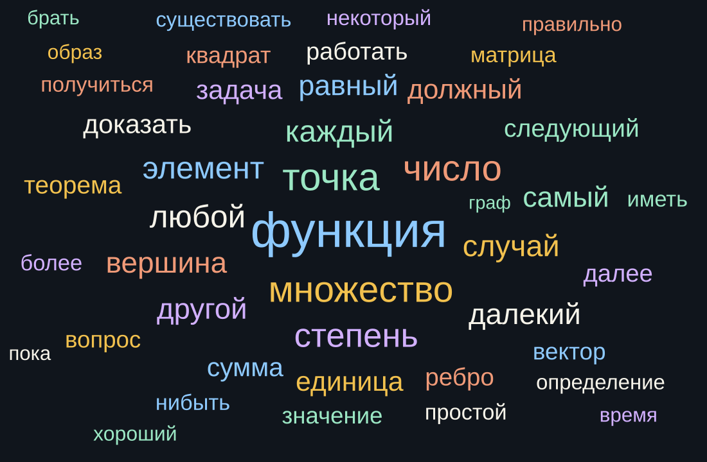

# Каталог расшифровок ФПМИ

Список уже сохранённых в репозитории текстов лекций.
Источник новых записей: [vkvideo.ru/@lectorium_fpmi](https://vkvideo.ru/@lectorium_fpmi).

- Расшифровок: **8303**
- Курсов: **2583**
- Обновлено: 2026-11-19

[Граф терминов по курсам](assets/term-graph.html)

Формат записи: **номер. тема** — ссылка на сплошной текст и, если есть, на текст с таймкодами.

## Содержание

- [#1 Что такое Git и зачем он нужен — Git и GitHub для начинающих](#1-что-такое-git-и-зачем-он-нужен--git-и-github-для-начинающих) (1)
- [#128640; Презентация магистерской программы S7 Airlines и ФПМИ МФТИ «Информационные технологии в авиации»](#128640-презентация-магистерской-программы-s7-airlines-и-фпми-мфти-информационные-технологии-в-авиации) (1)
- [#2 Установка Git — Git и GitHub для начинающих](#2-установка-git--git-и-github-для-начинающих) (1)
- [#3 Инициализация репозитория Git — Git и GitHub для начинающих](#3-инициализация-репозитория-git--git-и-github-для-начинающих) (1)
- [#4 Что делать, если ничего не работает — Git и GitHub для начинающих](#4-что-делать-если-ничего-не-работает--git-и-github-для-начинающих) (1)
- [#5 Регистрация на GitHub — Git и GitHub для начинающих](#5-регистрация-на-github--git-и-github-для-начинающих) (1)
- [#6 Загрузка кода на GitHub — Git и GitHub для начинающих](#6-загрузка-кода-на-github--git-и-github-для-начинающих) (1)
- [#7 Работа с графическим интерфейсом — Git и GitHub для начинающих](#7-работа-с-графическим-интерфейсом--git-и-github-для-начинающих) (1)
- [#8 Комбинированный способ загрузки кода — Git и GitHub для начинающих](#8-комбинированный-способ-загрузки-кода--git-и-github-для-начинающих) (1)
- [#9 Как удалить репозиторий на GitHub — Git и GitHub для начинающих](#9-как-удалить-репозиторий-на-github--git-и-github-для-начинающих) (1)
- [02l3hqICtVg_Cтатистические методы в биоинформатике](#02l3hqictvg_cтатистические-методы-в-биоинформатике) (1)
- [02XE12oSNKc_Основы комбинаторики и теории чисел](#02xe12osnkc_основы-комбинаторики-и-теории-чисел) (1)
- [09gcHw7hhDo_Теория вероятностей. Доп. семинар №2 — часть](#09gchw7hhdo_теория-вероятностей-доп-семинар-2--часть) (1)
- [0bSt5 UyLmo_Теория игр](#0bst5-uylmo_теория-игр) (1)
- [0ciBXg1fvdk_COG. Towards a structure theory for vertex minors](#0cibxg1fvdk_cog-towards-a-structure-theory-for-vertex-minors) (1)
- [0e5BXNy_rKs_Введение в математический анализ](#0e5bxny_rks_введение-в-математический-анализ) (1)
- [0gnF97MeV30_Дискретный анализ](#0gnf97mev30_дискретный-анализ) (1)
- [0gZS9m55Cg0_Алгоритмы и структуры данных](#0gzs9m55cg0_алгоритмы-и-структуры-данных) (1)
- [0rD44gS0BDs_Algorithms and Data Structures — Main Stream](#0rd44gs0bds_algorithms-and-data-structures--main-stream) (1)
- [0uxn4baQ_EE_Алгебра и Геометрия](#0uxn4baq_ee_алгебра-и-геометрия) (1)
- [0Zcq3hWe9pQ_Интеграл Лебега и теория поля](#0zcq3hwe9pq_интеграл-лебега-и-теория-поля) (1)
- [121021 — встречи с руководителями НИР](#121021--встречи-с-руководителями-нир) (1)
- [13.10.21 — встречи с руководителями НИР](#131021--встречи-с-руководителями-нир) (1)
- [131021 — встречи с руководителями НИР](#131021--встречи-с-руководителями-нир) (1)
- [14.10.21 — встречи с руководителями НИР](#141021--встречи-с-руководителями-нир) (1)
- [141021 — встречи с руководителями НИР](#141021--встречи-с-руководителями-нир) (1)
- [16OE6jagqfM_Математическая статистика](#16oe6jagqfm_математическая-статистика) (1)
- [195_Qzs4zxQ_ОКТЧ](#195_qzs4zxq_октч) (1)
- [1DJnOpq3UlY_Frontend](#1djnopq3uly_frontend) (1)
- [1KSaJSZpkLM_Introduction to Programming and Algorithms — Basic Stream](#1ksajszpklm_introduction-to-programming-and-algorithms--basic-stream) (1)
- [1nr_GhZuTK4_Алгоритмы и структуры данных](#1nr_ghzutk4_алгоритмы-и-структуры-данных) (1)
- [1O6KyPBf3hY_Optimization Methods](#1o6kypbf3hy_optimization-methods) (1)
- [1v56PYBpKZw_Введение в математический анализ](#1v56pybpkzw_введение-в-математический-анализ) (1)
- [1WbYbLHrZp8_Сложность вычислений](#1wbyblhrzp8_сложность-вычислений) (1)
- [1X5IW1bdHgw_Статистические методы в биоинформатике](#1x5iw1bdhgw_статистические-методы-в-биоинформатике) (1)
- [2A6s0XexxnU_Криптография](#2a6s0xexxnu_криптография) (1)
- [2EtXF4TwuIY_Теория игр](#2etxf4twuiy_теория-игр) (1)
- [2F52NUD4Kao_Промышленное программирование](#2f52nud4kao_промышленное-программирование) (1)
- [2i2q6bL6 sQ_Дискретный анализ](#2i2q6bl6-sq_дискретный-анализ) (1)
- [2n_NKZlDmzw_Сложность вычислений, доп.главы](#2n_nkzldmzw_сложность-вычислений-допглавы) (1)
- [2X7d_eITLXk_Введение в финансы](#2x7d_eitlxk_введение-в-финансы) (1)
- [2XfNXi6oJms_ОКТЧ](#2xfnxi6ojms_октч) (1)
- [3 vkuw6y_wM_Алгоритмы и структуры данных (продвинутый поток)](#3-vkuw6y_wm_алгоритмы-и-структуры-данных-продвинутый-поток) (1)
- [34 0Y92wv4c_ОКТЧ](#34-0y92wv4c_октч) (1)
- [3bgY78 Rt54_Основы вероятности и теории меры](#3bgy78-rt54_основы-вероятности-и-теории-меры) (1)
- [3D Topology and Hyperbolic Geometry](#3d-topology-and-hyperbolic-geometry) (3)
- [3e9mPu UPk8_Математический анализ](#3e9mpu-upk8_математический-анализ) (1)
- [3gOWWB5SZcs_Kotlin](#3gowwb5szcs_kotlin) (1)
- [3jJwSbF20wg_Теория вероятностей. Доп. семинар №2 — часть](#3jjwsbf20wg_теория-вероятностей-доп-семинар-2--часть) (1)
- [3pqoZJwfhkE_Основы комбинаторики и теории чисел](#3pqozjwfhke_основы-комбинаторики-и-теории-чисел) (1)
- [3qv47Rc_6do_Game Theory](#3qv47rc_6do_game-theory) (1)
- [3tEiNkdjHTY_Основы комбинаторики и теории чисел](#3teinkdjhty_основы-комбинаторики-и-теории-чисел) (1)
- [3u8dwMazkpY_Introduction to Programming #1. Basic Algorithms and Asymptotics](#3u8dwmazkpy_introduction-to-programming-1-basic-algorithms-and-asymptotics) (1)
- [3Uj8UZjWddA_Дискретный анализ](#3uj8uzjwdda_дискретный-анализ) (1)
- [3yjy19cUWIM_TFTDS](#3yjy19cuwim_tftds) (1)
- [48TBN 0QB4Y_Алгоритмы и структуры данных (основной поток)](#48tbn-0qb4y_алгоритмы-и-структуры-данных-основной-поток) (1)
- [4cWg5FVZV6Y_Backend](#4cwg5fvzv6y_backend) (1)
- [4FE395l5QYc_Discrete Analysis](#4fe395l5qyc_discrete-analysis) (1)
- [4GLauc07olE_Дискретный анализ](#4glauc07ole_дискретный-анализ) (1)
- [4LtAYJtyMy8_Программирование на языке C++ (базовый поток)](#4ltayjtymy8_программирование-на-языке-c-базовый-поток) (1)
- [4lVy TowodY_Дискретный анализ](#4lvy-towody_дискретный-анализ) (1)
- [4Lz5K9Qd 2w_Промышленное программирование](#4lz5k9qd-2w_промышленное-программирование) (1)
- [4rgtzkVmmXg_Теория вероятностей](#4rgtzkvmmxg_теория-вероятностей) (1)
- [4S4t1eiiRCo_Теория колец и полей](#4s4t1eiirco_теория-колец-и-полей) (1)
- [4yuEeM4bNQ4_АКОС](#4yueem4bnq4_акос) (1)
- [53X3qS165EY_Математический анализ](#53x3qs165ey_математический-анализ) (1)
- [55vm1hgNH3E_Технологии программирования. Семинар](#55vm1hgnh3e_технологии-программирования-семинар) (1)
- [59syNcy2EnE_Теория функций комплексного переменного](#59syncy2ene_теория-функций-комплексного-переменного) (1)
- [5eBOODZ2gLI_Основы вероятности и теория меры](#5eboodz2gli_основы-вероятности-и-теория-меры) (1)
- [5k1qoRFHxsQ_АКОС](#5k1qorfhxsq_акос) (1)
- [5OOSFdgHzNE_Discrete Analysis](#5oosfdghzne_discrete-analysis) (1)
- [5uuVxUn8Tck_Формальные языки и трансляции](#5uuvxun8tck_формальные-языки-и-трансляции) (1)
- [5XWc9JgjVLw_Технологии программирования](#5xwc9jgjvlw_технологии-программирования) (1)
- [60n5q DLgpY_Функциональный анализ](#60n5q-dlgpy_функциональный-анализ) (1)
- [65f0NyDrghY_Технологии программирования. Семинар](#65f0nydrghy_технологии-программирования-семинар) (1)
- [696Iu2lm78Q_Machine Learning](#696iu2lm78q_machine-learning) (1)
- [6CnnRPDNJcs_Основы комбинаторики и теории чисел (продвинутый поток)](#6cnnrpdnjcs_основы-комбинаторики-и-теории-чисел-продвинутый-поток) (1)
- [6iEbSa7ZDe4_Алгоритмы и структуры данных](#6iebsa7zde4_алгоритмы-и-структуры-данных) (1)
- [6KNit6Wizs8_Топологическая комбинаторика](#6knit6wizs8_топологическая-комбинаторика) (1)
- [6lw1sktCVT8_Optimization Methods](#6lw1sktcvt8_optimization-methods) (1)
- [6nZOs5jqD38_Дискретный анализ](#6nzos5jqd38_дискретный-анализ) (1)
- [6oLJ_agQSw4_Алгоритмы и структуры данных](#6olj_agqsw4_алгоритмы-и-структуры-данных) (1)
- [6rYLwf IBGU_Математическая логика и теория алгоритмов](#6rylwf-ibgu_математическая-логика-и-теория-алгоритмов) (1)
- [6uyRBw_t9NA_Математический анализ](#6uyrbw_t9na_математический-анализ) (1)
- [6wPniWn2XXY_Equations of Mathematical Physics](#6wpniwn2xxy_equations-of-mathematical-physics) (1)
- [71Wlae0c3ZE_Теоретическая информатика](#71wlae0c3ze_теоретическая-информатика) (1)
- [73QJmrYU0qY_Основы вероятности и теория меры](#73qjmryu0qy_основы-вероятности-и-теория-меры) (1)
- [79EiwJ3FifM_Functional Analysis](#79eiwj3fifm_functional-analysis) (1)
- [7b92lcZeRdg_АКОС. Семинар](#7b92lczerdg_акос-семинар) (1)
- [7ebl2Qu_hEk_Введение в финансы](#7ebl2qu_hek_введение-в-финансы) (1)
- [7KvC7lIFNBc_Дискретный анализ](#7kvc7lifnbc_дискретный-анализ) (1)
- [7UqrmZ89M9M_Blockchain](#7uqrmz89m9m_blockchain) (1)
- [7v8WVZVZoGM_Сложность вычислений](#7v8wvzvzogm_сложность-вычислений) (1)
- [8 7y45BNNFU_Комбинаторная теория групп](#8-7y45bnnfu_комбинаторная-теория-групп) (1)
- [800yaUbW7AA_Криптография](#800yaubw7aa_криптография) (1)
- [832gl6Ibxno_Теория колец и полей](#832gl6ibxno_теория-колец-и-полей) (1)
- [86SMPZtl8x8_ОКТЧ](#86smpztl8x8_октч) (1)
- [87LxHI92DeQ_Комбинаторная теория групп](#87lxhi92deq_комбинаторная-теория-групп) (1)
- [8cWSrhDkhY_Технологии программирования](#8cwsrhdkhy_технологии-программирования) (1)
- [8dcjhNvF6Lk_Математика больших данных](#8dcjhnvf6lk_математика-больших-данных) (1)
- [8weUQo4Vxys_Алгоритмы](#8weuqo4vxys_алгоритмы) (1)
- [8Ypbo oFtfc_Основы комбинаторики и теории чисел](#8ypbo-oftfc_основы-комбинаторики-и-теории-чисел) (1)
- [91oeMX57n14_Многомерный анализ, интегралы и ряды](#91oemx57n14_многомерный-анализ-интегралы-и-ряды) (1)
- [95QBB8emkck_Математическая логика и теория алгоритмов](#95qbb8emkck_математическая-логика-и-теория-алгоритмов) (1)
- [9_JjiuzwV54_Статистика, прикладной поток](#9_jjiuzwv54_статистика-прикладной-поток) (1)
- [9iO5AyNDRw_[ОВиТМ] Основы вероятности и теория меры — продвинутый поток](#9io5ayndrw_овитм-основы-вероятности-и-теория-меры--продвинутый-поток) (1)
- [9LaymnHtxEM_Презентация проектов Инновационного практикума](#9laymnhtxem_презентация-проектов-инновационного-практикума) (1)
- [9lPLshWk3Lk_Алгоритмы и структуры данных](#9lplshwk3lk_алгоритмы-и-структуры-данных) (1)
- [9ob4cmi6N2s_Математический анализ](#9ob4cmi6n2s_математический-анализ) (1)
- [9oXBjV_UoEs_Дискретная оптимизация и сложные сети](#9oxbjv_uoes_дискретная-оптимизация-и-сложные-сети) (1)
- [9ozqEcOsjWg_Методы и алгоритмы машинного обучения](#9ozqecosjwg_методы-и-алгоритмы-машинного-обучения) (1)
- [9RVW1wM9mO4_Алгебра и геометрия](#9rvw1wm9mo4_алгебра-и-геометрия) (1)
- [9xSlGgCsTqo_Probability Theory](#9xslggcstqo_probability-theory) (1)
- [[Additional] Mathlog](#additional-mathlog) (1)
- [[ADS] Algorithms and Data Structures](#ads-algorithms-and-data-structures) (2)
- [[AiSD] Algorithms and Data Structures](#aisd-algorithms-and-data-structures) (2)
- [[Basics-of-Probability-and-Measure-Theory] Advanced Stream](#basics-of-probability-and-measure-theory-advanced-stream) (1)
- [[Basics-of-Probability-and-Measure-Theory] Basics of Probability and Measure Theory — Advanced Str](#basics-of-probability-and-measure-theory-basics-of-probability-and-measure-theory--advanced-str) (1)
- [[BPTM] Basics of Probability and Measure Theory — Advanced Stream](#bptm-basics-of-probability-and-measure-theory--advanced-stream) (1)
- [[Consultation] Algebra and Geometry](#consultation-algebra-and-geometry) (1)
- [[Consultation] Introduction to Mathematical Analysis](#consultation-introduction-to-mathematical-analysis) (1)
- [[DG-T] Differential Geometry and Topology](#dg-t-differential-geometry-and-topology) (2)
- [[DGiT] Differential Geometry and Topology](#dgit-differential-geometry-and-topology) (1)
- [[Dopsem] Mathlogic](#dopsem-mathlogic) (2)
- [[FPTM] Fundamentals of Probability and Measure Theory — Advanced Stream](#fptm-fundamentals-of-probability-and-measure-theory--advanced-stream) (1)
- [[FYaIT] Formal Languages ​​and Translations](#fyait-formal-languages-and-translations) (1)
- [[LIPS] Algorithms with Predictions](#lips-algorithms-with-predictions) (3)
- [[LIPS] Combinatorics and Topology of Balanced Sets](#lips-combinatorics-and-topology-of-balanced-sets) (2)
- [[LIPS] Discrepancy and approximation algorithms](#lips-discrepancy-and-approximation-algorithms) (1)
- [[LIPS] Diverse solutions](#lips-diverse-solutions) (2)
- [[LIPS] Fair Division](#lips-fair-division) (1)
- [[LIPS] Fair division algorithms. Seminar](#lips-fair-division-algorithms-seminar) (1)
- [[LIPS] Fair Division Problems. Lecture](#lips-fair-division-problems-lecture) (1)
- [[LIPS] Graded algebras and the number of simplices in triangulations](#lips-graded-algebras-and-the-number-of-simplices-in-triangulations) (1)
- [[LIPS] On independent sets of the Boolean cube](#lips-on-independent-sets-of-the-boolean-cube) (1)
- [[LIPS] On the proximity of solutions to discrete and continuous problems](#lips-on-the-proximity-of-solutions-to-discrete-and-continuous-problems) (1)
- [[LIPS] p, q — property for special families of sets](#lips-p-q--property-for-special-families-of-sets) (1)
- [[LIPS] Selected Problems in Discrete Geometry](#lips-selected-problems-in-discrete-geometry) (2)
- [[LIPS] Seminar on the Borsuk Conjecture](#lips-seminar-on-the-borsuk-conjecture) (1)
- [[LIPS] Spanners, discrepancy](#lips-spanners-discrepancy) (1)
- [[OPaMT] Fundamentals of Probability and Measure Theory. Oral Exam Review Session](#opamt-fundamentals-of-probability-and-measure-theory-oral-exam-review-session) (1)
- [[Seminar] Programming Languages and Compiler Theory](#seminar-programming-languages-and-compiler-theory) (1)
- [[АиСД] Алгоритмв и структуры данных (продвинутый поток)](#аисд-алгоритмв-и-структуры-данных-продвинутый-поток) (11)
- [[АиСД] Алгоритмы и структуры данных](#аисд-алгоритмы-и-структуры-данных) (17)
- [[АЛКТГ] Алгебра, логика, комбинаторика и теория графов. Консультация ко второй к р](#алктг-алгебра-логика-комбинаторика-и-теория-графов-консультация-ко-второй-к-р) (1)
- [[ДГиТ] Дифференциальная геометрия и топология](#дгит-дифференциальная-геометрия-и-топология) (3)
- [[Допсем,-АЛКТГ] Алгебра, логика, комбинаторика и теория графов](#допсем-алктг-алгебра-логика-комбинаторика-и-теория-графов) (1)
- [[Допсем,-КИиТП] Кратные интегралы и теория поля](#допсем-киитп-кратные-интегралы-и-теория-поля) (1)
- [[Допсем,-ОКТЧ] Основы комбинаторики и теории чисел](#допсем-октч-основы-комбинаторики-и-теории-чисел) (4)
- [[Допсем,-Слупы] Случайные процессы. Подготовка к финальной КР](#допсем-слупы-случайные-процессы-подготовка-к-финальной-кр) (1)
- [[Допсем] Алгебра и геометрия. Билинейные формы, евклидовы пространства, сопряженный оператор](#допсем-алгебра-и-геометрия-билинейные-формы-евклидовы-пространства-сопряженный-оператор) (1)
- [[Допсем] Математическая статистика Подготовка к первой контрольной](#допсем-математическая-статистика-подготовка-к-первой-контрольной) (1)
- [[Допсем] Математическая статистика. Подготовка к первой контрольной](#допсем-математическая-статистика-подготовка-к-первой-контрольной) (1)
- [[Допсем] Матлог](#допсем-матлог) (2)
- [[Допсем] Матлогика](#допсем-матлогика) (31)
- [[Допсем] Матлогика + ОКТЧ. Подготовка к](#допсем-матлогика--октч-подготовка-к) (1)
- [[Допсем] Методы оптимизации](#допсем-методы-оптимизации) (1)
- [[Допсем] Многомерный анализ, интегралы и ряды. Подготовка к к р №2](#допсем-многомерный-анализ-интегралы-и-ряды-подготовка-к-к-р-2) (1)
- [[Допсем] Многомерный анализ, интегралы и ряды. Подготовка к третьей к р](#допсем-многомерный-анализ-интегралы-и-ряды-подготовка-к-третьей-к-р) (1)
- [[Допсем] ОКТЧ](#допсем-октч) (15)
- [[Допсем] Теорвер](#допсем-теорвер) (1)
- [[Допсем] Теория вероятностей. Подготовка к контрольной работе №2](#допсем-теория-вероятностей-подготовка-к-контрольной-работе-2) (1)
- [[Допсем] Теория групп. Подготовка ко второй контрольной работе](#допсем-теория-групп-подготовка-ко-второй-контрольной-работе) (1)
- [[Допсем] Технологии программирования. Подготовка к финальной к р](#допсем-технологии-программирования-подготовка-к-финальной-к-р) (1)
- [[Допсем] формальные языки и трансляции](#допсем-формальные-языки-и-трансляции) (1)
- [[ИВТф] Теория оптимизации](#ивтф-теория-оптимизации) (1)
- [[Консультация] Алгебра и геометрия](#консультация-алгебра-и-геометрия) (1)
- [[Консультация] Введение в математический анализ](#консультация-введение-в-математический-анализ) (2)
- [[Консультация] Введение в математический анализ. Консультация к коллоквиуму](#консультация-введение-в-математический-анализ-консультация-к-коллоквиуму) (1)
- [[Консультация] Математическая логика и теория алгоритмов](#консультация-математическая-логика-и-теория-алгоритмов) (1)
- [[Консультация] Математический анализ, интеграл и ряды](#консультация-математический-анализ-интеграл-и-ряды) (2)
- [[ЛИПС] Discrepancy and approximation algorithms](#липс-discrepancy-and-approximation-algorithms) (1)
- [[ЛИПС] Diverse solutions](#липс-diverse-solutions) (2)
- [[ЛИПС] p, q — свойство для специальных семейств множеств](#липс-p-q--свойство-для-специальных-семейств-множеств) (1)
- [[ЛИПС] Алгоритмы равного дележа. Семинар](#липс-алгоритмы-равного-дележа-семинар) (1)
- [[ЛИПС] Алгоритмы с предсказаниями](#липс-алгоритмы-с-предсказаниями) (3)
- [[ЛИПС] Градуированные алгебры и число симплексов в триангуляциях](#липс-градуированные-алгебры-и-число-симплексов-в-триангуляциях) (3)
- [[ЛИПС] Задачи справедливого дележа. Лекция](#липс-задачи-справедливого-дележа-лекция) (1)
- [[ЛИПС] Избранные задачи дискретной геометрии](#липс-избранные-задачи-дискретной-геометрии) (2)
- [[ЛИПС] Комбинаторика и топология сбалансированных наборов](#липс-комбинаторика-и-топология-сбалансированных-наборов) (2)
- [[ЛИПС] О близости решений дискретных и непрерывных задач](#липс-о-близости-решений-дискретных-и-непрерывных-задач) (2)
- [[ЛИПС] О независимых множествах булевого куба](#липс-о-независимых-множествах-булевого-куба) (1)
- [[ЛИПС] Семинар вокруг Борсука](#липс-семинар-вокруг-борсука) (1)
- [[ЛИПС] Спаннеры, discrepancy](#липс-спаннеры-discrepancy) (1)
- [[ЛИПС] Справедливый дележ](#липс-справедливый-дележ) (1)
- [[ОВиТМ] Основы вероятноси и теория меры](#овитм-основы-вероятноси-и-теория-меры) (2)
- [[ОВиТМ] Основы вероятности и теория меры (продвинутый поток)](#овитм-основы-вероятности-и-теория-меры-продвинутый-поток) (1)
- [[ОВиТМ] Основы вероятности и теория меры — продвинутый поток](#овитм-основы-вероятности-и-теория-меры--продвинутый-поток) (11)
- [[ОВиТМ] Основы вероятности и теория меры. Консультация к устному экзамену](#овитм-основы-вероятности-и-теория-меры-консультация-к-устному-экзамену) (1)
- [[Семинар] Языки программирования и теория компиляции](#семинар-языки-программирования-и-теория-компиляции) (2)
- [[ФЯиТ] Формальные языки и трансляции](#фяит-формальные-языки-и-трансляции) (10)
- [[ФЯиТ] Формальные языки и трансляции 8.5. Нормальная форма Грейбах](#фяит-формальные-языки-и-трансляции-85-нормальная-форма-грейбах) (1)
- [_ r38FMLuwk_Консультация к письменному госу по математике от Редкозубова В.В](#_-r38fmluwk_консультация-к-письменному-госу-по-математике-от-редкозубова-вв) (1)
- [_1ZlshsUTOQ_Криптография](#_1zlshsutoq_криптография) (1)
- [_4davehc77I_Нейробиология обучения](#_4davehc77i_нейробиология-обучения) (1)
- [_9a_W0DdT8s_Технологии программирования. Семинар](#_9a_w0ddt8s_технологии-программирования-семинар) (1)
- [__2E9DCTRBU_Введение в математический анализ](#__2e9dctrbu_введение-в-математический-анализ) (1)
- [_h8ea XDYeE_Математическая логика и теория алгоритмов](#_h8ea-xdyee_математическая-логика-и-теория-алгоритмов) (1)
- [_HaeqwTGFKA_[Допсем] ОКТЧ](#_haeqwtgfka_допсем-октч) (1)
- [_hvKm6dKQd4_Requirements Analysis](#_hvkm6dkqd4_requirements-analysis) (1)
- [_k1Fi3LdJLg_Комбинаторная теория групп](#_k1fi3ldjlg_комбинаторная-теория-групп) (1)
- [_oHEYvNRJSw_Дискретный анализ](#_oheyvnrjsw_дискретный-анализ) (1)
- [_sVzlofaoV4_Дискретный анализ 7,](#_svzlofaov4_дискретный-анализ-7) (1)
- [_T1gFQ6DHyA_Дискретный анализ](#_t1gfq6dhya_дискретный-анализ) (1)
- [_vC0h5sWxRo_Случайные процессы](#_vc0h5swxro_случайные-процессы) (1)
- [_zSZgR2khpY_Measure Theory](#_zszgr2khpy_measure-theory) (1)
- [A xcx2fsHZk_Теория вероятностей](#a-xcx2fshzk_теория-вероятностей) (1)
- [A02RuLY YEs_Формальные языки и трансляции](#a02ruly-yes_формальные-языки-и-трансляции) (1)
- [a0I3VYrR5ZU_Топологическая комбинаторика](#a0i3vyrr5zu_топологическая-комбинаторика) (1)
- [A4D 81PPCiY_Алгоритмы и структуры данных (основной поток)](#a4d-81ppciy_алгоритмы-и-структуры-данных-основной-поток) (1)
- [a5335PNcOBc_АКОС. Семинар 13,5. Использование GDB](#a5335pncobc_акос-семинар-135-использование-gdb) (1)
- [aa2PZAQZiZA_Алгоритмы и структуры данных](#aa2pzaqziza_алгоритмы-и-структуры-данных) (1)
- [AA4ioOxrsg8_Технологии программирования. Семинар](#aa4iooxrsg8_технологии-программирования-семинар) (1)
- [ACOS Seminar #5. ARM Development](#acos-seminar-5-arm-development) (1)
- [ADS](#ads) (1)
- [aG4N0LuGUbA_Алгоритмы и структуры данных](#ag4n0luguba_алгоритмы-и-структуры-данных) (1)
- [AGFtQWy_mAs_Applied Machine Learning. Seminar](#agftqwy_mas_applied-machine-learning-seminar) (1)
- [AI8iL_rWXVk_Алгоритмы и структуры данных (продвинутый поток)](#ai8il_rwxvk_алгоритмы-и-структуры-данных-продвинутый-поток) (1)
- [ajRv28rp5sc_Основы комбинаторики и теории чисел (продвинутый поток)](#ajrv28rp5sc_основы-комбинаторики-и-теории-чисел-продвинутый-поток) (1)
- [AKOS](#akos) (8)
- [AKOS Lecture](#akos-lecture) (2)
- [AKOS Seminar No.](#akos-seminar-no) (1)
- [Algebra and Coding Theory — Advanced Track](#algebra-and-coding-theory--advanced-track) (1)
- [Algebra and Field Theory — Advanced Stream](#algebra-and-field-theory--advanced-stream) (1)
- [Algebra and Geometry](#algebra-and-geometry) (45)
- [Algebra and Geometry — Advanced Track](#algebra-and-geometry--advanced-track) (1)
- [Algebra and Geometry. Lecture](#algebra-and-geometry-lecture) (3)
- [Algebraic Topology](#algebraic-topology) (1)
- [Algorithms and computation models](#algorithms-and-computation-models) (1)
- [Algorithms and Data Structures](#algorithms-and-data-structures) (38)
- [Algorithms and data structures](#algorithms-and-data-structures) (2)
- [Algorithms and Data Structures — Advanced Stream](#algorithms-and-data-structures--advanced-stream) (1)
- [Algorithms and Data Structures — Basic Stream](#algorithms-and-data-structures--basic-stream) (3)
- [Algorithms and Data Structures — Basic Track](#algorithms-and-data-structures--basic-track) (1)
- [Algorithms and Data Structures — Core Track](#algorithms-and-data-structures--core-track) (1)
- [Algorithms and Data Structures — Economics — ERP .](#algorithms-and-data-structures--economics--erp) (1)
- [Algorithms and Data Structures — IVT](#algorithms-and-data-structures--ivt) (1)
- [Algorithms and Data Structures — Main Stream](#algorithms-and-data-structures--main-stream) (29)
- [Algorithms and Data Structures — Main Thread](#algorithms-and-data-structures--main-thread) (4)
- [Algorithms and Data Structures — Main Track](#algorithms-and-data-structures--main-track) (1)
- [Algorithms and Models of Computation](#algorithms-and-models-of-computation) (3)
- [Algorithms — Advanced Stream](#algorithms--advanced-stream) (1)
- [Algorithms — base flow](#algorithms--base-flow) (2)
- [Algorithms — basic flow](#algorithms--basic-flow) (1)
- [Algorithms — Basic Track](#algorithms--basic-track) (1)
- [ALinCT](#alinct) (1)
- [ALKTG](#alktg) (1)
- [AmTK2_LdTfY_[Допсем] ОКТЧ](#amtk2_ldtfy_допсем-октч) (1)
- [Analytical Mechanics](#analytical-mechanics) (1)
- [aNjVrJ6bI8_Случайные процессы](#anjvrj6bi8_случайные-процессы) (1)
- [AOQLLCuh8Qg_[ОВиТМ] Основы вероятности и теория меры — продвинутый поток](#aoqllcuh8qg_овитм-основы-вероятности-и-теория-меры--продвинутый-поток) (1)
- [Applied Machine Learning](#applied-machine-learning) (4)
- [Applied Machine Learning. Seminar](#applied-machine-learning-seminar) (5)
- [Applied Machine Learning. Workshop](#applied-machine-learning-workshop) (1)
- [Applied Statistics](#applied-statistics) (3)
- [aPwA1PF5FSk_COG. Algorithmic Questions in Discrete Choice](#apwa1pf5fsk_cog-algorithmic-questions-in-discrete-choice) (1)
- [aqJXmwcxSXA_Алгебра и геометрия](#aqjxmwcxsxa_алгебра-и-геометрия) (1)
- [arega4zf0Xg_Дискретный анализ](#arega4zf0xg_дискретный-анализ) (1)
- [Atp5UWnnS8o_Алгоритмы и структуры данных (основной поток)](#atp5uwnns8o_алгоритмы-и-структуры-данных-основной-поток) (1)
- [AWHcZ08IekM_Game Theory](#awhcz08iekm_game-theory) (1)
- [aXOOsN_C5ok_[ЛИПС] О близости решений дискретных и непрерывных задач](#axoosn_c5ok_липс-о-близости-решений-дискретных-и-непрерывных-задач) (1)
- [ay j4nkbcPo_Формальные языки и трансляции](#ay-j4nkbcpo_формальные-языки-и-трансляции) (1)
- [aY9IvRA3W4E_Алгебра и Геометрия](#ay9ivra3w4e_алгебра-и-геометрия) (1)
- [b3iwY9ENBeE_ОКТЧ](#b3iwy9enbee_октч) (1)
- [b6BkzkCzmYk_Математическая логика и теория алгоритмов](#b6bkzkczmyk_математическая-логика-и-теория-алгоритмов) (1)
- [Basic Algorithms](#basic-algorithms) (1)
- [Basics of Combinatorics and Number Theory](#basics-of-combinatorics-and-number-theory) (1)
- [Basics of Probability and Measure Theory](#basics-of-probability-and-measure-theory) (1)
- [bBeb_zQEKRQ_Математическая логика](#bbeb_zqekrq_математическая-логика) (1)
- [bc3QOfHIt5Y_Формальные языки и трансляции](#bc3qofhit5y_формальные-языки-и-трансляции) (1)
- [bc9A_y2hCmA_Дискретный анализ](#bc9a_y2hcma_дискретный-анализ) (1)
- [bEGoOYrSXz0_Теория игр](#begooyrsxz0_теория-игр) (1)
- [bEHUSrkATHA_Алгоритмы и структуры данных (основной поток)](#behusrkatha_алгоритмы-и-структуры-данных-основной-поток) (1)
- [bG_VwZcw6Fo_Алгоритмы и структуры данных — продвинутый поток . Семинар](#bg_vwzcw6fo_алгоритмы-и-структуры-данных--продвинутый-поток--семинар) (1)
- [bga5RjV7Qro_Дискретный анализ](#bga5rjv7qro_дискретный-анализ) (1)
- [bGB7pqhTCzY_Optimization Methods](#bgb7pqhtczy_optimization-methods) (1)
- [bgJK k14qpo_Introduction to extremal set theory](#bgjk-k14qpo_introduction-to-extremal-set-theory) (1)
- [Bh9mLopcmaA_TFTDS](#bh9mlopcmaa_tftds) (1)
- [Big Data Infrastructure](#big-data-infrastructure) (1)
- [Big Data Mathematics](#big-data-mathematics) (1)
- [biZu5cayucY_Основы комбинаторики и теории чисел](#bizu5cayucy_основы-комбинаторики-и-теории-чисел) (1)
- [Bj FvN2MDz8_Confidential Computing](#bj-fvn2mdz8_confidential-computing) (1)
- [BjMj5xZyqco_Анализ требований](#bjmj5xzyqco_анализ-требований) (1)
- [BlZhCIZtA1w_Функциональный анализ](#blzhcizta1w_функциональный-анализ) (1)
- [Boolean Algebra, Combinatorics, and Graph Theory](#boolean-algebra-combinatorics-and-graph-theory) (1)
- [bP83h0osn0I_Дискретная и комбинаторная геометрия](#bp83h0osn0i_дискретная-и-комбинаторная-геометрия) (1)
- [BPCNUQ_B bk_DevOps](#bpcnuq_b-bk_devops) (1)
- [BrC6R4Lj3SM_Алгебра и Геометрия](#brc6r4lj3sm_алгебра-и-геометрия) (1)
- [BuhdZ9yg1iU_ОКТЧ](#buhdz9yg1iu_октч) (1)
- [Building an Operating System Kernel](#building-an-operating-system-kernel) (1)
- [bw2MnYyeh1k_Введение в математический анализ](#bw2mnyyeh1k_введение-в-математический-анализ) (1)
- [BzFBVopTM1c_Введение в финансы](#bzfbvoptm1c_введение-в-финансы) (1)
- [bZLxiITj5mk_Криптография](#bzlxiitj5mk_криптография) (1)
- [C kNGMoo lo_Основы комбинаторики и теории чисел](#c-kngmoo-lo_основы-комбинаторики-и-теории-чисел) (1)
- [C++](#c) (77)
- [C++ 4.1. References and Constants](#c-41-references-and-constants) (1)
- [C++ 4.2. Type Casting. OOP — Classes and Structures](#c-42-type-casting-oop--classes-and-structures) (1)
- [C++ and Algorithms — Basic Stream](#c-and-algorithms--basic-stream) (1)
- [C++ Programming — Basic Flow](#c-programming--basic-flow) (1)
- [C++ Programming — Basic Stream](#c-programming--basic-stream) (7)
- [C++ Programming — Basic Thread](#c-programming--basic-thread) (1)
- [C++ Programming — Basic Track](#c-programming--basic-track) (6)
- [C++ Programming — Main Stream](#c-programming--main-stream) (4)
- [C++ Programming — Main Thread](#c-programming--main-thread) (9)
- [C++ Programming — Main Track](#c-programming--main-track) (5)
- [C++ и алгоритмы (Базовый поток)](#c-и-алгоритмы-базовый-поток) (25)
- [C12ea6k00oI_Game Theory](#c12ea6k00oi_game-theory) (1)
- [c2WAYU0dqBs_Промышленное программирование](#c2wayu0dqbs_промышленное-программирование) (1)
- [C4qouKfY6 0_Kotlin](#c4qoukfy6-0_kotlin) (1)
- [CaDfuWKsA0A_Теоретическая информатика](#cadfuwksa0a_теоретическая-информатика) (1)
- [Calculus](#calculus) (2)
- [CAVT](#cavt) (1)
- [CdlK5t97y8Q_Программирование на языке C++ (базовый поток)](#cdlk5t97y8q_программирование-на-языке-c-базовый-поток) (1)
- [CEaPd79Uxzs_Applied Statistics](#ceapd79uxzs_applied-statistics) (1)
- [CiCvtpNzS8k_Криптография](#cicvtpnzs8k_криптография) (1)
- [CIj ZxepNbc_Гармонический анализ. Консультация к письменному экзамену. Часть](#cij-zxepnbc_гармонический-анализ-консультация-к-письменному-экзамену-часть) (1)
- [CN3tvE_LnWs_Криптография](#cn3tve_lnws_криптография) (1)
- [Complex Analysis](#complex-analysis) (1)
- [Complex Network for Data Analysis. Stefano Boccaletti](#complex-network-for-data-analysis-stefano-boccaletti) (1)
- [Complex Variable Function Theory](#complex-variable-function-theory) (1)
- [Complexity of Computations](#complexity-of-computations) (1)
- [Computational Algebra Methods](#computational-algebra-methods) (1)
- [Computational Complexity](#computational-complexity) (13)
- [Computational complexity](#computational-complexity) (3)
- [Computational Complexity — Additional Chapters](#computational-complexity--additional-chapters) (7)
- [Computational Complexity, Additional Topics. AM hierarchy](#computational-complexity-additional-topics-am-hierarchy) (1)
- [Computational Complexity, Advanced Topics. Interactive Proofs with Shared Random Bits](#computational-complexity-advanced-topics-interactive-proofs-with-shared-random-bits) (1)
- [Computational Complexity, Advanced Topics. IP = PSPACE](#computational-complexity-advanced-topics-ip--pspace) (1)
- [Computational Linear Algebra](#computational-linear-algebra) (14)
- [Computational Mathematics](#computational-mathematics) (9)
- [Computational Methods of Algebra](#computational-methods-of-algebra) (10)
- [Computer Science](#computer-science) (2)
- [Concurrecy семинар](#concurrecy-семинар) (6)
- [Concurrency семинар](#concurrency-семинар) (2)
- [Confidential Computing](#confidential-computing) (5)
- [Core Algorithms](#core-algorithms) (1)
- [Core Java](#core-java) (14)
- [cOXmcVAKeIk_Machine Learning](#coxmcvakeik_machine-learning) (1)
- [crD2zqW aLE_Machine Learning](#crd2zqw-ale_machine-learning) (1)
- [Cryptography](#cryptography) (3)
- [Cryptography Basics](#cryptography-basics) (2)
- [Cryptography Fundamentals](#cryptography-fundamentals) (1)
- [CS5IlysN32Y_Анализ требований](#cs5ilysn32y_анализ-требований) (1)
- [CTCID_rggW4_COG. Explosive synchronization and Bellerophon states in networked phase oscillators](#ctcid_rggw4_cog-explosive-synchronization-and-bellerophon-states-in-networked-phase-oscillators) (1)
- [cTdCDZFg7uY_АКОС](#ctdcdzfg7uy_акос) (1)
- [cuEwDXwh300_Алгоритмы и структуры данных (основной поток)](#cuewdxwh300_алгоритмы-и-структуры-данных-основной-поток) (1)
- [Cy7M4WnFFUY_Алгоритмы и структуры данных (основной поток)](#cy7m4wnffuy_алгоритмы-и-структуры-данных-основной-поток) (1)
- [CYumlvzf47o_Математическая статистика](#cyumlvzf47o_математическая-статистика) (1)
- [czr4cDVOZwo_Теория вероятностей](#czr4cdvozwo_теория-вероятностей) (1)
- [D14CEEjT1bc_Applied Machine Learning. Seminar](#d14ceejt1bc_applied-machine-learning-seminar) (1)
- [D3OmO1fPx9I_Формальные языки и трансляции](#d3omo1fpx9i_формальные-языки-и-трансляции) (1)
- [D5rG2rbcmuo_Algorithms and Data Structures](#d5rg2rbcmuo_algorithms-and-data-structures) (1)
- [Databases](#databases) (1)
- [dbMxe7c1OJs_Harmonic Analysis](#dbmxe7c1ojs_harmonic-analysis) (1)
- [DCT — Main Stream](#dct--main-stream) (1)
- [Department Presentations](#department-presentations) (2)
- [Department Presentations. Mathematics of Artificial Intelligence, Sber x MIPT](#department-presentations-mathematics-of-artificial-intelligence-sber-x-mipt) (1)
- [deqKvtDMOKU_Криптография](#deqkvtdmoku_криптография) (1)
- [Designing an Operating System Kernel](#designing-an-operating-system-kernel) (1)
- [dgrsL_y6 Ms_Алгоритмы и структуры данных — продвинутый поток . Семинар](#dgrsl_y6-ms_алгоритмы-и-структуры-данных--продвинутый-поток--семинар) (1)
- [dhwQrqGo58E_Программирование на языке C++ (базовый поток)](#dhwqrqgo58e_программирование-на-языке-c-базовый-поток) (1)
- [Differential Equations](#differential-equations) (44)
- [Differential equations](#differential-equations) (4)
- [Differential Equations — Exam Consultation](#differential-equations--exam-consultation) (1)
- [Diffusion Processes](#diffusion-processes) (2)
- [Discrete Analysis](#discrete-analysis) (33)
- [Discrete Analysis — Advanced](#discrete-analysis--advanced) (3)
- [Discrete Analysis — Advanced Flow](#discrete-analysis--advanced-flow) (1)
- [Discrete Analysis — Advanced Stream](#discrete-analysis--advanced-stream) (3)
- [Discrete Analysis — Advanced Track](#discrete-analysis--advanced-track) (7)
- [Discrete Analysis — Main Stream](#discrete-analysis--main-stream) (6)
- [Discrete and Combinatorial Geometry](#discrete-and-combinatorial-geometry) (3)
- [Discrete Optimization and Complex Networks](#discrete-optimization-and-complex-networks) (1)
- [Discrete Optimization and Networks](#discrete-optimization-and-networks) (1)
- [Discrete Structures](#discrete-structures) (15)
- [Distributed and Parallel Computing](#distributed-and-parallel-computing) (4)
- [Distributed and Parallel Computing 9.2. Hive, Big Data Infrastructure](#distributed-and-parallel-computing-92-hive-big-data-infrastructure) (1)
- [DkC5JOgfia0_Алгоритмы и структуры данных (основной поток)](#dkc5jogfia0_алгоритмы-и-структуры-данных-основной-поток) (1)
- [DMCS](#dmcs) (1)
- [DMS — main stream](#dms--main-stream) (1)
- [DMT](#dmt) (1)
- [DNnic5o15aQ_Дискретный анализ](#dnnic5o15aq_дискретный-анализ) (1)
- [drwJh3qnqe8_Алгебра и Геометрия](#drwjh3qnqe8_алгебра-и-геометрия) (1)
- [DSA](#dsa) (1)
- [DUA49wMaLd4_ОКТЧ](#dua49wmald4_октч) (1)
- [dubBjlL4 vU_Алгебра и геометрия. Лекция](#dubbjll4-vu_алгебра-и-геометрия-лекция) (1)
- [duQdVHwLePU_Дискретный анализ](#duqdvhwlepu_дискретный-анализ) (1)
- [DUZakG4p 8E_Математическая логика](#duzakg4p-8e_математическая-логика) (1)
- [DVQ4u8sWxZo_Blockchain](#dvq4u8swxzo_blockchain) (1)
- [dX3dtR9XgaM_Формальные языки и трансляции](#dx3dtr9xgam_формальные-языки-и-трансляции) (1)
- [e0oCiL0w20M_Дискретный анализ](#e0ocil0w20m_дискретный-анализ) (1)
- [E8DMzL2GG3g_Технологии программирования](#e8dmzl2gg3g_технологии-программирования) (1)
- [E92ra2sPdgM_C++](#e92ra2spdgm_c) (1)
- [E9YKGAUddtE_COG. Structural properties of multiplex networks](#e9ykgauddte_cog-structural-properties-of-multiplex-networks) (1)
- [e_zHKd3oAzo_Допсем по матлогике](#e_zhkd3oazo_допсем-по-матлогике) (1)
- [Econometric Modeling in the Securities Market](#econometric-modeling-in-the-securities-market) (3)
- [Econometric modeling on the RCB](#econometric-modeling-on-the-rcb) (1)
- [eCxaPLBgEdI_Backend](#ecxaplbgedi_backend) (1)
- [EebUPPo92OY_Теоретическая информатика](#eebuppo92oy_теоретическая-информатика) (1)
- [Ega6f8r2XCg_Криптография](#ega6f8r2xcg_криптография) (1)
- [eGkj3_GIyik_Frontend](#egkj3_giyik_frontend) (1)
- [ehQcjvvIIPg_ОКТЧ](#ehqcjvviipg_октч) (1)
- [eIt9R094GM8_Algorithms — Main Stream](#eit9r094gm8_algorithms--main-stream) (1)
- [eiYmxGYW6bA_[Семинар] Языки программирования и теория компиляции](#eiymxgyw6ba_семинар-языки-программирования-и-теория-компиляции) (1)
- [ekqbZXiQSB8_Discrete Analysis](#ekqbzxiqsb8_discrete-analysis) (1)
- [EL V_0kWRoI_Статистика, прикладной поток](#el-v_0kwroi_статистика-прикладной-поток) (1)
- [Elements of Differential Equations](#elements-of-differential-equations) (5)
- [Elements of differential equations](#elements-of-differential-equations) (1)
- [EMJhbKPpebU_Startups](#emjhbkppebu_startups) (1)
- [EONbhJTyrqs_Алгоритмы и структуры данных](#eonbhjtyrqs_алгоритмы-и-структуры-данных) (1)
- [Equations of Mathematical Physics](#equations-of-mathematical-physics) (2)
- [erjQPpaoqDg_Кратные интегралы и теория поля. Консультация от Гусева Н.А](#erjqppaoqdg_кратные-интегралы-и-теория-поля-консультация-от-гусева-на) (1)
- [ESgrIRvQtm4_Applied Statistics](#esgrirvqtm4_applied-statistics) (1)
- [EtiNU6PISD4_Алгоритмы и структуры данных (основной поток)](#etinu6pisd4_алгоритмы-и-структуры-данных-основной-поток) (1)
- [evNKTX8LwwQ_Optimization Methods](#evnktx8lwwq_optimization-methods) (1)
- [EvvjV_MFHT4_Сложность вычислений — доп.главы —](#evvjv_mfht4_сложность-вычислений--допглавы) (1)
- [EwsH9UR1XQE_Startups](#ewsh9ur1xqe_startups) (1)
- [ExTkXSFb9_w_Introduction to extremal set theory](#extkxsfb9_w_introduction-to-extremal-set-theory) (1)
- [Extremal Combinatorics](#extremal-combinatorics) (2)
- [EYABSWs1uCw_[ОВиТМ] Основы вероятности и теория меры — продвинутый поток](#eyabsws1ucw_овитм-основы-вероятности-и-теория-меры--продвинутый-поток) (1)
- [EyQ6PfbudA_Математическая логика и теория алгоритмов](#eyq6pfbuda_математическая-логика-и-теория-алгоритмов) (1)
- [eYt5lGAaewA_Теория колец и полей](#eyt5lgaaewa_теория-колец-и-полей) (1)
- [eZeBflKo_14_Алгоритмы. Семинар](#ezebflko_14_алгоритмы-семинар) (1)
- [f kHv0i7Zks_Дискретный анализ](#f-khv0i7zks_дискретный-анализ) (1)
- [f zIHTidkZY_Нейробиология обучения](#f-zihtidkzy_нейробиология-обучения) (1)
- [f00isF51DLs_ОКТЧ](#f00isf51dls_октч) (1)
- [F0GuQNlay58_Дискретный анализ](#f0guqnlay58_дискретный-анализ) (1)
- [FcHpb2ohH4Y_[ЛИПС] Градуированные алгебры и число симплексов в триангуляциях](#fchpb2ohh4y_липс-градуированные-алгебры-и-число-симплексов-в-триангуляциях) (1)
- [FCl9DD7c3LQ_Дискретный анализ](#fcl9dd7c3lq_дискретный-анализ) (1)
- [fFmc8h91kl8_Algebra and Geometry](#ffmc8h91kl8_algebra-and-geometry) (1)
- [FfqTXZ57P84_Algebra and Geometry](#ffqtxz57p84_algebra-and-geometry) (1)
- [fhCNI8F8D7o_OCTS — Advanced Track](#fhcni8f8d7o_octs--advanced-track) (1)
- [Field Theory](#field-theory) (1)
- [fLhdXxd095Y_Теория вероятностей](#flhdxxd095y_теория-вероятностей) (1)
- [fmYUiO2XDik_Промышленное программирование](#fmyuio2xdik_промышленное-программирование) (1)
- [fN6f8t8um1s_Основы высшей алгебры и теории кодирования Л2](#fn6f8t8um1s_основы-высшей-алгебры-и-теории-кодирования-л2) (1)
- [FNk6lN0tNKY_ОКТЧ](#fnk6ln0tnky_октч) (1)
- [FOd4CO2S ic_Дискретная оптимизация и сети](#fod4co2s-ic_дискретная-оптимизация-и-сети) (1)
- [FoGsGa6a9VI_Анализ требований](#fogsga6a9vi_анализ-требований) (1)
- [Formal Languages and Translation](#formal-languages-and-translation) (2)
- [Formal Languages and Translations](#formal-languages-and-translations) (4)
- [Formal Languages and Translators](#formal-languages-and-translators) (1)
- [Formal Languages ​​1. Finite State Machines](#formal-languages-1-finite-state-machines) (1)
- [Formal Languages ​​2. Properties of Finite Automata](#formal-languages-2-properties-of-finite-automata) (1)
- [Formal Languages ​​and Translations](#formal-languages-and-translations) (1)
- [Foundations of Combinatorics and Number Theory](#foundations-of-combinatorics-and-number-theory) (4)
- [Foundations of Combinatorics and Number Theory — Advanced Track](#foundations-of-combinatorics-and-number-theory--advanced-track) (2)
- [Foundations of Cryptography](#foundations-of-cryptography) (4)
- [Foundations of ML and Risk Management in Banking — Elective](#foundations-of-ml-and-risk-management-in-banking--elective) (6)
- [Foundations of Probability and Measure Theory](#foundations-of-probability-and-measure-theory) (5)
- [fq 9ShZS22s_Алгебра и Геометрия](#fq-9shzs22s_алгебра-и-геометрия) (1)
- [FqTAJmcYpeI_Дискретный анализ](#fqtajmcypei_дискретный-анализ) (1)
- [fr7N_nnocdU_Алгоритмы и структуры данных (основной поток)](#fr7n_nnocdu_алгоритмы-и-структуры-данных-основной-поток) (1)
- [FsGkWHogbiA_Дискретный анализ](#fsgkwhogbia_дискретный-анализ) (1)
- [FtOU57qVqgg_Криптография](#ftou57qvqgg_криптография) (1)
- [FU0iydDXShE_Algebra and Geometry. Lecture](#fu0iyddxshe_algebra-and-geometry-lecture) (1)
- [Functional Analysis](#functional-analysis) (51)
- [Functional analysis](#functional-analysis) (1)
- [Functional Programming Languages](#functional-programming-languages) (8)
- [Functional Programming Languages ​​15. Haskell. Applicative Functors and Monads](#functional-programming-languages-15-haskell-applicative-functors-and-monads) (1)
- [Functional Programming Languages ​​6. Types](#functional-programming-languages-6-types) (1)
- [Functional Programming Languages ​​8. Haskell. Pairs and Structures](#functional-programming-languages-8-haskell-pairs-and-structures) (1)
- [Functional Programming Languages ​​9. Haskell. Classes](#functional-programming-languages-9-haskell-classes) (1)
- [Functions of a Complex Variable](#functions-of-a-complex-variable) (1)
- [Fundamental Algorithms](#fundamental-algorithms) (1)
- [Fundamentals of Combinatorics and Number Theory](#fundamentals-of-combinatorics-and-number-theory) (13)
- [Fundamentals of Combinatorics and Number Theory — Advanced Track](#fundamentals-of-combinatorics-and-number-theory--advanced-track) (5)
- [Fundamentals of Cryptography](#fundamentals-of-cryptography) (2)
- [Fundamentals of Machine Learning and Risk Management in Banking — Elective](#fundamentals-of-machine-learning-and-risk-management-in-banking--elective) (1)
- [Fundamentals of ML and Risk Management in Banking — Elective](#fundamentals-of-ml-and-risk-management-in-banking--elective) (2)
- [Fundamentals of ML and Risk Management in Banks — Elective](#fundamentals-of-ml-and-risk-management-in-banks--elective) (1)
- [Fundamentals of Probability and Measure Theory](#fundamentals-of-probability-and-measure-theory) (4)
- [Fundamentals of Quantum Computing](#fundamentals-of-quantum-computing) (4)
- [fyEjpBAKusU_Многомерный анализ, интегралы и ряды](#fyejpbakusu_многомерный-анализ-интегралы-и-ряды) (1)
- [FyTrg_lu4qA_Статистические методы в биоинформатике](#fytrg_lu4qa_статистические-методы-в-биоинформатике) (1)
- [G vQgDO50vQ_Теория вероятностей](#g-vqgdo50vq_теория-вероятностей) (1)
- [g0wtS2i8EJQ_Алгоритмы и структуры данных](#g0wts2i8ejq_алгоритмы-и-структуры-данных) (1)
- [G4SfL6tZnBY_Алгоритмы и структуры данных (основной поток)](#g4sfl6tznby_алгоритмы-и-структуры-данных-основной-поток) (1)
- [G8OeJFadUGk_АКОС](#g8oejfadugk_акос) (1)
- [g_qco EJqDM_АКОС](#g_qco-ejqdm_акос) (1)
- [GaIdfNDUtPw_Algebra and Geometry](#gaidfndutpw_algebra-and-geometry) (1)
- [Game Design](#game-design) (1)
- [Game Dev](#game-dev) (1)
- [Game Development in Unity](#game-development-in-unity) (1)
- [Game Theory](#game-theory) (12)
- [Game Theory 3, Part](#game-theory-3-part) (1)
- [Game Theory 3.2. Correlated Equilibrium](#game-theory-32-correlated-equilibrium) (1)
- [Game Theory Concepts](#game-theory-concepts) (3)
- [GazVa42Dh60_Криптография](#gazva42dh60_криптография) (1)
- [GB5h CXx39k_N значные грууппы и матричная алгебра. Семинар от Виктора Матвеевича Бухштабера](#gb5h-cxx39k_n-значные-грууппы-и-матричная-алгебра-семинар-от-виктора-матвеевича-бухштабера) (1)
- [gbvmJDqLM3w_Статистические методы в биоинформатике](#gbvmjdqlm3w_статистические-методы-в-биоинформатике) (1)
- [gc1QUYafeto_Дискретные структуры](#gc1quyafeto_дискретные-структуры) (1)
- [gDMEAfa2YQ4_Математическая логика и теория алгоритмов](#gdmeafa2yq4_математическая-логика-и-теория-алгоритмов) (1)
- [gFPr372oWTA_AKOS](#gfpr372owta_akos) (1)
- [gkoPaRn3ivU_Дискретная оптимизация и сложные сети](#gkoparn3ivu_дискретная-оптимизация-и-сложные-сети) (1)
- [gksM3RfWiao_Сложность вычислений — доп.главы](#gksm3rfwiao_сложность-вычислений--допглавы) (1)
- [gm__hPizQWo_Технологии программирования](#gm__hpizqwo_технологии-программирования) (1)
- [gNgR1jLBAnc_Algorithms and Data Structures](#gngr1jlbanc_algorithms-and-data-structures) (1)
- [GoDMcCwyvU8_Математический анализ](#godmccwyvu8_математический-анализ) (1)
- [gpzMKByqRds_Допсем по матлогике](#gpzmkbyqrds_допсем-по-матлогике) (1)
- [Group Theory](#group-theory) (16)
- [Group, Ring, and Field Theory](#group-ring-and-field-theory) (2)
- [guRyKIB__74_Алгоритмы и структуры данных](#gurykib__74_алгоритмы-и-структуры-данных) (1)
- [gvYAe1ATB4g_АКОС. Семинар](#gvyae1atb4g_акос-семинар) (1)
- [GXCnW3cF AM_Алгоритмы и структуры данных (базовый поток)](#gxcnw3cf-am_алгоритмы-и-структуры-данных-базовый-поток) (1)
- [gY1vLHRR89c_ОКТЧ](#gy1vlhrr89c_октч) (1)
- [H 82_Gy6WEY_TFTDS](#h-82_gy6wey_tftds) (1)
- [H EprYQHMvc_[ЛИПС] Градуированные алгебры и число симплексов в триангуляциях](#h-epryqhmvc_липс-градуированные-алгебры-и-число-симплексов-в-триангуляциях) (1)
- [h0YtYh2hlnY_Алгоритмы и структуры данных](#h0ytyh2hlny_алгоритмы-и-структуры-данных) (1)
- [h15TmG0yUqQ_Программирование на языке C++ (основной поток)](#h15tmg0yuqq_программирование-на-языке-c-основной-поток) (1)
- [H2OF5R1ToFY_Алгоритмы и структуры данных — (базовый поток)](#h2of5r1tofy_алгоритмы-и-структуры-данных--базовый-поток) (1)
- [H3KBDKzy6fg_Математика больших данных](#h3kbdkzy6fg_математика-больших-данных) (1)
- [h5UKFlGxOkg_TFTDS — Lecture](#h5ukflgxokg_tftds--lecture) (1)
- [h5W5Dqn1A2g_Дискретные структуры](#h5w5dqn1a2g_дискретные-структуры) (1)
- [H5YTUl5US34_[АиСД] Алгоритмв и структуры данных (продвинутый поток)](#h5ytul5us34_аисд-алгоритмв-и-структуры-данных-продвинутый-поток) (1)
- [HepE0aFpwmk_Вычислительная линейная алгебра](#hepe0afpwmk_вычислительная-линейная-алгебра) (1)
- [HeVD9slkZtw_Функциональный анализ](#hevd9slkztw_функциональный-анализ) (1)
- [hHcXmor48qA_Сложность вычислений — доп.главы —](#hhcxmor48qa_сложность-вычислений--допглавы) (1)
- [HhFcpqz6Xg8_Теория колец и полей](#hhfcpqz6xg8_теория-колец-и-полей) (1)
- [Highload](#highload) (24)
- [History of Philosophy and Culture](#history-of-philosophy-and-culture) (4)
- [hKNLnH wMOk_Криптография](#hknlnh-wmok_криптография) (1)
- [hl3_Xyl 1u8_Топологическая комбинаторика](#hl3_xyl-1u8_топологическая-комбинаторика) (1)
- [hMwT0iNEGrw_Вычислительная линейная алгебра](#hmwt0inegrw_вычислительная-линейная-алгебра) (1)
- [HNIAcX2dJoM_Алгоритмы (основной поток)](#hniacx2djom_алгоритмы-основной-поток) (1)
- [HNtnpFldPYI_DevOps](#hntnpfldpyi_devops) (1)
- [hOwqsa9KuC4_Доп. семинар по ОКТЧ 15.09.2019](#howqsa9kuc4_доп-семинар-по-октч-15092019) (1)
- [HPNboKtse3Y_АКОС](#hpnboktse3y_акос) (1)
- [HQUkXiJa9tI_Введение в финансы](#hqukxija9ti_введение-в-финансы) (1)
- [hRIeHQ6Be9s_Machine Learning](#hriehq6be9s_machine-learning) (1)
- [HtIiWrnyx58_Algebra and Geometry](#htiiwrnyx58_algebra-and-geometry) (1)
- [htQaqKUMTlU_Формальные языки и трансляции](#htqaqkumtlu_формальные-языки-и-трансляции) (1)
- [Humanities Lectures](#humanities-lectures) (2)
- [hW9VsPd_jTw_Алгоритмы и структуры данных](#hw9vspd_jtw_алгоритмы-и-структуры-данных) (1)
- [hwSHs4XmaFM_Алгебра и алгоритмы — лекция №4](#hwshs4xmafm_алгебра-и-алгоритмы--лекция-4) (1)
- [HX0dIIAE47c_Full stack разработка](#hx0diiae47c_full-stack-разработка) (1)
- [hxiDxOsclh4_Статистические методы в биоинформатике](#hxidxosclh4_статистические-методы-в-биоинформатике) (1)
- [HxMkSnaQwd0_Математическая логика и теория алгоритмов](#hxmksnaqwd0_математическая-логика-и-теория-алгоритмов) (1)
- [hywLs9ihIjk_Анализ требований](#hywls9ihijk_анализ-требований) (1)
- [hZ0gDidiFWY_Kotlin](#hz0gdidifwy_kotlin) (1)
- [HzAGXCqR_nE_Алгебра и алгоритмы — лекция №5](#hzagxcqr_ne_алгебра-и-алгоритмы--лекция-5) (1)
- [hZjj13FJfkk_[АиСД] Алгоритмв и структуры данных (продвинутый поток)](#hzjj13fjfkk_аисд-алгоритмв-и-структуры-данных-продвинутый-поток) (1)
- [I0kTA0gqBnE_Технологии программирования. Семинар](#i0kta0gqbne_технологии-программирования-семинар) (1)
- [i3RlZVgbJPA_Сложность вычислений](#i3rlzvgbjpa_сложность-вычислений) (1)
- [i6vYUh0Vh 4_Discrete Analysis](#i6vyuh0vh-4_discrete-analysis) (1)
- [I8K 2s2OBwE_Алгебра и геометрия. Лекция](#i8k-2s2obwe_алгебра-и-геометрия-лекция) (1)
- [I9FF 3UAm4o_Прикладное машинное обучение](#i9ff-3uam4o_прикладное-машинное-обучение) (1)
- [IBP hOaqxtY_Алгоритмы и структуры данных (основной поток)](#ibp-hoaqxty_алгоритмы-и-структуры-данных-основной-поток) (1)
- [iGdT1h8Ai1k_Дискретный анализ](#igdt1h8ai1k_дискретный-анализ) (1)
- [IhNMVeq5XH8_Прикладное машинное обучение](#ihnmveq5xh8_прикладное-машинное-обучение) (1)
- [iHnQ0kQ66z8_Введение в математический анализ](#ihnq0kq66z8_введение-в-математический-анализ) (1)
- [IhoR_bTfnBs_Сложность вычислений — доп.главы](#ihor_btfnbs_сложность-вычислений--допглавы) (1)
- [IIC h7aWIaQ_Алгебра и геометрия. Замена лекции 27.04.19](#iic-h7awiaq_алгебра-и-геометрия-замена-лекции-270419) (1)
- [iJjiZnJNSho_Математическая логика и теория алгоритмов](#ijjiznjnsho_математическая-логика-и-теория-алгоритмов) (1)
- [Information Theory. Seminar](#information-theory-seminar) (1)
- [International Conference Data Analysis Optimization and their Applications day](#international-conference-data-analysis-optimization-and-their-applications-day) (1)
- [Introduction to Calculus](#introduction-to-calculus) (2)
- [Introduction to Deep Learning](#introduction-to-deep-learning) (22)
- [Introduction to High Performance Computing in Python. HPC in Python with TensorFlow. Part](#introduction-to-high-performance-computing-in-python-hpc-in-python-with-tensorflow-part) (1)
- [Introduction to LaTeX](#introduction-to-latex) (1)
- [Introduction to Machine Learning](#introduction-to-machine-learning) (2)
- [Introduction to Mathematical Analysis](#introduction-to-mathematical-analysis) (26)
- [Introduction to Programming](#introduction-to-programming) (2)
- [Introduction to Programming #7. The Master Theorem](#introduction-to-programming-7-the-master-theorem) (1)
- [Introduction to Programming and Algorithms — Basic Stream](#introduction-to-programming-and-algorithms--basic-stream) (1)
- [IOGfxT5UHC8_Measure Theory](#iogfxt5uhc8_measure-theory) (1)
- [iOlR 5CZVSo_ОКТЧ](#iolr-5czvso_октч) (1)
- [Iot9uj5Mw3E_Машинное обучение](#iot9uj5mw3e_машинное-обучение) (1)
- [iQJ_cJNF5_o_АКОС. Семинар](#iqj_cjnf5_o_акос-семинар) (1)
- [IrdgUwtlT0Y_Теория колец и полей](#irdguwtlt0y_теория-колец-и-полей) (1)
- [irGQBnZYkv4_Математическая логика и теория алгоритмов](#irgqbnzykv4_математическая-логика-и-теория-алгоритмов) (1)
- [IVdbtiKXjko_Дискретный анализ](#ivdbtikxjko_дискретный-анализ) (1)
- [Iwqlm4zBhgs_Дискретный анализ](#iwqlm4zbhgs_дискретный-анализ) (1)
- [iX3s3TWclQA_Интеграл Лебега и теория поля](#ix3s3twclqa_интеграл-лебега-и-теория-поля) (1)
- [iX9EdodS758_Алгебра и Геометрия](#ix9edods758_алгебра-и-геометрия) (1)
- [IY6d9Z_vtbI_Дискретные структуры](#iy6d9z_vtbi_дискретные-структуры) (1)
- [J U07shBrgY_Программирование на языке C++ (базовый поток)](#j-u07shbrgy_программирование-на-языке-c-базовый-поток) (1)
- [J0ldDANLyNI_Математическая логика](#j0lddanlyni_математическая-логика) (1)
- [j2sCuaP8I8E_Stochastic Processes](#j2scuap8i8e_stochastic-processes) (1)
- [j3I eANeU30_Криптография](#j3i-eaneu30_криптография) (1)
- [j9KvgeLbNRE_Теория вероятностей](#j9kvgelbnre_теория-вероятностей) (1)
- [J9YFNAhiWnI_Комбинаторная теория групп](#j9yfnahiwni_комбинаторная-теория-групп) (1)
- [Java](#java) (12)
- [Java #1. Экосистема](#java-1-экосистема) (1)
- [Java #10. Concurrency](#java-10-concurrency) (1)
- [Java #14. Spring Framework — Conclusion . Aspect Oriented Programming. Spring Boot](#java-14-spring-framework--conclusion--aspect-oriented-programming-spring-boot) (1)
- [Java #2. Introduction to Maven. Types. Operators. Arrays](#java-2-introduction-to-maven-types-operators-arrays) (1)
- [Java #3. Классы](#java-3-классы) (1)
- [Java #5. Regexp, Wrapper classes, IO classes, Time](#java-5-regexp-wrapper-classes-io-classes-time) (1)
- [Java #6. Generics](#java-6-generics) (1)
- [Java #7. Collections, lambdas, method references](#java-7-collections-lambdas-method-references) (1)
- [Jf5qWSZ9 hQ_Frontend](#jf5qwsz9-hq_frontend) (1)
- [JGIOoMRFPKk_Машинное обучение](#jgioomrfpkk_машинное-обучение) (1)
- [jh95pEBa7Jk_Полуопределенные релаксации в оптимизации](#jh95peba7jk_полуопределенные-релаксации-в-оптимизации) (1)
- [jHP0WmuvA28_ОКТЧ](#jhp0wmuva28_октч) (1)
- [ji2ETOej538_Введение в программирование №2. Структуры данных](#ji2etoej538_введение-в-программирование-2-структуры-данных) (1)
- [jiDoLQlUMLA_Сложность вычислений, доп.главы.](#jidolqlumla_сложность-вычислений-допглавы) (1)
- [jIqng9mAa7o_Промышленное программирование](#jiqng9maa7o_промышленное-программирование) (1)
- [jKk_Olf_EDk_Introduction to extremal set theory](#jkk_olf_edk_introduction-to-extremal-set-theory) (1)
- [JoF7_GtXosk_Статистические методы в биоинформатике](#jof7_gtxosk_статистические-методы-в-биоинформатике) (1)
- [JouOMwunwQ0_Дискретный анализ](#jouomwunwq0_дискретный-анализ) (1)
- [jPPTexde73I_Дискретная оптимизация и сложные сети](#jpptexde73i_дискретная-оптимизация-и-сложные-сети) (1)
- [JPypmkh77S4_Алгоритмы и структуры данных — продвинутый поток . Семинар](#jpypmkh77s4_алгоритмы-и-структуры-данных--продвинутый-поток--семинар) (1)
- [JtCQAISIKX0_АКОС. Семинар](#jtcqaisikx0_акос-семинар) (1)
- [JTMWHSdBmLs_Discrete Analysis](#jtmwhsdbmls_discrete-analysis) (1)
- [JUchmd6I7Es_Machine Learning](#juchmd6i7es_machine-learning) (1)
- [juphkcRV6HE_Функциональный анализ](#juphkcrv6he_функциональный-анализ) (1)
- [JX631vsgtM_АКОС. Семинар](#jx631vsgtm_акос-семинар) (1)
- [JXa7jUcflWU_Основы комбинаторики и теории чисел](#jxa7jucflwu_основы-комбинаторики-и-теории-чисел) (1)
- [JXnnlhm4Z0c_Введение в математический анализ](#jxnnlhm4z0c_введение-в-математический-анализ) (1)
- [k0VCFlWztTQ_Криптография](#k0vcflwzttq_криптография) (1)
- [K1OXayA gEk_Алгоритмы и структуры данных](#k1oxaya-gek_алгоритмы-и-структуры-данных) (1)
- [K3_CYvV8yH8_Kotlin](#k3_cyvv8yh8_kotlin) (1)
- [k3EJBVVOCdI_Теория функций комплексного переменного](#k3ejbvvocdi_теория-функций-комплексного-переменного) (1)
- [k9c0bZvKOaw_Теория игр](#k9c0bzvkoaw_теория-игр) (1)
- [K_PAnaVyoco_Kotlin](#k_panavyoco_kotlin) (1)
- [kAEeMvAZPIg_Формальные языки и трансляции](#kaeemvazpig_формальные-языки-и-трансляции) (1)
- [kfhppA1 CPQ_Дискретная оптимизация и сложные сети](#kfhppa1-cpq_дискретная-оптимизация-и-сложные-сети) (1)
- [KFk84c17zC8_Seminar — The domination number of the graph defined by two levels of the n cube](#kfk84c17zc8_seminar--the-domination-number-of-the-graph-defined-by-two-levels-of-the-n-cube) (1)
- [kgEqAGNw0Vg_Матлогика](#kgeqagnw0vg_матлогика) (1)
- [Kh1eukbvm3w_Анализ требований](#kh1eukbvm3w_анализ-требований) (1)
- [KihYfYIHcCk_Основы комбинаторики и теории чисел](#kihyfyihcck_основы-комбинаторики-и-теории-чисел) (1)
- [kkEeQXypBz0_Многомерный анализ, интегралы и ряды](#kkeeqxypbz0_многомерный-анализ-интегралы-и-ряды) (1)
- [kKO5LmVKbYQ_Дискретная и комбинаторная геометрия](#kko5lmvkbyq_дискретная-и-комбинаторная-геометрия) (1)
- [KkO5t4j15iw_Матлогика](#kko5t4j15iw_матлогика) (1)
- [KSHAtJGBh4Q_Python Workshop](#kshatjgbh4q_python-workshop) (1)
- [KSJodHHPpPA_Разработка компьютерных игр на Unity](#ksjodhhpppa_разработка-компьютерных-игр-на-unity) (1)
- [kT2FQGCgS60_Алгебра и геометрия](#kt2fqgcgs60_алгебра-и-геометрия) (1)
- [kT4YGIwkL1k_Дискретный анализ](#kt4ygiwkl1k_дискретный-анализ) (1)
- [Ktx7ZO2M1wo_Теория колец и полей](#ktx7zo2m1wo_теория-колец-и-полей) (1)
- [Kyi3Xh vKWc_Алгоритмы и структуры данных (основной поток)](#kyi3xh-vkwc_алгоритмы-и-структуры-данных-основной-поток) (1)
- [L fn8u6AKn4_Probability Theory](#l-fn8u6akn4_probability-theory) (1)
- [L UD YVmL9E_Вычислительная линейная алгебра](#l-ud-yvml9e_вычислительная-линейная-алгебра) (1)
- [L wzno7bbVQ_Алгоритмы и структуры данных (продвинутый поток)](#l-wzno7bbvq_алгоритмы-и-структуры-данных-продвинутый-поток) (1)
- [L24Ov0bMlEk_DevOps](#l24ov0bmlek_devops) (1)
- [l2qfXlQs4cY_Статфиз, семинар](#l2qfxlqs4cy_статфиз-семинар) (1)
- [l2ZDTFOvRa4_АКОС](#l2zdtfovra4_акос) (1)
- [L3d5SyT0xXA_Алгебра и геометрия](#l3d5syt0xxa_алгебра-и-геометрия) (1)
- [L4 xS1mU4oA_Fundamentals of Probability and Measure Theory](#l4-xs1mu4oa_fundamentals-of-probability-and-measure-theory) (1)
- [L4W_TzUlD38_Алгоритмы и структуры данных семинар](#l4w_tzuld38_алгоритмы-и-структуры-данных-семинар) (1)
- [l6oyG6ZucBk_Алгоритмы и структуры данных — Экономика — ERP .](#l6oyg6zucbk_алгоритмы-и-структуры-данных--экономика--erp) (1)
- [L6WTYn5uf6A_Теория колец и полей](#l6wtyn5uf6a_теория-колец-и-полей) (1)
- [L7dJf7RzUis_Алгоритмы и структуры данных](#l7djf7rzuis_алгоритмы-и-структуры-данных) (1)
- [L_Cu7Ppx5aQ_ACOS](#l_cu7ppx5aq_acos) (1)
- [l_mkAhp8C9Q_Сложность вычислений](#l_mkahp8c9q_сложность-вычислений) (1)
- [l_z390kRH6E_Functional Analysis](#l_z390krh6e_functional-analysis) (1)
- [lAOFzrxu9EE_TFTDS (Лекция)](#laofzrxu9ee_tftds-лекция) (1)
- [laWKjNuYnKE_Основные алгоритмы](#lawkjnuynke_основные-алгоритмы) (1)
- [LB AfxIgm8E_Алгоритмы и структуры данных — Экономика — ERP .](#lb-afxigm8e_алгоритмы-и-структуры-данных--экономика--erp) (1)
- [Lb1bDtuve w_Теория групп](#lb1bdtuve-w_теория-групп) (1)
- [LBBXq8GgEHo_Аддитивная комбинаторика](#lbbxq8ggeho_аддитивная-комбинаторика) (1)
- [lBO PgpBlWE_Алгоритмы (основной поток)](#lbo-pgpblwe_алгоритмы-основной-поток) (1)
- [lcfgXgHPFio_Kotlin](#lcfgxghpfio_kotlin) (1)
- [LcNT1TGXM24_Алгебра и геометрия](#lcnt1tgxm24_алгебра-и-геометрия) (1)
- [lDM9qN1Feqk_АЛКТГ](#ldm9qn1feqk_алктг) (1)
- [lDxkJ55LFMY_ООП — основной поток](#ldxkj55lfmy_ооп--основной-поток) (1)
- [Lebesgue Integral and Field Theory](#lebesgue-integral-and-field-theory) (5)
- [LECjfAu RkI_Алгоритмы и структуры данных](#lecjfau-rki_алгоритмы-и-структуры-данных) (1)
- [Lecture](#lecture) (2)
- [Lecture Nine on Mathematical Statistics](#lecture-nine-on-mathematical-statistics) (1)
- [Lecture Three on Mathematical Statistics](#lecture-three-on-mathematical-statistics) (1)
- [LEG85NPHfyU_Applied Machine Learning. Seminar](#leg85nphfyu_applied-machine-learning-seminar) (1)
- [lgbZw5PCH10_Group Theory](#lgbzw5pch10_group-theory) (1)
- [Lgc7QFQ6LT0_Алгебраическая топология](#lgc7qfq6lt0_алгебраическая-топология) (1)
- [LggdqmYWNwg_Программирование на языке С++ (базовый поток)](#lggdqmywnwg_программирование-на-языке-с-базовый-поток) (1)
- [lgNzo_9f2aI_ОКТЧ](#lgnzo_9f2ai_октч) (1)
- [lgTTTx8OUCs_Дискретная оптимизация и сложные сети](#lgtttx8oucs_дискретная-оптимизация-и-сложные-сети) (1)
- [lHAprbq6ayk_Основы вероятностей и теория меры](#lhaprbq6ayk_основы-вероятностей-и-теория-меры) (1)
- [lIP6x1K x8Y_Алгоритмы и структуры данных (продвинутый поток)](#lip6x1k-x8y_алгоритмы-и-структуры-данных-продвинутый-поток) (1)
- [LItUpCTX3_E_Функциональный анализ](#litupctx3_e_функциональный-анализ) (1)
- [Lj_L7lwBjbY_Параллельные и распределенные вычисления](#lj_l7lwbjby_параллельные-и-распределенные-вычисления) (1)
- [ljgC8Pf24tM_Теория информации. Семинар](#ljgc8pf24tm_теория-информации-семинар) (1)
- [lJvX9WPZ3jQ_Лекция №1](#ljvx9wpz3jq_лекция-1) (1)
- [lk1TDlWHOyo_Discrete Structures](#lk1tdlwhoyo_discrete-structures) (1)
- [LklYManbyMU_Дискретный анализ](#lklymanbymu_дискретный-анализ) (1)
- [lKPjqZsdF2w_Fundamentals of Probability and Measure Theory](#lkpjqzsdf2w_fundamentals-of-probability-and-measure-theory) (1)
- [LLEafxlGkDU_Теория групп](#lleafxlgkdu_теория-групп) (1)
- [lLK8zRqgdxw_Formal Languages](#llk8zrqgdxw_formal-languages) (1)
- [lLLYgMGu39I_TFTDS. Семинар](#lllygmgu39i_tftds-семинар) (1)
- [LLLYvY72L8E_С++](#lllyvy72l8e_с) (1)
- [LLSZ6YbiHlw_Вычислительная математика](#llsz6ybihlw_вычислительная-математика) (1)
- [lLXyWTbKKos_Сюжеты из теории игр — лекция №2](#llxywtbkkos_сюжеты-из-теории-игр--лекция-2) (1)
- [LM6TjTI5K_Y_AKOS](#lm6tjti5k_y_akos) (1)
- [LMCXdKfvox4_МАИиР](#lmcxdkfvox4_маиир) (1)
- [lmgr4gK8qwg_Формальные языки и трансляции](#lmgr4gk8qwg_формальные-языки-и-трансляции) (1)
- [LmLDYP5yF o_Прикладное машинное обучение. Семинар](#lmldyp5yf-o_прикладное-машинное-обучение-семинар) (1)
- [lMVed1xG7v0_Параллельные и распределенные вычисления](#lmved1xg7v0_параллельные-и-распределенные-вычисления) (1)
- [lMx1qWzELUw_Функциональный анализ](#lmx1qwzeluw_функциональный-анализ) (1)
- [ln9EzUpUSqQ_Функциональный анализ](#ln9ezupusqq_функциональный-анализ) (1)
- [LoNOjTI0hlo_Algebra and Geometry](#lonojti0hlo_algebra-and-geometry) (1)
- [lOqLp7MEMxA_Introduction to LaTeX](#loqlp7memxa_introduction-to-latex) (1)
- [LoVtNDUZg0Q_Functional Analysis](#lovtnduzg0q_functional-analysis) (1)
- [LpmAOmo8ktQ_Введение в машинное обучение](#lpmaomo8ktq_введение-в-машинное-обучение) (1)
- [lQ_g2y2OEhU_Теория функций комплексного переменного](#lq_g2y2oehu_теория-функций-комплексного-переменного) (1)
- [LqaEPjCKTAI_Алгоритмы и структуры данных](#lqaepjcktai_алгоритмы-и-структуры-данных) (1)
- [LqMQs7u6nIE_АКОС. Семинар](#lqmqs7u6nie_акос-семинар) (1)
- [LQqL7oSPl80_АиСД](#lqql7ospl80_аисд) (1)
- [lRgRIuryoNk_Дискретный анализ](#lrgriuryonk_дискретный-анализ) (1)
- [LS4qM Nbxh0_Parallel and Distributed Computing](#ls4qm-nbxh0_parallel-and-distributed-computing) (1)
- [lspqbOSiXrE_Дискретная оптимизация](#lspqbosixre_дискретная-оптимизация) (1)
- [LTcyoaSufrY_C++](#ltcyoasufry_c) (1)
- [LTHU4e_skNU_Инфраструктура больших данных. Лекция](#lthu4e_sknu_инфраструктура-больших-данных-лекция) (1)
- [ltJl6WSf_Eo_Multivariable Calculus](#ltjl6wsf_eo_multivariable-calculus) (1)
- [LtwArVMhY9Q_TFTDS — (Семинар)](#ltwarvmhy9q_tftds--семинар) (1)
- [LTz 2gMvIBo_Multivariate Analysis, Integrals and Series](#ltz-2gmvibo_multivariate-analysis-integrals-and-series) (1)
- [LuDFX0nk4kc_ОКТЧ](#ludfx0nk4kc_октч) (1)
- [Luz02UUWuQg_Разработка компьютерных игр. Семинар](#luz02uuwuqg_разработка-компьютерных-игр-семинар) (1)
- [LV GnbyxvmI_Технологии программирования. Семинар](#lv-gnbyxvmi_технологии-программирования-семинар) (1)
- [lV_kjcux6Tw_Функциональный анализ](#lv_kjcux6tw_функциональный-анализ) (1)
- [lvCJHO77JKE_AKOS](#lvcjho77jke_akos) (1)
- [LvMRJmXXUCc_Теоретическая информатика](#lvmrjmxxucc_теоретическая-информатика) (1)
- [LVX8sUjJEZo_Введение в программирование №4. Сортировки №2](#lvx8sujjezo_введение-в-программирование-4-сортировки-2) (1)
- [LvXoALY14Vg_Теория функций комплексного переменного](#lvxoaly14vg_теория-функций-комплексного-переменного) (1)
- [lW1Zsz7dmBo_Алгебра и геометрия](#lw1zsz7dmbo_алгебра-и-геометрия) (1)
- [LWxhvwxj4S4_Геймдизайн](#lwxhvwxj4s4_геймдизайн) (1)
- [LX_g1QDaC2k_[Допсем, КИиТП] Кратные интегралы и теория поля](#lx_g1qdac2k_допсем-киитп-кратные-интегралы-и-теория-поля) (1)
- [LXFegyfOEAg_Прикладная математика — искусство и ремесло вычислений](#lxfegyfoeag_прикладная-математика--искусство-и-ремесло-вычислений) (1)
- [lXslLKk hbk_Functional Analysis](#lxsllkk-hbk_functional-analysis) (1)
- [lxXBKyimH0c_Mathematical Analysis. Supplementary Lecture. Continuous Functions, Intermediate Value Theorem](#lxxbkyimh0c_mathematical-analysis-supplementary-lecture-continuous-functions-intermediate-value-theorem) (1)
- [LYIJc1FlaQ8_Algebra and Geometry](#lyijc1flaq8_algebra-and-geometry) (1)
- [lyKdXzgHXAM_Инновационный практикум. Презентации проектов. Часть](#lykdxzghxam_инновационный-практикум-презентации-проектов-часть) (1)
- [lzh9atdks6U_Дифференциальные уравнения](#lzh9atdks6u_дифференциальные-уравнения) (1)
- [LziQLB7QmAs_Алгоритмы — ИВТ](#lziqlb7qmas_алгоритмы--ивт) (1)
- [LzjG5_RlyXo_AKOS](#lzjg5_rlyxo_akos) (1)
- [lZM2WZWcow8_Матлогика](#lzm2wzwcow8_матлогика) (1)
- [LZOUlBgYbFw_Теория игр](#lzoulbgybfw_теория-игр) (1)
- [lZPuFIC8saA_C++](#lzpufic8saa_c) (1)
- [m ylzXguOEg_TFTDS. Seminar](#m-ylzxguoeg_tftds-seminar) (1)
- [m0WnzV1c3_o_Методы оптимизации](#m0wnzv1c3_o_методы-оптимизации) (1)
- [M10PgS1jt3I_Языки программирования и теории компиляций — семинары — 8.1. Механизмы вызова функций](#m10pgs1jt3i_языки-программирования-и-теории-компиляций--семинары--81-механизмы-вызова-функций) (1)
- [M1Ysmp3UZmw_Probability Theory](#m1ysmp3uzmw_probability-theory) (1)
- [M2QJY2jHs8M_Введение в программирование продвинутый поток](#m2qjy2jhs8m_введение-в-программирование-продвинутый-поток) (1)
- [m37 YVajy2Y_Введение в математический анализ](#m37-yvajy2y_введение-в-математический-анализ) (1)
- [M5c82b2Mnrc_Дискретный анализ](#m5c82b2mnrc_дискретный-анализ) (1)
- [m5P3Ax3ibvs_Mathematical Logic](#m5p3ax3ibvs_mathematical-logic) (1)
- [m5qIauGPt A_Матлогика — ПМФ, ИВТ . Логика первого порядка — продолжение](#m5qiaugpt-a_матлогика--пмф-ивт--логика-первого-порядка--продолжение) (1)
- [m655tINvbw4_Дискретный анализ](#m655tinvbw4_дискретный-анализ) (1)
- [m66xWJNxphI_Топологическая комбинаторика](#m66xwjnxphi_топологическая-комбинаторика) (1)
- [M67zyaoC7Vw_Workshop on Complex Networks. Metro](#m67zyaoc7vw_workshop-on-complex-networks-metro) (1)
- [M7rofmQ UW4_Разработка компьютерных игр. Семинар](#m7rofmq-uw4_разработка-компьютерных-игр-семинар) (1)
- [m8Mnp8Pb8lk_Mathematical Logic](#m8mnp8pb8lk_mathematical-logic) (1)
- [M9h3aKrj7jc_Theory of Functions of a Complex Variable](#m9h3akrj7jc_theory-of-functions-of-a-complex-variable) (1)
- [M9WrGOU8j5U_Differential Equations](#m9wrgou8j5u_differential-equations) (1)
- [M_Fyamz6IBE_Формальные языки](#m_fyamz6ibe_формальные-языки) (1)
- [Machine Learning](#machine-learning) (21)
- [Machine Learning Methods and Algorithms](#machine-learning-methods-and-algorithms) (7)
- [Macroeconomics](#macroeconomics) (11)
- [MAIiR](#maiir) (3)
- [MAkhwBQmNyE_Алгоритмы и модели вычислений](#makhwbqmnye_алгоритмы-и-модели-вычислений) (1)
- [Mathematical Analysis](#mathematical-analysis) (5)
- [Mathematical Logic](#mathematical-logic) (14)
- [Mathematical Logic and Algorithm Theory](#mathematical-logic-and-algorithm-theory) (5)
- [Mathematical Logic and Algorithm Theory.](#mathematical-logic-and-algorithm-theory) (1)
- [Mathematical Logic and Computability Theory](#mathematical-logic-and-computability-theory) (4)
- [Mathematical logic and the theory of algorithms](#mathematical-logic-and-the-theory-of-algorithms) (1)
- [Mathematical Logic and Theory of Algorithms](#mathematical-logic-and-theory-of-algorithms) (33)
- [Mathematical logic and theory of algorithms](#mathematical-logic-and-theory-of-algorithms) (8)
- [Mathematical Statistics](#mathematical-statistics) (6)
- [Mathematical statistics](#mathematical-statistics) (1)
- [Mathlogic](#mathlogic) (1)
- [MbzbX2SROJo_Multivariate analysis, integrals and series](#mbzbx2srojo_multivariate-analysis-integrals-and-series) (1)
- [McBbiudrh7A_Highload](#mcbbiudrh7a_highload) (1)
- [md5krGNRrwU_Machine Learning](#md5krgnrrwu_machine-learning) (1)
- [mdaP bqbM9k_Функциональный анализ](#mdap-bqbm9k_функциональный-анализ) (1)
- [MdbfanAsHHs_АиСД — продв — Семинар](#mdbfanashhs_аисд--продв--семинар) (1)
- [mDRyrDIaYQ8_Group Theory](#mdryrdiayq8_group-theory) (1)
- [MdS RuoU wU_Статфиз, лекция](#mds-ruou-wu_статфиз-лекция) (1)
- [me3lurhoKns_Методы оптимизации](#me3lurhokns_методы-оптимизации) (1)
- [Measure Theory](#measure-theory) (6)
- [MEFrIcGsw1o_Programming Basic Algorithms](#mefricgsw1o_programming-basic-algorithms) (1)
- [mEkYEPVBAOk_Технологии программирования](#mekyepvbaok_технологии-программирования) (1)
- [Metaprogramming](#metaprogramming) (2)
- [mEw2Gp5jaF8_Fundamentals of Combinatorics and Number Theory](#mew2gp5jaf8_fundamentals-of-combinatorics-and-number-theory) (1)
- [MHOoWSNP6Ic_Критография](#mhoowsnp6ic_критография) (1)
- [Mi2KfZWpSBI_Программирование на языке С++ (базовый поток)](#mi2kfzwpsbi_программирование-на-языке-с-базовый-поток) (1)
- [mI6OR2Pf8xI_Введение в программирование продвинутый поток](#mi6or2pf8xi_введение-в-программирование-продвинутый-поток) (1)
- [mi9TUwmwbXE_Synchronization in complex networks — the Master Stability Function. Stefano Boccaletti](#mi9tuwmwbxe_synchronization-in-complex-networks--the-master-stability-function-stefano-boccaletti) (1)
- [Microeconomics](#microeconomics) (7)
- [miDILBIqVLM_Программирование основных алгоритмов](#midilbiqvlm_программирование-основных-алгоритмов) (1)
- [Mif145DB8R8_Консультация Матан](#mif145db8r8_консультация-матан) (1)
- [MIsQmCmIvkw_ОКТЧ](#misqmcmivkw_октч) (1)
- [MjESyvPFoAw_Fundamentals of Combinatorics and Number Theory](#mjesyvpfoaw_fundamentals-of-combinatorics-and-number-theory) (1)
- [mJHOZFyx0ng_Комбинаторная теория групп](#mjhozfyx0ng_комбинаторная-теория-групп) (1)
- [mjoKFzQz4BE_ОВАиТК](#mjokfzqz4be_оваитк) (1)
- [MjtEWFpXpCY_Функциональный анализ](#mjtewfpxpcy_функциональный-анализ) (1)
- [mKk38Ua AHo_C++ и алгоритмы (Базовый поток)](#mkk38ua-aho_c-и-алгоритмы-базовый-поток) (1)
- [mkXcgHAClso_Случайные процессы](#mkxcghaclso_случайные-процессы) (1)
- [mLev9W9BJb0_Кратные интегралы и теория поля](#mlev9w9bjb0_кратные-интегралы-и-теория-поля) (1)
- [mMEEdV88vX8_Численные методы оптимизации](#mmeedv88vx8_численные-методы-оптимизации) (1)
- [mMswFgqTCyc_Теория вероятностей](#mmswfgqtcyc_теория-вероятностей) (1)
- [mNN1hTUd7og_Кратные интегралы и теория поля](#mnn1htud7og_кратные-интегралы-и-теория-поля) (1)
- [MNwSkMnMGi0_Алгоритмы и структуры данных](#mnwskmnmgi0_алгоритмы-и-структуры-данных) (1)
- [Monopsony. — Fair — Rate of Return. Monopoly Cascade](#monopsony--fair--rate-of-return-monopoly-cascade) (1)
- [Mop6ij9AE48_Формальные языки и трансляции](#mop6ij9ae48_формальные-языки-и-трансляции) (1)
- [mpgYZBBK2XU_Algorithms and Data Structures](#mpgyzbbk2xu_algorithms-and-data-structures) (1)
- [mPRD_a4xfKo_Pythonic model fitting with zfit. zfit toy studies. Tutorial](#mprd_a4xfko_pythonic-model-fitting-with-zfit-zfit-toy-studies-tutorial) (1)
- [mq8ml6K7X 4_Аналитическая механика](#mq8ml6k7x-4_аналитическая-механика) (1)
- [MQerTWOnDb4_Функциональный анализ](#mqertwondb4_функциональный-анализ) (1)
- [Mr2KUNm2ZzQ_Математическая логика и теория алгоритмов](#mr2kunm2zzq_математическая-логика-и-теория-алгоритмов) (1)
- [mrbsHyo7sf4_Теория поля](#mrbshyo7sf4_теория-поля) (1)
- [MrbVp30tSPc_МАИиР](#mrbvp30tspc_маиир) (1)
- [Ms4KG8ZBqCg_Функциональный анализ](#ms4kg8zbqcg_функциональный-анализ) (1)
- [MsDfL0Rq3mk_Лекция четвертая. Теория представлений](#msdfl0rq3mk_лекция-четвертая-теория-представлений) (1)
- [msNgke_qsRM_Fundamentals of Combinatorics and Number Theory](#msngke_qsrm_fundamentals-of-combinatorics-and-number-theory) (1)
- [Msra7TkxmWQ_УМФ](#msra7tkxmwq_умф) (1)
- [MT o3OEGo7k_Основы высшей алгебры и теории кодирования Л1](#mt-o3oego7k_основы-высшей-алгебры-и-теории-кодирования-л1) (1)
- [MT8IomEEZPY_C++](#mt8iomeezpy_c) (1)
- [mtHjf q_p0o_Algorithms and Data Structures](#mthjf-q_p0o_algorithms-and-data-structures) (1)
- [mtic9mpvxkE_Математическая логика и теория алгоритмов](#mtic9mpvxke_математическая-логика-и-теория-алгоритмов) (1)
- [MtiutHSkC1I_Введение в математический анализ](#mtiuthskc1i_введение-в-математический-анализ) (1)
- [mTXdQBKdsS0_Теория информации. Семинар](#mtxdqbkdss0_теория-информации-семинар) (1)
- [mUGrrULIe Y_Discrete Analysis](#mugrrulie-y_discrete-analysis) (1)
- [Multidimensional Analysis, Integrals and Series](#multidimensional-analysis-integrals-and-series) (1)
- [Multidimensional Analysis, Integrals, and Series](#multidimensional-analysis-integrals-and-series) (5)
- [Multiple Integrals and Field Theory](#multiple-integrals-and-field-theory) (2)
- [Multivariable Analysis, Integrals and Series](#multivariable-analysis-integrals-and-series) (2)
- [Multivariable Analysis, Integrals, and Series](#multivariable-analysis-integrals-and-series) (2)
- [Multivariable Calculus, Integrals and Series](#multivariable-calculus-integrals-and-series) (7)
- [Multivariable Calculus, Integrals, and Series](#multivariable-calculus-integrals-and-series) (1)
- [Multivariate Analysis, Integrals and Series](#multivariate-analysis-integrals-and-series) (11)
- [Multivariate analysis, integrals and series](#multivariate-analysis-integrals-and-series) (10)
- [Multivariate Analysis, Integrals, and Series](#multivariate-analysis-integrals-and-series) (8)
- [Multivariate analysis, integrals, series](#multivariate-analysis-integrals-series) (1)
- [muQ8xQgwfvU_Математический анализ](#muq8xqgwfvu_математический-анализ) (1)
- [mv9uqilG3Ho_Алгоритмы и структуры данных](#mv9uqilg3ho_алгоритмы-и-структуры-данных) (1)
- [MVH68ZlxPso_Коммутативная алгебра](#mvh68zlxpso_коммутативная-алгебра) (1)
- [mVNUYnSofrM_Основные алгоритмы](#mvnuynsofrm_основные-алгоритмы) (1)
- [mVxgs3k6N Y_Multiple Integrals and Field Theory](#mvxgs3k6n-y_multiple-integrals-and-field-theory) (1)
- [mw9Wxt6c3rQ_Дискретная математика](#mw9wxt6c3rq_дискретная-математика) (1)
- [MxCWimCmrq8_MAIiR](#mxcwimcmrq8_maiir) (1)
- [MXGvv9xFh0o_Введение в финансы](#mxgvv9xfh0o_введение-в-финансы) (1)
- [mxi5xYAvTh0_Основы комбинаторики и теории чисел](#mxi5xyavth0_основы-комбинаторики-и-теории-чисел) (1)
- [mxmKUKbeKZI_[IVTf] Optimization Theory](#mxmkukbekzi_ivtf-optimization-theory) (1)
- [MXyZ3v94fCM_Алгоритмы и структуры данных](#mxyz3v94fcm_алгоритмы-и-структуры-данных) (1)
- [Mymb6AaGlnI_МАИиР](#mymb6aaglni_маиир) (1)
- [MYmIGtMmXoo_Технологии программирования](#mymigtmmxoo_технологии-программирования) (1)
- [MZAbW2iWkZ4_Алгоритмы (основной поток)](#mzabw2iwkz4_алгоритмы-основной-поток) (1)
- [MzpkbFpF_zw_Лекция](#mzpkbfpf_zw_лекция) (1)
- [MZwfVVSFP_o_АКОС](#mzwfvvsfp_o_акос) (1)
- [N 5nNcpObgI_Введение в математический анализ](#n-5nncpobgi_введение-в-математический-анализ) (1)
- [n DFhPc9yNc_Algebra and Geometry](#n-dfhpc9ync_algebra-and-geometry) (1)
- [N значные грууппы и матричная алгебра. Семинар от Виктора Матвеевича Бухштабера](#n-значные-грууппы-и-матричная-алгебра-семинар-от-виктора-матвеевича-бухштабера) (1)
- [n0faRYjoom8_Распределённые и параллельные вычисления](#n0faryjoom8_распределённые-и-параллельные-вычисления) (1)
- [N2QOr7kxrI0_Основные алгоритмы](#n2qor7kxri0_основные-алгоритмы) (1)
- [N37eaU6_Mpg_Дискретный анализ](#n37eau6_mpg_дискретный-анализ) (1)
- [n3cllO6ef1o_Department Presentations. Applied Research and Development](#n3cllo6ef1o_department-presentations-applied-research-and-development) (1)
- [N4kCa0Qtw0A_Математическая логика и теория алгоритмов](#n4kca0qtw0a_математическая-логика-и-теория-алгоритмов) (1)
- [n592bDMhw0c_Матлогика](#n592bdmhw0c_матлогика) (1)
- [N6Bbj7YZrls_Formal Languages and Compilers](#n6bbj7yzrls_formal-languages-and-compilers) (1)
- [n8pn1swPrOg_C++](#n8pn1swprog_c) (1)
- [N8z2wEseNgw_Многомерный анализ, интегралы и ряды](#n8z2wesengw_многомерный-анализ-интегралы-и-ряды) (1)
- [n9hRlerugRw_Дискретный анализ](#n9hrlerugrw_дискретный-анализ) (1)
- [n_8aVtjUsnM_Математическая статистика](#n_8avtjusnm_математическая-статистика) (1)
- [N_CAnO98vAg_Основы комбинаторики и теории чисел](#n_cano98vag_основы-комбинаторики-и-теории-чисел) (1)
- [N_efYYrnSvM_Архитектура компьютеров и операционных систем ПМФ и ИВТ](#n_efyyrnsvm_архитектура-компьютеров-и-операционных-систем-пмф-и-ивт) (1)
- [n_VDz81LIJ8_Алгоритмы и структуры данных](#n_vdz81lij8_алгоритмы-и-структуры-данных) (1)
- [nabOeSUKhjo_Теория групп](#naboesukhjo_теория-групп) (1)
- [naciFWWN9yc_C++](#nacifwwn9yc_c) (1)
- [NAelHhiD_w0_Algebra and Geometry](#naelhhid_w0_algebra-and-geometry) (1)
- [NAjb tFz0xo_Консультация по математическому анализу к письменному экзамену,](#najb-tfz0xo_консультация-по-математическому-анализу-к-письменному-экзамену) (1)
- [NaN35RmaA5I_Информатика](#nan35rmaa5i_информатика) (1)
- [NbAuYoVS6Fo_Методы оптимизации — доп. главы](#nbauyovs6fo_методы-оптимизации--доп-главы) (1)
- [nbmGDa8sAJY_Криптография](#nbmgda8sajy_криптография) (1)
- [NBPhq3oxt o_АиСД](#nbphq3oxt-o_аисд) (1)
- [NcapW_KcHXc_Параллельные и распределенные вычисления](#ncapw_kchxc_параллельные-и-распределенные-вычисления) (1)
- [NCpwsUmhISU_Введение в программирование №6. Сортировки, основанные на свойствах чисел](#ncpwsumhisu_введение-в-программирование-6-сортировки-основанные-на-свойствах-чисел) (1)
- [ncpZmBzMLqI_Прикладное машинное обучение. Семинар](#ncpzmbzmlqi_прикладное-машинное-обучение-семинар) (1)
- [nDfZdov2BLM_Функциональный анализ](#ndfzdov2blm_функциональный-анализ) (1)
- [nDNyw2Hu2s0_Теория вероятностей. Доп. семинар](#ndnyw2hu2s0_теория-вероятностей-доп-семинар) (1)
- [NE4ltNMu0jc_Complex Variables](#ne4ltnmu0jc_complex-variables) (1)
- [nEFUuODSwwU_Аналитическая механика](#nefuuodswwu_аналитическая-механика) (1)
- [nEHEbYhi97w_ТФКП](#nehebyhi97w_тфкп) (1)
- [neiUM5UBzw0_Теория колец и полей](#neium5ubzw0_теория-колец-и-полей) (1)
- [Neurobiology of Learning](#neurobiology-of-learning) (1)
- [Neuroscience of Learning](#neuroscience-of-learning) (1)
- [NeXdKaS2JcY_Game Development. Workshop](#nexdkas2jcy_game-development-workshop) (1)
- [neYEP75m4bo_Прикладное машинное обучение](#neyep75m4bo_прикладное-машинное-обучение) (1)
- [Nf0Q3S0Cb_o_Differential Equations](#nf0q3s0cb_o_differential-equations) (1)
- [nF0rqbOwOAw_Машинное обучение](#nf0rqbowoaw_машинное-обучение) (1)
- [NFIigbYgaWI_TFTDS](#nfiigbygawi_tftds) (1)
- [nFlGRU8h9RI_Mathematical Analysis](#nflgru8h9ri_mathematical-analysis) (1)
- [nFnMu6zuSs0_Функциональный анализ](#nfnmu6zuss0_функциональный-анализ) (1)
- [nhKj78VAirE_ТФСиА](#nhkj78vaire_тфсиа) (1)
- [nhRiOit_mBI_Многомерный анализ, интегралы и ряды](#nhrioit_mbi_многомерный-анализ-интегралы-и-ряды) (1)
- [nhtRiaUTsEw_C++](#nhtriautsew_c) (1)
- [NHvNT65jArA_Дискретный анализ](#nhvnt65jara_дискретный-анализ) (1)
- [nHwu3Fwaqas_Introduction to Mathematical Analysis](#nhwu3fwaqas_introduction-to-mathematical-analysis) (1)
- [Ni66hcQ6MTM_AKOS](#ni66hcq6mtm_akos) (1)
- [niEE9pqZH6U_Встреча с деканатом ФПМИ о поступлении в магистратуру](#niee9pqzh6u_встреча-с-деканатом-фпми-о-поступлении-в-магистратуру) (1)
- [NIy7LPVuwOY_ТП](#niy7lpvuwoy_тп) (1)
- [nj4uo3aAMMI_ОКТЧ](#nj4uo3aammi_октч) (1)
- [nJDpc8Rq9vY_Математическая логика и теория алгоритмов](#njdpc8rq9vy_математическая-логика-и-теория-алгоритмов) (1)
- [njfH8PHghWo_C++ 3.1. Pointers, arrays, functions, constants](#njfh8phghwo_c-31-pointers-arrays-functions-constants) (1)
- [NJFJ39R1tnU_Алгоритмы. Семинар](#njfj39r1tnu_алгоритмы-семинар) (1)
- [NjNIhQKn1Ig_Методы оптимизации](#njnihqkn1ig_методы-оптимизации) (1)
- [NjSXUERJC1o_Введение в математический анализ](#njsxuerjc1o_введение-в-математический-анализ) (1)
- [NJZv6D8JBYs_Multiple Integrals and Field Theory](#njzv6d8jbys_multiple-integrals-and-field-theory) (1)
- [nk6tD0LO2Gk_Введение в программирование и алгоритмы (базовый поток)](#nk6td0lo2gk_введение-в-программирование-и-алгоритмы-базовый-поток) (1)
- [nlAQVYgKSM0_Сложность вычислений (семинары)](#nlaqvygksm0_сложность-вычислений-семинары) (1)
- [Nlax32gBkY8_Криптография](#nlax32gbky8_криптография) (1)
- [nLRYmw kq3U_Дискретный анализ](#nlrymw-kq3u_дискретный-анализ) (1)
- [NlwXbmqkfBI_Алгоритмы и структуры данных](#nlwxbmqkfbi_алгоритмы-и-структуры-данных) (1)
- [nMIDPeZV3qg_Вычислительная математика](#nmidpezv3qg_вычислительная-математика) (1)
- [nmnkhrzW2Jc_Введение в программирование продвинутый поток](#nmnkhrzw2jc_введение-в-программирование-продвинутый-поток) (1)
- [nmPyuMRRbGg_C++](#nmpyumrrbgg_c) (1)
- [nn4l2GgFq8I_Алгоритмы и структуры данных — основной поток](#nn4l2ggfq8i_алгоритмы-и-структуры-данных--основной-поток) (1)
- [NNFz4V7CC6s_Теория информации](#nnfz4v7cc6s_теория-информации) (1)
- [NnoBrUQCV0Q_Algorithms and Data Structures](#nnobruqcv0q_algorithms-and-data-structures) (1)
- [nNYGqJd cHU_AKOS Lecture](#nnygqjd-chu_akos-lecture) (1)
- [NNZetB2Y0l8_Основные алгоритмы](#nnzetb2y0l8_основные-алгоритмы) (1)
- [no0o0FgjKHA_ОКТЧ](#no0o0fgjkha_октч) (1)
- [NobIJGVLyr0_Лекция №3](#nobijgvlyr0_лекция-3) (1)
- [nOqLjwMIJ g_Lecture Four — Mathematical Statistics](#noqljwmij-g_lecture-four--mathematical-statistics) (1)
- [Np71OqVoYDU_Algebra and Geometry. Lecture](#np71oqvoydu_algebra-and-geometry-lecture) (1)
- [npGmhvA0ms4_Алгоритмы и структуры данных (продвинутый поток)](#npgmhva0ms4_алгоритмы-и-структуры-данных-продвинутый-поток) (1)
- [npWNDKUC8xQ_Multivariate analysis, integrals and series](#npwndkuc8xq_multivariate-analysis-integrals-and-series) (1)
- [NPY8Kb7J5OA_Математическая логика и теория алгоритмов](#npy8kb7j5oa_математическая-логика-и-теория-алгоритмов) (1)
- [NQ L9fWaqVs_Алгоритмы и структуры данных](#nq-l9fwaqvs_алгоритмы-и-структуры-данных) (1)
- [nRC6L13c96M_Алгоритмы и структуры данных (продвинутый поток)](#nrc6l13c96m_алгоритмы-и-структуры-данных-продвинутый-поток) (1)
- [nRddAUrbOo4_Теория вероятностей](#nrddaurboo4_теория-вероятностей) (1)
- [NrQajseUstc_Mathematical Logic and Theory of Algorithms](#nrqajseustc_mathematical-logic-and-theory-of-algorithms) (1)
- [NsaD6JIcCqs_Основы вероятности и теории меры](#nsad6jiccqs_основы-вероятности-и-теории-меры) (1)
- [Nt08GLwdfIg_Дискретный анализ](#nt08glwdfig_дискретный-анализ) (1)
- [NT7RbJ6N_Dg_Fundamentals of Combinatorics and Number Theory](#nt7rbj6n_dg_fundamentals-of-combinatorics-and-number-theory) (1)
- [ntEcEyY4Q s_Mathematical Logic](#nteceyy4q-s_mathematical-logic) (1)
- [Number Theory — Advanced Stream](#number-theory--advanced-stream) (2)
- [Number Theory — Main Stream](#number-theory--main-stream) (1)
- [Numerical Optimization Methods](#numerical-optimization-methods) (1)
- [nW2pZwZq5Dw_Workshop on Complex Networks. Andrei Leonidov, — Ising game on graphs — QRE and strategic cooling](#nw2pzwzq5dw_workshop-on-complex-networks-andrei-leonidov--ising-game-on-graphs--qre-and-strategic-cooling) (1)
- [NWvVKFwRm3M_Математический анализ](#nwvvkfwrm3m_математический-анализ) (1)
- [NwYnjYYZo2Q_Algorithms — Basic Track](#nwynjyyzo2q_algorithms--basic-track) (1)
- [NX5a MXysL4_Дискретный анализ](#nx5a-mxysl4_дискретный-анализ) (1)
- [nXzjdpjvYZQ_Алгоритмы и структуры данных (продвинутый поток)](#nxzjdpjvyzq_алгоритмы-и-структуры-данных-продвинутый-поток) (1)
- [nYDSS9g4HQo_Algorithms and Data Structures — Economics — ERP .](#nydss9g4hqo_algorithms-and-data-structures--economics--erp) (1)
- [nYuw7otwtkc_Multidimensional Analysis, Integrals and Series](#nyuw7otwtkc_multidimensional-analysis-integrals-and-series) (1)
- [Nz9i pIPJFw_ТФКП](#nz9i-pipjfw_тфкп) (1)
- [Nzdc60 nph4_Алгоритмы и структуры данных](#nzdc60-nph4_алгоритмы-и-структуры-данных) (1)
- [NZDPzg1S2ic_Введение в финансы](#nzdpzg1s2ic_введение-в-финансы) (1)
- [NzeS8XoGCLI_Computational Complexity](#nzes8xogcli_computational-complexity) (1)
- [nZMpTSdNL0o_Алгоритмы и структуры данных](#nzmptsdnl0o_алгоритмы-и-структуры-данных) (1)
- [nZOriIpKz U_Frontend](#nzoriipkz-u_frontend) (1)
- [NzSgujiSYI8_Аналитическая механика — дополнительный семинар](#nzsgujisyi8_аналитическая-механика--дополнительный-семинар) (1)
- [O GjuJHTK7Q_МАИиР](#o-gjujhtk7q_маиир) (1)
- [o04D4BN_M3Q_Functional Analysis](#o04d4bn_m3q_functional-analysis) (1)
- [O0MTRscccTE_TFTDS](#o0mtrscccte_tftds) (1)
- [o0oQ84BZHWE_Функциональный анализ](#o0oq84bzhwe_функциональный-анализ) (1)
- [o1 Syqiu IM_ОКТЧ](#o1-syqiu-im_октч) (1)
- [o1 ZhUDVY U_Algorithms and Data Structures](#o1-zhudvy-u_algorithms-and-data-structures) (1)
- [o2ZiwZaVbSY_Многомерный анализ](#o2ziwzavbsy_многомерный-анализ) (1)
- [O3F1e4_rTkQ_Algorithms and Data Structures — Main Stream](#o3f1e4_rtkq_algorithms-and-data-structures--main-stream) (1)
- [O5gsAD7K og_TFSiA](#o5gsad7k-og_tfsia) (1)
- [O5n1ORyECAY_Алгоритмы ИВТ](#o5n1oryecay_алгоритмы-ивт) (1)
- [o6J6z8D0qMo_ОКТЧ](#o6j6z8d0qmo_октч) (1)
- [O6XEEvcsvYA_Kotlin](#o6xeevcsvya_kotlin) (1)
- [o6yFW9vbDl8_МАИиР](#o6yfw9vbdl8_маиир) (1)
- [O87yv7yZtSM_Вычислительная линейная алгебра](#o87yv7yztsm_вычислительная-линейная-алгебра) (1)
- [o8kc3EOud o_Алгоритмы (основной поток)](#o8kc3eoud-o_алгоритмы-основной-поток) (1)
- [O8uFk6 9EP4_Дополнительная лекция по дискретной математике](#o8ufk6-9ep4_дополнительная-лекция-по-дискретной-математике) (1)
- [o9WlTvuYc s_Введение в математический анализ](#o9wltvuyc-s_введение-в-математический-анализ) (1)
- [O_JeCDR85bk_АКОС](#o_jecdr85bk_акос) (1)
- [o_Yd zAIUGw_Multivariable Analysis, Integrals, and Series](#o_yd-zaiugw_multivariable-analysis-integrals-and-series) (1)
- [o_zNn8ztVgA_Конструирование ядра операционной системы](#o_znn8ztvga_конструирование-ядра-операционной-системы) (1)
- [oBZSzPnfPHs_[АиСД] Алгоритмв и структуры данных (продвинутый поток)](#obzszpnfphs_аисд-алгоритмв-и-структуры-данных-продвинутый-поток) (1)
- [OCl6UeFU6v8_Discrete Mathematics](#ocl6uefu6v8_discrete-mathematics) (1)
- [ocsBQNyrCMM_C++](#ocsbqnyrcmm_c) (1)
- [OCT](#oct) (2)
- [OCT — Advanced Stream](#oct--advanced-stream) (1)
- [OCT — Main Stream](#oct--main-stream) (1)
- [OCTCH](#octch) (2)
- [OCTN](#octn) (1)
- [OCTN — main stream](#octn--main-stream) (1)
- [OCTP](#octp) (1)
- [ODuQradiaHY_Алгоритмы и структуры данных (продвинутый поток)](#oduqradiahy_алгоритмы-и-структуры-данных-продвинутый-поток) (1)
- [Oe5Y211QMk_Теория колец и полей](#oe5y211qmk_теория-колец-и-полей) (1)
- [oE79vG3SCPA_Алгебра и алгоритмы — лекция №2](#oe79vg3scpa_алгебра-и-алгоритмы--лекция-2) (1)
- [OEe1O0UjRAg_МАИиР](#oee1o0ujrag_маиир) (1)
- [oeuuo0ZACaQ_Алгебра и геометрия. Лекция](#oeuuo0zacaq_алгебра-и-геометрия-лекция) (1)
- [ofcIBquhX0M_Гармонический анализ. Консультация к письменному экзамену. Часть](#ofcibquhx0m_гармонический-анализ-консультация-к-письменному-экзамену-часть) (1)
- [oFDbKie1Cx4_Введение в программирование продвинутый поток](#ofdbkie1cx4_введение-в-программирование-продвинутый-поток) (1)
- [OfJZbbD Pik_Криптография](#ofjzbbd-pik_криптография) (1)
- [oFRhIS7Mas8_Mathematical Logic and Theory of Algorithms](#ofrhis7mas8_mathematical-logic-and-theory-of-algorithms) (1)
- [OfXdmjIcxc0_Алгебра и геометрия](#ofxdmjicxc0_алгебра-и-геометрия) (1)
- [OgcFdWQlIfU_Сюжеты из теории игр — лекция №4](#ogcfdwqlifu_сюжеты-из-теории-игр--лекция-4) (1)
- [ogj3JI57BLM_C++](#ogj3ji57blm_c) (1)
- [ogKNiFbiP1E_TFTDS (Семинар)](#ogknifbip1e_tftds-семинар) (1)
- [OgS iaEgVdo_Алгебра и геометрия](#ogs-iaegvdo_алгебра-и-геометрия) (1)
- [OgSVD0A0xWo_Прикладное машинное обучение](#ogsvd0a0xwo_прикладное-машинное-обучение) (1)
- [oGwNuB7uflM_С++](#ogwnub7uflm_с) (1)
- [ohcqCvhqtpk_Функциональный анализ](#ohcqcvhqtpk_функциональный-анализ) (1)
- [ohhNYzFGqhI_Дискретный анализ](#ohhnyzfgqhi_дискретный-анализ) (1)
- [oHJYjPy0uv0_Сложность вычислений](#ohjyjpy0uv0_сложность-вычислений) (1)
- [oHkwZdQ1Ei0_АиСД](#ohkwzdq1ei0_аисд) (1)
- [OiFxn_uR13U_Основы вероятностей и теория меры](#oifxn_ur13u_основы-вероятностей-и-теория-меры) (1)
- [oIL 89hc1WM_Multivariate Analysis, Integrals and Series](#oil-89hc1wm_multivariate-analysis-integrals-and-series) (1)
- [OJEWhGW4Jg8_Stochastic Processes](#ojewhgw4jg8_stochastic-processes) (1)
- [OJge8yE_iSM_Алгебра и геометрия](#ojge8ye_ism_алгебра-и-геометрия) (1)
- [ojiQ8V6Vm34_Backend](#ojiq8v6vm34_backend) (1)
- [oJwBIqtXmLg_Случайные процессы](#ojwbiqtxmlg_случайные-процессы) (1)
- [OkAbO5cxN_s_Алгоритмы (основной поток)](#okabo5cxn_s_алгоритмы-основной-поток) (1)
- [OKNT — main stream](#oknt--main-stream) (1)
- [oKq_vBwVi5E_[Допсем] Матлогика](#okq_vbwvi5e_допсем-матлогика) (1)
- [OKTC](#oktc) (2)
- [OKTC — main stream](#oktc--main-stream) (1)
- [OKTC — Main Stream](#oktc--main-stream) (1)
- [OKTCH](#oktch) (6)
- [OKTCh](#oktch) (5)
- [OKTCH — advanced flow](#oktch--advanced-flow) (2)
- [OKTCH — Advanced Stream](#oktch--advanced-stream) (2)
- [OKTCH — main stream](#oktch--main-stream) (5)
- [OkU9cxpaygM_Algorithms — Main Track](#oku9cxpaygm_algorithms--main-track) (1)
- [OLBNVsvREmw_Алгоритмы и структуры данных](#olbnvsvremw_алгоритмы-и-структуры-данных) (1)
- [OLe1vNuAgts_Введение в программирование](#ole1vnuagts_введение-в-программирование) (1)
- [olgcDcTRqKs_Программирование основных алгоритмов](#olgcdctrqks_программирование-основных-алгоритмов) (1)
- [oLqx4ycFlj4_Лекция](#olqx4ycflj4_лекция) (1)
- [oMrUaNQC3po_Machine Learning](#omruanqc3po_machine-learning) (1)
- [omtjL_VuDUs_Формальные языки](#omtjl_vudus_формальные-языки) (1)
- [ON UJvaOeyY_Теория групп](#on-ujvaoeyy_теория-групп) (1)
- [OoAG_1BWj_I_AKOS](#ooag_1bwj_i_akos) (1)
- [oOn8wrVmRHk_OKTC [Supplementary Seminar] Generalized Möbius Function, Linear Recurrence Relations](#oon8wrvmrhk_oktc-supplementary-seminar-generalized-möbius-function-linear-recurrence-relations) (1)
- [OOP — Advanced Flow](#oop--advanced-flow) (1)
- [OOP — Advanced Stream](#oop--advanced-stream) (2)
- [OOP — Main Stream](#oop--main-stream) (1)
- [ooWsu2RI_xU_Программирование основных алгоритмов](#oowsu2ri_xu_программирование-основных-алгоритмов) (1)
- [oP6DIpP738o_Сложность вычислений — доп.главы](#op6dipp738o_сложность-вычислений--допглавы) (1)
- [opBT 1D5Ll8_Алгоритмы и структуры данных — Экономика — ERP .](#opbt-1d5ll8_алгоритмы-и-структуры-данных--экономика--erp) (1)
- [Operating System Kernel Construction](#operating-system-kernel-construction) (2)
- [Operating System Kernel Design](#operating-system-kernel-design) (1)
- [Operating System Kernel Development](#operating-system-kernel-development) (1)
- [Optimization Methods](#optimization-methods) (29)
- [optQF7z0zYc_УМФ](#optqf7z0zyc_умф) (1)
- [oPylctq 30k_Introduction to Mathematical Analysis](#opylctq-30k_introduction-to-mathematical-analysis) (1)
- [OqGuotxB3IQ_Математика больших данных](#oqguotxb3iq_математика-больших-данных) (1)
- [oQRWUcR896k_Дискретный анализ](#oqrwucr896k_дискретный-анализ) (1)
- [oQXWiL0bbhc_Алгоритмы и структуры данных](#oqxwil0bbhc_алгоритмы-и-структуры-данных) (1)
- [Or uFNgxDG8_Функциональный анализ](#or-ufngxdg8_функциональный-анализ) (1)
- [Ori IullMpY_Алгоритмы и структуры данных (продвинутый поток)](#ori-iullmpy_алгоритмы-и-структуры-данных-продвинутый-поток) (1)
- [Orpxk B7odQ_Дискретная оптимизация](#orpxk-b7odq_дискретная-оптимизация) (1)
- [ORVg_IRe2WY_ОКТЧ](#orvg_ire2wy_октч) (1)
- [OS Kernel Construction](#os-kernel-construction) (1)
- [OS Kernel Development](#os-kernel-development) (3)
- [oSdhll8SnjE_Алгебра и геометрия. Лекция](#osdhll8snje_алгебра-и-геометрия-лекция) (1)
- [OSET](#oset) (1)
- [osVsGcLoKx4_Алгоритмы и структуры данных](#osvsgclokx4_алгоритмы-и-структуры-данных) (1)
- [oTIGBLQbuUk_Математическая логика](#otigblqbuuk_математическая-логика) (1)
- [OTiRILToIYQ_Математическая логика](#otiriltoiyq_математическая-логика) (1)
- [OtkDc3Vt_L8_Криптография](#otkdc3vt_l8_криптография) (1)
- [oTkzpG3BFqk_Семина по АКОС КТ ИВТ](#otkzpg3bfqk_семина-по-акос-кт-ивт) (1)
- [otp L8BG3kQ_Функциональный анализ](#otp-l8bg3kq_функциональный-анализ) (1)
- [OTs7hvzO4Ak_Эконометрическое моделирование на РЦБ](#ots7hvzo4ak_эконометрическое-моделирование-на-рцб) (1)
- [oTYRmIpaZD4_Introduction to LaTeX](#otyrmipazd4_introduction-to-latex) (1)
- [oU HRwrdGKs_Algebra and Geometry. Lecture](#ou-hrwrdgks_algebra-and-geometry-lecture) (1)
- [oub88nfZ bs_Алгебра и геометрия](#oub88nfz-bs_алгебра-и-геометрия) (1)
- [oUBTQqPsd98_Алгоритмы и структуры данных (продвинутый поток)](#oubtqqpsd98_алгоритмы-и-структуры-данных-продвинутый-поток) (1)
- [OUORzyBDuaY_Theory of Functions of a Complex Variable](#ouorzybduay_theory-of-functions-of-a-complex-variable) (1)
- [oV 1jwKBcP8_Функциональный анализ](#ov-1jwkbcp8_функциональный-анализ) (1)
- [oveDgRG0BuA_Гармонический анализ](#ovedgrg0bua_гармонический-анализ) (1)
- [OViTM](#ovitm) (2)
- [ovm1YNdK9so_COG. Extremal problems on Berge cycles in hypergraphs](#ovm1yndk9so_cog-extremal-problems-on-berge-cycles-in-hypergraphs) (1)
- [OwGk2CY47ak_Алгоритмы и структура данных](#owgk2cy47ak_алгоритмы-и-структура-данных) (1)
- [OwH7lechmB8_Криптография](#owh7lechmb8_криптография) (1)
- [oWlS2CChKgE_Допсем по матлогике](#owls2cchkge_допсем-по-матлогике) (1)
- [OWua0YYYUmQ_Discrete Analysis](#owua0yyyumq_discrete-analysis) (1)
- [OXB5ZE2R2Fw_Вычислительная математика](#oxb5ze2r2fw_вычислительная-математика) (1)
- [oxPxt6toHJg_Algebra and Geometry](#oxpxt6tohjg_algebra-and-geometry) (1)
- [OXsjkb_Bw94_Algebra and Geometry](#oxsjkb_bw94_algebra-and-geometry) (1)
- [Oy0pdrCTxEc_Computational Mathematics](#oy0pdrctxec_computational-mathematics) (1)
- [OZcd0P5dWqY_Доп. семинар по матлогике. Ординалы. 01.03.2020](#ozcd0p5dwqy_доп-семинар-по-матлогике-ординалы-01032020) (1)
- [OZiufYWVM8k_Функциональный анализ](#oziufywvm8k_функциональный-анализ) (1)
- [OZKGQ72 aA4_Operating System Kernel Development](#ozkgq72-aa4_operating-system-kernel-development) (1)
- [OZlcF4O94pc_Комбинаторика](#ozlcf4o94pc_комбинаторика) (1)
- [p 5jdmjOWWI_АКОС. Семинар](#p-5jdmjowwi_акос-семинар) (1)
- [p z36bS5zBQ_Field Theory](#p-z36bs5zbq_field-theory) (1)
- [P1c_AXu6 YU_TFTDS](#p1c_axu6-yu_tftds) (1)
- [p1FqWENKG4o_Конструирование ядра операционной системы](#p1fqwenkg4o_конструирование-ядра-операционной-системы) (1)
- [P20ansFv5I0_Аналитическая механика](#p20ansfv5i0_аналитическая-механика) (1)
- [P26EkStd_Nc_Дифференциальные уравнения](#p26ekstd_nc_дифференциальные-уравнения) (1)
- [p2ON8PvntHg_Probability Theory](#p2on8pvnthg_probability-theory) (1)
- [P3LLU ukl94_Матлогика](#p3llu-ukl94_матлогика) (1)
- [P4QYq3K_fxc_12.10.21 — встречи с руководителями НИР](#p4qyq3k_fxc_121021--встречи-с-руководителями-нир) (1)
- [P4VIKZAMGIk_ОВиТМ](#p4vikzamgik_овитм) (1)
- [p6Im9UI_ipw_Технологии программирования](#p6im9ui_ipw_технологии-программирования) (1)
- [P6qWLT_TFtw_Формальные языки и трансляции](#p6qwlt_tftw_формальные-языки-и-трансляции) (1)
- [p6ulI7guWso_Многомерный анализ, интегралы и ряды](#p6uli7guwso_многомерный-анализ-интегралы-и-ряды) (1)
- [P6VDBbKIZWM_ОКТЧ](#p6vdbbkizwm_октч) (1)
- [p7heqLZG so_Discrete Mathematics](#p7heqlzg-so_discrete-mathematics) (1)
- [P7QKKtgyh6s_Algorithms and data structures](#p7qkktgyh6s_algorithms-and-data-structures) (1)
- [p7rWgv3L2 g_Прикладное машинное обучение. Семинар](#p7rwgv3l2-g_прикладное-машинное-обучение-семинар) (1)
- [p8I9ygJ9E o_Group Theory](#p8i9ygj9e-o_group-theory) (1)
- [P8uRZ0qxP9Q_Group Theory](#p8urz0qxp9q_group-theory) (1)
- [p8XLQDMwB48_Матлогика](#p8xlqdmwb48_матлогика) (1)
- [P99GSKqQAfw_Highload](#p99gskqqafw_highload) (1)
- [p_mpfgCoQRY_Основные алгоритмы](#p_mpfgcoqry_основные-алгоритмы) (1)
- [Pa3D6N1Tka4_Complex Networks — Introduction and mathematical description — I — II . Stefano Boccaletti](#pa3d6n1tka4_complex-networks--introduction-and-mathematical-description--i--ii--stefano-boccaletti) (1)
- [pAEBVsCJSOE_Методы оптимизации — доп. главы](#paebvscjsoe_методы-оптимизации--доп-главы) (1)
- [paHB8JkQoVs_Введение в программирование продвинутый поток](#pahb8jkqovs_введение-в-программирование-продвинутый-поток) (1)
- [pAke_dZYdko_Математическая логика](#pake_dzydko_математическая-логика) (1)
- [Parallel and Distributed Computing](#parallel-and-distributed-computing) (2)
- [PARBJKn9TwY_Functional Analysis](#parbjkn9twy_functional-analysis) (1)
- [PBnyDHOpYLA_[ОВиТМ] Основы вероятности и теория меры — продвинутый поток](#pbnydhopyla_овитм-основы-вероятности-и-теория-меры--продвинутый-поток) (1)
- [PCeSJV_aejg_Computational Complexity](#pcesjv_aejg_computational-complexity) (1)
- [pCeX62oxTmg_Алгоритмы и структуры данных (продвинутый поток)](#pcex62oxtmg_алгоритмы-и-структуры-данных-продвинутый-поток) (1)
- [pCmJBOXf8Rc_Алгоритмы и структуры данных — Экономика — ERP .](#pcmjboxf8rc_алгоритмы-и-структуры-данных--экономика--erp) (1)
- [pcTfdCb8TI4_Алгебра и геометрия. Лекция](#pctfdcb8ti4_алгебра-и-геометрия-лекция) (1)
- [PDLmf_RHcbA_Технологии программирования](#pdlmf_rhcba_технологии-программирования) (1)
- [PEEbI6kbfpM_Введение в математический анализ](#peebi6kbfpm_введение-в-математический-анализ) (1)
- [PG0KS0Z3mkw_Lecture One on Mathematical Statistics](#pg0ks0z3mkw_lecture-one-on-mathematical-statistics) (1)
- [pGCpLcdUZm8_ОКТЧ](#pgcplcduzm8_октч) (1)
- [pGieAFpqE90_Multivariate Analysis, Integrals, and Series](#pgieafpqe90_multivariate-analysis-integrals-and-series) (1)
- [Pgobsd7S6js_Криптография](#pgobsd7s6js_криптография) (1)
- [pGtFff5BrwM_АКОС. Семинар](#pgtfff5brwm_акос-семинар) (1)
- [pGu426el_IQ_Прикладное машинное обучение](#pgu426el_iq_прикладное-машинное-обучение) (1)
- [PGY6Qs1Bb9s_Аддитивная комбинаторика](#pgy6qs1bb9s_аддитивная-комбинаторика) (1)
- [PhWM8aR94 Y_Алгоритмы и модели вычислений №1](#phwm8ar94-y_алгоритмы-и-модели-вычислений-1) (1)
- [Pi6oNV3un0U_Сложность вычислений (семинары)](#pi6onv3un0u_сложность-вычислений-семинары) (1)
- [pik7BwL4qTg_C++ и алгоритмы (Базовый поток)](#pik7bwl4qtg_c-и-алгоритмы-базовый-поток) (1)
- [PiTS](#pits) (1)
- [Pix9Al7UJFw_ОКТЧ 3.5. Основная теорема арифметики](#pix9al7ujfw_октч-35-основная-теорема-арифметики) (1)
- [pJowh6KnTkA_Алгебраическая топология](#pjowh6kntka_алгебраическая-топология) (1)
- [pjwnCsKGnnQ_АКОС](#pjwncskgnnq_акос) (1)
- [PkdtAZdgI6k_Algorithms and Data Structures](#pkdtazdgi6k_algorithms-and-data-structures) (1)
- [pKmCzmaCnp4_Криптография](#pkmczmacnp4_криптография) (1)
- [PkS8rsPSOPA_Computational Complexity](#pks8rspsopa_computational-complexity) (1)
- [PKTA4oJp mI_Алгоритмы и структуры данных (продвинутый поток)](#pkta4ojp-mi_алгоритмы-и-структуры-данных-продвинутый-поток) (1)
- [PkvcOxzLj7k_Матлог](#pkvcoxzlj7k_матлог) (1)
- [pl6jKrJoxqU_ОКТЧ](#pl6jkrjoxqu_октч) (1)
- [pL9oBFFV6Pg_Алгоритмы и структуры данных (продвинутый поток)](#pl9obffv6pg_алгоритмы-и-структуры-данных-продвинутый-поток) (1)
- [PlbwZZzAnvQ_Петр Федин — Как делать стартап](#plbwzzzanvq_петр-федин--как-делать-стартап) (1)
- [plDNwsPweSg_Probability Theory](#pldnwspwesg_probability-theory) (1)
- [plgyO39mORU_Алгебра и геометрия. Лекция](#plgyo39moru_алгебра-и-геометрия-лекция) (1)
- [pLVb7_o4X4U_Discrete Analysis](#plvb7_o4x4u_discrete-analysis) (1)
- [Pm7tFOG7K4Y_Algorithms and Data Structures — Main Stream](#pm7tfog7k4y_algorithms-and-data-structures--main-stream) (1)
- [PMatSM](#pmatsm) (1)
- [pMhDtLF_EaA_Основы вероятностей и теория меры](#pmhdtlf_eaa_основы-вероятностей-и-теория-меры) (1)
- [Pn1yLsZURmQ_Functional Analysis](#pn1ylszurmq_functional-analysis) (1)
- [PnaZMA9Xmu8_Многомерный анализ](#pnazma9xmu8_многомерный-анализ) (1)
- [PO4yUpwiv8A_Вычислительная математика](#po4yupwiv8a_вычислительная-математика) (1)
- [pomPxZFlb4o_АКОС. Семинар](#pompxzflb4o_акос-семинар) (1)
- [PoRmMrpKWDk_ТФКП](#pormmrpkwdk_тфкп) (1)
- [pOyVYceK0vQ_Основы комбинаторики и теории чисел](#poyvycek0vq_основы-комбинаторики-и-теории-чисел) (1)
- [Pp4ssFh eIY_Функциональный анализ](#pp4ssfh-eiy_функциональный-анализ) (1)
- [PpdYSUWl4r0_Лекция](#ppdysuwl4r0_лекция) (1)
- [PPgLQoZirps_Algebra and Geometry](#ppglqozirps_algebra-and-geometry) (1)
- [pPMMf8xR9KQ_C++](#ppmmf8xr9kq_c) (1)
- [PPsJkBUvSK8_Pythonic model fitting with zfit. zfit custom models. Tutorial](#ppsjkbuvsk8_pythonic-model-fitting-with-zfit-zfit-custom-models-tutorial) (1)
- [PqaHR77nnfA_Optimization Methods](#pqahr77nnfa_optimization-methods) (1)
- [PQAobq6h4N8_C++ и алгоритмы (Базовый поток)](#pqaobq6h4n8_c-и-алгоритмы-базовый-поток) (1)
- [PqN2oG93HoA_Алгоритмы и структуры данных](#pqn2og93hoa_алгоритмы-и-структуры-данных) (1)
- [PqweWTC513I_Probability Theory](#pqwewtc513i_probability-theory) (1)
- [pREm Glv5hc_Аналитическая механика](#prem-glv5hc_аналитическая-механика) (1)
- [Presentation of Base Departments](#presentation-of-base-departments) (1)
- [Presentation of Core Departments](#presentation-of-core-departments) (1)
- [Presentation of Department](#presentation-of-department) (1)
- [Presentation of Departments](#presentation-of-departments) (1)
- [Presentation of the Department of Mathematical Modeling of Complex Systems and Optimization at FPMI](#presentation-of-the-department-of-mathematical-modeling-of-complex-systems-and-optimization-at-fpmi) (1)
- [Presentations of base departments](#presentations-of-base-departments) (1)
- [Presentations of basic departments](#presentations-of-basic-departments) (1)
- [Presentations of the basic departments](#presentations-of-the-basic-departments) (5)
- [Presentations of the basic departments of](#presentations-of-the-basic-departments-of) (1)
- [Presentations of the main departments](#presentations-of-the-main-departments) (1)
- [priW8fXDkWg_C++](#priw8fxdkwg_c) (1)
- [Probability Theory](#probability-theory) (29)
- [Probability Theory and Measure Theory Basics](#probability-theory-and-measure-theory-basics) (2)
- [Programming Basic Algorithms](#programming-basic-algorithms) (2)
- [Programming Languages and Compiler Theory](#programming-languages-and-compiler-theory) (9)
- [Programming languages ​​and compilation theories](#programming-languages-and-compilation-theories) (1)
- [Programming Languages ​​and Compilation Theory](#programming-languages-and-compilation-theory) (9)
- [Programming languages ​​and compilation theory](#programming-languages-and-compilation-theory) (2)
- [Programming Technologies](#programming-technologies) (4)
- [Programming technologies](#programming-technologies) (2)
- [Programming Technologies — Advanced Flow](#programming-technologies--advanced-flow) (2)
- [Programming Technologies — Advanced Stream](#programming-technologies--advanced-stream) (15)
- [Programming Technologies — Advanced Track](#programming-technologies--advanced-track) (3)
- [PrxWquUK93M_Алгебра и геометрия](#prxwquuk93m_алгебра-и-геометрия) (1)
- [PrySf5W2BCY_Случайные процессы](#prysf5w2bcy_случайные-процессы) (1)
- [pSdgAb2OPBA_Статистические методы в биоинформатике](#psdgab2opba_статистические-методы-в-биоинформатике) (1)
- [pt P5bRn1oo_МАИиР](#pt-p5brn1oo_маиир) (1)
- [PTrDczw9VNE_TFTDS. Семинар](#ptrdczw9vne_tftds-семинар) (1)
- [pUkexkOIm4A_МАИиР](#pukexkoim4a_маиир) (1)
- [pv0IOoSn__0_МАИиР](#pv0ioosn__0_маиир) (1)
- [pV8XJsWb7g0_Complex Analysis](#pv8xjswb7g0_complex-analysis) (1)
- [pVL8jKwit2E_Сложность вычислений, доп. главы. Связь DRMA и CH](#pvl8jkwit2e_сложность-вычислений-доп-главы-связь-drma-и-ch) (1)
- [Pw_NlVHR_1g_Функциональный анализ](#pw_nlvhr_1g_функциональный-анализ) (1)
- [pWeB5yuAGYY_Лекция №2](#pweb5yuagyy_лекция-2) (1)
- [PWHMwC5TNWo_Machine Learning. Seminar](#pwhmwc5tnwo_machine-learning-seminar) (1)
- [PWhUkxrJaxo_OKTCH](#pwhukxrjaxo_oktch) (1)
- [pWIicLf4wzY_Дискретный анализ](#pwiiclf4wzy_дискретный-анализ) (1)
- [pwPhyeRtzaQ_Алгебра и Геометрия](#pwphyertzaq_алгебра-и-геометрия) (1)
- [pWQbolBXSfo_Functional Analysis](#pwqbolbxsfo_functional-analysis) (1)
- [pXcBJM5oWU4_Многомерный анализ](#pxcbjm5owu4_многомерный-анализ) (1)
- [PXo_xTeQSXE_Multivariate Analysis, Integrals and Series](#pxo_xteqsxe_multivariate-analysis-integrals-and-series) (1)
- [PYcILXyOAls_AKOS](#pycilxyoals_akos) (1)
- [Python](#python) (1)
- [Python Workshop](#python-workshop) (4)
- [Pythonic model fitting with zfit. Introduction to zfit. Talk](#pythonic-model-fitting-with-zfit-introduction-to-zfit-talk) (1)
- [Pythonic model fitting with zfit. zfit constraints simultaneous. Tutorial](#pythonic-model-fitting-with-zfit-zfit-constraints-simultaneous-tutorial) (1)
- [pz93nRkvUFQ_Дискретный анализ](#pz93nrkvufq_дискретный-анализ) (1)
- [pZmfCv3g8Us_Group Theory](#pzmfcv3g8us_group-theory) (1)
- [pZvO53 JFA4_ОКТЧ](#pzvo53-jfa4_октч) (1)
- [q 0RYQjTRpg_Дискретный анализ](#q-0ryqjtrpg_дискретный-анализ) (1)
- [q 2d CHFbJo_УМФ](#q-2d-chfbjo_умф) (1)
- [q fX5r024wI_Дискретный анализ](#q-fx5r024wi_дискретный-анализ) (1)
- [q68hrufGfUk_Доп. семинар по матлогу 22.09.2019](#q68hrufgfuk_доп-семинар-по-матлогу-22092019) (1)
- [q6_wpXiwUsk_Algorithms and Data Structures](#q6_wpxiwusk_algorithms-and-data-structures) (1)
- [q6ieGIXonv0_TFTDS](#q6iegixonv0_tftds) (1)
- [Q6LRTtHP0fI_Программирование основных алгоритмов](#q6lrtthp0fi_программирование-основных-алгоритмов) (1)
- [q7K78XjJumg_Прикладное машинное обучение](#q7k78xjjumg_прикладное-машинное-обучение) (1)
- [q89FAg02UBA_Теория функций комплексного переменного](#q89fag02uba_теория-функций-комплексного-переменного) (1)
- [q9l1mHsz0k8_Алгоритмы (базовый поток)](#q9l1mhsz0k8_алгоритмы-базовый-поток) (1)
- [Q_3VRE DH_4_Приложения алгебраических структур](#q_3vre-dh_4_приложения-алгебраических-структур) (1)
- [Q_7rbjacDyk_Введение в машинное обучение](#q_7rbjacdyk_введение-в-машинное-обучение) (1)
- [Qboz x5QTVg_ТФКП](#qboz-x5qtvg_тфкп) (1)
- [Qbtjs2DS3AE_Многомерный анализ](#qbtjs2ds3ae_многомерный-анализ) (1)
- [qBu_so BuXk_Multivariate Analysis, Integrals and Series](#qbu_so-buxk_multivariate-analysis-integrals-and-series) (1)
- [qdF9Lk3cK04_Дискретный анализ](#qdf9lk3ck04_дискретный-анализ) (1)
- [qdWlDHAatHk_Multivariate Analysis, Integrals and Series](#qdwldhaathk_multivariate-analysis-integrals-and-series) (1)
- [QEK1pN1jxC4_[ОВиТМ] Основы вероятности и теория меры — продвинутый поток](#qek1pn1jxc4_овитм-основы-вероятности-и-теория-меры--продвинутый-поток) (1)
- [QEkpDhtxLkc_TFTDS. Семинар](#qekpdhtxlkc_tftds-семинар) (1)
- [qENrML0nnOE_Метапрограммирование](#qenrml0nnoe_метапрограммирование) (1)
- [qer](#qer) (1)
- [QeSQEbFRdwQ_Технологии программирования](#qesqebfrdwq_технологии-программирования) (1)
- [qFD984kixOI_Математика больших данных](#qfd984kixoi_математика-больших-данных) (1)
- [Qfk5B_cC4y0_Algebra and Geometry](#qfk5b_cc4y0_algebra-and-geometry) (1)
- [QFM3NR7OWQM_Теория колец и полей](#qfm3nr7owqm_теория-колец-и-полей) (1)
- [qFMHjSekAnw_Parallel and Distributed Computing](#qfmhjsekanw_parallel-and-distributed-computing) (1)
- [qfTlJ4sbQuA_Highload](#qftlj4sbqua_highload) (1)
- [QFw76rqJx M_ТПиАК](#qfw76rqjx-m_тпиак) (1)
- [QGHuS4 tS38_Многомерный анализ](#qghus4-ts38_многомерный-анализ) (1)
- [QGiwA7NX32s_Лекция вторая. Теория представлений](#qgiwa7nx32s_лекция-вторая-теория-представлений) (1)
- [qhhO1ksWvCE_Дополнительная лекция по дискретной математике](#qhho1kswvce_дополнительная-лекция-по-дискретной-математике) (1)
- [qhWABpTdgCk_Математическая логика и теория алгоритмов](#qhwabptdgck_математическая-логика-и-теория-алгоритмов) (1)
- [QIGzglSGpgc_АКОС. Семинар](#qigzglsgpgc_акос-семинар) (1)
- [QiRY3i4Uzdg_OCT](#qiry3i4uzdg_oct) (1)
- [Qj3iV38z988_Multivariate Analysis, Integrals and Series](#qj3iv38z988_multivariate-analysis-integrals-and-series) (1)
- [qJWIE_2UMZ8_АКОС](#qjwie_2umz8_акос) (1)
- [QKLMZ7jpyfM_Многомерный анализ](#qklmz7jpyfm_многомерный-анализ) (1)
- [qkSiPfKiT8A_Дискретный анализ](#qksipfkit8a_дискретный-анализ) (1)
- [QLi5xlO0u A_Machine Learning](#qli5xlo0u-a_machine-learning) (1)
- [QLL6zFPljtU_Алгебра и геометрия](#qll6zfpljtu_алгебра-и-геометрия) (1)
- [qllDOLK Oc4_Computational Mathematics](#qlldolk-oc4_computational-mathematics) (1)
- [QloothgnESs_[АиСД] Алгоритмв и структуры данных (продвинутый поток)](#qloothgness_аисд-алгоритмв-и-структуры-данных-продвинутый-поток) (1)
- [Qm8Fu8nfu4k_Stochastic Processes](#qm8fu8nfu4k_stochastic-processes) (1)
- [qMBcqGqH0Bs_Big Data Infrastructure. Lecture](#qmbcqgqh0bs_big-data-infrastructure-lecture) (1)
- [qMczZG1U6us_Теория групп](#qmczzg1u6us_теория-групп) (1)
- [QmYXo fSn8M_Многомерный анализ](#qmyxo-fsn8m_многомерный-анализ) (1)
- [qN1HfshJaDE_АКОС. Семинар](#qn1hfshjade_акос-семинар) (1)
- [QN6t15f01Ek_Алгоритмы и модели вычислений](#qn6t15f01ek_алгоритмы-и-модели-вычислений) (1)
- [QNN3Ew8GSnU_Продвинутые алгоритмы и структуры данных](#qnn3ew8gsnu_продвинутые-алгоритмы-и-структуры-данных) (1)
- [QNQ _jiXQfU_Game Theory](#qnq-_jixqfu_game-theory) (1)
- [QO5fpkpNEcA_Прикладное машинное обучение](#qo5fpkpneca_прикладное-машинное-обучение) (1)
- [qPsdtxgCMJk_COG. The phase transition in the random d process](#qpsdtxgcmjk_cog-the-phase-transition-in-the-random-d-process) (1)
- [qQLOofy8SYI_Распределённые и параллельные вычисления](#qqloofy8syi_распределённые-и-параллельные-вычисления) (1)
- [QRCxVRuX7J0_[Допсем] Матлогика](#qrcxvrux7j0_допсем-матлогика) (1)
- [QRo82Wxx vI_Introduction to Mathematical Analysis](#qro82wxx-vi_introduction-to-mathematical-analysis) (1)
- [QRrDFFHzMGg_TFSiA](#qrrdffhzmgg_tfsia) (1)
- [QSEuHGVbWko_Функциональный анализ](#qseuhgvbwko_функциональный-анализ) (1)
- [qSgvfu8CcrE_Теория колец и полей](#qsgvfu8ccre_теория-колец-и-полей) (1)
- [QT rPPT0GVQ_Algorithms — main track](#qt-rppt0gvq_algorithms--main-track) (1)
- [QTka6VFHBn4_Mathematical Logic](#qtka6vfhbn4_mathematical-logic) (1)
- [QTUMxOGn5nk_МАИиР](#qtumxogn5nk_маиир) (1)
- [quRfnp UQHw_Алгоритмы и структуры данных](#qurfnp-uqhw_алгоритмы-и-структуры-данных) (1)
- [qURtQipKzW4_Measure Theory](#qurtqipkzw4_measure-theory) (1)
- [qV97KPqKHVg_OCT](#qv97kpqkhvg_oct) (1)
- [qVMBrL xG7A_АКОС. Семинар](#qvmbrl-xg7a_акос-семинар) (1)
- [Qw3pMt_hJpg_Введение в программирование №10. Декартовы деревья](#qw3pmt_hjpg_введение-в-программирование-10-декартовы-деревья) (1)
- [qwNBrL hVDg_Введение в программирование и алгоритмы (базовый поток)](#qwnbrl-hvdg_введение-в-программирование-и-алгоритмы-базовый-поток) (1)
- [qx1vVXya6qw_Функциональный анализ](#qx1vvxya6qw_функциональный-анализ) (1)
- [QxCD6ZPT k8_COG. Complete minors in graphs without sparse cuts](#qxcd6zpt-k8_cog-complete-minors-in-graphs-without-sparse-cuts) (1)
- [qXnOUPXSA9A_Алгоритмы и структуры данных](#qxnoupxsa9a_алгоритмы-и-структуры-данных) (1)
- [qxQF5n1JZis_Кратные интегралы и теория поля](#qxqf5n1jzis_кратные-интегралы-и-теория-поля) (1)
- [QYDx6wM2SiQ_Game Dev](#qydx6wm2siq_game-dev) (1)
- [QYG0ydp0sCs_АКОС](#qyg0ydp0scs_акос) (1)
- [R T50mVMMEM_Алгоритмы и структуры данных — продвинутый поток . Семинар](#r-t50mvmmem_алгоритмы-и-структуры-данных--продвинутый-поток--семинар) (1)
- [r1CLq19pEYo_Основы комбинаторики и теории чисел](#r1clq19peyo_основы-комбинаторики-и-теории-чисел) (1)
- [R1i3gdvZXTE_Сложность вычислений (семинары)](#r1i3gdvzxte_сложность-вычислений-семинары) (1)
- [r2DT_f552TA_Функциональный анализ](#r2dt_f552ta_функциональный-анализ) (1)
- [r2FrCOefbvg_Численные методы оптимизации](#r2frcoefbvg_численные-методы-оптимизации) (1)
- [R2qzk_vMCiU_Algorithms and Models of Computation](#r2qzk_vmciu_algorithms-and-models-of-computation) (1)
- [R2RspKAENMQ_Introduction to Programming and Algorithms — Basic Track](#r2rspkaenmq_introduction-to-programming-and-algorithms--basic-track) (1)
- [R2WyBwZNuMI_АКОС](#r2wybwznumi_акос) (1)
- [r3_kl2EaPvY_AKOS](#r3_kl2eapvy_akos) (1)
- [R3cyvi8Ujoo_TFTDS (Лекция)](#r3cyvi8ujoo_tftds-лекция) (1)
- [R3MZoJYqUhU_Формальные языки и трансляции](#r3mzojyquhu_формальные-языки-и-трансляции) (1)
- [R4meUF63xdQ_УТИ](#r4meuf63xdq_ути) (1)
- [r4zgz9Cl2I4_АКОС](#r4zgz9cl2i4_акос) (1)
- [r5Gtcz9apx0_Дифференциальные уравнения](#r5gtcz9apx0_дифференциальные-уравнения) (1)
- [r6YSZsGUxIk_Discrete Analysis](#r6yszsguxik_discrete-analysis) (1)
- [r7WpRaJG794_OOP — main thread](#r7wprajg794_oop--main-thread) (1)
- [R7wzvztpfLg_Computer Science](#r7wzvztpflg_computer-science) (1)
- [r9EvhUcig7k_TFTDS. Seminar](#r9evhucig7k_tftds-seminar) (1)
- [r_3tQkbc0kI_Теория вероятностей](#r_3tqkbc0ki_теория-вероятностей) (1)
- [r_UEjUN5jhM_Лекция №10](#r_uejun5jhm_лекция-10) (1)
- [RAmkegVmv8I_Функциональный анализ](#ramkegvmv8i_функциональный-анализ) (1)
- [RAn2LfBXUfk_TFTDS. Семинар](#ran2lfbxufk_tftds-семинар) (1)
- [Random Processes](#random-processes) (1)
- [Random processes](#random-processes) (3)
- [rArlFbFqCB0_ТФКП](#rarlfbfqcb0_тфкп) (1)
- [rbOecUJ1DJw_Случайные процессы](#rboecuj1djw_случайные-процессы) (1)
- [rbZ9ke2Sags_C++](#rbz9ke2sags_c) (1)
- [Rc6WJtcPRc4_[ОВиТМ] Основы вероятности и теория меры — продвинутый поток](#rc6wjtcprc4_овитм-основы-вероятности-и-теория-меры--продвинутый-поток) (1)
- [rCH 9ZG1Gf8_Презентация кафедры дискретной математики ФПМИ](#rch-9zg1gf8_презентация-кафедры-дискретной-математики-фпми) (1)
- [RchXGbNjt0_[Допсем, ОКТЧ] Основы комбинаторики и теории чисел](#rchxgbnjt0_допсем-октч-основы-комбинаторики-и-теории-чисел) (1)
- [rclezXa7_1M_Fundamentals of Combinatorics and Number Theory](#rclezxa7_1m_fundamentals-of-combinatorics-and-number-theory) (1)
- [rcpj3CnFAyI_Основы вероятности и теории меры](#rcpj3cnfayi_основы-вероятности-и-теории-меры) (1)
- [rDfaUp7DwZA_Algebra and Geometry](#rdfaup7dwza_algebra-and-geometry) (1)
- [RdmH0ZLpNBU_Программирование основных алгоритмов](#rdmh0zlpnbu_программирование-основных-алгоритмов) (1)
- [RE4ZThut8wI_АиСД](#re4zthut8wi_аисд) (1)
- [REPbAeic4SQ_OKTCh](#repbaeic4sq_oktch) (1)
- [RF0ONmYSKFs_Алгоритмы и структуры данных](#rf0onmyskfs_алгоритмы-и-структуры-данных) (1)
- [Rfk014zLldQ_Теория вероятностей](#rfk014zlldq_теория-вероятностей) (1)
- [RfqHBrxAys8_Функциональный анализ](#rfqhbrxays8_функциональный-анализ) (1)
- [RFwpPIgmyKA_Лекция №6](#rfwppigmyka_лекция-6) (1)
- [rGijKWbVtso_Machine Learning. Workshop](#rgijkwbvtso_machine-learning-workshop) (1)
- [rgu7UEzUeKY_Сложность вычислений](#rgu7uezueky_сложность-вычислений) (1)
- [rGXGnUbLXsI_Доп. семинар по матлогике, 15.05](#rgxgnublxsi_доп-семинар-по-матлогике-1505) (1)
- [RH9Y1TMMJxM_COG. Covering random graphs by monochromatic trees and Helly type results for hypergraphs](#rh9y1tmmjxm_cog-covering-random-graphs-by-monochromatic-trees-and-helly-type-results-for-hypergraphs) (1)
- [RHineCLKAbc_Криптография](#rhineclkabc_криптография) (1)
- [RHjV2rqc1K4_Введение в финансы](#rhjv2rqc1k4_введение-в-финансы) (1)
- [rHNAqx4mNTU_Многомерный анализ, интегралы и ряды](#rhnaqx4mntu_многомерный-анализ-интегралы-и-ряды) (1)
- [rhodVzqJLpg_EMP](#rhodvzqjlpg_emp) (1)
- [rhqEXut3OtI_TFTDS](#rhqexut3oti_tftds) (1)
- [RHtujDf5wVU_Теория поля](#rhtujdf5wvu_теория-поля) (1)
- [RhZs_RaJyoc_ОВАиТК](#rhzs_rajyoc_оваитк) (1)
- [RiKhHsZRPwg_Языки программирования и теориия компиляции](#rikhhszrpwg_языки-программирования-и-теориия-компиляции) (1)
- [Ring and Field Theory](#ring-and-field-theory) (11)
- [Ring and Field Theory — Basics](#ring-and-field-theory--basics) (5)
- [Ring and Field Theory — Foundations](#ring-and-field-theory--foundations) (2)
- [Ring and Field Theory — Fundamentals](#ring-and-field-theory--fundamentals) (2)
- [RiqIT697ThQ_Многомерный анализ. Исправление к](#riqit697thq_многомерный-анализ-исправление-к) (1)
- [RitGZS77Mdw_Машинное обучение с подкреплением. Лекция №3](#ritgzs77mdw_машинное-обучение-с-подкреплением-лекция-3) (1)
- [rItKU6brIck_Статфиз, лекция](#ritku6brick_статфиз-лекция) (1)
- [rIv0S7bd52Q_Алгебра и геометрия. Лекция](#riv0s7bd52q_алгебра-и-геометрия-лекция) (1)
- [RIXNQH9ZOaw_Основы комбинаторики и теории чисел](#rixnqh9zoaw_основы-комбинаторики-и-теории-чисел) (1)
- [RjKdXAv AJw_Теория групп](#rjkdxav-ajw_теория-групп) (1)
- [rjQCK1sMRYQ_Аналитическая механика](#rjqck1smryq_аналитическая-механика) (1)
- [rJUd7YKRFXc_C++ 3.2. Pointers, arrays, functions, constants... Continued](#rjud7ykrfxc_c-32-pointers-arrays-functions-constants-continued) (1)
- [RKFZapZmjE4_Многомерный анализ, интегралы и ряды](#rkfzapzmje4_многомерный-анализ-интегралы-и-ряды) (1)
- [RkKmEEjrkZg_Лекция](#rkkmeejrkzg_лекция) (1)
- [RKS2LaXJRzc_[Допсем] Алгебра и геометрия. Билинейные формы, евклидовы пространства, сопряженный оператор](#rks2laxjrzc_допсем-алгебра-и-геометрия-билинейные-формы-евклидовы-пространства-сопряженный-оператор) (1)
- [rL1k6tSU7Gg_Алгоритмы и структуры данных (базовый поток)](#rl1k6tsu7gg_алгоритмы-и-структуры-данных-базовый-поток) (1)
- [RLjI2XIGFJs_Дискретный анализ](#rlji2xigfjs_дискретный-анализ) (1)
- [RLqnQJXo9L8_Algorithms and Data Structures](#rlqnqjxo9l8_algorithms-and-data-structures) (1)
- [rmF2OvSeo6U_Дискретная математика](#rmf2ovseo6u_дискретная-математика) (1)
- [rmipYqObGG8_Алгоритмы и структуры данных — ИВТ (Семинар)](#rmipyqobgg8_алгоритмы-и-структуры-данных--ивт-семинар) (1)
- [RmqfdCcw3DM_Group Theory](#rmqfdccw3dm_group-theory) (1)
- [RN1RPP4C29I_Аналитическая механика](#rn1rpp4c29i_аналитическая-механика) (1)
- [RNc47qntRXY_Теория групп](#rnc47qntrxy_теория-групп) (1)
- [rNofNoLpXA4_Многомерный анализ](#rnofnolpxa4_многомерный-анализ) (1)
- [RnQYXltlkrI_Introduction to Programming #11. Red Black Trees](#rnqyxltlkri_introduction-to-programming-11-red-black-trees) (1)
- [RO5kzMS4hts_Functional Analysis](#ro5kzms4hts_functional-analysis) (1)
- [rPkvcUtHHt4_ОКТЧ](#rpkvcuthht4_октч) (1)
- [rQA7H0UDmrA_Дискретный анализ](#rqa7h0udmra_дискретный-анализ) (1)
- [rQHOBmWza4k_Криптография](#rqhobmwza4k_криптография) (1)
- [rqlJNtBhqZw_АКОС](#rqljntbhqzw_акос) (1)
- [RqO6XmUxLS8_АКОС. Семинар](#rqo6xmuxls8_акос-семинар) (1)
- [rr9MUxlKd2g_АиСД — продв — Семинар](#rr9muxlkd2g_аисд--продв--семинар) (1)
- [RR9X2gcNR8U_International Conference — Data Analysis, Optimization and their Applications — day](#rr9x2gcnr8u_international-conference--data-analysis-optimization-and-their-applications--day) (1)
- [rS6cfnlMbwQ_C++](#rs6cfnlmbwq_c) (1)
- [RSIrRMrcB_M_Java #11. Annotations. Concurrency — wrap up . Reflection — introduction](#rsirrmrcb_m_java-11-annotations-concurrency--wrap-up--reflection--introduction) (1)
- [Rt w0l0wZbQ_Machine Learning](#rt-w0l0wzbq_machine-learning) (1)
- [rTSGJR8HsPI_Формальные языки и трансляции](#rtsgjr8hspi_формальные-языки-и-трансляции) (1)
- [rU hrALXWCc_Stochastic Processes](#ru-hralxwcc_stochastic-processes) (1)
- [rUhpIuGFvxY_Многомерный анализ, интегралы и ряды](#ruhpiugfvxy_многомерный-анализ-интегралы-и-ряды) (1)
- [RuIqeGtXHFQ_Алгоритмы и модели вычислений](#ruiqegtxhfq_алгоритмы-и-модели-вычислений) (1)
- [rVIzjKJOMcw_Алгоритмы и структуры данных — Экономика — ERP .](#rvizjkjomcw_алгоритмы-и-структуры-данных--экономика--erp) (1)
- [Rvxtit9X9RI_Multidimensional Analysis, Integrals, and Series](#rvxtit9x9ri_multidimensional-analysis-integrals-and-series) (1)
- [Rw2KHYIdbTo_Программирование на языке С++ (базовый поток)](#rw2khyidbto_программирование-на-языке-с-базовый-поток) (1)
- [Rw4Rv80f Xw_COG. Many Pairwise Crossing Edges](#rw4rv80f-xw_cog-many-pairwise-crossing-edges) (1)
- [RwfhaA0cbz4_ОКТЧ](#rwfhaa0cbz4_октч) (1)
- [RWgESR4UKxg_Fundamentals of Combinatorics and Number Theory](#rwgesr4ukxg_fundamentals-of-combinatorics-and-number-theory) (1)
- [RwhRfH8PbSc_Языки программирования и теория компиляции](#rwhrfh8pbsc_языки-программирования-и-теория-компиляции) (1)
- [Rwm Jsob Pg_Algorithms and Data Structures — Basic Stream](#rwm-jsob-pg_algorithms-and-data-structures--basic-stream) (1)
- [RwziYcZD2 E_C++](#rwziyczd2-e_c) (1)
- [rXbfdgf6k9I_Математическая логика и теория алгоритмов](#rxbfdgf6k9i_математическая-логика-и-теория-алгоритмов) (1)
- [RXxwaMsCKLs_Криптография](#rxxwamsckls_криптография) (1)
- [RY2ITXzARcI_Статфиз, лекция](#ry2itxzarci_статфиз-лекция) (1)
- [ry8 l4Wsssg_Уравнения мат. физики](#ry8-l4wsssg_уравнения-мат-физики) (1)
- [rycczHpIwqI_Дискретный анализ](#rycczhpiwqi_дискретный-анализ) (1)
- [ryXNllYzlyA_Computational Algebra Methods](#ryxnllyzlya_computational-algebra-methods) (1)
- [RzXtyxd2LdI_Алгоритмы (продвинутый поток)](#rzxtyxd2ldi_алгоритмы-продвинутый-поток) (1)
- [rzzd Sz95KU_Статистика, прикладной поток](#rzzd-sz95ku_статистика-прикладной-поток) (1)
- [s 0a1R7c_nc_TFTDS (Лекция)](#s-0a1r7c_nc_tftds-лекция) (1)
- [s0uQtJTZcDg_C++](#s0uqtjtzcdg_c) (1)
- [S0y17xEZ5KA_Programming Languages and Compiler Theory](#s0y17xez5ka_programming-languages-and-compiler-theory) (1)
- [s24DeYhDzhs_Алгоритмы и структуры данных (продвинутый поток)](#s24deyhdzhs_алгоритмы-и-структуры-данных-продвинутый-поток) (1)
- [S2_PzN5Sb0E_Статистика, прикладной поток](#s2_pzn5sb0e_статистика-прикладной-поток) (1)
- [S2Q1TkGDXIM_Многомерный анализ, интегралы и ряды](#s2q1tkgdxim_многомерный-анализ-интегралы-и-ряды) (1)
- [s3fDNLjgkRg_Языки программирования и теории компиляций (семинары)](#s3fdnljgkrg_языки-программирования-и-теории-компиляций-семинары) (1)
- [S46Zra1ABKk_Дискретная оптимизация](#s46zra1abkk_дискретная-оптимизация) (1)
- [S4PF6VJFMmU_Дискретные структуры](#s4pf6vjfmmu_дискретные-структуры) (1)
- [s4rB0yPG3nk_OOP — Main Stream](#s4rb0ypg3nk_oop--main-stream) (1)
- [s4uvslKYmOM_Аддитивная комбинаторика](#s4uvslkymom_аддитивная-комбинаторика) (1)
- [S59sPX016NI_Программирование основных алгоритмов](#s59spx016ni_программирование-основных-алгоритмов) (1)
- [S5e2PClkP4o_Introduction to Machine Learning](#s5e2pclkp4o_introduction-to-machine-learning) (1)
- [s6AFFbObnGg_Algebra and Geometry](#s6affbobngg_algebra-and-geometry) (1)
- [S7S9xHGzvx0_Requirements Analysis](#s7s9xhgzvx0_requirements-analysis) (1)
- [S9LFcejgSac_Алгоритмы и структуры данных](#s9lfcejgsac_алгоритмы-и-структуры-данных) (1)
- [s_7rw40hVfQ_Дифференциальные уравнения](#s_7rw40hvfq_дифференциальные-уравнения) (1)
- [s_A7zFINxrA_Дискретный анализ](#s_a7zfinxra_дискретный-анализ) (1)
- [sal3ZsFmL8w_Уравнения математической физики. Консультация](#sal3zsfml8w_уравнения-математической-физики-консультация) (1)
- [sALpu6Wl4yU_Backend](#salpu6wl4yu_backend) (1)
- [SaTxkq9rAlA_Введение в математический анализ](#satxkq9rala_введение-в-математический-анализ) (1)
- [Sc59BS6zr4c_TFTDS — Lecture](#sc59bs6zr4c_tftds--lecture) (1)
- [ScBavPWcH60_Computer Science](#scbavpwch60_computer-science) (1)
- [sDDmC5qHKyk_АКОС](#sddmc5qhkyk_акос) (1)
- [SDKcV2mas6A_Дискретный анализ](#sdkcv2mas6a_дискретный-анализ) (1)
- [sDWEr2vrQ8A_Highload](#sdwer2vrq8a_highload) (1)
- [sDWFLaRv8 M_Многомерный анализ](#sdwflarv8-m_многомерный-анализ) (1)
- [SE](#se) (1)
- [sEtLU0M5pv0_Введение в математический анализ](#setlu0m5pv0_введение-в-математический-анализ) (1)
- [sEvPvhUqn_A_Алгоритмы (основной поток)](#sevpvhuqn_a_алгоритмы-основной-поток) (1)
- [SFK1lNUr_YQ_Group Theory](#sfk1lnur_yq_group-theory) (1)
- [sfpoeOfdMyI_Highload](#sfpoeofdmyi_highload) (1)
- [Sfrr8ry5DH0_Комбинаторная теория групп](#sfrr8ry5dh0_комбинаторная-теория-групп) (1)
- [SfSh1j6cPnM_Многомерный анализ, интегралы и ряды](#sfsh1j6cpnm_многомерный-анализ-интегралы-и-ряды) (1)
- [sgknr9jTj2U_Optimization Methods](#sgknr9jtj2u_optimization-methods) (1)
- [Sh4kpoAHfBY_С++](#sh4kpoahfby_с) (1)
- [Si2Ze1DOWt0_Основы вероятностей и теория меры](#si2ze1dowt0_основы-вероятностей-и-теория-меры) (1)
- [siJvRIX1NHg_Математический анализ](#sijvrix1nhg_математический-анализ) (1)
- [sIS1eP5veRE_Алгоритмы и структуры данных (продвинутый поток)](#sis1ep5vere_алгоритмы-и-структуры-данных-продвинутый-поток) (1)
- [sJNE Pgs4bI_Introduction to Machine Learning](#sjne-pgs4bi_introduction-to-machine-learning) (1)
- [SjStc8ujFQ8_Алгоритмы ИВТ](#sjstc8ujfq8_алгоритмы-ивт) (1)
- [sJXu ZaQq4o_Алгоритмы и структуры данных](#sjxu-zaqq4o_алгоритмы-и-структуры-данных) (1)
- [sK4G7xyiZ8o_Сложность вычислений, доп. главы. Вероятностно проверяемые доказательства](#sk4g7xyiz8o_сложность-вычислений-доп-главы-вероятностно-проверяемые-доказательства) (1)
- [skHz6U2w P0_Введение в LaTeX](#skhz6u2w-p0_введение-в-latex) (1)
- [ski230PiLy8_Probability Theory](#ski230pily8_probability-theory) (1)
- [SkkrnyBYQ c_Дискретный анализ](#skkrnybyq-c_дискретный-анализ) (1)
- [SKT572hwGes_Алгоритмы и структуры данных — ИВТ](#skt572hwges_алгоритмы-и-структуры-данных--ивт) (1)
- [sl3MM_i3az8_Machine Learning](#sl3mm_i3az8_machine-learning) (1)
- [SLg0z1QvhAA_C++](#slg0z1qvhaa_c) (1)
- [SLxwXXIyV4U_Алгебра и геометрия. Лекция](#slxwxxiyv4u_алгебра-и-геометрия-лекция) (1)
- [sM2T7x_Wo6U_Group Theory](#sm2t7x_wo6u_group-theory) (1)
- [Smf7wQIt97s_Algorithms — Basic Stream](#smf7wqit97s_algorithms--basic-stream) (1)
- [smsFDQGTyJE_Algebra and Geometry](#smsfdqgtyje_algebra-and-geometry) (1)
- [smuDUHXD0Aw_Теория функций комплексного переменного](#smuduhxd0aw_теория-функций-комплексного-переменного) (1)
- [sn4Pq1GKTDc_Основы вероятности и теория меры](#sn4pq1gktdc_основы-вероятности-и-теория-меры) (1)
- [snA3Xi3iP3M_Алгоритмы и модели вычислений](#sna3xi3ip3m_алгоритмы-и-модели-вычислений) (1)
- [SNq NgYcqbY_Математический анализ](#snq-ngycqby_математический-анализ) (1)
- [SnQeEKNMtLs_Algorithms and Data Structures](#snqeeknmtls_algorithms-and-data-structures) (1)
- [snUUD3AxnVI_Аддитивная комбинаторика](#snuud3axnvi_аддитивная-комбинаторика) (1)
- [sNzIrIxm eI_Алгебра и алгоритмы — лекция №3](#snzirixm-ei_алгебра-и-алгоритмы--лекция-3) (1)
- [SohAxUNSdeA_Программирование основных алгоритмов](#sohaxunsdea_программирование-основных-алгоритмов) (1)
- [SOnF7S ML3Y_Discrete Analysis](#sonf7s-ml3y_discrete-analysis) (1)
- [Sozs1GSkAA4_Распределённые и параллельные вычисления](#sozs1gskaa4_распределённые-и-параллельные-вычисления) (1)
- [SP9tr5ihb9M_Дискретная оптимизация и сложные сети](#sp9tr5ihb9m_дискретная-оптимизация-и-сложные-сети) (1)
- [sQp1n5t1T 4_Теория вероятностей](#sqp1n5t1t-4_теория-вероятностей) (1)
- [sQWKcBkRJLw_Введение в программирование продвинутый поток](#sqwkcbkrjlw_введение-в-программирование-продвинутый-поток) (1)
- [SR1419egu3I_Алгоритмы и модели вычислений №4](#sr1419egu3i_алгоритмы-и-модели-вычислений-4) (1)
- [SR3Ipq8CbsU_Теория функций комплексного переменного](#sr3ipq8cbsu_теория-функций-комплексного-переменного) (1)
- [srCBiNmXals_Эконометрическое моделирование на РЦБ](#srcbinmxals_эконометрическое-моделирование-на-рцб) (1)
- [srroZ9V5xM8_Программирование основных алгоритмов X. Основы основ. Численные методы в алгоритмах](#srroz9v5xm8_программирование-основных-алгоритмов-x-основы-основ-численные-методы-в-алгоритмах) (1)
- [sSRBWIeibXQ_ОКТЧ](#ssrbwieibxq_октч) (1)
- [Stochastic Analysis](#stochastic-analysis) (8)
- [Stochastic Processes](#stochastic-processes) (5)
- [stqqRxa5B7U_Разработка компьютерных игр. Семинар](#stqqrxa5b7u_разработка-компьютерных-игр-семинар) (1)
- [Su00k2Oh6n4_Гармонический анализ](#su00k2oh6n4_гармонический-анализ) (1)
- [SuEPKqkOmDo_Дискретный анализ](#suepkqkomdo_дискретный-анализ) (1)
- [Summer Research Program — LIPS](#summer-research-program--lips) (1)
- [Supplementary Seminar on Mathematical Logic](#supplementary-seminar-on-mathematical-logic) (1)
- [svC81BiNw6M_Алгоритмы и структуры данных (основной поток)](#svc81binw6m_алгоритмы-и-структуры-данных-основной-поток) (1)
- [SVEIOyU6AGM_Алгоритмы и структуры данных (продвинутый поток)](#sveioyu6agm_алгоритмы-и-структуры-данных-продвинутый-поток) (1)
- [SVTNZQoLhPo_Java #9. Streams](#svtnzqolhpo_java-9-streams) (1)
- [Sw9nX74FElE_Презентация инновационного практикума](#sw9nx74fele_презентация-инновационного-практикума) (1)
- [SWKt8Pd4mwE_ОКТЧ](#swkt8pd4mwe_октч) (1)
- [SwlIr437U_A_AKOS Seminar No.](#swlir437u_a_akos-seminar-no) (1)
- [sx8u Dul_i8_Алгоритмы и структуры данных (продвинутый поток)](#sx8u-dul_i8_алгоритмы-и-структуры-данных-продвинутый-поток) (1)
- [Sy38fgiwkkA_Алгоритмы и структуры данных (продвинутый поток)](#sy38fgiwkka_алгоритмы-и-структуры-данных-продвинутый-поток) (1)
- [SYHSjrhhPNI_ОКТЧ](#syhsjrhhpni_октч) (1)
- [sz0RYQKPwCs_Computational Methods of Linear Algebra](#sz0ryqkpwcs_computational-methods-of-linear-algebra) (1)
- [szqicmMn5dU_Многомерный анализ, интегралы и ряды](#szqicmmn5du_многомерный-анализ-интегралы-и-ряды) (1)
- [sZyDHZxcN20_Алгебра и геометрия](#szydhzxcn20_алгебра-и-геометрия) (1)
- [szyQJLITY2Y_Functional Analysis](#szyqjlity2y_functional-analysis) (1)
- [T MT2zaMeUE_Дискретный анализ](#t-mt2zameue_дискретный-анализ) (1)
- [T0NGOvJRYvI_Функциональный анализ](#t0ngovjryvi_функциональный-анализ) (1)
- [t13dqqm74gw_Дискретная оптимизация](#t13dqqm74gw_дискретная-оптимизация) (1)
- [t1F1_Vzp6zY_Теория групп](#t1f1_vzp6zy_теория-групп) (1)
- [T1Jtpw3S1WU_Алгебра и геометрия. Лекция](#t1jtpw3s1wu_алгебра-и-геометрия-лекция) (1)
- [T1wsFoCK4Jk_AKOS](#t1wsfock4jk_akos) (1)
- [T2OrDeWKl g_Формальные языки и трансляции](#t2ordewkl-g_формальные-языки-и-трансляции) (1)
- [t2v6vo7IZ_U_Сложность вычислений](#t2v6vo7iz_u_сложность-вычислений) (1)
- [t2xYX8 xwvY_C++](#t2xyx8-xwvy_c) (1)
- [t3st3Eimge4_Алгоритмы и модели вычислений №6](#t3st3eimge4_алгоритмы-и-модели-вычислений-6) (1)
- [t4eurf7VRtw_Stochastic Processes](#t4eurf7vrtw_stochastic-processes) (1)
- [T4V7gd8O7DY_Алгебра и Геометрия](#t4v7gd8o7dy_алгебра-и-геометрия) (1)
- [t5mfo mQiPU_Functional Analysis](#t5mfo-mqipu_functional-analysis) (1)
- [t61Y0z3auF8_Алгоритмы и структуры данных (основной поток)](#t61y0z3auf8_алгоритмы-и-структуры-данных-основной-поток) (1)
- [T6HlrSQ7Too_Functional Analysis](#t6hlrsq7too_functional-analysis) (1)
- [t6JuOFjVFrw_Discrete Analysis](#t6juofjvfrw_discrete-analysis) (1)
- [T70nn4EyTrs_Введение в программирование](#t70nn4eytrs_введение-в-программирование) (1)
- [T9_0oqVNHKo_Математика больших данных](#t9_0oqvnhko_математика-больших-данных) (1)
- [T9krj8PZuPo_Многомерный анализ](#t9krj8pzupo_многомерный-анализ) (1)
- [Ta2dcPxk_F0_Сложность вычислений (семинары)](#ta2dcpxk_f0_сложность-вычислений-семинары) (1)
- [Tacq8mG6UzE_ОВАиТК](#tacq8mg6uze_оваитк) (1)
- [TAZVi8ADx0Q_Теория информации. Семинар](#tazvi8adx0q_теория-информации-семинар) (1)
- [TB4VCH0QVng_Функциональный анализ](#tb4vch0qvng_функциональный-анализ) (1)
- [TB8rZN1tIMk_Функциональный анализ](#tb8rzn1timk_функциональный-анализ) (1)
- [tb_AYck2Jvk_Алгоритмы и структуры данных семинар](#tb_ayck2jvk_алгоритмы-и-структуры-данных-семинар) (1)
- [tbi_W8E csA_Введение в топологию](#tbi_w8e-csa_введение-в-топологию) (1)
- [Tbo4078hc0Y_Доп. семинар по матлогу. 24.11.2019](#tbo4078hc0y_доп-семинар-по-матлогу-24112019) (1)
- [tBRwUp_Z4Eo_Introduction to High Performance Computing in Python. HPC in Python with TensorFlow. Tutorial](#tbrwup_z4eo_introduction-to-high-performance-computing-in-python-hpc-in-python-with-tensorflow-tutorial) (1)
- [TbSKIN23i1k_Введение в финансы](#tbskin23i1k_введение-в-финансы) (1)
- [tbSPoJ2 rCE_TFTDS. Семинар](#tbspoj2-rce_tftds-семинар) (1)
- [TcniCs1pJ8c_TFTDS. Seminar](#tcnics1pj8c_tftds-seminar) (1)
- [tdj1N6vgdVQ_Mathematical Logic and Set Theory](#tdj1n6vgdvq_mathematical-logic-and-set-theory) (1)
- [tDNnQHIcUlE_Статистика, прикладной поток](#tdnnqhicule_статистика-прикладной-поток) (1)
- [TDpqf WT yc_TFTDS](#tdpqf-wt-yc_tftds) (1)
- [Tdrb3_japkk_Доп. семинар по матлогике 10.11.2019](#tdrb3_japkk_доп-семинар-по-матлогике-10112019) (1)
- [Te49rkkh3r4_Комбинаторная теория групп](#te49rkkh3r4_комбинаторная-теория-групп) (1)
- [tefuC3xNX3w_Алгебра и геометрия](#tefuc3xnx3w_алгебра-и-геометрия) (1)
- [TEGG0BZxwz0_Algorithms and Data Structures](#tegg0bzxwz0_algorithms-and-data-structures) (1)
- [teKcvStl_os_Алгоритмы и структуры данных (продвинутый поток)](#tekcvstl_os_алгоритмы-и-структуры-данных-продвинутый-поток) (1)
- [TenEN81EvWc_Highload](#tenen81evwc_highload) (1)
- [TEsRwziPhbo_Introduction to Programming](#tesrwziphbo_introduction-to-programming) (1)
- [TFSiA](#tfsia) (1)
- [TFTDS](#tftds) (14)
- [TFTDS (Лекция)](#tftds-лекция) (21)
- [TFTDS (Семинар)](#tftds-семинар) (10)
- [TFTDS — Lecture](#tftds--lecture) (2)
- [TFTDS — Workshop](#tftds--workshop) (1)
- [TFTDS. Seminar](#tftds-seminar) (1)
- [TFTDS. Семинар](#tftds-семинар) (10)
- [TFTDS. семинар](#tftds-семинар) (1)
- [tgJJk1KQ5OA_Алгоритмы и структуры данных (продвинутый поток)](#tgjjk1kq5oa_алгоритмы-и-структуры-данных-продвинутый-поток) (1)
- [tgTyro254J8_TFTDS (Семинар)](#tgtyro254j8_tftds-семинар) (1)
- [TGwiuH03yNw_Математическая логика и теория алгоритмов](#tgwiuh03ynw_математическая-логика-и-теория-алгоритмов) (1)
- [Th3We ooVtQ_Основы ML и управления рисками в банках — факультатив](#th3we-oovtq_основы-ml-и-управления-рисками-в-банках--факультатив) (1)
- [thArnVotT7U_Machine Learning. Seminar](#tharnvott7u_machine-learning-seminar) (1)
- [tHDx 6FNi4E_Введение в программирование №14.5. Дополнительная лекция по материалу, не вошедшему в курс](#thdx-6fni4e_введение-в-программирование-145-дополнительная-лекция-по-материалу-не-вошедшему-в-курс) (1)
- [Theoretical Computer Science](#theoretical-computer-science) (1)
- [Theory of Functions of a Complex Variable](#theory-of-functions-of-a-complex-variable) (2)
- [Theory of functions of a complex variable](#theory-of-functions-of-a-complex-variable) (2)
- [tHhGeGwdvks_Введение в машинное обучение](#thhgegwdvks_введение-в-машинное-обучение) (1)
- [THo7HEI5fC8_Многомерный анализ](#tho7hei5fc8_многомерный-анализ) (1)
- [THSfSxdNmoY_АКОС](#thsfsxdnmoy_акос) (1)
- [tIaTFFzarl0_Введение в LaTeX](#tiatffzarl0_введение-в-latex) (1)
- [tII8lxOdpHE_TFTDS. семинар](#tii8lxodphe_tftds-семинар) (1)
- [TIu1mPlFa1w_Введение в программирование продвинутый поток](#tiu1mplfa1w_введение-в-программирование-продвинутый-поток) (1)
- [TJ0dCgULkLc_Алгоритмы и структуры данных (продвинутый поток)](#tj0dcgulklc_алгоритмы-и-структуры-данных-продвинутый-поток) (1)
- [TJ8TZ0RVdYo_Harmonic Analysis](#tj8tz0rvdyo_harmonic-analysis) (1)
- [tJ__fwSoq1g_Введение в математический анализ](#tj__fwsoq1g_введение-в-математический-анализ) (1)
- [tjN8SJe2VnE_Lebesgue Measure and Integral](#tjn8sje2vne_lebesgue-measure-and-integral) (1)
- [tJvnUQTXHqE_Harmonic Analysis](#tjvnuqtxhqe_harmonic-analysis) (1)
- [tk4auPRp1jw_Основы криптографии](#tk4auprp1jw_основы-криптографии) (1)
- [TKiP — advanced flow](#tkip--advanced-flow) (1)
- [TKiP — advanced stream](#tkip--advanced-stream) (1)
- [TKiP — Advanced Stream](#tkip--advanced-stream) (2)
- [TKiP — Advanced Track](#tkip--advanced-track) (2)
- [tklZLjxwJ M_Машинное обучение с подкреплением. Лекция №2](#tklzljxwj-m_машинное-обучение-с-подкреплением-лекция-2) (1)
- [TknHRTYtDcQ_Distributed and Parallel Computing](#tknhrtytdcq_distributed-and-parallel-computing) (1)
- [tKO3z4J3BPk_Теория вероятностей](#tko3z4j3bpk_теория-вероятностей) (1)
- [TkokY6uLv00_Equations of Mathematical Physics](#tkoky6ulv00_equations-of-mathematical-physics) (1)
- [TlAhaV2z_kY_OKTCh](#tlahav2z_ky_oktch) (1)
- [TLjyehZ43nk_C++](#tljyehz43nk_c) (1)
- [tLqQyUFdRyU_Алгоритмы и структуры данных](#tlqqyufdryu_алгоритмы-и-структуры-данных) (1)
- [TmqkcuNhDIM_Теория меры](#tmqkcunhdim_теория-меры) (1)
- [TMRlWy6Fc9Q_Pythonic model fitting with zfit. zfit introduction. Tutorial](#tmrlwy6fc9q_pythonic-model-fitting-with-zfit-zfit-introduction-tutorial) (1)
- [tNA68j5ESdk_Алгебра и геометрия](#tna68j5esdk_алгебра-и-геометрия) (1)
- [TNYkiZ5pQzs_Теория групп](#tnykiz5pqzs_теория-групп) (1)
- [tOdBs1p6W8w_Дифференциальные уравнения](#todbs1p6w8w_дифференциальные-уравнения) (1)
- [TOevbf oKQ0_Теория вероятностей](#toevbf-okq0_теория-вероятностей) (1)
- [Topological Combinatorics](#topological-combinatorics) (2)
- [tOWyxq7dH3o_Programming Essential Algorithms](#towyxq7dh3o_programming-essential-algorithms) (1)
- [tpF499T8_lA_ОКТЧ](#tpf499t8_la_октч) (1)
- [tpg6j1ebL_I_Дискретная математика](#tpg6j1ebl_i_дискретная-математика) (1)
- [TPIAK](#tpiak) (1)
- [tPIQN5nEhw4_Методы оптимизации](#tpiqn5nehw4_методы-оптимизации) (1)
- [tpJcAndB62s_АКОС. Семинар](#tpjcandb62s_акос-семинар) (1)
- [tqq6dBmDfcY_Лекция одиннадцатая по математической статистике](#tqq6dbmdfcy_лекция-одиннадцатая-по-математической-статистике) (1)
- [Tqvi12gHtdc_Дискретные структуры](#tqvi12ghtdc_дискретные-структуры) (1)
- [tqxI4JajAUw_Инфраструктура больших данных. Лекция](#tqxi4jajauw_инфраструктура-больших-данных-лекция) (1)
- [Traffic Flow Models](#traffic-flow-models) (1)
- [trhda0k9M28_Математическая логика](#trhda0k9m28_математическая-логика) (1)
- [ts_w_aZRZaA_Дискретный анализ](#ts_w_azrzaa_дискретный-анализ) (1)
- [tsPWGmIwqdc_УМФ](#tspwgmiwqdc_умф) (1)
- [tSvHKCQ7sdo_Аддитивная комбинаторика](#tsvhkcq7sdo_аддитивная-комбинаторика) (1)
- [tTdDO7W2HAM_Алгебра и геометрия](#ttddo7w2ham_алгебра-и-геометрия) (1)
- [TTjdj2TL854_МАИиР](#ttjdj2tl854_маиир) (1)
- [Ttwl1c_Sgjs_Многомерный анализ](#ttwl1c_sgjs_многомерный-анализ) (1)
- [tuIUdauc6vA_Fundamentals of Combinatorics and Number Theory](#tuiudauc6va_fundamentals-of-combinatorics-and-number-theory) (1)
- [tun3NNaTVB8_ANT](#tun3nnatvb8_ant) (1)
- [TUQlJw9xApI_Алгоритмы. Семинар](#tuqljw9xapi_алгоритмы-семинар) (1)
- [Turan number of bipartite graphs with no complete bipartite graph](#turan-number-of-bipartite-graphs-with-no-complete-bipartite-graph) (1)
- [tVbnSkV48pY_Формальные языки и трансляции](#tvbnskv48py_формальные-языки-и-трансляции) (1)
- [TWXJzj3v eQ_Лекция восьмая по математической статистике](#twxjzj3v-eq_лекция-восьмая-по-математической-статистике) (1)
- [TWzXQQ5Ei6s_Mathematical Logic](#twzxqq5ei6s_mathematical-logic) (1)
- [tx6dXM0gNXo_Алгебра и Геометрия](#tx6dxm0gnxo_алгебра-и-геометрия) (1)
- [tx_CH80p9z0_Аналитическая механика](#tx_ch80p9z0_аналитическая-механика) (1)
- [Txgmyub7UHs_Основы вероятностей и теория меры](#txgmyub7uhs_основы-вероятностей-и-теория-меры) (1)
- [tXk3k3fJFT4_[Dopsem] Mathlogic](#txk3k3fjft4_dopsem-mathlogic) (1)
- [Txk_F9Bdx4k_Статфиз, семинар](#txk_f9bdx4k_статфиз-семинар) (1)
- [tXlkXRt6A9I_Введение в машинное обучение](#txlkxrt6a9i_введение-в-машинное-обучение) (1)
- [TXLP2GXRXQQ_Алгебра и геометрия](#txlp2gxrxqq_алгебра-и-геометрия) (1)
- [TXs_4Hu1IYo_Консультация по ТФКП к устному госу по математике от Бунакова А.Э](#txs_4hu1iyo_консультация-по-тфкп-к-устному-госу-по-математике-от-бунакова-аэ) (1)
- [TykF2_mMxvE_Математическая логика и теория алгоритмов](#tykf2_mmxve_математическая-логика-и-теория-алгоритмов) (1)
- [TyoLvqofZCM_AiSD](#tyolvqofzcm_aisd) (1)
- [tYVT2OJc43A_Введение в финансы](#tyvt2ojc43a_введение-в-финансы) (1)
- [Tz7RC45DNT8_Сложные сети](#tz7rc45dnt8_сложные-сети) (1)
- [TzH64mPmiIM_Алгоритмы](#tzh64mpmiim_алгоритмы) (1)
- [TzmlEBWZBUg_Статистика, прикладной поток](#tzmlebwzbug_статистика-прикладной-поток) (1)
- [tzU ck_XRjg_Гармонический анализ](#tzu-ck_xrjg_гармонический-анализ) (1)
- [u 4RmO SHKg_Algorithms and Data Structures](#u-4rmo-shkg_algorithms-and-data-structures) (1)
- [u g2nyhFpdU_Статистика, прикладной поток](#u-g2nyhfpdu_статистика-прикладной-поток) (1)
- [u J mBLcfmU_Алгоритмы ИВТ](#u-j-mblcfmu_алгоритмы-ивт) (1)
- [u MtuHyGzFg_Алгебра и Геометрия](#u-mtuhygzfg_алгебра-и-геометрия) (1)
- [u NoO9i7uM8_Дискретный анализ](#u-noo9i7um8_дискретный-анализ) (1)
- [u0C_e MCYyw_УТИ](#u0c_e-mcyyw_ути) (1)
- [u1b2__GJmU8_Статфиз, лекция](#u1b2__gjmu8_статфиз-лекция) (1)
- [u1NahpWkueA_Матлогика [дополнительный семинар] Разбор задач тестового варианта](#u1nahpwkuea_матлогика-дополнительный-семинар-разбор-задач-тестового-варианта) (1)
- [U2lSArwRV8M_ТФКП](#u2lsarwrv8m_тфкп) (1)
- [u2w3lSJPNtc_Stochastic Processes](#u2w3lsjpntc_stochastic-processes) (1)
- [U3EiPSrDZCg_Промышленное программирование](#u3eipsrdzcg_промышленное-программирование) (1)
- [U5XaPJFROXI_Java #12. Рефлексия — окончание . Singleton pattern. Dependency Injection](#u5xapjfroxi_java-12-рефлексия--окончание--singleton-pattern-dependency-injection) (1)
- [U6aStPRqrYc_Введение в математический анализ](#u6astprqryc_введение-в-математический-анализ) (1)
- [U_AA9p4ul00_Алгоритмы и структуры данных (продвинутый поток)](#u_aa9p4ul00_алгоритмы-и-структуры-данных-продвинутый-поток) (1)
- [U_dgHYjXll0_OCT](#u_dghyjxll0_oct) (1)
- [uA28fk5DKfU_Кратные интегралы и теория поля](#ua28fk5dkfu_кратные-интегралы-и-теория-поля) (1)
- [ua7r37Y82P0_ТФСиА](#ua7r37y82p0_тфсиа) (1)
- [Uaaqif6iWkw_Матлогика](#uaaqif6iwkw_матлогика) (1)
- [UamxSOe9_Og_Математика больших данных](#uamxsoe9_og_математика-больших-данных) (1)
- [UawuZOHme4k_Многомерный анализ, интегралы и ряды](#uawuzohme4k_многомерный-анализ-интегралы-и-ряды) (1)
- [UaX PZJKMME_Multivariable Calculus, Integrals and Series](#uax-pzjkmme_multivariable-calculus-integrals-and-series) (1)
- [uAZyWk5MS10_Функциональный анализ](#uazywk5ms10_функциональный-анализ) (1)
- [uB9VFvZKTgQ_Функциональный анализ](#ub9vfvzktgq_функциональный-анализ) (1)
- [ubt0zpCpDt8_ОВАиТК](#ubt0zpcpdt8_оваитк) (1)
- [uCdJeq57TeM_C++](#ucdjeq57tem_c) (1)
- [uCoiyA36GHk_AKOS](#ucoiya36ghk_akos) (1)
- [UCPnIEIlwUI_Многомерный анализ, интегралы и ряды](#ucpnieilwui_многомерный-анализ-интегралы-и-ряды) (1)
- [udDAvqyIJes_Functional Analysis](#uddavqyijes_functional-analysis) (1)
- [UDq0NNwgwIg_DevOps](#udq0nnwgwig_devops) (1)
- [UdxNCkqpUfI_Коммутативная алгебра](#udxnckqpufi_коммутативная-алгебра) (1)
- [uehE xHlcdc_Теория игр](#uehe-xhlcdc_теория-игр) (1)
- [uEp LY0COg4_Экстремальная комбинаторика](#uep-ly0cog4_экстремальная-комбинаторика) (1)
- [UETKUIlYE6g_Applied Machine Learning](#uetkuilye6g_applied-machine-learning) (1)
- [UeV7ADtGreE_Probability Theory](#uev7adtgree_probability-theory) (1)
- [UF6x8OBur7M_TFTDS — Lecture](#uf6x8obur7m_tftds--lecture) (1)
- [uFfjpZE6DVg_OVAiTK](#uffjpze6dvg_ovaitk) (1)
- [UGcThD lL64_ООП (продвинутый поток)](#ugcthd-ll64_ооп-продвинутый-поток) (1)
- [UGpXz5IAEVQ_Вычислительная математика](#ugpxz5iaevq_вычислительная-математика) (1)
- [UgVnaUXIiH4_Теория вероятностей](#ugvnauxiih4_теория-вероятностей) (1)
- [Uh7rykaNcD0_Программирование основных алгоритмов](#uh7rykancd0_программирование-основных-алгоритмов) (1)
- [uhTYWZxpNRA_Алгоритмы и структуры данных](#uhtywzxpnra_алгоритмы-и-структуры-данных) (1)
- [Uhu_6nNOFQc_Случайные процессы](#uhu_6nnofqc_случайные-процессы) (1)
- [UI4E i5_B3c_Технологии программирования](#ui4e-i5_b3c_технологии-программирования) (1)
- [uI6XSlmZNEQ_Прикладное машинное обучение. Семинар](#ui6xslmzneq_прикладное-машинное-обучение-семинар) (1)
- [uiEZYsPEU6k_Stochastic Processes](#uiezyspeu6k_stochastic-processes) (1)
- [UiKmvqrawmY_Матлогика](#uikmvqrawmy_матлогика) (1)
- [uIPWaXSA LQ_ТФКП](#uipwaxsa-lq_тфкп) (1)
- [uixwIOPWWBg_Введение в программирование и алгоритмы (базовый поток)](#uixwiopwwbg_введение-в-программирование-и-алгоритмы-базовый-поток) (1)
- [uJL86T4iGe4_DevOps](#ujl86t4ige4_devops) (1)
- [UjXL07vmDR4_Programming Technologies](#ujxl07vmdr4_programming-technologies) (1)
- [uK35lzkY1_o_Лекция](#uk35lzky1_o_лекция) (1)
- [UK8HkyTuKRY_Основы комбинаторики и теории чисел](#uk8hkytukry_основы-комбинаторики-и-теории-чисел) (1)
- [Ukae1oIE_DM_ТПиАК](#ukae1oie_dm_тпиак) (1)
- [UKPSlxLdg1Q_[Допсем] Матлогика](#ukpslxldg1q_допсем-матлогика) (1)
- [UL0pgnrKxIw_Highload](#ul0pgnrkxiw_highload) (1)
- [ULRteQaNJYY_Математический анализ](#ulrteqanjyy_математический-анализ) (1)
- [UlYDYJgBu9c_Теория вероятностей](#ulydyjgbu9c_теория-вероятностей) (1)
- [um0ZIn7m1sw_Algorithms and Data Structures](#um0zin7m1sw_algorithms-and-data-structures) (1)
- [UM2ibxtWRCc_Алгоритмы и структуры данных](#um2ibxtwrcc_алгоритмы-и-структуры-данных) (1)
- [uMLTApkIr3Q_ADS](#umltapkir3q_ads) (1)
- [UMNVQXOevzs_Теория групп](#umnvqxoevzs_теория-групп) (1)
- [UmxwKG1jgy0_ОКТЧ](#umxwkg1jgy0_октч) (1)
- [uN1h235M3wU_Основы вероятности и теории меры](#un1h235m3wu_основы-вероятности-и-теории-меры) (1)
- [Un2afKo2MOk_Параллельные алгоритмы](#un2afko2mok_параллельные-алгоритмы) (1)
- [unl4bDvByWQ_TFTDS. Seminar](#unl4bdvbywq_tftds-seminar) (1)
- [UnLmXCN04u4_Гармонический анализ](#unlmxcn04u4_гармонический-анализ) (1)
- [untitled](#untitled) (1)
- [Unusual divisibility by two in the sandpile group](#unusual-divisibility-by-two-in-the-sandpile-group) (1)
- [UNxtHQh4EN0_Лекция №11. Теория представлений](#unxthqh4en0_лекция-11-теория-представлений) (1)
- [UOBunO70ncU_Алгебра и геометрия](#uobuno70ncu_алгебра-и-геометрия) (1)
- [UoJ6qy1xwG4_Big Data Infrastructure. Seminar](#uoj6qy1xwg4_big-data-infrastructure-seminar) (1)
- [UPXXxuBuuUw_Статистика, прикладной поток](#upxxxubuuuw_статистика-прикладной-поток) (1)
- [Uq4juD81kwk_Highload](#uq4jud81kwk_highload) (1)
- [uq_yMkINueI_Математика больших данных](#uq_ymkinuei_математика-больших-данных) (1)
- [uQn_EQmaJpY_Дискретный анализ](#uqn_eqmajpy_дискретный-анализ) (1)
- [UqoVU 30ISw_Сложность вычислений (семинары)](#uqovu-30isw_сложность-вычислений-семинары) (1)
- [uQwOanutJqo_Full stack разработка](#uqwoanutjqo_full-stack-разработка) (1)
- [uSk6b30J5AM_Computational Mathematics](#usk6b30j5am_computational-mathematics) (1)
- [uSkrfUIYhqw_АКОС](#uskrfuiyhqw_акос) (1)
- [Ut8J5bS_DkQ_Инфраструктура больших данных. Лекция](#ut8j5bs_dkq_инфраструктура-больших-данных-лекция) (1)
- [UTiJvQkWMKs_Случайные процессы](#utijvqkwmks_случайные-процессы) (1)
- [UU5OtAt3L2A_Алгебра и геометрия](#uu5otat3l2a_алгебра-и-геометрия) (1)
- [uv5BBOGp6qY_Матлогика](#uv5bbogp6qy_матлогика) (1)
- [UWtofqXnP38_Multivariate analysis, integrals and series](#uwtofqxnp38_multivariate-analysis-integrals-and-series) (1)
- [Uwxb7ePj6FE_Лекция](#uwxb7epj6fe_лекция) (1)
- [uy s6roy_iw_DMIaCT](#uy-s6roy_iw_dmiact) (1)
- [Uy_SJy_ZSyg_ООП (продвинутый поток)](#uy_sjy_zsyg_ооп-продвинутый-поток) (1)
- [uYoYaHCJ8Oc_Введение в программирование №9. Деревья поиска](#uyoyahcj8oc_введение-в-программирование-9-деревья-поиска) (1)
- [UYSYoadde80_Вычислительная линейная алгебра](#uysyoadde80_вычислительная-линейная-алгебра) (1)
- [uYUMY205CBo_Алгоритмы (базовый поток)](#uyumy205cbo_алгоритмы-базовый-поток) (1)
- [UzKHLaRbdxE_Алгоритмы и структуры данных (продвинутый поток)](#uzkhlarbdxe_алгоритмы-и-структуры-данных-продвинутый-поток) (1)
- [uzpr1Z0b9mw_Функциональный анализ](#uzpr1z0b9mw_функциональный-анализ) (1)
- [V aoY57LGC8_Теория вероятностей](#v-aoy57lgc8_теория-вероятностей) (1)
- [v gGcv6kkZM_Функциональный анализ](#v-ggcv6kkzm_функциональный-анализ) (1)
- [V0nqDpCkHOI_Discrete Analysis](#v0nqdpckhoi_discrete-analysis) (1)
- [V13UdEDRWaA_Введение в математический анализ](#v13udedrwaa_введение-в-математический-анализ) (1)
- [V1KsyDlschE_Дифференциальные уравнения](#v1ksydlsche_дифференциальные-уравнения) (1)
- [V1NSbtw2T8Q_Лекция](#v1nsbtw2t8q_лекция) (1)
- [v1x41TF2LQ4_C++](#v1x41tf2lq4_c) (1)
- [V2W1W_MbZKQ_Game Design](#v2w1w_mbzkq_game-design) (1)
- [V_YCdVHy40U_Введение в математический анализ](#v_ycdvhy40u_введение-в-математический-анализ) (1)
- [Va iGz_Su8Q_Семинар по АиСД — продвинутый поток . Выпуклая оболочка. Потоки](#va-igz_su8q_семинар-по-аисд--продвинутый-поток--выпуклая-оболочка-потоки) (1)
- [VAn6Kiy8ALg_Ring and Field Theory](#van6kiy8alg_ring-and-field-theory) (1)
- [vaNaeUeDsdc_Programming Languages and Compiler Theory](#vanaeuedsdc_programming-languages-and-compiler-theory) (1)
- [vbeIaJhkMrA_Functional Analysis](#vbeiajhkmra_functional-analysis) (1)
- [vbNgO3dgzs4_Математический анализ](#vbngo3dgzs4_математический-анализ) (1)
- [vC3gHEMz9wQ_Алгоритмы и структуры данных](#vc3ghemz9wq_алгоритмы-и-структуры-данных) (1)
- [vcdHEc E3_Q_Введение в машинное обучение](#vcdhec-e3_q_введение-в-машинное-обучение) (1)
- [vCFSUYYr15o_AKOS](#vcfsuyyr15o_akos) (1)
- [VDd2Ezej6IE_Блокчейн](#vdd2ezej6ie_блокчейн) (1)
- [VDLwvk236Vw_Game Theory](#vdlwvk236vw_game-theory) (1)
- [vDO9cuA9vEE_Прикладное машинное обучение. Семинар](#vdo9cua9vee_прикладное-машинное-обучение-семинар) (1)
- [VdU4HM63y3o_Полуопределенные релаксации в оптимизации](#vdu4hm63y3o_полуопределенные-релаксации-в-оптимизации) (1)
- [VDybmhm9JOg_Технологии программирования](#vdybmhm9jog_технологии-программирования) (1)
- [VE4CJjg42qo_Multivariable Analysis](#ve4cjjg42qo_multivariable-analysis) (1)
- [Ve6smUtFMNE_ТФКП](#ve6smutfmne_тфкп) (1)
- [vEbg3J7rMgU_Алгоритмы и структуры данных (продвинутый поток)](#vebg3j7rmgu_алгоритмы-и-структуры-данных-продвинутый-поток) (1)
- [veI9lBWtx8E_Harmonic Analysis](#vei9lbwtx8e_harmonic-analysis) (1)
- [veXNgTayQOs_Алгебра и Геометрия](#vexngtayqos_алгебра-и-геометрия) (1)
- [vEydpxKbs9w_Operating System Kernel Development](#veydpxkbs9w_operating-system-kernel-development) (1)
- [vEYi3TjfVAk_Алгоритмы и модели вычислений №2](#veyi3tjfvak_алгоритмы-и-модели-вычислений-2) (1)
- [veYYkjC3Yvc_Applied Machine Learning. Workshop](#veyykjc3yvc_applied-machine-learning-workshop) (1)
- [vFKuIyI996Q_Multivariate analysis, integrals and series](#vfkuiyi996q_multivariate-analysis-integrals-and-series) (1)
- [vfL7cy5vlCg_Основы высшей алгебры и теории кодирования Л4](#vfl7cy5vlcg_основы-высшей-алгебры-и-теории-кодирования-л4) (1)
- [vFwJ4XLQh7I_Field Theory](#vfwj4xlqh7i_field-theory) (1)
- [vGn0WHVCC2E_Дискретный анализ](#vgn0whvcc2e_дискретный-анализ) (1)
- [vgti1ma94gQ_Machine Learning. Workshop](#vgti1ma94gq_machine-learning-workshop) (1)
- [VHmoaPNRRio_Алгебра и Геометрия](#vhmoapnrrio_алгебра-и-геометрия) (1)
- [vIdHW5x8IxM_Lecture Two on Mathematical Statistics](#vidhw5x8ixm_lecture-two-on-mathematical-statistics) (1)
- [vifpjWRmtYU_Введение в финансы](#vifpjwrmtyu_введение-в-финансы) (1)
- [vILpmd3VxW8_OCTCH](#vilpmd3vxw8_octch) (1)
- [VJ0iMoaEsqA_Комбинаторика](#vj0imoaesqa_комбинаторика) (1)
- [vJP07iWY8fI_Алгебра и геометрия](#vjp07iwy8fi_алгебра-и-геометрия) (1)
- [vKmduaEyStI_Сложность вычислений](#vkmduaeysti_сложность-вычислений) (1)
- [VKT8gikSxQ0_Методы оптимизации](#vkt8giksxq0_методы-оптимизации) (1)
- [vl9eAjcBNIc_АКОС. Семинар](#vl9eajcbnic_акос-семинар) (1)
- [vla7i6Ypceo_C++ и алгоритмы (Базовый поток)](#vla7i6ypceo_c-и-алгоритмы-базовый-поток) (1)
- [Vlali54uXFE_Core Algorithms](#vlali54uxfe_core-algorithms) (1)
- [vlBFFONj6zE_Уравнения математической физики 15+16 Задача Дирихле для уравнения Лапласа — Пуассона в круге](#vlbffonj6ze_уравнения-математической-физики-1516-задача-дирихле-для-уравнения-лапласа--пуассона-в-круге) (1)
- [vLl7P0PCfE4_АКОС. Семинар](#vll7p0pcfe4_акос-семинар) (1)
- [VlLRbmbYvgc_Algorithms — Main Track](#vllrbmbyvgc_algorithms--main-track) (1)
- [vM9Uk6iaLKU_Algebra and Geometry](#vm9uk6ialku_algebra-and-geometry) (1)
- [vn4tv49oOHk_[Допсем] Матлогика](#vn4tv49oohk_допсем-матлогика) (1)
- [vNlbEKF_BQ8_Основы вероятности и теории меры](#vnlbekf_bq8_основы-вероятности-и-теории-меры) (1)
- [vO TijhBT8E_Прикладное машинное обучение](#vo-tijhbt8e_прикладное-машинное-обучение) (1)
- [vpvIceVs3gk_WoCN. Parenclitic networks — how to uncover new functions and structural information from data](#vpvicevs3gk_wocn-parenclitic-networks--how-to-uncover-new-functions-and-structural-information-from-data) (1)
- [vqbpdf1nXrQ_Многомерный анализ, интегралы и ряды](#vqbpdf1nxrq_многомерный-анализ-интегралы-и-ряды) (1)
- [vQwD1T GP4U_Методы оптимизации](#vqwd1t-gp4u_методы-оптимизации) (1)
- [vRFZa5iaFkY_Алгоритмы и модели вычислений](#vrfza5iafky_алгоритмы-и-модели-вычислений) (1)
- [vRU_J5UwGxk_Алгоритмы и структуры данных (продвинутый поток)](#vru_j5uwgxk_алгоритмы-и-структуры-данных-продвинутый-поток) (1)
- [VS52Tv7oMd0_Алгоритмы и структуры данных (основной поток)](#vs52tv7omd0_алгоритмы-и-структуры-данных-основной-поток) (1)
- [vSRnoMcKp_I_Алгоритмы и структуры данных](#vsrnomckp_i_алгоритмы-и-структуры-данных) (1)
- [vSrzMWQ1rk4_Теория групп](#vsrzmwq1rk4_теория-групп) (1)
- [VTcXSvNbJrM_Уравнения мат. физики](#vtcxsvnbjrm_уравнения-мат-физики) (1)
- [VTiHRidcJvk_Game Dev](#vtihridcjvk_game-dev) (1)
- [VU4vzF4EYmk_Алгебра и геометрия. Лекция](#vu4vzf4eymk_алгебра-и-геометрия-лекция) (1)
- [vu7ybRmR9P4_Инфраструктура больших данных. Семинар](#vu7ybrmr9p4_инфраструктура-больших-данных-семинар) (1)
- [VUeoSx7vQd4_Parallel and Distributed Computing](#vueosx7vqd4_parallel-and-distributed-computing) (1)
- [VUGBUxwkBdU_Математика больших данных](#vugbuxwkbdu_математика-больших-данных) (1)
- [vUIDv QiIY0_Математическая логика и теория алгоритмов](#vuidv-qiiy0_математическая-логика-и-теория-алгоритмов) (1)
- [VVtkEPCBobQ_Доп. семинар по ОКТЧ. Алгоритм Евклида, ОТА. 24.02.2020](#vvtkepcbobq_доп-семинар-по-октч-алгоритм-евклида-ота-24022020) (1)
- [VWmgC4d5n38_Формальные языки](#vwmgc4d5n38_формальные-языки) (1)
- [VWs7BmSJtgA_COG. An algorithmic version of Banaszczyk's discrepancy theorem](#vws7bmsjtga_cog-an-algorithmic-version-of-banaszczyks-discrepancy-theorem) (1)
- [vWVfodR30TU_Введение в программирование №15. Метод ветвей и границ, естественные алгоритмы](#vwvfodr30tu_введение-в-программирование-15-метод-ветвей-и-границ-естественные-алгоритмы) (1)
- [vxbmDKIluec_Дискретный анализ](#vxbmdkiluec_дискретный-анализ) (1)
- [vXJnUc1Mqv4_Computational Complexity](#vxjnuc1mqv4_computational-complexity) (1)
- [vySD7QowNkQ_Алгоритмы и структуры данных — Экономика — ERP .](#vysd7qownkq_алгоритмы-и-структуры-данных--экономика--erp) (1)
- [vZAfV9ZRcy4_Algebra and Geometry](#vzafv9zrcy4_algebra-and-geometry) (1)
- [vZbDnAi gIU_Лекция №3](#vzbdnai-giu_лекция-3) (1)
- [vzbyk_7HdiQ_Machine Learning](#vzbyk_7hdiq_machine-learning) (1)
- [vzibigTKO5w_Многомерный анализ](#vzibigtko5w_многомерный-анализ) (1)
- [VzJYp8vu6TM_Analytical Mechanics](#vzjyp8vu6tm_analytical-mechanics) (1)
- [VzZfHus6u0k_ТФКП](#vzzfhus6u0k_тфкп) (1)
- [W0v9evHSRy4_Численные методы оптимизации](#w0v9evhsry4_численные-методы-оптимизации) (1)
- [w1B_OgdPUwU_Алгебра и геометрия](#w1b_ogdpuwu_алгебра-и-геометрия) (1)
- [W2hPtY96bvI_Программирование на языке С++ (базовый поток)](#w2hpty96bvi_программирование-на-языке-с-базовый-поток) (1)
- [W2Ou0L3ZIa0_Optimization Methods](#w2ou0l3zia0_optimization-methods) (1)
- [w43JPKumRsA_Algebra and Geometry](#w43jpkumrsa_algebra-and-geometry) (1)
- [W4i0cz8xc0g_TFKP](#w4i0cz8xc0g_tfkp) (1)
- [w4TGmqfrTU0_Дискретный анализ](#w4tgmqfrtu0_дискретный-анализ) (1)
- [w5TGszSSU70_Discrete Analysis](#w5tgszssu70_discrete-analysis) (1)
- [W5XCL5GG02Y_Дискретный анализ](#w5xcl5gg02y_дискретный-анализ) (1)
- [w6MbuKQUhBk_Алгоритмы и структуры данных](#w6mbukquhbk_алгоритмы-и-структуры-данных) (1)
- [W87LHUSM3t4_Лекция №13. Теория представлений](#w87lhusm3t4_лекция-13-теория-представлений) (1)
- [w_m2LcP7zFI_Сложные сети](#w_m2lcp7zfi_сложные-сети) (1)
- [wATyVAqsIvI_Дискретный анализ](#watyvaqsivi_дискретный-анализ) (1)
- [WB2NuX0bqCY_Discrete Analysis](#wb2nux0bqcy_discrete-analysis) (1)
- [WBxwi7GGVkQ_Топологическая комбинаторика](#wbxwi7ggvkq_топологическая-комбинаторика) (1)
- [WCBOVSmPEYg_Алгебра и геометрия. Лекция](#wcbovsmpeyg_алгебра-и-геометрия-лекция) (1)
- [WcH03Kqflm4_Discrete Analysis](#wch03kqflm4_discrete-analysis) (1)
- [wD42Ku091Mk_Сложность вычислений, доп. главы. Интерактивные доказательства](#wd42ku091mk_сложность-вычислений-доп-главы-интерактивные-доказательства) (1)
- [wDQ1IR2pf2I_Основы вероятностей и теория меры](#wdq1ir2pf2i_основы-вероятностей-и-теория-меры) (1)
- [wDYJmkn4S9k_Лекции — Яндекса — — Рекомендации — разработка и исследование](#wdyjmkn4s9k_лекции--яндекса---рекомендации--разработка-и-исследование) (1)
- [wEgPNdpN Jk_Дискретный анализ](#wegpndpn-jk_дискретный-анализ) (1)
- [wEHV1x4oDgk_Вычислительная линейная алгебра](#wehv1x4odgk_вычислительная-линейная-алгебра) (1)
- [wF6XlSNWdVo_[АиСД] Алгоритмы и структуры данных](#wf6xlsnwdvo_аисд-алгоритмы-и-структуры-данных) (1)
- [WfcSapUED44_Алгоритмы и структуры данных (продвинутый поток)](#wfcsapued44_алгоритмы-и-структуры-данных-продвинутый-поток) (1)
- [wfFpxFmLCEQ_Алгебра и геометрия](#wffpxfmlceq_алгебра-и-геометрия) (1)
- [Wfl1g4o1nCU_Лекция №10. Теория представлений](#wfl1g4o1ncu_лекция-10-теория-представлений) (1)
- [wfNcDNHnqqM_Введение в программирование продвинутый поток](#wfncdnhnqqm_введение-в-программирование-продвинутый-поток) (1)
- [WFTaSnZEFLg_Introduction to Machine Learning](#wftasnzeflg_introduction-to-machine-learning) (1)
- [wGNSY3YFQfA_Дискретная оптимизация](#wgnsy3yfqfa_дискретная-оптимизация) (1)
- [wgynU1cOoSY_Программирование основных алгоритмов](#wgynu1coosy_программирование-основных-алгоритмов) (1)
- [WH3_R2fclgE_Основы высшей алгебры и теории кодирования Л8](#wh3_r2fclge_основы-высшей-алгебры-и-теории-кодирования-л8) (1)
- [Wh3hPicv9qg_Формальные языки](#wh3hpicv9qg_формальные-языки) (1)
- [WH7kq7TlV6Q_Алгоритмы и структуры данных (продвинутый поток)](#wh7kq7tlv6q_алгоритмы-и-структуры-данных-продвинутый-поток) (1)
- [WhRBCW39Aw0_Функциональный анализ](#whrbcw39aw0_функциональный-анализ) (1)
- [WhrZYAQG2OQ_Методы оптимизации](#whrzyaqg2oq_методы-оптимизации) (1)
- [wHvEh3b0Bao_Mathematical Logic and Theory of Algorithms](#whveh3b0bao_mathematical-logic-and-theory-of-algorithms) (1)
- [WI1F8gTtWx0_COG. The connectivity of random graphs with given degree sequences](#wi1f8gttwx0_cog-the-connectivity-of-random-graphs-with-given-degree-sequences) (1)
- [WiCRonv7tcM_Algorithms and Data Structures](#wicronv7tcm_algorithms-and-data-structures) (1)
- [wIfpX_XjRY8_Функциональный анализ](#wifpx_xjry8_функциональный-анализ) (1)
- [WjGNIVOOdBg_Programming Basic Algorithms](#wjgnivoodbg_programming-basic-algorithms) (1)
- [WjK0vkJN6UQ_ТПиАК](#wjk0vkjn6uq_тпиак) (1)
- [wK4HqmbY_Io_АКОС](#wk4hqmby_io_акос) (1)
- [wKgGgBCCEb8_Формальные языки и трансляции](#wkgggbcceb8_формальные-языки-и-трансляции) (1)
- [wkHIO RDq7s_АКОС. Семинар](#wkhio-rdq7s_акос-семинар) (1)
- [wkqphz5pRWA_FSA](#wkqphz5prwa_fsa) (1)
- [WKrpmaKvhgY_Алгоритмы и структуры данных](#wkrpmakvhgy_алгоритмы-и-структуры-данных) (1)
- [wluSo_b6eeI_Функциональный анализ](#wluso_b6eei_функциональный-анализ) (1)
- [WM0St1vX_JM_Программирование на Rust](#wm0st1vx_jm_программирование-на-rust) (1)
- [Wmik yspNY4_TFTDS. Семинар](#wmik-yspny4_tftds-семинар) (1)
- [WMwWVOT5CmE_Computational Mathematics](#wmwwvot5cme_computational-mathematics) (1)
- [WMy019y_ MU_МАИиР](#wmy019y_-mu_маиир) (1)
- [wn6i1SS45U0_Алгоритмы ИВТ, семинар](#wn6i1ss45u0_алгоритмы-ивт-семинар) (1)
- [wN_ 9zXvOlc_Введение в программирование](#wn_-9zxvolc_введение-в-программирование) (1)
- [woDLcz_P0pc_ОКТЧ](#wodlcz_p0pc_октч) (1)
- [Workshop on Complex Networks. Current research directions in complex networks — an informal survey](#workshop-on-complex-networks-current-research-directions-in-complex-networks--an-informal-survey) (1)
- [wpiUhTy6LaQ_ОВАиТК](#wpiuhty6laq_оваитк) (1)
- [WqISk7lMsIM_International Conference — Data Analysis, Optimization and their Applications — day](#wqisk7lmsim_international-conference--data-analysis-optimization-and-their-applications--day) (1)
- [WQTUucIfGP8_Параллельные и распределенные вычисления](#wqtuucifgp8_параллельные-и-распределенные-вычисления) (1)
- [wr69WETiJTU_Многомерный анализ, интегралы и ряды](#wr69wetijtu_многомерный-анализ-интегралы-и-ряды) (1)
- [Wr9b2gzAYwA_Многомерный анализ, интегралы и ряды](#wr9b2gzaywa_многомерный-анализ-интегралы-и-ряды) (1)
- [wRHujWaIa6s_Криптография](#wrhujwaia6s_криптография) (1)
- [wSGFUiTmYxU_Algorithms and Data Structures](#wsgfuitmyxu_algorithms-and-data-structures) (1)
- [WSHhaTzRt5A_Multivariable Calculus, Integrals, and Series](#wshhatzrt5a_multivariable-calculus-integrals-and-series) (1)
- [wsixQEXx7Hw_Алгоритмы и структуры данных](#wsixqexx7hw_алгоритмы-и-структуры-данных) (1)
- [wTdO_N0qGg4_Теория групп](#wtdo_n0qgg4_теория-групп) (1)
- [wu66JJ8ATbg_C++](#wu66jj8atbg_c) (1)
- [wUBsGAixaUA_Случайные процессы](#wubsgaixaua_случайные-процессы) (1)
- [WUnA4YRjqq8_Алгоритмы (семинары, продвинутый поток)](#wuna4yrjqq8_алгоритмы-семинары-продвинутый-поток) (1)
- [wUrpXDxQeTg_Алгебра и геометрия](#wurpxdxqetg_алгебра-и-геометрия) (1)
- [WuSdMYMwu7c_Дискретные структуры](#wusdmymwu7c_дискретные-структуры) (1)
- [WvUP1ueSCR0_Introduction to Mathematical Analysis](#wvup1uescr0_introduction-to-mathematical-analysis) (1)
- [WwZ2ulDpPzg_TFTDS (Лекция)](#wwz2uldppzg_tftds-лекция) (1)
- [WX2_vfGNoNg_Математический анализ](#wx2_vfgnong_математический-анализ) (1)
- [wXoQIh6mvwE_TFTDS. Seminar](#wxoqih6mvwe_tftds-seminar) (1)
- [WxOuWO tbUg_Комбинаторная теория групп](#wxouwo-tbug_комбинаторная-теория-групп) (1)
- [wXUvvVcrmwU_Теория колец и полей](#wxuvvvcrmwu_теория-колец-и-полей) (1)
- [wy5ZxCR5TF4_Алгебра и Геометрия](#wy5zxcr5tf4_алгебра-и-геометрия) (1)
- [wyaCK EXhzo_C++](#wyack-exhzo_c) (1)
- [wYHYPmKwk1k_Дискретный анализ](#wyhypmkwk1k_дискретный-анализ) (1)
- [wYJtc3xG8as_Introduction to High Performance Computing in Python. HPC in Python with TensorFlow. Part](#wyjtc3xg8as_introduction-to-high-performance-computing-in-python-hpc-in-python-with-tensorflow-part) (1)
- [WyNEGTHvDpQ_[ОВиТМ] Основы вероятности и теория меры — продвинутый поток](#wynegthvdpq_овитм-основы-вероятности-и-теория-меры--продвинутый-поток) (1)
- [WyQYJXIj5K8_Algorithms and data structures](#wyqyjxij5k8_algorithms-and-data-structures) (1)
- [wZ9Z1Jli01s_Теория информации](#wz9z1jli01s_теория-информации) (1)
- [WzsQfs5P4Dc_Программирование на Rust](#wzsqfs5p4dc_программирование-на-rust) (1)
- [wZueWIBpqCA_Машинное обучение с подкреплением. Лекция №6](#wzuewibpqca_машинное-обучение-с-подкреплением-лекция-6) (1)
- [WZz1BBOz6r0_Алгебра и геометрия. Лекция](#wzz1bboz6r0_алгебра-и-геометрия-лекция) (1)
- [wZZjgeEPwf4_Fundamentals of Probability and Measure Theory](#wzzjgeepwf4_fundamentals-of-probability-and-measure-theory) (1)
- [x VOn_HMLMA_Сложность вычислений (семинары)](#x-von_hmlma_сложность-вычислений-семинары) (1)
- [X0jNL3fH424_Algebra and Geometry](#x0jnl3fh424_algebra-and-geometry) (1)
- [X2lkHqzKwdw_Презентация магистратуры кафедры АТП](#x2lkhqzkwdw_презентация-магистратуры-кафедры-атп) (1)
- [X34j3qhscSA_Алгоритмы и структуры данных (продвинутый поток)](#x34j3qhscsa_алгоритмы-и-структуры-данных-продвинутый-поток) (1)
- [x3HvM6HP04w_Equations of Mathematical Physics](#x3hvm6hp04w_equations-of-mathematical-physics) (1)
- [x43UDlC0bAA_Метапрограммирование](#x43udlc0baa_метапрограммирование) (1)
- [x4yCcdm5xwc_Математика больших данных](#x4yccdm5xwc_математика-больших-данных) (1)
- [x537L0awZng_Алгоритмы и структуры данных — Экономика — ERP .](#x537l0awzng_алгоритмы-и-структуры-данных--экономика--erp) (1)
- [x5s5n9NPT2E_Group Theory](#x5s5n9npt2e_group-theory) (1)
- [X5y1ZrXgwW8_TFTDS](#x5y1zrxgww8_tftds) (1)
- [x666DRm8rrc_Кратные интегралы и теория поля](#x666drm8rrc_кратные-интегралы-и-теория-поля) (1)
- [X6862rvaVMM_Теория групп](#x6862rvavmm_теория-групп) (1)
- [X7vy9gXdoeI_Алгоритмы и структуры данных](#x7vy9gxdoei_алгоритмы-и-структуры-данных) (1)
- [x9Btt8P0V3c_Алгоритмы и структуры данных (продвинутый поток)](#x9btt8p0v3c_алгоритмы-и-структуры-данных-продвинутый-поток) (1)
- [x9hoAgQ9dRA_Теория функций комплексного переменного](#x9hoagq9dra_теория-функций-комплексного-переменного) (1)
- [x9OZTnk4ejw_Статфиз, лекция](#x9oztnk4ejw_статфиз-лекция) (1)
- [X9SU2dbG8Lc_Методы машинного обучения —](#x9su2dbg8lc_методы-машинного-обучения) (1)
- [X_d7MYnT1Kc_Введение в машинное обучение (семинары, SVM, PCA.)](#x_d7mynt1kc_введение-в-машинное-обучение-семинары-svm-pca) (1)
- [X_tWuneZ_rY_МАИиР](#x_twunez_ry_маиир) (1)
- [X_ZxsO2 Bx4_OCTF](#x_zxso2-bx4_octf) (1)
- [XAEnh 5DKs8_Допсем по матлогике](#xaenh-5dks8_допсем-по-матлогике) (1)
- [XamV5 pTNc8_C++](#xamv5-ptnc8_c) (1)
- [xaQfd840Toc_Алгоритмы и структуры данных](#xaqfd840toc_алгоритмы-и-структуры-данных) (1)
- [xAqTNas7qtU_Формальные языки](#xaqtnas7qtu_формальные-языки) (1)
- [xBnwi4KANYE_OCTN](#xbnwi4kanye_octn) (1)
- [xBT60jwj_k8_Дискретные структуры](#xbt60jwj_k8_дискретные-структуры) (1)
- [xclluZ6gYZ0_Introduction to Programming #8 — Sorting Networks](#xclluz6gyz0_introduction-to-programming-8--sorting-networks) (1)
- [XD3r6f_9lPQ_Алгоритмы и структуры данных](#xd3r6f_9lpq_алгоритмы-и-структуры-данных) (1)
- [XdCj2SXb06I_АиСД](#xdcj2sxb06i_аисд) (1)
- [xdmruLbP4M0_Алгоритмы и структуры данных (основной поток)](#xdmrulbp4m0_алгоритмы-и-структуры-данных-основной-поток) (1)
- [xdpWbLV_FwA_Алгоритмы и структуры данных](#xdpwblv_fwa_алгоритмы-и-структуры-данных) (1)
- [XDv4I3_4Ubs_Программирование на Rust](#xdv4i3_4ubs_программирование-на-rust) (1)
- [XeFbNhH8sDA_Дискретная математика](#xefbnhh8sda_дискретная-математика) (1)
- [XESxLf63A5Y_Алгебра и алгоритмы — лекция №11](#xesxlf63a5y_алгебра-и-алгоритмы--лекция-11) (1)
- [XeT6cGmacf4_Сложность вычислений — доп.главы](#xet6cgmacf4_сложность-вычислений--допглавы) (1)
- [XFA5UpSpGFs_Field Theory](#xfa5upspgfs_field-theory) (1)
- [xFH2BfJyk24_Cryptography](#xfh2bfjyk24_cryptography) (1)
- [xg3jzcKkqrQ_TFTDS — Lecture](#xg3jzckkqrq_tftds--lecture) (1)
- [XG5U1SHHuOQ_АКОС. Семинар](#xg5u1shhuoq_акос-семинар) (1)
- [xgAi1DRLfA0_Random processes](#xgai1drlfa0_random-processes) (1)
- [XGDE0CqcGxQ_TFTDS](#xgde0cqcgxq_tftds) (1)
- [XgeMBZhqC04_Multivariable Calculus, Integrals and Series](#xgembzhqc04_multivariable-calculus-integrals-and-series) (1)
- [xHFlGnoYAX8_COG. Polynomial to Exponential transition in Ramsey theory](#xhflgnoyax8_cog-polynomial-to-exponential-transition-in-ramsey-theory) (1)
- [xHgOVBHta3U_Основные алгоритмы](#xhgovbhta3u_основные-алгоритмы) (1)
- [xHLV3QdVpU8_УМФ](#xhlv3qdvpu8_умф) (1)
- [xhP2uDTmdbc_Введение в LaTeX](#xhp2udtmdbc_введение-в-latex) (1)
- [XHWiaR2fBrY_Теория вероятностей](#xhwiar2fbry_теория-вероятностей) (1)
- [XIVnHXLY9Ns_C++](#xivnhxly9ns_c) (1)
- [XjGbg N4sQc_SE](#xjgbg-n4sqc_se) (1)
- [xJvI56Q1ZZc_Кратные интегралы и теория поля](#xjvi56q1zzc_кратные-интегралы-и-теория-поля) (1)
- [xK3YyiNBD9M_Algorithms and Data Structures](#xk3yyinbd9m_algorithms-and-data-structures) (1)
- [XlEHTf93Y8w_Прикладное машинное обучение. Семинар](#xlehtf93y8w_прикладное-машинное-обучение-семинар) (1)
- [XLnLO1wcGII_Криптография](#xlnlo1wcgii_криптография) (1)
- [XlxgotogaCQ_Технологии программирования](#xlxgotogacq_технологии-программирования) (1)
- [xmDEE4Z7Y1Y_АКОС](#xmdee4z7y1y_акос) (1)
- [xmJINdHGucw_ТП](#xmjindhgucw_тп) (1)
- [XMLdflANAbQ_Случайные процессы](#xmldflanabq_случайные-процессы) (1)
- [XmwqCHJW8tg_Теория вероятностей](#xmwqchjw8tg_теория-вероятностей) (1)
- [xneijxLEI08_Доп. семинар по матлогике, 24.04](#xneijxlei08_доп-семинар-по-матлогике-2404) (1)
- [xO9fZa2_sjY_Введение в LaTeX](#xo9fza2_sjy_введение-в-latex) (1)
- [XOclnvpX0hU_Статистика, прикладной поток](#xoclnvpx0hu_статистика-прикладной-поток) (1)
- [XONp9MJElTg_Теория колец и полей](#xonp9mjeltg_теория-колец-и-полей) (1)
- [Xp8g56pIRCE_Математика больших данных](#xp8g56pirce_математика-больших-данных) (1)
- [xpQntZcADjg_Программирование основных алгоритмов](#xpqntzcadjg_программирование-основных-алгоритмов) (1)
- [XpYj4c1Jtp4_Algebra and Geometry](#xpyj4c1jtp4_algebra-and-geometry) (1)
- [xpzz3ilYYoA_Алгоритмы и структуры данных](#xpzz3ilyyoa_алгоритмы-и-структуры-данных) (1)
- [XqdBz_TE 7g_Алгоритмы (основной поток)](#xqdbz_te-7g_алгоритмы-основной-поток) (1)
- [XQVOGHi4Fdo_Applied Machine Learning. Seminar](#xqvoghi4fdo_applied-machine-learning-seminar) (1)
- [XrcKhjIWd1g_Backend](#xrckhjiwd1g_backend) (1)
- [xrdUAfAHf s_АКОС. Семинар](#xrduafahf-s_акос-семинар) (1)
- [xRh8YhrnoKg_Алгоритмы и структуры данных (продвинутый поток)](#xrh8yhrnokg_алгоритмы-и-структуры-данных-продвинутый-поток) (1)
- [XRhgrmAbdsA_Алгоритмы и структуры данных](#xrhgrmabdsa_алгоритмы-и-структуры-данных) (1)
- [xrNjy3n65a0_Полуопределенные релаксации в оптимизации](#xrnjy3n65a0_полуопределенные-релаксации-в-оптимизации) (1)
- [XsFYKWvb9mY_C++](#xsfykwvb9my_c) (1)
- [xSIBDRe_M c_Алгоритмы и структуры данных](#xsibdre_m-c_алгоритмы-и-структуры-данных) (1)
- [XsMykwRbo1g_Математическая логика и теория алгоритмов](#xsmykwrbo1g_математическая-логика-и-теория-алгоритмов) (1)
- [xst7a1k Qk8_Агоритмы и структуры данных, семинар](#xst7a1k-qk8_агоритмы-и-структуры-данных-семинар) (1)
- [xSW RH9gQ6E_TFTDS](#xsw-rh9gq6e_tftds) (1)
- [XT2 nPlcrQ_Дискретный анализ](#xt2-nplcrq_дискретный-анализ) (1)
- [xTE3_i__mms_АЛКТГ](#xte3_i__mms_алктг) (1)
- [xTOboqftqHw_Криптография](#xtoboqftqhw_криптография) (1)
- [xU2FzfVE_UY_Алгоритмы и структуры данных (основной поток)](#xu2fzfve_uy_алгоритмы-и-структуры-данных-основной-поток) (1)
- [xu3I0GOL1Rw_Алгоритмы и структуры данных (продвинутый поток)](#xu3i0gol1rw_алгоритмы-и-структуры-данных-продвинутый-поток) (1)
- [xuNU NIehAY_Формальные языки](#xunu-niehay_формальные-языки) (1)
- [xv7Fu3MRChA_Программирование основных алгоритмов](#xv7fu3mrcha_программирование-основных-алгоритмов) (1)
- [Xvw3iY2SXDg_C++](#xvw3iy2sxdg_c) (1)
- [XWAvufvzk2M_Machine Learning](#xwavufvzk2m_machine-learning) (1)
- [xWNy189aKZA_Инфраструктура больших данных. Лекция](#xwny189akza_инфраструктура-больших-данных-лекция) (1)
- [xwupy_UVdCA_Инновационный практикум. Презентации проектов. Часть](#xwupy_uvdca_инновационный-практикум-презентации-проектов-часть) (1)
- [XWv3tYhiCHU_С++](#xwv3tyhichu_с) (1)
- [XYzdJKeAOtQ_Formal Languages and Translations](#xyzdjkeaotq_formal-languages-and-translations) (1)
- [XzSGeWDR9Ks_Дискретный анализ](#xzsgewdr9ks_дискретный-анализ) (1)
- [Y 1vsbUSx_0_Java #13. Dependency Injection — часть](#y-1vsbusx_0_java-13-dependency-injection--часть) (1)
- [y b kKtt8KY_ТПиАК](#y-b-kktt8ky_тпиак) (1)
- [y G5yzyYp 4_Дифференциальные уравнения](#y-g5yzyyp-4_дифференциальные-уравнения) (1)
- [y M9VN1aTMI_Random processes](#y-m9vn1atmi_random-processes) (1)
- [Y zrfOjb Ps_Дискретный анализ](#y-zrfojb-ps_дискретный-анализ) (1)
- [Y0hV13JYgS4_Алгоритмы и модели вычислений](#y0hv13jygs4_алгоритмы-и-модели-вычислений) (1)
- [Y0s4Tdmk2t4_Доп.семинар. Комбинаторика](#y0s4tdmk2t4_допсеминар-комбинаторика) (1)
- [Y19TDBRjkHY_Алгоритмы и структуры данных (продвинутый поток)](#y19tdbrjkhy_алгоритмы-и-структуры-данных-продвинутый-поток) (1)
- [Y1TZymF2wso_Algebraic Topology](#y1tzymf2wso_algebraic-topology) (1)
- [y213uQur2Y8_Fundamentals of Higher Algebra and Coding Theory L3](#y213uqur2y8_fundamentals-of-higher-algebra-and-coding-theory-l3) (1)
- [Y2MRTi3JAVQ_Harmonic Analysis](#y2mrti3javq_harmonic-analysis) (1)
- [Y2XlFTR2zCs_[Допсем] Матлогика](#y2xlftr2zcs_допсем-матлогика) (1)
- [Y494gUjhmdQ_Multivariate Analysis, Integrals, and Series](#y494gujhmdq_multivariate-analysis-integrals-and-series) (1)
- [y4KE85PorvA_Field Theory](#y4ke85porva_field-theory) (1)
- [y4RncCEKkPs_Технологии программирования. Семинар](#y4rnccekkps_технологии-программирования-семинар) (1)
- [y5psx42CTWI_С++](#y5psx42ctwi_с) (1)
- [y68t95UgDqA_Многомерный анализ, интегралы и ряды](#y68t95ugdqa_многомерный-анализ-интегралы-и-ряды) (1)
- [y7rc4gGex2c_Программирование основных алгоритмов](#y7rc4ggex2c_программирование-основных-алгоритмов) (1)
- [Y8Pqp4cpNE4_ТП](#y8pqp4cpne4_тп) (1)
- [Y8v_sibL5p0_Технологии программирования. Семинар](#y8v_sibl5p0_технологии-программирования-семинар) (1)
- [Y8xNRYjHOf8_Проекты инновационного практикума МФТИ](#y8xnryjhof8_проекты-инновационного-практикума-мфти) (1)
- [y981SRXfa88_Kotlin](#y981srxfa88_kotlin) (1)
- [YAezi7Ck2lg_Алгоритмы (базовый поток)](#yaezi7ck2lg_алгоритмы-базовый-поток) (1)
- [yb2UZkvBFkQ_МАИиР](#yb2uzkvbfkq_маиир) (1)
- [Ybh0C n r58_Многомерный анализ, интегралы и ряды](#ybh0c-n-r58_многомерный-анализ-интегралы-и-ряды) (1)
- [yboq Abd3iQ_Algorithms and Data Structures](#yboq-abd3iq_algorithms-and-data-structures) (1)
- [Ybq0siZTYug_ТПиАК](#ybq0siztyug_тпиак) (1)
- [YcOEZTwvgAI_Введение в программирование и алгоритмы (базовый поток)](#ycoeztwvgai_введение-в-программирование-и-алгоритмы-базовый-поток) (1)
- [YcqhloMe9C0_Многомерный анализ, интегралы и ряды](#ycqhlome9c0_многомерный-анализ-интегралы-и-ряды) (1)
- [Yd0aYKgiFG4_ОКТЧ](#yd0aykgifg4_октч) (1)
- [Ydcwmnnjobs_Алгебра и геометрия. Лекция](#ydcwmnnjobs_алгебра-и-геометрия-лекция) (1)
- [Ydst0Ld 2xE_Основные алгоритмы](#ydst0ld-2xe_основные-алгоритмы) (1)
- [Yduis1Y9atw_Лекция №1](#yduis1y9atw_лекция-1) (1)
- [yDzzaDqC5hk_Game Dev](#ydzzadqc5hk_game-dev) (1)
- [yessM8N3P Y_Приложения алгебраических структур](#yessm8n3p-y_приложения-алгебраических-структур) (1)
- [YEWGcUa GXM_Applied Machine Learning](#yewgcua-gxm_applied-machine-learning) (1)
- [yEYLst3nn1c_Кратные интегралы и теория поля](#yeylst3nn1c_кратные-интегралы-и-теория-поля) (1)
- [yf3a5rpi0bk_Теория групп](#yf3a5rpi0bk_теория-групп) (1)
- [yfDjsuxIKA4_Прикладное машинное обучение. Семинар](#yfdjsuxika4_прикладное-машинное-обучение-семинар) (1)
- [YFfAxpRjzBU_Дискретная и комбинаторная геометрия](#yffaxprjzbu_дискретная-и-комбинаторная-геометрия) (1)
- [yfT0eKgJDcU_Field Theory](#yft0ekgjdcu_field-theory) (1)
- [YG 83gP4NOU_C++](#yg-83gp4nou_c) (1)
- [yGaVvK__hT0_Введение в программирование №5. Быстрая сортировка и чуть чуть асимптотик](#ygavvk__ht0_введение-в-программирование-5-быстрая-сортировка-и-чуть-чуть-асимптотик) (1)
- [yGsuJtXUao_Дискретная и комбинаторная геометрия](#ygsujtxuao_дискретная-и-комбинаторная-геометрия) (1)
- [Ygt1q9p52ps_Криптография](#ygt1q9p52ps_криптография) (1)
- [YgY2pksf3k8_Java #4. Exceptions, JUnit, Lombok, Strings](#ygy2pksf3k8_java-4-exceptions-junit-lombok-strings) (1)
- [YhAgqOjXgss_Программирование основных алгоритмов](#yhagqojxgss_программирование-основных-алгоритмов) (1)
- [YHjoC8TCrMU_Дерандомизация](#yhjoc8tcrmu_дерандомизация) (1)
- [YHKiTGWPwEc_Functional Analysis](#yhkitgwpwec_functional-analysis) (1)
- [YhM3MzgEvgA_Доп. семинар по матлогике 3, 20.10.2019](#yhm3mzgevga_доп-семинар-по-матлогике-3-20102019) (1)
- [yhvzj9Aiz80_Discrete Analysis](#yhvzj9aiz80_discrete-analysis) (1)
- [yi_yy4uDhyk_Метапрограммирование](#yi_yy4udhyk_метапрограммирование) (1)
- [YIcA8c9H2jg_Основы ML и управления рисками в банках — факультатив](#yica8c9h2jg_основы-ml-и-управления-рисками-в-банках--факультатив) (1)
- [yIvHquFYUKg_Дискретный анализ](#yivhqufyukg_дискретный-анализ) (1)
- [yIW8FV0w21o_Algebra and Geometry](#yiw8fv0w21o_algebra-and-geometry) (1)
- [YjeyKgCGJFU_Вычисления на квантовых компьютерах](#yjeykgcgjfu_вычисления-на-квантовых-компьютерах) (1)
- [YJqbb8rM8eI_Дискретный анализ](#yjqbb8rm8ei_дискретный-анализ) (1)
- [yjuEWBuIBtU_MAIiR](#yjuewbuibtu_maiir) (1)
- [yK70GbBMkkc_Дифференциальные уравнения](#yk70gbbmkkc_дифференциальные-уравнения) (1)
- [YLCAnTOdUUA_Алгебра и алгоритмы — лекция №7](#ylcantoduua_алгебра-и-алгоритмы--лекция-7) (1)
- [yldKfG_0rwU_АиСД](#yldkfg_0rwu_аисд) (1)
- [YLOpqbZ21j8_TFTDS. Семинар](#ylopqbz21j8_tftds-семинар) (1)
- [YLu9KvHyFCY_Теория вероятностей](#ylu9kvhyfcy_теория-вероятностей) (1)
- [ymwPljzMRh0_Ring and Field Theory](#ymwpljzmrh0_ring-and-field-theory) (1)
- [yN8Hu wjRDk_Алгебра и Геометрия](#yn8hu-wjrdk_алгебра-и-геометрия) (1)
- [YNEdqUwtS4s_ТП](#ynedquwts4s_тп) (1)
- [ynhr920CWHA_Языки программирования и теории компиляций (семинары)](#ynhr920cwha_языки-программирования-и-теории-компиляций-семинары) (1)
- [yNLMx ZhSIk_Algorithms and Data Structures](#ynlmx-zhsik_algorithms-and-data-structures) (1)
- [yNOq0J1Y0c4_Сложность вычислений, доп.главы. Доказательства с нулевым разглашением](#ynoq0j1y0c4_сложность-вычислений-допглавы-доказательства-с-нулевым-разглашением) (1)
- [ynrrO_L3RyE_C++](#ynrro_l3rye_c) (1)
- [yof3EkCXQB4_Алгоритмы (продвинутый поток)](#yof3ekcxqb4_алгоритмы-продвинутый-поток) (1)
- [YOOgP0U d1Q_Frontend](#yoogp0u-d1q_frontend) (1)
- [yOvOwOGzziM_Прикладное машинное обучение. Семинар](#yovowogzzim_прикладное-машинное-обучение-семинар) (1)
- [YppGPCg6ks8_Теория информации](#yppgpcg6ks8_теория-информации) (1)
- [YQDXGT_tB9Q_Дискретный анализ](#yqdxgt_tb9q_дискретный-анализ) (1)
- [Yqr_HM7ZEhc_ОВиТМ](#yqr_hm7zehc_овитм) (1)
- [YrI9Xz8Dij0_Лекция третья. Теория представлений](#yri9xz8dij0_лекция-третья-теория-представлений) (1)
- [YrL_bjontmQ_С++](#yrl_bjontmq_с) (1)
- [yRTXuga5k98_Programming Basic Algorithms](#yrtxuga5k98_programming-basic-algorithms) (1)
- [yryl8xepoJg_Программирование основных алгоритмов](#yryl8xepojg_программирование-основных-алгоритмов) (1)
- [Ys7hMhGSnyE_Статистика, прикладной поток](#ys7hmhgsnye_статистика-прикладной-поток) (1)
- [YSCKD2Ih5n0_Дискретный анализ](#ysckd2ih5n0_дискретный-анализ) (1)
- [ysf3fRtc_UQ_Алгебра и геометрия](#ysf3frtc_uq_алгебра-и-геометрия) (1)
- [YtjsfCKrjyo_ТФКП](#ytjsfckrjyo_тфкп) (1)
- [ytNqplgYm0U_Теория вероятностей](#ytnqplgym0u_теория-вероятностей) (1)
- [YTxblhRVu A_Программирование на Rust](#ytxblhrvu-a_программирование-на-rust) (1)
- [Yucke9_Ubj8_Алгоритмы и структуры данных](#yucke9_ubj8_алгоритмы-и-структуры-данных) (1)
- [yUgmDWT9_Xg_Машинное обучение](#yugmdwt9_xg_машинное-обучение) (1)
- [YvLNTwkQ93Q_Алгоритмы и структуры данных (продвинутый поток)](#yvlntwkq93q_алгоритмы-и-структуры-данных-продвинутый-поток) (1)
- [yvQe5 JDS0o_Теория групп](#yvqe5-jds0o_теория-групп) (1)
- [YWoIW4xQz8g_Algebra and Geometry](#ywoiw4xqz8g_algebra-and-geometry) (1)
- [YXy1mVlr2I4_Методы оптимизации](#yxy1mvlr2i4_методы-оптимизации) (1)
- [Yy6Uu0d1Gg8_Введение в программирование](#yy6uu0d1gg8_введение-в-программирование) (1)
- [YYeXL2t3dTU_AKOS](#yyexl2t3dtu_akos) (1)
- [YyIApMbN4pQ_Calculus](#yyiapmbn4pq_calculus) (1)
- [yyJ47LTuWHU_Алгоритмы и модели вычислений](#yyj47ltuwhu_алгоритмы-и-модели-вычислений) (1)
- [yzL3MAEHQmI_Аналитическая механика](#yzl3maehqmi_аналитическая-механика) (1)
- [YZvJVR4lrTo_Статфиз, семинар](#yzvjvr4lrto_статфиз-семинар) (1)
- [Z 1sXhQTqZI_Введение в математический анализ](#z-1sxhqtqzi_введение-в-математический-анализ) (1)
- [z CSO4UVjug_Технологии программирования](#z-cso4uvjug_технологии-программирования) (1)
- [Z ILJKbNUUM_Многомерный анализ](#z-iljkbnuum_многомерный-анализ) (1)
- [Z LV7rqw4lE_Algebra and Geometry](#z-lv7rqw4le_algebra-and-geometry) (1)
- [Z03sPdldGAU_Методы оптимизации — доп. главы](#z03spdldgau_методы-оптимизации--доп-главы) (1)
- [Z0WsW3Gx07c_[АиСД] Алгоритмв и структуры данных (продвинутый поток)](#z0wsw3gx07c_аисд-алгоритмв-и-структуры-данных-продвинутый-поток) (1)
- [z2aPo0yKtXc_Многомерный анализ, интегралы и ряды](#z2apo0yktxc_многомерный-анализ-интегралы-и-ряды) (1)
- [Z2djkPn2Jo8_Алгоритмы (продвинутый поток)](#z2djkpn2jo8_алгоритмы-продвинутый-поток) (1)
- [z2w5S_xHrlU_Дискретная оптимизация](#z2w5s_xhrlu_дискретная-оптимизация) (1)
- [z37SghfuJoI_Алгоритмы (основной поток)](#z37sghfujoi_алгоритмы-основной-поток) (1)
- [Z3klQuBa6CY_Сюжеты из теории игр — лекция №5](#z3klquba6cy_сюжеты-из-теории-игр--лекция-5) (1)
- [z4 6ejAPs1A_Алгоритмы (продвинутый поток)](#z4-6ejaps1a_алгоритмы-продвинутый-поток) (1)
- [Z4qKrVeoLYY_Сложность вычислений, доп. главы. Приближенное решение оптимизационных задач](#z4qkrveolyy_сложность-вычислений-доп-главы-приближенное-решение-оптимизационных-задач) (1)
- [z5OvIpYDYKc_Discrete Analysis](#z5ovipydykc_discrete-analysis) (1)
- [z6EnzTivNj8_Computational Complexity — seminars](#z6enztivnj8_computational-complexity--seminars) (1)
- [Z6YCJ_E7pfM_Статфиз, семинар](#z6ycj_e7pfm_статфиз-семинар) (1)
- [Z7MTAMCWj8k_АКОС. Семинар](#z7mtamcwj8k_акос-семинар) (1)
- [z7O1Azndwvo_Дискретный анализ](#z7o1azndwvo_дискретный-анализ) (1)
- [Z7YmLaRreJM_Теория информации. Семинар](#z7ymlarrejm_теория-информации-семинар) (1)
- [z8QY 0IUrsw_Discrete Analysis](#z8qy-0iursw_discrete-analysis) (1)
- [z9QRTJg8D5c_Analytical mechanics](#z9qrtjg8d5c_analytical-mechanics) (1)
- [z9tnYfHoZSg_Сложность вычислений](#z9tnyfhozsg_сложность-вычислений) (1)
- [z_DknRoZw Q_Introduction to Data Analysis](#z_dknrozw-q_introduction-to-data-analysis) (1)
- [Z_EV8EMQL1U_Multivariate analysis, integrals and series](#z_ev8emql1u_multivariate-analysis-integrals-and-series) (1)
- [z_EWLuoEPlo_Разработка компьютерных игр. Семинар](#z_ewluoeplo_разработка-компьютерных-игр-семинар) (1)
- [Z_U_D0x uls_Функциональный анализ](#z_u_d0x-uls_функциональный-анализ) (1)
- [Za4IMeasa9A_Основные алгоритмы](#za4imeasa9a_основные-алгоритмы) (1)
- [ZA7I71m14Fg_Алгоритмы и структуры данных (продвинутый поток)](#za7i71m14fg_алгоритмы-и-структуры-данных-продвинутый-поток) (1)
- [zAou7qxYwc8_Методы оптимизации](#zaou7qxywc8_методы-оптимизации) (1)
- [zawHINdb0lw_Complex Analysis](#zawhindb0lw_complex-analysis) (1)
- [ZbsROtiITeg_Математическая логика и теория алгоритмов](#zbsrotiiteg_математическая-логика-и-теория-алгоритмов) (1)
- [ZCaLExEhJzM_Программирование основных алгоритмов](#zcalexehjzm_программирование-основных-алгоритмов) (1)
- [ZcD9SrfgEJE_Основы вероятности и теории меры](#zcd9srfgeje_основы-вероятности-и-теории-меры) (1)
- [zCGUCCa wCg_Вычислительная математика](#zcgucca-wcg_вычислительная-математика) (1)
- [ZCHl ky1LdM_Функциональный анализ](#zchl-ky1ldm_функциональный-анализ) (1)
- [zcrPsiuIJjU_Алгоритмы и структуры данных](#zcrpsiuijju_алгоритмы-и-структуры-данных) (1)
- [zdiMEFuwUbg_Теория вероятностей](#zdimefuwubg_теория-вероятностей) (1)
- [zdlD5mwsogM_Формальные языки и трансляции](#zdld5mwsogm_формальные-языки-и-трансляции) (1)
- [zDTBLVjKW4g_Introduction to Mathematical Analysis](#zdtblvjkw4g_introduction-to-mathematical-analysis) (1)
- [zEyIcV1M6Q_Теоретическая информатика](#zeyicv1m6q_теоретическая-информатика) (1)
- [zfAUcdWkv5s_Введение в математический анализ](#zfaucdwkv5s_введение-в-математический-анализ) (1)
- [ZFe8Yv7qwR8_Введение в программирование №13. Хэш таблицы](#zfe8yv7qwr8_введение-в-программирование-13-хэш-таблицы) (1)
- [ZFLeX4leTuo_Programming Core Algorithms](#zflex4letuo_programming-core-algorithms) (1)
- [ZGe9CLNI0Wk_Сложность вычислений (семинары)](#zge9clni0wk_сложность-вычислений-семинары) (1)
- [zGfcDLMHAIM_Parallel and Distributed Computing](#zgfcdlmhaim_parallel-and-distributed-computing) (1)
- [zh4SyJKIqZk_Дискретный анализ](#zh4syjkiqzk_дискретный-анализ) (1)
- [Zh_1WWVKx28_TFTDS. Семинар](#zh_1wwvkx28_tftds-семинар) (1)
- [zHApRSC1s5A_Программирование основных алгоритмов](#zhaprsc1s5a_программирование-основных-алгоритмов) (1)
- [zHMuOMGGNnk_Матлогика](#zhmuomggnnk_матлогика) (1)
- [ZHVHgKaBB1o_Discrete Analysis](#zhvhgkabb1o_discrete-analysis) (1)
- [zi4Y0ABOxKU_МАИиР](#zi4y0aboxku_маиир) (1)
- [zi585xlwFj4_Статфиз, лекция](#zi585xlwfj4_статфиз-лекция) (1)
- [ZiL_JfF5QTQ_Highload](#zil_jff5qtq_highload) (1)
- [zILqk2TvBv0_Дерандомизация и псевдослучайность](#zilqk2tvbv0_дерандомизация-и-псевдослучайность) (1)
- [zJzluXd1yGg_Алгебра и Геометрия](#zjzluxd1ygg_алгебра-и-геометрия) (1)
- [ZKDRAvP9Hds_АКОС](#zkdravp9hds_акос) (1)
- [zksp6KRNFHY_Алгебра и геометрия. Лекция](#zksp6krnfhy_алгебра-и-геометрия-лекция) (1)
- [ZkyyAP 2UTI_Algorithms and Data Structures](#zkyyap-2uti_algorithms-and-data-structures) (1)
- [ZL_322 mzco_Алгоритмы и структуры данных (продвинутый поток)](#zl_322-mzco_алгоритмы-и-структуры-данных-продвинутый-поток) (1)
- [zlHdPnoLeEo_Дискретный анализ](#zlhdpnoleeo_дискретный-анализ) (1)
- [zlNEXqiNlZE_TFTDS](#zlnexqinlze_tftds) (1)
- [Zlq9qk_Ky6g_Analytical Mechanics](#zlq9qk_ky6g_analytical-mechanics) (1)
- [zlZKFrUlUZQ_Алгебра и геометрия](#zlzkfruluzq_алгебра-и-геометрия) (1)
- [Zm4AKHkjWI8_Harmonic Analysis](#zm4akhkjwi8_harmonic-analysis) (1)
- [ZMN3trbfdj0_[ОВиТМ] Основы вероятности и теория меры — продвинутый поток](#zmn3trbfdj0_овитм-основы-вероятности-и-теория-меры--продвинутый-поток) (1)
- [zmtVYhLQoYQ_Лекция №9. Теория представлений](#zmtvyhlqoyq_лекция-9-теория-представлений) (1)
- [znVYekTeTsE_Разработка компьютерных игр. Семинар](#znvyektetse_разработка-компьютерных-игр-семинар) (1)
- [ZOOQzu72jfI_Mathematical Logic](#zooqzu72jfi_mathematical-logic) (1)
- [ZoV60L8sL_k_АКОС](#zov60l8sl_k_акос) (1)
- [ZOxCaW4jxpA_Теория вероятностей](#zoxcaw4jxpa_теория-вероятностей) (1)
- [zPfwYX_2rA0_Матлогика](#zpfwyx_2ra0_матлогика) (1)
- [zpn7DeYe13o_Parallel and Distributed Computing](#zpn7deye13o_parallel-and-distributed-computing) (1)
- [zqi_YosKYuQ_ТФКП](#zqi_yoskyuq_тфкп) (1)
- [zQpw_9eA7 Q_Measure Theory](#zqpw_9ea7-q_measure-theory) (1)
- [zr LD9ux5HE_Mathematical Logic and Theory of Algorithms](#zr-ld9ux5he_mathematical-logic-and-theory-of-algorithms) (1)
- [ZrAbH5yyKuc_Промышленное программирование](#zrabh5yykuc_промышленное-программирование) (1)
- [zRC63JUfg1M_Многомерный анализ, интегралы и ряды](#zrc63jufg1m_многомерный-анализ-интегралы-и-ряды) (1)
- [ZrjOEfHs740_C++](#zrjoefhs740_c) (1)
- [ZRzOdDu4N9w_ТП](#zrzoddu4n9w_тп) (1)
- [zS8IlckSVho_ОКТЧ](#zs8ilcksvho_октч) (1)
- [ZT3xSaFJMp8_3D Topology and Hyperbolic Geometry](#zt3xsafjmp8_3d-topology-and-hyperbolic-geometry) (1)
- [zt6LaGtT1sM_Теория групп](#zt6lagtt1sm_теория-групп) (1)
- [zt85w7r8Pv4_Криптография](#zt85w7r8pv4_криптография) (1)
- [zta8aA_SJ1U_АКОС. Семинар](#zta8aa_sj1u_акос-семинар) (1)
- [ztekU5ut5mY_Fundamentals of Combinatorics and Number Theory](#zteku5ut5my_fundamentals-of-combinatorics-and-number-theory) (1)
- [zTGp1QDzycw_Доп. семинар по ОКТЧ. Линейные сравнения. Диофантовы уравнения. 08.03.2020](#ztgp1qdzycw_доп-семинар-по-октч-линейные-сравнения-диофантовы-уравнения-08032020) (1)
- [ZtKGjcXAzlQ_Blockchain](#ztkgjcxazlq_blockchain) (1)
- [zuaYkt0DdlA_Алгоритмы и структуры данных — продвинутый поток . Семинары](#zuaykt0ddla_алгоритмы-и-структуры-данных--продвинутый-поток--семинары) (1)
- [zUddCQigl48_OCT](#zuddcqigl48_oct) (1)
- [zUHIBt5anFw_Инфраструктура больших данных. Семинар](#zuhibt5anfw_инфраструктура-больших-данных-семинар) (1)
- [zujKBWETEGg_OKTCH](#zujkbwetegg_oktch) (1)
- [zulHM4lCYcM_Theory of functions of a complex variable](#zulhm4lcycm_theory-of-functions-of-a-complex-variable) (1)
- [ZusQQs8cN5c_Алгоритмы и структуры данных (продвинутый поток)](#zusqqs8cn5c_алгоритмы-и-структуры-данных-продвинутый-поток) (1)
- [zvLa281WvYY_Комбинаторика](#zvla281wvyy_комбинаторика) (1)
- [zW231R4WoyM_Многомерный анализ](#zw231r4woym_многомерный-анализ) (1)
- [zW6Sbef6P8s_Лекция №4 от](#zw6sbef6p8s_лекция-4-от) (1)
- [ZWAD3_AO6sk_ТФСиА](#zwad3_ao6sk_тфсиа) (1)
- [ZxcjqGf48kA_Mathematical Logic — AM, CS . First Order Logic](#zxcjqgf48ka_mathematical-logic--am-cs--first-order-logic) (1)
- [ZXL66FGI2hw_Экстремальная комбинаторика](#zxl66fgi2hw_экстремальная-комбинаторика) (1)
- [ZXrn1RUjuUI_Algorithms and Data Structures](#zxrn1rujuui_algorithms-and-data-structures) (1)
- [Zyp_fTV9dxA_TFTDS (Лекция)](#zyp_ftv9dxa_tftds-лекция) (1)
- [ZZjbCD9ir1g_Матлогика](#zzjbcd9ir1g_матлогика) (1)
- [ZztIXLD7fzY_Функциональный анализ](#zztixld7fzy_функциональный-анализ) (1)
- [zZzwTXOqEvM_С++](#zzzwtxoqevm_с) (1)
- [Аддитивная комбинаторика](#аддитивная-комбинаторика) (6)
- [АиСД](#аисд) (5)
- [АКОС](#акос) (29)
- [АКОС Семинар №4. Целочисленная арифметика. Вещественная арифметика](#акос-семинар-4-целочисленная-арифметика-вещественная-арифметика) (1)
- [АКОС Семинар №8. Вещественные операции в SSE](#акос-семинар-8-вещественные-операции-в-sse) (1)
- [АКОС Семинар №9. Системные вызовы](#акос-семинар-9-системные-вызовы) (1)
- [Алгебра и алгоритмы — лекция №10](#алгебра-и-алгоритмы--лекция-10) (1)
- [Алгебра и алгоритмы — лекция №12](#алгебра-и-алгоритмы--лекция-12) (1)
- [Алгебра и алгоритмы — лекция №6](#алгебра-и-алгоритмы--лекция-6) (1)
- [Алгебра и алгоритмы — лекция №8](#алгебра-и-алгоритмы--лекция-8) (1)
- [Алгебра и алгоритмы — лекция №9](#алгебра-и-алгоритмы--лекция-9) (1)
- [Алгебра и Геометрия](#алгебра-и-геометрия) (39)
- [Алгебра и геометрия](#алгебра-и-геометрия) (191)
- [Алгебра и геометрия 5.Ориентированные площадь и объём. Метод Крамера. Векторное произведение](#алгебра-и-геометрия-5ориентированные-площадь-и-объём-метод-крамера-векторное-произведение) (1)
- [Алгебра и геометрия. Лекция](#алгебра-и-геометрия-лекция) (6)
- [Алгебра логики, комбинаторика и теория графов](#алгебра-логики-комбинаторика-и-теория-графов) (1)
- [Алгебраическая топология](#алгебраическая-топология) (5)
- [Алгоритмы (базовый поток)](#алгоритмы-базовый-поток) (12)
- [Алгоритмы (основной поток)](#алгоритмы-основной-поток) (3)
- [Алгоритмы (семинары, продвинутый поток)](#алгоритмы-семинары-продвинутый-поток) (2)
- [Алгоритмы и модели вычислений](#алгоритмы-и-модели-вычислений) (23)
- [Алгоритмы и модели вычислений №3](#алгоритмы-и-модели-вычислений-3) (1)
- [Алгоритмы и модели вычислений №5](#алгоритмы-и-модели-вычислений-5) (1)
- [Алгоритмы и структуры данных](#алгоритмы-и-структуры-данных) (216)
- [Алгоритмы и структуры данных (базовый поток . Обход в глубину)](#алгоритмы-и-структуры-данных-базовый-поток--обход-в-глубину) (1)
- [Алгоритмы и структуры данных (базовый поток .)](#алгоритмы-и-структуры-данных-базовый-поток) (1)
- [Алгоритмы и структуры данных (базовый поток)](#алгоритмы-и-структуры-данных-базовый-поток) (41)
- [Алгоритмы и структуры данных (основной поток)](#алгоритмы-и-структуры-данных-основной-поток) (78)
- [Алгоритмы и структуры данных (продвинутый поток)](#алгоритмы-и-структуры-данных-продвинутый-поток) (204)
- [Алгоритмы и структуры данных 4.Mincost maxflow](#алгоритмы-и-структуры-данных-4mincost-maxflow) (1)
- [Алгоритмы и структуры данных — (базовый поток)](#алгоритмы-и-структуры-данных--базовый-поток) (7)
- [Алгоритмы и структуры данных — ИВТ (семинар)](#алгоритмы-и-структуры-данных--ивт-семинар) (1)
- [Алгоритмы и структуры данных — основной поток](#алгоритмы-и-структуры-данных--основной-поток) (3)
- [Алгоритмы и структуры данных — продвинутый поток . Семинары](#алгоритмы-и-структуры-данных--продвинутый-поток--семинары) (2)
- [Алгоритмы и структуры данных — Экономика — ERP .](#алгоритмы-и-структуры-данных--экономика--erp) (3)
- [Алгоритмы и структуры данных, семинар](#алгоритмы-и-структуры-данных-семинар) (1)
- [Алгоритмы ИВТ](#алгоритмы-ивт) (1)
- [Алгоритмы ИВТ семинар](#алгоритмы-ивт-семинар) (1)
- [Алгоритмы ИВТ, семинар](#алгоритмы-ивт-семинар) (1)
- [алгоритмы основа](#алгоритмы-основа) (1)
- [Алгоритмы — ИВТ — семинар 9, ДП](#алгоритмы--ивт--семинар-9-дп) (1)
- [Алгоритмы. Семинар](#алгоритмы-семинар) (5)
- [АЛКТГ](#алктг) (9)
- [АЛКТГ Консультация к контрольной работе](#алктг-консультация-к-контрольной-работе) (1)
- [Аналитическая механика](#аналитическая-механика) (8)
- [Архитектура компьютеров и операционных систем ПМФ и ИВТ](#архитектура-компьютеров-и-операционных-систем-пмф-и-ивт) (1)
- [Базы данных](#базы-данных) (24)
- [Блокчейн](#блокчейн) (1)
- [Введение в LaTeX](#введение-в-latex) (15)
- [Введение в глубокое обучение](#введение-в-глубокое-обучение) (29)
- [Введение в математический анализ](#введение-в-математический-анализ) (113)
- [Введение в математическую логику](#введение-в-математическую-логику) (30)
- [Введение в машинное обучение](#введение-в-машинное-обучение) (12)
- [Введение в машинное обучение (семинары SVM PCA)](#введение-в-машинное-обучение-семинары-svm-pca) (1)
- [Введение в программирование](#введение-в-программирование) (15)
- [Введение в программирование и алгоритмы (базовый поток)](#введение-в-программирование-и-алгоритмы-базовый-поток) (7)
- [Введение в программирование продвинутый поток](#введение-в-программирование-продвинутый-поток) (15)
- [Введение в программирование №12. Алгоритм Хаффмана](#введение-в-программирование-12-алгоритм-хаффмана) (1)
- [Введение в программирование №14. Жадность, динамика](#введение-в-программирование-14-жадность-динамика) (1)
- [Введение в программирование №3. Сортировки](#введение-в-программирование-3-сортировки) (1)
- [Введение в топологию](#введение-в-топологию) (17)
- [Введение в финансы](#введение-в-финансы) (11)
- [Восьмая лекция. Теория представлений](#восьмая-лекция-теория-представлений) (1)
- [Встреча для](#встреча-для) (1)
- [Встреча с Яндекс.Такси — 18.10.2019](#встреча-с-яндекстакси--18102019) (1)
- [Вычислительная линейная алгебра](#вычислительная-линейная-алгебра) (29)
- [Вычислительная математика](#вычислительная-математика) (27)
- [Вычислительные методы алгебры](#вычислительные-методы-алгебры) (16)
- [Гармонический анализ](#гармонический-анализ) (71)
- [Гармонический анализ Консультация к письменному экзамену Часть](#гармонический-анализ-консультация-к-письменному-экзамену-часть) (3)
- [Гармонический анализ Консультация к устному экзамену](#гармонический-анализ-консультация-к-устному-экзамену) (1)
- [Гармонический анализ Консультация перед устным экзаменом](#гармонический-анализ-консультация-перед-устным-экзаменом) (1)
- [Гармонический анализ. Консультация к письменному экзамену. Часть](#гармонический-анализ-консультация-к-письменному-экзамену-часть) (2)
- [Гармонический анализ. Консультация к устному экзамену](#гармонический-анализ-консультация-к-устному-экзамену) (1)
- [Гармонический анализ. Консультация перед устным экзаменом](#гармонический-анализ-консультация-перед-устным-экзаменом) (1)
- [Геймдев](#геймдев) (1)
- [Геймдизайн](#геймдизайн) (1)
- [Гомотопическая топология](#гомотопическая-топология) (9)
- [Гуманитарные лекции](#гуманитарные-лекции) (5)
- [Гуманитарные лекции 2Античная риторика искусство убеждать](#гуманитарные-лекции-2античная-риторика-искусство-убеждать) (1)
- [Дерандомизация](#дерандомизация) (1)
- [Дерандомизация и псевдослучайность](#дерандомизация-и-псевдослучайность) (1)
- [Дискретная и комбинаторная геометрия](#дискретная-и-комбинаторная-геометрия) (16)
- [Дискретная и комбинаторная геометрия 10.Что такое модель Лама и как она работает](#дискретная-и-комбинаторная-геометрия-10что-такое-модель-лама-и-как-она-работает) (1)
- [Дискретная математика](#дискретная-математика) (24)
- [Дискретная оптимизация](#дискретная-оптимизация) (10)
- [Дискретная оптимизация и сети](#дискретная-оптимизация-и-сети) (2)
- [Дискретная оптимизация и сложные сети](#дискретная-оптимизация-и-сложные-сети) (7)
- [Дискретные структуры](#дискретные-структуры) (49)
- [Дискретный анализ](#дискретный-анализ) (239)
- [Дискретный анализ (основной поток)](#дискретный-анализ-основной-поток) (11)
- [Дискретный анализ (продвинутый поток)](#дискретный-анализ-продвинутый-поток) (13)
- [Дискретный анализ 13.Кнезеровский граф](#дискретный-анализ-13кнезеровский-граф) (1)
- [Дискретный анализ 7,](#дискретный-анализ-7) (1)
- [Дифференциальные уравнение](#дифференциальные-уравнение) (2)
- [Дифференциальные уравнения](#дифференциальные-уравнения) (119)
- [Дифференциальные уравнения. Консультация к экзамену](#дифференциальные-уравнения-консультация-к-экзамену) (1)
- [Диффузионные процессы](#диффузионные-процессы) (6)
- [Доп. семинар 2019.12.15](#доп-семинар-20191215) (1)
- [Доп. семинар по матлогике 07.11.2020. Подготовка к четвертой контрольной](#доп-семинар-по-матлогике-07112020-подготовка-к-четвертой-контрольной) (1)
- [Доп. семинар по матлогике 08.12.2019](#доп-семинар-по-матлогике-08122019) (1)
- [Доп. семинар по матлогу. 06.10.2019](#доп-семинар-по-матлогу-06102019) (1)
- [Доп. семинар по ОКТЧ](#доп-семинар-по-октч) (3)
- [Доп. семинар по ОКТЧ 01.12](#доп-семинар-по-октч-0112) (1)
- [Доп. семинар по ОКТЧ 29.09.2019](#доп-семинар-по-октч-29092019) (1)
- [Доп. семинары по матлогике. Подготовка к первой контрольной](#доп-семинары-по-матлогике-подготовка-к-первой-контрольной) (1)
- [Доп.семинар по ОКТЧ](#допсеминар-по-октч) (1)
- [Доп.семинар по ОКТЧ. Первый лист — множества](#допсеминар-по-октч-первый-лист--множества) (1)
- [Дополнительная лекция по дискретной математике](#дополнительная-лекция-по-дискретной-математике) (5)
- [Дополнительные главы теории вероятности и теории меры](#дополнительные-главы-теории-вероятности-и-теории-меры) (20)
- [Дополнительный семинар от ВШМ](#дополнительный-семинар-от-вшм) (1)
- [Допсем АиСД, базовый поток. O нотация, сортировки, структуры данных, динамическое программирование](#допсем-аисд-базовый-поток-o-нотация-сортировки-структуры-данных-динамическое-программирование) (1)
- [Допсем ОКТЧ](#допсем-октч) (2)
- [Допсем по матлогике](#допсем-по-матлогике) (5)
- [Инновационный практикум. Презентации миникурсов. Часть](#инновационный-практикум-презентации-миникурсов-часть) (2)
- [Интеграл Лебега и теория поля](#интеграл-лебега-и-теория-поля) (56)
- [Интеграл Лебега и теория поля. Консультация к устному экзамену](#интеграл-лебега-и-теория-поля-консультация-к-устному-экзамену) (1)
- [Информатика](#информатика) (4)
- [Инфраструктура больших данных. Лекция](#инфраструктура-больших-данных-лекция) (1)
- [Инфраструктура больших данных. Семинар](#инфраструктура-больших-данных-семинар) (2)
- [История философии и культуры](#история-философии-и-культуры) (4)
- [Кандидат наук Мусатов о курсе ЛОГИКИ](#кандидат-наук-мусатов-о-курсе-логики) (1)
- [Комбинаторика](#комбинаторика) (5)
- [Коммутативная алгебра](#коммутативная-алгебра) (11)
- [Коммутативная алгебра. Алгебраическая геометрия, спектр кольца](#коммутативная-алгебра-алгебраическая-геометрия-спектр-кольца) (1)
- [Конструирование ядра операционной системы](#конструирование-ядра-операционной-системы) (15)
- [Консультация перед письменным экзаменом по диффурам](#консультация-перед-письменным-экзаменом-по-диффурам) (1)
- [Конфиденциальные вычисления](#конфиденциальные-вычисления) (10)
- [Концепции теории игр](#концепции-теории-игр) (12)
- [Кратные интегралы и теория поля](#кратные-интегралы-и-теория-поля) (23)
- [Кратные интегралы и теория поля Консультация от Гусева НА](#кратные-интегралы-и-теория-поля-консультация-от-гусева-на) (1)
- [Кратные интегралы и теория поля. Консультация от Гусева Н.А](#кратные-интегралы-и-теория-поля-консультация-от-гусева-на) (1)
- [Криптография](#криптография) (30)
- [Критография](#критография) (1)
- [Лекции — Яндекса — — Компьютерное зрение](#лекции--яндекса---компьютерное-зрение) (1)
- [Лекция](#лекция) (1)
- [Лекция двенадцатая по математической статистике](#лекция-двенадцатая-по-математической-статистике) (1)
- [Лекция десятая по математической статистике](#лекция-десятая-по-математической-статистике) (1)
- [Лекция первая. Теория представлений](#лекция-первая-теория-представлений) (1)
- [Лекция пятая по математической статистике](#лекция-пятая-по-математической-статистике) (1)
- [Лекция седьмая по математической статистике](#лекция-седьмая-по-математической-статистике) (1)
- [Лекция тринадцатая по математической статистике](#лекция-тринадцатая-по-математической-статистике) (1)
- [Лекция четырнадцатая по математической статистике](#лекция-четырнадцатая-по-математической-статистике) (1)
- [Лекция шестая по математической статистике](#лекция-шестая-по-математической-статистике) (1)
- [Лекция №1](#лекция-1) (1)
- [Лекция №12. Теория представлений](#лекция-12-теория-представлений) (1)
- [Лекция №2](#лекция-2) (1)
- [Лекция №3 от](#лекция-3-от) (1)
- [Лекция №4](#лекция-4) (1)
- [Лекция №5](#лекция-5) (1)
- [Лекция №6](#лекция-6) (1)
- [Лекция №7](#лекция-7) (1)
- [Лекция №8](#лекция-8) (1)
- [Лекция №8. Теория представлений](#лекция-8-теория-представлений) (1)
- [Лекция №9](#лекция-9) (1)
- [МАИиР](#маиир) (10)
- [Макроэкономика](#макроэкономика) (29)
- [Математика больших данных](#математика-больших-данных) (27)
- [Математическая логика](#математическая-логика) (15)
- [Математическая логика и теория алгоритмов](#математическая-логика-и-теория-алгоритмов) (177)
- [Математическая логика и теория алгоритмов.](#математическая-логика-и-теория-алгоритмов) (1)
- [Математическая логика и теория множеств](#математическая-логика-и-теория-множеств) (1)
- [Математическая статистика](#математическая-статистика) (15)
- [Математическая статистика,](#математическая-статистика) (10)
- [Математическая статистика, организационная информация по курсу, БМ ХФ,](#математическая-статистика-организационная-информация-по-курсу-бм-хф) (1)
- [Математический анализ](#математический-анализ) (13)
- [Математический анализ Доп лекция Непрерывные функции теорема о промежуточном значении](#математический-анализ-доп-лекция-непрерывные-функции-теорема-о-промежуточном-значении) (1)
- [Матлог](#матлог) (4)
- [Матлогика](#матлогика) (34)
- [Матлогика 14.02 — ВУМы](#матлогика-1402--вумы) (1)
- [Матлогика 7½. Перечислимые множества II](#матлогика-7½-перечислимые-множества-ii) (1)
- [Машинное обучение](#машинное-обучение) (39)
- [Машинное обучение с подкреплением. Лекция №1](#машинное-обучение-с-подкреплением-лекция-1) (1)
- [Машинное обучение с подкреплением. Лекция №4](#машинное-обучение-с-подкреплением-лекция-4) (1)
- [Машинное обучение. Доп. семинар](#машинное-обучение-доп-семинар) (1)
- [Машинное обучение. Семинар](#машинное-обучение-семинар) (1)
- [Метапрограммирование](#метапрограммирование) (44)
- [Метапрограммирование (семинар . Реализация std)](#метапрограммирование-семинар--реализация-std) (2)
- [Метапрограммирование (семинар)](#метапрограммирование-семинар) (4)
- [Методы и алгоритмы машинного обучения](#методы-и-алгоритмы-машинного-обучения) (13)
- [Методы машинного обучения —](#методы-машинного-обучения) (4)
- [Методы оптимизации](#методы-оптимизации) (106)
- [Методы Оптимизации](#методы-оптимизации) (1)
- [Методы оптимизации — доп. главы](#методы-оптимизации--доп-главы) (8)
- [Метопты](#метопты) (1)
- [Микроэкономика](#микроэкономика) (59)
- [Многомерный анализ](#многомерный-анализ) (15)
- [Многомерный анализ интегралы и ряды](#многомерный-анализ-интегралы-и-ряды) (81)
- [Многомерный анализ интегралы и ряды Консультация от Гусева НА](#многомерный-анализ-интегралы-и-ряды-консультация-от-гусева-на) (1)
- [Многомерный анализ интегралы ряды](#многомерный-анализ-интегралы-ряды) (12)
- [Многомерный анализ, интегралы и ряды](#многомерный-анализ-интегралы-и-ряды) (93)
- [Многомерный анализ, интегралы и ряды. Консультация от Гусева Н.А](#многомерный-анализ-интегралы-и-ряды-консультация-от-гусева-на) (1)
- [Многомерный анализ, интегралы, ряды](#многомерный-анализ-интегралы-ряды) (14)
- [Модели транспортных потоков](#модели-транспортных-потоков) (1)
- [Название лекции ТПМС (Лекция)](#название-лекции-тпмс-лекция) (1)
- [Нейробиология обучения](#нейробиология-обучения) (24)
- [Необычная делимость на двойку в песочной группе](#необычная-делимость-на-двойку-в-песочной-группе) (1)
- [НЕофициальная консультация к семестровой контрольной работе](#неофициальная-консультация-к-семестровой-контрольной-работе) (1)
- [ОВАиТК](#оваитк) (20)
- [ОВАиТк](#оваитк) (2)
- [ОВиТМ](#овитм) (4)
- [ОКТЧ](#октч) (171)
- [ОКТЧ (допсемы)](#октч-допсемы) (2)
- [ОКТЧ (основной поток)](#октч-основной-поток) (17)
- [ОКТЧ (продвинутый поток)](#октч-продвинутый-поток) (21)
- [ОКТЧ 21.02](#октч-2102) (1)
- [ОКТЧ 3.5. Основная теорема арифметики](#октч-35-основная-теорема-арифметики) (1)
- [ОКТЧ подвинутый поток, допсем](#октч-подвинутый-поток-допсем) (1)
- [ОКТЧ продвинутый поток](#октч-продвинутый-поток) (1)
- [ОКТЧ — продвинутый поток — #4 Отношение порядка](#октч--продвинутый-поток--4-отношение-порядка) (1)
- [ОКТЧ — продвинутый поток — #5 Перечислительная комбинаторика](#октч--продвинутый-поток--5-перечислительная-комбинаторика) (1)
- [ОКТЧ — продвинутый поток — #7 Обращение Мёбиуса](#октч--продвинутый-поток--7-обращение-мёбиуса) (1)
- [ОКТЧ — продвинутый поток — #8 Свертка функций. Лемма Бернсайда](#октч--продвинутый-поток--8-свертка-функций-лемма-бернсайда) (1)
- [ОКТЧ — продвинутый — #10 Производящие функции](#октч--продвинутый--10-производящие-функции) (1)
- [ОКТЧ — продвинутый — #11 Дискретное разложение Фурье](#октч--продвинутый--11-дискретное-разложение-фурье) (1)
- [ООП (основной поток)](#ооп-основной-поток) (2)
- [ООП (продвинутый поток)](#ооп-продвинутый-поток) (2)
- [Основные алгоритмы](#основные-алгоритмы) (1)
- [Основные алгоритмы Консультация к полусеместровой контрольной](#основные-алгоритмы-консультация-к-полусеместровой-контрольной) (1)
- [Основные алгоритмы Консультация к полусеместровой КР](#основные-алгоритмы-консультация-к-полусеместровой-кр) (1)
- [Основные алгоритмы. Консультация к полусеместровой контрольной](#основные-алгоритмы-консультация-к-полусеместровой-контрольной) (1)
- [Основы ML и управления рисками в банках — факультатив](#основы-ml-и-управления-рисками-в-банках--факультатив) (11)
- [Основы вероятностей и теория меры](#основы-вероятностей-и-теория-меры) (21)
- [Основы вероятности и теории меры](#основы-вероятности-и-теории-меры) (18)
- [Основы вероятности и теория меры](#основы-вероятности-и-теория-меры) (22)
- [Основы высшей алгебры и теории кодирования Л5](#основы-высшей-алгебры-и-теории-кодирования-л5) (1)
- [Основы высшей алгебры и теории кодирования Л6](#основы-высшей-алгебры-и-теории-кодирования-л6) (1)
- [Основы высшей алгебры и теории кодирования Л7](#основы-высшей-алгебры-и-теории-кодирования-л7) (1)
- [Основы высшей алгебры и теории кодирования С1](#основы-высшей-алгебры-и-теории-кодирования-с1) (1)
- [Основы высшей алгебры и теории кодирования С2](#основы-высшей-алгебры-и-теории-кодирования-с2) (1)
- [Основы квантовых вычислений](#основы-квантовых-вычислений) (7)
- [Основы комбинаторики и теории чисел](#основы-комбинаторики-и-теории-чисел) (54)
- [Основы комбинаторики и теории чисел (продвинутый поток)](#основы-комбинаторики-и-теории-чисел-продвинутый-поток) (13)
- [Основы криптографии](#основы-криптографии) (13)
- [Основы машинного обучения и управления рисками в банках — факультатив](#основы-машинного-обучения-и-управления-рисками-в-банках--факультатив) (1)
- [Открытие Летней Исследовательской Программы. — ЛИПС](#открытие-летней-исследовательской-программы--липс) (1)
- [Открытые лекции сборной России по хакатонам Russian Hack Team](#открытые-лекции-сборной-россии-по-хакатонам-russian-hack-team) (1)
- [Отраслевые рынки](#отраслевые-рынки) (7)
- [Параллельные алгоритмы](#параллельные-алгоритмы) (1)
- [Параллельные и Распределенные Вычисления](#параллельные-и-распределенные-вычисления) (16)
- [Параллельные и распределенные вычисления](#параллельные-и-распределенные-вычисления) (15)
- [Полуопределенные релаксации в оптимизации](#полуопределенные-релаксации-в-оптимизации) (1)
- [Практикум Python](#практикум-python) (8)
- [Презентации базовых кафедр](#презентации-базовых-кафедр) (4)
- [Презентации кафедр. Прикладные исследования и разработки](#презентации-кафедр-прикладные-исследования-и-разработки) (1)
- [Презентация базовой специализации «Блокчейн»](#презентация-базовой-специализации-блокчейн) (1)
- [Презентация базовой специализации — quot;IT предпринимательство quot;](#презентация-базовой-специализации--quotit-предпринимательство-quot) (1)
- [Презентация бакалавриата и магистратуры кафедры когнитивных технологий — Smart Engines](#презентация-бакалавриата-и-магистратуры-кафедры-когнитивных-технологий--smart-engines) (1)
- [Презентация бакалавриата и магистратуры кафедры математического моделирования и прикладной математики](#презентация-бакалавриата-и-магистратуры-кафедры-математического-моделирования-и-прикладной-математики) (1)
- [Презентация бакалавриата и магистратуры кафедры Теоретической и Прикладной Информатики — ТиПИ](#презентация-бакалавриата-и-магистратуры-кафедры-теоретической-и-прикладной-информатики--типи) (1)
- [Презентация инновационного практикума](#презентация-инновационного-практикума) (1)
- [Презентация кафедры 1С ФПМИ](#презентация-кафедры-1с-фпми) (1)
- [Презентация кафедры «Финансовые технологии» бакалавриата и магистратуры](#презентация-кафедры-финансовые-технологии-бакалавриата-и-магистратуры) (1)
- [Презентация кафедры анализа данных — Яндекс](#презентация-кафедры-анализа-данных--яндекс) (1)
- [Презентация кафедры анализа систем и решений ФПМИ](#презентация-кафедры-анализа-систем-и-решений-фпми) (1)
- [Презентация кафедры Вычислительные технологии и моделирование в геофизике и биоматематике — ВТМГБ](#презентация-кафедры-вычислительные-технологии-и-моделирование-в-геофизике-и-биоматематике--втмгб) (1)
- [Презентация кафедры вычислительных технологий и моделирования в геофизике и биоматематике — ИВМ РАН](#презентация-кафедры-вычислительных-технологий-и-моделирования-в-геофизике-и-биоматематике--ивм-ран) (2)
- [Презентация кафедры дискретной математики](#презентация-кафедры-дискретной-математики) (1)
- [Презентация кафедры дискретной математики ФПМИ](#презентация-кафедры-дискретной-математики-фпми) (1)
- [Презентация Кафедры Интеллектуальных систем — базовая организация — ФИЦ ИУ РАН](#презентация-кафедры-интеллектуальных-систем--базовая-организация--фиц-иу-ран) (1)
- [Презентация кафедры корпоративных информационных систем](#презентация-кафедры-корпоративных-информационных-систем) (1)
- [Презентация кафедры корпоративных информационных систем — 1С](#презентация-кафедры-корпоративных-информационных-систем--1с) (1)
- [Презентация кафедры математического моделирования сложных систем и оптимизации ФПМИ](#презентация-кафедры-математического-моделирования-сложных-систем-и-оптимизации-фпми) (1)
- [Презентация кафедры математического моделирования сложных систем и оптимизации ФПМИ — ММССиО](#презентация-кафедры-математического-моделирования-сложных-систем-и-оптимизации-фпми--ммссио) (1)
- [Презентация кафедры проблем передачи информации и анализа данных — ИППИ РАН](#презентация-кафедры-проблем-передачи-информации-и-анализа-данных--иппи-ран) (1)
- [Презентация кафедры системного программирования на базе ИСП РАН](#презентация-кафедры-системного-программирования-на-базе-исп-ран) (1)
- [Презентация кафедры системных исследований](#презентация-кафедры-системных-исследований) (1)
- [Презентация кафедры Тинькофф — финансовых технологий backend на Scala — ФПМИ](#презентация-кафедры-тинькофф--финансовых-технологий-backend-на-scala--фпми) (1)
- [Презентация кафедры Тинькофф — финансовых технологий, backend на Scala — ФПМИ](#презентация-кафедры-тинькофф--финансовых-технологий-backend-на-scala--фпми) (1)
- [Презентация курса прикладной комбинаторной оптимизации](#презентация-курса-прикладной-комбинаторной-оптимизации) (1)
- [Презентация магистерской программы Кафедры проблем передачи информации и анализа данных — ИППИ РАН](#презентация-магистерской-программы-кафедры-проблем-передачи-информации-и-анализа-данных--иппи-ран) (1)
- [Презентация магистратуры «Аппаратная разработка умных устройств» — ФПМИ, Яндекс.Образование](#презентация-магистратуры-аппаратная-разработка-умных-устройств--фпми-яндексобразование) (1)
- [Презентация магистратуры «ИИ и социальные медиа» — ФПМИ МФТИ](#презентация-магистратуры-ии-и-социальные-медиа--фпми-мфти) (1)
- [Презентация магистратуры кафедры «Анализ данных» — Яндекс, ШАД](#презентация-магистратуры-кафедры-анализ-данных--яндекс-шад) (1)
- [Презентация магистратуры кафедры АТП](#презентация-магистратуры-кафедры-атп) (1)
- [Презентация магистратуры — quot;Защищенные информационные технологии quot;](#презентация-магистратуры--quotзащищенные-информационные-технологии-quot) (1)
- [Презентация новой магистратуры «Защищенные информационные технологии»](#презентация-новой-магистратуры-защищенные-информационные-технологии) (1)
- [Презентация образовательной программы Центра Когнитивного Моделирования МФТИ — ЦКМ — «Методы и технологии ИИ»](#презентация-образовательной-программы-центра-когнитивного-моделирования-мфти--цкм--методы-и-технологии-ии) (1)
- [Презентация образовательных программ Центра Когнитивного Моделирования МФТИ — ЦКМ](#презентация-образовательных-программ-центра-когнитивного-моделирования-мфти--цкм) (1)
- [Прикладная математика искусство и ремесло вычислений](#прикладная-математика-искусство-и-ремесло-вычислений) (5)
- [Прикладная математика искусство и ремесло вычислений 2Комплексные числа преобразование Фурье](#прикладная-математика-искусство-и-ремесло-вычислений-2комплексные-числа-преобразование-фурье) (1)
- [Прикладная математика искусство и ремесло вычислений 3Устойчивость стационарных точек лемма Морса](#прикладная-математика-искусство-и-ремесло-вычислений-3устойчивость-стационарных-точек-лемма-морса) (1)
- [Прикладная математика искусство и ремесло вычислений 4Первые интегралы преобразование Фурье](#прикладная-математика-искусство-и-ремесло-вычислений-4первые-интегралы-преобразование-фурье) (1)
- [Прикладная математика искусство и ремесло вычислений 5Уравнение неразрывности диффузии](#прикладная-математика-искусство-и-ремесло-вычислений-5уравнение-неразрывности-диффузии) (1)
- [Прикладная математика искусство и ремесло вычислений 6Случайные блуждания — дифференциальные ур ия](#прикладная-математика-искусство-и-ремесло-вычислений-6случайные-блуждания--дифференциальные-ур-ия) (1)
- [Прикладная математика искусство и ремесло вычислений 7Линейная динамика струны пружинный маятник](#прикладная-математика-искусство-и-ремесло-вычислений-7линейная-динамика-струны-пружинный-маятник) (1)
- [Прикладная математика искусство и ремесло вычислений 8Сингулярные возмущения квадратурные формулы](#прикладная-математика-искусство-и-ремесло-вычислений-8сингулярные-возмущения-квадратурные-формулы) (1)
- [Прикладная математика — искусство и ремесло вычислений](#прикладная-математика--искусство-и-ремесло-вычислений) (6)
- [Прикладная математика — искусство и ремесло вычислений 2.Комплексные числа, преобразование Фурье](#прикладная-математика--искусство-и-ремесло-вычислений-2комплексные-числа-преобразование-фурье) (1)
- [Прикладная математика — искусство и ремесло вычислений 3.Устойчивость стационарных точек, лемма Морса](#прикладная-математика--искусство-и-ремесло-вычислений-3устойчивость-стационарных-точек-лемма-морса) (1)
- [Прикладная математика — искусство и ремесло вычислений 4.Первые интегралы, преобразование Фурье](#прикладная-математика--искусство-и-ремесло-вычислений-4первые-интегралы-преобразование-фурье) (1)
- [Прикладная математика — искусство и ремесло вычислений 5.Уравнение неразрывности, диффузии](#прикладная-математика--искусство-и-ремесло-вычислений-5уравнение-неразрывности-диффузии) (1)
- [Прикладная математика — искусство и ремесло вычислений 6.Случайные блуждания, — дифференциальные ур ия](#прикладная-математика--искусство-и-ремесло-вычислений-6случайные-блуждания--дифференциальные-ур-ия) (1)
- [Прикладная математика — искусство и ремесло вычислений 7.Линейная динамика струны, пружинный маятник](#прикладная-математика--искусство-и-ремесло-вычислений-7линейная-динамика-струны-пружинный-маятник) (1)
- [Прикладная математика — искусство и ремесло вычислений 8.Сингулярные возмущения, квадратурные формулы](#прикладная-математика--искусство-и-ремесло-вычислений-8сингулярные-возмущения-квадратурные-формулы) (1)
- [Прикладная статистика](#прикладная-статистика) (7)
- [Прикладное машинное обучение](#прикладное-машинное-обучение) (8)
- [Прикладное машинное обучение 7.Value based методы](#прикладное-машинное-обучение-7value-based-методы) (1)
- [Прикладное машинное обучение. Семинар](#прикладное-машинное-обучение-семинар) (8)
- [Приложения алгебраических структур](#приложения-алгебраических-структур) (9)
- [Программирование на C++ (базовый поток)](#программирование-на-c-базовый-поток) (10)
- [Программирование на Go — 2026s](#программирование-на-go--2026s) (1)
- [Программирование на Rust](#программирование-на-rust) (11)
- [Программирование на языке C++](#программирование-на-языке-c) (6)
- [Программирование на языке C++ (базовый поток)](#программирование-на-языке-c-базовый-поток) (18)
- [Программирование на языке C++ (основной поток)](#программирование-на-языке-c-основной-поток) (42)
- [Программирование на языке C++ — базовый поток — Семинар. Санитайзеры и отладка](#программирование-на-языке-c--базовый-поток--семинар-санитайзеры-и-отладка) (1)
- [Программирование на языке C++ — основной поток — 10.Mutable, static поля, explicit, наследование](#программирование-на-языке-c--основной-поток--10mutable-static-поля-explicit-наследование) (1)
- [Программирование на языке C++ — основной поток — 6.Swap, ссылки, const](#программирование-на-языке-c--основной-поток--6swap-ссылки-const) (1)
- [Программирование на языке C++ — основной поток — 7.Касты, ООП, вложенные структуры](#программирование-на-языке-c--основной-поток--7касты-ооп-вложенные-структуры) (1)
- [Программирование на языке C++ — основной поток — 8.Классы, string](#программирование-на-языке-c--основной-поток--8классы-string) (1)
- [Программирование на языке C++ — основной поток — 9.Реализация операторов, правило трёх](#программирование-на-языке-c--основной-поток--9реализация-операторов-правило-трёх) (1)
- [Программирование на языке С++ (базовый поток)](#программирование-на-языке-с-базовый-поток) (29)
- [Программирование основных алгоритмов](#программирование-основных-алгоритмов) (33)
- [Программирование основных алгоритмов X Основы основ Численные методы в алгоритмах](#программирование-основных-алгоритмов-x-основы-основ-численные-методы-в-алгоритмах) (1)
- [Продвинутые алгоритмы и структуры данных](#продвинутые-алгоритмы-и-структуры-данных) (3)
- [Проекты инновационного практикума МФТИ](#проекты-инновационного-практикума-мфти) (1)
- [Пятая лекция. Теория представлений](#пятая-лекция-теория-представлений) (1)
- [Разработка компьютерных игр на Unity](#разработка-компьютерных-игр-на-unity) (7)
- [Разработка компьютерных игр. Семинар](#разработка-компьютерных-игр-семинар) (5)
- [Распределённые и параллельные вычисления](#распределённые-и-параллельные-вычисления) (10)
- [Распределённые и параллельные вычисления 9.1. Hive](#распределённые-и-параллельные-вычисления-91-hive) (1)
- [Седьмая лекция. Теория представлений](#седьмая-лекция-теория-представлений) (1)
- [Семина по АКОС КТИВТ](#семина-по-акос-ктивт) (1)
- [Семинар по АиСД — продвинутый поток . Асимптотика потоковых алгоритмов в различных задачах](#семинар-по-аисд--продвинутый-поток--асимптотика-потоковых-алгоритмов-в-различных-задачах) (1)
- [Семинар по АиСД — продвинутый поток . Геометрия](#семинар-по-аисд--продвинутый-поток--геометрия) (1)
- [Семинар по АиСД — продвинутый поток . Решение задач на потоки. Паросочетания](#семинар-по-аисд--продвинутый-поток--решение-задач-на-потоки-паросочетания) (1)
- [Сложность вычислений](#сложность-вычислений) (71)
- [Сложность вычислений (семинары)](#сложность-вычислений-семинары) (6)
- [Сложность вычислений — доп главы](#сложность-вычислений--доп-главы) (1)
- [Сложность вычислений — доп. главы](#сложность-вычислений--доп-главы) (1)
- [Сложность вычислений — дополнительные главы](#сложность-вычислений--дополнительные-главы) (12)
- [Сложность вычислений, доп. главы. Вероятностно проверяемые доказательства — часть](#сложность-вычислений-доп-главы-вероятностно-проверяемые-доказательства--часть) (1)
- [Сложность вычислений, доп. главы. Задачи поиска](#сложность-вычислений-доп-главы-задачи-поиска) (1)
- [Сложность вычислений, доп. главы. Интерактивные доказательства с несколькими пруверами](#сложность-вычислений-доп-главы-интерактивные-доказательства-с-несколькими-пруверами) (1)
- [Сложность вычислений, доп. главы. Рациональные интерактивные доказательства](#сложность-вычислений-доп-главы-рациональные-интерактивные-доказательства) (1)
- [Сложные сети](#сложные-сети) (2)
- [Случайные процессы](#случайные-процессы) (59)
- [Статистика, прикладной поток](#статистика-прикладной-поток) (5)
- [Статфиз лекция](#статфиз-лекция) (12)
- [Статфиз семинар](#статфиз-семинар) (12)
- [Статфиз, лекция](#статфиз-лекция) (6)
- [Статфиз, семинар](#статфиз-семинар) (8)
- [Стохастический анализ](#стохастический-анализ) (11)
- [Сюжеты из теории игр — лекция №1](#сюжеты-из-теории-игр--лекция-1) (1)
- [Сюжеты из теории игр — лекция №3](#сюжеты-из-теории-игр--лекция-3) (1)
- [Теорема Нэша](#теорема-нэша) (1)
- [Теоретическая информатика](#теоретическая-информатика) (6)
- [Теория вероятностей](#теория-вероятностей) (76)
- [Теория Вероятностей](#теория-вероятностей) (1)
- [Теория вероятностей Доп семинар](#теория-вероятностей-доп-семинар) (1)
- [Теория вероятностей Доп семинар №2 — часть 1](#теория-вероятностей-доп-семинар-2--часть-1) (1)
- [Теория вероятностей Доп семинар №2 — часть 2](#теория-вероятностей-доп-семинар-2--часть-2) (1)
- [Теория вероятностей,](#теория-вероятностей) (11)
- [Теория вероятностей, лекция 1, Райгородский А.М., 01.09.2022,](#теория-вероятностей-лекция-1-райгородский-ам-01092022) (1)
- [Теория вероятностей, Райгородский А.М.,](#теория-вероятностей-райгородский-ам) (1)
- [Теория вероятностей, Райгородский А.М., 12.11.20](#теория-вероятностей-райгородский-ам-121120) (1)
- [Теория вероятностей, Райгородский А.М., 19.11.20](#теория-вероятностей-райгородский-ам-191120) (1)
- [Теория вероятностей, Райгородский А.М., 26.11.20](#теория-вероятностей-райгородский-ам-261120) (1)
- [Теория вероятностей, Райгородский А.М., Лекция 01, 03.09.20](#теория-вероятностей-райгородский-ам-лекция-01-030920) (1)
- [Теория вероятностей, Райгородский А.М., Лекция 06, 08.10.2020](#теория-вероятностей-райгородский-ам-лекция-06-08102020) (1)
- [Теория вероятностей, Райгородский А.М., Лекция 08, 22.10.20](#теория-вероятностей-райгородский-ам-лекция-08-221020) (1)
- [Теория вероятностей, Райгородский А.М., Лекция 09, 29.10.20](#теория-вероятностей-райгородский-ам-лекция-09-291020) (1)
- [Теория вероятностей, Райгородский А.М., Лекция 10, 05.11.20](#теория-вероятностей-райгородский-ам-лекция-10-051120) (1)
- [Теория вероятностей, Райгородский А.М., Лекция 14, 03.12.20](#теория-вероятностей-райгородский-ам-лекция-14-031220) (1)
- [Теория вероятностей, Райгородский А.М., — Лекция 07, 15.10.20](#теория-вероятностей-райгородский-ам--лекция-07-151020) (1)
- [Теория вероятностей. Доп. семинар](#теория-вероятностей-доп-семинар) (1)
- [Теория вероятностей. Доп. семинар №2 — часть](#теория-вероятностей-доп-семинар-2--часть) (2)
- [Теория вероятности, А.М. Райгородский, 17.09](#теория-вероятности-ам-райгородский-1709) (1)
- [Теория вероятности, Райгородский А.М., 01.10.20](#теория-вероятности-райгородский-ам-011020) (1)
- [Теория вероятности, Райгородский А.М., 10.09.20](#теория-вероятности-райгородский-ам-100920) (1)
- [Теория вероятности, Райгородский А.М., 24.09.20](#теория-вероятности-райгородский-ам-240920) (1)
- [Теория групп](#теория-групп) (46)
- [Теория групп колец и полей](#теория-групп-колец-и-полей) (9)
- [Теория групп, колец и полей](#теория-групп-колец-и-полей) (9)
- [Теория игр](#теория-игр) (53)
- [Теория информации](#теория-информации) (5)
- [Теория информации. Семинар](#теория-информации-семинар) (4)
- [Теория колец и полей](#теория-колец-и-полей) (55)
- [Теория колец и полей — основа](#теория-колец-и-полей--основа) (11)
- [Теория меры](#теория-меры) (3)
- [Теория оптимизации](#теория-оптимизации) (4)
- [Теория поля](#теория-поля) (15)
- [Теория функций комплексного переменного](#теория-функций-комплексного-переменного) (20)
- [Технологии программирование](#технологии-программирование) (2)
- [Технологии программирования](#технологии-программирования) (39)
- [Технологии программирования (продвинутый поток)](#технологии-программирования-продвинутый-поток) (25)
- [Технологии программирования продвинутый поток](#технологии-программирования-продвинутый-поток) (1)
- [ТКиП (продвинутый поток)](#ткип-продвинутый-поток) (12)
- [ТКиП — продвинутый поток — 12.5. p адические числа. Абсолютная группа Галуа](#ткип--продвинутый-поток--125-p-адические-числа-абсолютная-группа-галуа) (1)
- [Топологическая комбинаторика](#топологическая-комбинаторика) (7)
- [ТП](#тп) (3)
- [ТПиАК](#тпиак) (15)
- [ТПМС (Лекция)](#тпмс-лекция) (15)
- [Трехмерная топология и гиперболическая геометрия](#трехмерная-топология-и-гиперболическая-геометрия) (3)
- [ТРЯП дополнительный семинар](#тряп-дополнительный-семинар) (1)
- [ТФКП](#тфкп) (26)
- [ТФКП консультация](#тфкп-консультация) (1)
- [ТФСиА](#тфсиа) (15)
- [УМФ](#умф) (17)
- [Упаковки шаров в малых размерностях](#упаковки-шаров-в-малых-размерностях) (1)
- [Уравнения мат физики](#уравнения-мат-физики) (8)
- [Уравнения мат. физики](#уравнения-мат-физики) (4)
- [Уравнения математической физики](#уравнения-математической-физики) (2)
- [Уравнения математической физики 13+14 Принцип максимума Спектральная задача](#уравнения-математической-физики-1314-принцип-максимума-спектральная-задача) (1)
- [Уравнения математической физики 15+16 Задача Дирихле для уравнения Лапласа — Пуассона в круге](#уравнения-математической-физики-1516-задача-дирихле-для-уравнения-лапласа--пуассона-в-круге) (1)
- [Уравнения математической физики Консультация](#уравнения-математической-физики-консультация) (1)
- [УТИ](#ути) (2)
- [Формальные языки](#формальные-языки) (18)
- [Формальные языки 9¾ Алгоритм Эрли доказательство](#формальные-языки-9¾-алгоритм-эрли-доказательство) (1)
- [Формальные языки 9¾. Алгоритм Эрли — доказательство](#формальные-языки-9¾-алгоритм-эрли--доказательство) (1)
- [Формальные языки и трансляции](#формальные-языки-и-трансляции) (58)
- [Формальные языки — дополнительный семинар . LR k — разбор](#формальные-языки--дополнительный-семинар--lr-k--разбор) (1)
- [Формальные языки — дополнительный семинар — LR k — разбор](#формальные-языки--дополнительный-семинар--lr-k--разбор) (1)
- [Функациональный анализ](#функациональный-анализ) (1)
- [Функциональные языки программирования](#функциональные-языки-программирования) (15)
- [Функциональный анализ](#функциональный-анализ) (265)
- [Численные методы оптимизации](#численные-методы-оптимизации) (2)
- [Шестая лекция. Теория представлений](#шестая-лекция-теория-представлений) (1)
- [Эконометрика](#эконометрика) (10)
- [Эконометрическое моделирование на РЦБ](#эконометрическое-моделирование-на-рцб) (5)
- [Экстремальная комбинаторика](#экстремальная-комбинаторика) (4)
- [Экстремальная комбинаторика 2.Графы Келли и спектральные методы в комбинаторике](#экстремальная-комбинаторика-2графы-келли-и-спектральные-методы-в-комбинаторике) (1)
- [Элементы дифференциальных уравнений](#элементы-дифференциальных-уравнений) (8)
- [Языки программирования и теории компиляции](#языки-программирования-и-теории-компиляции) (1)
- [Языки программирования и теории компиляций](#языки-программирования-и-теории-компиляций) (2)
- [Языки программирования и теории компиляций (семинары)](#языки-программирования-и-теории-компиляций-семинары) (3)
- [Языки программирования и теории компиляций — семинары — 8.2. Механизмы вызова функций](#языки-программирования-и-теории-компиляций--семинары--82-механизмы-вызова-функций) (1)
- [Языки программирования и теориия компиляции](#языки-программирования-и-теориия-компиляции) (3)
- [Языки программирования и теория компиляции](#языки-программирования-и-теория-компиляции) (41)

## #1 Что такое Git и зачем он нужен — Git и GitHub для начинающих

- [#1 Что такое Git и зачем он нужен — Git и GitHub для начинающих](result/#1-Что-такое-Git-и-зачем-он-нужен---Git-и-GitHub-для-начинающих.txt) · [таймкоды](download/#1-Что-такое-Git-и-зачем-он-нужен---Git-и-GitHub-для-начинающих.mp4.txt)

## #128640; Презентация магистерской программы S7 Airlines и ФПМИ МФТИ «Информационные технологии в авиации»

- [#128640; Презентация магистерской программы S7 Airlines и ФПМИ МФТИ «Информационные технологии в авиации»](result/#128640;-Презентация-магистерской-программы-S7-Airlines-и-ФПМИ-МФТИ-«Информационные-технологии-в-авиации».txt) · [таймкоды](download/#128640;-Презентация-магистерской-программы-S7-Airlines-и-ФПМИ-МФТИ-«Информационные-технологии-в-авиации».mp4.txt)

## #2 Установка Git — Git и GitHub для начинающих

- [#2 Установка Git — Git и GitHub для начинающих](result/#2-Установка-Git---Git-и-GitHub-для-начинающих.txt) · [таймкоды](download/#2-Установка-Git---Git-и-GitHub-для-начинающих.mp4.txt)

## #3 Инициализация репозитория Git — Git и GitHub для начинающих

- [#3 Инициализация репозитория Git — Git и GitHub для начинающих](result/#3-Инициализация-репозитория-Git---Git-и-GitHub-для-начинающих.txt) · [таймкоды](download/#3-Инициализация-репозитория-Git---Git-и-GitHub-для-начинающих.mp4.txt)

## #4 Что делать, если ничего не работает — Git и GitHub для начинающих

- [#4 Что делать, если ничего не работает — Git и GitHub для начинающих](result/#4-Что-делать,-если-ничего-не-работает---Git-и-GitHub-для-начинающих.txt) · [таймкоды](download/#4-Что-делать,-если-ничего-не-работает---Git-и-GitHub-для-начинающих.mp4.txt)

## #5 Регистрация на GitHub — Git и GitHub для начинающих

- [#5 Регистрация на GitHub — Git и GitHub для начинающих](result/#5-Регистрация-на-GitHub---Git-и-GitHub-для-начинающих.txt) · [таймкоды](download/#5-Регистрация-на-GitHub---Git-и-GitHub-для-начинающих.mp4.txt)

## #6 Загрузка кода на GitHub — Git и GitHub для начинающих

- [#6 Загрузка кода на GitHub — Git и GitHub для начинающих](result/#6-Загрузка-кода-на-GitHub---Git-и-GitHub-для-начинающих.txt) · [таймкоды](download/#6-Загрузка-кода-на-GitHub---Git-и-GitHub-для-начинающих.mp4.txt)

## #7 Работа с графическим интерфейсом — Git и GitHub для начинающих

- [#7 Работа с графическим интерфейсом — Git и GitHub для начинающих](result/#7-Работа-с-графическим-интерфейсом---Git-и-GitHub-для-начинающих.txt) · [таймкоды](download/#7-Работа-с-графическим-интерфейсом---Git-и-GitHub-для-начинающих.mp4.txt)

## #8 Комбинированный способ загрузки кода — Git и GitHub для начинающих

- [#8 Комбинированный способ загрузки кода — Git и GitHub для начинающих](result/#8-Комбинированный-способ-загрузки-кода---Git-и-GitHub-для-начинающих.txt) · [таймкоды](download/#8-Комбинированный-способ-загрузки-кода---Git-и-GitHub-для-начинающих.mp4.txt)

## #9 Как удалить репозиторий на GitHub — Git и GitHub для начинающих

- [#9 Как удалить репозиторий на GitHub — Git и GitHub для начинающих](result/#9-Как-удалить-репозиторий-на-GitHub---Git-и-GitHub-для-начинающих.txt) · [таймкоды](download/#9-Как-удалить-репозиторий-на-GitHub---Git-и-GitHub-для-начинающих.mp4.txt)

## 02l3hqICtVg_Cтатистические методы в биоинформатике

- [4. Критерии согласия. Множественная проверка гипотез](result/02l3hqICtVg_Cтатистические-методы-в-биоинформатике-4.-Критерии-согласия.-Множественная-проверка-гипотез.txt) · [таймкоды](download/02l3hqICtVg_Cтатистические-методы-в-биоинформатике-4.-Критерии-согласия.-Множественная-проверка-гипотез.mp4.txt)

## 02XE12oSNKc_Основы комбинаторики и теории чисел

- [4. Распределение простых чисел](result/02XE12oSNKc_Основы-комбинаторики-и-теории-чисел-4.-Распределение-простых-чисел.txt) · [таймкоды](download/02XE12oSNKc_Основы-комбинаторики-и-теории-чисел-4.-Распределение-простых-чисел.mp4.txt)

## 09gcHw7hhDo_Теория вероятностей. Доп. семинар №2 — часть

- [1. 09gcHw7hhDo_Теория вероятностей. Доп. семинар №2 — часть](result/09gcHw7hhDo_Теория-вероятностей.-Доп.-семинар-№2--часть-1.txt) · [таймкоды](download/09gcHw7hhDo_Теория-вероятностей.-Доп.-семинар-№2--часть-1.mp4.txt)

## 0bSt5 UyLmo_Теория игр

- [5. Теория игр — смешанные стратегии](result/0bSt5-UyLmo_Теория-игр-5.-Теория-игр--смешанные-стратегии.txt) · [таймкоды](download/0bSt5-UyLmo_Теория-игр-5.-Теория-игр--смешанные-стратегии.mp4.txt)

## 0ciBXg1fvdk_COG. Towards a structure theory for vertex minors

- [0ciBXg1fvdk_COG. Towards a structure theory for vertex minors](result/0ciBXg1fvdk_COG.-Towards-a-structure-theory-for-vertex-minors.txt) · [таймкоды](download/0ciBXg1fvdk_COG.-Towards-a-structure-theory-for-vertex-minors.mp4.txt)

## 0e5BXNy_rKs_Введение в математический анализ

- [12. Теорема об обратной функции](result/0e5BXNy_rKs_Введение-в-математический-анализ-12.-Теорема-об-обратной-функции.txt) · [таймкоды](download/0e5BXNy_rKs_Введение-в-математический-анализ-12.-Теорема-об-обратной-функции.mp4.txt)

## 0gnF97MeV30_Дискретный анализ

- [10. Оценка системы общих представителей](result/0gnF97MeV30_Дискретный-анализ-10.-Оценка-системы-общих-представителей.txt) · [таймкоды](download/0gnF97MeV30_Дискретный-анализ-10.-Оценка-системы-общих-представителей.mp4.txt)

## 0gZS9m55Cg0_Алгоритмы и структуры данных

- [2. ДП — Рюкзак, матрицы](result/0gZS9m55Cg0_Алгоритмы-и-структуры-данных-2.-ДП--Рюкзак,-матрицы.txt) · [таймкоды](download/0gZS9m55Cg0_Алгоритмы-и-структуры-данных-2.-ДП--Рюкзак,-матрицы.mp4.txt)

## 0rD44gS0BDs_Algorithms and Data Structures — Main Stream

- [6. Linked Lists, Fibonacci Heap](result/0rD44gS0BDs_Algorithms-and-Data-Structures--Main-Stream--6.-Linked-Lists,-Fibonacci-Heap.txt) · [таймкоды](download/0rD44gS0BDs_Algorithms-and-Data-Structures--Main-Stream--6.-Linked-Lists,-Fibonacci-Heap.mp4.txt)

## 0uxn4baQ_EE_Алгебра и Геометрия

- [29. Циклические подгруппы. Смежные классы. Теорема Лагранжа](result/0uxn4baQ_EE_Алгебра-и-Геометрия-29.-Циклические-подгруппы.-Смежные-классы.-Теорема-Лагранжа.txt) · [таймкоды](download/0uxn4baQ_EE_Алгебра-и-Геометрия-29.-Циклические-подгруппы.-Смежные-классы.-Теорема-Лагранжа.mp4.txt)

## 0Zcq3hWe9pQ_Интеграл Лебега и теория поля

- [11. Замена переменной в интеграле Лебега](result/0Zcq3hWe9pQ_Интеграл-Лебега-и-теория-поля-11.-Замена-переменной-в-интеграле-Лебега.txt) · [таймкоды](download/0Zcq3hWe9pQ_Интеграл-Лебега-и-теория-поля-11.-Замена-переменной-в-интеграле-Лебега.mp4.txt)

## 121021 — встречи с руководителями НИР

- [121021 — встречи с руководителями НИР](result/121021---встречи-с-руководителями-НИР.txt) · [таймкоды](download/121021---встречи-с-руководителями-НИР.mp4.txt)

## 13.10.21 — встречи с руководителями НИР

- [13.10.21 — встречи с руководителями НИР](result/13.10.21---встречи-с-руководителями-НИР.txt) · [таймкоды](download/13.10.21---встречи-с-руководителями-НИР.mp4.txt)

## 131021 — встречи с руководителями НИР

- [131021 — встречи с руководителями НИР](result/131021---встречи-с-руководителями-НИР.txt) · [таймкоды](download/131021---встречи-с-руководителями-НИР.mp4.txt)

## 14.10.21 — встречи с руководителями НИР

- [14.10.21 — встречи с руководителями НИР](result/14.10.21---встречи-с-руководителями-НИР.txt) · [таймкоды](download/14.10.21---встречи-с-руководителями-НИР.mp4.txt)

## 141021 — встречи с руководителями НИР

- [141021 — встречи с руководителями НИР](result/141021---встречи-с-руководителями-НИР.txt) · [таймкоды](download/141021---встречи-с-руководителями-НИР.mp4.txt)

## 16OE6jagqfM_Математическая статистика

- [2. Распределения Фишера и Стьюдента, базовые характеристики выборки](result/16OE6jagqfM_Математическая-статистика-2.-Распределения-Фишера-и-Стьюдента,-базовые-характеристики-выборки.txt) · [таймкоды](download/16OE6jagqfM_Математическая-статистика-2.-Распределения-Фишера-и-Стьюдента,-базовые-характеристики-выборки.mp4.txt)

## 195_Qzs4zxQ_ОКТЧ

- [1. Основы теории множеств](result/195_Qzs4zxQ_ОКТЧ-1.-Основы-теории-множеств.txt) · [таймкоды](download/195_Qzs4zxQ_ОКТЧ-1.-Основы-теории-множеств.mp4.txt)

## 1DJnOpq3UlY_Frontend

- [2. JavaScript](result/1DJnOpq3UlY_Frontend-2.-JavaScript.txt) · [таймкоды](download/1DJnOpq3UlY_Frontend-2.-JavaScript.mp4.txt)

## 1KSaJSZpkLM_Introduction to Programming and Algorithms — Basic Stream

- [13. 14. LCS and LIS](result/1KSaJSZpkLM_Introduction-to-Programming-and-Algorithms--Basic-Stream--13-14.-LCS-and-LIS.txt) · [таймкоды](download/1KSaJSZpkLM_Introduction-to-Programming-and-Algorithms--Basic-Stream--13-14.-LCS-and-LIS.mp4.txt)

## 1nr_GhZuTK4_Алгоритмы и структуры данных

- [8. Теория чисел](result/1nr_GhZuTK4_Алгоритмы-и-структуры-данных-8.-Теория-чисел.txt) · [таймкоды](download/1nr_GhZuTK4_Алгоритмы-и-структуры-данных-8.-Теория-чисел.mp4.txt)

## 1O6KyPBf3hY_Optimization Methods

- [4. Accelerated and Optimal Methods](result/1O6KyPBf3hY_Optimization-Methods-4.-Accelerated-and-Optimal-Methods.txt) · [таймкоды](download/1O6KyPBf3hY_Optimization-Methods-4.-Accelerated-and-Optimal-Methods.mp4.txt)

## 1v56PYBpKZw_Введение в математический анализ

- [13. Равномерная непрерывность](result/1v56PYBpKZw_Введение-в-математический-анализ-13.-Равномерная-непрерывность.txt) · [таймкоды](download/1v56PYBpKZw_Введение-в-математический-анализ-13.-Равномерная-непрерывность.mp4.txt)

## 1WbYbLHrZp8_Сложность вычислений

- [12. Дерандомизация. Интерактивные доказательства](result/1WbYbLHrZp8_Сложность-вычислений-12.-Дерандомизация.-Интерактивные-доказательства.txt) · [таймкоды](download/1WbYbLHrZp8_Сложность-вычислений-12.-Дерандомизация.-Интерактивные-доказательства.mp4.txt)

## 1X5IW1bdHgw_Статистические методы в биоинформатике

- [3. Гипотезы и критерии, p value](result/1X5IW1bdHgw_Статистические-методы-в-биоинформатике-3.-Гипотезы-и-критерии,-p-value.txt) · [таймкоды](download/1X5IW1bdHgw_Статистические-методы-в-биоинформатике-3.-Гипотезы-и-критерии,-p-value.mp4.txt)

## 2A6s0XexxnU_Криптография

- [9. Интерактивные протоколы привязки к биту. Орлянка по телефону](result/2A6s0XexxnU_Криптография-9.-Интерактивные-протоколы-привязки-к-биту.-Орлянка-по-телефону.txt) · [таймкоды](download/2A6s0XexxnU_Криптография-9.-Интерактивные-протоколы-привязки-к-биту.-Орлянка-по-телефону.mp4.txt)

## 2EtXF4TwuIY_Теория игр

- [9. Задача об общественном дележе](result/2EtXF4TwuIY_Теория-игр-9.-Задача-об-общественном-дележе.txt) · [таймкоды](download/2EtXF4TwuIY_Теория-игр-9.-Задача-об-общественном-дележе.mp4.txt)

## 2F52NUD4Kao_Промышленное программирование

- [3. Frontend](result/2F52NUD4Kao_Промышленное-программирование-3.-Frontend.txt) · [таймкоды](download/2F52NUD4Kao_Промышленное-программирование-3.-Frontend.mp4.txt)

## 2i2q6bL6 sQ_Дискретный анализ

- [11. Линейно алгебраический метод. Исследование величины m n, r, s](result/2i2q6bL6-sQ_Дискретный-анализ-11.-Линейно-алгебраический-метод.-Исследование-величины-m-n,-r,-s.txt) · [таймкоды](download/2i2q6bL6-sQ_Дискретный-анализ-11.-Линейно-алгебраический-метод.-Исследование-величины-m-n,-r,-s.mp4.txt)

## 2n_NKZlDmzw_Сложность вычислений, доп.главы

- [3. PZK, SZK, CZK. Протокол привязки к биту](result/2n_NKZlDmzw_Сложность-вычислений,-доп.главы-3.-PZK,-SZK,-CZK.-Протокол-привязки-к-биту.txt) · [таймкоды](download/2n_NKZlDmzw_Сложность-вычислений,-доп.главы-3.-PZK,-SZK,-CZK.-Протокол-привязки-к-биту.mp4.txt)

## 2X7d_eITLXk_Введение в финансы

- [4. Доходность облигаций](result/2X7d_eITLXk_Введение-в-финансы-4.-Доходность-облигаций.txt) · [таймкоды](download/2X7d_eITLXk_Введение-в-финансы-4.-Доходность-облигаций.mp4.txt)

## 2XfNXi6oJms_ОКТЧ

- [5. Бинарные отношения](result/2XfNXi6oJms_ОКТЧ-5.-Бинарные-отношения.txt) · [таймкоды](download/2XfNXi6oJms_ОКТЧ-5.-Бинарные-отношения.mp4.txt)

## 3 vkuw6y_wM_Алгоритмы и структуры данных (продвинутый поток)

- [4. Min cost flow, задачи на разрезы и на парсочи](result/3-vkuw6y_wM_Алгоритмы-и-структуры-данных--продвинутый-поток--4.-Min-cost-flow,-задачи-на-разрезы-и-на-парсочи.txt) · [таймкоды](download/3-vkuw6y_wM_Алгоритмы-и-структуры-данных--продвинутый-поток--4.-Min-cost-flow,-задачи-на-разрезы-и-на-парсочи.mp4.txt)

## 34 0Y92wv4c_ОКТЧ

- [12. Разбиения](result/34-0Y92wv4c_ОКТЧ-12.-Разбиения.txt) · [таймкоды](download/34-0Y92wv4c_ОКТЧ-12.-Разбиения.mp4.txt)

## 3bgY78 Rt54_Основы вероятности и теории меры

- [8. Мера. Внешняя мера](result/3bgY78-Rt54_Основы-вероятности-и-теории-меры-8.-Мера.-Внешняя-мера.txt) · [таймкоды](download/3bgY78-Rt54_Основы-вероятности-и-теории-меры-8.-Мера.-Внешняя-мера.mp4.txt)

## 3D Topology and Hyperbolic Geometry

- [1. Polyhedra in Lobachevsky Space](result/3D-Topology-and-Hyperbolic-Geometry-1--Polyhedra-in-Lobachevsky-Space.txt) · [таймкоды](download/3D-Topology-and-Hyperbolic-Geometry-1--Polyhedra-in-Lobachevsky-Space.mp4.txt)
- [2. Graphs in 3D Space](result/3D-Topology-and-Hyperbolic-Geometry-2.-Graphs-in-3D-Space.txt) · [таймкоды](download/3D-Topology-and-Hyperbolic-Geometry-2.-Graphs-in-3D-Space.mp4.txt)
- [3. The Volume and Determinant Conjecture](result/3D-Topology-and-Hyperbolic-Geometry-3.-The-Volume-and-Determinant-Conjecture.txt) · [таймкоды](download/3D-Topology-and-Hyperbolic-Geometry-3.-The-Volume-and-Determinant-Conjecture.mp4.txt)

## 3e9mPu UPk8_Математический анализ

- [3. Действительные числа. Комплексные числа](result/3e9mPu-UPk8_Математический-анализ-3.-Действительные-числа.-Комплексные-числа.txt) · [таймкоды](download/3e9mPu-UPk8_Математический-анализ-3.-Действительные-числа.-Комплексные-числа.mp4.txt)

## 3gOWWB5SZcs_Kotlin

- [1. Основы языка, интерфейс — IntelliJ IDEA](result/3gOWWB5SZcs_Kotlin-1.-Основы-языка,-интерфейс--IntelliJ-IDEA.txt) · [таймкоды](download/3gOWWB5SZcs_Kotlin-1.-Основы-языка,-интерфейс--IntelliJ-IDEA.mp4.txt)

## 3jJwSbF20wg_Теория вероятностей. Доп. семинар №2 — часть

- [2. 3jJwSbF20wg_Теория вероятностей. Доп. семинар №2 — часть](result/3jJwSbF20wg_Теория-вероятностей.-Доп.-семинар-№2--часть-2.txt) · [таймкоды](download/3jJwSbF20wg_Теория-вероятностей.-Доп.-семинар-№2--часть-2.mp4.txt)

## 3pqoZJwfhkE_Основы комбинаторики и теории чисел

- [8. Алгебраические и трансцендентные числа](result/3pqoZJwfhkE_Основы-комбинаторики-и-теории-чисел-8.-Алгебраические-и-трансцендентные-числа.txt) · [таймкоды](download/3pqoZJwfhkE_Основы-комбинаторики-и-теории-чисел-8.-Алгебраические-и-трансцендентные-числа.mp4.txt)

## 3qv47Rc_6do_Game Theory

- [1. Introduction to Game Theory](result/3qv47Rc_6do_Game-Theory-1.-Introduction-to-Game-Theory.txt) · [таймкоды](download/3qv47Rc_6do_Game-Theory-1.-Introduction-to-Game-Theory.mp4.txt)

## 3tEiNkdjHTY_Основы комбинаторики и теории чисел

- [3. Матрицы Адамара. Приложения](result/3tEiNkdjHTY_Основы-комбинаторики-и-теории-чисел-3.-Матрицы-Адамара.-Приложения.txt) · [таймкоды](download/3tEiNkdjHTY_Основы-комбинаторики-и-теории-чисел-3.-Матрицы-Адамара.-Приложения.mp4.txt)

## 3u8dwMazkpY_Introduction to Programming #1. Basic Algorithms and Asymptotics

- [3u8dwMazkpY_Introduction to Programming #1. Basic Algorithms and Asymptotics](result/3u8dwMazkpY_Introduction-to-Programming-#1.-Basic-Algorithms-and-Asymptotics.txt) · [таймкоды](download/3u8dwMazkpY_Introduction-to-Programming-#1.-Basic-Algorithms-and-Asymptotics.mp4.txt)

## 3Uj8UZjWddA_Дискретный анализ

- [7. Теорема о фазовом переходе](result/3Uj8UZjWddA_Дискретный-анализ-7.-Теорема-о-фазовом-переходе.txt) · [таймкоды](download/3Uj8UZjWddA_Дискретный-анализ-7.-Теорема-о-фазовом-переходе.mp4.txt)

## 3yjy19cUWIM_TFTDS

- [1. Distributed System Model](result/3yjy19cUWIM_TFTDS-1.-Distributed-System-Model.txt) · [таймкоды](download/3yjy19cUWIM_TFTDS-1.-Distributed-System-Model.mp4.txt)

## 48TBN 0QB4Y_Алгоритмы и структуры данных (основной поток)

- [8. Дерево отрезков](result/48TBN-0QB4Y_Алгоритмы-и-структуры-данных--основной-поток--8.-Дерево-отрезков.txt) · [таймкоды](download/48TBN-0QB4Y_Алгоритмы-и-структуры-данных--основной-поток--8.-Дерево-отрезков.mp4.txt)

## 4cWg5FVZV6Y_Backend

- [2. RabbitMQ. Pika](result/4cWg5FVZV6Y_Backend-2.-RabbitMQ.-Pika.txt) · [таймкоды](download/4cWg5FVZV6Y_Backend-2.-RabbitMQ.-Pika.mp4.txt)

## 4FE395l5QYc_Discrete Analysis

- [24. V.C. Dimension](result/4FE395l5QYc_Discrete-Analysis-24.-V.C.-Dimension.txt) · [таймкоды](download/4FE395l5QYc_Discrete-Analysis-24.-V.C.-Dimension.mp4.txt)

## 4GLauc07olE_Дискретный анализ

- [11. Теорема Эрдеша Ко Радо](result/4GLauc07olE_Дискретный-анализ-11.-Теорема-Эрдеша-Ко-Радо.txt) · [таймкоды](download/4GLauc07olE_Дискретный-анализ-11.-Теорема-Эрдеша-Ко-Радо.mp4.txt)

## 4LtAYJtyMy8_Программирование на языке C++ (базовый поток)

- [3. Указатели и массивы](result/4LtAYJtyMy8_Программирование-на-языке-C++--базовый-поток--3.-Указатели-и-массивы.txt) · [таймкоды](download/4LtAYJtyMy8_Программирование-на-языке-C++--базовый-поток--3.-Указатели-и-массивы.mp4.txt)

## 4lVy TowodY_Дискретный анализ

- [2. Локальная лемма Ловаса](result/4lVy-TowodY_Дискретный-анализ-2.-Локальная-лемма-Ловаса.txt) · [таймкоды](download/4lVy-TowodY_Дискретный-анализ-2.-Локальная-лемма-Ловаса.mp4.txt)

## 4Lz5K9Qd 2w_Промышленное программирование

- [8. ООП](result/4Lz5K9Qd-2w_Промышленное-программирование-8.-ООП.txt) · [таймкоды](download/4Lz5K9Qd-2w_Промышленное-программирование-8.-ООП.mp4.txt)

## 4rgtzkVmmXg_Теория вероятностей

- [2. Многомерные функции распределения](result/4rgtzkVmmXg_Теория-вероятностей-2.-Многомерные-функции-распределения.txt) · [таймкоды](download/4rgtzkVmmXg_Теория-вероятностей-2.-Многомерные-функции-распределения.mp4.txt)

## 4S4t1eiiRCo_Теория колец и полей

- [7. Кольцо многочленов. Неприводимые многочлены. Расширение поля](result/4S4t1eiiRCo_Теория-колец-и-полей-7.-Кольцо-многочленов.-Неприводимые-многочлены.-Расширение-поля.txt) · [таймкоды](download/4S4t1eiiRCo_Теория-колец-и-полей-7.-Кольцо-многочленов.-Неприводимые-многочлены.-Расширение-поля.mp4.txt)

## 4yuEeM4bNQ4_АКОС

- [19. Неблокирующие сокеты. — Событийно ориентированное — программирование](result/4yuEeM4bNQ4_АКОС-19.-Неблокирующие-сокеты.--Событийно-ориентированное--программирование.txt) · [таймкоды](download/4yuEeM4bNQ4_АКОС-19.-Неблокирующие-сокеты.--Событийно-ориентированное--программирование.mp4.txt)

## 53X3qS165EY_Математический анализ

- [5. Свойства пределов](result/53X3qS165EY_Математический-анализ-5.-Свойства-пределов.txt) · [таймкоды](download/53X3qS165EY_Математический-анализ-5.-Свойства-пределов.mp4.txt)

## 55vm1hgNH3E_Технологии программирования. Семинар

- [8. Паттерны поведения](result/55vm1hgNH3E_Технологии-программирования.-Семинар-8.-Паттерны-поведения.txt) · [таймкоды](download/55vm1hgNH3E_Технологии-программирования.-Семинар-8.-Паттерны-поведения.mp4.txt)

## 59syNcy2EnE_Теория функций комплексного переменного

- [15. Мероморфные функции](result/59syNcy2EnE_Теория-функций-комплексного-переменного-15.-Мероморфные-функции.txt) · [таймкоды](download/59syNcy2EnE_Теория-функций-комплексного-переменного-15.-Мероморфные-функции.mp4.txt)

## 5eBOODZ2gLI_Основы вероятности и теория меры

- [8. Условная вероятность](result/5eBOODZ2gLI_Основы-вероятности-и-теория-меры-8.-Условная-вероятность.txt) · [таймкоды](download/5eBOODZ2gLI_Основы-вероятности-и-теория-меры-8.-Условная-вероятность.mp4.txt)

## 5k1qoRFHxsQ_АКОС

- [18. Сокеты и сети](result/5k1qoRFHxsQ_АКОС-18.-Сокеты-и-сети.txt) · [таймкоды](download/5k1qoRFHxsQ_АКОС-18.-Сокеты-и-сети.mp4.txt)

## 5OOSFdgHzNE_Discrete Analysis

- [12. Vapnik–Chervonenkis Dimension Part 2](result/5OOSFdgHzNE_Discrete-Analysis-12.-Vapnik–Chervonenkis-Dimension-Part-2.txt) · [таймкоды](download/5OOSFdgHzNE_Discrete-Analysis-12.-Vapnik–Chervonenkis-Dimension-Part-2.mp4.txt)

## 5uuVxUn8Tck_Формальные языки и трансляции

- [14. Доказательство инварианта. Теорема Нива](result/5uuVxUn8Tck_Формальные-языки-и-трансляции-14.-Доказательство-инварианта.-Теорема-Нива.txt) · [таймкоды](download/5uuVxUn8Tck_Формальные-языки-и-трансляции-14.-Доказательство-инварианта.-Теорема-Нива.mp4.txt)

## 5XWc9JgjVLw_Технологии программирования

- [11. Сетевок стек — виды API. Тестирование API](result/5XWc9JgjVLw_Технологии-программирования-11.-Сетевок-стек---виды-API.-Тестирование-API.txt) · [таймкоды](download/5XWc9JgjVLw_Технологии-программирования-11.-Сетевок-стек---виды-API.-Тестирование-API.mp4.txt)

## 60n5q DLgpY_Функциональный анализ

- [1. Введение в курс. История развития науки](result/60n5q-DLgpY_Функциональный-анализ-1.-Введение-в-курс.-История-развития-науки.txt) · [таймкоды](download/60n5q-DLgpY_Функциональный-анализ-1.-Введение-в-курс.-История-развития-науки.mp4.txt)

## 65f0NyDrghY_Технологии программирования. Семинар

- [10. Основные команды в Linux](result/65f0NyDrghY_Технологии-программирования.-Семинар-10.-Основные-команды-в-Linux.txt) · [таймкоды](download/65f0NyDrghY_Технологии-программирования.-Семинар-10.-Основные-команды-в-Linux.mp4.txt)

## 696Iu2lm78Q_Machine Learning

- [6. Multiclass Classification. Quality Metrics](result/696Iu2lm78Q_Machine-Learning-6.-Multiclass-Classification.-Quality-Metrics.txt) · [таймкоды](download/696Iu2lm78Q_Machine-Learning-6.-Multiclass-Classification.-Quality-Metrics.mp4.txt)

## 6CnnRPDNJcs_Основы комбинаторики и теории чисел (продвинутый поток)

- [12. Разбиения](result/6CnnRPDNJcs_Основы-комбинаторики-и-теории-чисел--продвинутый-поток--12.-Разбиения.txt) · [таймкоды](download/6CnnRPDNJcs_Основы-комбинаторики-и-теории-чисел--продвинутый-поток--12.-Разбиения.mp4.txt)

## 6iEbSa7ZDe4_Алгоритмы и структуры данных

- [13. Выпуклая оболочка 3D](result/6iEbSa7ZDe4_Алгоритмы-и-структуры-данных-13.-Выпуклая-оболочка-3D.txt) · [таймкоды](download/6iEbSa7ZDe4_Алгоритмы-и-структуры-данных-13.-Выпуклая-оболочка-3D.mp4.txt)

## 6KNit6Wizs8_Топологическая комбинаторика

- [5. Гомотопические группы — отображения сфер простыми словами](result/6KNit6Wizs8_Топологическая-комбинаторика-5.-Гомотопические-группы--отображения-сфер-простыми-словами.txt) · [таймкоды](download/6KNit6Wizs8_Топологическая-комбинаторика-5.-Гомотопические-группы--отображения-сфер-простыми-словами.mp4.txt)

## 6lw1sktCVT8_Optimization Methods

- [8. Fenchel Conjugate Functions](result/6lw1sktCVT8_Optimization-Methods-8.-Fenchel-Conjugate-Functions.txt) · [таймкоды](download/6lw1sktCVT8_Optimization-Methods-8.-Fenchel-Conjugate-Functions.mp4.txt)

## 6nZOs5jqD38_Дискретный анализ

- [5. Случайные графы](result/6nZOs5jqD38_Дискретный-анализ-5.-Случайные-графы.txt) · [таймкоды](download/6nZOs5jqD38_Дискретный-анализ-5.-Случайные-графы.mp4.txt)

## 6oLJ_agQSw4_Алгоритмы и структуры данных

- [1. Поиск подстроки в строке](result/6oLJ_agQSw4_Алгоритмы-и-структуры-данных-1.-Поиск-подстроки-в-строке.txt) · [таймкоды](download/6oLJ_agQSw4_Алгоритмы-и-структуры-данных-1.-Поиск-подстроки-в-строке.mp4.txt)

## 6rYLwf IBGU_Математическая логика и теория алгоритмов

- [16. Дополнительная лекция — P=NP](result/6rYLwf-IBGU_Математическая-логика-и-теория-алгоритмов-16.-Дополнительная-лекция--P=NP.txt) · [таймкоды](download/6rYLwf-IBGU_Математическая-логика-и-теория-алгоритмов-16.-Дополнительная-лекция--P=NP.mp4.txt)

## 6uyRBw_t9NA_Математический анализ

- [27. Многочлены](result/6uyRBw_t9NA_Математический-анализ-27.-Многочлены.txt) · [таймкоды](download/6uyRBw_t9NA_Математический-анализ-27.-Многочлены.mp4.txt)

## 6wPniWn2XXY_Equations of Mathematical Physics

- [6. Sobolev Spaces](result/6wPniWn2XXY_Equations-of-Mathematical-Physics-6.-Sobolev-Spaces.txt) · [таймкоды](download/6wPniWn2XXY_Equations-of-Mathematical-Physics-6.-Sobolev-Spaces.mp4.txt)

## 71Wlae0c3ZE_Теоретическая информатика

- [7. 71Wlae0c3ZE_Теоретическая информатика](result/71Wlae0c3ZE_Теоретическая-информатика-7.txt) · [таймкоды](download/71Wlae0c3ZE_Теоретическая-информатика-7.mp4.txt)

## 73QJmrYU0qY_Основы вероятности и теория меры

- [9. Независимые случайные величины](result/73QJmrYU0qY_Основы-вероятности-и-теория-меры-9.-Независимые-случайные-величины.txt) · [таймкоды](download/73QJmrYU0qY_Основы-вероятности-и-теория-меры-9.-Независимые-случайные-величины.mp4.txt)

## 79EiwJ3FifM_Functional Analysis

- [1. Weak Convergence](result/79EiwJ3FifM_Functional-Analysis-1.-Weak-Convergence.txt) · [таймкоды](download/79EiwJ3FifM_Functional-Analysis-1.-Weak-Convergence.mp4.txt)

## 7b92lcZeRdg_АКОС. Семинар

- [24. Многопоточная синхронизация](result/7b92lcZeRdg_АКОС.-Семинар-24.-Многопоточная-синхронизация.txt) · [таймкоды](download/7b92lcZeRdg_АКОС.-Семинар-24.-Многопоточная-синхронизация.mp4.txt)

## 7ebl2Qu_hEk_Введение в финансы

- [5. Риски](result/7ebl2Qu_hEk_Введение-в-финансы-5.-Риски.txt) · [таймкоды](download/7ebl2Qu_hEk_Введение-в-финансы-5.-Риски.mp4.txt)

## 7KvC7lIFNBc_Дискретный анализ

- [19. Локальная лемма Ловаса продолжение](result/7KvC7lIFNBc_Дискретный-анализ-19.-Локальная-лемма-Ловаса-продолжение.txt) · [таймкоды](download/7KvC7lIFNBc_Дискретный-анализ-19.-Локальная-лемма-Ловаса-продолжение.mp4.txt)

## 7UqrmZ89M9M_Blockchain

- [1. Introduction to Banking Systems](result/7UqrmZ89M9M_Blockchain-1.-Introduction-to-Banking-Systems.txt) · [таймкоды](download/7UqrmZ89M9M_Blockchain-1.-Introduction-to-Banking-Systems.mp4.txt)

## 7v8WVZVZoGM_Сложность вычислений

- [4. NP полные задачи](result/7v8WVZVZoGM_Сложность-вычислений-4.-NP-полные-задачи.txt) · [таймкоды](download/7v8WVZVZoGM_Сложность-вычислений-4.-NP-полные-задачи.mp4.txt)

## 8 7y45BNNFU_Комбинаторная теория групп

- [6. Графы Кэли](result/8-7y45BNNFU_Комбинаторная-теория-групп-6.-Графы-Кэли.txt) · [таймкоды](download/8-7y45BNNFU_Комбинаторная-теория-групп-6.-Графы-Кэли.mp4.txt)

## 800yaUbW7AA_Криптография

- [12. Протоколы привязки](result/800yaUbW7AA_Криптография-12.-Протоколы-привязки.txt) · [таймкоды](download/800yaUbW7AA_Криптография-12.-Протоколы-привязки.mp4.txt)

## 832gl6Ibxno_Теория колец и полей

- [14. Конечные поля](result/832gl6Ibxno_Теория-колец-и-полей-14.-Конечные-поля.txt) · [таймкоды](download/832gl6Ibxno_Теория-колец-и-полей-14.-Конечные-поля.mp4.txt)

## 86SMPZtl8x8_ОКТЧ

- [1. Основы теории множеств](result/86SMPZtl8x8_ОКТЧ-1.-Основы-теории-множеств.txt) · [таймкоды](download/86SMPZtl8x8_ОКТЧ-1.-Основы-теории-множеств.mp4.txt)

## 87LxHI92DeQ_Комбинаторная теория групп

- [4. Теорема Магнуса о свободе](result/87LxHI92DeQ_Комбинаторная-теория-групп-4.-Теорема-Магнуса-о-свободе.txt) · [таймкоды](download/87LxHI92DeQ_Комбинаторная-теория-групп-4.-Теорема-Магнуса-о-свободе.mp4.txt)

## 8cWSrhDkhY_Технологии программирования

- [12. Виртуализация и контейнеризация. Введение в Docker](result/8cWSrhDkhY_Технологии-программирования-12.-Виртуализация-и-контейнеризация.-Введение-в-Docker.txt) · [таймкоды](download/8cWSrhDkhY_Технологии-программирования-12.-Виртуализация-и-контейнеризация.-Введение-в-Docker.mp4.txt)

## 8dcjhNvF6Lk_Математика больших данных

- [4. Теоретико информационные подходы в анализе данных](result/8dcjhNvF6Lk_Математика-больших-данных-4.-Теоретико-информационные-подходы-в-анализе-данных.txt) · [таймкоды](download/8dcjhNvF6Lk_Математика-больших-данных-4.-Теоретико-информационные-подходы-в-анализе-данных.mp4.txt)

## 8weUQo4Vxys_Алгоритмы

- [19. Линейное улучшение алгоритма Дейкстры](result/8weUQo4Vxys_Алгоритмы-19.-Линейное-улучшение-алгоритма-Дейкстры.txt) · [таймкоды](download/8weUQo4Vxys_Алгоритмы-19.-Линейное-улучшение-алгоритма-Дейкстры.mp4.txt)

## 8Ypbo oFtfc_Основы комбинаторики и теории чисел

- [1. Квадратичные сравнения. Символ Лежандра](result/8Ypbo-oFtfc_Основы-комбинаторики-и-теории-чисел-1.-Квадратичные-сравнения.-Символ-Лежандра.txt) · [таймкоды](download/8Ypbo-oFtfc_Основы-комбинаторики-и-теории-чисел-1.-Квадратичные-сравнения.-Символ-Лежандра.mp4.txt)

## 91oeMX57n14_Многомерный анализ, интегралы и ряды

- [4. Определённый интеграл Римана](result/91oeMX57n14_Многомерный-анализ,-интегралы-и-ряды-4.-Определённый-интеграл-Римана.txt) · [таймкоды](download/91oeMX57n14_Многомерный-анализ,-интегралы-и-ряды-4.-Определённый-интеграл-Римана.mp4.txt)

## 95QBB8emkck_Математическая логика и теория алгоритмов

- [13. Игра Эренфхойта](result/95QBB8emkck_Математическая-логика-и-теория-алгоритмов-13.-Игра-Эренфхойта.txt) · [таймкоды](download/95QBB8emkck_Математическая-логика-и-теория-алгоритмов-13.-Игра-Эренфхойта.mp4.txt)

## 9_JjiuzwV54_Статистика, прикладной поток

- [1. Введение](result/9_JjiuzwV54_Статистика,-прикладной-поток-1.-Введение.txt) · [таймкоды](download/9_JjiuzwV54_Статистика,-прикладной-поток-1.-Введение.mp4.txt)

## 9iO5AyNDRw_[ОВиТМ] Основы вероятности и теория меры — продвинутый поток

- [5. 9iO5AyNDRw_[ОВиТМ] Основы вероятности и теория меры — продвинутый поток](result/9iO5AyNDRw_[ОВиТМ]-Основы-вероятности-и-теория-меры--продвинутый-поток--5.txt) · [таймкоды](download/9iO5AyNDRw_[ОВиТМ]-Основы-вероятности-и-теория-меры--продвинутый-поток--5.mp4.txt)

## 9LaymnHtxEM_Презентация проектов Инновационного практикума

- [2019. 9LaymnHtxEM_Презентация проектов Инновационного практикума](result/9LaymnHtxEM_Презентация-проектов-Инновационного-практикума-2019.txt) · [таймкоды](download/9LaymnHtxEM_Презентация-проектов-Инновационного-практикума-2019.mp4.txt)

## 9lPLshWk3Lk_Алгоритмы и структуры данных

- [12. Персистентность](result/9lPLshWk3Lk_Алгоритмы-и-структуры-данных-12.-Персистентность.txt) · [таймкоды](download/9lPLshWk3Lk_Алгоритмы-и-структуры-данных-12.-Персистентность.mp4.txt)

## 9ob4cmi6N2s_Математический анализ

- [2. Операции на действительных числах](result/9ob4cmi6N2s_Математический-анализ-2.-Операции-на-действительных-числах.txt) · [таймкоды](download/9ob4cmi6N2s_Математический-анализ-2.-Операции-на-действительных-числах.mp4.txt)

## 9oXBjV_UoEs_Дискретная оптимизация и сложные сети

- [4. 9oXBjV_UoEs_Дискретная оптимизация и сложные сети](result/9oXBjV_UoEs_Дискретная-оптимизация-и-сложные-сети-4.txt) · [таймкоды](download/9oXBjV_UoEs_Дискретная-оптимизация-и-сложные-сети-4.mp4.txt)

## 9ozqEcOsjWg_Методы и алгоритмы машинного обучения

- [4. Субградиентный спуск. AdaGrad. Adam. DoG](result/9ozqEcOsjWg_Методы-и-алгоритмы-машинного-обучения-4.-Субградиентный-спуск.-AdaGrad.-Adam.-DoG.txt) · [таймкоды](download/9ozqEcOsjWg_Методы-и-алгоритмы-машинного-обучения-4.-Субградиентный-спуск.-AdaGrad.-Adam.-DoG.mp4.txt)

## 9RVW1wM9mO4_Алгебра и геометрия

- [1. Алгебра многочленов](result/9RVW1wM9mO4_Алгебра-и-геометрия-1.-Алгебра-многочленов.txt) · [таймкоды](download/9RVW1wM9mO4_Алгебра-и-геометрия-1.-Алгебра-многочленов.mp4.txt)

## 9xSlGgCsTqo_Probability Theory

- [11. Random Walks. Characteristic Functions — Introduction](result/9xSlGgCsTqo_Probability-Theory-11.-Random-Walks.-Characteristic-Functions--Introduction.txt) · [таймкоды](download/9xSlGgCsTqo_Probability-Theory-11.-Random-Walks.-Characteristic-Functions--Introduction.mp4.txt)

## [Additional] Mathlog

- [3. Computability](result/[Additional]-Mathlog-3.-Computability.txt) · [таймкоды](download/[Additional]-Mathlog-3.-Computability.mp4.txt)

## [ADS] Algorithms and Data Structures

- [7. Fast Fourier Transform — FFT](result/[ADS]-Algorithms-and-Data-Structures-7.-Fast-Fourier-Transform--FFT.txt) · [таймкоды](download/[ADS]-Algorithms-and-Data-Structures-7.-Fast-Fourier-Transform--FFT.mp4.txt)
- [15. Delaunay Triangulation. 3D Convex Hull](result/[ADS]-Algorithms-and-Data-Structures-15.-Delaunay-Triangulation.-3D-Convex-Hull.txt) · [таймкоды](download/[ADS]-Algorithms-and-Data-Structures-15.-Delaunay-Triangulation.-3D-Convex-Hull.mp4.txt)

## [AiSD] Algorithms and Data Structures

- [8. FFT Problems](result/[AiSD]-Algorithms-and-Data-Structures-8.-FFT-Problems.txt) · [таймкоды](download/[AiSD]-Algorithms-and-Data-Structures-8.-FFT-Problems.mp4.txt)
- [12. Minkowski Sum](result/[AiSD]-Algorithms-and-Data-Structures-12.-Minkowski-Sum.txt) · [таймкоды](download/[AiSD]-Algorithms-and-Data-Structures-12.-Minkowski-Sum.mp4.txt)

## [Basics-of-Probability-and-Measure-Theory] Advanced Stream

- [11. Advanced Stream](result/[Basics-of-Probability-and-Measure-Theory]--Advanced-Stream--11.txt) · [таймкоды](download/[Basics-of-Probability-and-Measure-Theory]--Advanced-Stream--11.mp4.txt)

## [Basics-of-Probability-and-Measure-Theory] Basics of Probability and Measure Theory — Advanced Str

- [Basics of Probability and Measure Theory — Advanced Str](result/[Basics-of-Probability-and-Measure-Theory]-Basics-of-Probability-and-Measure-Theory--Advanced-Str.txt) · [таймкоды](download/[Basics-of-Probability-and-Measure-Theory]-Basics-of-Probability-and-Measure-Theory--Advanced-Str.mp4.txt)

## [BPTM] Basics of Probability and Measure Theory — Advanced Stream

- [9. Basics of Probability and Measure Theory — Advanced Stream](result/[BPTM]-Basics-of-Probability-and-Measure-Theory--Advanced-Stream--9.txt) · [таймкоды](download/[BPTM]-Basics-of-Probability-and-Measure-Theory--Advanced-Stream--9.mp4.txt)

## [Consultation] Algebra and Geometry

- [1. Oral exam review session](result/[Consultation]-Algebra-and-Geometry-1.-Oral-exam-review-session.txt) · [таймкоды](download/[Consultation]-Algebra-and-Geometry-1.-Oral-exam-review-session.mp4.txt)

## [Consultation] Introduction to Mathematical Analysis

- [1. Topology of the Real Line](result/[Consultation]-Introduction-to-Mathematical-Analysis-1.-Topology-of-the-Real-Line.txt) · [таймкоды](download/[Consultation]-Introduction-to-Mathematical-Analysis-1.-Topology-of-the-Real-Line.mp4.txt)

## [DG-T] Differential Geometry and Topology

- [1. Topological Manifolds. Submanifolds in R^n](result/[DG-T]-Differential-Geometry-and-Topology-1.-Topological-Manifolds.-Submanifolds-in-R^n.txt) · [таймкоды](download/[DG-T]-Differential-Geometry-and-Topology-1.-Topological-Manifolds.-Submanifolds-in-R^n.mp4.txt)
- [3. Manifolds with boundary](result/[DG-T]-Differential-Geometry-and-Topology-3.-Manifolds-with-boundary.txt) · [таймкоды](download/[DG-T]-Differential-Geometry-and-Topology-3.-Manifolds-with-boundary.mp4.txt)

## [DGiT] Differential Geometry and Topology

- [5. Orientability. Tangent bundles of surfaces](result/[DGiT]-Differential-Geometry-and-Topology-5.-Orientability.-Tangent-bundles-of-surfaces.txt) · [таймкоды](download/[DGiT]-Differential-Geometry-and-Topology-5.-Orientability.-Tangent-bundles-of-surfaces.mp4.txt)

## [Dopsem] Mathlogic

- [12. Turing Machines](result/[Dopsem]-Mathlogic-12.-Turing-Machines.txt) · [таймкоды](download/[Dopsem]-Mathlogic-12.-Turing-Machines.mp4.txt)
- [13. Decidability and enumerability of sets](result/[Dopsem]-Mathlogic-13.-Decidability-and-enumerability-of-sets.txt) · [таймкоды](download/[Dopsem]-Mathlogic-13.-Decidability-and-enumerability-of-sets.mp4.txt)

## [FPTM] Fundamentals of Probability and Measure Theory — Advanced Stream

- [3. Fundamentals of Probability and Measure Theory — Advanced Stream](result/[FPTM]-Fundamentals-of-Probability-and-Measure-Theory--Advanced-Stream--3.txt) · [таймкоды](download/[FPTM]-Fundamentals-of-Probability-and-Measure-Theory--Advanced-Stream--3.mp4.txt)

## [FYaIT] Formal Languages ​​and Translations

- [1. Finite State Machines](result/[FYaIT]-Formal-Languages-​​and-Translations-1.-Finite-State-Machines.txt) · [таймкоды](download/[FYaIT]-Formal-Languages-​​and-Translations-1.-Finite-State-Machines.mp4.txt)

## [LIPS] Algorithms with Predictions

- [1. Algorithms with Predictions](result/[LIPS]-Algorithms-with-Predictions-1.txt) · [таймкоды](download/[LIPS]-Algorithms-with-Predictions-1.mp4.txt)
- [2. Algorithms with Predictions](result/[LIPS]-Algorithms-with-Predictions-2.txt) · [таймкоды](download/[LIPS]-Algorithms-with-Predictions-2.mp4.txt)
- [3. Algorithms with Predictions](result/[LIPS]-Algorithms-with-Predictions-3.txt) · [таймкоды](download/[LIPS]-Algorithms-with-Predictions-3.mp4.txt)

## [LIPS] Combinatorics and Topology of Balanced Sets

- [1. Combinatorics and Topology of Balanced Sets](result/[LIPS]-Combinatorics-and-Topology-of-Balanced-Sets-1.txt) · [таймкоды](download/[LIPS]-Combinatorics-and-Topology-of-Balanced-Sets-1.mp4.txt)
- [2. Combinatorics and Topology of Balanced Sets](result/[LIPS]-Combinatorics-and-Topology-of-Balanced-Sets-2.txt) · [таймкоды](download/[LIPS]-Combinatorics-and-Topology-of-Balanced-Sets-2.mp4.txt)

## [LIPS] Discrepancy and approximation algorithms

- [Discrepancy and approximation algorithms](result/[LIPS]-Discrepancy-and-approximation-algorithms.txt) · [таймкоды](download/[LIPS]-Discrepancy-and-approximation-algorithms.mp4.txt)

## [LIPS] Diverse solutions

- [1. Diverse solutions](result/[LIPS]-Diverse-solutions-1.txt) · [таймкоды](download/[LIPS]-Diverse-solutions-1.mp4.txt)
- [2. Diverse solutions](result/[LIPS]-Diverse-solutions-2.txt) · [таймкоды](download/[LIPS]-Diverse-solutions-2.mp4.txt)

## [LIPS] Fair Division

- [Fair Division](result/[LIPS]-Fair-Division.txt) · [таймкоды](download/[LIPS]-Fair-Division.mp4.txt)

## [LIPS] Fair division algorithms. Seminar

- [Fair division algorithms. Seminar](result/[LIPS]-Fair-division-algorithms.-Seminar.txt) · [таймкоды](download/[LIPS]-Fair-division-algorithms.-Seminar.mp4.txt)

## [LIPS] Fair Division Problems. Lecture

- [Fair Division Problems. Lecture](result/[LIPS]-Fair-Division-Problems.-Lecture.txt) · [таймкоды](download/[LIPS]-Fair-Division-Problems.-Lecture.mp4.txt)

## [LIPS] Graded algebras and the number of simplices in triangulations

- [2. Graded algebras and the number of simplices in triangulations](result/[LIPS]-Graded-algebras-and-the-number-of-simplices-in-triangulations-2.txt) · [таймкоды](download/[LIPS]-Graded-algebras-and-the-number-of-simplices-in-triangulations-2.mp4.txt)

## [LIPS] On independent sets of the Boolean cube

- [On independent sets of the Boolean cube](result/[LIPS]-On-independent-sets-of-the-Boolean-cube.txt) · [таймкоды](download/[LIPS]-On-independent-sets-of-the-Boolean-cube.mp4.txt)

## [LIPS] On the proximity of solutions to discrete and continuous problems

- [1. On the proximity of solutions to discrete and continuous problems](result/[LIPS]-On-the-proximity-of-solutions-to-discrete-and-continuous-problems-1.txt) · [таймкоды](download/[LIPS]-On-the-proximity-of-solutions-to-discrete-and-continuous-problems-1.mp4.txt)

## [LIPS] p, q — property for special families of sets

- [p, q — property for special families of sets](result/[LIPS]--p,-q--property-for-special-families-of-sets.txt) · [таймкоды](download/[LIPS]--p,-q--property-for-special-families-of-sets.mp4.txt)

## [LIPS] Selected Problems in Discrete Geometry

- [1. Selected Problems in Discrete Geometry](result/[LIPS]-Selected-Problems-in-Discrete-Geometry-1.txt) · [таймкоды](download/[LIPS]-Selected-Problems-in-Discrete-Geometry-1.mp4.txt)
- [2. Selected Problems in Discrete Geometry](result/[LIPS]-Selected-Problems-in-Discrete-Geometry-2.txt) · [таймкоды](download/[LIPS]-Selected-Problems-in-Discrete-Geometry-2.mp4.txt)

## [LIPS] Seminar on the Borsuk Conjecture

- [Seminar on the Borsuk Conjecture](result/[LIPS]-Seminar-on-the-Borsuk-Conjecture.txt) · [таймкоды](download/[LIPS]-Seminar-on-the-Borsuk-Conjecture.mp4.txt)

## [LIPS] Spanners, discrepancy

- [Spanners, discrepancy](result/[LIPS]-Spanners,-discrepancy.txt) · [таймкоды](download/[LIPS]-Spanners,-discrepancy.mp4.txt)

## [OPaMT] Fundamentals of Probability and Measure Theory. Oral Exam Review Session

- [Fundamentals of Probability and Measure Theory. Oral Exam Review Session](result/[OPaMT]-Fundamentals-of-Probability-and-Measure-Theory.-Oral-Exam-Review-Session.txt) · [таймкоды](download/[OPaMT]-Fundamentals-of-Probability-and-Measure-Theory.-Oral-Exam-Review-Session.mp4.txt)

## [Seminar] Programming Languages and Compiler Theory

- [1. Introduction. Scanner](result/[Seminar]-Programming-Languages-and-Compiler-Theory-1.-Introduction.-Scanner.txt) · [таймкоды](download/[Seminar]-Programming-Languages-and-Compiler-Theory-1.-Introduction.-Scanner.mp4.txt)

## [АиСД] Алгоритмв и структуры данных (продвинутый поток)

- [1. Геометрия](result/[АиСД]-Алгоритмв-и-структуры-данных--продвинутый-поток--1.-Геометрия.txt) · [таймкоды](download/[АиСД]-Алгоритмв-и-структуры-данных--продвинутый-поток--1.-Геометрия.mp4.txt)
- [3. Продолжение геометрии](result/[АиСД]-Алгоритмв-и-структуры-данных--продвинутый-поток--3.-Продолжение-геометрии.txt) · [таймкоды](download/[АиСД]-Алгоритмв-и-структуры-данных--продвинутый-поток--3.-Продолжение-геометрии.mp4.txt)
- [4. Диаграмма Вороного, триангуляция Делоне](result/[АиСД]-Алгоритмв-и-структуры-данных--продвинутый-поток--4.-Диаграмма-Вороного,-триангуляция-Делоне.txt) · [таймкоды](download/[АиСД]-Алгоритмв-и-структуры-данных--продвинутый-поток--4.-Диаграмма-Вороного,-триангуляция-Делоне.mp4.txt)
- [5. Строки](result/[АиСД]-Алгоритмв-и-структуры-данных--продвинутый-поток--5.-Строки.txt) · [таймкоды](download/[АиСД]-Алгоритмв-и-структуры-данных--продвинутый-поток--5.-Строки.mp4.txt)
- [6. Поиск подстрок](result/[АиСД]-Алгоритмв-и-структуры-данных--продвинутый-поток--6.-Поиск-подстрок.txt) · [таймкоды](download/[АиСД]-Алгоритмв-и-структуры-данных--продвинутый-поток--6.-Поиск-подстрок.mp4.txt)
- [7. Дерево палиндромов, суффиксное дерево](result/[АиСД]-Алгоритмв-и-структуры-данных--продвинутый-поток--7.-Дерево-палиндромов,-суффиксное-дерево.txt) · [таймкоды](download/[АиСД]-Алгоритмв-и-структуры-данных--продвинутый-поток--7.-Дерево-палиндромов,-суффиксное-дерево.mp4.txt)
- [8. Суффиксный автомат](result/[АиСД]-Алгоритмв-и-структуры-данных--продвинутый-поток--8.-Суффиксный-автомат.txt) · [таймкоды](download/[АиСД]-Алгоритмв-и-структуры-данных--продвинутый-поток--8.-Суффиксный-автомат.mp4.txt)
- [9. Суффиксный массив, LCP](result/[АиСД]-Алгоритмв-и-структуры-данных--продвинутый-поток--9.-Суффиксный-массив,-LCP.txt) · [таймкоды](download/[АиСД]-Алгоритмв-и-структуры-данных--продвинутый-поток--9.-Суффиксный-массив,-LCP.mp4.txt)
- [9. Суффиксный массив, Наибольший общий префикс — LCP](result/[АиСД]-Алгоритмв-и-структуры-данных--продвинутый-поток--9.-Суффиксный-массив,-Наибольший-общий-префикс--LCP.txt) · [таймкоды](download/[АиСД]-Алгоритмв-и-структуры-данных--продвинутый-поток--9.-Суффиксный-массив,-Наибольший-общий-префикс--LCP.mp4.txt)
- [10. Вероятностные алгоритмы](result/[АиСД]-Алгоритмв-и-структуры-данных--продвинутый-поток--10.-Вероятностные-алгоритмы.txt) · [таймкоды](download/[АиСД]-Алгоритмв-и-структуры-данных--продвинутый-поток--10.-Вероятностные-алгоритмы.mp4.txt)
- [11. Хеши](result/[АиСД]-Алгоритмв-и-структуры-данных--продвинутый-поток--11.-Хеши.txt) · [таймкоды](download/[АиСД]-Алгоритмв-и-структуры-данных--продвинутый-поток--11.-Хеши.mp4.txt)

## [АиСД] Алгоритмы и структуры данных

- [1. Базовые строковые алгоритмы](result/[АиСД]-Алгоритмы-и-структуры-данных-1.-Базовые-строковые-алгоритмы.txt) · [таймкоды](download/[АиСД]-Алгоритмы-и-структуры-данных-1.-Базовые-строковые-алгоритмы.mp4.txt)
- [2. Бор. Алгоритм Ахо Корасик](result/[АиСД]-Алгоритмы-и-структуры-данных-2.-Бор.-Алгоритм-Ахо-Корасик.txt) · [таймкоды](download/[АиСД]-Алгоритмы-и-структуры-данных-2.-Бор.-Алгоритм-Ахо-Корасик.mp4.txt)
- [3. Суффиксный массив](result/[АиСД]-Алгоритмы-и-структуры-данных-3.-Суффиксный-массив.txt) · [таймкоды](download/[АиСД]-Алгоритмы-и-структуры-данных-3.-Суффиксный-массив.mp4.txt)
- [4. Суффиксный автомат](result/[АиСД]-Алгоритмы-и-структуры-данных-4.-Суффиксный-автомат.txt) · [таймкоды](download/[АиСД]-Алгоритмы-и-структуры-данных-4.-Суффиксный-автомат.mp4.txt)
- [5. Построение суффиксного автомата](result/[АиСД]-Алгоритмы-и-структуры-данных-5.-Построение-суффиксного-автомата.txt) · [таймкоды](download/[АиСД]-Алгоритмы-и-структуры-данных-5.-Построение-суффиксного-автомата.mp4.txt)
- [6. Суффиксное дерево. Дерево палиндромов](result/[АиСД]-Алгоритмы-и-структуры-данных-6.-Суффиксное-дерево.-Дерево-палиндромов.txt) · [таймкоды](download/[АиСД]-Алгоритмы-и-структуры-данных-6.-Суффиксное-дерево.-Дерево-палиндромов.mp4.txt)
- [7. Быстрое преобразование Фурье — FFT](result/[АиСД]-Алгоритмы-и-структуры-данных-7.-Быстрое-преобразование-Фурье--FFT.txt) · [таймкоды](download/[АиСД]-Алгоритмы-и-структуры-данных-7.-Быстрое-преобразование-Фурье--FFT.mp4.txt)
- [8. Задачи на FFT](result/[АиСД]-Алгоритмы-и-структуры-данных-8.-Задачи-на-FFT.txt) · [таймкоды](download/[АиСД]-Алгоритмы-и-структуры-данных-8.-Задачи-на-FFT.mp4.txt)
- [9. Алгоритмы в теории чисел](result/[АиСД]-Алгоритмы-и-структуры-данных-9.-Алгоритмы-в-теории-чисел.txt) · [таймкоды](download/[АиСД]-Алгоритмы-и-структуры-данных-9.-Алгоритмы-в-теории-чисел.mp4.txt)
- [9. Приближённые алгоритмы](result/[АиСД]-Алгоритмы-и-структуры-данных-9.-Приближённые-алгоритмы.txt) · [таймкоды](download/[АиСД]-Алгоритмы-и-структуры-данных-9.-Приближённые-алгоритмы.mp4.txt)
- [10. Элементарная геометрия](result/[АиСД]-Алгоритмы-и-структуры-данных-10.-Элементарная-геометрия.txt) · [таймкоды](download/[АиСД]-Алгоритмы-и-структуры-данных-10.-Элементарная-геометрия.mp4.txt)
- [11. Выпуклые оболочки](result/[АиСД]-Алгоритмы-и-структуры-данных-11.-Выпуклые-оболочки.txt) · [таймкоды](download/[АиСД]-Алгоритмы-и-структуры-данных-11.-Выпуклые-оболочки.mp4.txt)
- [12. Геометрические задачи. Сумма Минковского](result/[АиСД]-Алгоритмы-и-структуры-данных-12.-Геометрические-задачи.-Сумма-Минковского.txt) · [таймкоды](download/[АиСД]-Алгоритмы-и-структуры-данных-12.-Геометрические-задачи.-Сумма-Минковского.mp4.txt)
- [13. Пересечение полуплоскостей](result/[АиСД]-Алгоритмы-и-структуры-данных-13.-Пересечение-полуплоскостей.txt) · [таймкоды](download/[АиСД]-Алгоритмы-и-структуры-данных-13.-Пересечение-полуплоскостей.mp4.txt)
- [14. Диаграмма Вороного](result/[АиСД]-Алгоритмы-и-структуры-данных-14.-Диаграмма-Вороного.txt) · [таймкоды](download/[АиСД]-Алгоритмы-и-структуры-данных-14.-Диаграмма-Вороного.mp4.txt)
- [14. Диаграмма Вороного. Алгоритм Форчуна](result/[АиСД]-Алгоритмы-и-структуры-данных-14.-Диаграмма-Вороного.-Алгоритм-Форчуна.txt) · [таймкоды](download/[АиСД]-Алгоритмы-и-структуры-данных-14.-Диаграмма-Вороного.-Алгоритм-Форчуна.mp4.txt)
- [15. Триангуляция Делоне](result/[АиСД]-Алгоритмы-и-структуры-данных-15.-Триангуляция-Делоне.txt) · [таймкоды](download/[АиСД]-Алгоритмы-и-структуры-данных-15.-Триангуляция-Делоне.mp4.txt)

## [АЛКТГ] Алгебра, логика, комбинаторика и теория графов. Консультация ко второй к р

- [Алгебра, логика, комбинаторика и теория графов. Консультация ко второй к р](result/[АЛКТГ]-Алгебра,-логика,-комбинаторика-и-теория-графов.-Консультация-ко-второй-к-р.txt) · [таймкоды](download/[АЛКТГ]-Алгебра,-логика,-комбинаторика-и-теория-графов.-Консультация-ко-второй-к-р.mp4.txt)

## [ДГиТ] Дифференциальная геометрия и топология

- [2. Экскурс в общую топологию](result/[ДГиТ]-Дифференциальная-геометрия-и-топология-2.-Экскурс-в-общую-топологию.txt) · [таймкоды](download/[ДГиТ]-Дифференциальная-геометрия-и-топология-2.-Экскурс-в-общую-топологию.mp4.txt)
- [4. Дифференциал гладкого отображения многообразий](result/[ДГиТ]-Дифференциальная-геометрия-и-топология-4.-Дифференциал-гладкого-отображения-многообразий.txt) · [таймкоды](download/[ДГиТ]-Дифференциальная-геометрия-и-топология-4.-Дифференциал-гладкого-отображения-многообразий.mp4.txt)
- [6. Касательное расслоение. Теорема о воротнике](result/[ДГиТ]-Дифференциальная-геометрия-и-топология-6.-Касательное-расслоение.-Теорема-о-воротнике.txt) · [таймкоды](download/[ДГиТ]-Дифференциальная-геометрия-и-топология-6.-Касательное-расслоение.-Теорема-о-воротнике.mp4.txt)

## [Допсем,-АЛКТГ] Алгебра, логика, комбинаторика и теория графов

- [2. Подготовка к контрольной](result/[Допсем,-АЛКТГ]-Алгебра,-логика,-комбинаторика-и-теория-графов-2.-Подготовка-к-контрольной.txt) · [таймкоды](download/[Допсем,-АЛКТГ]-Алгебра,-логика,-комбинаторика-и-теория-графов-2.-Подготовка-к-контрольной.mp4.txt)

## [Допсем,-КИиТП] Кратные интегралы и теория поля

- [2. Дифференциальные формы](result/[Допсем,-КИиТП]-Кратные-интегралы-и-теория-поля-2.-Дифференциальные-формы.txt) · [таймкоды](download/[Допсем,-КИиТП]-Кратные-интегралы-и-теория-поля-2.-Дифференциальные-формы.mp4.txt)

## [Допсем,-ОКТЧ] Основы комбинаторики и теории чисел

- [2. Индексы. Показатели](result/[Допсем,-ОКТЧ]-Основы-комбинаторики-и-теории-чисел-2.-Индексы.-Показатели.txt) · [таймкоды](download/[Допсем,-ОКТЧ]-Основы-комбинаторики-и-теории-чисел-2.-Индексы.-Показатели.mp4.txt)
- [2. Квадратичные вычеты. Матрицы Адамара](result/[Допсем,-ОКТЧ]-Основы-комбинаторики-и-теории-чисел-2.-Квадратичные-вычеты.-Матрицы-Адамара.txt) · [таймкоды](download/[Допсем,-ОКТЧ]-Основы-комбинаторики-и-теории-чисел-2.-Квадратичные-вычеты.-Матрицы-Адамара.mp4.txt)
- [5. Формула включений и исключений. Комбинаторные тождества](result/[Допсем,-ОКТЧ]-Основы-комбинаторики-и-теории-чисел-5.-Формула-включений-и-исключений.-Комбинаторные-тождества.txt) · [таймкоды](download/[Допсем,-ОКТЧ]-Основы-комбинаторики-и-теории-чисел-5.-Формула-включений-и-исключений.-Комбинаторные-тождества.mp4.txt)
- [6. Функция Мёбиуса](result/[Допсем,-ОКТЧ]-Основы-комбинаторики-и-теории-чисел-6.-Функция-Мёбиуса.txt) · [таймкоды](download/[Допсем,-ОКТЧ]-Основы-комбинаторики-и-теории-чисел-6.-Функция-Мёбиуса.mp4.txt)

## [Допсем,-Слупы] Случайные процессы. Подготовка к финальной КР

- [Случайные процессы. Подготовка к финальной КР](result/[Допсем,-Слупы]-Случайные-процессы.-Подготовка-к-финальной-КР.txt) · [таймкоды](download/[Допсем,-Слупы]-Случайные-процессы.-Подготовка-к-финальной-КР.mp4.txt)

## [Допсем] Алгебра и геометрия. Билинейные формы, евклидовы пространства, сопряженный оператор

- [Алгебра и геометрия. Билинейные формы, евклидовы пространства, сопряженный оператор](result/[Допсем]-Алгебра-и-геометрия.-Билинейные-формы,-евклидовы-пространства,-сопряженный-оператор.txt) · [таймкоды](download/[Допсем]-Алгебра-и-геометрия.-Билинейные-формы,-евклидовы-пространства,-сопряженный-оператор.mp4.txt)

## [Допсем] Математическая статистика Подготовка к первой контрольной

- [Математическая статистика Подготовка к первой контрольной](result/[Допсем]-Математическая-статистика-Подготовка-к-первой-контрольной.txt) · [таймкоды](download/[Допсем]-Математическая-статистика-Подготовка-к-первой-контрольной.mp4.txt)

## [Допсем] Математическая статистика. Подготовка к первой контрольной

- [Математическая статистика. Подготовка к первой контрольной](result/[Допсем]-Математическая-статистика.-Подготовка-к-первой-контрольной.txt) · [таймкоды](download/[Допсем]-Математическая-статистика.-Подготовка-к-первой-контрольной.mp4.txt)

## [Допсем] Матлог

- [3. Вычислимость](result/[Допсем]-Матлог-3.-Вычислимость.txt) · [таймкоды](download/[Допсем]-Матлог-3.-Вычислимость.mp4.txt)
- [4. Универсальные вычислимые функции](result/[Допсем]-Матлог-4.-Универсальные-вычислимые-функции.txt) · [таймкоды](download/[Допсем]-Матлог-4.-Универсальные-вычислимые-функции.mp4.txt)

## [Допсем] Матлогика

- [1. Вполне упорядоченные множества](result/[Допсем]-Матлогика-1.-Вполне-упорядоченные-множества.txt) · [таймкоды](download/[Допсем]-Матлогика-1.-Вполне-упорядоченные-множества.mp4.txt)
- [1. Основы формальных языков](result/[Допсем]-Матлогика-1-Основы-формальных-языков.txt) · [таймкоды](download/[Допсем]-Матлогика-1-Основы-формальных-языков.mp4.txt)
- [1. Основы формальных языков](result/[Допсем]-Матлогика-1.-Основы-формальных-языков.txt) · [таймкоды](download/[Допсем]-Матлогика-1.-Основы-формальных-языков.mp4.txt)
- [2. Пропозициональные формулы](result/[Допсем]-Матлогика-2-Пропозициональные-формулы.txt) · [таймкоды](download/[Допсем]-Матлогика-2-Пропозициональные-формулы.mp4.txt)
- [2. Пропозициональные формулы](result/[Допсем]-Матлогика-2.-Пропозициональные-формулы.txt) · [таймкоды](download/[Допсем]-Матлогика-2.-Пропозициональные-формулы.mp4.txt)
- [3. Булевы функции](result/[Допсем]-Матлогика-3-Булевы-функции.txt) · [таймкоды](download/[Допсем]-Матлогика-3-Булевы-функции.mp4.txt)
- [3. Булевы функции. Критерий Поста](result/[Допсем]-Матлогика-3.-Булевы-функции.-Критерий-Поста.txt) · [таймкоды](download/[Допсем]-Матлогика-3.-Булевы-функции.-Критерий-Поста.mp4.txt)
- [4. Вычислимость](result/[Допсем]-Матлогика-4.-Вычислимость.txt) · [таймкоды](download/[Допсем]-Матлогика-4.-Вычислимость.mp4.txt)
- [4. Исчисление высказываний](result/[Допсем]-Матлогика-4-Исчисление-высказываний.txt) · [таймкоды](download/[Допсем]-Матлогика-4-Исчисление-высказываний.mp4.txt)
- [4. Исчисление высказываний](result/[Допсем]-Матлогика-4.-Исчисление-высказываний.txt) · [таймкоды](download/[Допсем]-Матлогика-4.-Исчисление-высказываний.mp4.txt)
- [5. Метод резолюций](result/[Допсем]-Матлогика-5-Метод-резолюций.txt) · [таймкоды](download/[Допсем]-Матлогика-5-Метод-резолюций.mp4.txt)
- [5. Метод резолюций](result/[Допсем]-Матлогика-5.-Метод-резолюций.txt) · [таймкоды](download/[Допсем]-Матлогика-5.-Метод-резолюций.mp4.txt)
- [5. Перечислимость и коперечислимость](result/[Допсем]-Матлогика-5.-Перечислимость-и-коперечислимость.txt) · [таймкоды](download/[Допсем]-Матлогика-5.-Перечислимость-и-коперечислимость.mp4.txt)
- [6. Арифметическая иерархия](result/[Допсем]-Матлогика-6.-Арифметическая-иерархия.txt) · [таймкоды](download/[Допсем]-Матлогика-6.-Арифметическая-иерархия.mp4.txt)
- [6. Языки первого порядка](result/[Допсем]-Матлогика-6-Языки-первого-порядка.txt) · [таймкоды](download/[Допсем]-Матлогика-6-Языки-первого-порядка.mp4.txt)
- [6. Языки первого порядка](result/[Допсем]-Матлогика-6.-Языки-первого-порядка.txt) · [таймкоды](download/[Допсем]-Матлогика-6.-Языки-первого-порядка.mp4.txt)
- [7. Выразимость предикатов](result/[Допсем]-Матлогика-7-Выразимость-предикатов.txt) · [таймкоды](download/[Допсем]-Матлогика-7-Выразимость-предикатов.mp4.txt)
- [8. Исчисление предикатов](result/[Допсем]-Матлогика-8-Исчисление-предикатов.txt) · [таймкоды](download/[Допсем]-Матлогика-8-Исчисление-предикатов.mp4.txt)
- [8. Исчисление предикатов](result/[Допсем]-Матлогика-8.-Исчисление-предикатов.txt) · [таймкоды](download/[Допсем]-Матлогика-8.-Исчисление-предикатов.mp4.txt)
- [9. Порядки](result/[Допсем]-Матлогика-9-Порядки.txt) · [таймкоды](download/[Допсем]-Матлогика-9-Порядки.mp4.txt)
- [9. Порядки](result/[Допсем]-Матлогика-9.-Порядки.txt) · [таймкоды](download/[Допсем]-Матлогика-9.-Порядки.mp4.txt)
- [10. Ординалы](result/[Допсем]-Матлогика-10-Ординалы.txt) · [таймкоды](download/[Допсем]-Матлогика-10-Ординалы.mp4.txt)
- [10. Ординалы](result/[Допсем]-Матлогика-10.-Ординалы.txt) · [таймкоды](download/[Допсем]-Матлогика-10.-Ординалы.mp4.txt)
- [11. Мощность Лемма Цорна](result/[Допсем]-Матлогика-11-Мощность-Лемма-Цорна.txt) · [таймкоды](download/[Допсем]-Матлогика-11-Мощность-Лемма-Цорна.mp4.txt)
- [11. Мощность. Лемма Цорна](result/[Допсем]-Матлогика-11.-Мощность.-Лемма-Цорна.txt) · [таймкоды](download/[Допсем]-Матлогика-11.-Мощность.-Лемма-Цорна.mp4.txt)
- [12. Машины Тьюринга](result/[Допсем]-Матлогика-12-Машины-Тьюринга.txt) · [таймкоды](download/[Допсем]-Матлогика-12-Машины-Тьюринга.mp4.txt)
- [13. Разрешимость и перечеслимость множеств](result/[Допсем]-Матлогика-13-Разрешимость-и-перечеслимость-множеств.txt) · [таймкоды](download/[Допсем]-Матлогика-13-Разрешимость-и-перечеслимость-множеств.mp4.txt)
- [14. Вычислимые функции Арифметическая иерархия](result/[Допсем]-Матлогика-14-Вычислимые-функции-Арифметическая-иерархия.txt) · [таймкоды](download/[Допсем]-Матлогика-14-Вычислимые-функции-Арифметическая-иерархия.mp4.txt)
- [14. Вычислимые функции. Арифметическая иерархия](result/[Допсем]-Матлогика-14.-Вычислимые-функции.-Арифметическая-иерархия.txt) · [таймкоды](download/[Допсем]-Матлогика-14.-Вычислимые-функции.-Арифметическая-иерархия.mp4.txt)
- [15. Лямбда исчисление](result/[Допсем]-Матлогика-15.-Лямбда-исчисление.txt) · [таймкоды](download/[Допсем]-Матлогика-15.-Лямбда-исчисление.mp4.txt)
- [15. Финал](result/[Допсем]-Матлогика-15-Финал.txt) · [таймкоды](download/[Допсем]-Матлогика-15-Финал.mp4.txt)

## [Допсем] Матлогика + ОКТЧ. Подготовка к

- [1. к р](result/[Допсем]-Матлогика-+-ОКТЧ.-Подготовка-к-1-к-р.txt) · [таймкоды](download/[Допсем]-Матлогика-+-ОКТЧ.-Подготовка-к-1-к-р.mp4.txt)

## [Допсем] Методы оптимизации

- [1. Подготовка к КР](result/[Допсем]-Методы-оптимизации-1.-Подготовка-к-КР.txt) · [таймкоды](download/[Допсем]-Методы-оптимизации-1.-Подготовка-к-КР.mp4.txt)

## [Допсем] Многомерный анализ, интегралы и ряды. Подготовка к к р №2

- [Многомерный анализ, интегралы и ряды. Подготовка к к р №2](result/[Допсем]-Многомерный-анализ,-интегралы-и-ряды.-Подготовка-к-к-р-№2.txt) · [таймкоды](download/[Допсем]-Многомерный-анализ,-интегралы-и-ряды.-Подготовка-к-к-р-№2.mp4.txt)

## [Допсем] Многомерный анализ, интегралы и ряды. Подготовка к третьей к р

- [Многомерный анализ, интегралы и ряды. Подготовка к третьей к р](result/[Допсем]-Многомерный-анализ,-интегралы-и-ряды.-Подготовка-к-третьей-к-р.txt) · [таймкоды](download/[Допсем]-Многомерный-анализ,-интегралы-и-ряды.-Подготовка-к-третьей-к-р.mp4.txt)

## [Допсем] ОКТЧ

- [1. Модулярная арифметика. Линейные сравнения](result/[Допсем]-ОКТЧ-1.-Модулярная-арифметика.-Линейные-сравнения.txt) · [таймкоды](download/[Допсем]-ОКТЧ-1.-Модулярная-арифметика.-Линейные-сравнения.mp4.txt)
- [1. Отображения. Мощность](result/[Допсем]-ОКТЧ-1.-Отображения.-Мощность.txt) · [таймкоды](download/[Допсем]-ОКТЧ-1.-Отображения.-Мощность.mp4.txt)
- [2. Бинарные отношения Мощности множеств](result/[Допсем]-ОКТЧ-2-Бинарные-отношения-Мощности-множеств.txt) · [таймкоды](download/[Допсем]-ОКТЧ-2-Бинарные-отношения-Мощности-множеств.mp4.txt)
- [2. Бинарные отношения. Мощности множеств](result/[Допсем]-ОКТЧ-2.-Бинарные-отношения.-Мощности-множеств.txt) · [таймкоды](download/[Допсем]-ОКТЧ-2.-Бинарные-отношения.-Мощности-множеств.mp4.txt)
- [2. Диаграмма Хассе. Бинарные отношения](result/[Допсем]-ОКТЧ-2.-Диаграмма-Хассе.-Бинарные-отношения.txt) · [таймкоды](download/[Допсем]-ОКТЧ-2.-Диаграмма-Хассе.-Бинарные-отношения.mp4.txt)
- [2. Квадратичные вычеты. Матрицы Адамара](result/[Допсем]-ОКТЧ-2.-Квадратичные-вычеты.-Матрицы-Адамара.txt) · [таймкоды](download/[Допсем]-ОКТЧ-2.-Квадратичные-вычеты.-Матрицы-Адамара.mp4.txt)
- [3. Первообразные корни. Индексы](result/[Допсем]-ОКТЧ-3.-Первообразные-корни.-Индексы.txt) · [таймкоды](download/[Допсем]-ОКТЧ-3.-Первообразные-корни.-Индексы.mp4.txt)
- [3. Порядки. Сочетания](result/[Допсем]-ОКТЧ-3.-Порядки.-Сочетания.txt) · [таймкоды](download/[Допсем]-ОКТЧ-3.-Порядки.-Сочетания.mp4.txt)
- [4. Простейшая комбинаторика](result/[Допсем]-ОКТЧ-4-Простейшая-комбинаторика.txt) · [таймкоды](download/[Допсем]-ОКТЧ-4-Простейшая-комбинаторика.mp4.txt)
- [4. Простейшая комбинаторика](result/[Допсем]-ОКТЧ-4.-Простейшая-комбинаторика.txt) · [таймкоды](download/[Допсем]-ОКТЧ-4.-Простейшая-комбинаторика.mp4.txt)
- [4. Цепные дроби. Квадратичные иррациональности. Диофантовы приближения](result/[Допсем]-ОКТЧ-4.-Цепные-дроби.-Квадратичные-иррациональности.-Диофантовы-приближения.txt) · [таймкоды](download/[Допсем]-ОКТЧ-4.-Цепные-дроби.-Квадратичные-иррациональности.-Диофантовы-приближения.mp4.txt)
- [5. Уравнения Пелля. Решётки](result/[Допсем]-ОКТЧ-5.-Уравнения-Пелля.-Решётки.txt) · [таймкоды](download/[Допсем]-ОКТЧ-5.-Уравнения-Пелля.-Решётки.mp4.txt)
- [5. Функция Мёбиуса](result/[Допсем]-ОКТЧ-5.-Функция-Мёбиуса.txt) · [таймкоды](download/[Допсем]-ОКТЧ-5.-Функция-Мёбиуса.mp4.txt)
- [6. Равномерно распределённые последовательности](result/[Допсем]-ОКТЧ-6.-Равномерно-распределённые-последовательности.txt) · [таймкоды](download/[Допсем]-ОКТЧ-6.-Равномерно-распределённые-последовательности.mp4.txt)
- [7. Графы. Гамильтоновы графы](result/[Допсем]-ОКТЧ-7.-Графы.-Гамильтоновы-графы.txt) · [таймкоды](download/[Допсем]-ОКТЧ-7.-Графы.-Гамильтоновы-графы.mp4.txt)

## [Допсем] Теорвер

- [1. Подготовка к потоковой контрольной по теории вероятностей ивтф](result/[Допсем]-Теорвер-1.-Подготовка-к-потоковой-контрольной-по-теории-вероятностей-ивтф.txt) · [таймкоды](download/[Допсем]-Теорвер-1.-Подготовка-к-потоковой-контрольной-по-теории-вероятностей-ивтф.mp4.txt)

## [Допсем] Теория вероятностей. Подготовка к контрольной работе №2

- [Теория вероятностей. Подготовка к контрольной работе №2](result/[Допсем]-Теория-вероятностей.-Подготовка-к-контрольной-работе-№2.txt) · [таймкоды](download/[Допсем]-Теория-вероятностей.-Подготовка-к-контрольной-работе-№2.mp4.txt)

## [Допсем] Теория групп. Подготовка ко второй контрольной работе

- [Теория групп. Подготовка ко второй контрольной работе](result/[Допсем]-Теория-групп.-Подготовка-ко-второй-контрольной-работе.txt) · [таймкоды](download/[Допсем]-Теория-групп.-Подготовка-ко-второй-контрольной-работе.mp4.txt)

## [Допсем] Технологии программирования. Подготовка к финальной к р

- [Технологии программирования. Подготовка к финальной к р](result/[Допсем]-Технологии-программирования.-Подготовка-к-финальной-к-р.txt) · [таймкоды](download/[Допсем]-Технологии-программирования.-Подготовка-к-финальной-к-р.mp4.txt)

## [Допсем] формальные языки и трансляции

- [1. Регулярные языки](result/[Допсем]-формальные-языки-и-трансляции-1.-Регулярные-языки.txt) · [таймкоды](download/[Допсем]-формальные-языки-и-трансляции-1.-Регулярные-языки.mp4.txt)

## [ИВТф] Теория оптимизации

- [2. Выпуклые множества. Морфизмы](result/[ИВТф]-Теория-оптимизации-2.-Выпуклые-множества.-Морфизмы.txt) · [таймкоды](download/[ИВТф]-Теория-оптимизации-2.-Выпуклые-множества.-Морфизмы.mp4.txt)

## [Консультация] Алгебра и геометрия

- [1. Консультация к устному экзамену](result/[Консультация]-Алгебра-и-геометрия-1.-Консультация-к-устному-экзамену.txt) · [таймкоды](download/[Консультация]-Алгебра-и-геометрия-1.-Консультация-к-устному-экзамену.mp4.txt)

## [Консультация] Введение в математический анализ

- [1. Консультация к коллоквиуму](result/[Консультация]-Введение-в-математический-анализ-1.-Консультация-к-коллоквиуму.txt) · [таймкоды](download/[Консультация]-Введение-в-математический-анализ-1.-Консультация-к-коллоквиуму.mp4.txt)
- [1. Топология числовой прямой](result/[Консультация]-Введение-в-математический-анализ-1.-Топология-числовой-прямой.txt) · [таймкоды](download/[Консультация]-Введение-в-математический-анализ-1.-Топология-числовой-прямой.mp4.txt)

## [Консультация] Введение в математический анализ. Консультация к коллоквиуму

- [Введение в математический анализ. Консультация к коллоквиуму](result/[Консультация]-Введение-в-математический-анализ.-Консультация-к-коллоквиуму.txt) · [таймкоды](download/[Консультация]-Введение-в-математический-анализ.-Консультация-к-коллоквиуму.mp4.txt)

## [Консультация] Математическая логика и теория алгоритмов

- [1. Подготовка к устному экзамену](result/[Консультация]-Математическая-логика-и-теория-алгоритмов-1.-Подготовка-к-устному-экзамену.txt) · [таймкоды](download/[Консультация]-Математическая-логика-и-теория-алгоритмов-1.-Подготовка-к-устному-экзамену.mp4.txt)

## [Консультация] Математический анализ, интеграл и ряды

- [1. Подготовка к письменному экзамену](result/[Консультация]-Математический-анализ,-интеграл-и-ряды-1.-Подготовка-к-письменному-экзамену.txt) · [таймкоды](download/[Консультация]-Математический-анализ,-интеграл-и-ряды-1.-Подготовка-к-письменному-экзамену.mp4.txt)
- [1. Подготовка к устному экзамену](result/[Консультация]-Математический-анализ,-интеграл-и-ряды-1.-Подготовка-к-устному-экзамену.txt) · [таймкоды](download/[Консультация]-Математический-анализ,-интеграл-и-ряды-1.-Подготовка-к-устному-экзамену.mp4.txt)

## [ЛИПС] Discrepancy and approximation algorithms

- [Discrepancy and approximation algorithms](result/[ЛИПС]-Discrepancy-and-approximation-algorithms.txt) · [таймкоды](download/[ЛИПС]-Discrepancy-and-approximation-algorithms.mp4.txt)

## [ЛИПС] Diverse solutions

- [1. Diverse solutions](result/[ЛИПС]-Diverse-solutions-1.txt) · [таймкоды](download/[ЛИПС]-Diverse-solutions-1.mp4.txt)
- [2. Diverse solutions](result/[ЛИПС]-Diverse-solutions-2.txt) · [таймкоды](download/[ЛИПС]-Diverse-solutions-2.mp4.txt)

## [ЛИПС] p, q — свойство для специальных семейств множеств

- [p, q — свойство для специальных семейств множеств](result/[ЛИПС]--p,-q--свойство-для-специальных-семейств-множеств.txt) · [таймкоды](download/[ЛИПС]--p,-q--свойство-для-специальных-семейств-множеств.mp4.txt)

## [ЛИПС] Алгоритмы равного дележа. Семинар

- [Алгоритмы равного дележа. Семинар](result/[ЛИПС]-Алгоритмы-равного-дележа.-Семинар.txt) · [таймкоды](download/[ЛИПС]-Алгоритмы-равного-дележа.-Семинар.mp4.txt)

## [ЛИПС] Алгоритмы с предсказаниями

- [1. Алгоритмы с предсказаниями](result/[ЛИПС]-Алгоритмы-с-предсказаниями-1.txt) · [таймкоды](download/[ЛИПС]-Алгоритмы-с-предсказаниями-1.mp4.txt)
- [2. Алгоритмы с предсказаниями](result/[ЛИПС]-Алгоритмы-с-предсказаниями-2.txt) · [таймкоды](download/[ЛИПС]-Алгоритмы-с-предсказаниями-2.mp4.txt)
- [3. Алгоритмы с предсказаниями](result/[ЛИПС]-Алгоритмы-с-предсказаниями-3.txt) · [таймкоды](download/[ЛИПС]-Алгоритмы-с-предсказаниями-3.mp4.txt)

## [ЛИПС] Градуированные алгебры и число симплексов в триангуляциях

- [1. Градуированные алгебры и число симплексов в триангуляциях](result/[ЛИПС]-Градуированные-алгебры-и-число-симплексов-в-триангуляциях-1.txt) · [таймкоды](download/[ЛИПС]-Градуированные-алгебры-и-число-симплексов-в-триангуляциях-1.mp4.txt)
- [2. Градуированные алгебры и число симплексов в триангуляциях](result/[ЛИПС]-Градуированные-алгебры-и-число-симплексов-в-триангуляциях-2.txt) · [таймкоды](download/[ЛИПС]-Градуированные-алгебры-и-число-симплексов-в-триангуляциях-2.mp4.txt)
- [3. Градуированные алгебры и число симплексов в триангуляциях](result/[ЛИПС]-Градуированные-алгебры-и-число-симплексов-в-триангуляциях-3.txt) · [таймкоды](download/[ЛИПС]-Градуированные-алгебры-и-число-симплексов-в-триангуляциях-3.mp4.txt)

## [ЛИПС] Задачи справедливого дележа. Лекция

- [Задачи справедливого дележа. Лекция](result/[ЛИПС]-Задачи-справедливого-дележа.-Лекция.txt) · [таймкоды](download/[ЛИПС]-Задачи-справедливого-дележа.-Лекция.mp4.txt)

## [ЛИПС] Избранные задачи дискретной геометрии

- [1. Избранные задачи дискретной геометрии](result/[ЛИПС]-Избранные-задачи-дискретной-геометрии-1.txt) · [таймкоды](download/[ЛИПС]-Избранные-задачи-дискретной-геометрии-1.mp4.txt)
- [2. Избранные задачи дискретной геометрии](result/[ЛИПС]-Избранные-задачи-дискретной-геометрии-2.txt) · [таймкоды](download/[ЛИПС]-Избранные-задачи-дискретной-геометрии-2.mp4.txt)

## [ЛИПС] Комбинаторика и топология сбалансированных наборов

- [1. Комбинаторика и топология сбалансированных наборов](result/[ЛИПС]-Комбинаторика-и-топология-сбалансированных-наборов-1.txt) · [таймкоды](download/[ЛИПС]-Комбинаторика-и-топология-сбалансированных-наборов-1.mp4.txt)
- [2. Комбинаторика и топология сбалансированных наборов](result/[ЛИПС]-Комбинаторика-и-топология-сбалансированных-наборов-2.txt) · [таймкоды](download/[ЛИПС]-Комбинаторика-и-топология-сбалансированных-наборов-2.mp4.txt)

## [ЛИПС] О близости решений дискретных и непрерывных задач

- [1. О близости решений дискретных и непрерывных задач](result/[ЛИПС]-О-близости-решений-дискретных-и-непрерывных-задач-1.txt) · [таймкоды](download/[ЛИПС]-О-близости-решений-дискретных-и-непрерывных-задач-1.mp4.txt)
- [2. О близости решений дискретных и непрерывных задач](result/[ЛИПС]-О-близости-решений-дискретных-и-непрерывных-задач-2.txt) · [таймкоды](download/[ЛИПС]-О-близости-решений-дискретных-и-непрерывных-задач-2.mp4.txt)

## [ЛИПС] О независимых множествах булевого куба

- [О независимых множествах булевого куба](result/[ЛИПС]-О-независимых-множествах-булевого-куба.txt) · [таймкоды](download/[ЛИПС]-О-независимых-множествах-булевого-куба.mp4.txt)

## [ЛИПС] Семинар вокруг Борсука

- [Семинар вокруг Борсука](result/[ЛИПС]-Семинар-вокруг-Борсука.txt) · [таймкоды](download/[ЛИПС]-Семинар-вокруг-Борсука.mp4.txt)

## [ЛИПС] Спаннеры, discrepancy

- [Спаннеры, discrepancy](result/[ЛИПС]-Спаннеры,-discrepancy.txt) · [таймкоды](download/[ЛИПС]-Спаннеры,-discrepancy.mp4.txt)

## [ЛИПС] Справедливый дележ

- [Справедливый дележ](result/[ЛИПС]-Справедливый-дележ.txt) · [таймкоды](download/[ЛИПС]-Справедливый-дележ.mp4.txt)

## [ОВиТМ] Основы вероятноси и теория меры

- [3. Алгебры теорема Лебега](result/[ОВиТМ]-Основы-вероятноси-и-теория-меры-3-Алгебры-теорема-Лебега.txt) · [таймкоды](download/[ОВиТМ]-Основы-вероятноси-и-теория-меры-3-Алгебры-теорема-Лебега.mp4.txt)
- [3. Алгебры, теорема Лебега](result/[ОВиТМ]-Основы-вероятноси-и-теория-меры-3.-Алгебры,-теорема-Лебега.txt) · [таймкоды](download/[ОВиТМ]-Основы-вероятноси-и-теория-меры-3.-Алгебры,-теорема-Лебега.mp4.txt)

## [ОВиТМ] Основы вероятности и теория меры (продвинутый поток)

- [1. Определение вероятносных пространств](result/[ОВиТМ]-Основы-вероятности-и-теория-меры--продвинутый-поток--1.-Определение-вероятносных-пространств.txt) · [таймкоды](download/[ОВиТМ]-Основы-вероятности-и-теория-меры--продвинутый-поток--1.-Определение-вероятносных-пространств.mp4.txt)

## [ОВиТМ] Основы вероятности и теория меры — продвинутый поток

- [2. Основы вероятности и теория меры — продвинутый поток](result/[ОВиТМ]-Основы-вероятности-и-теория-меры--продвинутый-поток--2.txt) · [таймкоды](download/[ОВиТМ]-Основы-вероятности-и-теория-меры--продвинутый-поток--2.mp4.txt)
- [3. Основы вероятности и теория меры — продвинутый поток](result/[ОВиТМ]-Основы-вероятности-и-теория-меры--продвинутый-поток--3.txt) · [таймкоды](download/[ОВиТМ]-Основы-вероятности-и-теория-меры--продвинутый-поток--3.mp4.txt)
- [4. Основы вероятности и теория меры — продвинутый поток](result/[ОВиТМ]-Основы-вероятности-и-теория-меры--продвинутый-поток--4.txt) · [таймкоды](download/[ОВиТМ]-Основы-вероятности-и-теория-меры--продвинутый-поток--4.mp4.txt)
- [5. Основы вероятности и теория меры — продвинутый поток](result/[ОВиТМ]-Основы-вероятности-и-теория-меры--продвинутый-поток--5.txt) · [таймкоды](download/[ОВиТМ]-Основы-вероятности-и-теория-меры--продвинутый-поток--5.mp4.txt)
- [6. Основы вероятности и теория меры — продвинутый поток](result/[ОВиТМ]-Основы-вероятности-и-теория-меры--продвинутый-поток--6.txt) · [таймкоды](download/[ОВиТМ]-Основы-вероятности-и-теория-меры--продвинутый-поток--6.mp4.txt)
- [7. Основы вероятности и теория меры — продвинутый поток](result/[ОВиТМ]-Основы-вероятности-и-теория-меры--продвинутый-поток--7.txt) · [таймкоды](download/[ОВиТМ]-Основы-вероятности-и-теория-меры--продвинутый-поток--7.mp4.txt)
- [9. Основы вероятности и теория меры — продвинутый поток](result/[ОВиТМ]-Основы-вероятности-и-теория-меры--продвинутый-поток--9.txt) · [таймкоды](download/[ОВиТМ]-Основы-вероятности-и-теория-меры--продвинутый-поток--9.mp4.txt)
- [10. Основы вероятности и теория меры — продвинутый поток](result/[ОВиТМ]-Основы-вероятности-и-теория-меры--продвинутый-поток--10.txt) · [таймкоды](download/[ОВиТМ]-Основы-вероятности-и-теория-меры--продвинутый-поток--10.mp4.txt)
- [11. Основы вероятности и теория меры — продвинутый поток](result/[ОВиТМ]-Основы-вероятности-и-теория-меры--продвинутый-поток--11.txt) · [таймкоды](download/[ОВиТМ]-Основы-вероятности-и-теория-меры--продвинутый-поток--11.mp4.txt)
- [12. Основы вероятности и теория меры — продвинутый поток](result/[ОВиТМ]-Основы-вероятности-и-теория-меры--продвинутый-поток--12.txt) · [таймкоды](download/[ОВиТМ]-Основы-вероятности-и-теория-меры--продвинутый-поток--12.mp4.txt)
- [13. Основы вероятности и теория меры — продвинутый поток](result/[ОВиТМ]-Основы-вероятности-и-теория-меры--продвинутый-поток--13.txt) · [таймкоды](download/[ОВиТМ]-Основы-вероятности-и-теория-меры--продвинутый-поток--13.mp4.txt)

## [ОВиТМ] Основы вероятности и теория меры. Консультация к устному экзамену

- [Основы вероятности и теория меры. Консультация к устному экзамену](result/[ОВиТМ]-Основы-вероятности-и-теория-меры.-Консультация-к-устному-экзамену.txt) · [таймкоды](download/[ОВиТМ]-Основы-вероятности-и-теория-меры.-Консультация-к-устному-экзамену.mp4.txt)

## [Семинар] Языки программирования и теория компиляции

- [1. Введение. Сканер](result/[Семинар]-Языки-программирования-и-теория-компиляции-1.-Введение.-Сканер.txt) · [таймкоды](download/[Семинар]-Языки-программирования-и-теория-компиляции-1.-Введение.-Сканер.mp4.txt)
- [2. Парсинг. Рекурсивный спуск](result/[Семинар]-Языки-программирования-и-теория-компиляции-2.-Парсинг.-Рекурсивный-спуск.txt) · [таймкоды](download/[Семинар]-Языки-программирования-и-теория-компиляции-2.-Парсинг.-Рекурсивный-спуск.mp4.txt)

## [ФЯиТ] Формальные языки и трансляции

- [1. Конечные автоматы](result/[ФЯиТ]-Формальные-языки-и-трансляции-1.-Конечные-автоматы.txt) · [таймкоды](download/[ФЯиТ]-Формальные-языки-и-трансляции-1.-Конечные-автоматы.mp4.txt)
- [7. Лемма о разрастании для КС языков](result/[ФЯиТ]-Формальные-языки-и-трансляции-7.-Лемма-о-разрастании-для-КС-языков.txt) · [таймкоды](download/[ФЯиТ]-Формальные-языки-и-трансляции-7.-Лемма-о-разрастании-для-КС-языков.mp4.txt)
- [8. Автоматы с магазинной памятью](result/[ФЯиТ]-Формальные-языки-и-трансляции-8.-Автоматы-с-магазинной-памятью.txt) · [таймкоды](download/[ФЯиТ]-Формальные-языки-и-трансляции-8.-Автоматы-с-магазинной-памятью.mp4.txt)
- [9. Алгоритм Эрли](result/[ФЯиТ]-Формальные-языки-и-трансляции-9.-Алгоритм-Эрли.txt) · [таймкоды](download/[ФЯиТ]-Формальные-языки-и-трансляции-9.-Алгоритм-Эрли.mp4.txt)
- [10. Реализация алгоритма Эрли](result/[ФЯиТ]-Формальные-языки-и-трансляции-10.-Реализация-алгоритма-Эрли.txt) · [таймкоды](download/[ФЯиТ]-Формальные-языки-и-трансляции-10.-Реализация-алгоритма-Эрли.mp4.txt)
- [11. Алгоритм LR. Начало](result/[ФЯиТ]-Формальные-языки-и-трансляции-11.-Алгоритм-LR.-Начало.txt) · [таймкоды](download/[ФЯиТ]-Формальные-языки-и-трансляции-11.-Алгоритм-LR.-Начало.mp4.txt)
- [12. Алгоритм LR. Продолжение](result/[ФЯиТ]-Формальные-языки-и-трансляции-12.-Алгоритм-LR.-Продолжение.txt) · [таймкоды](download/[ФЯиТ]-Формальные-языки-и-трансляции-12.-Алгоритм-LR.-Продолжение.mp4.txt)
- [13. Алгоритм LR. Завершение](result/[ФЯиТ]-Формальные-языки-и-трансляции-13.-Алгоритм-LR.-Завершение.txt) · [таймкоды](download/[ФЯиТ]-Формальные-языки-и-трансляции-13.-Алгоритм-LR.-Завершение.mp4.txt)
- [14. Конечные преобразователи](result/[ФЯиТ]-Формальные-языки-и-трансляции-14.-Конечные-преобразователи.txt) · [таймкоды](download/[ФЯиТ]-Формальные-языки-и-трансляции-14.-Конечные-преобразователи.mp4.txt)
- [15. Конечные преобразователи 2](result/[ФЯиТ]-Формальные-языки-и-трансляции-15.-Конечные-преобразователи-2.txt) · [таймкоды](download/[ФЯиТ]-Формальные-языки-и-трансляции-15.-Конечные-преобразователи-2.mp4.txt)

## [ФЯиТ] Формальные языки и трансляции 8.5. Нормальная форма Грейбах

- [Формальные языки и трансляции 8.5. Нормальная форма Грейбах](result/[ФЯиТ]-Формальные-языки-и-трансляции-8.5.-Нормальная-форма-Грейбах.txt) · [таймкоды](download/[ФЯиТ]-Формальные-языки-и-трансляции-8.5.-Нормальная-форма-Грейбах.mp4.txt)

## _ r38FMLuwk_Консультация к письменному госу по математике от Редкозубова В.В

- [_ r38FMLuwk_Консультация к письменному госу по математике от Редкозубова В.В](result/_-r38FMLuwk_Консультация-к-письменному-госу-по-математике-от-Редкозубова-В.В.txt) · [таймкоды](download/_-r38FMLuwk_Консультация-к-письменному-госу-по-математике-от-Редкозубова-В.В.mp4.txt)

## _1ZlshsUTOQ_Криптография

- [1. Синопсис курса. Односторонние функции](result/_1ZlshsUTOQ_Криптография-1.-Синопсис-курса.-Односторонние-функции.txt) · [таймкоды](download/_1ZlshsUTOQ_Криптография-1.-Синопсис-курса.-Односторонние-функции.mp4.txt)

## _4davehc77I_Нейробиология обучения

- [13. Как правильно спать](result/_4davehc77I_Нейробиология-обучения-13.-Как-правильно-спать.txt) · [таймкоды](download/_4davehc77I_Нейробиология-обучения-13.-Как-правильно-спать.mp4.txt)

## _9a_W0DdT8s_Технологии программирования. Семинар

- [5. Утечки памяти. Паттерны](result/_9a_W0DdT8s_Технологии-программирования.-Семинар-5.-Утечки-памяти.-Паттерны.txt) · [таймкоды](download/_9a_W0DdT8s_Технологии-программирования.-Семинар-5.-Утечки-памяти.-Паттерны.mp4.txt)

## __2E9DCTRBU_Введение в математический анализ

- [15. Сравнение функций. Производная](result/__2E9DCTRBU_Введение-в-математический-анализ-15.-Сравнение-функций.-Производная.txt) · [таймкоды](download/__2E9DCTRBU_Введение-в-математический-анализ-15.-Сравнение-функций.-Производная.mp4.txt)

## _h8ea XDYeE_Математическая логика и теория алгоритмов

- [7. Разрешимые и перечислимые множества](result/_h8ea-XDYeE_Математическая-логика-и-теория-алгоритмов-7.-Разрешимые-и-перечислимые-множества.txt) · [таймкоды](download/_h8ea-XDYeE_Математическая-логика-и-теория-алгоритмов-7.-Разрешимые-и-перечислимые-множества.mp4.txt)

## _HaeqwTGFKA_[Допсем] ОКТЧ

- [2. Бинарные отношения. Мощности множеств](result/_HaeqwTGFKA_[Допсем]-ОКТЧ-2.-Бинарные-отношения.-Мощности-множеств.txt) · [таймкоды](download/_HaeqwTGFKA_[Допсем]-ОКТЧ-2.-Бинарные-отношения.-Мощности-множеств.mp4.txt)

## _hvKm6dKQd4_Requirements Analysis

- [6. Business Objects, Business Requirements, Functional Requirements](result/_hvKm6dKQd4_Requirements-Analysis-6--Business-Objects,-Business-Requirements,-Functional-Requirements.txt) · [таймкоды](download/_hvKm6dKQd4_Requirements-Analysis-6--Business-Objects,-Business-Requirements,-Functional-Requirements.mp4.txt)

## _k1Fi3LdJLg_Комбинаторная теория групп

- [3. HNN расширения, теорема о нормальной форме. Хопфовы группы](result/_k1Fi3LdJLg_Комбинаторная-теория-групп-3.-HNN-расширения,-теорема-о-нормальной-форме.-Хопфовы-группы.txt) · [таймкоды](download/_k1Fi3LdJLg_Комбинаторная-теория-групп-3.-HNN-расширения,-теорема-о-нормальной-форме.-Хопфовы-группы.mp4.txt)

## _oHEYvNRJSw_Дискретный анализ

- [9. Доказательство теоремы Баллобаша](result/_oHEYvNRJSw_Дискретный-анализ-9.-Доказательство-теоремы-Баллобаша.txt) · [таймкоды](download/_oHEYvNRJSw_Дискретный-анализ-9.-Доказательство-теоремы-Баллобаша.mp4.txt)

## _sVzlofaoV4_Дискретный анализ 7,

- [8. Хроматическое число — продолжение](result/_sVzlofaoV4_Дискретный-анализ-7,-8.-Хроматическое-число--продолжение.txt) · [таймкоды](download/_sVzlofaoV4_Дискретный-анализ-7,-8.-Хроматическое-число--продолжение.mp4.txt)

## _T1gFQ6DHyA_Дискретный анализ

- [9. Теорема Боллобаша 2](result/_T1gFQ6DHyA_Дискретный-анализ-9.-Теорема-Боллобаша-2.txt) · [таймкоды](download/_T1gFQ6DHyA_Дискретный-анализ-9.-Теорема-Боллобаша-2.mp4.txt)

## _vC0h5sWxRo_Случайные процессы

- [9. Марковские процессы](result/_vC0h5sWxRo_Случайные-процессы-9.-Марковские-процессы.txt) · [таймкоды](download/_vC0h5sWxRo_Случайные-процессы-9.-Марковские-процессы.mp4.txt)

## _zSZgR2khpY_Measure Theory

- [0. Introductory Lecture](result/_zSZgR2khpY_Measure-Theory-0.-Introductory-Lecture.txt) · [таймкоды](download/_zSZgR2khpY_Measure-Theory-0.-Introductory-Lecture.mp4.txt)

## A xcx2fsHZk_Теория вероятностей

- [5. Случайные величины](result/A-xcx2fsHZk_Теория-вероятностей-5-Случайные-величины.txt) · [таймкоды](download/A-xcx2fsHZk_Теория-вероятностей-5-Случайные-величины.mp4.txt)

## A02RuLY YEs_Формальные языки и трансляции

- [12. LR алгоритм — продолжение](result/A02RuLY-YEs_Формальные-языки-и-трансляции-12.-LR-алгоритм--продолжение.txt) · [таймкоды](download/A02RuLY-YEs_Формальные-языки-и-трансляции-12.-LR-алгоритм--продолжение.mp4.txt)

## a0I3VYrR5ZU_Топологическая комбинаторика

- [4. Множества с двумя расстояниями и гипотеза Борсука](result/a0I3VYrR5ZU_Топологическая-комбинаторика-4.-Множества-с-двумя-расстояниями-и-гипотеза-Борсука.txt) · [таймкоды](download/a0I3VYrR5ZU_Топологическая-комбинаторика-4.-Множества-с-двумя-расстояниями-и-гипотеза-Борсука.mp4.txt)

## A4D 81PPCiY_Алгоритмы и структуры данных (основной поток)

- [9. Паросочетания](result/A4D-81PPCiY_Алгоритмы-и-структуры-данных--основной-поток--9.-Паросочетания.txt) · [таймкоды](download/A4D-81PPCiY_Алгоритмы-и-структуры-данных--основной-поток--9.-Паросочетания.mp4.txt)

## a5335PNcOBc_АКОС. Семинар 13,5. Использование GDB

- [a5335PNcOBc_АКОС. Семинар 13,5. Использование GDB](result/a5335PNcOBc_АКОС.-Семинар-13,5.-Использование-GDB.txt) · [таймкоды](download/a5335PNcOBc_АКОС.-Семинар-13,5.-Использование-GDB.mp4.txt)

## aa2PZAQZiZA_Алгоритмы и структуры данных

- [15. Триангуляция Делоне](result/aa2PZAQZiZA_Алгоритмы-и-структуры-данных-15.-Триангуляция-Делоне.txt) · [таймкоды](download/aa2PZAQZiZA_Алгоритмы-и-структуры-данных-15.-Триангуляция-Делоне.mp4.txt)

## AA4ioOxrsg8_Технологии программирования. Семинар

- [6. Proxy. Кросс компиляция. Doxygen](result/AA4ioOxrsg8_Технологии-программирования.-Семинар-6.-Proxy.-Кросс-компиляция.-Doxygen.txt) · [таймкоды](download/AA4ioOxrsg8_Технологии-программирования.-Семинар-6.-Proxy.-Кросс-компиляция.-Doxygen.mp4.txt)

## ACOS Seminar #5. ARM Development

- [ACOS Seminar #5. ARM Development](result/ACOS-Seminar-#5.-ARM-Development.txt) · [таймкоды](download/ACOS-Seminar-#5.-ARM-Development.mp4.txt)

## ADS

- [10. Sparse table. Segment tree](result/ADS-10.-Sparse-table.-Segment-tree.txt) · [таймкоды](download/ADS-10.-Sparse-table.-Segment-tree.mp4.txt)

## aG4N0LuGUbA_Алгоритмы и структуры данных

- [11. Дерево отрезков. Обновление на отрезке](result/aG4N0LuGUbA_Алгоритмы-и-структуры-данных-11.-Дерево-отрезков.-Обновление-на-отрезке.txt) · [таймкоды](download/aG4N0LuGUbA_Алгоритмы-и-структуры-данных-11.-Дерево-отрезков.-Обновление-на-отрезке.mp4.txt)

## AGFtQWy_mAs_Applied Machine Learning. Seminar

- [3. Attention and Neural Machine Translation](result/AGFtQWy_mAs_Applied-Machine-Learning.-Seminar-3.-Attention-and-Neural-Machine-Translation.txt) · [таймкоды](download/AGFtQWy_mAs_Applied-Machine-Learning.-Seminar-3.-Attention-and-Neural-Machine-Translation.mp4.txt)

## AI8iL_rWXVk_Алгоритмы и структуры данных (продвинутый поток)

- [1. Сортировки](result/AI8iL_rWXVk_Алгоритмы-и-структуры-данных--продвинутый-поток--1.-Сортировки.txt) · [таймкоды](download/AI8iL_rWXVk_Алгоритмы-и-структуры-данных--продвинутый-поток--1.-Сортировки.mp4.txt)

## ajRv28rp5sc_Основы комбинаторики и теории чисел (продвинутый поток)

- [4. Тесты на простоту](result/ajRv28rp5sc_Основы-комбинаторики-и-теории-чисел--продвинутый-поток--4.-Тесты-на-простоту.txt) · [таймкоды](download/ajRv28rp5sc_Основы-комбинаторики-и-теории-чисел--продвинутый-поток--4.-Тесты-на-простоту.mp4.txt)

## AKOS

- [4. Assembly languages and binary code](result/AKOS-4.-Assembly-languages-and-binary-code.txt) · [таймкоды](download/AKOS-4.-Assembly-languages-and-binary-code.mp4.txt)
- [4. Processor Instructions](result/AKOS-4.-Processor-Instructions.txt) · [таймкоды](download/AKOS-4.-Processor-Instructions.mp4.txt)
- [5. Command encoding](result/AKOS-5.-Command-encoding.txt) · [таймкоды](download/AKOS-5.-Command-encoding.mp4.txt)
- [7. Interrupts and system calls](result/AKOS-7.-Interrupts-and-system-calls.txt) · [таймкоды](download/AKOS-7.-Interrupts-and-system-calls.mp4.txt)
- [12. Signals](result/AKOS-12.-Signals.txt) · [таймкоды](download/AKOS-12.-Signals.mp4.txt)
- [14. Sockets](result/AKOS-14.-Sockets.txt) · [таймкоды](download/AKOS-14.-Sockets.mp4.txt)
- [15. Sockets](result/AKOS-15.-Sockets.txt) · [таймкоды](download/AKOS-15.-Sockets.mp4.txt)
- [18. Dynamic library loading. Low level networking](result/AKOS-18.-Dynamic-library-loading.-Low-level-networking.txt) · [таймкоды](download/AKOS-18.-Dynamic-library-loading.-Low-level-networking.mp4.txt)

## AKOS Lecture

- [1. Unix like OS](result/AKOS-Lecture-1.-Unix-like-OS.txt) · [таймкоды](download/AKOS-Lecture-1.-Unix-like-OS.mp4.txt)
- [7. Peripheral devices](result/AKOS-Lecture-7.-Peripheral-devices.txt) · [таймкоды](download/AKOS-Lecture-7.-Peripheral-devices.mp4.txt)

## AKOS Seminar No.

- [6. ARM Assembly](result/AKOS-Seminar-No.-6.-ARM-Assembly.txt) · [таймкоды](download/AKOS-Seminar-No.-6.-ARM-Assembly.mp4.txt)

## Algebra and Coding Theory — Advanced Track

- [14. Solvability by Radicals](result/Algebra-and-Coding-Theory--Advanced-Track--14.-Solvability-by-Radicals.txt) · [таймкоды](download/Algebra-and-Coding-Theory--Advanced-Track--14.-Solvability-by-Radicals.mp4.txt)

## Algebra and Field Theory — Advanced Stream

- [12. Fundamental Theorem of Galois Theory. Finite Fields](result/Algebra-and-Field-Theory--Advanced-Stream--12.-Fundamental-Theorem-of-Galois-Theory.-Finite-Fields.txt) · [таймкоды](download/Algebra-and-Field-Theory--Advanced-Stream--12.-Fundamental-Theorem-of-Galois-Theory.-Finite-Fields.mp4.txt)

## Algebra and Geometry

- [1. Matrix Algebra](result/Algebra-and-Geometry-1.-Matrix-Algebra.txt) · [таймкоды](download/Algebra-and-Geometry-1.-Matrix-Algebra.mp4.txt)
- [1. Roots of a Polynomial. Root Multiplicity. Invariant Subspaces](result/Algebra-and-Geometry-1.-Roots-of-a-Polynomial.-Root-Multiplicity.-Invariant-Subspaces.txt) · [таймкоды](download/Algebra-and-Geometry-1.-Roots-of-a-Polynomial.-Root-Multiplicity.-Invariant-Subspaces.mp4.txt)
- [2. Vector Algebra](result/Algebra-and-Geometry-2.-Vector-Algebra.txt) · [таймкоды](download/Algebra-and-Geometry-2.-Vector-Algebra.mp4.txt)
- [3. Basis. Change of Basis. Cartesian Coordinate System](result/Algebra-and-Geometry-3.-Basis.-Change-of-Basis.-Cartesian-Coordinate-System.txt) · [таймкоды](download/Algebra-and-Geometry-3.-Basis.-Change-of-Basis.-Cartesian-Coordinate-System.mp4.txt)
- [4. Bases and Cartesian Coordinate System](result/Algebra-and-Geometry-4.-Bases-and-Cartesian-Coordinate-System.txt) · [таймкоды](download/Algebra-and-Geometry-4.-Bases-and-Cartesian-Coordinate-System.mp4.txt)
- [4. Cartesian Coordinate System](result/Algebra-and-Geometry-4--Cartesian-Coordinate-System.txt) · [таймкоды](download/Algebra-and-Geometry-4--Cartesian-Coordinate-System.mp4.txt)
- [4. Dot product. Gram matrix. Orientation](result/Algebra-and-Geometry-4.-Dot-product.-Gram-matrix.-Orientation.txt) · [таймкоды](download/Algebra-and-Geometry-4.-Dot-product.-Gram-matrix.-Orientation.mp4.txt)
- [4. Jordan Normal Form](result/Algebra-and-Geometry-4.-Jordan-Normal-Form.txt) · [таймкоды](download/Algebra-and-Geometry-4.-Jordan-Normal-Form.mp4.txt)
- [5. Existence and Uniqueness of the Jordan Normal Form](result/Algebra-and-Geometry-5.-Existence-and-Uniqueness-of-the-Jordan-Normal-Form.txt) · [таймкоды](download/Algebra-and-Geometry-5.-Existence-and-Uniqueness-of-the-Jordan-Normal-Form.mp4.txt)
- [5. Oriented Area and Volume. Cramer's Rule. Vector Product](result/Algebra-and-Geometry-5.-Oriented-Area-and-Volume.-Cramer's-Rule.-Vector-Product.txt) · [таймкоды](download/Algebra-and-Geometry-5.-Oriented-Area-and-Volume.-Cramer's-Rule.-Vector-Product.mp4.txt)
- [5. Scalar Product Expression](result/Algebra-and-Geometry-5--Scalar-Product-Expression.txt) · [таймкоды](download/Algebra-and-Geometry-5--Scalar-Product-Expression.mp4.txt)
- [6. Lines and Plane. Plane in space](result/Algebra-and-Geometry-6.-Lines-and-Plane.-Plane-in-space.txt) · [таймкоды](download/Algebra-and-Geometry-6.-Lines-and-Plane.-Plane-in-space.mp4.txt)
- [6. Vector Product. Line on a Plane](result/Algebra-and-Geometry-6.-Vector-Product.-Line-on-a-Plane.txt) · [таймкоды](download/Algebra-and-Geometry-6.-Vector-Product.-Line-on-a-Plane.mp4.txt)
- [7. Field Extensions. Bilinear and Quadratic Forms](result/Algebra-and-Geometry-7.-Field-Extensions.-Bilinear-and-Quadratic-Forms.txt) · [таймкоды](download/Algebra-and-Geometry-7.-Field-Extensions.-Bilinear-and-Quadratic-Forms.mp4.txt)
- [7. Lines in a Plane and in Space](result/Algebra-and-Geometry-7.-Lines-in-a-Plane-and-in-Space.txt) · [таймкоды](download/Algebra-and-Geometry-7.-Lines-in-a-Plane-and-in-Space.mp4.txt)
- [7. Lines in a Plane. Planes in Space](result/Algebra-and-Geometry-7.-Lines-in-a-Plane.-Planes-in-Space.txt) · [таймкоды](download/Algebra-and-Geometry-7.-Lines-in-a-Plane.-Planes-in-Space.mp4.txt)
- [8. Planes. Lines in Space](result/Algebra-and-Geometry-8.-Planes.-Lines-in-Space.txt) · [таймкоды](download/Algebra-and-Geometry-8.-Planes.-Lines-in-Space.mp4.txt)
- [9. Jacobi's Method. Sylvester's Criterion. Hermitian Sesquilinear Form](result/Algebra-and-Geometry-9.-Jacobi's-Method.-Sylvester's-Criterion.-Hermitian-Sesquilinear-Form.txt) · [таймкоды](download/Algebra-and-Geometry-9.-Jacobi's-Method.-Sylvester's-Criterion.-Hermitian-Sesquilinear-Form.mp4.txt)
- [9. Pencil of planes. Straight line in space](result/Algebra-and-Geometry-9.-Pencil-of-planes.-Straight-line-in-space.txt) · [таймкоды](download/Algebra-and-Geometry-9.-Pencil-of-planes.-Straight-line-in-space.mp4.txt)
- [9. Polynomials. Algebraic curve. Second order curves](result/Algebra-and-Geometry-9.-Polynomials.-Algebraic-curve.-Second-order-curves.txt) · [таймкоды](download/Algebra-and-Geometry-9.-Polynomials.-Algebraic-curve.-Second-order-curves.mp4.txt)
- [10. Ellipse. Hyperbola. Parabola](result/Algebra-and-Geometry-10.-Ellipse.-Hyperbola.-Parabola.txt) · [таймкоды](download/Algebra-and-Geometry-10.-Ellipse.-Hyperbola.-Parabola.mp4.txt)
- [10. Euclidean and Hermitian spaces](result/Algebra-and-Geometry-10.-Euclidean-and-Hermitian-spaces.txt) · [таймкоды](download/Algebra-and-Geometry-10.-Euclidean-and-Hermitian-spaces.mp4.txt)
- [11. Diameters of curves](result/Algebra-and-Geometry-11.-Diameters-of-curves.txt) · [таймкоды](download/Algebra-and-Geometry-11.-Diameters-of-curves.mp4.txt)
- [11. Hyperbola. Parabola. Conjugate diameters](result/Algebra-and-Geometry-11.-Hyperbola.-Parabola.-Conjugate-diameters.txt) · [таймкоды](download/Algebra-and-Geometry-11.-Hyperbola.-Parabola.-Conjugate-diameters.mp4.txt)
- [11. Volume in Euclidean Spaces. Adjoint Operators. Fredholm's Theorem](result/Algebra-and-Geometry-11.-Volume-in-Euclidean-Spaces.-Adjoint-Operators.-Fredholm's-Theorem.txt) · [таймкоды](download/Algebra-and-Geometry-11.-Volume-in-Euclidean-Spaces.-Adjoint-Operators.-Fredholm's-Theorem.mp4.txt)
- [12. Second Order Curves — Continued](result/Algebra-and-Geometry-12--Second-Order-Curves--Continued.txt) · [таймкоды](download/Algebra-and-Geometry-12--Second-Order-Curves--Continued.mp4.txt)
- [13. Group. Ring. Residue ring](result/Algebra-and-Geometry-13.-Group.-Ring.-Residue-ring.txt) · [таймкоды](download/Algebra-and-Geometry-13.-Group.-Ring.-Residue-ring.mp4.txt)
- [14. Bases. Systems of linear equations](result/Algebra-and-Geometry-14.-Bases.-Systems-of-linear-equations.txt) · [таймкоды](download/Algebra-and-Geometry-14.-Bases.-Systems-of-linear-equations.mp4.txt)
- [14. Groups, Rings, Fields](result/Algebra-and-Geometry-14.-Groups,-Rings,-Fields.txt) · [таймкоды](download/Algebra-and-Geometry-14.-Groups,-Rings,-Fields.mp4.txt)
- [14. Tensors. Tensor product](result/Algebra-and-Geometry-14.-Tensors.-Tensor-product.txt) · [таймкоды](download/Algebra-and-Geometry-14.-Tensors.-Tensor-product.mp4.txt)
- [16. Description of prime subfields. Vector spaces](result/Algebra-and-Geometry-16.-Description-of-prime-subfields.-Vector-spaces.txt) · [таймкоды](download/Algebra-and-Geometry-16.-Description-of-prime-subfields.-Vector-spaces.mp4.txt)
- [16. Dimension and basis, ranks of matrices](result/Algebra-and-Geometry-16.-Dimension-and-basis,-ranks-of-matrices.txt) · [таймкоды](download/Algebra-and-Geometry-16.-Dimension-and-basis,-ranks-of-matrices.mp4.txt)
- [17. Dimension and Basis of a Linear Space. Matrix Rank](result/Algebra-and-Geometry-17.-Dimension-and-Basis-of-a-Linear-Space.-Matrix-Rank.txt) · [таймкоды](download/Algebra-and-Geometry-17.-Dimension-and-Basis-of-a-Linear-Space.-Matrix-Rank.mp4.txt)
- [18. Linear Space Isomorphisms](result/Algebra-and-Geometry-18.-Linear-Space-Isomorphisms.txt) · [таймкоды](download/Algebra-and-Geometry-18.-Linear-Space-Isomorphisms.mp4.txt)
- [19. Rank of a system of vectors. Rank of a matrix](result/Algebra-and-Geometry-19.-Rank-of-a-system-of-vectors.-Rank-of-a-matrix.txt) · [таймкоды](download/Algebra-and-Geometry-19.-Rank-of-a-system-of-vectors.-Rank-of-a-matrix.mp4.txt)
- [20. Double Dual, Annihilators](result/Algebra-and-Geometry-20.-Double-Dual,-Annihilators.txt) · [таймкоды](download/Algebra-and-Geometry-20.-Double-Dual,-Annihilators.mp4.txt)
- [21. Properties of annihilators, linear mappings](result/Algebra-and-Geometry-21.-Properties-of-annihilators,-linear-mappings.txt) · [таймкоды](download/Algebra-and-Geometry-21.-Properties-of-annihilators,-linear-mappings.mp4.txt)
- [22. Linear mappings. Linear operators. Kernel, image of a mapping](result/Algebra-and-Geometry-22.-Linear-mappings.-Linear-operators.-Kernel,-image-of-a-mapping.txt) · [таймкоды](download/Algebra-and-Geometry-22.-Linear-mappings.-Linear-operators.-Kernel,-image-of-a-mapping.mp4.txt)
- [23. Cosets. Lagrange's Theorem](result/Algebra-and-Geometry-23.-Cosets.-Lagrange's-Theorem.txt) · [таймкоды](download/Algebra-and-Geometry-23.-Cosets.-Lagrange's-Theorem.mp4.txt)
- [23. Matrix of a Linear Map](result/Algebra-and-Geometry-23.-Matrix-of-a-Linear-Map.txt) · [таймкоды](download/Algebra-and-Geometry-23.-Matrix-of-a-Linear-Map.mp4.txt)
- [24. Linear Mappings and Their Properties](result/Algebra-and-Geometry-24.-Linear-Mappings-and-Their-Properties.txt) · [таймкоды](download/Algebra-and-Geometry-24.-Linear-Mappings-and-Their-Properties.mp4.txt)
- [25. Properties of the Determinant, Cayley's Theorem](result/Algebra-and-Geometry-25.-Properties-of-the-Determinant,-Cayley's-Theorem.txt) · [таймкоды](download/Algebra-and-Geometry-25.-Properties-of-the-Determinant,-Cayley's-Theorem.mp4.txt)
- [26. Determinants. Groups. Cayley's Theorem](result/Algebra-and-Geometry-26.-Determinants.-Groups.-Cayley's-Theorem.txt) · [таймкоды](download/Algebra-and-Geometry-26.-Determinants.-Groups.-Cayley's-Theorem.mp4.txt)
- [27. Cosets, Lagrange's Theorem](result/Algebra-and-Geometry-27.-Cosets,-Lagrange's-Theorem.txt) · [таймкоды](download/Algebra-and-Geometry-27.-Cosets,-Lagrange's-Theorem.mp4.txt)
- [28. Algebra over a field, polynomials](result/Algebra-and-Geometry-28.-Algebra-over-a-field,-polynomials.txt) · [таймкоды](download/Algebra-and-Geometry-28.-Algebra-over-a-field,-polynomials.mp4.txt)

## Algebra and Geometry — Advanced Track

- [6. Factoriality of Polynomial Rings. Introduction to Tensor](result/Algebra-and-Geometry--Advanced-Track--6.-Factoriality-of-Polynomial-Rings.-Introduction-to-Tensor.txt) · [таймкоды](download/Algebra-and-Geometry--Advanced-Track--6.-Factoriality-of-Polynomial-Rings.-Introduction-to-Tensor.mp4.txt)

## Algebra and Geometry. Lecture

- [9. Ellipse. Hyperbola. Parabola](result/Algebra-and-Geometry.-Lecture-9.-Ellipse.-Hyperbola.-Parabola.txt) · [таймкоды](download/Algebra-and-Geometry.-Lecture-9.-Ellipse.-Hyperbola.-Parabola.mp4.txt)
- [11. Group, ring, field. Linear — vector — spaces](result/Algebra-and-Geometry.-Lecture-11.-Group,-ring,-field.-Linear--vector--spaces.txt) · [таймкоды](download/Algebra-and-Geometry.-Lecture-11.-Group,-ring,-field.-Linear--vector--spaces.mp4.txt)
- [15. Matrix Rank. Invertible Matrices. Sum and Intersection of Subsp](result/Algebra-and-Geometry.-Lecture-15.-Matrix-Rank.-Invertible-Matrices.-Sum-and-Intersection-of-Subsp.txt) · [таймкоды](download/Algebra-and-Geometry.-Lecture-15.-Matrix-Rank.-Invertible-Matrices.-Sum-and-Intersection-of-Subsp.mp4.txt)

## Algebraic Topology

- [3. Methods of Defining a Topology](result/Algebraic-Topology-3.-Methods-of-Defining-a-Topology.txt) · [таймкоды](download/Algebraic-Topology-3.-Methods-of-Defining-a-Topology.mp4.txt)

## Algorithms and computation models

- [4. Cook Levin theorem](result/Algorithms-and-computation-models-4.-Cook-Levin-theorem.txt) · [таймкоды](download/Algorithms-and-computation-models-4.-Cook-Levin-theorem.mp4.txt)

## Algorithms and Data Structures

- [1. Dynamic Programming](result/Algorithms-and-Data-Structures-1.-Dynamic-Programming.txt) · [таймкоды](download/Algorithms-and-Data-Structures-1.-Dynamic-Programming.mp4.txt)
- [1. Strings — Hashing, Prefix and Z functions](result/Algorithms-and-Data-Structures-1.-Strings--Hashing,-Prefix-and-Z-functions.txt) · [таймкоды](download/Algorithms-and-Data-Structures-1.-Strings--Hashing,-Prefix-and-Z-functions.mp4.txt)
- [2. Aho Corasick Algorithm](result/Algorithms-and-Data-Structures-2.-Aho-Corasick-Algorithm.txt) · [таймкоды](download/Algorithms-and-Data-Structures-2.-Aho-Corasick-Algorithm.mp4.txt)
- [2. Dynamic Programming — 2](result/Algorithms-and-Data-Structures-2.-Dynamic-Programming--2.txt) · [таймкоды](download/Algorithms-and-Data-Structures-2.-Dynamic-Programming--2.mp4.txt)
- [2. Matrices in Dynamic Programming](result/Algorithms-and-Data-Structures-2.-Matrices-in-Dynamic-Programming.txt) · [таймкоды](download/Algorithms-and-Data-Structures-2.-Matrices-in-Dynamic-Programming.mp4.txt)
- [3. Dynamic Programming on Subsets — Bitmask DP](result/Algorithms-and-Data-Structures-3.-Dynamic-Programming-on-Subsets--Bitmask-DP.txt) · [таймкоды](download/Algorithms-and-Data-Structures-3.-Dynamic-Programming-on-Subsets--Bitmask-DP.mp4.txt)
- [3. Trie. Aho Corasick Algorithm](result/Algorithms-and-Data-Structures-3.-Trie.-Aho-Corasick-Algorithm.txt) · [таймкоды](download/Algorithms-and-Data-Structures-3.-Trie.-Aho-Corasick-Algorithm.mp4.txt)
- [4. Graphs, DFS algorithm, strongly connected components](result/Algorithms-and-Data-Structures-4.-Graphs,-DFS-algorithm,-strongly-connected-components.txt) · [таймкоды](download/Algorithms-and-Data-Structures-4.-Graphs,-DFS-algorithm,-strongly-connected-components.mp4.txt)
- [4. Hashes and Hash Tables — std — unordered_set from the Inside Out](result/Algorithms-and-Data-Structures-4.-Hashes-and-Hash-Tables---std--unordered_set-from-the-Inside-Out.txt) · [таймкоды](download/Algorithms-and-Data-Structures-4.-Hashes-and-Hash-Tables---std--unordered_set-from-the-Inside-Out.mp4.txt)
- [4. Palindromes](result/Algorithms-and-Data-Structures-4.-Palindromes.txt) · [таймкоды](download/Algorithms-and-Data-Structures-4.-Palindromes.mp4.txt)
- [5. Shortest Paths, Bellman Ford and Floyd Warshall Algorithms](result/Algorithms-and-Data-Structures-5.-Shortest-Paths,-Bellman-Ford-and-Floyd-Warshall-Algorithms.txt) · [таймкоды](download/Algorithms-and-Data-Structures-5.-Shortest-Paths,-Bellman-Ford-and-Floyd-Warshall-Algorithms.mp4.txt)
- [6. Biconnectivity. Eulerian Cycles](result/Algorithms-and-Data-Structures-6.-Biconnectivity.-Eulerian-Cycles.txt) · [таймкоды](download/Algorithms-and-Data-Structures-6.-Biconnectivity.-Eulerian-Cycles.mp4.txt)
- [6. Shortest Path Search. BFS. Dijkstra's Algorithm](result/Algorithms-and-Data-Structures-6.-Shortest-Path-Search.-BFS.-Dijkstra's-Algorithm.txt) · [таймкоды](download/Algorithms-and-Data-Structures-6.-Shortest-Path-Search.-BFS.-Dijkstra's-Algorithm.mp4.txt)
- [6. Suffix Automaton](result/Algorithms-and-Data-Structures-6.-Suffix-Automaton.txt) · [таймкоды](download/Algorithms-and-Data-Structures-6.-Suffix-Automaton.mp4.txt)
- [8. Floyd's Algorithm. Algorithms for constructing MST](result/Algorithms-and-Data-Structures-8.-Floyd's-Algorithm.-Algorithms-for-constructing-MST.txt) · [таймкоды](download/Algorithms-and-Data-Structures-8.-Floyd's-Algorithm.-Algorithms-for-constructing-MST.mp4.txt)
- [9. Elementary Geometry. Triangulations](result/Algorithms-and-Data-Structures-9.-Elementary-Geometry.-Triangulations.txt) · [таймкоды](download/Algorithms-and-Data-Structures-9.-Elementary-Geometry.-Triangulations.mp4.txt)
- [9. Fenwick Tree](result/Algorithms-and-Data-Structures-9.-Fenwick-Tree.txt) · [таймкоды](download/Algorithms-and-Data-Structures-9.-Fenwick-Tree.mp4.txt)
- [9. Matchings](result/Algorithms-and-Data-Structures-9.-Matchings.txt) · [таймкоды](download/Algorithms-and-Data-Structures-9.-Matchings.mp4.txt)
- [10. Basic Geometry](result/Algorithms-and-Data-Structures-10.-Basic-Geometry.txt) · [таймкоды](download/Algorithms-and-Data-Structures-10.-Basic-Geometry.mp4.txt)
- [10. Finding the Maximum Matching in an Arbitrary Graph](result/Algorithms-and-Data-Structures-10.-Finding-the-Maximum-Matching-in-an-Arbitrary-Graph.txt) · [таймкоды](download/Algorithms-and-Data-Structures-10.-Finding-the-Maximum-Matching-in-an-Arbitrary-Graph.mp4.txt)
- [10. Segment Tree](result/Algorithms-and-Data-Structures-10.-Segment-Tree.txt) · [таймкоды](download/Algorithms-and-Data-Structures-10.-Segment-Tree.mp4.txt)
- [11. Matchings. Coverings and Independent Sets](result/Algorithms-and-Data-Structures-11.-Matchings.-Coverings-and-Independent-Sets.txt) · [таймкоды](download/Algorithms-and-Data-Structures-11.-Matchings.-Coverings-and-Independent-Sets.mp4.txt)
- [12. Dinic's Algorithm](result/Algorithms-and-Data-Structures-12.-Dinic's-Algorithm.txt) · [таймкоды](download/Algorithms-and-Data-Structures-12.-Dinic's-Algorithm.mp4.txt)
- [12. Half plane intersection](result/Algorithms-and-Data-Structures-12.-Half-plane-intersection.txt) · [таймкоды](download/Algorithms-and-Data-Structures-12.-Half-plane-intersection.mp4.txt)
- [12. Point in Polygon. Half plane Intersection. Bounding box](result/Algorithms-and-Data-Structures-12.-Point-in-Polygon.-Half-plane-Intersection.-Bounding-box.txt) · [таймкоды](download/Algorithms-and-Data-Structures-12.-Point-in-Polygon.-Half-plane-Intersection.-Bounding-box.mp4.txt)
- [13. Centers and Centroids](result/Algorithms-and-Data-Structures-13.-Centers-and-Centroids.txt) · [таймкоды](download/Algorithms-and-Data-Structures-13.-Centers-and-Centroids.mp4.txt)
- [13. Global Minimum Cut. Weighted Flows](result/Algorithms-and-Data-Structures-13.-Global-Minimum-Cut.-Weighted-Flows.txt) · [таймкоды](download/Algorithms-and-Data-Structures-13.-Global-Minimum-Cut.-Weighted-Flows.mp4.txt)
- [14. Delaunay Triangulation](result/Algorithms-and-Data-Structures-14.-Delaunay-Triangulation.txt) · [таймкоды](download/Algorithms-and-Data-Structures-14.-Delaunay-Triangulation.mp4.txt)
- [14. Trees. Lowest Common Ancestor](result/Algorithms-and-Data-Structures-14.-Trees.-Lowest-Common-Ancestor.txt) · [таймкоды](download/Algorithms-and-Data-Structures-14.-Trees.-Lowest-Common-Ancestor.mp4.txt)
- [14. Voronoi Diagram](result/Algorithms-and-Data-Structures-14.-Voronoi-Diagram.txt) · [таймкоды](download/Algorithms-and-Data-Structures-14.-Voronoi-Diagram.mp4.txt)
- [15. Centroids. HLD](result/Algorithms-and-Data-Structures-15.-Centroids.-HLD.txt) · [таймкоды](download/Algorithms-and-Data-Structures-15.-Centroids.-HLD.mp4.txt)
- [15. Link cut tree](result/Algorithms-and-Data-Structures-15.-Link-cut-tree.txt) · [таймкоды](download/Algorithms-and-Data-Structures-15.-Link-cut-tree.mp4.txt)
- [15. Minimax. Sprague Grundy Theory](result/Algorithms-and-Data-Structures-15.-Minimax.-Sprague-Grundy-Theory.txt) · [таймкоды](download/Algorithms-and-Data-Structures-15.-Minimax.-Sprague-Grundy-Theory.mp4.txt)
- [15. Trees — Fast Solutions to Complex Problems. LCA](result/Algorithms-and-Data-Structures-15.-Trees--Fast-Solutions-to-Complex-Problems.-LCA.txt) · [таймкоды](download/Algorithms-and-Data-Structures-15.-Trees--Fast-Solutions-to-Complex-Problems.-LCA.mp4.txt)
- [19. Basic Stream . Fundamentals of Graph Theory](result/Algorithms-and-Data-Structures-19--Basic-Stream-.-Fundamentals-of-Graph-Theory.txt) · [таймкоды](download/Algorithms-and-Data-Structures-19--Basic-Stream-.-Fundamentals-of-Graph-Theory.mp4.txt)
- [20. Basic Stream . DFS](result/Algorithms-and-Data-Structures-20--Basic-Stream-.-DFS.txt) · [таймкоды](download/Algorithms-and-Data-Structures-20--Basic-Stream-.-DFS.mp4.txt)
- [23. Basic Stream . DSU. Kruskal's; Borůvka's Algorithm. Dijkstra's](result/Algorithms-and-Data-Structures-23--Basic-Stream-.-DSU.-Kruskal's;-Borůvka's-Algorithm.-Dijkstra's.txt) · [таймкоды](download/Algorithms-and-Data-Structures-23--Basic-Stream-.-DSU.-Kruskal's;-Borůvka's-Algorithm.-Dijkstra's.mp4.txt)
- [25. Basic Stream . Streams](result/Algorithms-and-Data-Structures-25--Basic-Stream-.-Streams.txt) · [таймкоды](download/Algorithms-and-Data-Structures-25--Basic-Stream-.-Streams.mp4.txt)

## Algorithms and data structures

- [7. Boyer Moore algorithm](result/Algorithms-and-data-structures-7.-Boyer-Moore-algorithm.txt) · [таймкоды](download/Algorithms-and-data-structures-7.-Boyer-Moore-algorithm.mp4.txt)
- [11. Indexing geoobjects](result/Algorithms-and-data-structures-11.-Indexing-geoobjects.txt) · [таймкоды](download/Algorithms-and-data-structures-11.-Indexing-geoobjects.mp4.txt)

## Algorithms and Data Structures — Advanced Stream

- [1. Geometry](result/Algorithms-and-Data-Structures--Advanced-Stream--1.-Geometry.txt) · [таймкоды](download/Algorithms-and-Data-Structures--Advanced-Stream--1.-Geometry.mp4.txt)

## Algorithms and Data Structures — Basic Stream

- [1. Asymptotics](result/Algorithms-and-Data-Structures---Basic-Stream-1-Asymptotics.txt) · [таймкоды](download/Algorithms-and-Data-Structures---Basic-Stream-1-Asymptotics.mp4.txt)
- [4. QuickSort](result/Algorithms-and-Data-Structures---Basic-Stream-4-QuickSort.txt) · [таймкоды](download/Algorithms-and-Data-Structures---Basic-Stream-4-QuickSort.mp4.txt)
- [9. AVL Tree](result/Algorithms-and-Data-Structures--Basic-Stream--9.-AVL-Tree.txt) · [таймкоды](download/Algorithms-and-Data-Structures--Basic-Stream--9.-AVL-Tree.mp4.txt)

## Algorithms and Data Structures — Basic Track

- [2. Quadratic Sorts](result/Algorithms-and-Data-Structures---Basic-Track-2-Quadratic-Sorts.txt) · [таймкоды](download/Algorithms-and-Data-Structures---Basic-Track-2-Quadratic-Sorts.mp4.txt)

## Algorithms and Data Structures — Core Track

- [3. DeterministicQuickSelect, Number Sorting](result/Algorithms-and-Data-Structures--Core-Track--3.-DeterministicQuickSelect,-Number-Sorting.txt) · [таймкоды](download/Algorithms-and-Data-Structures--Core-Track--3.-DeterministicQuickSelect,-Number-Sorting.mp4.txt)

## Algorithms and Data Structures — Economics — ERP .

- [2. Sorting](result/Algorithms-and-Data-Structures--Economics---ERP-.-2.-Sorting.txt) · [таймкоды](download/Algorithms-and-Data-Structures--Economics---ERP-.-2.-Sorting.mp4.txt)

## Algorithms and Data Structures — IVT

- [8. Fenwick Tree](result/Algorithms-and-Data-Structures--IVT--8.-Fenwick-Tree.txt) · [таймкоды](download/Algorithms-and-Data-Structures--IVT--8.-Fenwick-Tree.mp4.txt)

## Algorithms and Data Structures — Main Stream

- [1. Asymptotics, Binary Search](result/Algorithms-and-Data-Structures--Main-Stream--1.-Asymptotics,-Binary-Search.txt) · [таймкоды](download/Algorithms-and-Data-Structures--Main-Stream--1.-Asymptotics,-Binary-Search.mp4.txt)
- [1. Hashes, Prefix Function, Z Function, Manacher's A](result/Algorithms-and-Data-Structures--Main-Stream--1.-Hashes,-Prefix-Function,-Z-Function,-Manacher's-A.txt) · [таймкоды](download/Algorithms-and-Data-Structures--Main-Stream--1.-Hashes,-Prefix-Function,-Z-Function,-Manacher's-A.mp4.txt)
- [2. Dynamic Programming, Continued](result/Algorithms-and-Data-Structures--Main-Stream--2.-Dynamic-Programming,-Continued.txt) · [таймкоды](download/Algorithms-and-Data-Structures--Main-Stream--2.-Dynamic-Programming,-Continued.mp4.txt)
- [2. Sorting — Asymptotics, MergeSort](result/Algorithms-and-Data-Structures--Main-Stream--2.-Sorting--Asymptotics,-MergeSort.txt) · [таймкоды](download/Algorithms-and-Data-Structures--Main-Stream--2.-Sorting--Asymptotics,-MergeSort.mp4.txt)
- [2. Trie, Aho Corasick Algorithm](result/Algorithms-and-Data-Structures--Main-Stream--2.-Trie,-Aho-Corasick-Algorithm.txt) · [таймкоды](download/Algorithms-and-Data-Structures--Main-Stream--2.-Trie,-Aho-Corasick-Algorithm.mp4.txt)
- [3. Dynamic Programming with Bitmasks](result/Algorithms-and-Data-Structures--Main-Stream--3.-Dynamic-Programming-with-Bitmasks.txt) · [таймкоды](download/Algorithms-and-Data-Structures--Main-Stream--3.-Dynamic-Programming-with-Bitmasks.mp4.txt)
- [3. LCP](result/Algorithms-and-Data-Structures--Main-Stream--3.-LCP.txt) · [таймкоды](download/Algorithms-and-Data-Structures--Main-Stream--3.-LCP.mp4.txt)
- [3. QuickSort, QuickSelect, DQS — Derandomization](result/Algorithms-and-Data-Structures--Main-Stream--3.-QuickSort,-QuickSelect,-DQS--Derandomization.txt) · [таймкоды](download/Algorithms-and-Data-Structures--Main-Stream--3.-QuickSort,-QuickSelect,-DQS--Derandomization.mp4.txt)
- [3. Sorting. Derandomized quick sort. LSD sort](result/Algorithms-and-Data-Structures--Main-Stream--3.-Sorting.-Derandomized-quick-sort.-LSD-sort.txt) · [таймкоды](download/Algorithms-and-Data-Structures--Main-Stream--3.-Sorting.-Derandomized-quick-sort.-LSD-sort.mp4.txt)
- [4. Graphs, DFS](result/Algorithms-and-Data-Structures--Main-Stream--4.-Graphs,-DFS.txt) · [таймкоды](download/Algorithms-and-Data-Structures--Main-Stream--4.-Graphs,-DFS.mp4.txt)
- [4. Stable Sort, LSD Sort. Heaps](result/Algorithms-and-Data-Structures--Main-Stream--4.-Stable-Sort,-LSD-Sort.-Heaps.txt) · [таймкоды](download/Algorithms-and-Data-Structures--Main-Stream--4.-Stable-Sort,-LSD-Sort.-Heaps.mp4.txt)
- [5. Eulerianity, DFS on undirected graphs](result/Algorithms-and-Data-Structures--Main-Stream--5.-Eulerianity,-DFS-on-undirected-graphs.txt) · [таймкоды](download/Algorithms-and-Data-Structures--Main-Stream--5.-Eulerianity,-DFS-on-undirected-graphs.mp4.txt)
- [5. Heaps continued. Dynamic array](result/Algorithms-and-Data-Structures--Main-Stream--5.-Heaps-continued.-Dynamic-array.txt) · [таймкоды](download/Algorithms-and-Data-Structures--Main-Stream--5.-Heaps-continued.-Dynamic-array.mp4.txt)
- [5. Suffix Automaton Construction Algorithm](result/Algorithms-and-Data-Structures--Main-Stream--5.-Suffix-Automaton-Construction-Algorithm.txt) · [таймкоды](download/Algorithms-and-Data-Structures--Main-Stream--5.-Suffix-Automaton-Construction-Algorithm.mp4.txt)
- [6. Linked Lists, Fibonacci Heap](result/Algorithms-and-Data-Structures--Main-Stream--6.-Linked-Lists,-Fibonacci-Heap.txt) · [таймкоды](download/Algorithms-and-Data-Structures--Main-Stream--6.-Linked-Lists,-Fibonacci-Heap.mp4.txt)
- [6. std — vector. List, stack, queue](result/Algorithms-and-Data-Structures--Main-Stream--6.-std--vector.-List,-stack,-queue.txt) · [таймкоды](download/Algorithms-and-Data-Structures--Main-Stream--6.-std--vector.-List,-stack,-queue.mp4.txt)
- [6. Weighted Graph, BFS](result/Algorithms-and-Data-Structures--Main-Stream--6.-Weighted-Graph,-BFS.txt) · [таймкоды](download/Algorithms-and-Data-Structures--Main-Stream--6.-Weighted-Graph,-BFS.mp4.txt)
- [8. Segment Tree](result/Algorithms-and-Data-Structures--Main-Stream--8.-Segment-Tree.txt) · [таймкоды](download/Algorithms-and-Data-Structures--Main-Stream--8.-Segment-Tree.mp4.txt)
- [9. Fenwick Tree](result/Algorithms-and-Data-Structures--Main-Stream--9.-Fenwick-Tree.txt) · [таймкоды](download/Algorithms-and-Data-Structures--Main-Stream--9.-Fenwick-Tree.mp4.txt)
- [10. Search Trees — AVL Tree, Splay Tree](result/Algorithms-and-Data-Structures--Main-Stream--10.-Search-Trees--AVL-Tree,-Splay-Tree.txt) · [таймкоды](download/Algorithms-and-Data-Structures--Main-Stream--10.-Search-Trees--AVL-Tree,-Splay-Tree.mp4.txt)
- [11. Flows, Edmonds Karp Algorithm](result/Algorithms-and-Data-Structures--Main-Stream--11.-Flows,-Edmonds-Karp-Algorithm.txt) · [таймкоды](download/Algorithms-and-Data-Structures--Main-Stream--11.-Flows,-Edmonds-Karp-Algorithm.mp4.txt)
- [11. Splay. Implicit Search Tree](result/Algorithms-and-Data-Structures--Main-Stream--11.-Splay.-Implicit-Search-Tree.txt) · [таймкоды](download/Algorithms-and-Data-Structures--Main-Stream--11.-Splay.-Implicit-Search-Tree.mp4.txt)
- [12. Hashing. Collisions](result/Algorithms-and-Data-Structures--Main-Stream--12.-Hashing.-Collisions.txt) · [таймкоды](download/Algorithms-and-Data-Structures--Main-Stream--12.-Hashing.-Collisions.mp4.txt)
- [12. Treap. B tree](result/Algorithms-and-Data-Structures--Main-Stream--12.-Treap.-B-tree.txt) · [таймкоды](download/Algorithms-and-Data-Structures--Main-Stream--12.-Treap.-B-tree.mp4.txt)
- [13. Global Minimum Cut](result/Algorithms-and-Data-Structures--Main-Stream--13.-Global-Minimum-Cut.txt) · [таймкоды](download/Algorithms-and-Data-Structures--Main-Stream--13.-Global-Minimum-Cut.mp4.txt)
- [14. Tree Algorithms, LCA](result/Algorithms-and-Data-Structures--Main-Stream--14.-Tree-Algorithms,-LCA.txt) · [таймкоды](download/Algorithms-and-Data-Structures--Main-Stream--14.-Tree-Algorithms,-LCA.mp4.txt)
- [15. Centroid Decomposition, Square Root Decompositio](result/Algorithms-and-Data-Structures--Main-Stream--15.-Centroid-Decomposition,-Square-Root-Decompositio.txt) · [таймкоды](download/Algorithms-and-Data-Structures--Main-Stream--15.-Centroid-Decomposition,-Square-Root-Decompositio.mp4.txt)
- [15. Hash Tables continued](result/Algorithms-and-Data-Structures--Main-Stream--15.-Hash-Tables-continued.txt) · [таймкоды](download/Algorithms-and-Data-Structures--Main-Stream--15.-Hash-Tables-continued.mp4.txt)
- [15. Red Black Tree](result/Algorithms-and-Data-Structures--Main-Stream--15.-Red-Black-Tree.txt) · [таймкоды](download/Algorithms-and-Data-Structures--Main-Stream--15.-Red-Black-Tree.mp4.txt)

## Algorithms and Data Structures — Main Thread

- [4. Heaps. Heap Sort](result/Algorithms-and-Data-Structures--Main-Thread--4.-Heaps.-Heap-Sort.txt) · [таймкоды](download/Algorithms-and-Data-Structures--Main-Thread--4.-Heaps.-Heap-Sort.mp4.txt)
- [5. Heaps continued](result/Algorithms-and-Data-Structures--Main-Thread--5.-Heaps-continued.txt) · [таймкоды](download/Algorithms-and-Data-Structures--Main-Thread--5.-Heaps-continued.mp4.txt)
- [11. Splay Tree Asymptotics. Implicit Search Tree](result/Algorithms-and-Data-Structures--Main-Thread--11.-Splay-Tree-Asymptotics.-Implicit-Search-Tree.txt) · [таймкоды](download/Algorithms-and-Data-Structures--Main-Thread--11.-Splay-Tree-Asymptotics.-Implicit-Search-Tree.mp4.txt)
- [13. Red Black Tree](result/Algorithms-and-Data-Structures--Main-Thread--13.-Red-Black-Tree.txt) · [таймкоды](download/Algorithms-and-Data-Structures--Main-Thread--13.-Red-Black-Tree.mp4.txt)

## Algorithms and Data Structures — Main Track

- [4. Palindromic Tree, Suffix Automaton](result/Algorithms-and-Data-Structures--Main-Track--4.-Palindromic-Tree,-Suffix-Automaton.txt) · [таймкоды](download/Algorithms-and-Data-Structures--Main-Track--4.-Palindromic-Tree,-Suffix-Automaton.mp4.txt)

## Algorithms and Models of Computation

- [1. Introductory Lecture](result/Algorithms-and-Models-of-Computation-1.-Introductory-Lecture.txt) · [таймкоды](download/Algorithms-and-Models-of-Computation-1.-Introductory-Lecture.mp4.txt)
- [2. P and NP Classes](result/Algorithms-and-Models-of-Computation-2.-P-and-NP-Classes.txt) · [таймкоды](download/Algorithms-and-Models-of-Computation-2.-P-and-NP-Classes.mp4.txt)
- [10. Randomized Algorithms and Probabilistic Classes](result/Algorithms-and-Models-of-Computation-10.-Randomized-Algorithms-and-Probabilistic-Classes.txt) · [таймкоды](download/Algorithms-and-Models-of-Computation-10.-Randomized-Algorithms-and-Probabilistic-Classes.mp4.txt)

## Algorithms — Advanced Stream

- [4. LIS and DP on Subsegments](result/Algorithms--Advanced-Stream--4.-LIS-and-DP-on-Subsegments.txt) · [таймкоды](download/Algorithms--Advanced-Stream--4.-LIS-and-DP-on-Subsegments.mp4.txt)

## Algorithms — base flow

- [11. Johnson Floyd Warshall algorithm](result/Algorithms--base-flow--11.-Johnson-Floyd-Warshall-algorithm.txt) · [таймкоды](download/Algorithms--base-flow--11.-Johnson-Floyd-Warshall-algorithm.mp4.txt)
- [13. Streams 2](result/Algorithms--base-flow--13.-Streams-2.txt) · [таймкоды](download/Algorithms--base-flow--13.-Streams-2.mp4.txt)

## Algorithms — basic flow

- [10. Dijkstra, Ford Bellman algorithm](result/Algorithms--basic-flow--10.-Dijkstra,-Ford-Bellman-algorithm.txt) · [таймкоды](download/Algorithms--basic-flow--10.-Dijkstra,-Ford-Bellman-algorithm.mp4.txt)

## Algorithms — Basic Track

- [8. Articulation points, Bridges, Euler cycle](result/Algorithms--Basic-Track--8.-Articulation-points,-Bridges,-Euler-cycle.txt) · [таймкоды](download/Algorithms--Basic-Track--8.-Articulation-points,-Bridges,-Euler-cycle.mp4.txt)

## ALinCT

- [10. Euclidean Rings](result/ALinCT-10.-Euclidean-Rings.txt) · [таймкоды](download/ALinCT-10.-Euclidean-Rings.mp4.txt)

## ALKTG

- [5. Trees](result/ALKTG-5.-Trees.txt) · [таймкоды](download/ALKTG-5.-Trees.mp4.txt)

## AmTK2_LdTfY_[Допсем] ОКТЧ

- [4. Простейшая комбинаторика](result/AmTK2_LdTfY_[Допсем]-ОКТЧ-4.-Простейшая-комбинаторика.txt) · [таймкоды](download/AmTK2_LdTfY_[Допсем]-ОКТЧ-4.-Простейшая-комбинаторика.mp4.txt)

## Analytical Mechanics

- [4. Lagrangian Formalism](result/Analytical-Mechanics-4.-Lagrangian-Formalism.txt) · [таймкоды](download/Analytical-Mechanics-4.-Lagrangian-Formalism.mp4.txt)

## aNjVrJ6bI8_Случайные процессы

- [9. Марковские процессы](result/aNjVrJ6bI8_Случайные-процессы-9.-Марковские-процессы.txt) · [таймкоды](download/aNjVrJ6bI8_Случайные-процессы-9.-Марковские-процессы.mp4.txt)

## AOQLLCuh8Qg_[ОВиТМ] Основы вероятности и теория меры — продвинутый поток

- [6. AOQLLCuh8Qg_[ОВиТМ] Основы вероятности и теория меры — продвинутый поток](result/AOQLLCuh8Qg_[ОВиТМ]-Основы-вероятности-и-теория-меры--продвинутый-поток--6.txt) · [таймкоды](download/AOQLLCuh8Qg_[ОВиТМ]-Основы-вероятности-и-теория-меры--продвинутый-поток--6.mp4.txt)

## Applied Machine Learning

- [5. Modern NLP Methods](result/Applied-Machine-Learning-5.-Modern-NLP-Methods.txt) · [таймкоды](download/Applied-Machine-Learning-5.-Modern-NLP-Methods.mp4.txt)
- [7. Intro to Reinforcement Learning](result/Applied-Machine-Learning-7.-Intro-to-Reinforcement-Learning.txt) · [таймкоды](download/Applied-Machine-Learning-7.-Intro-to-Reinforcement-Learning.mp4.txt)
- [10. Policy gradient](result/Applied-Machine-Learning-10.-Policy-gradient.txt) · [таймкоды](download/Applied-Machine-Learning-10.-Policy-gradient.mp4.txt)
- [12. Introduction to Computer Vision](result/Applied-Machine-Learning-12.-Introduction-to-Computer-Vision.txt) · [таймкоды](download/Applied-Machine-Learning-12.-Introduction-to-Computer-Vision.mp4.txt)

## Applied Machine Learning. Seminar

- [3. Seq2seq practice](result/Applied-Machine-Learning.-Seminar-3.-Seq2seq-practice.txt) · [таймкоды](download/Applied-Machine-Learning.-Seminar-3.-Seq2seq-practice.mp4.txt)
- [8. Q learning](result/Applied-Machine-Learning.-Seminar-8.-Q-learning.txt) · [таймкоды](download/Applied-Machine-Learning.-Seminar-8.-Q-learning.mp4.txt)
- [9. Approximate Q learning](result/Applied-Machine-Learning.-Seminar-9.-Approximate-Q-learning.txt) · [таймкоды](download/Applied-Machine-Learning.-Seminar-9.-Approximate-Q-learning.mp4.txt)
- [9. Deep Q learning](result/Applied-Machine-Learning.-Seminar-9.-Deep-Q-learning.txt) · [таймкоды](download/Applied-Machine-Learning.-Seminar-9.-Deep-Q-learning.mp4.txt)
- [11. RL outside the games. Self critical sequence training](result/Applied-Machine-Learning.-Seminar-11.-RL-outside-the-games.-Self-critical-sequence-training.txt) · [таймкоды](download/Applied-Machine-Learning.-Seminar-11.-RL-outside-the-games.-Self-critical-sequence-training.mp4.txt)

## Applied Machine Learning. Workshop

- [4. Positional Encoding and Transformer](result/Applied-Machine-Learning.-Workshop-4.-Positional-Encoding-and-Transformer.txt) · [таймкоды](download/Applied-Machine-Learning.-Workshop-4.-Positional-Encoding-and-Transformer.mp4.txt)

## Applied Statistics

- [2. Edgeworth Expansion](result/Applied-Statistics-2.-Edgeworth-Expansion.txt) · [таймкоды](download/Applied-Statistics-2.-Edgeworth-Expansion.mp4.txt)
- [3. Regression](result/Applied-Statistics-3.-Regression.txt) · [таймкоды](download/Applied-Statistics-3.-Regression.mp4.txt)
- [5. Wald Test](result/Applied-Statistics-5.-Wald-Test.txt) · [таймкоды](download/Applied-Statistics-5.-Wald-Test.mp4.txt)

## aPwA1PF5FSk_COG. Algorithmic Questions in Discrete Choice

- [aPwA1PF5FSk_COG. Algorithmic Questions in Discrete Choice](result/aPwA1PF5FSk_COG.-Algorithmic-Questions-in-Discrete-Choice.txt) · [таймкоды](download/aPwA1PF5FSk_COG.-Algorithmic-Questions-in-Discrete-Choice.mp4.txt)

## aqJXmwcxSXA_Алгебра и геометрия

- [32. Нахождение жорданова базиса, единственность ЖНФ, приложения ЖНФ](result/aqJXmwcxSXA_Алгебра-и-геометрия-32.-Нахождение-жорданова-базиса,-единственность-ЖНФ,-приложения-ЖНФ.txt) · [таймкоды](download/aqJXmwcxSXA_Алгебра-и-геометрия-32.-Нахождение-жорданова-базиса,-единственность-ЖНФ,-приложения-ЖНФ.mp4.txt)

## arega4zf0Xg_Дискретный анализ

- [11. Нижняя оценка m n . Энтропия](result/arega4zf0Xg_Дискретный-анализ-11.-Нижняя-оценка-m-n-.-Энтропия.txt) · [таймкоды](download/arega4zf0Xg_Дискретный-анализ-11.-Нижняя-оценка-m-n-.-Энтропия.mp4.txt)

## Atp5UWnnS8o_Алгоритмы и структуры данных (основной поток)

- [8. Дерево отрезков](result/Atp5UWnnS8o_Алгоритмы-и-структуры-данных--основной-поток--8.-Дерево-отрезков.txt) · [таймкоды](download/Atp5UWnnS8o_Алгоритмы-и-структуры-данных--основной-поток--8.-Дерево-отрезков.mp4.txt)

## AWHcZ08IekM_Game Theory

- [1. The Fair Division Problem](result/AWHcZ08IekM_Game-Theory-1.-The-Fair-Division-Problem.txt) · [таймкоды](download/AWHcZ08IekM_Game-Theory-1.-The-Fair-Division-Problem.mp4.txt)

## aXOOsN_C5ok_[ЛИПС] О близости решений дискретных и непрерывных задач

- [2. aXOOsN_C5ok_[ЛИПС] О близости решений дискретных и непрерывных задач](result/aXOOsN_C5ok_[ЛИПС]-О-близости-решений-дискретных-и-непрерывных-задач-2.txt) · [таймкоды](download/aXOOsN_C5ok_[ЛИПС]-О-близости-решений-дискретных-и-непрерывных-задач-2.mp4.txt)

## ay j4nkbcPo_Формальные языки и трансляции

- [11. LR алгоритм](result/ay-j4nkbcPo_Формальные-языки-и-трансляции-11.-LR-алгоритм.txt) · [таймкоды](download/ay-j4nkbcPo_Формальные-языки-и-трансляции-11.-LR-алгоритм.mp4.txt)

## aY9IvRA3W4E_Алгебра и Геометрия

- [11. Кривые второго порядка](result/aY9IvRA3W4E_Алгебра-и-Геометрия-11.-Кривые-второго-порядка.txt) · [таймкоды](download/aY9IvRA3W4E_Алгебра-и-Геометрия-11.-Кривые-второго-порядка.mp4.txt)

## b3iwY9ENBeE_ОКТЧ

- [13. Рекурренты](result/b3iwY9ENBeE_ОКТЧ-13.-Рекурренты.txt) · [таймкоды](download/b3iwY9ENBeE_ОКТЧ-13.-Рекурренты.mp4.txt)

## b6BkzkCzmYk_Математическая логика и теория алгоритмов

- [9. Резолюции. Языки 1 го порядка](result/b6BkzkCzmYk_Математическая-логика-и-теория-алгоритмов-9.-Резолюции.-Языки-1-го-порядка.txt) · [таймкоды](download/b6BkzkCzmYk_Математическая-логика-и-теория-алгоритмов-9.-Резолюции.-Языки-1-го-порядка.mp4.txt)

## Basic Algorithms

- [3. Divide and Conquer Algorithms](result/Basic-Algorithms-3.-Divide-and-Conquer-Algorithms.txt) · [таймкоды](download/Basic-Algorithms-3.-Divide-and-Conquer-Algorithms.mp4.txt)

## Basics of Combinatorics and Number Theory

- [14. The AKS Algorithm. Continued](result/Basics-of-Combinatorics-and-Number-Theory-14.-The-AKS-Algorithm.-Continued.txt) · [таймкоды](download/Basics-of-Combinatorics-and-Number-Theory-14.-The-AKS-Algorithm.-Continued.mp4.txt)

## Basics of Probability and Measure Theory

- [1. Probability Space. Random Variables](result/Basics-of-Probability-and-Measure-Theory-1.-Probability-Space.-Random-Variables.txt) · [таймкоды](download/Basics-of-Probability-and-Measure-Theory-1.-Probability-Space.-Random-Variables.mp4.txt)

## bBeb_zQEKRQ_Математическая логика

- [10. Вложения. Теорема Кантора](result/bBeb_zQEKRQ_Математическая-логика-10.-Вложения.-Теорема-Кантора.txt) · [таймкоды](download/bBeb_zQEKRQ_Математическая-логика-10.-Вложения.-Теорема-Кантора.mp4.txt)

## bc3QOfHIt5Y_Формальные языки и трансляции

- [1. Слова и языки. Конечные автоматы](result/bc3QOfHIt5Y_Формальные-языки-и-трансляции-1.-Слова-и-языки.-Конечные-автоматы.txt) · [таймкоды](download/bc3QOfHIt5Y_Формальные-языки-и-трансляции-1.-Слова-и-языки.-Конечные-автоматы.mp4.txt)

## bc9A_y2hCmA_Дискретный анализ

- [15. Теорема Борсука. Хроматическое число R^n](result/bc9A_y2hCmA_Дискретный-анализ-15.-Теорема-Борсука.-Хроматическое-число-R^n.txt) · [таймкоды](download/bc9A_y2hCmA_Дискретный-анализ-15.-Теорема-Борсука.-Хроматическое-число-R^n.mp4.txt)

## bEGoOYrSXz0_Теория игр

- [6. Практическое применение теории игр](result/bEGoOYrSXz0_Теория-игр-6.-Практическое-применение-теории-игр.txt) · [таймкоды](download/bEGoOYrSXz0_Теория-игр-6.-Практическое-применение-теории-игр.mp4.txt)

## bEHUSrkATHA_Алгоритмы и структуры данных (основной поток)

- [13. Красно чёрное дерево](result/bEHUSrkATHA_Алгоритмы-и-структуры-данных--основной-поток--13.-Красно-чёрное-дерево.txt) · [таймкоды](download/bEHUSrkATHA_Алгоритмы-и-структуры-данных--основной-поток--13.-Красно-чёрное-дерево.mp4.txt)

## bG_VwZcw6Fo_Алгоритмы и структуры данных — продвинутый поток . Семинар

- [4. Реализация остаточной сети](result/bG_VwZcw6Fo_Алгоритмы-и-структуры-данных--продвинутый-поток-.-Семинар-4.-Реализация-остаточной-сети.txt) · [таймкоды](download/bG_VwZcw6Fo_Алгоритмы-и-структуры-данных--продвинутый-поток-.-Семинар-4.-Реализация-остаточной-сети.mp4.txt)

## bga5RjV7Qro_Дискретный анализ

- [3. Числа Рамсея](result/bga5RjV7Qro_Дискретный-анализ-3.-Числа-Рамсея.txt) · [таймкоды](download/bga5RjV7Qro_Дискретный-анализ-3.-Числа-Рамсея.mp4.txt)

## bGB7pqhTCzY_Optimization Methods

- [6. Conjugate Gradient Method](result/bGB7pqhTCzY_Optimization-Methods-6.-Conjugate-Gradient-Method.txt) · [таймкоды](download/bGB7pqhTCzY_Optimization-Methods-6.-Conjugate-Gradient-Method.mp4.txt)

## bgJK k14qpo_Introduction to extremal set theory

- [3. Intersecting permutations. Milner theorem](result/bgJK-k14qpo_Introduction-to-extremal-set-theory-3.-Intersecting-permutations.-Milner-theorem.txt) · [таймкоды](download/bgJK-k14qpo_Introduction-to-extremal-set-theory-3.-Intersecting-permutations.-Milner-theorem.mp4.txt)

## Bh9mLopcmaA_TFTDS

- [5. Single Decree Paxos](result/Bh9mLopcmaA_TFTDS-5.-Single-Decree-Paxos.txt) · [таймкоды](download/Bh9mLopcmaA_TFTDS-5.-Single-Decree-Paxos.mp4.txt)

## Big Data Infrastructure

- [1. Introduction](result/Big-Data-Infrastructure-1.-Introduction.txt) · [таймкоды](download/Big-Data-Infrastructure-1.-Introduction.mp4.txt)

## Big Data Mathematics

- [8. Optimal Transport in Modern Generative Models](result/Big-Data-Mathematics-8.-Optimal-Transport-in-Modern-Generative-Models.txt) · [таймкоды](download/Big-Data-Mathematics-8.-Optimal-Transport-in-Modern-Generative-Models.mp4.txt)

## biZu5cayucY_Основы комбинаторики и теории чисел

- [9. Проблема Эрдеша Гинзбурга Зива](result/biZu5cayucY_Основы-комбинаторики-и-теории-чисел-9.-Проблема-Эрдеша-Гинзбурга-Зива.txt) · [таймкоды](download/biZu5cayucY_Основы-комбинаторики-и-теории-чисел-9.-Проблема-Эрдеша-Гинзбурга-Зива.mp4.txt)

## Bj FvN2MDz8_Confidential Computing

- [7. Private Training](result/Bj-FvN2MDz8_Confidential-Computing-7.-Private-Training.txt) · [таймкоды](download/Bj-FvN2MDz8_Confidential-Computing-7.-Private-Training.mp4.txt)

## BjMj5xZyqco_Анализ требований

- [5. Ценностное предложение — практика . Метрики](result/BjMj5xZyqco_Анализ-требований-5.-Ценностное-предложение--практика-.-Метрики.txt) · [таймкоды](download/BjMj5xZyqco_Анализ-требований-5.-Ценностное-предложение--практика-.-Метрики.mp4.txt)

## BlZhCIZtA1w_Функциональный анализ

- [6. Критерий компактности метрического пространства](result/BlZhCIZtA1w_Функциональный-анализ-6.-Критерий-компактности-метрического-пространства.txt) · [таймкоды](download/BlZhCIZtA1w_Функциональный-анализ-6.-Критерий-компактности-метрического-пространства.mp4.txt)

## Boolean Algebra, Combinatorics, and Graph Theory

- [1. Introduction to Boolean Algebra](result/Boolean-Algebra,-Combinatorics,-and-Graph-Theory-1.-Introduction-to-Boolean-Algebra.txt) · [таймкоды](download/Boolean-Algebra,-Combinatorics,-and-Graph-Theory-1.-Introduction-to-Boolean-Algebra.mp4.txt)

## bP83h0osn0I_Дискретная и комбинаторная геометрия

- [14. bP83h0osn0I_Дискретная и комбинаторная геометрия](result/bP83h0osn0I_Дискретная-и-комбинаторная-геометрия-14.txt) · [таймкоды](download/bP83h0osn0I_Дискретная-и-комбинаторная-геометрия-14.mp4.txt)

## BPCNUQ_B bk_DevOps

- [1. Гибкие методологии разработки. Scrum](result/BPCNUQ_B-bk_DevOps-1.-Гибкие-методологии-разработки.-Scrum.txt) · [таймкоды](download/BPCNUQ_B-bk_DevOps-1.-Гибкие-методологии-разработки.-Scrum.mp4.txt)

## BrC6R4Lj3SM_Алгебра и Геометрия

- [6. Теорема Крамера. Векторное произведение](result/BrC6R4Lj3SM_Алгебра-и-Геометрия-6.-Теорема-Крамера.-Векторное-произведение.txt) · [таймкоды](download/BrC6R4Lj3SM_Алгебра-и-Геометрия-6.-Теорема-Крамера.-Векторное-произведение.mp4.txt)

## BuhdZ9yg1iU_ОКТЧ

- [1. Основы теории множеств](result/BuhdZ9yg1iU_ОКТЧ-1.-Основы-теории-множеств.txt) · [таймкоды](download/BuhdZ9yg1iU_ОКТЧ-1.-Основы-теории-множеств.mp4.txt)

## Building an Operating System Kernel

- [5. Input Output](result/Building-an-Operating-System-Kernel-5.-Input-Output.txt) · [таймкоды](download/Building-an-Operating-System-Kernel-5.-Input-Output.mp4.txt)

## bw2MnYyeh1k_Введение в математический анализ

- [8. Топология числовой прямой](result/bw2MnYyeh1k_Введение-в-математический-анализ-8.-Топология-числовой-прямой.txt) · [таймкоды](download/bw2MnYyeh1k_Введение-в-математический-анализ-8.-Топология-числовой-прямой.mp4.txt)

## BzFBVopTM1c_Введение в финансы

- [2. Present value](result/BzFBVopTM1c_Введение-в-финансы-2.-Present-value.txt) · [таймкоды](download/BzFBVopTM1c_Введение-в-финансы-2.-Present-value.mp4.txt)

## bZLxiITj5mk_Криптография

- [10. Протоколы идентификации. Цифровая подпись](result/bZLxiITj5mk_Криптография-10.-Протоколы-идентификации.-Цифровая-подпись.txt) · [таймкоды](download/bZLxiITj5mk_Криптография-10.-Протоколы-идентификации.-Цифровая-подпись.mp4.txt)

## C kNGMoo lo_Основы комбинаторики и теории чисел

- [10. Теорема Шевалле. Теорема Варнинга](result/C-kNGMoo-lo_Основы-комбинаторики-и-теории-чисел-10.-Теорема-Шевалле.-Теорема-Варнинга.txt) · [таймкоды](download/C-kNGMoo-lo_Основы-комбинаторики-и-теории-чисел-10.-Теорема-Шевалле.-Теорема-Варнинга.mp4.txt)

## C++

- [1. std — map, std — list](result/C++-1.-std--map,-std--list.txt) · [таймкоды](download/C++-1.-std--map,-std--list.mp4.txt)
- [1. stdmap stdlist](result/C++-1-stdmap-stdlist.txt) · [таймкоды](download/C++-1-stdmap-stdlist.mp4.txt)
- [1. Внутреннее устройство stdlist stdmap](result/C++-1-Внутреннее-устройство-stdlist-stdmap.txt) · [таймкоды](download/C++-1-Внутреннее-устройство-stdlist-stdmap.mp4.txt)
- [1. Указатели и Виды памяти](result/C++-1-Указатели-и-Виды-памяти.txt) · [таймкоды](download/C++-1-Указатели-и-Виды-памяти.mp4.txt)
- [1. Указатели и Виды памяти](result/C++-1.-Указатели-и-Виды-памяти.txt) · [таймкоды](download/C++-1.-Указатели-и-Виды-памяти.mp4.txt)
- [2. unordered_map allocator_traits и allocator aware containers](result/C++-2-unordered_map-allocator_traits-и-allocator-aware-containers.txt) · [таймкоды](download/C++-2-unordered_map-allocator_traits-и-allocator-aware-containers.mp4.txt)
- [2. Ссылки и константы Классы и структуры Инкапсуляция и доступ](result/C++-2-Ссылки-и-константы-Классы-и-структуры-Инкапсуляция-и-доступ.txt) · [таймкоды](download/C++-2-Ссылки-и-константы-Классы-и-структуры-Инкапсуляция-и-доступ.mp4.txt)
- [2. Хеш таблицы stdunordered_map](result/C++-2-Хеш-таблицы-stdunordered_map.txt) · [таймкоды](download/C++-2-Хеш-таблицы-stdunordered_map.mp4.txt)
- [2. Хеш таблицы, std — unordered_map](result/C++-2.-Хеш-таблицы,-std--unordered_map.txt) · [таймкоды](download/C++-2.-Хеш-таблицы,-std--unordered_map.mp4.txt)
- [3. Аллокаторы](result/C++-3-Аллокаторы.txt) · [таймкоды](download/C++-3-Аллокаторы.mp4.txt)
- [3. Аллокаторы](result/C++-3.-Аллокаторы.txt) · [таймкоды](download/C++-3.-Аллокаторы.mp4.txt)
- [3. Конструкторы и деструкторы Правило Трех Перегрузка операторов](result/C++-3-Конструкторы-и-деструкторы-Правило-Трех-Перегрузка-операторов.txt) · [таймкоды](download/C++-3-Конструкторы-и-деструкторы-Правило-Трех-Перегрузка-операторов.mp4.txt)
- [3. Конструкторы и деструкторы, Правило Трех, Перегрузка операторов](result/C++-3.-Конструкторы-и-деструкторы,-Правило-Трех,-Перегрузка-операторов.txt) · [таймкоды](download/C++-3.-Конструкторы-и-деструкторы,-Правило-Трех,-Перегрузка-операторов.mp4.txt)
- [3. Перегрузка newdelete Alignments and bit fields Scoped allocators stdmove](result/C++-3--Перегрузка-newdelete-Alignments-and-bit-fields-Scoped-allocators-stdmove.txt) · [таймкоды](download/C++-3--Перегрузка-newdelete-Alignments-and-bit-fields-Scoped-allocators-stdmove.mp4.txt)
- [4. Выравнивание Переопределение new и delete](result/C++-4-Выравнивание-Переопределение-new-и-delete.txt) · [таймкоды](download/C++-4-Выравнивание-Переопределение-new-и-delete.mp4.txt)
- [4. Реализация std — move, — rvalue and lvalue + Семинар](result/C++-4.-Реализация-std--move,--rvalue-and-lvalue-+-Семинар.txt) · [таймкоды](download/C++-4.-Реализация-std--move,--rvalue-and-lvalue-+-Семинар.mp4.txt)
- [4. Реализация stdmove — rvalue and lvalue + Семинар](result/C++-4-Реализация-stdmove--rvalue-and-lvalue-+-Семинар.txt) · [таймкоды](download/C++-4-Реализация-stdmove--rvalue-and-lvalue-+-Семинар.mp4.txt)
- [4. Статические поля и методы Функторы User defined type conversions](result/C++-4-Статические-поля-и-методы-Функторы-User-defined-type-conversions.txt) · [таймкоды](download/C++-4-Статические-поля-и-методы-Функторы-User-defined-type-conversions.mp4.txt)
- [5. Constructors and destructors](result/C++-5.-Constructors-and-destructors.txt) · [таймкоды](download/C++-5.-Constructors-and-destructors.mp4.txt)
- [5. Perfect forwarding and Universal references](result/С++-5-Perfect-forwarding-and-Universal-references.txt) · [таймкоды](download/С++-5-Perfect-forwarding-and-Universal-references.mp4.txt)
- [5. Наследования](result/C++-5-Наследования.txt) · [таймкоды](download/C++-5-Наследования.mp4.txt)
- [5. Наследования](result/C++-5.-Наследования.txt) · [таймкоды](download/C++-5.-Наследования.mp4.txt)
- [6. Operator overloading](result/C++-6.-Operator-overloading.txt) · [таймкоды](download/C++-6.-Operator-overloading.mp4.txt)
- [6. Rvalue references Universal references](result/C++-6-Rvalue-references-Universal-references.txt) · [таймкоды](download/C++-6-Rvalue-references-Universal-references.mp4.txt)
- [6. xvalues RVO copy elision move_if_noexcept](result/C++-6-xvalues-RVO-copy-elision-move_if_noexcept.txt) · [таймкоды](download/C++-6-xvalues-RVO-copy-elision-move_if_noexcept.mp4.txt)
- [6. Полиморфизм и Виртуальные функции](result/C++-6.-Полиморфизм-и-Виртуальные-функции.txt) · [таймкоды](download/C++-6.-Полиморфизм-и-Виртуальные-функции.mp4.txt)
- [7. Xvalues RVO copy elision Вывод типов auto decltype](result/C++-7-Xvalues-RVO-copy-elision-Вывод-типов-auto-decltype.txt) · [таймкоды](download/C++-7-Xvalues-RVO-copy-elision-Вывод-типов-auto-decltype.mp4.txt)
- [7. Xvalues, RVO, copy elision. Вывод типов — auto, decltype](result/C++-7.-Xvalues,-RVO,-copy-elision.-Вывод-типов--auto,-decltype.txt) · [таймкоды](download/C++-7.-Xvalues,-RVO,-copy-elision.-Вывод-типов--auto,-decltype.mp4.txt)
- [7. Виртуальные таблицы и Шаблоны](result/C++-7.-Виртуальные-таблицы-и-Шаблоны.txt) · [таймкоды](download/C++-7.-Виртуальные-таблицы-и-Шаблоны.mp4.txt)
- [7. Лямбда функция](result/C++-7-Лямбда-функция.txt) · [таймкоды](download/C++-7-Лямбда-функция.mp4.txt)
- [7. Лямбда функция](result/C++-7.-Лямбда-функция.txt) · [таймкоды](download/C++-7.-Лямбда-функция.mp4.txt)
- [8. stdfunction — stdbind — stdany](result/C++-8-stdfunction--stdbind--stdany.txt) · [таймкоды](download/C++-8-stdfunction--stdbind--stdany.mp4.txt)
- [8. Вывод типов decltype CTAD Умные указатели unique_ptr shared_ptr](result/C++-8-Вывод-типов-decltype-CTAD-Умные-указатели-unique_ptr-shared_ptr.txt) · [таймкоды](download/C++-8-Вывод-типов-decltype-CTAD-Умные-указатели-unique_ptr-shared_ptr.mp4.txt)
- [8. Наследование, видимость и доступность при наследовании](result/C++-8.-Наследование,-видимость-и-доступность-при-наследовании.txt) · [таймкоды](download/C++-8.-Наследование,-видимость-и-доступность-при-наследовании.mp4.txt)
- [8. Продолжение шаблонов специализация шаблонов](result/C++-8-Продолжение-шаблонов-специализация-шаблонов.txt) · [таймкоды](download/C++-8-Продолжение-шаблонов-специализация-шаблонов.mp4.txt)
- [8. Продолжение шаблонов, специализация шаблонов](result/C++-8.-Продолжение-шаблонов,-специализация-шаблонов.txt) · [таймкоды](download/C++-8.-Продолжение-шаблонов,-специализация-шаблонов.mp4.txt)
- [9. unions — small strings optimization](result/C++-9-unions--small-strings-optimization.txt) · [таймкоды](download/C++-9-unions--small-strings-optimization.mp4.txt)
- [9. unions — small strings optimization](result/C++-9.-unions---small-strings-optimization.txt) · [таймкоды](download/C++-9.-unions---small-strings-optimization.mp4.txt)
- [9. Исключения](result/C++-9-Исключения.txt) · [таймкоды](download/C++-9-Исключения.mp4.txt)
- [9. Приведения типов при наследовании](result/С++-9.-Приведения-типов-при-наследовании.txt) · [таймкоды](download/С++-9.-Приведения-типов-при-наследовании.mp4.txt)
- [9. Умные указатели shared_ptr weak_ptr](result/C++-9-Умные-указатели-shared_ptr-weak_ptr.txt) · [таймкоды](download/C++-9-Умные-указатели-shared_ptr-weak_ptr.mp4.txt)
- [10. Smart Pointers. Lambda Functions](result/C++-10.-Smart-Pointers.-Lambda-Functions.txt) · [таймкоды](download/C++-10.-Smart-Pointers.-Lambda-Functions.mp4.txt)
- [10. std — variant — std — visit](result/C++-10.-std--variant---std--visit.txt) · [таймкоды](download/C++-10.-std--variant---std--visit.mp4.txt)
- [10. stdvariant — stdvisit](result/C++-10-stdvariant--stdvisit.txt) · [таймкоды](download/C++-10-stdvariant--stdvisit.mp4.txt)
- [10. Спецификация исключений Контейнеры и Итераторы](result/C++-10-Спецификация-исключений-Контейнеры-и-Итераторы.txt) · [таймкоды](download/C++-10-Спецификация-исключений-Контейнеры-и-Итераторы.mp4.txt)
- [10. Умные указатели Лямбда функции](result/С++-10-Умные-указатели-Лямбда-функции.txt) · [таймкоды](download/С++-10-Умные-указатели-Лямбда-функции.mp4.txt)
- [11. stdlaunder stdvisit impl Инстанцирование шаблонов SFINAE enable_if](result/C++-11-stdlaunder-stdvisit-impl-Инстанцирование-шаблонов-SFINAE-enable_if.txt) · [таймкоды](download/C++-11-stdlaunder-stdvisit-impl-Инстанцирование-шаблонов-SFINAE-enable_if.mp4.txt)
- [12. Type erasure](result/C++-12-Type-erasure.txt) · [таймкоды](download/C++-12-Type-erasure.mp4.txt)
- [12. Концепты — constexpr function](result/С++-12-Концепты--constexpr-function.txt) · [таймкоды](download/С++-12-Концепты--constexpr-function.mp4.txt)
- [13. Objects as non type template parameters — consteval — stdis_constant_evaluated](result/C++-13-Objects-as-non-type-template-parameters--consteval--stdis_constant_evaluated.txt) · [таймкоды](download/C++-13-Objects-as-non-type-template-parameters--consteval--stdis_constant_evaluated.mp4.txt)
- [13. Unions stdfunction](result/C++-13-Unions-stdfunction.txt) · [таймкоды](download/C++-13-Unions-stdfunction.mp4.txt)
- [13. Unions. std — function](result/C++-13.-Unions.-std--function.txt) · [таймкоды](download/C++-13.-Unions.-std--function.mp4.txt)
- [14. Перегрузка и специализация шаблонов](result/C++-14.-Перегрузка-и-специализация-шаблонов.txt) · [таймкоды](download/C++-14.-Перегрузка-и-специализация-шаблонов.mp4.txt)
- [14. Реализация std — function](result/C++-14.-Реализация-std--function.txt) · [таймкоды](download/C++-14.-Реализация-std--function.mp4.txt)
- [14. Реализация stdfunction](result/C++-14-Реализация-stdfunction.txt) · [таймкоды](download/C++-14-Реализация-stdfunction.mp4.txt)
- [15. Non type template parameters](result/C++-15.--Non-type-template-parameters.txt) · [таймкоды](download/C++-15.--Non-type-template-parameters.mp4.txt)
- [15. std — variant и его реализация](result/C++-15.-std--variant-и-его-реализация.txt) · [таймкоды](download/C++-15.-std--variant-и-его-реализация.mp4.txt)
- [15. stdvariant и его реализация](result/C++-15-stdvariant-и-его-реализация.txt) · [таймкоды](download/C++-15-stdvariant-и-его-реализация.mp4.txt)
- [16. Implementing std — variant — continued . std — launder function](result/C++-16.-Implementing-std--variant--continued-.-std--launder-function.txt) · [таймкоды](download/C++-16.-Implementing-std--variant--continued-.-std--launder-function.mp4.txt)
- [16. Реализация stdvariant — продолжение — Функция stdlaunder](result/C++-16-Реализация-stdvariant--продолжение--Функция-stdlaunder.txt) · [таймкоды](download/C++-16-Реализация-stdvariant--продолжение--Функция-stdlaunder.mp4.txt)
- [17. Шаблонное метапрограммирование SFINAE](result/C++-17-Шаблонное-метапрограммирование-SFINAE.txt) · [таймкоды](download/C++-17-Шаблонное-метапрограммирование-SFINAE.mp4.txt)
- [18. SFINAE stdmove_if_noexcept stdis_base_of stdcommon_type](result/C++-18-SFINAE-stdmove_if_noexcept-stdis_base_of-stdcommon_type.txt) · [таймкоды](download/C++-18-SFINAE-stdmove_if_noexcept-stdis_base_of-stdcommon_type.mp4.txt)
- [18. Исключения, идиома RAII](result/C++-18.-Исключения,-идиома-RAII.txt) · [таймкоды](download/C++-18.-Исключения,-идиома-RAII.mp4.txt)
- [19. Constrains and concepts](result/C++-19-Constrains-and-concepts.txt) · [таймкоды](download/C++-19-Constrains-and-concepts.mp4.txt)
- [19. Constrains and concepts](result/C++-19.-Constrains-and-concepts.txt) · [таймкоды](download/C++-19.-Constrains-and-concepts.mp4.txt)
- [19. Exception Specifications. Standard Containers](result/C++-19.-Exception-Specifications.-Standard-Containers.txt) · [таймкоды](download/C++-19.-Exception-Specifications.-Standard-Containers.mp4.txt)
- [20. Compile time вычисления](result/C++-20-Compile-time-вычисления.txt) · [таймкоды](download/C++-20-Compile-time-вычисления.mp4.txt)
- [20. Iterators, types of iterators](result/C++-20.-Iterators,-types-of-iterators.txt) · [таймкоды](download/C++-20.-Iterators,-types-of-iterators.mp4.txt)
- [21. Typelist](result/C++-21-Typelist.txt) · [таймкоды](download/C++-21-Typelist.mp4.txt)
- [22. Внутреннее устройство vector](result/C++-22.-Внутреннее-устройство-vector.txt) · [таймкоды](download/C++-22.-Внутреннее-устройство-vector.mp4.txt)
- [23. Internals of list, map, unordered_map](result/C++-23.-Internals-of-list,-map,-unordered_map.txt) · [таймкоды](download/C++-23.-Internals-of-list,-map,-unordered_map.mp4.txt)
- [26. scoped allocator, выравнивание, aligned_alloc](result/C++-26.-scoped-allocator,-выравнивание,-aligned_alloc.txt) · [таймкоды](download/C++-26.-scoped-allocator,-выравнивание,-aligned_alloc.mp4.txt)
- [28. Value Categories, rvalue references, universal references](result/C++-28.-Value-Categories,-rvalue-references,-universal-references.txt) · [таймкоды](download/C++-28.-Value-Categories,-rvalue-references,-universal-references.mp4.txt)
- [29. Perfect forwarding, xvalues, reference qualifiers](result/C++-29.-Perfect-forwarding,-xvalues,-reference-qualifiers.txt) · [таймкоды](download/C++-29.-Perfect-forwarding,-xvalues,-reference-qualifiers.mp4.txt)
- [34. Implementing std — variant, std — launder function](result/C++-34.-Implementing-std--variant,-std--launder-function.txt) · [таймкоды](download/C++-34.-Implementing-std--variant,-std--launder-function.mp4.txt)
- [37. Лямбда функции — продолжение . std — function](result/C++-37.-Лямбда-функции--продолжение-.-std--function.txt) · [таймкоды](download/C++-37.-Лямбда-функции--продолжение-.-std--function.mp4.txt)
- [38. std — bind, std — invoke, SFINAE](result/C++-38.-std--bind,-std--invoke,-SFINAE.txt) · [таймкоды](download/C++-38.-std--bind,-std--invoke,-SFINAE.mp4.txt)

## C++ 4.1. References and Constants

- [C++ 4.1. References and Constants](result/C++-4.1.-References-and-Constants.txt) · [таймкоды](download/C++-4.1.-References-and-Constants.mp4.txt)

## C++ 4.2. Type Casting. OOP — Classes and Structures

- [C++ 4.2. Type Casting. OOP — Classes and Structures](result/C++-4.2.-Type-Casting.-OOP--Classes-and-Structures.txt) · [таймкоды](download/C++-4.2.-Type-Casting.-OOP--Classes-and-Structures.mp4.txt)

## C++ and Algorithms — Basic Stream

- [15. LCA. Relationship with RMQ](result/C++-and-Algorithms--Basic-Stream--15.-LCA.-Relationship-with-RMQ.txt) · [таймкоды](download/C++-and-Algorithms--Basic-Stream--15.-LCA.-Relationship-with-RMQ.mp4.txt)

## C++ Programming — Basic Flow

- [2. Conditions and Cycles](result/C++-Programming--Basic-Flow--2.-Conditions-and-Cycles.txt) · [таймкоды](download/C++-Programming--Basic-Flow--2.-Conditions-and-Cycles.mp4.txt)

## C++ Programming — Basic Stream

- [3. Access Modifiers and Inheritance](result/C++-Programming--Basic-Stream--3.-Access-Modifiers-and-Inheritance.txt) · [таймкоды](download/C++-Programming--Basic-Stream--3.-Access-Modifiers-and-Inheritance.mp4.txt)
- [3. Pointers](result/C++-Programming--Basic-Stream--3.-Pointers.txt) · [таймкоды](download/C++-Programming--Basic-Stream--3.-Pointers.mp4.txt)
- [4. References and Functions](result/C++-Programming--Basic-Stream--4.-References-and-Functions.txt) · [таймкоды](download/C++-Programming--Basic-Stream--4.-References-and-Functions.mp4.txt)
- [6. Constructors. Destructors](result/C++-Programming--Basic-Stream--6.-Constructors.-Destructors.txt) · [таймкоды](download/C++-Programming--Basic-Stream--6.-Constructors.-Destructors.mp4.txt)
- [6. Move Semantics II](result/C++-Programming--Basic-Stream--6.-Move-Semantics-II.txt) · [таймкоды](download/C++-Programming--Basic-Stream--6.-Move-Semantics-II.mp4.txt)
- [9. Ranges](result/C++-Programming--Basic-Stream--9.-Ranges.txt) · [таймкоды](download/C++-Programming--Basic-Stream--9.-Ranges.mp4.txt)
- [11. Inheritance](result/C++-Programming--Basic-Stream--11.-Inheritance.txt) · [таймкоды](download/C++-Programming--Basic-Stream--11.-Inheritance.mp4.txt)

## C++ Programming — Basic Thread

- [13. Type Aliases, Functors](result/C++-Programming--Basic-Thread--13.-Type-Aliases,-Functors.txt) · [таймкоды](download/C++-Programming--Basic-Thread--13.-Type-Aliases,-Functors.mp4.txt)

## C++ Programming — Basic Track

- [1. Introduction to C++](result/C++-Programming--Basic-Track--1.-Introduction-to-C++.txt) · [таймкоды](download/C++-Programming--Basic-Track--1.-Introduction-to-C++.mp4.txt)
- [1. RAII](result/C++-Programming--Basic-Track--1.-RAII.txt) · [таймкоды](download/C++-Programming--Basic-Track--1.-RAII.mp4.txt)
- [4. References. Templates. Modular Programming](result/C++-Programming--Basic-Track--4.-References.-Templates.-Modular-Programming.txt) · [таймкоды](download/C++-Programming--Basic-Track--4.-References.-Templates.-Modular-Programming.mp4.txt)
- [10. Constructors and Operator Overloading](result/C++-Programming--Basic-Track--10.-Constructors-and-Operator-Overloading.txt) · [таймкоды](download/C++-Programming--Basic-Track--10.-Constructors-and-Operator-Overloading.mp4.txt)
- [11. Operator Overloading, Type Conversion](result/C++-Programming--Basic-Track--11.-Operator-Overloading,-Type-Conversion.txt) · [таймкоды](download/C++-Programming--Basic-Track--11.-Operator-Overloading,-Type-Conversion.mp4.txt)
- [12. Inheritance 2](result/C++-Programming--Basic-Track--12.-Inheritance-2.txt) · [таймкоды](download/C++-Programming--Basic-Track--12.-Inheritance-2.mp4.txt)

## C++ Programming — Main Stream

- [4. Operators, Errors, and Undefined Behavior](result/C++-Programming--Main-Stream--4.-Operators,-Errors,-and-Undefined-Behavior.txt) · [таймкоды](download/C++-Programming--Main-Stream--4.-Operators,-Errors,-and-Undefined-Behavior.mp4.txt)
- [6. Map](result/C++-Programming--Main-Stream--6.-Map.txt) · [таймкоды](download/C++-Programming--Main-Stream--6.-Map.mp4.txt)
- [10. Compilation, Linking, Namespace](result/C++-Programming--Main-Stream--10.-Compilation,-Linking,-Namespace.txt) · [таймкоды](download/C++-Programming--Main-Stream--10.-Compilation,-Linking,-Namespace.mp4.txt)
- [10. Lvalue, Rvalue, Perfect forwarding problem](result/C++-Programming--Main-Stream--10.-Lvalue,-Rvalue,-Perfect-forwarding-problem.txt) · [таймкоды](download/C++-Programming--Main-Stream--10.-Lvalue,-Rvalue,-Perfect-forwarding-problem.mp4.txt)

## C++ Programming — Main Thread

- [2. Exception — continued](result/C++-Programming--Main-Thread--2.-Exception---continued.txt) · [таймкоды](download/C++-Programming--Main-Thread--2.-Exception---continued.mp4.txt)
- [4. Vector bool, Bitset, Deque](result/C++-Programming--Main-Thread--4.-Vector-bool,-Bitset,-Deque.txt) · [таймкоды](download/C++-Programming--Main-Thread--4.-Vector-bool,-Bitset,-Deque.mp4.txt)
- [5. Deque, Iterator, List](result/C++-Programming--Main-Thread--5.-Deque,-Iterator,-List.txt) · [таймкоды](download/C++-Programming--Main-Thread--5.-Deque,-Iterator,-List.mp4.txt)
- [6. Virtual Functions, Overloading, Inheritance](result/C++-Programming--Main-Thread--6.-Virtual-Functions,-Overloading,-Inheritance.txt) · [таймкоды](download/C++-Programming--Main-Thread--6.-Virtual-Functions,-Overloading,-Inheritance.mp4.txt)
- [7. RAII Idiom, Type Conversions](result/C++-Programming--Main-Thread--7.-RAII-Idiom,-Type-Conversions.txt) · [таймкоды](download/C++-Programming--Main-Thread--7.-RAII-Idiom,-Type-Conversions.mp4.txt)
- [7. Unordered Map](result/C++-Programming--Main-Thread--7.-Unordered-Map.txt) · [таймкоды](download/C++-Programming--Main-Thread--7.-Unordered-Map.mp4.txt)
- [9. Move Semantics](result/C++-Programming--Main-Thread--9.-Move-Semantics.txt) · [таймкоды](download/C++-Programming--Main-Thread--9.-Move-Semantics.mp4.txt)
- [11. Std — move, Std — forward](result/C++-Programming--Main-Thread--11.-Std--move,-Std--forward.txt) · [таймкоды](download/C++-Programming--Main-Thread--11.-Std--move,-Std--forward.mp4.txt)
- [12. Type Deduction, Std — tuple](result/C++-Programming--Main-Thread--12.-Type-Deduction,-Std--tuple.txt) · [таймкоды](download/C++-Programming--Main-Thread--12.-Type-Deduction,-Std--tuple.mp4.txt)

## C++ Programming — Main Track

- [2. Namespaces, Definitions, and Declarations](result/C++-Programming--Main-Track--2.-Namespaces,-Definitions,-and-Declarations.txt) · [таймкоды](download/C++-Programming--Main-Track--2.-Namespaces,-Definitions,-and-Declarations.mp4.txt)
- [3. Noexcept, exception safety, vector](result/C++-Programming--Main-Track--3.-Noexcept,-exception-safety,-vector.txt) · [таймкоды](download/C++-Programming--Main-Track--3.-Noexcept,-exception-safety,-vector.mp4.txt)
- [6. Memory in C++. Lifetime and Storage Duration](result/C++-Programming--Main-Track--6.-Memory-in-C++.-Lifetime-and-Storage-Duration.txt) · [таймкоды](download/C++-Programming--Main-Track--6.-Memory-in-C++.-Lifetime-and-Storage-Duration.mp4.txt)
- [8. Allocator, Allocator traits, alignment](result/C++-Programming--Main-Track--8.-Allocator,-Allocator-traits,-alignment.txt) · [таймкоды](download/C++-Programming--Main-Track--8.-Allocator,-Allocator-traits,-alignment.mp4.txt)
- [15. Templates 2](result/C++-Programming--Main-Track--15.-Templates-2.txt) · [таймкоды](download/C++-Programming--Main-Track--15.-Templates-2.mp4.txt)

## C++ и алгоритмы (Базовый поток)

- [1. Массивы и строки Шаблоны функций](result/C++-и-алгоритмы--Базовый-поток--1-Массивы-и-строки-Шаблоны-функций.txt) · [таймкоды](download/C++-и-алгоритмы--Базовый-поток--1-Массивы-и-строки-Шаблоны-функций.mp4.txt)
- [1. Массивы и строки. Шаблоны функций](result/C++-и-алгоритмы--Базовый-поток--1.-Массивы-и-строки.-Шаблоны-функций.txt) · [таймкоды](download/C++-и-алгоритмы--Базовый-поток--1.-Массивы-и-строки.-Шаблоны-функций.mp4.txt)
- [2. Введение в ООП](result/C++-и-алгоритмы--Базовый-поток--2-Введение-в-ООП.txt) · [таймкоды](download/C++-и-алгоритмы--Базовый-поток--2-Введение-в-ООП.mp4.txt)
- [3. Конструкторы Деструкторы Перегрузка операций](result/C++-и-алгоритмы--Базовый-поток--3-Конструкторы-Деструкторы-Перегрузка-операций.txt) · [таймкоды](download/C++-и-алгоритмы--Базовый-поток--3-Конструкторы-Деструкторы-Перегрузка-операций.mp4.txt)
- [4. Наследование Вычислительная геометрия — 2D](result/C++-и-алгоритмы--Базовый-поток--4-Наследование-Вычислительная-геометрия--2D-.txt) · [таймкоды](download/C++-и-алгоритмы--Базовый-поток--4-Наследование-Вычислительная-геометрия--2D-.mp4.txt)
- [4. Наследование. Вычислительная геометрия — 2D](result/C++-и-алгоритмы--Базовый-поток--4.-Наследование.-Вычислительная-геометрия--2D.txt) · [таймкоды](download/C++-и-алгоритмы--Базовый-поток--4.-Наследование.-Вычислительная-геометрия--2D.mp4.txt)
- [5. Наследование II Выпуклые многоугольники](result/C++-и-алгоритмы--Базовый-поток--5-Наследование-II-Выпуклые-многоугольники.txt) · [таймкоды](download/C++-и-алгоритмы--Базовый-поток--5-Наследование-II-Выпуклые-многоугольники.mp4.txt)
- [5. Наследование II. Выпуклые многоугольники](result/C++-и-алгоритмы--Базовый-поток--5.-Наследование-II.-Выпуклые-многоугольники.txt) · [таймкоды](download/C++-и-алгоритмы--Базовый-поток--5.-Наследование-II.-Выпуклые-многоугольники.mp4.txt)
- [6. Семантика перемещения I Умные указатели](result/C++-и-алгоритмы--Базовый-поток--6-Семантика-перемещения-I-Умные-указатели.txt) · [таймкоды](download/C++-и-алгоритмы--Базовый-поток--6-Семантика-перемещения-I-Умные-указатели.mp4.txt)
- [7. Variadic template Семантика перемещения II](result/C++-и-алгоритмы--Базовый-поток--7-Variadic-template-Семантика-перемещения-II.txt) · [таймкоды](download/C++-и-алгоритмы--Базовый-поток--7-Variadic-template-Семантика-перемещения-II.mp4.txt)
- [7. Variadic template. Семантика перемещения II](result/C++-и-алгоритмы--Базовый-поток--7.-Variadic-template.-Семантика-перемещения-II.txt) · [таймкоды](download/C++-и-алгоритмы--Базовый-поток--7.-Variadic-template.-Семантика-перемещения-II.mp4.txt)
- [8. Copy Elision Исключения Хеш таблицы](result/C++-и-алгоритмы--Базовый-поток--8-Copy-Elision-Исключения-Хеш-таблицы.txt) · [таймкоды](download/C++-и-алгоритмы--Базовый-поток--8-Copy-Elision-Исключения-Хеш-таблицы.mp4.txt)
- [8. Copy Elision. Исключения. Хеш таблицы](result/C++-и-алгоритмы--Базовый-поток--8.-Copy-Elision.-Исключения.-Хеш-таблицы.txt) · [таймкоды](download/C++-и-алгоритмы--Базовый-поток--8.-Copy-Elision.-Исключения.-Хеш-таблицы.mp4.txt)
- [9. Исключения II Универсальное хеширование](result/C++-и-алгоритмы--Базовый-поток--9-Исключения-II-Универсальное-хеширование.txt) · [таймкоды](download/C++-и-алгоритмы--Базовый-поток--9-Исключения-II-Универсальное-хеширование.mp4.txt)
- [9. Исключения II. Универсальное хеширование](result/C++-и-алгоритмы--Базовый-поток--9.-Исключения-II.-Универсальное-хеширование.txt) · [таймкоды](download/C++-и-алгоритмы--Базовый-поток--9.-Исключения-II.-Универсальное-хеширование.mp4.txt)
- [10. Последовательные контейнеры](result/C++-и-алгоритмы--Базовый-поток--10-Последовательные-контейнеры.txt) · [таймкоды](download/C++-и-алгоритмы--Базовый-поток--10-Последовательные-контейнеры.mp4.txt)
- [10. Последовательные контейнеры](result/C++-и-алгоритмы--Базовый-поток--10.-Последовательные-контейнеры.txt) · [таймкоды](download/C++-и-алгоритмы--Базовый-поток--10.-Последовательные-контейнеры.mp4.txt)
- [11. Итераторы Функторы Ассоциативные контейнеры](result/C++-и-алгоритмы--Базовый-поток--11-Итераторы-Функторы-Ассоциативные-контейнеры.txt) · [таймкоды](download/C++-и-алгоритмы--Базовый-поток--11-Итераторы-Функторы-Ассоциативные-контейнеры.mp4.txt)
- [11. Итераторы. Функторы. Ассоциативные контейнеры](result/C++-и-алгоритмы--Базовый-поток--11.-Итераторы.-Функторы.-Ассоциативные-контейнеры.txt) · [таймкоды](download/C++-и-алгоритмы--Базовый-поток--11.-Итераторы.-Функторы.-Ассоциативные-контейнеры.mp4.txt)
- [12. RMQ — RSQ Sparse Table Дерево Фенвика](result/C++-и-алгоритмы--Базовый-поток--12-RMQ--RSQ-Sparse-Table-Дерево-Фенвика.txt) · [таймкоды](download/C++-и-алгоритмы--Базовый-поток--12-RMQ--RSQ-Sparse-Table-Дерево-Фенвика.mp4.txt)
- [13. Дерево отрезков](result/C++-и-алгоритмы--Базовый-поток--13-Дерево-отрезков.txt) · [таймкоды](download/C++-и-алгоритмы--Базовый-поток--13-Дерево-отрезков.mp4.txt)
- [13. Дерево отрезков](result/C++-и-алгоритмы--Базовый-поток--13.-Дерево-отрезков.txt) · [таймкоды](download/C++-и-алгоритмы--Базовый-поток--13.-Дерево-отрезков.mp4.txt)
- [14. Декартово дерево](result/C++-и-алгоритмы--Базовый-поток--14-Декартово-дерево.txt) · [таймкоды](download/C++-и-алгоритмы--Базовый-поток--14-Декартово-дерево.mp4.txt)
- [14. Декартово дерево](result/C++-и-алгоритмы--Базовый-поток--14.-Декартово-дерево.txt) · [таймкоды](download/C++-и-алгоритмы--Базовый-поток--14.-Декартово-дерево.mp4.txt)
- [15. LCA Связь с RMQ](result/C++-и-алгоритмы--Базовый-поток--15-LCA-Связь-с-RMQ.txt) · [таймкоды](download/C++-и-алгоритмы--Базовый-поток--15-LCA-Связь-с-RMQ.mp4.txt)

## C12ea6k00oI_Game Theory

- [10. Mechanism Design](result/C12ea6k00oI_Game-Theory-10--Mechanism-Design.txt) · [таймкоды](download/C12ea6k00oI_Game-Theory-10--Mechanism-Design.mp4.txt)

## c2WAYU0dqBs_Промышленное программирование

- [6. Антипаттерны 2](result/c2WAYU0dqBs_Промышленное-программирование-6.-Антипаттерны-2.txt) · [таймкоды](download/c2WAYU0dqBs_Промышленное-программирование-6.-Антипаттерны-2.mp4.txt)

## C4qouKfY6 0_Kotlin

- [4. Системы типов. Функции расширения](result/C4qouKfY6-0_Kotlin-4.-Системы-типов.-Функции-расширения.txt) · [таймкоды](download/C4qouKfY6-0_Kotlin-4.-Системы-типов.-Функции-расширения.mp4.txt)

## CaDfuWKsA0A_Теоретическая информатика

- [6. CaDfuWKsA0A_Теоретическая информатика](result/CaDfuWKsA0A_Теоретическая-информатика-6.txt) · [таймкоды](download/CaDfuWKsA0A_Теоретическая-информатика-6.mp4.txt)

## Calculus

- [17. Function Analysis](result/Calculus-17.-Function-Analysis.txt) · [таймкоды](download/Calculus-17.-Function-Analysis.mp4.txt)
- [22. Properties of vector valued function limits. Curves in R^n](result/Calculus-22.-Properties-of-vector-valued-function-limits.-Curves-in-R^n.txt) · [таймкоды](download/Calculus-22.-Properties-of-vector-valued-function-limits.-Curves-in-R^n.mp4.txt)

## CAVT

- [13. Regular branches of multi valued functions. DLO](result/CAVT-13.-Regular-branches-of-multi-valued-functions.-DLO.txt) · [таймкоды](download/CAVT-13.-Regular-branches-of-multi-valued-functions.-DLO.mp4.txt)

## CdlK5t97y8Q_Программирование на языке C++ (базовый поток)

- [12. Шаблоны классов, объявления](result/CdlK5t97y8Q_Программирование-на-языке-C++--базовый-поток--12.-Шаблоны-классов,-объявления.txt) · [таймкоды](download/CdlK5t97y8Q_Программирование-на-языке-C++--базовый-поток--12.-Шаблоны-классов,-объявления.mp4.txt)

## CEaPd79Uxzs_Applied Statistics

- [7. AIC](result/CEaPd79Uxzs_Applied-Statistics-7.-AIC.txt) · [таймкоды](download/CEaPd79Uxzs_Applied-Statistics-7.-AIC.mp4.txt)

## CiCvtpNzS8k_Криптография

- [4. Свойства ГПСЧ](result/CiCvtpNzS8k_Криптография-4.-Свойства-ГПСЧ.txt) · [таймкоды](download/CiCvtpNzS8k_Криптография-4.-Свойства-ГПСЧ.mp4.txt)

## CIj ZxepNbc_Гармонический анализ. Консультация к письменному экзамену. Часть

- [3. CIj ZxepNbc_Гармонический анализ. Консультация к письменному экзамену. Часть](result/CIj-ZxepNbc_Гармонический-анализ.-Консультация-к-письменному-экзамену.-Часть-3.txt) · [таймкоды](download/CIj-ZxepNbc_Гармонический-анализ.-Консультация-к-письменному-экзамену.-Часть-3.mp4.txt)

## CN3tvE_LnWs_Криптография

- [13. Протоколы идентификации, протоколы цифровой подписи](result/CN3tvE_LnWs_Криптография-13.-Протоколы-идентификации,-протоколы-цифровой-подписи.txt) · [таймкоды](download/CN3tvE_LnWs_Криптография-13.-Протоколы-идентификации,-протоколы-цифровой-подписи.mp4.txt)

## Complex Analysis

- [12. Conformal Mappings](result/Complex-Analysis-12.-Conformal-Mappings.txt) · [таймкоды](download/Complex-Analysis-12.-Conformal-Mappings.mp4.txt)

## Complex Network for Data Analysis. Stefano Boccaletti

- [Complex Network for Data Analysis. Stefano Boccaletti](result/Complex-Network-for-Data-Analysis.-Stefano-Boccaletti.txt) · [таймкоды](download/Complex-Network-for-Data-Analysis.-Stefano-Boccaletti.mp4.txt)

## Complex Variable Function Theory

- [5. Cauchy's Integral Theorem](result/Complex-Variable-Function-Theory-5.-Cauchy's-Integral-Theorem.txt) · [таймкоды](download/Complex-Variable-Function-Theory-5.-Cauchy's-Integral-Theorem.mp4.txt)

## Complexity of Computations

- [1. Introductory Lecture](result/Complexity-of-Computations-1.-Introductory-Lecture.txt) · [таймкоды](download/Complexity-of-Computations-1.-Introductory-Lecture.mp4.txt)

## Computational Algebra Methods

- [1. Matrix Decompositions, QR Algorithm](result/Computational-Algebra-Methods-1.-Matrix-Decompositions,-QR-Algorithm.txt) · [таймкоды](download/Computational-Algebra-Methods-1.-Matrix-Decompositions,-QR-Algorithm.mp4.txt)

## Computational Complexity

- [1. P and NP Classes](result/Computational-Complexity-1.-P-and-NP-Classes.txt) · [таймкоды](download/Computational-Complexity-1.-P-and-NP-Classes.mp4.txt)
- [2. P and NP Classes](result/Computational-Complexity-2.-P-and-NP-Classes.txt) · [таймкоды](download/Computational-Complexity-2.-P-and-NP-Classes.mp4.txt)
- [3. Karp Reductions. NPH and NPC](result/Computational-Complexity-3.-Karp-Reductions.-NPH-and-NPC.txt) · [таймкоды](download/Computational-Complexity-3.-Karp-Reductions.-NPH-and-NPC.mp4.txt)
- [3. NP complete problems](result/Computational-Complexity-3.-NP-complete-problems.txt) · [таймкоды](download/Computational-Complexity-3.-NP-complete-problems.mp4.txt)
- [3. NP Completeness](result/Computational-Complexity-3.-NP-Completeness.txt) · [таймкоды](download/Computational-Complexity-3.-NP-Completeness.mp4.txt)
- [4. NP Completeness](result/Computational-Complexity-4.-NP-Completeness.txt) · [таймкоды](download/Computational-Complexity-4.-NP-Completeness.mp4.txt)
- [5. Examples of NP complete problems](result/Computational-Complexity-5.-Examples-of-NP-complete-problems.txt) · [таймкоды](download/Computational-Complexity-5.-Examples-of-NP-complete-problems.mp4.txt)
- [6. Completeness in PH and Alternating Turing Machines](result/Computational-Complexity-6.-Completeness-in-PH-and-Alternating-Turing-Machines.txt) · [таймкоды](download/Computational-Complexity-6.-Completeness-in-PH-and-Alternating-Turing-Machines.mp4.txt)
- [6. Polynomial Hierarchy](result/Computational-Complexity-6.-Polynomial-Hierarchy.txt) · [таймкоды](download/Computational-Complexity-6.-Polynomial-Hierarchy.mp4.txt)
- [7. Space Complexity](result/Computational-Complexity-7.-Space-Complexity.txt) · [таймкоды](download/Computational-Complexity-7.-Space-Complexity.mp4.txt)
- [8. A Gaming Look at PSPACE](result/Computational-Complexity-8.-A-Gaming-Look-at-PSPACE.txt) · [таймкоды](download/Computational-Complexity-8.-A-Gaming-Look-at-PSPACE.mp4.txt)
- [9. The NL Class, Reingold's Theorem, PSPACE](result/Computational-Complexity-9.-The-NL-Class,-Reingold's-Theorem,-PSPACE.txt) · [таймкоды](download/Computational-Complexity-9.-The-NL-Class,-Reingold's-Theorem,-PSPACE.mp4.txt)
- [13. Zero Knowledge Proofs](result/Computational-Complexity-13.-Zero-Knowledge-Proofs.txt) · [таймкоды](download/Computational-Complexity-13.-Zero-Knowledge-Proofs.mp4.txt)

## Computational complexity

- [8. Classes L and NL](result/Computational-complexity-8.-Classes-L-and-NL.txt) · [таймкоды](download/Computational-complexity-8.-Classes-L-and-NL.mp4.txt)
- [9. Theorem NL=coNL](result/Computational-complexity-9.-Theorem-NL=coNL.txt) · [таймкоды](download/Computational-complexity-9.-Theorem-NL=coNL.mp4.txt)
- [10. Circuit complexity](result/Computational-complexity-10.-Circuit-complexity.txt) · [таймкоды](download/Computational-complexity-10.-Circuit-complexity.mp4.txt)

## Computational Complexity — Additional Chapters

- [4. Proof of IP=PSPACE](result/Computational-Complexity--Additional-Chapters-4.-Proof-of-IP=PSPACE.txt) · [таймкоды](download/Computational-Complexity--Additional-Chapters-4.-Proof-of-IP=PSPACE.mp4.txt)
- [6. PZK, SZK, and CZK Classes](result/Computational-Complexity--Additional-Chapters-6.-PZK,-SZK,-and-CZK-Classes.txt) · [таймкоды](download/Computational-Complexity--Additional-Chapters-6.-PZK,-SZK,-and-CZK-Classes.mp4.txt)
- [7. Probabilistically Verifiable Proofs](result/Computational-Complexity--Additional-Chapters-7.-Probabilistically-Verifiable-Proofs.txt) · [таймкоды](download/Computational-Complexity--Additional-Chapters-7.-Probabilistically-Verifiable-Proofs.mp4.txt)
- [8. Probabilistically Verifiable Proofs. Continued](result/Computational-Complexity--Additional-Chapters-8.-Probabilistically-Verifiable-Proofs.-Continued.txt) · [таймкоды](download/Computational-Complexity--Additional-Chapters-8.-Probabilistically-Verifiable-Proofs.-Continued.mp4.txt)
- [9. Linearity Test](result/Computational-Complexity--Additional-Chapters-9.-Linearity-Test.txt) · [таймкоды](download/Computational-Complexity--Additional-Chapters-9.-Linearity-Test.mp4.txt)
- [11. Continued MIP = NEXP](result/Computational-Complexity--Additional-Chapters-11.-Continued-MIP-=-NEXP.txt) · [таймкоды](download/Computational-Complexity--Additional-Chapters-11.-Continued-MIP-=-NEXP.mp4.txt)
- [12. Completing the Proof of MIP = NEXP](result/Computational-Complexity--Additional-Chapters-12.-Completing-the-Proof-of-MIP-=-NEXP.txt) · [таймкоды](download/Computational-Complexity--Additional-Chapters-12.-Completing-the-Proof-of-MIP-=-NEXP.mp4.txt)

## Computational Complexity, Additional Topics. AM hierarchy

- [Computational Complexity, Additional Topics. AM hierarchy](result/Computational-Complexity,-Additional-Topics.-AM-hierarchy.txt) · [таймкоды](download/Computational-Complexity,-Additional-Topics.-AM-hierarchy.mp4.txt)

## Computational Complexity, Advanced Topics. Interactive Proofs with Shared Random Bits

- [Computational Complexity, Advanced Topics. Interactive Proofs with Shared Random Bits](result/Computational-Complexity,-Advanced-Topics.-Interactive-Proofs-with-Shared-Random-Bits.txt) · [таймкоды](download/Computational-Complexity,-Advanced-Topics.-Interactive-Proofs-with-Shared-Random-Bits.mp4.txt)

## Computational Complexity, Advanced Topics. IP = PSPACE

- [Computational Complexity, Advanced Topics. IP = PSPACE](result/Computational-Complexity,-Advanced-Topics.-IP-=-PSPACE.txt) · [таймкоды](download/Computational-Complexity,-Advanced-Topics.-IP-=-PSPACE.mp4.txt)

## Computational Linear Algebra

- [2. Memory hierarchy, matrix multiplication, Strassen's algorithm](result/Computational-Linear-Algebra-2.-Memory-hierarchy,-matrix-multiplication,-Strassen's-algorithm.txt) · [таймкоды](download/Computational-Linear-Algebra-2.-Memory-hierarchy,-matrix-multiplication,-Strassen's-algorithm.mp4.txt)
- [3. Low Rank Matrices. Vector and Matrix Norms](result/Computational-Linear-Algebra-3.-Low-Rank-Matrices.-Vector-and-Matrix-Norms.txt) · [таймкоды](download/Computational-Linear-Algebra-3.-Low-Rank-Matrices.-Vector-and-Matrix-Norms.mp4.txt)
- [3. Matrix Rank, Skeleton Decomposition, SVD](result/Computational-Linear-Algebra-3.-Matrix-Rank,-Skeleton-Decomposition,-SVD.txt) · [таймкоды](download/Computational-Linear-Algebra-3.-Matrix-Rank,-Skeleton-Decomposition,-SVD.mp4.txt)
- [5. Eigenvalues and Eigenvectors](result/Computational-Linear-Algebra-5.-Eigenvalues-and-Eigenvectors.txt) · [таймкоды](download/Computational-Linear-Algebra-5.-Eigenvalues-and-Eigenvectors.mp4.txt)
- [7. Schur's Lemma. Normal Matrices](result/Computational-Linear-Algebra-7.-Schur's-Lemma.-Normal-Matrices.txt) · [таймкоды](download/Computational-Linear-Algebra-7.-Schur's-Lemma.-Normal-Matrices.mp4.txt)
- [9. The Problem of Best Approximation of Matrices](result/Computational-Linear-Algebra-9.-The-Problem-of-Best-Approximation-of-Matrices.txt) · [таймкоды](download/Computational-Linear-Algebra-9.-The-Problem-of-Best-Approximation-of-Matrices.mp4.txt)
- [10. Perturbation Theory](result/Computational-Linear-Algebra-10.-Perturbation-Theory.txt) · [таймкоды](download/Computational-Linear-Algebra-10.-Perturbation-Theory.mp4.txt)
- [11. Linear Systems. LU Decomposition](result/Computational-Linear-Algebra-11.-Linear-Systems.-LU-Decomposition.txt) · [таймкоды](download/Computational-Linear-Algebra-11.-Linear-Systems.-LU-Decomposition.mp4.txt)
- [11. Richardson's and Chebyshev's Methods](result/Computational-Linear-Algebra-11.-Richardson's-and-Chebyshev's-Methods.txt) · [таймкоды](download/Computational-Linear-Algebra-11.-Richardson's-and-Chebyshev's-Methods.mp4.txt)
- [13. Spectral Problem. Perturbation Theory](result/Computational-Linear-Algebra-13.-Spectral-Problem.-Perturbation-Theory.txt) · [таймкоды](download/Computational-Linear-Algebra-13.-Spectral-Problem.-Perturbation-Theory.mp4.txt)
- [14. Spectral Stability. Numerical Algorithms](result/Computational-Linear-Algebra-14.-Spectral-Stability.-Numerical-Algorithms.txt) · [таймкоды](download/Computational-Linear-Algebra-14.-Spectral-Stability.-Numerical-Algorithms.mp4.txt)
- [15. QR Decomposition. Cholesky Decomposition](result/Computational-Linear-Algebra-15.-QR-Decomposition.-Cholesky-Decomposition.txt) · [таймкоды](download/Computational-Linear-Algebra-15.-QR-Decomposition.-Cholesky-Decomposition.mp4.txt)
- [16. Discrete Fourier Transform](result/Computational-Linear-Algebra-16.-Discrete-Fourier-Transform.txt) · [таймкоды](download/Computational-Linear-Algebra-16.-Discrete-Fourier-Transform.mp4.txt)
- [19. Projection Operators. Distance Between Subspaces](result/Computational-Linear-Algebra-19.-Projection-Operators.-Distance-Between-Subspaces.txt) · [таймкоды](download/Computational-Linear-Algebra-19.-Projection-Operators.-Distance-Between-Subspaces.mp4.txt)

## Computational Mathematics

- [3. Iterative methods for solving SLAEs](result/Computational-Mathematics-3.-Iterative-methods-for-solving-SLAEs.txt) · [таймкоды](download/Computational-Mathematics-3.-Iterative-methods-for-solving-SLAEs.mp4.txt)
- [4. Numerical solution of nonlinear equations and systems of nonlinear e](result/Computational-Mathematics-4.-Numerical-solution-of-nonlinear-equations-and-systems-of-nonlinear-e.txt) · [таймкоды](download/Computational-Mathematics-4.-Numerical-solution-of-nonlinear-equations-and-systems-of-nonlinear-e.mp4.txt)
- [5. Newton's Method](result/Computational-Mathematics-5-Newton's-Method.txt) · [таймкоды](download/Computational-Mathematics-5-Newton's-Method.mp4.txt)
- [6. Linear Regression, Ordinary Least Squares, Preconditioning](result/Computational-Mathematics-6.-Linear-Regression,-Ordinary-Least-Squares,-Preconditioning.txt) · [таймкоды](download/Computational-Mathematics-6.-Linear-Regression,-Ordinary-Least-Squares,-Preconditioning.mp4.txt)
- [7. Theorem on Generalized Solutions](result/Computational-Mathematics-7--Theorem-on-Generalized-Solutions.txt) · [таймкоды](download/Computational-Mathematics-7--Theorem-on-Generalized-Solutions.mp4.txt)
- [13. Solving ODEs, Stiff Problems](result/Computational-Mathematics-13--Solving-ODEs,-Stiff-Problems.txt) · [таймкоды](download/Computational-Mathematics-13--Solving-ODEs,-Stiff-Problems.mp4.txt)
- [15. Stability of the Sweep Method](result/Computational-Mathematics-15--Stability-of-the-Sweep-Method.txt) · [таймкоды](download/Computational-Mathematics-15--Stability-of-the-Sweep-Method.mp4.txt)
- [17. Theory of Difference Schemes](result/Computational-Mathematics-17--Theory-of-Difference-Schemes.txt) · [таймкоды](download/Computational-Mathematics-17--Theory-of-Difference-Schemes.mp4.txt)
- [20. Parabolic Equations](result/Computational-Mathematics-20--Parabolic-Equations.txt) · [таймкоды](download/Computational-Mathematics-20--Parabolic-Equations.mp4.txt)

## Computational Methods of Algebra

- [2. QR Algorithm — continued . Fast Fourier Transform](result/Computational-Methods-of-Algebra-2.-QR-Algorithm--continued-.-Fast-Fourier-Transform.txt) · [таймкоды](download/Computational-Methods-of-Algebra-2.-QR-Algorithm--continued-.-Fast-Fourier-Transform.mp4.txt)
- [3. Matrix Norms. Singular Value Decomposition](result/Computational-Methods-of-Algebra-3.-Matrix-Norms.-Singular-Value-Decomposition.txt) · [таймкоды](download/Computational-Methods-of-Algebra-3.-Matrix-Norms.-Singular-Value-Decomposition.mp4.txt)
- [3. Singular Value Decomposition](result/Computational-Methods-of-Algebra-3.-Singular-Value-Decomposition.txt) · [таймкоды](download/Computational-Methods-of-Algebra-3.-Singular-Value-Decomposition.mp4.txt)
- [4. Singular Value Decomposition](result/Computational-Methods-of-Algebra-4.-Singular-Value-Decomposition.txt) · [таймкоды](download/Computational-Methods-of-Algebra-4.-Singular-Value-Decomposition.mp4.txt)
- [4. Singular Value Decomposition — continued . Least Squares Method](result/Computational-Methods-of-Algebra-4.-Singular-Value-Decomposition--continued-.-Least-Squares-Method.txt) · [таймкоды](download/Computational-Methods-of-Algebra-4.-Singular-Value-Decomposition--continued-.-Least-Squares-Method.mp4.txt)
- [5. The Idea of ​​Regularization](result/Computational-Methods-of-Algebra-5.-The-Idea-of-​​Regularization.txt) · [таймкоды](download/Computational-Methods-of-Algebra-5.-The-Idea-of-​​Regularization.mp4.txt)
- [6. The Principle of Maximum Volume. The Cross Method](result/Computational-Methods-of-Algebra-6.-The-Principle-of-Maximum-Volume.-The-Cross-Method.txt) · [таймкоды](download/Computational-Methods-of-Algebra-6.-The-Principle-of-Maximum-Volume.-The-Cross-Method.mp4.txt)
- [7. Tensor Decompositions](result/Computational-Methods-of-Algebra-7.-Tensor-Decompositions.txt) · [таймкоды](download/Computational-Methods-of-Algebra-7.-Tensor-Decompositions.mp4.txt)
- [8. Kruskal's Theorem](result/Computational-Methods-of-Algebra-8.-Kruskal's-Theorem.txt) · [таймкоды](download/Computational-Methods-of-Algebra-8.-Kruskal's-Theorem.mp4.txt)
- [9. Tucker Decomposition. Tensor Train](result/Computational-Methods-of-Algebra-9.-Tucker-Decomposition.-Tensor-Train.txt) · [таймкоды](download/Computational-Methods-of-Algebra-9.-Tucker-Decomposition.-Tensor-Train.mp4.txt)

## Computer Science

- [1. Introduction](result/Computer-Science-1.-Introduction.txt) · [таймкоды](download/Computer-Science-1.-Introduction.mp4.txt)
- [3. Floating point representation](result/Computer-Science-3.-Floating-point-representation.txt) · [таймкоды](download/Computer-Science-3.-Floating-point-representation.mp4.txt)

## Concurrecy семинар

- [3. Futex Memory orders](result/Concurrecy-семинар--3-Futex-Memory-orders.txt) · [таймкоды](download/Concurrecy-семинар--3-Futex-Memory-orders.mp4.txt)
- [4. Защита памяти Address sanitizer](result/Concurrecy-семинар--4-Защита-памяти-Address-sanitizer.txt) · [таймкоды](download/Concurrecy-семинар--4-Защита-памяти-Address-sanitizer.mp4.txt)
- [5. Трамплины Fault injection Mutex на 3 х состояниях](result/Concurrecy-семинар--5-Трамплины-Fault-injection-Mutex-на-3-х-состояниях.txt) · [таймкоды](download/Concurrecy-семинар--5-Трамплины-Fault-injection-Mutex-на-3-х-состояниях.mp4.txt)
- [6. Event loop Аллокации стеков Реордеринги](result/Concurrecy-семинар--6-Event-loop-Аллокации-стеков-Реордеринги.txt) · [таймкоды](download/Concurrecy-семинар--6-Event-loop-Аллокации-стеков-Реордеринги.mp4.txt)
- [7. Модели памяти](result/Concurrecy-семинар--7-Модели-памяти.txt) · [таймкоды](download/Concurrecy-семинар--7-Модели-памяти.mp4.txt)
- [8. Модели памяти Продолжение](result/Concurrecy-семинар--8-Модели-памяти-Продолжение.txt) · [таймкоды](download/Concurrecy-семинар--8-Модели-памяти-Продолжение.mp4.txt)

## Concurrency семинар

- [1. Напоминание о работе стека вызовов](result/Concurrency-семинар--1-Напоминание-о-работе-стека-вызовов.txt) · [таймкоды](download/Concurrency-семинар--1-Напоминание-о-работе-стека-вызовов.mp4.txt)
- [2. Процессы решения и сдачи задач](result/Concurrency-семинар--2-Процессы-решения-и-сдачи-задач.txt) · [таймкоды](download/Concurrency-семинар--2-Процессы-решения-и-сдачи-задач.mp4.txt)

## Confidential Computing

- [1. Introduction](result/Confidential-Computing-1.-Introduction.txt) · [таймкоды](download/Confidential-Computing-1.-Introduction.mp4.txt)
- [2. Differential Privacy. Theory](result/Confidential-Computing-2.-Differential-Privacy.-Theory.txt) · [таймкоды](download/Confidential-Computing-2.-Differential-Privacy.-Theory.mp4.txt)
- [3. Differential Privacy. Theory II](result/Confidential-Computing-3.-Differential-Privacy.-Theory-II.txt) · [таймкоды](download/Confidential-Computing-3.-Differential-Privacy.-Theory-II.mp4.txt)
- [5. Differential Privacy. Noise Injection for Weights and Gradients](result/Confidential-Computing-5.-Differential-Privacy.-Noise-Injection-for-Weights-and-Gradients.txt) · [таймкоды](download/Confidential-Computing-5.-Differential-Privacy.-Noise-Injection-for-Weights-and-Gradients.mp4.txt)
- [6. Attacks](result/Confidential-Computing-6.-Attacks.txt) · [таймкоды](download/Confidential-Computing-6.-Attacks.mp4.txt)

## Core Algorithms

- [13. Dynamic Programming II. The Knapsack Problem](result/Core-Algorithms-13.-Dynamic-Programming-II.-The-Knapsack-Problem.txt) · [таймкоды](download/Core-Algorithms-13.-Dynamic-Programming-II.-The-Knapsack-Problem.mp4.txt)

## Core Java

- [1. введение в Java](result/Core-Java-1.-введение-в-Java.txt) · [таймкоды](download/Core-Java-1.-введение-в-Java.mp4.txt)
- [2. Примитивы. Операторы. Массивы](result/Core-Java-2.-Примитивы.-Операторы.-Массивы.txt) · [таймкоды](download/Core-Java-2.-Примитивы.-Операторы.-Массивы.mp4.txt)
- [3. Классы. Интерфейсы. Класс Object](result/Core-Java-3.-Классы.-Интерфейсы.-Класс-Object.txt) · [таймкоды](download/Core-Java-3.-Классы.-Интерфейсы.-Класс-Object.mp4.txt)
- [4. instanceof и Pattern Matching](result/Core-Java-4.-instanceof-и-Pattern-Matching.txt) · [таймкоды](download/Core-Java-4.-instanceof-и-Pattern-Matching.mp4.txt)
- [5. Регулярные выражения. Wrapper classes](result/Core-Java-5.-Регулярные-выражения.-Wrapper-classes.txt) · [таймкоды](download/Core-Java-5.-Регулярные-выражения.-Wrapper-classes.mp4.txt)
- [6. Generics](result/Core-Java-6.-Generics.txt) · [таймкоды](download/Core-Java-6.-Generics.mp4.txt)
- [7. Generics 2. Collections](result/Core-Java-7.-Generics-2.-Collections.txt) · [таймкоды](download/Core-Java-7.-Generics-2.-Collections.mp4.txt)
- [8. Collections. Lambdas. Method references](result/Core-Java-8.-Collections.-Lambdas.-Method-references.txt) · [таймкоды](download/Core-Java-8.-Collections.-Lambdas.-Method-references.mp4.txt)
- [9. Streams API. Optionals](result/Core-Java-9.-Streams-API.-Optionals.txt) · [таймкоды](download/Core-Java-9.-Streams-API.-Optionals.mp4.txt)
- [10. Java Concurrency](result/Core-Java-10.-Java-Concurrency.txt) · [таймкоды](download/Core-Java-10.-Java-Concurrency.mp4.txt)
- [11. Java Concurrency 2](result/Core-Java-11.-Java-Concurrency-2.txt) · [таймкоды](download/Core-Java-11.-Java-Concurrency-2.mp4.txt)
- [12. Annotations. Reflection API](result/Core-Java-12.-Annotations.-Reflection-API.txt) · [таймкоды](download/Core-Java-12.-Annotations.-Reflection-API.mp4.txt)
- [13. Dependency Injection. Spring Framework](result/Core-Java-13.-Dependency-Injection.-Spring-Framework.txt) · [таймкоды](download/Core-Java-13.-Dependency-Injection.-Spring-Framework.mp4.txt)
- [14. Spring AOP. Spring Boot](result/Core-Java-14.-Spring-AOP.-Spring-Boot.txt) · [таймкоды](download/Core-Java-14.-Spring-AOP.-Spring-Boot.mp4.txt)

## cOXmcVAKeIk_Machine Learning

- [9. SVM](result/cOXmcVAKeIk_Machine-Learning-9.-SVM.txt) · [таймкоды](download/cOXmcVAKeIk_Machine-Learning-9.-SVM.mp4.txt)

## crD2zqW aLE_Machine Learning

- [8. Clustering task after dimensionality reduction](result/crD2zqW-aLE_Machine-Learning-8.-Clustering-task-after-dimensionality-reduction.txt) · [таймкоды](download/crD2zqW-aLE_Machine-Learning-8.-Clustering-task-after-dimensionality-reduction.mp4.txt)

## Cryptography

- [3. Computational Indistinguishability](result/Cryptography-3.-Computational-Indistinguishability.txt) · [таймкоды](download/Cryptography-3.-Computational-Indistinguishability.mp4.txt)
- [8. Hash Function Families](result/Cryptography-8.-Hash-Function-Families.txt) · [таймкоды](download/Cryptography-8.-Hash-Function-Families.mp4.txt)
- [14. Secure Multi Party Computation](result/Cryptography-14.-Secure-Multi-Party-Computation.txt) · [таймкоды](download/Cryptography-14.-Secure-Multi-Party-Computation.mp4.txt)

## Cryptography Basics

- [12. Two Party Secure Computation. Oblivious transfer](result/Cryptography-Basics-12--Two-Party-Secure-Computation.-Oblivious-transfer.txt) · [таймкоды](download/Cryptography-Basics-12--Two-Party-Secure-Computation.-Oblivious-transfer.mp4.txt)
- [13. Secret Sharing](result/Cryptography-Basics-13.-Secret-Sharing.txt) · [таймкоды](download/Cryptography-Basics-13.-Secret-Sharing.mp4.txt)

## Cryptography Fundamentals

- [9. Authentication Protocols — continued . Digital Signature](result/Cryptography-Fundamentals-9.-Authentication-Protocols--continued-.-Digital-Signature.txt) · [таймкоды](download/Cryptography-Fundamentals-9.-Authentication-Protocols--continued-.-Digital-Signature.mp4.txt)

## CS5IlysN32Y_Анализ требований

- [2. Проекты, цели и риски. Анализ стейкхолдеров, контекст и scope проекта](result/CS5IlysN32Y_Анализ-требований-2.-Проекты,-цели-и-риски.-Анализ-стейкхолдеров,-контекст-и-scope-проекта.txt) · [таймкоды](download/CS5IlysN32Y_Анализ-требований-2.-Проекты,-цели-и-риски.-Анализ-стейкхолдеров,-контекст-и-scope-проекта.mp4.txt)

## CTCID_rggW4_COG. Explosive synchronization and Bellerophon states in networked phase oscillators

- [CTCID_rggW4_COG. Explosive synchronization and Bellerophon states in networked phase oscillators](result/CTCID_rggW4_COG.-Explosive-synchronization-and-Bellerophon-states-in-networked-phase-oscillators.txt) · [таймкоды](download/CTCID_rggW4_COG.-Explosive-synchronization-and-Bellerophon-states-in-networked-phase-oscillators.mp4.txt)

## cTdCDZFg7uY_АКОС

- [17. Сокеты и сети](result/cTdCDZFg7uY_АКОС-17.-Сокеты-и-сети.txt) · [таймкоды](download/cTdCDZFg7uY_АКОС-17.-Сокеты-и-сети.mp4.txt)

## cuEwDXwh300_Алгоритмы и структуры данных (основной поток)

- [10. Деревья поиска — AVL дерево, Splay дерево](result/cuEwDXwh300_Алгоритмы-и-структуры-данных--основной-поток--10.-Деревья-поиска--AVL-дерево,-Splay-дерево.txt) · [таймкоды](download/cuEwDXwh300_Алгоритмы-и-структуры-данных--основной-поток--10.-Деревья-поиска--AVL-дерево,-Splay-дерево.mp4.txt)

## Cy7M4WnFFUY_Алгоритмы и структуры данных (основной поток)

- [1. Динамическое программирование](result/Cy7M4WnFFUY_Алгоритмы-и-структуры-данных--основной-поток--1.-Динамическое-программирование.txt) · [таймкоды](download/Cy7M4WnFFUY_Алгоритмы-и-структуры-данных--основной-поток--1.-Динамическое-программирование.mp4.txt)

## CYumlvzf47o_Математическая статистика

- [4. Сравнение критериев, мощность, функция мощности](result/CYumlvzf47o_Математическая-статистика-4.-Сравнение-критериев,-мощность,-функция-мощности.txt) · [таймкоды](download/CYumlvzf47o_Математическая-статистика-4.-Сравнение-критериев,-мощность,-функция-мощности.mp4.txt)

## czr4cDVOZwo_Теория вероятностей

- [12. Характеристические функции — ч.2](result/czr4cDVOZwo_Теория-вероятностей-12.-Характеристические-функции--ч.2.txt) · [таймкоды](download/czr4cDVOZwo_Теория-вероятностей-12.-Характеристические-функции--ч.2.mp4.txt)

## D14CEEjT1bc_Applied Machine Learning. Seminar

- [1. Fun with Embeddings](result/D14CEEjT1bc_Applied-Machine-Learning.-Seminar-1.-Fun-with-Embeddings.txt) · [таймкоды](download/D14CEEjT1bc_Applied-Machine-Learning.-Seminar-1.-Fun-with-Embeddings.mp4.txt)

## D3OmO1fPx9I_Формальные языки и трансляции

- [11. LR алгоритм](result/D3OmO1fPx9I_Формальные-языки-и-трансляции-11.-LR-алгоритм.txt) · [таймкоды](download/D3OmO1fPx9I_Формальные-языки-и-трансляции-11.-LR-алгоритм.mp4.txt)

## D5rG2rbcmuo_Algorithms and Data Structures

- [9. Matchings](result/D5rG2rbcmuo_Algorithms-and-Data-Structures-9.-Matchings.txt) · [таймкоды](download/D5rG2rbcmuo_Algorithms-and-Data-Structures-9.-Matchings.mp4.txt)

## Databases

- [12. Non relational databases](result/Databases-12.-Non-relational-databases.txt) · [таймкоды](download/Databases-12.-Non-relational-databases.mp4.txt)

## dbMxe7c1OJs_Harmonic Analysis

- [6. Term by term differentiation and integration of Fourier series](result/dbMxe7c1OJs_Harmonic-Analysis-6.-Term-by-term-differentiation-and-integration-of-Fourier-series.txt) · [таймкоды](download/dbMxe7c1OJs_Harmonic-Analysis-6.-Term-by-term-differentiation-and-integration-of-Fourier-series.mp4.txt)

## DCT — Main Stream

- [2. Hadamard matrices](result/DCT--Main-Stream--2.-Hadamard-matrices.txt) · [таймкоды](download/DCT--Main-Stream--2.-Hadamard-matrices.mp4.txt)

## Department Presentations

- [5. Steklov Mathematical Institute of the Russian Academy of Sciences](result/Department-Presentations-5.-Steklov-Mathematical-Institute-of-the-Russian-Academy-of-Sciences.txt) · [таймкоды](download/Department-Presentations-5.-Steklov-Mathematical-Institute-of-the-Russian-Academy-of-Sciences.mp4.txt)
- [11. Scientific Software — CNP](result/Department-Presentations-11.-Scientific-Software--CNP.txt) · [таймкоды](download/Department-Presentations-11.-Scientific-Software--CNP.mp4.txt)

## Department Presentations. Mathematics of Artificial Intelligence, Sber x MIPT

- [Department Presentations. Mathematics of Artificial Intelligence, Sber x MIPT](result/Department-Presentations.-Mathematics-of-Artificial-Intelligence,-Sber-x-MIPT.txt) · [таймкоды](download/Department-Presentations.-Mathematics-of-Artificial-Intelligence,-Sber-x-MIPT.mp4.txt)

## deqKvtDMOKU_Криптография

- [11. Надёжность протоколов шифрования 2](result/deqKvtDMOKU_Криптография-11.-Надёжность-протоколов-шифрования-2.txt) · [таймкоды](download/deqKvtDMOKU_Криптография-11.-Надёжность-протоколов-шифрования-2.mp4.txt)

## Designing an Operating System Kernel

- [8. The Impact of the Processor on Operating System Architecture](result/Designing-an-Operating-System-Kernel-8.-The-Impact-of-the-Processor-on-Operating-System-Architecture.txt) · [таймкоды](download/Designing-an-Operating-System-Kernel-8.-The-Impact-of-the-Processor-on-Operating-System-Architecture.mp4.txt)

## dgrsL_y6 Ms_Алгоритмы и структуры данных — продвинутый поток . Семинар

- [6. Потоки и паросочетания](result/dgrsL_y6-Ms_Алгоритмы-и-структуры-данных--продвинутый-поток-.-Семинар-6.-Потоки-и-паросочетания.txt) · [таймкоды](download/dgrsL_y6-Ms_Алгоритмы-и-структуры-данных--продвинутый-поток-.-Семинар-6.-Потоки-и-паросочетания.mp4.txt)

## dhwQrqGo58E_Программирование на языке C++ (базовый поток)

- [6. Шаблоны функций](result/dhwQrqGo58E_Программирование-на-языке-C++--базовый-поток--6.-Шаблоны-функций.txt) · [таймкоды](download/dhwQrqGo58E_Программирование-на-языке-C++--базовый-поток--6.-Шаблоны-функций.mp4.txt)

## Differential Equations

- [1. Equilibrium positions of homogeneous systems on the plane](result/Differential-Equations-1.-Equilibrium-positions-of-homogeneous-systems-on-the-plane.txt) · [таймкоды](download/Differential-Equations-1.-Equilibrium-positions-of-homogeneous-systems-on-the-plane.mp4.txt)
- [1. Introduction](result/Differential-Equations-1.-Introduction.txt) · [таймкоды](download/Differential-Equations-1.-Introduction.mp4.txt)
- [1. ODE Basics. Cauchy Problem](result/Differential-Equations-1.-ODE-Basics.-Cauchy-Problem.txt) · [таймкоды](download/Differential-Equations-1.-ODE-Basics.-Cauchy-Problem.mp4.txt)
- [1. Ordinary differential equations, Cauchy problem, separable equations](result/Differential-Equations-1.-Ordinary-differential-equations,-Cauchy-problem,-separable-equations.txt) · [таймкоды](download/Differential-Equations-1.-Ordinary-differential-equations,-Cauchy-problem,-separable-equations.mp4.txt)
- [1. Ordinary Differential Equations. Cauchy Problem](result/Differential-Equations-1.-Ordinary-Differential-Equations.-Cauchy-Problem.txt) · [таймкоды](download/Differential-Equations-1.-Ordinary-Differential-Equations.-Cauchy-Problem.mp4.txt)
- [1. Trajectories of Autonomous Systems on a Plane](result/Differential-Equations-1--Trajectories-of-Autonomous-Systems-on-a-Plane.txt) · [таймкоды](download/Differential-Equations-1--Trajectories-of-Autonomous-Systems-on-a-Plane.mp4.txt)
- [2. First Order ODEs](result/Differential-Equations-2--First-Order-ODEs.txt) · [таймкоды](download/Differential-Equations-2--First-Order-ODEs.mp4.txt)
- [2. Hadamard's Lemma. Rectification Theorem](result/Differential-Equations-2.-Hadamard's-Lemma.-Rectification-Theorem.txt) · [таймкоды](download/Differential-Equations-2.-Hadamard's-Lemma.-Rectification-Theorem.mp4.txt)
- [2. Integration Methods](result/Differential-Equations-2.-Integration-Methods.txt) · [таймкоды](download/Differential-Equations-2.-Integration-Methods.mp4.txt)
- [2. Methods for Solving ODEs](result/Differential-Equations-2--Methods-for-Solving-ODEs.txt) · [таймкоды](download/Differential-Equations-2--Methods-for-Solving-ODEs.mp4.txt)
- [2. Methods for Solving Ordinary Differential Equations](result/Differential-Equations-2.-Methods-for-Solving-Ordinary-Differential-Equations.txt) · [таймкоды](download/Differential-Equations-2.-Methods-for-Solving-Ordinary-Differential-Equations.mp4.txt)
- [3. Existence and Uniqueness Theorem](result/Differential-Equations-3.-Existence-and-Uniqueness-Theorem.txt) · [таймкоды](download/Differential-Equations-3.-Existence-and-Uniqueness-Theorem.mp4.txt)
- [3. Extendability of Solutions](result/Differential-Equations-3.-Extendability-of-Solutions.txt) · [таймкоды](download/Differential-Equations-3.-Extendability-of-Solutions.mp4.txt)
- [3. Lyapunov Stability and Asymptotic Stability](result/Differential-Equations-3.-Lyapunov-Stability-and-Asymptotic-Stability.txt) · [таймкоды](download/Differential-Equations-3.-Lyapunov-Stability-and-Asymptotic-Stability.mp4.txt)
- [3. The Banach Fixed Point Theorem](result/Differential-Equations-3.-The-Banach-Fixed-Point-Theorem.txt) · [таймкоды](download/Differential-Equations-3.-The-Banach-Fixed-Point-Theorem.mp4.txt)
- [3. The Contraction Mapping Principle](result/Differential-Equations-3--The-Contraction-Mapping-Principle.txt) · [таймкоды](download/Differential-Equations-3--The-Contraction-Mapping-Principle.mp4.txt)
- [4. Cauchy Problem for an n th Order Equation](result/Differential-Equations-4.-Cauchy-Problem-for-an-n-th-Order-Equation.txt) · [таймкоды](download/Differential-Equations-4.-Cauchy-Problem-for-an-n-th-Order-Equation.mp4.txt)
- [4. Differential Equations](result/Differential-Equations-4.-Differential-Equations.txt) · [таймкоды](download/Differential-Equations-4.-Differential-Equations.mp4.txt)
- [4. Existence and Uniqueness Theorem for the Cauchy Problem](result/Differential-Equations-4.-Existence-and-Uniqueness-Theorem-for-the-Cauchy-Problem.txt) · [таймкоды](download/Differential-Equations-4.-Existence-and-Uniqueness-Theorem-for-the-Cauchy-Problem.mp4.txt)
- [4. Sufficient Conditions for Stability. The Flow Box Theorem](result/Differential-Equations-4.-Sufficient-Conditions-for-Stability.-The-Flow-Box-Theorem.txt) · [таймкоды](download/Differential-Equations-4.-Sufficient-Conditions-for-Stability.-The-Flow-Box-Theorem.mp4.txt)
- [4. Theorems on the Extension of Solutions](result/Differential-Equations-4.-Theorems-on-the-Extension-of-Solutions.txt) · [таймкоды](download/Differential-Equations-4.-Theorems-on-the-Extension-of-Solutions.mp4.txt)
- [5. Equations not solved for the derivative](result/Differential-Equations-5.-Equations-not-solved-for-the-derivative.txt) · [таймкоды](download/Differential-Equations-5.-Equations-not-solved-for-the-derivative.mp4.txt)
- [5. Existence and Uniqueness of the Cauchy Problem Solution](result/Differential-Equations-5.-Existence-and-Uniqueness-of-the-Cauchy-Problem-Solution.txt) · [таймкоды](download/Differential-Equations-5.-Existence-and-Uniqueness-of-the-Cauchy-Problem-Solution.mp4.txt)
- [5. First Integrals](result/Differential-Equations-5.-First-Integrals.txt) · [таймкоды](download/Differential-Equations-5.-First-Integrals.mp4.txt)
- [5. First Order Implicit ODEs](result/Differential-Equations-5.-First-Order-Implicit-ODEs.txt) · [таймкоды](download/Differential-Equations-5.-First-Order-Implicit-ODEs.mp4.txt)
- [5. Lyapunov Function. First Integrals](result/Differential-Equations-5.-Lyapunov-Function.-First-Integrals.txt) · [таймкоды](download/Differential-Equations-5.-Lyapunov-Function.-First-Integrals.mp4.txt)
- [6. Generalized Homogeneous Differential Equation](result/Differential-Equations-6.-Generalized-Homogeneous-Differential-Equation.txt) · [таймкоды](download/Differential-Equations-6.-Generalized-Homogeneous-Differential-Equation.mp4.txt)
- [6. Linear Homogeneous Partial Differential Equations](result/Differential-Equations-6.-Linear-Homogeneous-Partial-Differential-Equations.txt) · [таймкоды](download/Differential-Equations-6.-Linear-Homogeneous-Partial-Differential-Equations.mp4.txt)
- [6. Riccati Equation](result/Differential-Equations-6.-Riccati-Equation.txt) · [таймкоды](download/Differential-Equations-6.-Riccati-Equation.mp4.txt)
- [6. Theorems on the Continuation of a Solution](result/Differential-Equations-6.-Theorems-on-the-Continuation-of-a-Solution.txt) · [таймкоды](download/Differential-Equations-6.-Theorems-on-the-Continuation-of-a-Solution.mp4.txt)
- [8. History and Applications of Differential Equations](result/Differential-Equations-8.-History-and-Applications-of-Differential-Equations.txt) · [таймкоды](download/Differential-Equations-8.-History-and-Applications-of-Differential-Equations.mp4.txt)
- [8. Linear Equations of Higher Orders](result/Differential-Equations-8.-Linear-Equations-of-Higher-Orders.txt) · [таймкоды](download/Differential-Equations-8.-Linear-Equations-of-Higher-Orders.mp4.txt)
- [9. Linear Non Homogeneous Higher Order Equations](result/Differential-Equations-9.-Linear-Non-Homogeneous-Higher-Order-Equations.txt) · [таймкоды](download/Differential-Equations-9.-Linear-Non-Homogeneous-Higher-Order-Equations.mp4.txt)
- [9. The Brachistochrone Problem](result/Differential-Equations-9.-The-Brachistochrone-Problem.txt) · [таймкоды](download/Differential-Equations-9.-The-Brachistochrone-Problem.mp4.txt)
- [10. System of Linear ODEs with Constant Coefficients](result/Differential-Equations-10.-System-of-Linear-ODEs-with-Constant-Coefficients.txt) · [таймкоды](download/Differential-Equations-10.-System-of-Linear-ODEs-with-Constant-Coefficients.mp4.txt)
- [11. Matrix Exponential. Sturm's Theorem](result/Differential-Equations-11.-Matrix-Exponential.-Sturm's-Theorem.txt) · [таймкоды](download/Differential-Equations-11.-Matrix-Exponential.-Sturm's-Theorem.mp4.txt)
- [11. Simple Variational Problems with a Convex Lagrangian](result/Differential-Equations-11.-Simple-Variational-Problems-with-a-Convex-Lagrangian.txt) · [таймкоды](download/Differential-Equations-11.-Simple-Variational-Problems-with-a-Convex-Lagrangian.mp4.txt)
- [11. Strong and Weak Extrema of Functionals](result/Differential-Equations-11.-Strong-and-Weak-Extrema-of-Functionals.txt) · [таймкоды](download/Differential-Equations-11.-Strong-and-Weak-Extrema-of-Functionals.mp4.txt)
- [11. Varieties of the Simplest Variational Problem](result/Differential-Equations-11.-Varieties-of-the-Simplest-Variational-Problem.txt) · [таймкоды](download/Differential-Equations-11.-Varieties-of-the-Simplest-Variational-Problem.mp4.txt)
- [12. Sturm's Theorem](result/Differential-Equations-12.-Sturm's-Theorem.txt) · [таймкоды](download/Differential-Equations-12.-Sturm's-Theorem.mp4.txt)
- [12. The Isoperimetric Problem](result/Differential-Equations-12.-The-Isoperimetric-Problem.txt) · [таймкоды](download/Differential-Equations-12.-The-Isoperimetric-Problem.mp4.txt)
- [13. Dependence of the Cauchy Problem Solution on a Parameter](result/Differential-Equations-13.-Dependence-of-the-Cauchy-Problem-Solution-on-a-Parameter.txt) · [таймкоды](download/Differential-Equations-13.-Dependence-of-the-Cauchy-Problem-Solution-on-a-Parameter.mp4.txt)
- [13. The Lagrange Problem](result/Differential-Equations-13.-The-Lagrange-Problem.txt) · [таймкоды](download/Differential-Equations-13.-The-Lagrange-Problem.mp4.txt)
- [14. Autonomous Systems](result/Differential-Equations-14.-Autonomous-Systems.txt) · [таймкоды](download/Differential-Equations-14.-Autonomous-Systems.mp4.txt)

## Differential equations

- [6. Linear homogeneous systems of ordinary differential equations](result/Differential-equations-6.-Linear-homogeneous-systems-of-ordinary-differential-equations.txt) · [таймкоды](download/Differential-equations-6.-Linear-homogeneous-systems-of-ordinary-differential-equations.mp4.txt)
- [7. The simplest problem of the calculus of variations](result/Differential-equations-7.-The-simplest-problem-of-the-calculus-of-variations.txt) · [таймкоды](download/Differential-equations-7.-The-simplest-problem-of-the-calculus-of-variations.mp4.txt)
- [9. Generalizations of the differential equations](result/Differential-equations-9.-Generalizations-of-the-differential-equations.txt) · [таймкоды](download/Differential-equations-9.-Generalizations-of-the-differential-equations.mp4.txt)
- [9. Systems of linear ODEs with constant coefficients](result/Differential-equations-9.-Systems-of-linear-ODEs-with-constant-coefficients.txt) · [таймкоды](download/Differential-equations-9.-Systems-of-linear-ODEs-with-constant-coefficients.mp4.txt)

## Differential Equations — Exam Consultation

- [Differential Equations — Exam Consultation](result/Differential-Equations--Exam-Consultation.txt) · [таймкоды](download/Differential-Equations--Exam-Consultation.mp4.txt)

## Diffusion Processes

- [2. Examples of Continuous Semigroups](result/Diffusion-Processes-2.-Examples-of-Continuous-Semigroups.txt) · [таймкоды](download/Diffusion-Processes-2.-Examples-of-Continuous-Semigroups.mp4.txt)
- [3. Poisson and Ornstein Uhlenbeck Semigroups](result/Diffusion-Processes-3.-Poisson-and-Ornstein-Uhlenbeck-Semigroups.txt) · [таймкоды](download/Diffusion-Processes-3.-Poisson-and-Ornstein-Uhlenbeck-Semigroups.mp4.txt)

## Discrete Analysis

- [1. Asymptotic Estimates of Graphs](result/Discrete-Analysis-1.-Asymptotic-Estimates-of-Graphs.txt) · [таймкоды](download/Discrete-Analysis-1.-Asymptotic-Estimates-of-Graphs.mp4.txt)
- [1. Asymptotics of a Unicyclic Graph](result/Discrete-Analysis-1.-Asymptotics-of-a-Unicyclic-Graph.txt) · [таймкоды](download/Discrete-Analysis-1.-Asymptotics-of-a-Unicyclic-Graph.mp4.txt)
- [2. Asymptotic Graph Estimates for Proving Graph Properties](result/Discrete-Analysis-2.-Asymptotic-Graph-Estimates-for-Proving-Graph-Properties.txt) · [таймкоды](download/Discrete-Analysis-2.-Asymptotic-Graph-Estimates-for-Proving-Graph-Properties.mp4.txt)
- [2. n, r, s — graph. Cliques](result/Discrete-Analysis-2.--n,-r,-s--graph.-Cliques.txt) · [таймкоды](download/Discrete-Analysis-2.--n,-r,-s--graph.-Cliques.mp4.txt)
- [3. Bounds on the Chromatic Number of a Graph](result/Discrete-Analysis-3.-Bounds-on-the-Chromatic-Number-of-a-Graph.txt) · [таймкоды](download/Discrete-Analysis-3.-Bounds-on-the-Chromatic-Number-of-a-Graph.mp4.txt)
- [3. Estimates of the Ramsey Number](result/Discrete-Analysis-3.-Estimates-of-the-Ramsey-Number.txt) · [таймкоды](download/Discrete-Analysis-3.-Estimates-of-the-Ramsey-Number.mp4.txt)
- [4. Erdős–Chvátal Theorem. Chromatic Number of a Graph](result/Discrete-Analysis-4.-Erdős–Chvátal-Theorem.-Chromatic-Number-of-a-Graph.txt) · [таймкоды](download/Discrete-Analysis-4.-Erdős–Chvátal-Theorem.-Chromatic-Number-of-a-Graph.mp4.txt)
- [4. Frankl Wilson Theorem](result/Discrete-Analysis-4.-Frankl-Wilson-Theorem.txt) · [таймкоды](download/Discrete-Analysis-4.-Frankl-Wilson-Theorem.mp4.txt)
- [4. Phase transitions of connectivity and number of vertices in random graph com](result/Discrete-Analysis-4.-Phase-transitions-of-connectivity-and-number-of-vertices-in-random-graph-com.txt) · [таймкоды](download/Discrete-Analysis-4.-Phase-transitions-of-connectivity-and-number-of-vertices-in-random-graph-com.mp4.txt)
- [4. Random Graphs](result/Discrete-Analysis-4.-Random-Graphs.txt) · [таймкоды](download/Discrete-Analysis-4.-Random-Graphs.mp4.txt)
- [5. Graph Traversals. Kučera's Theorem. Random Graphs](result/Discrete-Analysis-5.-Graph-Traversals.-Kučera's-Theorem.-Random-Graphs.txt) · [таймкоды](download/Discrete-Analysis-5.-Graph-Traversals.-Kučera's-Theorem.-Random-Graphs.mp4.txt)
- [5. Proof of the statement regarding component size](result/Discrete-Analysis-5.-Proof-of-the-statement-regarding-component-size.txt) · [таймкоды](download/Discrete-Analysis-5.-Proof-of-the-statement-regarding-component-size.mp4.txt)
- [6. Chromatic Number](result/Discrete-Analysis-6.-Chromatic-Number.txt) · [таймкоды](download/Discrete-Analysis-6.-Chromatic-Number.mp4.txt)
- [6. Erdős–Rényi Model](result/Discrete-Analysis-6.-Erdős–Rényi-Model.txt) · [таймкоды](download/Discrete-Analysis-6.-Erdős–Rényi-Model.mp4.txt)
- [6. Inversion Formula. Efficiency of Greedy Graph Coloring](result/Discrete-Analysis-6.-Inversion-Formula.-Efficiency-of-Greedy-Graph-Coloring.txt) · [таймкоды](download/Discrete-Analysis-6.-Inversion-Formula.-Efficiency-of-Greedy-Graph-Coloring.mp4.txt)
- [6. Systems of Common Representatives](result/Discrete-Analysis-6.-Systems-of-Common-Representatives.txt) · [таймкоды](download/Discrete-Analysis-6.-Systems-of-Common-Representatives.mp4.txt)
- [7. Bollobás's Theorem](result/Discrete-Analysis-7.-Bollobás's-Theorem.txt) · [таймкоды](download/Discrete-Analysis-7.-Bollobás's-Theorem.mp4.txt)
- [7. Systems of General Representatives. Continued](result/Discrete-Analysis-7.-Systems-of-General-Representatives.-Continued.txt) · [таймкоды](download/Discrete-Analysis-7.-Systems-of-General-Representatives.-Continued.mp4.txt)
- [8. Bollobás's Theorem](result/Discrete-Analysis-8.-Bollobás's-Theorem.txt) · [таймкоды](download/Discrete-Analysis-8.-Bollobás's-Theorem.mp4.txt)
- [8. Large Deviation Inequalities. 2 Bollobás Theorems](result/Discrete-Analysis-8.-Large-Deviation-Inequalities.-2-Bollobás-Theorems.txt) · [таймкоды](download/Discrete-Analysis-8.-Large-Deviation-Inequalities.-2-Bollobás-Theorems.mp4.txt)
- [8. Martingales](result/Discrete-Analysis-8.-Martingales.txt) · [таймкоды](download/Discrete-Analysis-8.-Martingales.mp4.txt)
- [8. Vapnik Chervonenkis Dimension](result/Discrete-Analysis-8.-Vapnik-Chervonenkis-Dimension.txt) · [таймкоды](download/Discrete-Analysis-8.-Vapnik-Chervonenkis-Dimension.mp4.txt)
- [9. Epsilon nets](result/Discrete-Analysis-9.-Epsilon-nets.txt) · [таймкоды](download/Discrete-Analysis-9.-Epsilon-nets.mp4.txt)
- [9. Lipschitz Functions on Graphs](result/Discrete-Analysis-9--Lipschitz-Functions-on-Graphs.txt) · [таймкоды](download/Discrete-Analysis-9--Lipschitz-Functions-on-Graphs.mp4.txt)
- [11. Proof of the Bollobás Theorem](result/Discrete-Analysis-11.-Proof-of-the-Bollobás-Theorem.txt) · [таймкоды](download/Discrete-Analysis-11.-Proof-of-the-Bollobás-Theorem.mp4.txt)
- [14. AKS Algorithm, Part 2](result/Discrete-Analysis-14.-AKS-Algorithm,-Part-2.txt) · [таймкоды](download/Discrete-Analysis-14.-AKS-Algorithm,-Part-2.mp4.txt)
- [14. Chromatic Number of the Kneser Graph](result/Discrete-Analysis-14.-Chromatic-Number-of-the-Kneser-Graph.txt) · [таймкоды](download/Discrete-Analysis-14.-Chromatic-Number-of-the-Kneser-Graph.mp4.txt)
- [14. Frankl Wilson and Erdős–Ko–Rado Theorems](result/Discrete-Analysis-14.-Frankl-Wilson-and-Erdős–Ko–Rado-Theorems.txt) · [таймкоды](download/Discrete-Analysis-14.-Frankl-Wilson-and-Erdős–Ko–Rado-Theorems.mp4.txt)
- [15. Chromatic Number of Space. Distance Graph](result/Discrete-Analysis-15.-Chromatic-Number-of-Space.-Distance-Graph.txt) · [таймкоды](download/Discrete-Analysis-15.-Chromatic-Number-of-Space.-Distance-Graph.mp4.txt)
- [15. Combinatorial Geometry](result/Discrete-Analysis-15.-Combinatorial-Geometry.txt) · [таймкоды](download/Discrete-Analysis-15.-Combinatorial-Geometry.mp4.txt)
- [16. Counterexamples to the Borsuk Conjecture](result/Discrete-Analysis-16.-Counterexamples-to-the-Borsuk-Conjecture.txt) · [таймкоды](download/Discrete-Analysis-16.-Counterexamples-to-the-Borsuk-Conjecture.mp4.txt)
- [20. Frankl Wilson Theorem](result/Discrete-Analysis-20.-Frankl-Wilson-Theorem.txt) · [таймкоды](download/Discrete-Analysis-20.-Frankl-Wilson-Theorem.mp4.txt)
- [27. The Discrepancy Problem — continuation](result/Discrete-Analysis-27.-The-Discrepancy-Problem--continuation.txt) · [таймкоды](download/Discrete-Analysis-27.-The-Discrepancy-Problem--continuation.mp4.txt)

## Discrete Analysis — Advanced

- [8. Bipartite Hypergraphs, m n](result/Discrete-Analysis--Advanced--8.-Bipartite-Hypergraphs,-m-n.txt) · [таймкоды](download/Discrete-Analysis--Advanced--8.-Bipartite-Hypergraphs,-m-n.mp4.txt)
- [11. Alon's Nulls Theorem](result/Discrete-Analysis--Advanced--11.-Alon's-Nulls-Theorem.txt) · [таймкоды](download/Discrete-Analysis--Advanced--11.-Alon's-Nulls-Theorem.mp4.txt)
- [13. Matroids](result/Discrete-Analysis--Advanced--13.-Matroids.txt) · [таймкоды](download/Discrete-Analysis--Advanced--13.-Matroids.mp4.txt)

## Discrete Analysis — Advanced Flow

- [9. Balanced Paint Jobs](result/Discrete-Analysis--Advanced-Flow--9.-Balanced-Paint-Jobs.txt) · [таймкоды](download/Discrete-Analysis--Advanced-Flow--9.-Balanced-Paint-Jobs.mp4.txt)

## Discrete Analysis — Advanced Stream

- [1. Ramsey Theory](result/Discrete-Analysis--Advanced-Stream--1.-Ramsey-Theory.txt) · [таймкоды](download/Discrete-Analysis--Advanced-Stream--1.-Ramsey-Theory.mp4.txt)
- [2. Lovász Local Lemma](result/Discrete-Analysis--Advanced-Stream--2.-Lovász-Local-Lemma.txt) · [таймкоды](download/Discrete-Analysis--Advanced-Stream--2.-Lovász-Local-Lemma.mp4.txt)
- [7. Completion of VC Dimension, SOP on Lattice](result/Discrete-Analysis--Advanced-Stream--7.-Completion-of-VC-Dimension,-SOP-on-Lattice.txt) · [таймкоды](download/Discrete-Analysis--Advanced-Stream--7.-Completion-of-VC-Dimension,-SOP-on-Lattice.mp4.txt)

## Discrete Analysis — Advanced Track

- [3. Ramsey Theory Continued](result/Discrete-Analysis--Advanced-Track--3.-Ramsey-Theory-Continued.txt) · [таймкоды](download/Discrete-Analysis--Advanced-Track--3.-Ramsey-Theory-Continued.mp4.txt)
- [4. Van der Waerden's Theorem](result/Discrete-Analysis--Advanced-Track--4.-Van-der-Waerden's-Theorem.txt) · [таймкоды](download/Discrete-Analysis--Advanced-Track--4.-Van-der-Waerden's-Theorem.mp4.txt)
- [6. VC dimension](result/Discrete-Analysis--Advanced-Track--6.-VC-dimension.txt) · [таймкоды](download/Discrete-Analysis--Advanced-Track--6.-VC-dimension.mp4.txt)
- [10. Entropy Methods](result/Discrete-Analysis--Advanced-Track--10.-Entropy-Methods.txt) · [таймкоды](download/Discrete-Analysis--Advanced-Track--10.-Entropy-Methods.mp4.txt)
- [12. Designs](result/Discrete-Analysis--Advanced-Track--12.-Designs.txt) · [таймкоды](download/Discrete-Analysis--Advanced-Track--12.-Designs.mp4.txt)
- [14. Matroids. Continuation](result/Discrete-Analysis--Advanced-Track--14.-Matroids.-Continuation.txt) · [таймкоды](download/Discrete-Analysis--Advanced-Track--14.-Matroids.-Continuation.mp4.txt)
- [15. AKS Primality Test](result/Discrete-Analysis--Advanced-Track--15.-AKS-Primality-Test.txt) · [таймкоды](download/Discrete-Analysis--Advanced-Track--15.-AKS-Primality-Test.mp4.txt)

## Discrete Analysis — Main Stream

- [1. Number of Connected Graphs](result/Discrete-Analysis--Main-Stream--1.-Number-of-Connected-Graphs.txt) · [таймкоды](download/Discrete-Analysis--Main-Stream--1.-Number-of-Connected-Graphs.mp4.txt)
- [2. Unicyclic Graph Asymptotics](result/Discrete-Analysis--Main-Stream--2.-Unicyclic-Graph-Asymptotics.txt) · [таймкоды](download/Discrete-Analysis--Main-Stream--2.-Unicyclic-Graph-Asymptotics.mp4.txt)
- [4. Graph Chromatic Number](result/Discrete-Analysis--Main-Stream--4.-Graph-Chromatic-Number.txt) · [таймкоды](download/Discrete-Analysis--Main-Stream--4.-Graph-Chromatic-Number.mp4.txt)
- [5. Random Graphs. Probabilistic Methods](result/Discrete-Analysis--Main-Stream--5.-Random-Graphs.-Probabilistic-Methods.txt) · [таймкоды](download/Discrete-Analysis--Main-Stream--5.-Random-Graphs.-Probabilistic-Methods.mp4.txt)
- [6. Properties of Random Graphs — Connectivity, Independent Sets](result/Discrete-Analysis--Main-Stream--6.-Properties-of-Random-Graphs--Connectivity,-Independent-Sets.txt) · [таймкоды](download/Discrete-Analysis--Main-Stream--6.-Properties-of-Random-Graphs--Connectivity,-Independent-Sets.mp4.txt)
- [7. Chromatic number of a random graph, random walk](result/Discrete-Analysis--Main-Stream--7.-Chromatic-number-of-a-random-graph,-random-walk.txt) · [таймкоды](download/Discrete-Analysis--Main-Stream--7.-Chromatic-number-of-a-random-graph,-random-walk.mp4.txt)

## Discrete and Combinatorial Geometry

- [1. Brooks' and Turán's Theorems in Action — The Path to Precis](result/Discrete-and-Combinatorial-Geometry-1.-Brooks'-and-Turán's-Theorems-in-Action--The-Path-to-Precis.txt) · [таймкоды](download/Discrete-and-Combinatorial-Geometry-1.-Brooks'-and-Turán's-Theorems-in-Action--The-Path-to-Precis.mp4.txt)
- [3. Metrics and Trees in Data Analysis](result/Discrete-and-Combinatorial-Geometry-3.-Metrics-and-Trees-in-Data-Analysis.txt) · [таймкоды](download/Discrete-and-Combinatorial-Geometry-3.-Metrics-and-Trees-in-Data-Analysis.mp4.txt)
- [12. Graphs with Bounded Independence — General Problem](result/Discrete-and-Combinatorial-Geometry-12.-Graphs-with-Bounded-Independence--General-Problem.txt) · [таймкоды](download/Discrete-and-Combinatorial-Geometry-12.-Graphs-with-Bounded-Independence--General-Problem.mp4.txt)

## Discrete Optimization and Complex Networks

- [1. Discrete Optimization and Complex Networks](result/Discrete-Optimization-and-Complex-Networks-1.txt) · [таймкоды](download/Discrete-Optimization-and-Complex-Networks-1.mp4.txt)

## Discrete Optimization and Networks

- [2. Discrete Optimization and Networks](result/Discrete-Optimization-and-Networks-2.txt) · [таймкоды](download/Discrete-Optimization-and-Networks-2.mp4.txt)

## Discrete Structures

- [1. Formal Power Series, Composition](result/Discrete-Structures-1.-Formal-Power-Series,-Composition.txt) · [таймкоды](download/Discrete-Structures-1.-Formal-Power-Series,-Composition.mp4.txt)
- [2. Block Cutpoint Graph Theorem, Prüfer Codes, Cayley's Formula](result/Discrete-Structures-2.-Block-Cutpoint-Graph-Theorem,-Prüfer-Codes,-Cayley's-Formula.txt) · [таймкоды](download/Discrete-Structures-2.-Block-Cutpoint-Graph-Theorem,-Prüfer-Codes,-Cayley's-Formula.mp4.txt)
- [3. Partially Ordered Sets. Dilworth's Theorem](result/Discrete-Structures-3.-Partially-Ordered-Sets.-Dilworth's-Theorem.txt) · [таймкоды](download/Discrete-Structures-3.-Partially-Ordered-Sets.-Dilworth's-Theorem.mp4.txt)
- [4. Integer Partitions, Euler's Theorem, Graph Coloring](result/Discrete-Structures-4.-Integer-Partitions,-Euler's-Theorem,-Graph-Coloring.txt) · [таймкоды](download/Discrete-Structures-4.-Integer-Partitions,-Euler's-Theorem,-Graph-Coloring.mp4.txt)
- [4. Partition of Natural Numbers into Summands. Young Diagram](result/Discrete-Structures-4.-Partition-of-Natural-Numbers-into-Summands.-Young-Diagram.txt) · [таймкоды](download/Discrete-Structures-4.-Partition-of-Natural-Numbers-into-Summands.-Young-Diagram.mp4.txt)
- [5. Euler's Theorem. Chromatic Number of a Graph. Brooks' Theorem](result/Discrete-Structures-5.-Euler's-Theorem.-Chromatic-Number-of-a-Graph.-Brooks'-Theorem.txt) · [таймкоды](download/Discrete-Structures-5.-Euler's-Theorem.-Chromatic-Number-of-a-Graph.-Brooks'-Theorem.mp4.txt)
- [6. Permutation Group](result/Discrete-Structures-6.-Permutation-Group.txt) · [таймкоды](download/Discrete-Structures-6.-Permutation-Group.mp4.txt)
- [7. Hamiltonicity. Erdős Chvátal, Dirac, Ore Theorems](result/Discrete-Structures-7.-Hamiltonicity.-Erdős-Chvátal,-Dirac,-Ore-Theorems.txt) · [таймкоды](download/Discrete-Structures-7.-Hamiltonicity.-Erdős-Chvátal,-Dirac,-Ore-Theorems.mp4.txt)
- [7. Menger's Theorems, edge k connectivity](result/Discrete-Structures-7.-Menger's-Theorems,-edge-k-connectivity.txt) · [таймкоды](download/Discrete-Structures-7.-Menger's-Theorems,-edge-k-connectivity.mp4.txt)
- [7. Rings and Fields of Residues, Euler's Theorem, FLT and CRT](result/Discrete-Structures-7.-Rings-and-Fields-of-Residues,-Euler's-Theorem,-FLT-and-CRT.txt) · [таймкоды](download/Discrete-Structures-7.-Rings-and-Fields-of-Residues,-Euler's-Theorem,-FLT-and-CRT.mp4.txt)
- [8. Galois Fields. Field Extensions](result/Discrete-Structures-8.-Galois-Fields.-Field-Extensions.txt) · [таймкоды](download/Discrete-Structures-8.-Galois-Fields.-Field-Extensions.mp4.txt)
- [10. Generating Functions](result/Discrete-Structures-10.-Generating-Functions.txt) · [таймкоды](download/Discrete-Structures-10.-Generating-Functions.mp4.txt)
- [11. Partially Ordered Sets](result/Discrete-Structures-11.-Partially-Ordered-Sets.txt) · [таймкоды](download/Discrete-Structures-11.-Partially-Ordered-Sets.mp4.txt)
- [12. Hall's Marriage Theorem. Möbius functions](result/Discrete-Structures-12.-Hall's-Marriage-Theorem.-Möbius-functions.txt) · [таймкоды](download/Discrete-Structures-12.-Hall's-Marriage-Theorem.-Möbius-functions.mp4.txt)
- [13. Chinese Remainder Theorem and Fermat's Little Theorem](result/Discrete-Structures-13.-Chinese-Remainder-Theorem-and-Fermat's-Little-Theorem.txt) · [таймкоды](download/Discrete-Structures-13.-Chinese-Remainder-Theorem-and-Fermat's-Little-Theorem.mp4.txt)

## Distributed and Parallel Computing

- [2. Types of Interconnects, Parallelism](result/Distributed-and-Parallel-Computing-2.-Types-of-Interconnects,-Parallelism.txt) · [таймкоды](download/Distributed-and-Parallel-Computing-2.-Types-of-Interconnects,-Parallelism.mp4.txt)
- [4. CUDA. Control flow. Memory](result/Distributed-and-Parallel-Computing-4.-CUDA.-Control-flow.-Memory.txt) · [таймкоды](download/Distributed-and-Parallel-Computing-4.-CUDA.-Control-flow.-Memory.mp4.txt)
- [10. Spark](result/Distributed-and-Parallel-Computing-10.-Spark.txt) · [таймкоды](download/Distributed-and-Parallel-Computing-10.-Spark.mp4.txt)
- [11. Distributed System Model](result/Distributed-and-Parallel-Computing-11.-Distributed-System-Model.txt) · [таймкоды](download/Distributed-and-Parallel-Computing-11.-Distributed-System-Model.mp4.txt)

## Distributed and Parallel Computing 9.2. Hive, Big Data Infrastructure

- [Distributed and Parallel Computing 9.2. Hive, Big Data Infrastructure](result/Distributed-and-Parallel-Computing-9.2.-Hive,-Big-Data-Infrastructure.txt) · [таймкоды](download/Distributed-and-Parallel-Computing-9.2.-Hive,-Big-Data-Infrastructure.mp4.txt)

## DkC5JOgfia0_Алгоритмы и структуры данных (основной поток)

- [3. Сортировки. Derandomized quick sort. LSD sort](result/DkC5JOgfia0_Алгоритмы-и-структуры-данных--основной-поток--3.-Сортировки.-Derandomized-quick-sort.-LSD-sort.txt) · [таймкоды](download/DkC5JOgfia0_Алгоритмы-и-структуры-данных--основной-поток--3.-Сортировки.-Derandomized-quick-sort.-LSD-sort.mp4.txt)

## DMCS

- [5. Equivalence. Partial order](result/DMCS-5.-Equivalence.-Partial-order.txt) · [таймкоды](download/DMCS-5.-Equivalence.-Partial-order.mp4.txt)

## DMS — main stream

- [3. Application of Hadamard matrices](result/DMS--main-stream--3.-Application-of-Hadamard-matrices.txt) · [таймкоды](download/DMS--main-stream--3.-Application-of-Hadamard-matrices.mp4.txt)

## DMT

- [5. Equivalence Relations](result/DMT-5.-Equivalence-Relations.txt) · [таймкоды](download/DMT-5.-Equivalence-Relations.mp4.txt)

## DNnic5o15aQ_Дискретный анализ

- [13. Теоремы Франкла и Уилсона](result/DNnic5o15aQ_Дискретный-анализ-13.-Теоремы-Франкла-и-Уилсона.txt) · [таймкоды](download/DNnic5o15aQ_Дискретный-анализ-13.-Теоремы-Франкла-и-Уилсона.mp4.txt)

## drwJh3qnqe8_Алгебра и Геометрия

- [18. Метод Гаусса решения СЛУ](result/drwJh3qnqe8_Алгебра-и-Геометрия-18.-Метод-Гаусса-решения-СЛУ.txt) · [таймкоды](download/drwJh3qnqe8_Алгебра-и-Геометрия-18.-Метод-Гаусса-решения-СЛУ.mp4.txt)

## DSA

- [5. Heaps](result/DSA-5.-Heaps.txt) · [таймкоды](download/DSA-5.-Heaps.mp4.txt)

## DUA49wMaLd4_ОКТЧ

- [14. Тесты на простоту. Тест Миллера Рабина. Тест Люка Лемера](result/DUA49wMaLd4_ОКТЧ-14.-Тесты-на-простоту.-Тест-Миллера-Рабина.-Тест-Люка-Лемера.txt) · [таймкоды](download/DUA49wMaLd4_ОКТЧ-14.-Тесты-на-простоту.-Тест-Миллера-Рабина.-Тест-Люка-Лемера.mp4.txt)

## dubBjlL4 vU_Алгебра и геометрия. Лекция

- [2. Векторы. Линейные соотношения. Базисы и координаты](result/dubBjlL4-vU_Алгебра-и-геометрия.-Лекция-2.-Векторы.-Линейные-соотношения.-Базисы-и-координаты.txt) · [таймкоды](download/dubBjlL4-vU_Алгебра-и-геометрия.-Лекция-2.-Векторы.-Линейные-соотношения.-Базисы-и-координаты.mp4.txt)

## duQdVHwLePU_Дискретный анализ

- [6. Теорема Франкла Уилсона](result/duQdVHwLePU_Дискретный-анализ-6.-Теорема-Франкла-Уилсона.txt) · [таймкоды](download/duQdVHwLePU_Дискретный-анализ-6.-Теорема-Франкла-Уилсона.mp4.txt)

## DUZakG4p 8E_Математическая логика

- [9. Равномощность. Возведение множества в степень](result/DUZakG4p-8E_Математическая-логика-9.-Равномощность.-Возведение-множества-в-степень.txt) · [таймкоды](download/DUZakG4p-8E_Математическая-логика-9.-Равномощность.-Возведение-множества-в-степень.mp4.txt)

## DVQ4u8sWxZo_Blockchain

- [2. Cryptography](result/DVQ4u8sWxZo_Blockchain-2.-Cryptography.txt) · [таймкоды](download/DVQ4u8sWxZo_Blockchain-2.-Cryptography.mp4.txt)

## dX3dtR9XgaM_Формальные языки и трансляции

- [1. Конечные автоматы](result/dX3dtR9XgaM_Формальные-языки-и-трансляции-1.-Конечные-автоматы.txt) · [таймкоды](download/dX3dtR9XgaM_Формальные-языки-и-трансляции-1.-Конечные-автоматы.mp4.txt)

## e0oCiL0w20M_Дискретный анализ

- [2. Унициклические графы](result/e0oCiL0w20M_Дискретный-анализ-2.-Унициклические-графы.txt) · [таймкоды](download/e0oCiL0w20M_Дискретный-анализ-2.-Унициклические-графы.mp4.txt)

## E8DMzL2GG3g_Технологии программирования

- [7. Антипаттерны](result/E8DMzL2GG3g_Технологии-программирования-7.-Антипаттерны.txt) · [таймкоды](download/E8DMzL2GG3g_Технологии-программирования-7.-Антипаттерны.mp4.txt)

## E92ra2sPdgM_C++

- [11. Polymorphism and virtual functions](result/E92ra2sPdgM_C++-11.-Polymorphism-and-virtual-functions.txt) · [таймкоды](download/E92ra2sPdgM_C++-11.-Polymorphism-and-virtual-functions.mp4.txt)

## E9YKGAUddtE_COG. Structural properties of multiplex networks

- [E9YKGAUddtE_COG. Structural properties of multiplex networks](result/E9YKGAUddtE_COG.-Structural-properties-of-multiplex-networks.txt) · [таймкоды](download/E9YKGAUddtE_COG.-Structural-properties-of-multiplex-networks.mp4.txt)

## e_zHKd3oAzo_Допсем по матлогике

- [4. Исчисление высказываний](result/e_zHKd3oAzo_Допсем-по-матлогике-4.-Исчисление-высказываний.txt) · [таймкоды](download/e_zHKd3oAzo_Допсем-по-матлогике-4.-Исчисление-высказываний.mp4.txt)

## Econometric Modeling in the Securities Market

- [2. Econometric Modeling in the Securities Market](result/Econometric-Modeling-in-the-Securities-Market-2.txt) · [таймкоды](download/Econometric-Modeling-in-the-Securities-Market-2.mp4.txt)
- [8. Econometric Modeling in the Securities Market](result/Econometric-Modeling-in-the-Securities-Market-8.txt) · [таймкоды](download/Econometric-Modeling-in-the-Securities-Market-8.mp4.txt)
- [11. Econometric Modeling in the Securities Market](result/Econometric-Modeling-in-the-Securities-Market-11.txt) · [таймкоды](download/Econometric-Modeling-in-the-Securities-Market-11.mp4.txt)

## Econometric modeling on the RCB

- [9. Econometric modeling on the RCB](result/Econometric-modeling-on-the-RCB-9.txt) · [таймкоды](download/Econometric-modeling-on-the-RCB-9.mp4.txt)

## eCxaPLBgEdI_Backend

- [5. Аутентификация. Heroku](result/eCxaPLBgEdI_Backend-5.-Аутентификация.-Heroku.txt) · [таймкоды](download/eCxaPLBgEdI_Backend-5.-Аутентификация.-Heroku.mp4.txt)

## EebUPPo92OY_Теоретическая информатика

- [2. EebUPPo92OY_Теоретическая информатика](result/EebUPPo92OY_Теоретическая-информатика-2.txt) · [таймкоды](download/EebUPPo92OY_Теоретическая-информатика-2.mp4.txt)

## Ega6f8r2XCg_Криптография

- [7. Шифрование с открытым и закрытым ключами](result/Ega6f8r2XCg_Криптография-7.-Шифрование-с-открытым-и-закрытым-ключами.txt) · [таймкоды](download/Ega6f8r2XCg_Криптография-7.-Шифрование-с-открытым-и-закрытым-ключами.mp4.txt)

## eGkj3_GIyik_Frontend

- [5. Взаимодействие с Backend](result/eGkj3_GIyik_Frontend-5.-Взаимодействие-с-Backend.txt) · [таймкоды](download/eGkj3_GIyik_Frontend-5.-Взаимодействие-с-Backend.mp4.txt)

## ehQcjvvIIPg_ОКТЧ

- [16. Двумерный аналог теоремы Эрдеша Гинзбурга Зива](result/ehQcjvvIIPg_ОКТЧ-16.-Двумерный-аналог-теоремы-Эрдеша-Гинзбурга-Зива.txt) · [таймкоды](download/ehQcjvvIIPg_ОКТЧ-16.-Двумерный-аналог-теоремы-Эрдеша-Гинзбурга-Зива.mp4.txt)

## eIt9R094GM8_Algorithms — Main Stream

- [1. Prefix Function and KMP](result/eIt9R094GM8_Algorithms--Main-Stream--1.-Prefix-Function-and-KMP.txt) · [таймкоды](download/eIt9R094GM8_Algorithms--Main-Stream--1.-Prefix-Function-and-KMP.mp4.txt)

## eiYmxGYW6bA_[Семинар] Языки программирования и теория компиляции

- [2. Парсинг. Рекурсивный спуск](result/eiYmxGYW6bA_[Семинар]-Языки-программирования-и-теория-компиляции-2.-Парсинг.-Рекурсивный-спуск.txt) · [таймкоды](download/eiYmxGYW6bA_[Семинар]-Языки-программирования-и-теория-компиляции-2.-Парсинг.-Рекурсивный-спуск.mp4.txt)

## ekqbZXiQSB8_Discrete Analysis

- [9. Systems of Distinct Representatives](result/ekqbZXiQSB8_Discrete-Analysis-9.-Systems-of-Distinct-Representatives.txt) · [таймкоды](download/ekqbZXiQSB8_Discrete-Analysis-9.-Systems-of-Distinct-Representatives.mp4.txt)

## EL V_0kWRoI_Статистика, прикладной поток

- [3. Наследование свойств оценок — продолжение . Методы нахождения оценок](result/EL-V_0kWRoI_Статистика,-прикладной-поток-3.-Наследование-свойств-оценок--продолжение-.-Методы-нахождения-оценок.txt) · [таймкоды](download/EL-V_0kWRoI_Статистика,-прикладной-поток-3.-Наследование-свойств-оценок--продолжение-.-Методы-нахождения-оценок.mp4.txt)

## Elements of Differential Equations

- [1. Simple Examples of 1st Order DEs](result/Elements-of-Differential-Equations-1.-Simple-Examples-of-1st-Order-DEs.txt) · [таймкоды](download/Elements-of-Differential-Equations-1.-Simple-Examples-of-1st-Order-DEs.mp4.txt)
- [5. Linear Homogeneous Equations. Conclusion](result/Elements-of-Differential-Equations-5.-Linear-Homogeneous-Equations.-Conclusion.txt) · [таймкоды](download/Elements-of-Differential-Equations-5.-Linear-Homogeneous-Equations.-Conclusion.mp4.txt)
- [11. Solving the Cauchy Problem](result/Elements-of-Differential-Equations-11.-Solving-the-Cauchy-Problem.txt) · [таймкоды](download/Elements-of-Differential-Equations-11.-Solving-the-Cauchy-Problem.mp4.txt)
- [12. Extension of solutions, LDE](result/Elements-of-Differential-Equations-12.-Extension-of-solutions,-LDE.txt) · [таймкоды](download/Elements-of-Differential-Equations-12.-Extension-of-solutions,-LDE.mp4.txt)
- [15. First Integral](result/Elements-of-Differential-Equations-15.-First-Integral.txt) · [таймкоды](download/Elements-of-Differential-Equations-15.-First-Integral.mp4.txt)

## Elements of differential equations

- [13. Wronskian, variation of constants](result/Elements-of-differential-equations-13.-Wronskian,-variation-of-constants.txt) · [таймкоды](download/Elements-of-differential-equations-13.-Wronskian,-variation-of-constants.mp4.txt)

## EMJhbKPpebU_Startups

- [2. Анализ рынка](result/EMJhbKPpebU_Startups-2.-Анализ-рынка.txt) · [таймкоды](download/EMJhbKPpebU_Startups-2.-Анализ-рынка.mp4.txt)

## EONbhJTyrqs_Алгоритмы и структуры данных

- [7. FFT — продолжение](result/EONbhJTyrqs_Алгоритмы-и-структуры-данных-7.-FFT--продолжение.txt) · [таймкоды](download/EONbhJTyrqs_Алгоритмы-и-структуры-данных-7.-FFT--продолжение.mp4.txt)

## Equations of Mathematical Physics

- [11. Poisson's Formula for the Heat Equation](result/Equations-of-Mathematical-Physics-11-Poisson's-Formula-for-the-Heat-Equation.txt) · [таймкоды](download/Equations-of-Mathematical-Physics-11-Poisson's-Formula-for-the-Heat-Equation.mp4.txt)
- [12. Inhomogeneous Equations Uniqueness of Solution](result/Equations-of-Mathematical-Physics-12-Inhomogeneous-Equations-Uniqueness-of-Solution.txt) · [таймкоды](download/Equations-of-Mathematical-Physics-12-Inhomogeneous-Equations-Uniqueness-of-Solution.mp4.txt)

## erjQPpaoqDg_Кратные интегралы и теория поля. Консультация от Гусева Н.А

- [erjQPpaoqDg_Кратные интегралы и теория поля. Консультация от Гусева Н.А](result/erjQPpaoqDg_Кратные-интегралы-и-теория-поля.-Консультация-от-Гусева-Н.А.txt) · [таймкоды](download/erjQPpaoqDg_Кратные-интегралы-и-теория-поля.-Консультация-от-Гусева-Н.А.mp4.txt)

## ESgrIRvQtm4_Applied Statistics

- [6. LR and LM tests](result/ESgrIRvQtm4_Applied-Statistics-6.-LR-and-LM-tests.txt) · [таймкоды](download/ESgrIRvQtm4_Applied-Statistics-6.-LR-and-LM-tests.mp4.txt)

## EtiNU6PISD4_Алгоритмы и структуры данных (основной поток)

- [7. Алгоритмы Дейкстры и Форда Беллмана](result/EtiNU6PISD4_Алгоритмы-и-структуры-данных--основной-поток--7.-Алгоритмы-Дейкстры-и-Форда-Беллмана.txt) · [таймкоды](download/EtiNU6PISD4_Алгоритмы-и-структуры-данных--основной-поток--7.-Алгоритмы-Дейкстры-и-Форда-Беллмана.mp4.txt)

## evNKTX8LwwQ_Optimization Methods

- [7. Newton's Methods. Quasi Newton Methods](result/evNKTX8LwwQ_Optimization-Methods-7.-Newton's-Methods.-Quasi-Newton-Methods.txt) · [таймкоды](download/evNKTX8LwwQ_Optimization-Methods-7.-Newton's-Methods.-Quasi-Newton-Methods.mp4.txt)

## EvvjV_MFHT4_Сложность вычислений — доп.главы —

- [4. CZK, PCP](result/EvvjV_MFHT4_Сложность-вычислений--доп.главы----4.-CZK,-PCP.txt) · [таймкоды](download/EvvjV_MFHT4_Сложность-вычислений--доп.главы----4.-CZK,-PCP.mp4.txt)

## EwsH9UR1XQE_Startups

- [1. Как проводить проблемное интервью](result/EwsH9UR1XQE_Startups-1.-Как-проводить-проблемное-интервью.txt) · [таймкоды](download/EwsH9UR1XQE_Startups-1.-Как-проводить-проблемное-интервью.mp4.txt)

## ExTkXSFb9_w_Introduction to extremal set theory

- [2. Erdős Ko Rado Theorem](result/ExTkXSFb9_w_Introduction-to-extremal-set-theory-2.-Erdős-Ko-Rado-Theorem.txt) · [таймкоды](download/ExTkXSFb9_w_Introduction-to-extremal-set-theory-2.-Erdős-Ko-Rado-Theorem.mp4.txt)

## Extremal Combinatorics

- [1. Thresholds, Shadows, and Isoperimetry](result/Extremal-Combinatorics-1.-Thresholds,-Shadows,-and-Isoperimetry.txt) · [таймкоды](download/Extremal-Combinatorics-1.-Thresholds,-Shadows,-and-Isoperimetry.mp4.txt)
- [2. Cayley Graphs and Spectral Methods in Combinatorics](result/Extremal-Combinatorics-2.-Cayley-Graphs-and-Spectral-Methods-in-Combinatorics.txt) · [таймкоды](download/Extremal-Combinatorics-2.-Cayley-Graphs-and-Spectral-Methods-in-Combinatorics.mp4.txt)

## EYABSWs1uCw_[ОВиТМ] Основы вероятности и теория меры — продвинутый поток

- [12. EYABSWs1uCw_[ОВиТМ] Основы вероятности и теория меры — продвинутый поток](result/EYABSWs1uCw_[ОВиТМ]-Основы-вероятности-и-теория-меры--продвинутый-поток--12.txt) · [таймкоды](download/EYABSWs1uCw_[ОВиТМ]-Основы-вероятности-и-теория-меры--продвинутый-поток--12.mp4.txt)

## EyQ6PfbudA_Математическая логика и теория алгоритмов

- [6. Приложения аксиомы выбора](result/EyQ6PfbudA_Математическая-логика-и-теория-алгоритмов-6.-Приложения-аксиомы-выбора.txt) · [таймкоды](download/EyQ6PfbudA_Математическая-логика-и-теория-алгоритмов-6.-Приложения-аксиомы-выбора.mp4.txt)

## eYt5lGAaewA_Теория колец и полей

- [10. Расширения Галуа](result/eYt5lGAaewA_Теория-колец-и-полей-10.-Расширения-Галуа.txt) · [таймкоды](download/eYt5lGAaewA_Теория-колец-и-полей-10.-Расширения-Галуа.mp4.txt)

## eZeBflKo_14_Алгоритмы. Семинар

- [1. Асимптотики](result/eZeBflKo_14_Алгоритмы.-Семинар-1.-Асимптотики.txt) · [таймкоды](download/eZeBflKo_14_Алгоритмы.-Семинар-1.-Асимптотики.mp4.txt)

## f kHv0i7Zks_Дискретный анализ

- [11. Гиперграфы](result/f-kHv0i7Zks_Дискретный-анализ-11.-Гиперграфы.txt) · [таймкоды](download/f-kHv0i7Zks_Дискретный-анализ-11.-Гиперграфы.mp4.txt)

## f zIHTidkZY_Нейробиология обучения

- [12. Что будет, если не спать](result/f-zIHTidkZY_Нейробиология-обучения-12.-Что-будет,-если-не-спать.txt) · [таймкоды](download/f-zIHTidkZY_Нейробиология-обучения-12.-Что-будет,-если-не-спать.mp4.txt)

## f00isF51DLs_ОКТЧ

- [1. Квадратичные вычеты. Символ Лежандра](result/f00isF51DLs_ОКТЧ-1.-Квадратичные-вычеты.-Символ-Лежандра.txt) · [таймкоды](download/f00isF51DLs_ОКТЧ-1.-Квадратичные-вычеты.-Символ-Лежандра.mp4.txt)

## F0GuQNlay58_Дискретный анализ

- [3. Унициклические графы — продолжение . Гамильтоновы графы](result/F0GuQNlay58_Дискретный-анализ-3.-Унициклические-графы--продолжение-.-Гамильтоновы-графы.txt) · [таймкоды](download/F0GuQNlay58_Дискретный-анализ-3.-Унициклические-графы--продолжение-.-Гамильтоновы-графы.mp4.txt)

## FcHpb2ohH4Y_[ЛИПС] Градуированные алгебры и число симплексов в триангуляциях

- [3. FcHpb2ohH4Y_[ЛИПС] Градуированные алгебры и число симплексов в триангуляциях](result/FcHpb2ohH4Y_[ЛИПС]-Градуированные-алгебры-и-число-симплексов-в-триангуляциях-3.txt) · [таймкоды](download/FcHpb2ohH4Y_[ЛИПС]-Градуированные-алгебры-и-число-симплексов-в-триангуляциях-3.mp4.txt)

## FCl9DD7c3LQ_Дискретный анализ

- [2. Локальная лемма Ловаса](result/FCl9DD7c3LQ_Дискретный-анализ-2.-Локальная-лемма-Ловаса.txt) · [таймкоды](download/FCl9DD7c3LQ_Дискретный-анализ-2.-Локальная-лемма-Ловаса.mp4.txt)

## fFmc8h91kl8_Algebra and Geometry

- [8. Planes, lines in space](result/fFmc8h91kl8_Algebra-and-Geometry-8.-Planes,-lines-in-space.txt) · [таймкоды](download/fFmc8h91kl8_Algebra-and-Geometry-8.-Planes,-lines-in-space.mp4.txt)

## FfqTXZ57P84_Algebra and Geometry

- [18. Linear Mapping](result/FfqTXZ57P84_Algebra-and-Geometry-18.-Linear-Mapping.txt) · [таймкоды](download/FfqTXZ57P84_Algebra-and-Geometry-18.-Linear-Mapping.mp4.txt)

## fhCNI8F8D7o_OCTS — Advanced Track

- [7. Generalized Möbius Function](result/fhCNI8F8D7o_OCTS--Advanced-Track--7.-Generalized-Möbius-Function.txt) · [таймкоды](download/fhCNI8F8D7o_OCTS--Advanced-Track--7.-Generalized-Möbius-Function.mp4.txt)

## Field Theory

- [1. Postulates of Special Relativity. Lorentz Transformations](result/Field-Theory-1.-Postulates-of-Special-Relativity.-Lorentz-Transformations.txt) · [таймкоды](download/Field-Theory-1.-Postulates-of-Special-Relativity.-Lorentz-Transformations.mp4.txt)

## fLhdXxd095Y_Теория вероятностей

- [5. Дисперсия и ковариация](result/fLhdXxd095Y_Теория-вероятностей-5.-Дисперсия-и-ковариация.txt) · [таймкоды](download/fLhdXxd095Y_Теория-вероятностей-5.-Дисперсия-и-ковариация.mp4.txt)

## fmYUiO2XDik_Промышленное программирование

- [7. Паттерны](result/fmYUiO2XDik_Промышленное-программирование-7.-Паттерны.txt) · [таймкоды](download/fmYUiO2XDik_Промышленное-программирование-7.-Паттерны.mp4.txt)

## fN6f8t8um1s_Основы высшей алгебры и теории кодирования Л2

- [fN6f8t8um1s_Основы высшей алгебры и теории кодирования Л2](result/fN6f8t8um1s_Основы-высшей-алгебры-и-теории-кодирования-Л2.txt) · [таймкоды](download/fN6f8t8um1s_Основы-высшей-алгебры-и-теории-кодирования-Л2.mp4.txt)

## FNk6lN0tNKY_ОКТЧ

- [12. Равномерно распределённые последовательности. Критерий Вейля](result/FNk6lN0tNKY_ОКТЧ-12.-Равномерно-распределённые-последовательности.-Критерий-Вейля.txt) · [таймкоды](download/FNk6lN0tNKY_ОКТЧ-12.-Равномерно-распределённые-последовательности.-Критерий-Вейля.mp4.txt)

## FOd4CO2S ic_Дискретная оптимизация и сети

- [3. FOd4CO2S ic_Дискретная оптимизация и сети](result/FOd4CO2S-ic_Дискретная-оптимизация-и-сети-3.txt) · [таймкоды](download/FOd4CO2S-ic_Дискретная-оптимизация-и-сети-3.mp4.txt)

## FoGsGa6a9VI_Анализ требований

- [1. Введение в аналитику, системный анализ](result/FoGsGa6a9VI_Анализ-требований-1.-Введение-в-аналитику,-системный-анализ.txt) · [таймкоды](download/FoGsGa6a9VI_Анализ-требований-1.-Введение-в-аналитику,-системный-анализ.mp4.txt)

## Formal Languages and Translation

- [2. Properties of Finite Automata. Regular Languages](result/Formal-Languages-and-Translation-2.-Properties-of-Finite-Automata.-Regular-Languages.txt) · [таймкоды](download/Formal-Languages-and-Translation-2.-Properties-of-Finite-Automata.-Regular-Languages.mp4.txt)
- [4. Context Free Grammars, Introduction](result/Formal-Languages-and-Translation-4.-Context-Free-Grammars,-Introduction.txt) · [таймкоды](download/Formal-Languages-and-Translation-4.-Context-Free-Grammars,-Introduction.mp4.txt)

## Formal Languages and Translations

- [4. Construction and Uniqueness of DPDA. Generative Grammars](result/Formal-Languages-and-Translations-4.-Construction-and-Uniqueness-of-DPDA.-Generative-Grammars.txt) · [таймкоды](download/Formal-Languages-and-Translations-4.-Construction-and-Uniqueness-of-DPDA.-Generative-Grammars.mp4.txt)
- [6. Chomsky Normal Form. Recursive Descent](result/Formal-Languages-and-Translations-6.-Chomsky-Normal-Form.-Recursive-Descent.txt) · [таймкоды](download/Formal-Languages-and-Translations-6.-Chomsky-Normal-Form.-Recursive-Descent.mp4.txt)
- [7. Closure Properties of Context Free Languages. Pushdown Automata](result/Formal-Languages-and-Translations-7.-Closure-Properties-of-Context-Free-Languages.-Pushdown-Automata.txt) · [таймкоды](download/Formal-Languages-and-Translations-7.-Closure-Properties-of-Context-Free-Languages.-Pushdown-Automata.mp4.txt)
- [15. Closure properties of Context Free Languages under operations](result/Formal-Languages-and-Translations-15.-Closure-properties-of-Context-Free-Languages-under-operations.txt) · [таймкоды](download/Formal-Languages-and-Translations-15.-Closure-properties-of-Context-Free-Languages-under-operations.mp4.txt)

## Formal Languages and Translators

- [2. Properties of Finite Automata. Regular Languages](result/Formal-Languages-and-Translators-2.-Properties-of-Finite-Automata.-Regular-Languages.txt) · [таймкоды](download/Formal-Languages-and-Translators-2.-Properties-of-Finite-Automata.-Regular-Languages.mp4.txt)

## Formal Languages ​​1. Finite State Machines

- [Formal Languages ​​1. Finite State Machines](result/Formal-Languages-​​1.-Finite-State-Machines.txt) · [таймкоды](download/Formal-Languages-​​1.-Finite-State-Machines.mp4.txt)

## Formal Languages ​​2. Properties of Finite Automata

- [Formal Languages ​​2. Properties of Finite Automata](result/Formal-Languages-​​2.-Properties-of-Finite-Automata.txt) · [таймкоды](download/Formal-Languages-​​2.-Properties-of-Finite-Automata.mp4.txt)

## Formal Languages ​​and Translations

- [1. Finite State Machines](result/Formal-Languages-​​and-Translations-1.-Finite-State-Machines.txt) · [таймкоды](download/Formal-Languages-​​and-Translations-1.-Finite-State-Machines.mp4.txt)

## Foundations of Combinatorics and Number Theory

- [3. Cardinality. Cantor–Bernstein Theorem](result/Foundations-of-Combinatorics-and-Number-Theory-3.-Cardinality.-Cantor–Bernstein-Theorem.txt) · [таймкоды](download/Foundations-of-Combinatorics-and-Number-Theory-3.-Cardinality.-Cantor–Bernstein-Theorem.mp4.txt)
- [4. Cantor's Diagonal Method. Binary Relations](result/Foundations-of-Combinatorics-and-Number-Theory-4.-Cantor's-Diagonal-Method.-Binary-Relations.txt) · [таймкоды](download/Foundations-of-Combinatorics-and-Number-Theory-4.-Cantor's-Diagonal-Method.-Binary-Relations.mp4.txt)
- [6. Partially Ordered Sets](result/Foundations-of-Combinatorics-and-Number-Theory-6.-Partially-Ordered-Sets.txt) · [таймкоды](download/Foundations-of-Combinatorics-and-Number-Theory-6.-Partially-Ordered-Sets.mp4.txt)
- [11. Fibonacci Numbers. Catalan Numbers. Linear Rec](result/Foundations-of-Combinatorics-and-Number-Theory-11.-Fibonacci-Numbers.-Catalan-Numbers.-Linear-Rec.txt) · [таймкоды](download/Foundations-of-Combinatorics-and-Number-Theory-11.-Fibonacci-Numbers.-Catalan-Numbers.-Linear-Rec.mp4.txt)

## Foundations of Combinatorics and Number Theory — Advanced Track

- [3. Chebyshev's Theorem. Primitive](result/Foundations-of-Combinatorics-and-Number-Theory--Advanced-Track--3.-Chebyshev's-Theorem.-Primitive.txt) · [таймкоды](download/Foundations-of-Combinatorics-and-Number-Theory--Advanced-Track--3.-Chebyshev's-Theorem.-Primitive.mp4.txt)
- [3. ZFC Axiomatics](result/Foundations-of-Combinatorics-and-Number-Theory--Advanced-Track--3.-ZFC-Axiomatics.txt) · [таймкоды](download/Foundations-of-Combinatorics-and-Number-Theory--Advanced-Track--3.-ZFC-Axiomatics.mp4.txt)

## Foundations of Cryptography

- [2. Hardness Amplification Theorem](result/Foundations-of-Cryptography-2.-Hardness-Amplification-Theorem.txt) · [таймкоды](download/Foundations-of-Cryptography-2.-Hardness-Amplification-Theorem.mp4.txt)
- [3. Theorem on converting a one way permutation into a pseudorandom ge](result/Foundations-of-Cryptography-3.-Theorem-on-converting-a-one-way-permutation-into-a-pseudorandom-ge.txt) · [таймкоды](download/Foundations-of-Cryptography-3.-Theorem-on-converting-a-one-way-permutation-into-a-pseudorandom-ge.mp4.txt)
- [4. Yao's Theorem. Levin Goldreich Theorem](result/Foundations-of-Cryptography-4.-Yao's-Theorem.-Levin-Goldreich-Theorem.txt) · [таймкоды](download/Foundations-of-Cryptography-4.-Yao's-Theorem.-Levin-Goldreich-Theorem.mp4.txt)
- [5. Proof of the Levin Goldreich Theorem. Pseudorandom Function Families](result/Foundations-of-Cryptography-5.-Proof-of-the-Levin-Goldreich-Theorem.-Pseudorandom-Function-Families.txt) · [таймкоды](download/Foundations-of-Cryptography-5.-Proof-of-the-Levin-Goldreich-Theorem.-Pseudorandom-Function-Families.mp4.txt)

## Foundations of ML and Risk Management in Banking — Elective

- [4. Introduction to ML. Classification](result/Foundations-of-ML-and-Risk-Management-in-Banking--Elective--4.-Introduction-to-ML.-Classification.txt) · [таймкоды](download/Foundations-of-ML-and-Risk-Management-in-Banking--Elective--4.-Introduction-to-ML.-Classification.mp4.txt)
- [5. Market Risks](result/Foundations-of-ML-and-Risk-Management-in-Banking--Elective--5.-Market-Risks.txt) · [таймкоды](download/Foundations-of-ML-and-Risk-Management-in-Banking--Elective--5.-Market-Risks.mp4.txt)
- [8. Ensembling. Random Forest](result/Foundations-of-ML-and-Risk-Management-in-Banking--Elective--8.-Ensembling.-Random-Forest.txt) · [таймкоды](download/Foundations-of-ML-and-Risk-Management-in-Banking--Elective--8.-Ensembling.-Random-Forest.mp4.txt)
- [10. Capital and Risk Management](result/Foundations-of-ML-and-Risk-Management-in-Banking--Elective--10.-Capital-and-Risk-Management.txt) · [таймкоды](download/Foundations-of-ML-and-Risk-Management-in-Banking--Elective--10.-Capital-and-Risk-Management.mp4.txt)
- [11. Feature Selection](result/Foundations-of-ML-and-Risk-Management-in-Banking--Elective--11.-Feature-Selection.txt) · [таймкоды](download/Foundations-of-ML-and-Risk-Management-in-Banking--Elective--11.-Feature-Selection.mp4.txt)
- [12. Introduction to Survival Analysis](result/Foundations-of-ML-and-Risk-Management-in-Banking--Elective--12.-Introduction-to-Survival-Analysis.txt) · [таймкоды](download/Foundations-of-ML-and-Risk-Management-in-Banking--Elective--12.-Introduction-to-Survival-Analysis.mp4.txt)

## Foundations of Probability and Measure Theory

- [5. Lebesgue Measure. Carathéodory's Theorem](result/Foundations-of-Probability-and-Measure-Theory-5.-Lebesgue-Measure.-Carathéodory's-Theorem.txt) · [таймкоды](download/Foundations-of-Probability-and-Measure-Theory-5.-Lebesgue-Measure.-Carathéodory's-Theorem.mp4.txt)
- [7. Measurable Functions. Cantor Function. Convergences](result/Foundations-of-Probability-and-Measure-Theory-7.-Measurable-Functions.-Cantor-Function.-Convergences.txt) · [таймкоды](download/Foundations-of-Probability-and-Measure-Theory-7.-Measurable-Functions.-Cantor-Function.-Convergences.mp4.txt)
- [9. Lebesgue, Borel, and Lebesgue Stieltjes Measures](result/Foundations-of-Probability-and-Measure-Theory-9.-Lebesgue,-Borel,-and-Lebesgue-Stieltjes-Measures.txt) · [таймкоды](download/Foundations-of-Probability-and-Measure-Theory-9.-Lebesgue,-Borel,-and-Lebesgue-Stieltjes-Measures.mp4.txt)
- [11. Convergence of Random Variables](result/Foundations-of-Probability-and-Measure-Theory-11.-Convergence-of-Random-Variables.txt) · [таймкоды](download/Foundations-of-Probability-and-Measure-Theory-11.-Convergence-of-Random-Variables.mp4.txt)
- [13. Passing to the Limit Under the Integral Sign](result/Foundations-of-Probability-and-Measure-Theory-13.-Passing-to-the-Limit-Under-the-Integral-Sign.txt) · [таймкоды](download/Foundations-of-Probability-and-Measure-Theory-13.-Passing-to-the-Limit-Under-the-Integral-Sign.mp4.txt)

## fq 9ShZS22s_Алгебра и Геометрия

- [8. Плоскость в пространстве](result/fq-9ShZS22s_Алгебра-и-Геометрия-8.-Плоскость-в-пространстве.txt) · [таймкоды](download/fq-9ShZS22s_Алгебра-и-Геометрия-8.-Плоскость-в-пространстве.mp4.txt)

## FqTAJmcYpeI_Дискретный анализ

- [17. Числа Рамсея. Локальная лемма Ловаса](result/FqTAJmcYpeI_Дискретный-анализ-17.--Числа-Рамсея.-Локальная-лемма-Ловаса.txt) · [таймкоды](download/FqTAJmcYpeI_Дискретный-анализ-17.--Числа-Рамсея.-Локальная-лемма-Ловаса.mp4.txt)

## fr7N_nnocdU_Алгоритмы и структуры данных (основной поток)

- [10. Алгоритм Эдмондса](result/fr7N_nnocdU_Алгоритмы-и-структуры-данных--основной-поток--10.-Алгоритм-Эдмондса.txt) · [таймкоды](download/fr7N_nnocdU_Алгоритмы-и-структуры-данных--основной-поток--10.-Алгоритм-Эдмондса.mp4.txt)

## FsGkWHogbiA_Дискретный анализ

- [30. AKS — продолжение](result/FsGkWHogbiA_Дискретный-анализ-30.-AKS--продолжение.txt) · [таймкоды](download/FsGkWHogbiA_Дискретный-анализ-30.-AKS--продолжение.mp4.txt)

## FtOU57qVqgg_Криптография

- [3. Построение ГПСЧ по односторонней перестановке, xor лемма Яо, лемма Левина Голдрайха](result/FtOU57qVqgg_Криптография-3.-Построение-ГПСЧ-по-односторонней-перестановке,-xor-лемма-Яо,-лемма-Левина-Голдрайха.txt) · [таймкоды](download/FtOU57qVqgg_Криптография-3.-Построение-ГПСЧ-по-односторонней-перестановке,-xor-лемма-Яо,-лемма-Левина-Голдрайха.mp4.txt)

## FU0iydDXShE_Algebra and Geometry. Lecture

- [1. Matrices](result/FU0iydDXShE_Algebra-and-Geometry.-Lecture-1.-Matrices.txt) · [таймкоды](download/FU0iydDXShE_Algebra-and-Geometry.-Lecture-1.-Matrices.mp4.txt)

## Functional Analysis

- [1. Introduction to the Course. History of the Field](result/Functional-Analysis-1.-Introduction-to-the-Course.-History-of-the-Field.txt) · [таймкоды](download/Functional-Analysis-1.-Introduction-to-the-Course.-History-of-the-Field.mp4.txt)
- [1. The Addition of Functional Analysis](result/Functional-Analysis-1.-The-Addition-of-Functional-Analysis.txt) · [таймкоды](download/Functional-Analysis-1.-The-Addition-of-Functional-Analysis.mp4.txt)
- [1. Weak Convergence](result/Functional-Analysis-1.-Weak-Convergence.txt) · [таймкоды](download/Functional-Analysis-1.-Weak-Convergence.mp4.txt)
- [2. Language of Functional Analysis](result/Functional-Analysis-2.-Language-of-Functional-Analysis.txt) · [таймкоды](download/Functional-Analysis-2.-Language-of-Functional-Analysis.mp4.txt)
- [2. Sequential Topology and Countability Axioms](result/Functional-Analysis-2.-Sequential-Topology-and-Countability-Axioms.txt) · [таймкоды](download/Functional-Analysis-2.-Sequential-Topology-and-Countability-Axioms.mp4.txt)
- [2. The Language of Functional Analysis](result/Functional-Analysis-2.-The-Language-of-Functional-Analysis.txt) · [таймкоды](download/Functional-Analysis-2.-The-Language-of-Functional-Analysis.mp4.txt)
- [2. Weak Convergence, Continuation](result/Functional-Analysis-2.-Weak-Convergence,-Continuation.txt) · [таймкоды](download/Functional-Analysis-2.-Weak-Convergence,-Continuation.mp4.txt)
- [3. Continuous Mapping](result/Functional-Analysis-3.-Continuous-Mapping.txt) · [таймкоды](download/Functional-Analysis-3.-Continuous-Mapping.mp4.txt)
- [3. Inverse Operator](result/Functional-Analysis-3.-Inverse-Operator.txt) · [таймкоды](download/Functional-Analysis-3.-Inverse-Operator.mp4.txt)
- [3. On Metric and Topological Spaces](result/Functional-Analysis-3.-On-Metric-and-Topological-Spaces.txt) · [таймкоды](download/Functional-Analysis-3.-On-Metric-and-Topological-Spaces.mp4.txt)
- [3. Openness criterion, base and subbase, topology of pointwise convergence](result/Functional-Analysis-3.-Openness-criterion,-base-and-subbase,-topology-of-pointwise-convergence.txt) · [таймкоды](download/Functional-Analysis-3.-Openness-criterion,-base-and-subbase,-topology-of-pointwise-convergence.mp4.txt)
- [3. Spectrum. Resolvent](result/Functional-Analysis-3.-Spectrum.-Resolvent.txt) · [таймкоды](download/Functional-Analysis-3.-Spectrum.-Resolvent.mp4.txt)
- [3. Topology of Pointwise Convergence](result/Functional-Analysis-3.-Topology-of-Pointwise-Convergence.txt) · [таймкоды](download/Functional-Analysis-3.-Topology-of-Pointwise-Convergence.mp4.txt)
- [3. Weak Convergence. Inverse Operator](result/Functional-Analysis-3.-Weak-Convergence.-Inverse-Operator.txt) · [таймкоды](download/Functional-Analysis-3.-Weak-Convergence.-Inverse-Operator.mp4.txt)
- [4. Adjoint Operators](result/Functional-Analysis-4.-Adjoint-Operators.txt) · [таймкоды](download/Functional-Analysis-4.-Adjoint-Operators.mp4.txt)
- [4. Inverse Operator — Continuation . Adjoint Operator](result/Functional-Analysis-4.-Inverse-Operator--Continuation-.-Adjoint-Operator.txt) · [таймкоды](download/Functional-Analysis-4.-Inverse-Operator--Continuation-.-Adjoint-Operator.mp4.txt)
- [4. Metrizability. Banach Alaoglu Theorem](result/Functional-Analysis-4.-Metrizability.-Banach-Alaoglu-Theorem.txt) · [таймкоды](download/Functional-Analysis-4.-Metrizability.-Banach-Alaoglu-Theorem.mp4.txt)
- [5. Compactness and total boundedness](result/Functional-Analysis-5.-Compactness-and-total-boundedness.txt) · [таймкоды](download/Functional-Analysis-5.-Compactness-and-total-boundedness.mp4.txt)
- [5. Reflexivity and Separability](result/Functional-Analysis-5.-Reflexivity-and-Separability.txt) · [таймкоды](download/Functional-Analysis-5.-Reflexivity-and-Separability.mp4.txt)
- [6. Self Adjoint Operators — Continued . Compact Operators](result/Functional-Analysis-6.-Self-Adjoint-Operators--Continued-.-Compact-Operators.txt) · [таймкоды](download/Functional-Analysis-6.-Self-Adjoint-Operators--Continued-.-Compact-Operators.mp4.txt)
- [7. Hausdorff's Theorem](result/Functional-Analysis-7.-Hausdorff's-Theorem.txt) · [таймкоды](download/Functional-Analysis-7.-Hausdorff's-Theorem.mp4.txt)
- [7. Self Adjoint Operator](result/Functional-Analysis-7.-Self-Adjoint-Operator.txt) · [таймкоды](download/Functional-Analysis-7.-Self-Adjoint-Operator.mp4.txt)
- [8. Consequences of the Separation Theorem](result/Functional-Analysis-8.-Consequences-of-the-Separation-Theorem.txt) · [таймкоды](download/Functional-Analysis-8.-Consequences-of-the-Separation-Theorem.mp4.txt)
- [8. Fredholm's Theorem](result/Functional-Analysis-8.-Fredholm's-Theorem.txt) · [таймкоды](download/Functional-Analysis-8.-Fredholm's-Theorem.mp4.txt)
- [8. Normed Spaces](result/Functional-Analysis-8.-Normed-Spaces.txt) · [таймкоды](download/Functional-Analysis-8.-Normed-Spaces.mp4.txt)
- [8. Riesz Representation Theorem. Euclidean Space. CBS Inequality](result/Functional-Analysis-8.-Riesz-Representation-Theorem.-Euclidean-Space.-CBS-Inequality.txt) · [таймкоды](download/Functional-Analysis-8.-Riesz-Representation-Theorem.-Euclidean-Space.-CBS-Inequality.mp4.txt)
- [8. Separation Axioms](result/Functional-Analysis-8.-Separation-Axioms.txt) · [таймкоды](download/Functional-Analysis-8.-Separation-Axioms.mp4.txt)
- [9. Adjoint Operator](result/Functional-Analysis-9.-Adjoint-Operator.txt) · [таймкоды](download/Functional-Analysis-9.-Adjoint-Operator.mp4.txt)
- [9. Compact Operators — continued](result/Functional-Analysis-9.-Compact-Operators--continued.txt) · [таймкоды](download/Functional-Analysis-9.-Compact-Operators--continued.mp4.txt)
- [9. Hilbert Schmidt Theorem](result/Functional-Analysis-9.-Hilbert-Schmidt-Theorem.txt) · [таймкоды](download/Functional-Analysis-9.-Hilbert-Schmidt-Theorem.mp4.txt)
- [9. Hilbert Spaces](result/Functional-Analysis-9.-Hilbert-Spaces.txt) · [таймкоды](download/Functional-Analysis-9.-Hilbert-Spaces.mp4.txt)
- [10. Compact Operator](result/Functional-Analysis-10.-Compact-Operator.txt) · [таймкоды](download/Functional-Analysis-10.-Compact-Operator.mp4.txt)
- [10. Completeness of Metric Spaces](result/Functional-Analysis-10.-Completeness-of-Metric-Spaces.txt) · [таймкоды](download/Functional-Analysis-10.-Completeness-of-Metric-Spaces.mp4.txt)
- [10. Elements of Nonlinear Analysis](result/Functional-Analysis-10.-Elements-of-Nonlinear-Analysis.txt) · [таймкоды](download/Functional-Analysis-10.-Elements-of-Nonlinear-Analysis.mp4.txt)
- [10. Linear Topological Space. Linear Bounded Operators](result/Functional-Analysis-10.-Linear-Topological-Space.-Linear-Bounded-Operators.txt) · [таймкоды](download/Functional-Analysis-10.-Linear-Topological-Space.-Linear-Bounded-Operators.mp4.txt)
- [11. Bounded Linear Operators](result/Functional-Analysis-11.-Bounded-Linear-Operators.txt) · [таймкоды](download/Functional-Analysis-11.-Bounded-Linear-Operators.mp4.txt)
- [11. Closedness of the sum of a finite dimensional subspace and a closed subspace](result/Functional-Analysis-11.-Closedness-of-the-sum-of-a-finite-dimensional-subspace-and-a-closed-subspace.txt) · [таймкоды](download/Functional-Analysis-11.-Closedness-of-the-sum-of-a-finite-dimensional-subspace-and-a-closed-subspace.mp4.txt)
- [11. Elements of Nonlinear Analysis](result/Functional-Analysis-11.-Elements-of-Nonlinear-Analysis.txt) · [таймкоды](download/Functional-Analysis-11.-Elements-of-Nonlinear-Analysis.mp4.txt)
- [11. Elements of Nonlinear Analysis. Continuation](result/Functional-Analysis-11.-Elements-of-Nonlinear-Analysis.-Continuation.txt) · [таймкоды](download/Functional-Analysis-11.-Elements-of-Nonlinear-Analysis.-Continuation.mp4.txt)
- [11. Fourier Transform. Convolution](result/Functional-Analysis-11.-Fourier-Transform.-Convolution.txt) · [таймкоды](download/Functional-Analysis-11.-Fourier-Transform.-Convolution.mp4.txt)
- [11. Properties of Compact Operators](result/Functional-Analysis-11.-Properties-of-Compact-Operators.txt) · [таймкоды](download/Functional-Analysis-11.-Properties-of-Compact-Operators.mp4.txt)
- [12. Fourier Transform in L1 R](result/Functional-Analysis-12.-Fourier-Transform-in-L1-R.txt) · [таймкоды](download/Functional-Analysis-12.-Fourier-Transform-in-L1-R.mp4.txt)
- [12. Fourier Transform in L₁ ℝ . Convolution](result/Functional-Analysis-12.-Fourier-Transform-in-L₁-ℝ-.-Convolution.txt) · [таймкоды](download/Functional-Analysis-12.-Fourier-Transform-in-L₁-ℝ-.-Convolution.mp4.txt)
- [13. Fourier Transform in L₂ ℝ](result/Functional-Analysis-13.-Fourier-Transform-in-L₂-ℝ.txt) · [таймкоды](download/Functional-Analysis-13.-Fourier-Transform-in-L₂-ℝ.mp4.txt)
- [13. Linear Functionals and the Riesz Fréchet Theorem](result/Functional-Analysis-13.-Linear-Functionals-and-the-Riesz-Fréchet-Theorem.txt) · [таймкоды](download/Functional-Analysis-13.-Linear-Functionals-and-the-Riesz-Fréchet-Theorem.mp4.txt)
- [13. Spectrum of a Self Adjoint Operator](result/Functional-Analysis-13.-Spectrum-of-a-Self-Adjoint-Operator.txt) · [таймкоды](download/Functional-Analysis-13.-Spectrum-of-a-Self-Adjoint-Operator.mp4.txt)
- [14. Applications of the Hahn Banach Theorem. Generalized Functions — Part 1](result/Functional-Analysis-14.-Applications-of-the-Hahn-Banach-Theorem.-Generalized-Functions--Part-1.txt) · [таймкоды](download/Functional-Analysis-14.-Applications-of-the-Hahn-Banach-Theorem.-Generalized-Functions--Part-1.mp4.txt)
- [14. Hilbert Schmidt operators](result/Functional-Analysis-14.-Hilbert-Schmidt-operators.txt) · [таймкоды](download/Functional-Analysis-14.-Hilbert-Schmidt-operators.mp4.txt)
- [14. The Hahn Banach Theorem](result/Functional-Analysis-14.-The-Hahn-Banach-Theorem.txt) · [таймкоды](download/Functional-Analysis-14.-The-Hahn-Banach-Theorem.mp4.txt)
- [14. The Main Theorem on Spectra of Bounded Linear Operators](result/Functional-Analysis-14.-The-Main-Theorem-on-Spectra-of-Bounded-Linear-Operators.txt) · [таймкоды](download/Functional-Analysis-14.-The-Main-Theorem-on-Spectra-of-Bounded-Linear-Operators.mp4.txt)
- [15. Banach Inverse Mapping Theorem](result/Functional-Analysis-15.-Banach-Inverse-Mapping-Theorem.txt) · [таймкоды](download/Functional-Analysis-15.-Banach-Inverse-Mapping-Theorem.mp4.txt)

## Functional analysis

- [1. Topological space](result/Functional-analysis-1.-Topological-space.txt) · [таймкоды](download/Functional-analysis-1.-Topological-space.mp4.txt)

## Functional Programming Languages

- [1. Introduction to Lambda Calculus](result/Functional-Programming-Languages-1.-Introduction-to-Lambda-Calculus.txt) · [таймкоды](download/Functional-Programming-Languages-1.-Introduction-to-Lambda-Calculus.mp4.txt)
- [2. β reduction, η reduction](result/Functional-Programming-Languages-2.-β-reduction,-η-reduction.txt) · [таймкоды](download/Functional-Programming-Languages-2.-β-reduction,-η-reduction.mp4.txt)
- [4. Recursion](result/Functional-Programming-Languages-4.-Recursion.txt) · [таймкоды](download/Functional-Programming-Languages-4.-Recursion.mp4.txt)
- [5. Lists, Infinite Sequences, Types](result/Functional-Programming-Languages-5.-Lists,-Infinite-Sequences,-Types.txt) · [таймкоды](download/Functional-Programming-Languages-5.-Lists,-Infinite-Sequences,-Types.mp4.txt)
- [7. Haskell. Introduction](result/Functional-Programming-Languages-7.-Haskell.-Introduction.txt) · [таймкоды](download/Functional-Programming-Languages-7.-Haskell.-Introduction.mp4.txt)
- [12. Haskell. IO Monads](result/Functional-Programming-Languages-12.-Haskell.-IO-Monads.txt) · [таймкоды](download/Functional-Programming-Languages-12.-Haskell.-IO-Monads.mp4.txt)
- [13. Haskell. Randomization, Monoid and Foldable](result/Functional-Programming-Languages-13.-Haskell.-Randomization,-Monoid-and-Foldable.txt) · [таймкоды](download/Functional-Programming-Languages-13.-Haskell.-Randomization,-Monoid-and-Foldable.mp4.txt)
- [14. Haskell. Lazy evaluation, functors](result/Functional-Programming-Languages-14.-Haskell.-Lazy-evaluation,-functors.txt) · [таймкоды](download/Functional-Programming-Languages-14.-Haskell.-Lazy-evaluation,-functors.mp4.txt)

## Functional Programming Languages ​​15. Haskell. Applicative Functors and Monads

- [Functional Programming Languages ​​15. Haskell. Applicative Functors and Monads](result/Functional-Programming-Languages-​​15.-Haskell.-Applicative-Functors-and-Monads.txt) · [таймкоды](download/Functional-Programming-Languages-​​15.-Haskell.-Applicative-Functors-and-Monads.mp4.txt)

## Functional Programming Languages ​​6. Types

- [Functional Programming Languages ​​6. Types](result/Functional-Programming-Languages-​​6.-Types.txt) · [таймкоды](download/Functional-Programming-Languages-​​6.-Types.mp4.txt)

## Functional Programming Languages ​​8. Haskell. Pairs and Structures

- [Functional Programming Languages ​​8. Haskell. Pairs and Structures](result/Functional-Programming-Languages-​​8.-Haskell.-Pairs-and-Structures.txt) · [таймкоды](download/Functional-Programming-Languages-​​8.-Haskell.-Pairs-and-Structures.mp4.txt)

## Functional Programming Languages ​​9. Haskell. Classes

- [Functional Programming Languages ​​9. Haskell. Classes](result/Functional-Programming-Languages-​​9.-Haskell.-Classes.txt) · [таймкоды](download/Functional-Programming-Languages-​​9.-Haskell.-Classes.mp4.txt)

## Functions of a Complex Variable

- [10. Increment of the argument of z along a curve](result/Functions-of-a-Complex-Variable-10.-Increment-of-the-argument-of-z-along-a-curve.txt) · [таймкоды](download/Functions-of-a-Complex-Variable-10.-Increment-of-the-argument-of-z-along-a-curve.mp4.txt)

## Fundamental Algorithms

- [5. Sorting II. Lower Bounds. Linear Time Sorting](result/Fundamental-Algorithms-5.-Sorting-II.-Lower-Bounds.-Linear-Time-Sorting.txt) · [таймкоды](download/Fundamental-Algorithms-5.-Sorting-II.-Lower-Bounds.-Linear-Time-Sorting.mp4.txt)

## Fundamentals of Combinatorics and Number Theory

- [1. Set Theory](result/Fundamentals-of-Combinatorics-and-Number-Theory-1.-Set-Theory.txt) · [таймкоды](download/Fundamentals-of-Combinatorics-and-Number-Theory-1.-Set-Theory.mp4.txt)
- [2. Dirichlet's Principle. Correspondences](result/Fundamentals-of-Combinatorics-and-Number-Theory-2.-Dirichlet's-Principle.-Correspondences.txt) · [таймкоды](download/Fundamentals-of-Combinatorics-and-Number-Theory-2.-Dirichlet's-Principle.-Correspondences.mp4.txt)
- [2. Exponentiation. Power](result/Fundamentals-of-Combinatorics-and-Number-Theory-2.-Exponentiation.-Power.txt) · [таймкоды](download/Fundamentals-of-Combinatorics-and-Number-Theory-2.-Exponentiation.-Power.mp4.txt)
- [2. Hadamard Matrices](result/Fundamentals-of-Combinatorics-and-Number-Theory-2.-Hadamard-Matrices.txt) · [таймкоды](download/Fundamentals-of-Combinatorics-and-Number-Theory-2.-Hadamard-Matrices.mp4.txt)
- [2. Mappings and Correspondences](result/Fundamentals-of-Combinatorics-and-Number-Theory-2.-Mappings-and-Correspondences.txt) · [таймкоды](download/Fundamentals-of-Combinatorics-and-Number-Theory-2.-Mappings-and-Correspondences.mp4.txt)
- [3. Introduction to Set Theory. Cardinality of Sets](result/Fundamentals-of-Combinatorics-and-Number-Theory-3.-Introduction-to-Set-Theory.-Cardinality-of-Sets.txt) · [таймкоды](download/Fundamentals-of-Combinatorics-and-Number-Theory-3.-Introduction-to-Set-Theory.-Cardinality-of-Sets.mp4.txt)
- [4. Countable Sets. Binary Relations](result/Fundamentals-of-Combinatorics-and-Number-Theory-4.-Countable-Sets.-Binary-Relations.txt) · [таймкоды](download/Fundamentals-of-Combinatorics-and-Number-Theory-4.-Countable-Sets.-Binary-Relations.mp4.txt)
- [4. Generalized Möbius Function](result/Fundamentals-of-Combinatorics-and-Number-Theory-4.-Generalized-Möbius-Function.txt) · [таймкоды](download/Fundamentals-of-Combinatorics-and-Number-Theory-4.-Generalized-Möbius-Function.mp4.txt)
- [5. Equivalence Relations](result/Fundamentals-of-Combinatorics-and-Number-Theory-5.-Equivalence-Relations.txt) · [таймкоды](download/Fundamentals-of-Combinatorics-and-Number-Theory-5.-Equivalence-Relations.mp4.txt)
- [6. Recurrence Relations. Partition into Summands](result/Fundamentals-of-Combinatorics-and-Number-Theory-6.-Recurrence-Relations.-Partition-into-Summands.txt) · [таймкоды](download/Fundamentals-of-Combinatorics-and-Number-Theory-6.-Recurrence-Relations.-Partition-into-Summands.mp4.txt)
- [7. Fundamentals of Combinatorics](result/Fundamentals-of-Combinatorics-and-Number-Theory-7.-Fundamentals-of-Combinatorics.txt) · [таймкоды](download/Fundamentals-of-Combinatorics-and-Number-Theory-7.-Fundamentals-of-Combinatorics.mp4.txt)
- [8. Fundamentals of Combinatorics 2](result/Fundamentals-of-Combinatorics-and-Number-Theory-8.-Fundamentals-of-Combinatorics-2.txt) · [таймкоды](download/Fundamentals-of-Combinatorics-and-Number-Theory-8.-Fundamentals-of-Combinatorics-2.mp4.txt)
- [14. Erdős–Ginzburg–Ziv Theorem. Kemnitz Conjecture](result/Fundamentals-of-Combinatorics-and-Number-Theory-14.-Erdős–Ginzburg–Ziv-Theorem.-Kemnitz-Conjecture.txt) · [таймкоды](download/Fundamentals-of-Combinatorics-and-Number-Theory-14.-Erdős–Ginzburg–Ziv-Theorem.-Kemnitz-Conjecture.mp4.txt)

## Fundamentals of Combinatorics and Number Theory — Advanced Track

- [2. Equinumerosity](result/Fundamentals-of-Combinatorics-and-Number-Theory--Advanced-Track--2.-Equinumerosity.txt) · [таймкоды](download/Fundamentals-of-Combinatorics-and-Number-Theory--Advanced-Track--2.-Equinumerosity.mp4.txt)
- [5. Diophantine Approximations](result/Fundamentals-of-Combinatorics-and-Number-Theory--Advanced-Track--5.-Diophantine-Approximations.txt) · [таймкоды](download/Fundamentals-of-Combinatorics-and-Number-Theory--Advanced-Track--5.-Diophantine-Approximations.mp4.txt)
- [8. Liouville's Theorem. Transcen](result/Fundamentals-of-Combinatorics-and-Number-Theory--Advanced-Track--8.-Liouville's-Theorem.-Transcen.txt) · [таймкоды](download/Fundamentals-of-Combinatorics-and-Number-Theory--Advanced-Track--8.-Liouville's-Theorem.-Transcen.mp4.txt)
- [9. Linear Recursion](result/Fundamentals-of-Combinatorics-and-Number-Theory--Advanced-Track--9.-Linear-Recursion.txt) · [таймкоды](download/Fundamentals-of-Combinatorics-and-Number-Theory--Advanced-Track--9.-Linear-Recursion.mp4.txt)
- [13. Erdős–Ginzburg–Ziv Theorem](result/Fundamentals-of-Combinatorics-and-Number-Theory--Advanced-Track--13.-Erdős–Ginzburg–Ziv-Theorem.txt) · [таймкоды](download/Fundamentals-of-Combinatorics-and-Number-Theory--Advanced-Track--13.-Erdős–Ginzburg–Ziv-Theorem.mp4.txt)

## Fundamentals of Cryptography

- [6. Construction of a family of PSFs based on a PRNG. The problem of](result/Fundamentals-of-Cryptography-6.-Construction-of-a-family-of-PSFs-based-on-a-PRNG.-The-problem-of.txt) · [таймкоды](download/Fundamentals-of-Cryptography-6.-Construction-of-a-family-of-PSFs-based-on-a-PRNG.-The-problem-of.mp4.txt)
- [11. Digital Signatures and Hash Functions — Continuation](result/Fundamentals-of-Cryptography-11.-Digital-Signatures-and-Hash-Functions--Continuation.txt) · [таймкоды](download/Fundamentals-of-Cryptography-11.-Digital-Signatures-and-Hash-Functions--Continuation.mp4.txt)

## Fundamentals of Machine Learning and Risk Management in Banking — Elective

- [1. Introductory Session](result/Fundamentals-of-Machine-Learning-and-Risk-Management-in-Banking--Elective--1.-Introductory-Session.txt) · [таймкоды](download/Fundamentals-of-Machine-Learning-and-Risk-Management-in-Banking--Elective--1.-Introductory-Session.mp4.txt)

## Fundamentals of ML and Risk Management in Banking — Elective

- [3. Introduction to ML. Regression Task](result/Fundamentals-of-ML-and-Risk-Management-in-Banking--Elective--3.-Introduction-to-ML.-Regression-Task.txt) · [таймкоды](download/Fundamentals-of-ML-and-Risk-Management-in-Banking--Elective--3.-Introduction-to-ML.-Regression-Task.mp4.txt)
- [6. Interest Rate Risk](result/Fundamentals-of-ML-and-Risk-Management-in-Banking--Elective--6.-Interest-Rate-Risk.txt) · [таймкоды](download/Fundamentals-of-ML-and-Risk-Management-in-Banking--Elective--6.-Interest-Rate-Risk.mp4.txt)

## Fundamentals of ML and Risk Management in Banks — Elective

- [2. Applied Mathematics in Risk](result/Fundamentals-of-ML-and-Risk-Management-in-Banks--Elective--2.-Applied-Mathematics-in-Risk.txt) · [таймкоды](download/Fundamentals-of-ML-and-Risk-Management-in-Banks--Elective--2.-Applied-Mathematics-in-Risk.mp4.txt)

## Fundamentals of Probability and Measure Theory

- [4. Continuity of Measure from Above and Below. Out](result/Fundamentals-of-Probability-and-Measure-Theory-4.-Continuity-of-Measure-from-Above-and-Below.-Out.txt) · [таймкоды](download/Fundamentals-of-Probability-and-Measure-Theory-4.-Continuity-of-Measure-from-Above-and-Below.-Out.mp4.txt)
- [4. Probability Distributions of Random Variables](result/Fundamentals-of-Probability-and-Measure-Theory-4.-Probability-Distributions-of-Random-Variables.txt) · [таймкоды](download/Fundamentals-of-Probability-and-Measure-Theory-4.-Probability-Distributions-of-Random-Variables.mp4.txt)
- [6. Lebesgue Stieltjes Measure. Vitali Set. Cantor Set](result/Fundamentals-of-Probability-and-Measure-Theory-6.-Lebesgue-Stieltjes-Measure.-Vitali-Set.-Cantor-Set.txt) · [таймкоды](download/Fundamentals-of-Probability-and-Measure-Theory-6.-Lebesgue-Stieltjes-Measure.-Vitali-Set.-Cantor-Set.mp4.txt)
- [14. Lebesgue's Theorem](result/Fundamentals-of-Probability-and-Measure-Theory-14.-Lebesgue's-Theorem.txt) · [таймкоды](download/Fundamentals-of-Probability-and-Measure-Theory-14.-Lebesgue's-Theorem.mp4.txt)

## Fundamentals of Quantum Computing

- [1. Introduction. Measurements. Bloch Sphere](result/Fundamentals-of-Quantum-Computing-1.-Introduction.-Measurements.-Bloch-Sphere.txt) · [таймкоды](download/Fundamentals-of-Quantum-Computing-1.-Introduction.-Measurements.-Bloch-Sphere.mp4.txt)
- [3. Quantum Computing. Quantum Teleportation](result/Fundamentals-of-Quantum-Computing-3.-Quantum-Computing.-Quantum-Teleportation.txt) · [таймкоды](download/Fundamentals-of-Quantum-Computing-3.-Quantum-Computing.-Quantum-Teleportation.mp4.txt)
- [4. Gate Implementation. Two Level Operators](result/Fundamentals-of-Quantum-Computing-4.-Gate-Implementation.-Two-Level-Operators.txt) · [таймкоды](download/Fundamentals-of-Quantum-Computing-4.-Gate-Implementation.-Two-Level-Operators.mp4.txt)
- [6. QFT. Shor's Algorithm. Quantum Casino](result/Fundamentals-of-Quantum-Computing-6.-QFT.-Shor's-Algorithm.-Quantum-Casino.txt) · [таймкоды](download/Fundamentals-of-Quantum-Computing-6.-QFT.-Shor's-Algorithm.-Quantum-Casino.mp4.txt)

## fyEjpBAKusU_Многомерный анализ, интегралы и ряды

- [13. Определенный интеграл Римана](result/fyEjpBAKusU_Многомерный-анализ,-интегралы-и-ряды-13.-Определенный-интеграл-Римана.txt) · [таймкоды](download/fyEjpBAKusU_Многомерный-анализ,-интегралы-и-ряды-13.-Определенный-интеграл-Римана.mp4.txt)

## FyTrg_lu4qA_Статистические методы в биоинформатике

- [1. Повторение теории вероятностей, задача оценки параметра](result/FyTrg_lu4qA_Статистические-методы-в-биоинформатике-1.-Повторение-теории-вероятностей,-задача-оценки-параметра.txt) · [таймкоды](download/FyTrg_lu4qA_Статистические-методы-в-биоинформатике-1.-Повторение-теории-вероятностей,-задача-оценки-параметра.mp4.txt)

## G vQgDO50vQ_Теория вероятностей

- [6. Условное математическое ожидание](result/G-vQgDO50vQ_Теория-вероятностей-6.-Условное-математическое-ожидание.txt) · [таймкоды](download/G-vQgDO50vQ_Теория-вероятностей-6.-Условное-математическое-ожидание.mp4.txt)

## g0wtS2i8EJQ_Алгоритмы и структуры данных

- [1. Потоки](result/g0wtS2i8EJQ_Алгоритмы-и-структуры-данных-1.-Потоки.txt) · [таймкоды](download/g0wtS2i8EJQ_Алгоритмы-и-структуры-данных-1.-Потоки.mp4.txt)

## G4SfL6tZnBY_Алгоритмы и структуры данных (основной поток)

- [12. Потоки, Алгоритм Диница](result/G4SfL6tZnBY_Алгоритмы-и-структуры-данных--основной-поток--12.-Потоки,-Алгоритм-Диница.txt) · [таймкоды](download/G4SfL6tZnBY_Алгоритмы-и-структуры-данных--основной-поток--12.-Потоки,-Алгоритм-Диница.mp4.txt)

## G8OeJFadUGk_АКОС

- [4. G8OeJFadUGk_АКОС](result/G8OeJFadUGk_АКОС-4.txt) · [таймкоды](download/G8OeJFadUGk_АКОС-4.mp4.txt)

## g_qco EJqDM_АКОС

- [16. Разделяемая память. Семафоры](result/g_qco-EJqDM_АКОС-16.-Разделяемая-память.-Семафоры.txt) · [таймкоды](download/g_qco-EJqDM_АКОС-16.-Разделяемая-память.-Семафоры.mp4.txt)

## GaIdfNDUtPw_Algebra and Geometry

- [21. Properties of the Determinant](result/GaIdfNDUtPw_Algebra-and-Geometry-21.-Properties-of-the-Determinant.txt) · [таймкоды](download/GaIdfNDUtPw_Algebra-and-Geometry-21.-Properties-of-the-Determinant.mp4.txt)

## Game Design

- [3. The — Big Five — System. Blue Ocean — Red Ocean](result/Game-Design-3.-The--Big-Five--System.-Blue-Ocean---Red-Ocean.txt) · [таймкоды](download/Game-Design-3.-The--Big-Five--System.-Blue-Ocean---Red-Ocean.mp4.txt)

## Game Dev

- [2. C# Features](result/Game-Dev-2.-C#-Features.txt) · [таймкоды](download/Game-Dev-2.-C#-Features.mp4.txt)

## Game Development in Unity

- [6. Patterns](result/Game-Development-in-Unity-6.-Patterns.txt) · [таймкоды](download/Game-Development-in-Unity-6.-Patterns.mp4.txt)

## Game Theory

- [1. Introduction to Game Theory](result/Game-Theory-1.-Introduction-to-Game-Theory.txt) · [таймкоды](download/Game-Theory-1.-Introduction-to-Game-Theory.mp4.txt)
- [2. 13. Proportional Representation](result/Game-Theory-2-13.-Proportional-Representation.txt) · [таймкоды](download/Game-Theory-2-13.-Proportional-Representation.mp4.txt)
- [2. 5. Sharing on a Graph](result/Game-Theory-2-5.-Sharing-on-a-Graph.txt) · [таймкоды](download/Game-Theory-2-5.-Sharing-on-a-Graph.mp4.txt)
- [3. Multi Armed Bandit](result/Game-Theory-3.-Multi-Armed-Bandit.txt) · [таймкоды](download/Game-Theory-3.-Multi-Armed-Bandit.mp4.txt)
- [3. Nash's Theorem](result/Game-Theory-3.-Nash's-Theorem.txt) · [таймкоды](download/Game-Theory-3.-Nash's-Theorem.mp4.txt)
- [4. Symmetric and Dynamic Games](result/Game-Theory-4.-Symmetric-and-Dynamic-Games.txt) · [таймкоды](download/Game-Theory-4.-Symmetric-and-Dynamic-Games.mp4.txt)
- [5. Repeated Games](result/Game-Theory-5.-Repeated-Games.txt) · [таймкоды](download/Game-Theory-5.-Repeated-Games.mp4.txt)
- [6. The One Shot Deviation Principle](result/Game-Theory-6.-The-One-Shot-Deviation-Principle.txt) · [таймкоды](download/Game-Theory-6.-The-One-Shot-Deviation-Principle.mp4.txt)
- [7. Sequential Equilibria](result/Game-Theory-7.-Sequential-Equilibria.txt) · [таймкоды](download/Game-Theory-7.-Sequential-Equilibria.mp4.txt)
- [8. Auctions](result/Game-Theory-8.-Auctions.txt) · [таймкоды](download/Game-Theory-8.-Auctions.mp4.txt)
- [9. Auctions 2. Auctioneer's Revenue](result/Game-Theory-9.-Auctions-2.-Auctioneer's-Revenue.txt) · [таймкоды](download/Game-Theory-9.-Auctions-2.-Auctioneer's-Revenue.mp4.txt)
- [12. Edgeworth Box and Walrasian Equilibrium](result/Game-Theory-12.-Edgeworth-Box-and-Walrasian-Equilibrium.txt) · [таймкоды](download/Game-Theory-12.-Edgeworth-Box-and-Walrasian-Equilibrium.mp4.txt)

## Game Theory 3, Part

- [1. The Lemke Howson Algorithm. Equilibrium Search Algorithms](result/Game-Theory-3,-Part-1--The-Lemke-Howson-Algorithm.-Equilibrium-Search-Algorithms.txt) · [таймкоды](download/Game-Theory-3,-Part-1--The-Lemke-Howson-Algorithm.-Equilibrium-Search-Algorithms.mp4.txt)

## Game Theory 3.2. Correlated Equilibrium

- [Game Theory 3.2. Correlated Equilibrium](result/Game-Theory-3.2.-Correlated-Equilibrium.txt) · [таймкоды](download/Game-Theory-3.2.-Correlated-Equilibrium.mp4.txt)

## Game Theory Concepts

- [1. Nash Equilibrium](result/Game-Theory-Concepts-1.-Nash-Equilibrium.txt) · [таймкоды](download/Game-Theory-Concepts-1.-Nash-Equilibrium.mp4.txt)
- [3. Symmetric Games](result/Game-Theory-Concepts-3.-Symmetric-Games.txt) · [таймкоды](download/Game-Theory-Concepts-3.-Symmetric-Games.mp4.txt)
- [4. Repeated Games](result/Game-Theory-Concepts-4.-Repeated-Games.txt) · [таймкоды](download/Game-Theory-Concepts-4.-Repeated-Games.mp4.txt)

## GazVa42Dh60_Криптография

- [6. Псевдослучайные функции](result/GazVa42Dh60_Криптография-6.-Псевдослучайные-функции.txt) · [таймкоды](download/GazVa42Dh60_Криптография-6.-Псевдослучайные-функции.mp4.txt)

## GB5h CXx39k_N значные грууппы и матричная алгебра. Семинар от Виктора Матвеевича Бухштабера

- [GB5h CXx39k_N значные грууппы и матричная алгебра. Семинар от Виктора Матвеевича Бухштабера](result/GB5h-CXx39k_N-значные-грууппы-и-матричная-алгебра.-Семинар-от-Виктора-Матвеевича-Бухштабера.txt) · [таймкоды](download/GB5h-CXx39k_N-значные-грууппы-и-матричная-алгебра.-Семинар-от-Виктора-Матвеевича-Бухштабера.mp4.txt)

## gbvmJDqLM3w_Статистические методы в биоинформатике

- [6. Дисперсионный анализ](result/gbvmJDqLM3w_Статистические-методы-в-биоинформатике-6.-Дисперсионный-анализ.txt) · [таймкоды](download/gbvmJDqLM3w_Статистические-методы-в-биоинформатике-6.-Дисперсионный-анализ.mp4.txt)

## gc1QUYafeto_Дискретные структуры

- [1. Формальные степенные ряды. Производящие функции](result/gc1QUYafeto_Дискретные-структуры-1.-Формальные-степенные-ряды.-Производящие-функции.txt) · [таймкоды](download/gc1QUYafeto_Дискретные-структуры-1.-Формальные-степенные-ряды.-Производящие-функции.mp4.txt)

## gDMEAfa2YQ4_Математическая логика и теория алгоритмов

- [6. Правила вывода](result/gDMEAfa2YQ4_Математическая-логика-и-теория-алгоритмов-6.-Правила-вывода.txt) · [таймкоды](download/gDMEAfa2YQ4_Математическая-логика-и-теория-алгоритмов-6.-Правила-вывода.mp4.txt)

## gFPr372oWTA_AKOS

- [14. Named Channels. Signals](result/gFPr372oWTA_AKOS-14.-Named-Channels.-Signals.txt) · [таймкоды](download/gFPr372oWTA_AKOS-14.-Named-Channels.-Signals.mp4.txt)

## gkoPaRn3ivU_Дискретная оптимизация и сложные сети

- [6. gkoPaRn3ivU_Дискретная оптимизация и сложные сети](result/gkoPaRn3ivU_Дискретная-оптимизация-и-сложные-сети-6.txt) · [таймкоды](download/gkoPaRn3ivU_Дискретная-оптимизация-и-сложные-сети-6.mp4.txt)

## gksM3RfWiao_Сложность вычислений — доп.главы

- [7. Рациональные интерактивные доказательства](result/gksM3RfWiao_Сложность-вычислений--доп.главы--7.-Рациональные-интерактивные-доказательства.txt) · [таймкоды](download/gksM3RfWiao_Сложность-вычислений--доп.главы--7.-Рациональные-интерактивные-доказательства.mp4.txt)

## gm__hPizQWo_Технологии программирования

- [1. Введение в компиляторы. Отладка ПО](result/gm__hPizQWo_Технологии-программирования-1.-Введение-в-компиляторы.-Отладка-ПО.txt) · [таймкоды](download/gm__hPizQWo_Технологии-программирования-1.-Введение-в-компиляторы.-Отладка-ПО.mp4.txt)

## gNgR1jLBAnc_Algorithms and Data Structures

- [1. Dynamic Programming](result/gNgR1jLBAnc_Algorithms-and-Data-Structures-1--Dynamic-Programming.txt) · [таймкоды](download/gNgR1jLBAnc_Algorithms-and-Data-Structures-1--Dynamic-Programming.mp4.txt)

## GoDMcCwyvU8_Математический анализ

- [4. Предел последовательности](result/GoDMcCwyvU8_Математический-анализ-4.-Предел-последовательности.txt) · [таймкоды](download/GoDMcCwyvU8_Математический-анализ-4.-Предел-последовательности.mp4.txt)

## gpzMKByqRds_Допсем по матлогике

- [6. Метод автоморфизмов. Игра Эренфойхта](result/gpzMKByqRds_Допсем-по-матлогике-6.-Метод-автоморфизмов.-Игра-Эренфойхта.txt) · [таймкоды](download/gpzMKByqRds_Допсем-по-матлогике-6.-Метод-автоморфизмов.-Игра-Эренфойхта.mp4.txt)

## Group Theory

- [3. Homomorphism and Isomorphism Theorems](result/Group-Theory-3--Homomorphism-and-Isomorphism-Theorems.txt) · [таймкоды](download/Group-Theory-3--Homomorphism-and-Isomorphism-Theorems.mp4.txt)
- [3. Homomorphisms. Group Actions on a Set](result/Group-Theory-3.-Homomorphisms.-Group-Actions-on-a-Set.txt) · [таймкоды](download/Group-Theory-3.-Homomorphisms.-Group-Actions-on-a-Set.mp4.txt)
- [3. Quotient Groups](result/Group-Theory-3--Quotient-Groups.txt) · [таймкоды](download/Group-Theory-3--Quotient-Groups.mp4.txt)
- [4. Group Action on a Set. Examples of Actions](result/Group-Theory-4.-Group-Action-on-a-Set.-Examples-of-Actions.txt) · [таймкоды](download/Group-Theory-4.-Group-Action-on-a-Set.-Examples-of-Actions.mp4.txt)
- [4. Group Actions on a Set](result/Group-Theory-4.-Group-Actions-on-a-Set.txt) · [таймкоды](download/Group-Theory-4.-Group-Actions-on-a-Set.mp4.txt)
- [5. Burnside's Lemma. Direct Product of Groups](result/Group-Theory-5.-Burnside's-Lemma.-Direct-Product-of-Groups.txt) · [таймкоды](download/Group-Theory-5.-Burnside's-Lemma.-Direct-Product-of-Groups.mp4.txt)
- [5. p groups. Burnside's Formula. Direct product of groups — introduction](result/Group-Theory-5.-p-groups.-Burnside's-Formula.-Direct-product-of-groups--introduction.txt) · [таймкоды](download/Group-Theory-5.-p-groups.-Burnside's-Formula.-Direct-product-of-groups--introduction.mp4.txt)
- [6. Direct and Semidirect Products of Groups. Commutator](result/Group-Theory-6.-Direct-and-Semidirect-Products-of-Groups.-Commutator.txt) · [таймкоды](download/Group-Theory-6.-Direct-and-Semidirect-Products-of-Groups.-Commutator.mp4.txt)
- [6. Direct Product of Groups. Commutator](result/Group-Theory-6.-Direct-Product-of-Groups.-Commutator.txt) · [таймкоды](download/Group-Theory-6.-Direct-Product-of-Groups.-Commutator.mp4.txt)
- [7. Derived Subgroup. Solvable Groups](result/Group-Theory-7.-Derived-Subgroup.-Solvable-Groups.txt) · [таймкоды](download/Group-Theory-7.-Derived-Subgroup.-Solvable-Groups.mp4.txt)
- [10. Simple groups A_n, n ≥ 5](result/Group-Theory-10.-Simple-groups-A_n,-n-≥-5.txt) · [таймкоды](download/Group-Theory-10.-Simple-groups-A_n,-n-≥-5.mp4.txt)
- [10. Sylow Subgroups](result/Group-Theory-10.-Sylow-Subgroups.txt) · [таймкоды](download/Group-Theory-10.-Sylow-Subgroups.mp4.txt)
- [11. Finitely Generated Abelian Groups](result/Group-Theory-11.-Finitely-Generated-Abelian-Groups.txt) · [таймкоды](download/Group-Theory-11.-Finitely-Generated-Abelian-Groups.mp4.txt)
- [11. Free Abelian Subgroups](result/Group-Theory-11.-Free-Abelian-Subgroups.txt) · [таймкоды](download/Group-Theory-11.-Free-Abelian-Subgroups.mp4.txt)
- [12. Free Abelian Groups](result/Group-Theory-12.-Free-Abelian-Groups.txt) · [таймкоды](download/Group-Theory-12.-Free-Abelian-Groups.mp4.txt)
- [15. Automorphisms of the Symmetric Group](result/Group-Theory-15.-Automorphisms-of-the-Symmetric-Group.txt) · [таймкоды](download/Group-Theory-15.-Automorphisms-of-the-Symmetric-Group.mp4.txt)

## Group, Ring, and Field Theory

- [1. Introduction. Gaussian Integers](result/Group,-Ring,-and-Field-Theory-1.-Introduction.-Gaussian-Integers.txt) · [таймкоды](download/Group,-Ring,-and-Field-Theory-1.-Introduction.-Gaussian-Integers.mp4.txt)
- [2. The Fundamental Theorem of Arithmetic](result/Group,-Ring,-and-Field-Theory-2.-The-Fundamental-Theorem-of-Arithmetic.txt) · [таймкоды](download/Group,-Ring,-and-Field-Theory-2.-The-Fundamental-Theorem-of-Arithmetic.mp4.txt)

## guRyKIB__74_Алгоритмы и структуры данных

- [11. Диаметр многоугольника. Cумма Минковского](result/guRyKIB__74_Алгоритмы-и-структуры-данных-11.-Диаметр-многоугольника.-Cумма-Минковского.txt) · [таймкоды](download/guRyKIB__74_Алгоритмы-и-структуры-данных-11.-Диаметр-многоугольника.-Cумма-Минковского.mp4.txt)

## gvYAe1ATB4g_АКОС. Семинар

- [8. Системные вызовы](result/gvYAe1ATB4g_АКОС.-Семинар-8.-Системные-вызовы.txt) · [таймкоды](download/gvYAe1ATB4g_АКОС.-Семинар-8.-Системные-вызовы.mp4.txt)

## GXCnW3cF AM_Алгоритмы и структуры данных (базовый поток)

- [3. Квадратичные сортировки](result/GXCnW3cF-AM_Алгоритмы-и-структуры-данных--базовый-поток-3.-Квадратичные-сортировки.txt) · [таймкоды](download/GXCnW3cF-AM_Алгоритмы-и-структуры-данных--базовый-поток-3.-Квадратичные-сортировки.mp4.txt)

## gY1vLHRR89c_ОКТЧ

- [15. Теорема Роньяи](result/gY1vLHRR89c_ОКТЧ-15.-Теорема-Роньяи.txt) · [таймкоды](download/gY1vLHRR89c_ОКТЧ-15.-Теорема-Роньяи.mp4.txt)

## H 82_Gy6WEY_TFTDS

- [2. Atomic Register, ABD Algorithm](result/H-82_Gy6WEY_TFTDS-2.-Atomic-Register,-ABD-Algorithm.txt) · [таймкоды](download/H-82_Gy6WEY_TFTDS-2.-Atomic-Register,-ABD-Algorithm.mp4.txt)

## H EprYQHMvc_[ЛИПС] Градуированные алгебры и число симплексов в триангуляциях

- [1. H EprYQHMvc_[ЛИПС] Градуированные алгебры и число симплексов в триангуляциях](result/H-EprYQHMvc_[ЛИПС]-Градуированные-алгебры-и-число-симплексов-в-триангуляциях-1.txt) · [таймкоды](download/H-EprYQHMvc_[ЛИПС]-Градуированные-алгебры-и-число-симплексов-в-триангуляциях-1.mp4.txt)

## h0YtYh2hlnY_Алгоритмы и структуры данных

- [2. Палиндромы. Строки и хэши](result/h0YtYh2hlnY_Алгоритмы-и-структуры-данных-2.-Палиндромы.-Строки-и-хэши.txt) · [таймкоды](download/h0YtYh2hlnY_Алгоритмы-и-структуры-данных-2.-Палиндромы.-Строки-и-хэши.mp4.txt)

## h15TmG0yUqQ_Программирование на языке C++ (основной поток)

- [3. Выражения и операторы в C++](result/h15TmG0yUqQ_Программирование-на-языке-C++--основной-поток--3.-Выражения-и-операторы-в-C++.txt) · [таймкоды](download/h15TmG0yUqQ_Программирование-на-языке-C++--основной-поток--3.-Выражения-и-операторы-в-C++.mp4.txt)

## H2OF5R1ToFY_Алгоритмы и структуры данных — (базовый поток)

- [12. Динамическое программирование](result/H2OF5R1ToFY_Алгоритмы-и-структуры-данных---базовый-поток-12-Динамическое-программирование.txt) · [таймкоды](download/H2OF5R1ToFY_Алгоритмы-и-структуры-данных---базовый-поток-12-Динамическое-программирование.mp4.txt)

## H3KBDKzy6fg_Математика больших данных

- [3. Введение в теорию информации и ее приложения](result/H3KBDKzy6fg_Математика-больших-данных-3.-Введение-в-теорию-информации-и-ее-приложения.txt) · [таймкоды](download/H3KBDKzy6fg_Математика-больших-данных-3.-Введение-в-теорию-информации-и-ее-приложения.mp4.txt)

## h5UKFlGxOkg_TFTDS — Lecture

- [1. — Distributed Systems Model](result/h5UKFlGxOkg_TFTDS---Lecture-1---Distributed-Systems-Model.txt) · [таймкоды](download/h5UKFlGxOkg_TFTDS---Lecture-1---Distributed-Systems-Model.mp4.txt)

## h5W5Dqn1A2g_Дискретные структуры

- [7. Первообразные корни](result/h5W5Dqn1A2g_Дискретные-структуры-7.-Первообразные-корни.txt) · [таймкоды](download/h5W5Dqn1A2g_Дискретные-структуры-7.-Первообразные-корни.mp4.txt)

## H5YTUl5US34_[АиСД] Алгоритмв и структуры данных (продвинутый поток)

- [3. Продолжение геометрии](result/H5YTUl5US34_[АиСД]-Алгоритмв-и-структуры-данных--продвинутый-поток--3.-Продолжение-геометрии.txt) · [таймкоды](download/H5YTUl5US34_[АиСД]-Алгоритмв-и-структуры-данных--продвинутый-поток--3.-Продолжение-геометрии.mp4.txt)

## HepE0aFpwmk_Вычислительная линейная алгебра

- [7. Проблема собственных значений симметричных матриц и SVD](result/HepE0aFpwmk_Вычислительная-линейная-алгебра-7.-Проблема-собственных-значений-симметричных-матриц-и-SVD.txt) · [таймкоды](download/HepE0aFpwmk_Вычислительная-линейная-алгебра-7.-Проблема-собственных-значений-симметричных-матриц-и-SVD.mp4.txt)

## HeVD9slkZtw_Функциональный анализ

- [8. Линейные нормированные пространства](result/HeVD9slkZtw_Функциональный-анализ-8.-Линейные-нормированные-пространства.txt) · [таймкоды](download/HeVD9slkZtw_Функциональный-анализ-8.-Линейные-нормированные-пространства.mp4.txt)

## hHcXmor48qA_Сложность вычислений — доп.главы —

- [5. PCP теорема, приближённые решения NP полных задач оптимизации](result/hHcXmor48qA_Сложность-вычислений--доп.главы----5.-PCP-теорема,-приближённые-решения-NP-полных-задач-оптимизации.txt) · [таймкоды](download/hHcXmor48qA_Сложность-вычислений--доп.главы----5.-PCP-теорема,-приближённые-решения-NP-полных-задач-оптимизации.mp4.txt)

## HhFcpqz6Xg8_Теория колец и полей

- [9. Автоморфизмы. Теорема о примитивном элементе](result/HhFcpqz6Xg8_Теория-колец-и-полей-9.-Автоморфизмы.-Теорема-о-примитивном-элементе.txt) · [таймкоды](download/HhFcpqz6Xg8_Теория-колец-и-полей-9.-Автоморфизмы.-Теорема-о-примитивном-элементе.mp4.txt)

## Highload

- [0. Введение](result/Highload-0-Введение.txt) · [таймкоды](download/Highload-0-Введение.mp4.txt)
- [0. Введение](result/Highload-0.-Введение.txt) · [таймкоды](download/Highload-0.-Введение.mp4.txt)
- [0. Презентация курса](result/Highload-0.-Презентация-курса.txt) · [таймкоды](download/Highload-0.-Презентация-курса.mp4.txt)
- [1. Requirements Gathering. Frontend Backend](result/Highload-1.-Requirements-Gathering.-Frontend-Backend.txt) · [таймкоды](download/Highload-1.-Requirements-Gathering.-Frontend-Backend.mp4.txt)
- [1. Вводное занятие, примеры проектирования систем, сбор требований](result/Highload-1.-Вводное-занятие,-примеры-проектирования-систем,-сбор-требований.txt) · [таймкоды](download/Highload-1.-Вводное-занятие,-примеры-проектирования-систем,-сбор-требований.mp4.txt)
- [1. Описание функционального проекта](result/Highload-1.-Описание-функционального-проекта.txt) · [таймкоды](download/Highload-1.-Описание-функционального-проекта.mp4.txt)
- [1. Сбор требований Фронтенд бэкенд](result/Highload-1-Сбор-требований-Фронтенд-бэкенд.txt) · [таймкоды](download/Highload-1-Сбор-требований-Фронтенд-бэкенд.mp4.txt)
- [2. Caching](result/Highload-2.-Caching.txt) · [таймкоды](download/Highload-2.-Caching.mp4.txt)
- [2. Кэширование](result/Highload-2-Кэширование.txt) · [таймкоды](download/Highload-2-Кэширование.mp4.txt)
- [2. Фронтенд бэкенд, кэширование](result/Highload-2.-Фронтенд-бэкенд,-кэширование.txt) · [таймкоды](download/Highload-2.-Фронтенд-бэкенд,-кэширование.mp4.txt)
- [3. Инвалидация кешей](result/Highload-3-Инвалидация-кешей.txt) · [таймкоды](download/Highload-3-Инвалидация-кешей.mp4.txt)
- [3. Инвалидация кешей](result/Highload-3.-Инвалидация-кешей.txt) · [таймкоды](download/Highload-3.-Инвалидация-кешей.mp4.txt)
- [5. Базы данных, начало](result/Highload-5.-Базы-данных,-начало.txt) · [таймкоды](download/Highload-5.-Базы-данных,-начало.mp4.txt)
- [5. Конвейер. Брокер. SOA и монолит](result/Highload-5.-Конвейер.-Брокер.-SOA-и-монолит.txt) · [таймкоды](download/Highload-5.-Конвейер.-Брокер.-SOA-и-монолит.mp4.txt)
- [6. Databases. Replication. Sharding](result/Highload-6.-Databases.-Replication.-Sharding.txt) · [таймкоды](download/Highload-6.-Databases.-Replication.-Sharding.mp4.txt)
- [6. Очередь конвейер Репликация](result/Highload-6-Очередь-конвейер-Репликация.txt) · [таймкоды](download/Highload-6-Очередь-конвейер-Репликация.mp4.txt)
- [7. COMET сервер. Алгоритм работы при проектировании](result/Highload-7.-COMET-сервер.-Алгоритм-работы-при-проектировании.txt) · [таймкоды](download/Highload-7.-COMET-сервер.-Алгоритм-работы-при-проектировании.mp4.txt)
- [7. Примеры проектирования систем](result/Highload-7.-Примеры-проектирования-систем.txt) · [таймкоды](download/Highload-7.-Примеры-проектирования-систем.mp4.txt)
- [7. Шардинг Партиционирование денормализация](result/Highload-7-Шардинг-Партиционирование-денормализация.txt) · [таймкоды](download/Highload-7-Шардинг-Партиционирование-денормализация.mp4.txt)
- [8. Practical Session. Sports Broadcasts](result/Highload-8.-Practical-Session.-Sports-Broadcasts.txt) · [таймкоды](download/Highload-8.-Practical-Session.-Sports-Broadcasts.mp4.txt)
- [8. Проектирование спортивных трансляций](result/Highload-8-Проектирование-спортивных-трансляций.txt) · [таймкоды](download/Highload-8-Проектирование-спортивных-трансляций.mp4.txt)
- [9. Practical session. Dating site](result/Highload-9.-Practical-session.-Dating-site.txt) · [таймкоды](download/Highload-9.-Practical-session.-Dating-site.mp4.txt)
- [9. Практика проектирования](result/Highload-9-Практика-проектирования.txt) · [таймкоды](download/Highload-9-Практика-проектирования.mp4.txt)
- [9. Практика проектирования](result/Highload-9.-Практика-проектирования.txt) · [таймкоды](download/Highload-9.-Практика-проектирования.mp4.txt)

## History of Philosophy and Culture

- [1. Introduction](result/History-of-Philosophy-and-Culture-1.-Introduction.txt) · [таймкоды](download/History-of-Philosophy-and-Culture-1.-Introduction.mp4.txt)
- [4. General Overview of Ancient Greek Society](result/History-of-Philosophy-and-Culture-4.-General-Overview-of-Ancient-Greek-Society.txt) · [таймкоды](download/History-of-Philosophy-and-Culture-4.-General-Overview-of-Ancient-Greek-Society.mp4.txt)
- [5. Political Structure of Ancient Greek Poleis](result/History-of-Philosophy-and-Culture-5.-Political-Structure-of-Ancient-Greek-Poleis.txt) · [таймкоды](download/History-of-Philosophy-and-Culture-5.-Political-Structure-of-Ancient-Greek-Poleis.mp4.txt)
- [6. Ancient Greek Poleis. Sparta](result/History-of-Philosophy-and-Culture-6.-Ancient-Greek-Poleis.-Sparta.txt) · [таймкоды](download/History-of-Philosophy-and-Culture-6.-Ancient-Greek-Poleis.-Sparta.mp4.txt)

## hKNLnH wMOk_Криптография

- [15. Конфиденциальные двусторонние вычисления](result/hKNLnH-wMOk_Криптография-15.-Конфиденциальные-двусторонние-вычисления.txt) · [таймкоды](download/hKNLnH-wMOk_Криптография-15.-Конфиденциальные-двусторонние-вычисления.mp4.txt)

## hl3_Xyl 1u8_Топологическая комбинаторика

- [2. Уникурсальные кривые — счёт, группы и алгоритмы](result/hl3_Xyl-1u8_Топологическая-комбинаторика-2.-Уникурсальные-кривые--счёт,-группы-и-алгоритмы.txt) · [таймкоды](download/hl3_Xyl-1u8_Топологическая-комбинаторика-2.-Уникурсальные-кривые--счёт,-группы-и-алгоритмы.mp4.txt)

## hMwT0iNEGrw_Вычислительная линейная алгебра

- [8. Рандомизированная линейная алгебра](result/hMwT0iNEGrw_Вычислительная-линейная-алгебра-8.-Рандомизированная-линейная-алгебра.txt) · [таймкоды](download/hMwT0iNEGrw_Вычислительная-линейная-алгебра-8.-Рандомизированная-линейная-алгебра.mp4.txt)

## HNIAcX2dJoM_Алгоритмы (основной поток)

- [3. Алгоритм Ахо Корасик](result/HNIAcX2dJoM_Алгоритмы--основной-поток--3.-Алгоритм-Ахо-Корасик.txt) · [таймкоды](download/HNIAcX2dJoM_Алгоритмы--основной-поток--3.-Алгоритм-Ахо-Корасик.mp4.txt)

## HNtnpFldPYI_DevOps

- [3. Тестирование](result/HNtnpFldPYI_DevOps-3.-Тестирование.txt) · [таймкоды](download/HNtnpFldPYI_DevOps-3.-Тестирование.mp4.txt)

## hOwqsa9KuC4_Доп. семинар по ОКТЧ 15.09.2019

- [hOwqsa9KuC4_Доп. семинар по ОКТЧ 15.09.2019](result/hOwqsa9KuC4_Доп.-семинар-по-ОКТЧ-15.09.2019.txt) · [таймкоды](download/hOwqsa9KuC4_Доп.-семинар-по-ОКТЧ-15.09.2019.mp4.txt)

## HPNboKtse3Y_АКОС

- [4. лекция. Ассемблер ARM](result/HPNboKtse3Y_АКОС-4-лекция.-Ассемблер-ARM.txt) · [таймкоды](download/HPNboKtse3Y_АКОС-4-лекция.-Ассемблер-ARM.mp4.txt)

## HQUkXiJa9tI_Введение в финансы

- [13. Решение задач](result/HQUkXiJa9tI_Введение-в-финансы-13.-Решение-задач.txt) · [таймкоды](download/HQUkXiJa9tI_Введение-в-финансы-13.-Решение-задач.mp4.txt)

## hRIeHQ6Be9s_Machine Learning

- [11. Convolutional Neural Networks](result/hRIeHQ6Be9s_Machine-Learning-11.-Convolutional-Neural-Networks.txt) · [таймкоды](download/hRIeHQ6Be9s_Machine-Learning-11.-Convolutional-Neural-Networks.mp4.txt)

## HtIiWrnyx58_Algebra and Geometry

- [9. Polynomials, algebraic curve, second order curves](result/HtIiWrnyx58_Algebra-and-Geometry-9.-Polynomials,-algebraic-curve,-second-order-curves.txt) · [таймкоды](download/HtIiWrnyx58_Algebra-and-Geometry-9.-Polynomials,-algebraic-curve,-second-order-curves.mp4.txt)

## htQaqKUMTlU_Формальные языки и трансляции

- [13. Конечные преобразователи](result/htQaqKUMTlU_Формальные-языки-и-трансляции-13.-Конечные-преобразователи.txt) · [таймкоды](download/htQaqKUMTlU_Формальные-языки-и-трансляции-13.-Конечные-преобразователи.mp4.txt)

## Humanities Lectures

- [2. Ancient Rhetoric — The Art of Persuasion](result/Humanities-Lectures-2.-Ancient-Rhetoric--The-Art-of-Persuasion.txt) · [таймкоды](download/Humanities-Lectures-2.-Ancient-Rhetoric--The-Art-of-Persuasion.mp4.txt)
- [5. From the History of Ancient Cartography — The Mystery of the Peutinger Table](result/Humanities-Lectures-5.-From-the-History-of-Ancient-Cartography--The-Mystery-of-the-Peutinger-Table.txt) · [таймкоды](download/Humanities-Lectures-5.-From-the-History-of-Ancient-Cartography--The-Mystery-of-the-Peutinger-Table.mp4.txt)

## hW9VsPd_jTw_Алгоритмы и структуры данных

- [6. FFT](result/hW9VsPd_jTw_Алгоритмы-и-структуры-данных-6.-FFT.txt) · [таймкоды](download/hW9VsPd_jTw_Алгоритмы-и-структуры-данных-6.-FFT.mp4.txt)

## hwSHs4XmaFM_Алгебра и алгоритмы — лекция №4

- [hwSHs4XmaFM_Алгебра и алгоритмы — лекция №4](result/hwSHs4XmaFM_Алгебра-и-алгоритмы--лекция-№4.txt) · [таймкоды](download/hwSHs4XmaFM_Алгебра-и-алгоритмы--лекция-№4.mp4.txt)

## HX0dIIAE47c_Full stack разработка

- [1. Вводная лекция, HTML, CSS](result/HX0dIIAE47c_Full-stack-разработка-1.-Вводная-лекция,-HTML,-CSS.txt) · [таймкоды](download/HX0dIIAE47c_Full-stack-разработка-1.-Вводная-лекция,-HTML,-CSS.mp4.txt)

## hxiDxOsclh4_Статистические методы в биоинформатике

- [2. Методы поиска оценок и доверительных интервалов](result/hxiDxOsclh4_Статистические-методы-в-биоинформатике-2.-Методы-поиска-оценок-и-доверительных-интервалов.txt) · [таймкоды](download/hxiDxOsclh4_Статистические-методы-в-биоинформатике-2.-Методы-поиска-оценок-и-доверительных-интервалов.mp4.txt)

## HxMkSnaQwd0_Математическая логика и теория алгоритмов

- [11. Предварённая нормальная форма](result/HxMkSnaQwd0_Математическая-логика-и-теория-алгоритмов-11.-Предварённая-нормальная-форма.txt) · [таймкоды](download/HxMkSnaQwd0_Математическая-логика-и-теория-алгоритмов-11.-Предварённая-нормальная-форма.mp4.txt)

## hywLs9ihIjk_Анализ требований

- [4. Ценностное предложение. Анализ конкурентов](result/hywLs9ihIjk_Анализ-требований-4.-Ценностное-предложение.-Анализ-конкурентов.txt) · [таймкоды](download/hywLs9ihIjk_Анализ-требований-4.-Ценностное-предложение.-Анализ-конкурентов.mp4.txt)

## hZ0gDidiFWY_Kotlin

- [3. Сборка проектов](result/hZ0gDidiFWY_Kotlin-3.-Сборка-проектов.txt) · [таймкоды](download/hZ0gDidiFWY_Kotlin-3.-Сборка-проектов.mp4.txt)

## HzAGXCqR_nE_Алгебра и алгоритмы — лекция №5

- [HzAGXCqR_nE_Алгебра и алгоритмы — лекция №5](result/HzAGXCqR_nE_Алгебра-и-алгоритмы--лекция-№5.txt) · [таймкоды](download/HzAGXCqR_nE_Алгебра-и-алгоритмы--лекция-№5.mp4.txt)

## hZjj13FJfkk_[АиСД] Алгоритмв и структуры данных (продвинутый поток)

- [6. Поиск подстрок](result/hZjj13FJfkk_[АиСД]-Алгоритмв-и-структуры-данных--продвинутый-поток--6.-Поиск-подстрок.txt) · [таймкоды](download/hZjj13FJfkk_[АиСД]-Алгоритмв-и-структуры-данных--продвинутый-поток--6.-Поиск-подстрок.mp4.txt)

## I0kTA0gqBnE_Технологии программирования. Семинар

- [3. Паттерны. Системы сборки](result/I0kTA0gqBnE_Технологии-программирования.-Семинар-3.-Паттерны.-Системы-сборки.txt) · [таймкоды](download/I0kTA0gqBnE_Технологии-программирования.-Семинар-3.-Паттерны.-Системы-сборки.mp4.txt)

## i3RlZVgbJPA_Сложность вычислений

- [3. Проблемы доказательства P = NP](result/i3RlZVgbJPA_Сложность-вычислений-3.-Проблемы-доказательства-P-=-NP.txt) · [таймкоды](download/i3RlZVgbJPA_Сложность-вычислений-3.-Проблемы-доказательства-P-=-NP.mp4.txt)

## i6vYUh0Vh 4_Discrete Analysis

- [6. Markov's and Chebyshev's Inequalities. Chromatic Number](result/i6vYUh0Vh-4_Discrete-Analysis-6.-Markov's-and-Chebyshev's-Inequalities.-Chromatic-Number.txt) · [таймкоды](download/i6vYUh0Vh-4_Discrete-Analysis-6.-Markov's-and-Chebyshev's-Inequalities.-Chromatic-Number.mp4.txt)

## I8K 2s2OBwE_Алгебра и геометрия. Лекция

- [3. Базисы и координаты — продолжение . Скалярное произведение](result/I8K-2s2OBwE_Алгебра-и-геометрия.-Лекция-3.-Базисы-и-координаты--продолжение-.-Скалярное-произведение.txt) · [таймкоды](download/I8K-2s2OBwE_Алгебра-и-геометрия.-Лекция-3.-Базисы-и-координаты--продолжение-.-Скалярное-произведение.mp4.txt)

## I9FF 3UAm4o_Прикладное машинное обучение

- [1. Embeddings](result/I9FF-3UAm4o_Прикладное-машинное-обучение-1.-Embeddings.txt) · [таймкоды](download/I9FF-3UAm4o_Прикладное-машинное-обучение-1.-Embeddings.mp4.txt)

## IBP hOaqxtY_Алгоритмы и структуры данных (основной поток)

- [14. Хэш таблицы](result/IBP-hOaqxtY_Алгоритмы-и-структуры-данных--основной-поток--14.-Хэш-таблицы.txt) · [таймкоды](download/IBP-hOaqxtY_Алгоритмы-и-структуры-данных--основной-поток--14.-Хэш-таблицы.mp4.txt)

## iGdT1h8Ai1k_Дискретный анализ

- [4. Применения локальной леммы Ловаса](result/iGdT1h8Ai1k_Дискретный-анализ-4.-Применения-локальной-леммы-Ловаса.txt) · [таймкоды](download/iGdT1h8Ai1k_Дискретный-анализ-4.-Применения-локальной-леммы-Ловаса.mp4.txt)

## IhNMVeq5XH8_Прикладное машинное обучение

- [2. RNN и CNN в NLP](result/IhNMVeq5XH8_Прикладное-машинное-обучение-2.-RNN-и-CNN-в-NLP.txt) · [таймкоды](download/IhNMVeq5XH8_Прикладное-машинное-обучение-2.-RNN-и-CNN-в-NLP.mp4.txt)

## iHnQ0kQ66z8_Введение в математический анализ

- [16. Производная обратной функции](result/iHnQ0kQ66z8_Введение-в-математический-анализ-16.-Производная-обратной-функции.txt) · [таймкоды](download/iHnQ0kQ66z8_Введение-в-математический-анализ-16.-Производная-обратной-функции.mp4.txt)

## IhoR_bTfnBs_Сложность вычислений — доп.главы

- [8. DRMA = CH. Задачи поиска, PPAD](result/IhoR_bTfnBs_Сложность-вычислений--доп.главы--8.-DRMA-=-CH.-Задачи-поиска,-PPAD.txt) · [таймкоды](download/IhoR_bTfnBs_Сложность-вычислений--доп.главы--8.-DRMA-=-CH.-Задачи-поиска,-PPAD.mp4.txt)

## IIC h7aWIaQ_Алгебра и геометрия. Замена лекции 27.04.19

- [IIC h7aWIaQ_Алгебра и геометрия. Замена лекции 27.04.19](result/IIC-h7aWIaQ_Алгебра-и-геометрия.-Замена-лекции-27.04.19.txt) · [таймкоды](download/IIC-h7aWIaQ_Алгебра-и-геометрия.-Замена-лекции-27.04.19.mp4.txt)

## iJjiZnJNSho_Математическая логика и теория алгоритмов

- [6. Исчисление высказываний](result/iJjiZnJNSho_Математическая-логика-и-теория-алгоритмов-6.-Исчисление-высказываний.txt) · [таймкоды](download/iJjiZnJNSho_Математическая-логика-и-теория-алгоритмов-6.-Исчисление-высказываний.mp4.txt)

## Information Theory. Seminar

- [8. The Fooling Set Method](result/Information-Theory.-Seminar-8.-The-Fooling-Set-Method.txt) · [таймкоды](download/Information-Theory.-Seminar-8.-The-Fooling-Set-Method.mp4.txt)

## International Conference Data Analysis Optimization and their Applications day

- [2. International Conference Data Analysis Optimization and their Applications day](result/International-Conference-Data-Analysis-Optimization-and-their-Applications-day-2.txt) · [таймкоды](download/International-Conference-Data-Analysis-Optimization-and-their-Applications-day-2.mp4.txt)

## Introduction to Calculus

- [4. Limit of a Sequence](result/Introduction-to-Calculus-4.-Limit-of-a-Sequence.txt) · [таймкоды](download/Introduction-to-Calculus-4.-Limit-of-a-Sequence.mp4.txt)
- [18. The Derivative. Mean Value Theorems](result/Introduction-to-Calculus-18.-The-Derivative.-Mean-Value-Theorems.txt) · [таймкоды](download/Introduction-to-Calculus-18.-The-Derivative.-Mean-Value-Theorems.mp4.txt)

## Introduction to Deep Learning

- [2. Neural Network Initialization and Regularization](result/Introduction-to-Deep-Learning-2.-Neural-Network-Initialization-and-Regularization.txt) · [таймкоды](download/Introduction-to-Deep-Learning-2.-Neural-Network-Initialization-and-Regularization.mp4.txt)
- [4. Automatic Differentiation](result/Introduction-to-Deep-Learning-4.-Automatic-Differentiation.txt) · [таймкоды](download/Introduction-to-Deep-Learning-4.-Automatic-Differentiation.mp4.txt)
- [5. PyTorch](result/Introduction-to-Deep-Learning-5.-PyTorch.txt) · [таймкоды](download/Introduction-to-Deep-Learning-5.-PyTorch.mp4.txt)
- [6. Training Loop in PyTorch](result/Introduction-to-Deep-Learning-6.-Training-Loop-in-PyTorch.txt) · [таймкоды](download/Introduction-to-Deep-Learning-6.-Training-Loop-in-PyTorch.mp4.txt)
- [7. Convolution Operation](result/Introduction-to-Deep-Learning-7.-Convolution-Operation.txt) · [таймкоды](download/Introduction-to-Deep-Learning-7.-Convolution-Operation.mp4.txt)
- [10. Practical Computer Vision Tasks](result/Introduction-to-Deep-Learning-10.-Practical-Computer-Vision-Tasks.txt) · [таймкоды](download/Introduction-to-Deep-Learning-10.-Practical-Computer-Vision-Tasks.mp4.txt)
- [12. Working with Embeddings](result/Introduction-to-Deep-Learning-12.-Working-with-Embeddings.txt) · [таймкоды](download/Introduction-to-Deep-Learning-12.-Working-with-Embeddings.mp4.txt)
- [13. Recurrent Networks — Theory](result/Introduction-to-Deep-Learning-13.-Recurrent-Networks--Theory.txt) · [таймкоды](download/Introduction-to-Deep-Learning-13.-Recurrent-Networks--Theory.mp4.txt)
- [14. Recurrent Neural Networks — Practice](result/Introduction-to-Deep-Learning-14.-Recurrent-Neural-Networks--Practice.txt) · [таймкоды](download/Introduction-to-Deep-Learning-14.-Recurrent-Neural-Networks--Practice.mp4.txt)
- [15. Transformers — Theory](result/Introduction-to-Deep-Learning-15.-Transformers--Theory.txt) · [таймкоды](download/Introduction-to-Deep-Learning-15.-Transformers--Theory.mp4.txt)
- [16. BERT, GPT, seq2seq](result/Introduction-to-Deep-Learning-16.-BERT,-GPT,-seq2seq.txt) · [таймкоды](download/Introduction-to-Deep-Learning-16.-BERT,-GPT,-seq2seq.mp4.txt)
- [17. Transfer Learning, Transformers](result/Introduction-to-Deep-Learning-17.-Transfer-Learning,-Transformers.txt) · [таймкоды](download/Introduction-to-Deep-Learning-17.-Transfer-Learning,-Transformers.mp4.txt)
- [18. PEFT methods](result/Introduction-to-Deep-Learning-18.-PEFT-methods.txt) · [таймкоды](download/Introduction-to-Deep-Learning-18.-PEFT-methods.mp4.txt)
- [19. Signal Processing, Audio Representation, ASR](result/Introduction-to-Deep-Learning-19.-Signal-Processing,-Audio-Representation,-ASR.txt) · [таймкоды](download/Introduction-to-Deep-Learning-19.-Signal-Processing,-Audio-Representation,-ASR.mp4.txt)
- [20. ASR, augmentations](result/Introduction-to-Deep-Learning-20.-ASR,-augmentations.txt) · [таймкоды](download/Introduction-to-Deep-Learning-20.-ASR,-augmentations.mp4.txt)
- [21. Generative Modeling Tasks, GAN, WGAN](result/Introduction-to-Deep-Learning-21.-Generative-Modeling-Tasks,-GAN,-WGAN.txt) · [таймкоды](download/Introduction-to-Deep-Learning-21.-Generative-Modeling-Tasks,-GAN,-WGAN.mp4.txt)
- [22. GAN Training, Architectures](result/Introduction-to-Deep-Learning-22.-GAN-Training,-Architectures.txt) · [таймкоды](download/Introduction-to-Deep-Learning-22.-GAN-Training,-Architectures.mp4.txt)
- [23. Variational Autoencoders and Diffusion Models](result/Introduction-to-Deep-Learning-23--Variational-Autoencoders-and-Diffusion-Models.txt) · [таймкоды](download/Introduction-to-Deep-Learning-23--Variational-Autoencoders-and-Diffusion-Models.mp4.txt)
- [24. Generative Adversarial Networks](result/Introduction-to-Deep-Learning-24.-Generative-Adversarial-Networks.txt) · [таймкоды](download/Introduction-to-Deep-Learning-24.-Generative-Adversarial-Networks.mp4.txt)
- [26. CLIP](result/Introduction-to-Deep-Learning-26.-CLIP.txt) · [таймкоды](download/Introduction-to-Deep-Learning-26.-CLIP.mp4.txt)
- [28. Machine Learning on Graphs](result/Introduction-to-Deep-Learning-28--Machine-Learning-on-Graphs.txt) · [таймкоды](download/Introduction-to-Deep-Learning-28--Machine-Learning-on-Graphs.mp4.txt)
- [29. Physics Informed Neural Networks](result/Introduction-to-Deep-Learning-29--Physics-Informed-Neural-Networks.txt) · [таймкоды](download/Introduction-to-Deep-Learning-29--Physics-Informed-Neural-Networks.mp4.txt)

## Introduction to High Performance Computing in Python. HPC in Python with TensorFlow. Part

- [1. Introduction to High Performance Computing in Python. HPC in Python with TensorFlow. Part](result/Introduction-to-High-Performance-Computing-in-Python.-HPC-in-Python-with-TensorFlow.-Part-1.txt) · [таймкоды](download/Introduction-to-High-Performance-Computing-in-Python.-HPC-in-Python-with-TensorFlow.-Part-1.mp4.txt)

## Introduction to LaTeX

- [3. Mathematical Environments. Links. Counters](result/Introduction-to-LaTeX-3.-Mathematical-Environments.-Links.-Counters.txt) · [таймкоды](download/Introduction-to-LaTeX-3.-Mathematical-Environments.-Links.-Counters.mp4.txt)

## Introduction to Machine Learning

- [2. Linear Models — screencast](result/Introduction-to-Machine-Learning-2.-Linear-Models--screencast.txt) · [таймкоды](download/Introduction-to-Machine-Learning-2.-Linear-Models--screencast.mp4.txt)
- [6. Gradient boosting](result/Introduction-to-Machine-Learning-6.-Gradient-boosting.txt) · [таймкоды](download/Introduction-to-Machine-Learning-6.-Gradient-boosting.mp4.txt)

## Introduction to Mathematical Analysis

- [2. Axiom of Continuity](result/Introduction-to-Mathematical-Analysis-2.-Axiom-of-Continuity.txt) · [таймкоды](download/Introduction-to-Mathematical-Analysis-2.-Axiom-of-Continuity.mp4.txt)
- [3. Bounded Functions and Limits](result/Introduction-to-Mathematical-Analysis-3--Bounded-Functions-and-Limits.txt) · [таймкоды](download/Introduction-to-Mathematical-Analysis-3--Bounded-Functions-and-Limits.mp4.txt)
- [4. Limit of a Sequence and Its Properties](result/Introduction-to-Mathematical-Analysis-4.-Limit-of-a-Sequence-and-Its-Properties.txt) · [таймкоды](download/Introduction-to-Mathematical-Analysis-4.-Limit-of-a-Sequence-and-Its-Properties.mp4.txt)
- [6. Infinite Limits](result/Introduction-to-Mathematical-Analysis-6.-Infinite-Limits.txt) · [таймкоды](download/Introduction-to-Mathematical-Analysis-6.-Infinite-Limits.mp4.txt)
- [6. Limits and Fundamental Sequences](result/Introduction-to-Mathematical-Analysis-6.-Limits-and-Fundamental-Sequences.txt) · [таймкоды](download/Introduction-to-Mathematical-Analysis-6.-Limits-and-Fundamental-Sequences.mp4.txt)
- [8. Compact Sets. Heine Borel Lemma](result/Introduction-to-Mathematical-Analysis-8.-Compact-Sets.-Heine-Borel-Lemma.txt) · [таймкоды](download/Introduction-to-Mathematical-Analysis-8.-Compact-Sets.-Heine-Borel-Lemma.mp4.txt)
- [8. Limit of a function. Dirichlet function](result/Introduction-to-Mathematical-Analysis-8.-Limit-of-a-function.-Dirichlet-function.txt) · [таймкоды](download/Introduction-to-Mathematical-Analysis-8.-Limit-of-a-function.-Dirichlet-function.mp4.txt)
- [9. Set Cover. Limit of a Function](result/Introduction-to-Mathematical-Analysis-9.-Set-Cover.-Limit-of-a-Function.txt) · [таймкоды](download/Introduction-to-Mathematical-Analysis-9.-Set-Cover.-Limit-of-a-Function.mp4.txt)
- [9. Topology of the Number Line. Limit of a Function](result/Introduction-to-Mathematical-Analysis-9.-Topology-of-the-Number-Line.-Limit-of-a-Function.txt) · [таймкоды](download/Introduction-to-Mathematical-Analysis-9.-Topology-of-the-Number-Line.-Limit-of-a-Function.mp4.txt)
- [10. One Sided Limits of a Function](result/Introduction-to-Mathematical-Analysis-10.-One-Sided-Limits-of-a-Function.txt) · [таймкоды](download/Introduction-to-Mathematical-Analysis-10.-One-Sided-Limits-of-a-Function.mp4.txt)
- [10. Theorems Related to the Limit of a Function](result/Introduction-to-Mathematical-Analysis-10.-Theorems-Related-to-the-Limit-of-a-Function.txt) · [таймкоды](download/Introduction-to-Mathematical-Analysis-10.-Theorems-Related-to-the-Limit-of-a-Function.mp4.txt)
- [14. The number e. Remarkable limits](result/Introduction-to-Mathematical-Analysis-14.-The-number-e.-Remarkable-limits.txt) · [таймкоды](download/Introduction-to-Mathematical-Analysis-14.-The-number-e.-Remarkable-limits.mp4.txt)
- [15. Exponential Function. Logarithm](result/Introduction-to-Mathematical-Analysis-15.-Exponential-Function.-Logarithm.txt) · [таймкоды](download/Introduction-to-Mathematical-Analysis-15.-Exponential-Function.-Logarithm.mp4.txt)
- [16. The Second Remarkable Limit. Comparison of Functions](result/Introduction-to-Mathematical-Analysis-16.-The-Second-Remarkable-Limit.-Comparison-of-Functions.txt) · [таймкоды](download/Introduction-to-Mathematical-Analysis-16.-The-Second-Remarkable-Limit.-Comparison-of-Functions.mp4.txt)
- [17. The Derivative. Mean Value Theorems](result/Introduction-to-Mathematical-Analysis-17.-The-Derivative.-Mean-Value-Theorems.txt) · [таймкоды](download/Introduction-to-Mathematical-Analysis-17.-The-Derivative.-Mean-Value-Theorems.mp4.txt)
- [18. Applications of Mean Value Theorems](result/Introduction-to-Mathematical-Analysis-18.-Applications-of-Mean-Value-Theorems.txt) · [таймкоды](download/Introduction-to-Mathematical-Analysis-18.-Applications-of-Mean-Value-Theorems.mp4.txt)
- [18. Introduction to Mathematical Analysis](result/Introduction-to-Mathematical-Analysis-18.txt) · [таймкоды](download/Introduction-to-Mathematical-Analysis-18.mp4.txt)
- [19. L'Hôpital's Rule. Taylor's Formula](result/Introduction-to-Mathematical-Analysis-19.-L'Hôpital's-Rule.-Taylor's-Formula.txt) · [таймкоды](download/Introduction-to-Mathematical-Analysis-19.-L'Hôpital's-Rule.-Taylor's-Formula.mp4.txt)
- [21. Convexity of Functions](result/Introduction-to-Mathematical-Analysis-21.-Convexity-of-Functions.txt) · [таймкоды](download/Introduction-to-Mathematical-Analysis-21.-Convexity-of-Functions.mp4.txt)
- [24. Euclidean Spaces](result/Introduction-to-Mathematical-Analysis-24.-Euclidean-Spaces.txt) · [таймкоды](download/Introduction-to-Mathematical-Analysis-24.-Euclidean-Spaces.mp4.txt)
- [24. Parameterized Curves](result/Introduction-to-Mathematical-Analysis-24.-Parameterized-Curves.txt) · [таймкоды](download/Introduction-to-Mathematical-Analysis-24.-Parameterized-Curves.mp4.txt)
- [26. Integrable functions and their properties](result/Introduction-to-Mathematical-Analysis-26.-Integrable-functions-and-their-properties.txt) · [таймкоды](download/Introduction-to-Mathematical-Analysis-26.-Integrable-functions-and-their-properties.mp4.txt)
- [27. The Fundamental Theorem of Calculus](result/Introduction-to-Mathematical-Analysis-27.-The-Fundamental-Theorem-of-Calculus.txt) · [таймкоды](download/Introduction-to-Mathematical-Analysis-27.-The-Fundamental-Theorem-of-Calculus.mp4.txt)
- [28. Vector Function. Curves](result/Introduction-to-Mathematical-Analysis-28.-Vector-Function.-Curves.txt) · [таймкоды](download/Introduction-to-Mathematical-Analysis-28.-Vector-Function.-Curves.mp4.txt)
- [29. Integral as a Function of the Upper Limit](result/Introduction-to-Mathematical-Analysis-29.-Integral-as-a-Function-of-the-Upper-Limit.txt) · [таймкоды](download/Introduction-to-Mathematical-Analysis-29.-Integral-as-a-Function-of-the-Upper-Limit.mp4.txt)
- [29. The Fundamental Theorem of Algebra. Complex Exponent](result/Introduction-to-Mathematical-Analysis-29.-The-Fundamental-Theorem-of-Algebra.-Complex-Exponent.txt) · [таймкоды](download/Introduction-to-Mathematical-Analysis-29.-The-Fundamental-Theorem-of-Algebra.-Complex-Exponent.mp4.txt)

## Introduction to Programming

- [4. QuickSelect, Deterministic QuickSort, LSD](result/Introduction-to-Programming-4.-QuickSelect,-Deterministic-QuickSort,-LSD.txt) · [таймкоды](download/Introduction-to-Programming-4.-QuickSelect,-Deterministic-QuickSort,-LSD.mp4.txt)
- [11. Fenwick Tree, Naive Search Tree, AVL Tree](result/Introduction-to-Programming-11.-Fenwick-Tree,-Naive-Search-Tree,-AVL-Tree.txt) · [таймкоды](download/Introduction-to-Programming-11.-Fenwick-Tree,-Naive-Search-Tree,-AVL-Tree.mp4.txt)

## Introduction to Programming #7. The Master Theorem

- [Introduction to Programming #7. The Master Theorem](result/Introduction-to-Programming-#7.-The-Master-Theorem.txt) · [таймкоды](download/Introduction-to-Programming-#7.-The-Master-Theorem.mp4.txt)

## Introduction to Programming and Algorithms — Basic Stream

- [4. Quicksort](result/Introduction-to-Programming-and-Algorithms--Basic-Stream--4.-Quicksort.txt) · [таймкоды](download/Introduction-to-Programming-and-Algorithms--Basic-Stream--4.-Quicksort.mp4.txt)

## IOGfxT5UHC8_Measure Theory

- [1. Geometric Probabilities](result/IOGfxT5UHC8_Measure-Theory-1.-Geometric-Probabilities.txt) · [таймкоды](download/IOGfxT5UHC8_Measure-Theory-1.-Geometric-Probabilities.mp4.txt)

## iOlR 5CZVSo_ОКТЧ

- [6. Предпорядки и решётки](result/iOlR-5CZVSo_ОКТЧ-6.-Предпорядки-и-решётки.txt) · [таймкоды](download/iOlR-5CZVSo_ОКТЧ-6.-Предпорядки-и-решётки.mp4.txt)

## Iot9uj5Mw3E_Машинное обучение

- [9. SVD](result/Iot9uj5Mw3E_Машинное-обучение-9.-SVD.txt) · [таймкоды](download/Iot9uj5Mw3E_Машинное-обучение-9.-SVD.mp4.txt)

## iQJ_cJNF5_o_АКОС. Семинар

- [13. Запуск и завершение работы процессов](result/iQJ_cJNF5_o_АКОС.-Семинар-13.-Запуск-и-завершение-работы-процессов.txt) · [таймкоды](download/iQJ_cJNF5_o_АКОС.-Семинар-13.-Запуск-и-завершение-работы-процессов.mp4.txt)

## IrdgUwtlT0Y_Теория колец и полей

- [12. Симметрические многочлены](result/IrdgUwtlT0Y_Теория-колец-и-полей-12.-Симметрические-многочлены.txt) · [таймкоды](download/IrdgUwtlT0Y_Теория-колец-и-полей-12.-Симметрические-многочлены.mp4.txt)

## irGQBnZYkv4_Математическая логика и теория алгоритмов

- [10. Истинность формул](result/irGQBnZYkv4_Математическая-логика-и-теория-алгоритмов-10.-Истинность-формул.txt) · [таймкоды](download/irGQBnZYkv4_Математическая-логика-и-теория-алгоритмов-10.-Истинность-формул.mp4.txt)

## IVdbtiKXjko_Дискретный анализ

- [10. Исследование величины f n, r, s](result/IVdbtiKXjko_Дискретный-анализ-10.-Исследование-величины-f-n,-r,-s.txt) · [таймкоды](download/IVdbtiKXjko_Дискретный-анализ-10.-Исследование-величины-f-n,-r,-s.mp4.txt)

## Iwqlm4zBhgs_Дискретный анализ

- [5. Локальная лемма Ловаса](result/Iwqlm4zBhgs_Дискретный-анализ-5.-Локальная-лемма-Ловаса.txt) · [таймкоды](download/Iwqlm4zBhgs_Дискретный-анализ-5.-Локальная-лемма-Ловаса.mp4.txt)

## iX3s3TWclQA_Интеграл Лебега и теория поля

- [16. Сравнение интегралов Лебега и Римана](result/iX3s3TWclQA_Интеграл-Лебега-и-теория-поля-16.-Сравнение-интегралов-Лебега-и-Римана.txt) · [таймкоды](download/iX3s3TWclQA_Интеграл-Лебега-и-теория-поля-16.-Сравнение-интегралов-Лебега-и-Римана.mp4.txt)

## iX9EdodS758_Алгебра и Геометрия

- [13. Асимптоты, диаметры, касательные](result/iX9EdodS758_Алгебра-и-Геометрия-13.-Асимптоты,-диаметры,-касательные.txt) · [таймкоды](download/iX9EdodS758_Алгебра-и-Геометрия-13.-Асимптоты,-диаметры,-касательные.mp4.txt)

## IY6d9Z_vtbI_Дискретные структуры

- [5. Теория чисел. Системы вычетов по натуральному модулю](result/IY6d9Z_vtbI_Дискретные-структуры-5.-Теория-чисел.-Системы-вычетов-по-натуральному-модулю.txt) · [таймкоды](download/IY6d9Z_vtbI_Дискретные-структуры-5.-Теория-чисел.-Системы-вычетов-по-натуральному-модулю.mp4.txt)

## J U07shBrgY_Программирование на языке C++ (базовый поток)

- [5. Функции, константность](result/J-U07shBrgY_Программирование-на-языке-C++--базовый-поток--5.-Функции,-константность.txt) · [таймкоды](download/J-U07shBrgY_Программирование-на-языке-C++--базовый-поток--5.-Функции,-константность.mp4.txt)

## J0ldDANLyNI_Математическая логика

- [1. Высказывания. Логические связки. Тавтологии](result/J0ldDANLyNI_Математическая-логика-1.-Высказывания.-Логические-связки.-Тавтологии.txt) · [таймкоды](download/J0ldDANLyNI_Математическая-логика-1.-Высказывания.-Логические-связки.-Тавтологии.mp4.txt)

## j2sCuaP8I8E_Stochastic Processes

- [5. Stochastic Analysis 2](result/j2sCuaP8I8E_Stochastic-Processes-5--Stochastic-Analysis-2.txt) · [таймкоды](download/j2sCuaP8I8E_Stochastic-Processes-5--Stochastic-Analysis-2.mp4.txt)

## j3I eANeU30_Криптография

- [3. Построение ГСПЧ. Односторонние перестановки](result/j3I-eANeU30_Криптография-3.-Построение-ГСПЧ.-Односторонние-перестановки.txt) · [таймкоды](download/j3I-eANeU30_Криптография-3.-Построение-ГСПЧ.-Односторонние-перестановки.mp4.txt)

## j9KvgeLbNRE_Теория вероятностей

- [1. Функции распределения на R](result/j9KvgeLbNRE_Теория-вероятностей-1.-Функции-распределения-на-R.txt) · [таймкоды](download/j9KvgeLbNRE_Теория-вероятностей-1.-Функции-распределения-на-R.mp4.txt)

## J9YFNAhiWnI_Комбинаторная теория групп

- [7. Концы топологических пространств, диаграммы ван Кампена](result/J9YFNAhiWnI_Комбинаторная-теория-групп-7.-Концы-топологических-пространств,-диаграммы-ван-Кампена.txt) · [таймкоды](download/J9YFNAhiWnI_Комбинаторная-теория-групп-7.-Концы-топологических-пространств,-диаграммы-ван-Кампена.mp4.txt)

## Java

- [0. Intro](result/Java-0.-Intro.txt) · [таймкоды](download/Java-0.-Intro.mp4.txt)
- [1. Memory](result/Java-1.-Memory.txt) · [таймкоды](download/Java-1.-Memory.mp4.txt)
- [2. Classes](result/Java-2.-Classes.txt) · [таймкоды](download/Java-2.-Classes.mp4.txt)
- [3. Class Members](result/Java-3.-Class-Members.txt) · [таймкоды](download/Java-3.-Class-Members.mp4.txt)
- [4. Special classes](result/Java-4.-Special-classes.txt) · [таймкоды](download/Java-4.-Special-classes.mp4.txt)
- [6. String Exceptions](result/Java-6.-String-Exceptions.txt) · [таймкоды](download/Java-6.-String-Exceptions.mp4.txt)
- [7. Collections](result/Java-7.-Collections.txt) · [таймкоды](download/Java-7.-Collections.mp4.txt)
- [8. Reflection — Annotations](result/Java-8--Reflection---Annotations.txt) · [таймкоды](download/Java-8--Reflection---Annotations.mp4.txt)
- [9. Functional programming](result/Java-9.-Functional-programming.txt) · [таймкоды](download/Java-9.-Functional-programming.mp4.txt)
- [10. Streams](result/Java-10.-Streams.txt) · [таймкоды](download/Java-10.-Streams.mp4.txt)
- [11. Java Internals 1](result/Java-11.-Java-Internals-1.txt) · [таймкоды](download/Java-11.-Java-Internals-1.mp4.txt)
- [12. Java Internals 2](result/Java-12.-Java-Internals-2.txt) · [таймкоды](download/Java-12.-Java-Internals-2.mp4.txt)

## Java #1. Экосистема

- [Java #1. Экосистема](result/Java-#1.-Экосистема.txt) · [таймкоды](download/Java-#1.-Экосистема.mp4.txt)

## Java #10. Concurrency

- [Java #10. Concurrency](result/Java-#10.-Concurrency.txt) · [таймкоды](download/Java-#10.-Concurrency.mp4.txt)

## Java #14. Spring Framework — Conclusion . Aspect Oriented Programming. Spring Boot

- [Java #14. Spring Framework — Conclusion . Aspect Oriented Programming. Spring Boot](result/Java-#14.-Spring-Framework--Conclusion-.-Aspect-Oriented-Programming.-Spring-Boot.txt) · [таймкоды](download/Java-#14.-Spring-Framework--Conclusion-.-Aspect-Oriented-Programming.-Spring-Boot.mp4.txt)

## Java #2. Introduction to Maven. Types. Operators. Arrays

- [Java #2. Introduction to Maven. Types. Operators. Arrays](result/Java-#2.-Introduction-to-Maven.-Types.-Operators.-Arrays.txt) · [таймкоды](download/Java-#2.-Introduction-to-Maven.-Types.-Operators.-Arrays.mp4.txt)

## Java #3. Классы

- [Java #3. Классы](result/Java-#3.-Классы.txt) · [таймкоды](download/Java-#3.-Классы.mp4.txt)

## Java #5. Regexp, Wrapper classes, IO classes, Time

- [Java #5. Regexp, Wrapper classes, IO classes, Time](result/Java-#5.-Regexp,-Wrapper-classes,-IO-classes,-Time.txt) · [таймкоды](download/Java-#5.-Regexp,-Wrapper-classes,-IO-classes,-Time.mp4.txt)

## Java #6. Generics

- [Java #6. Generics](result/Java-#6.-Generics.txt) · [таймкоды](download/Java-#6.-Generics.mp4.txt)

## Java #7. Collections, lambdas, method references

- [Java #7. Collections, lambdas, method references](result/Java-#7.-Collections,-lambdas,-method-references.txt) · [таймкоды](download/Java-#7.-Collections,-lambdas,-method-references.mp4.txt)

## Jf5qWSZ9 hQ_Frontend

- [4. React — продолжение](result/Jf5qWSZ9-hQ_Frontend-4.--React--продолжение.txt) · [таймкоды](download/Jf5qWSZ9-hQ_Frontend-4.--React--продолжение.mp4.txt)

## JGIOoMRFPKk_Машинное обучение

- [1. Введение, kNN классификатор](result/JGIOoMRFPKk_Машинное-обучение-1.-Введение,-kNN-классификатор.txt) · [таймкоды](download/JGIOoMRFPKk_Машинное-обучение-1.-Введение,-kNN-классификатор.mp4.txt)

## jh95pEBa7Jk_Полуопределенные релаксации в оптимизации

- [3. jh95pEBa7Jk_Полуопределенные релаксации в оптимизации](result/jh95pEBa7Jk_Полуопределенные-релаксации-в-оптимизации-3.txt) · [таймкоды](download/jh95pEBa7Jk_Полуопределенные-релаксации-в-оптимизации-3.mp4.txt)

## jHP0WmuvA28_ОКТЧ

- [5. Первообразные корни. Теорема Шевалле](result/jHP0WmuvA28_ОКТЧ-5.-Первообразные-корни.-Теорема-Шевалле.txt) · [таймкоды](download/jHP0WmuvA28_ОКТЧ-5.-Первообразные-корни.-Теорема-Шевалле.mp4.txt)

## ji2ETOej538_Введение в программирование №2. Структуры данных

- [ji2ETOej538_Введение в программирование №2. Структуры данных](result/ji2ETOej538_Введение-в-программирование-№2.-Структуры-данных.txt) · [таймкоды](download/ji2ETOej538_Введение-в-программирование-№2.-Структуры-данных.mp4.txt)

## jiDoLQlUMLA_Сложность вычислений, доп.главы.

- [2. IP = PSPACE. Доказательства с нулевым разглашением](result/jiDoLQlUMLA_Сложность-вычислений,-доп.главы.-2.-IP-=-PSPACE.-Доказательства-с-нулевым-разглашением.txt) · [таймкоды](download/jiDoLQlUMLA_Сложность-вычислений,-доп.главы.-2.-IP-=-PSPACE.-Доказательства-с-нулевым-разглашением.mp4.txt)

## jIqng9mAa7o_Промышленное программирование

- [1. Введение](result/jIqng9mAa7o_Промышленное-программирование-1.-Введение.txt) · [таймкоды](download/jIqng9mAa7o_Промышленное-программирование-1.-Введение.mp4.txt)

## jKk_Olf_EDk_Introduction to extremal set theory

- [1. Sperner's theorem](result/jKk_Olf_EDk_Introduction-to-extremal-set-theory-1.-Sperner's-theorem.txt) · [таймкоды](download/jKk_Olf_EDk_Introduction-to-extremal-set-theory-1.-Sperner's-theorem.mp4.txt)

## JoF7_GtXosk_Статистические методы в биоинформатике

- [7. Линейная регрессия](result/JoF7_GtXosk_Статистические-методы-в-биоинформатике-7.-Линейная-регрессия.txt) · [таймкоды](download/JoF7_GtXosk_Статистические-методы-в-биоинформатике-7.-Линейная-регрессия.mp4.txt)

## JouOMwunwQ0_Дискретный анализ

- [20. Явное построение примеров для чисел Рамсея](result/JouOMwunwQ0_Дискретный-анализ-20.-Явное-построение-примеров-для-чисел-Рамсея.txt) · [таймкоды](download/JouOMwunwQ0_Дискретный-анализ-20.-Явное-построение-примеров-для-чисел-Рамсея.mp4.txt)

## jPPTexde73I_Дискретная оптимизация и сложные сети

- [5. jPPTexde73I_Дискретная оптимизация и сложные сети](result/jPPTexde73I_Дискретная-оптимизация-и-сложные-сети-5.txt) · [таймкоды](download/jPPTexde73I_Дискретная-оптимизация-и-сложные-сети-5.mp4.txt)

## JPypmkh77S4_Алгоритмы и структуры данных — продвинутый поток . Семинар

- [5. Выпуклые оболочки](result/JPypmkh77S4_Алгоритмы-и-структуры-данных--продвинутый-поток-.-Семинар-5.-Выпуклые-оболочки.txt) · [таймкоды](download/JPypmkh77S4_Алгоритмы-и-структуры-данных--продвинутый-поток-.-Семинар-5.-Выпуклые-оболочки.mp4.txt)

## JtCQAISIKX0_АКОС. Семинар

- [9. Низкоуровневый файловый ввод вывод](result/JtCQAISIKX0_АКОС.-Семинар-9.-Низкоуровневый-файловый-ввод-вывод.txt) · [таймкоды](download/JtCQAISIKX0_АКОС.-Семинар-9.-Низкоуровневый-файловый-ввод-вывод.mp4.txt)

## JTMWHSdBmLs_Discrete Analysis

- [1. Kneser Graphs](result/JTMWHSdBmLs_Discrete-Analysis-1.-Kneser-Graphs.txt) · [таймкоды](download/JTMWHSdBmLs_Discrete-Analysis-1.-Kneser-Graphs.mp4.txt)

## JUchmd6I7Es_Machine Learning

- [3. Linear Classification](result/JUchmd6I7Es_Machine-Learning-3.-Linear-Classification.txt) · [таймкоды](download/JUchmd6I7Es_Machine-Learning-3.-Linear-Classification.mp4.txt)

## juphkcRV6HE_Функциональный анализ

- [9. Компактные операторы](result/juphkcRV6HE_Функциональный-анализ-9.-Компактные-операторы.txt) · [таймкоды](download/juphkcRV6HE_Функциональный-анализ-9.-Компактные-операторы.mp4.txt)

## JX631vsgtM_АКОС. Семинар

- [22. Мультиплексирование ввода вывода](result/JX631vsgtM_АКОС.-Семинар-22.-Мультиплексирование-ввода-вывода.txt) · [таймкоды](download/JX631vsgtM_АКОС.-Семинар-22.-Мультиплексирование-ввода-вывода.mp4.txt)

## JXa7jUcflWU_Основы комбинаторики и теории чисел

- [12. Тригонометрические суммы. Сумма Гаусса](result/JXa7jUcflWU_Основы-комбинаторики-и-теории-чисел-12.-Тригонометрические-суммы.-Сумма-Гаусса.txt) · [таймкоды](download/JXa7jUcflWU_Основы-комбинаторики-и-теории-чисел-12.-Тригонометрические-суммы.-Сумма-Гаусса.mp4.txt)

## JXnnlhm4Z0c_Введение в математический анализ

- [17. Дифференциал. Теоремы о среднем](result/JXnnlhm4Z0c_Введение-в-математический-анализ-17.-Дифференциал.-Теоремы-о-среднем.txt) · [таймкоды](download/JXnnlhm4Z0c_Введение-в-математический-анализ-17.-Дифференциал.-Теоремы-о-среднем.mp4.txt)

## k0VCFlWztTQ_Криптография

- [7. Трудные биты для конкретных функций](result/k0VCFlWztTQ_Криптография-7.-Трудные-биты-для-конкретных-функций.txt) · [таймкоды](download/k0VCFlWztTQ_Криптография-7.-Трудные-биты-для-конкретных-функций.mp4.txt)

## K1OXayA gEk_Алгоритмы и структуры данных

- [21. Паросочетания и покрытия в двудольных графах](result/K1OXayA-gEk_Алгоритмы-и-структуры-данных-21.-Паросочетания-и-покрытия-в-двудольных-графах.txt) · [таймкоды](download/K1OXayA-gEk_Алгоритмы-и-структуры-данных-21.-Паросочетания-и-покрытия-в-двудольных-графах.mp4.txt)

## K3_CYvV8yH8_Kotlin

- [2. Устройство классов. Компиляция, исполнение программы](result/K3_CYvV8yH8_Kotlin-2.-Устройство-классов.-Компиляция,-исполнение-программы.txt) · [таймкоды](download/K3_CYvV8yH8_Kotlin-2.-Устройство-классов.-Компиляция,-исполнение-программы.mp4.txt)

## k3EJBVVOCdI_Теория функций комплексного переменного

- [4. Интегрирование. Теорема Жордана](result/k3EJBVVOCdI_Теория-функций-комплексного-переменного-4.-Интегрирование.-Теорема-Жордана.txt) · [таймкоды](download/k3EJBVVOCdI_Теория-функций-комплексного-переменного-4.-Интегрирование.-Теорема-Жордана.mp4.txt)

## k9c0bZvKOaw_Теория игр

- [3. Задача о справедливом дележе на графах](result/k9c0bZvKOaw_Теория-игр-3.-Задача-о-справедливом-дележе-на-графах.txt) · [таймкоды](download/k9c0bZvKOaw_Теория-игр-3.-Задача-о-справедливом-дележе-на-графах.mp4.txt)

## K_PAnaVyoco_Kotlin

- [7. Параллельные вычисления в kotlin](result/K_PAnaVyoco_Kotlin-7.-Параллельные-вычисления-в-kotlin.txt) · [таймкоды](download/K_PAnaVyoco_Kotlin-7.-Параллельные-вычисления-в-kotlin.mp4.txt)

## kAEeMvAZPIg_Формальные языки и трансляции

- [11. LR алгоритм](result/kAEeMvAZPIg_Формальные-языки-и-трансляции-11.-LR-алгоритм.txt) · [таймкоды](download/kAEeMvAZPIg_Формальные-языки-и-трансляции-11.-LR-алгоритм.mp4.txt)

## kfhppA1 CPQ_Дискретная оптимизация и сложные сети

- [7. kfhppA1 CPQ_Дискретная оптимизация и сложные сети](result/kfhppA1-CPQ_Дискретная-оптимизация-и-сложные-сети-7.txt) · [таймкоды](download/kfhppA1-CPQ_Дискретная-оптимизация-и-сложные-сети-7.mp4.txt)

## KFk84c17zC8_Seminar — The domination number of the graph defined by two levels of the n cube

- [KFk84c17zC8_Seminar — The domination number of the graph defined by two levels of the n cube](result/KFk84c17zC8_Seminar--The-domination-number-of-the-graph-defined-by-two-levels-of-the-n-cube.txt) · [таймкоды](download/KFk84c17zC8_Seminar--The-domination-number-of-the-graph-defined-by-two-levels-of-the-n-cube.mp4.txt)

## kgEqAGNw0Vg_Матлогика

- [1. Теория формальных языков](result/kgEqAGNw0Vg_Матлогика-1.-Теория-формальных-языков.txt) · [таймкоды](download/kgEqAGNw0Vg_Матлогика-1.-Теория-формальных-языков.mp4.txt)

## Kh1eukbvm3w_Анализ требований

- [7. Группировка артефактов. Управление артефактами. Usability тестирование](result/Kh1eukbvm3w_Анализ-требований-7.-Группировка-артефактов.-Управление-артефактами.-Usability-тестирование.txt) · [таймкоды](download/Kh1eukbvm3w_Анализ-требований-7.-Группировка-артефактов.-Управление-артефактами.-Usability-тестирование.mp4.txt)

## KihYfYIHcCk_Основы комбинаторики и теории чисел

- [9. Теорема Минковского. Решетки](result/KihYfYIHcCk_Основы-комбинаторики-и-теории-чисел-9.-Теорема-Минковского.-Решетки.txt) · [таймкоды](download/KihYfYIHcCk_Основы-комбинаторики-и-теории-чисел-9.-Теорема-Минковского.-Решетки.mp4.txt)

## kkEeQXypBz0_Многомерный анализ, интегралы и ряды

- [15. Следствия из критерия Лебега](result/kkEeQXypBz0_Многомерный-анализ,-интегралы-и-ряды-15.-Следствия-из-критерия-Лебега.txt) · [таймкоды](download/kkEeQXypBz0_Многомерный-анализ,-интегралы-и-ряды-15.-Следствия-из-критерия-Лебега.mp4.txt)

## kKO5LmVKbYQ_Дискретная и комбинаторная геометрия

- [13. kKO5LmVKbYQ_Дискретная и комбинаторная геометрия](result/kKO5LmVKbYQ_Дискретная-и-комбинаторная-геометрия-13.txt) · [таймкоды](download/kKO5LmVKbYQ_Дискретная-и-комбинаторная-геометрия-13.mp4.txt)

## KkO5t4j15iw_Матлогика

- [30. М сводимость](result/KkO5t4j15iw_Матлогика-30.-М-сводимость.txt) · [таймкоды](download/KkO5t4j15iw_Матлогика-30.-М-сводимость.mp4.txt)

## KSHAtJGBh4Q_Python Workshop

- [5. PyTorch. Memory Optimization. Profiling. Traces](result/KSHAtJGBh4Q_Python-Workshop-5.-PyTorch.-Memory-Optimization.-Profiling.-Traces.txt) · [таймкоды](download/KSHAtJGBh4Q_Python-Workshop-5.-PyTorch.-Memory-Optimization.-Profiling.-Traces.mp4.txt)

## KSJodHHPpPA_Разработка компьютерных игр на Unity

- [2. Первое знакомство с Unity](result/KSJodHHPpPA_Разработка-компьютерных-игр-на-Unity-2.-Первое-знакомство-с-Unity.txt) · [таймкоды](download/KSJodHHPpPA_Разработка-компьютерных-игр-на-Unity-2.-Первое-знакомство-с-Unity.mp4.txt)

## kT2FQGCgS60_Алгебра и геометрия

- [9. Симметричные и кососимметричные функции](result/kT2FQGCgS60_Алгебра-и-геометрия-9.-Симметричные-и-кососимметричные-функции.txt) · [таймкоды](download/kT2FQGCgS60_Алгебра-и-геометрия-9.-Симметричные-и-кососимметричные-функции.mp4.txt)

## kT4YGIwkL1k_Дискретный анализ

- [5. Жадные алгоритмы раскраски графов](result/kT4YGIwkL1k_Дискретный-анализ-5.-Жадные-алгоритмы-раскраски-графов.txt) · [таймкоды](download/kT4YGIwkL1k_Дискретный-анализ-5.-Жадные-алгоритмы-раскраски-графов.mp4.txt)

## Ktx7ZO2M1wo_Теория колец и полей

- [5. Простые и максимальные идеалы. Поле частных](result/Ktx7ZO2M1wo_Теория-колец-и-полей-5.-Простые-и-максимальные-идеалы.-Поле-частных.txt) · [таймкоды](download/Ktx7ZO2M1wo_Теория-колец-и-полей-5.-Простые-и-максимальные-идеалы.-Поле-частных.mp4.txt)

## Kyi3Xh vKWc_Алгоритмы и структуры данных (основной поток)

- [2. Сортировки. Merge sort. Quick sort. Quick select](result/Kyi3Xh-vKWc_Алгоритмы-и-структуры-данных--основной-поток--2.-Сортировки.-Merge-sort.-Quick-sort.-Quick-select.txt) · [таймкоды](download/Kyi3Xh-vKWc_Алгоритмы-и-структуры-данных--основной-поток--2.-Сортировки.-Merge-sort.-Quick-sort.-Quick-select.mp4.txt)

## L fn8u6AKn4_Probability Theory

- [13. Characteristic Functions — Part 3 . CLT](result/L-fn8u6AKn4_Probability-Theory-13.-Characteristic-Functions--Part-3-.-CLT.txt) · [таймкоды](download/L-fn8u6AKn4_Probability-Theory-13.-Characteristic-Functions--Part-3-.-CLT.mp4.txt)

## L UD YVmL9E_Вычислительная линейная алгебра

- [9. От плотной к разреженной линейной алгебре](result/L-UD-YVmL9E_Вычислительная-линейная-алгебра-9.-От-плотной-к-разреженной-линейной-алгебре.txt) · [таймкоды](download/L-UD-YVmL9E_Вычислительная-линейная-алгебра-9.-От-плотной-к-разреженной-линейной-алгебре.mp4.txt)

## L wzno7bbVQ_Алгоритмы и структуры данных (продвинутый поток)

- [3. Алгоритм Диница и его модификации](result/L-wzno7bbVQ_Алгоритмы-и-структуры-данных--продвинутый-поток--3.-Алгоритм-Диница-и-его-модификации.txt) · [таймкоды](download/L-wzno7bbVQ_Алгоритмы-и-структуры-данных--продвинутый-поток--3.-Алгоритм-Диница-и-его-модификации.mp4.txt)

## L24Ov0bMlEk_DevOps

- [4. Configuration Management — Systems](result/L24Ov0bMlEk_DevOps-4.-Configuration-Management--Systems.txt) · [таймкоды](download/L24Ov0bMlEk_DevOps-4.-Configuration-Management--Systems.mp4.txt)

## l2qfXlQs4cY_Статфиз, семинар

- [8. Тензорные сети](result/l2qfXlQs4cY_Статфиз,-семинар-8.-Тензорные-сети.txt) · [таймкоды](download/l2qfXlQs4cY_Статфиз,-семинар-8.-Тензорные-сети.mp4.txt)

## l2ZDTFOvRa4_АКОС

- [3. Кэш процессора. — Meltdown](result/l2ZDTFOvRa4_АКОС-3.-Кэш-процессора.--Meltdown.txt) · [таймкоды](download/l2ZDTFOvRa4_АКОС-3.-Кэш-процессора.--Meltdown.mp4.txt)

## L3d5SyT0xXA_Алгебра и геометрия

- [9. Эллипс. Гипербола. Парабола](result/L3d5SyT0xXA_Алгебра-и-геометрия-9.-Эллипс.-Гипербола.-Парабола.txt) · [таймкоды](download/L3d5SyT0xXA_Алгебра-и-геометрия-9.-Эллипс.-Гипербола.-Парабола.mp4.txt)

## L4 xS1mU4oA_Fundamentals of Probability and Measure Theory

- [13. Cantor Function. Convergence in Measure and Al](result/L4-xS1mU4oA_Fundamentals-of-Probability-and-Measure-Theory-13.-Cantor-Function.-Convergence-in-Measure-and-Al.txt) · [таймкоды](download/L4-xS1mU4oA_Fundamentals-of-Probability-and-Measure-Theory-13.-Cantor-Function.-Convergence-in-Measure-and-Al.mp4.txt)

## L4W_TzUlD38_Алгоритмы и структуры данных семинар

- [12. Задачи на хэштаблицы](result/L4W_TzUlD38_Алгоритмы-и-структуры-данных-семинар-12.-Задачи-на-хэштаблицы.txt) · [таймкоды](download/L4W_TzUlD38_Алгоритмы-и-структуры-данных-семинар-12.-Задачи-на-хэштаблицы.mp4.txt)

## l6oyG6ZucBk_Алгоритмы и структуры данных — Экономика — ERP .

- [12. Минимальные остовы LCA](result/l6oyG6ZucBk_Алгоритмы-и-структуры-данных--Экономика---ERP-.-12.-Минимальные-остовы-LCA.txt) · [таймкоды](download/l6oyG6ZucBk_Алгоритмы-и-структуры-данных--Экономика---ERP-.-12.-Минимальные-остовы-LCA.mp4.txt)

## L6WTYn5uf6A_Теория колец и полей

- [5. Простые и максимальные идеалы. Поле частных](result/L6WTYn5uf6A_Теория-колец-и-полей-5.-Простые-и-максимальные-идеалы.-Поле-частных.txt) · [таймкоды](download/L6WTYn5uf6A_Теория-колец-и-полей-5.-Простые-и-максимальные-идеалы.-Поле-частных.mp4.txt)

## L7dJf7RzUis_Алгоритмы и структуры данных

- [1. Базовые строковые алгоритмы](result/L7dJf7RzUis_Алгоритмы-и-структуры-данных-1.-Базовые-строковые-алгоритмы.txt) · [таймкоды](download/L7dJf7RzUis_Алгоритмы-и-структуры-данных-1.-Базовые-строковые-алгоритмы.mp4.txt)

## L_Cu7Ppx5aQ_ACOS

- [6. Cash. Conveyor. SIMD](result/L_Cu7Ppx5aQ_ACOS-6.-Cash.-Conveyor.-SIMD.txt) · [таймкоды](download/L_Cu7Ppx5aQ_ACOS-6.-Cash.-Conveyor.-SIMD.mp4.txt)

## l_mkAhp8C9Q_Сложность вычислений

- [9. PSPACE полнота](result/l_mkAhp8C9Q_Сложность-вычислений-9.-PSPACE-полнота.txt) · [таймкоды](download/l_mkAhp8C9Q_Сложность-вычислений-9.-PSPACE-полнота.mp4.txt)

## l_z390kRH6E_Functional Analysis

- [7. Compact Operators](result/l_z390kRH6E_Functional-Analysis-7.-Compact-Operators.txt) · [таймкоды](download/l_z390kRH6E_Functional-Analysis-7.-Compact-Operators.mp4.txt)

## lAOFzrxu9EE_TFTDS (Лекция)

- [16. Bitcoin](result/lAOFzrxu9EE_TFTDS---Лекция-16---Bitcoin.txt) · [таймкоды](download/lAOFzrxu9EE_TFTDS---Лекция-16---Bitcoin.mp4.txt)

## laWKjNuYnKE_Основные алгоритмы

- [7. Структуры данных II](result/laWKjNuYnKE_Основные-алгоритмы-7.-Структуры-данных-II.txt) · [таймкоды](download/laWKjNuYnKE_Основные-алгоритмы-7.-Структуры-данных-II.mp4.txt)

## LB AfxIgm8E_Алгоритмы и структуры данных — Экономика — ERP .

- [8. Строки](result/LB-AfxIgm8E_Алгоритмы-и-структуры-данных--Экономика---ERP-.-8.-Строки.txt) · [таймкоды](download/LB-AfxIgm8E_Алгоритмы-и-структуры-данных--Экономика---ERP-.-8.-Строки.mp4.txt)

## Lb1bDtuve w_Теория групп

- [15. Автоморфизмы группы перестановок](result/Lb1bDtuve-w_Теория-групп-15.-Автоморфизмы-группы-перестановок.txt) · [таймкоды](download/Lb1bDtuve-w_Теория-групп-15.-Автоморфизмы-группы-перестановок.mp4.txt)

## LBBXq8GgEHo_Аддитивная комбинаторика

- [8. Теорема Вэра, оценки Элекеша и Шолумоши](result/LBBXq8GgEHo_Аддитивная-комбинаторика-8--Теорема-Вэра,-оценки-Элекеша-и-Шолумоши.txt) · [таймкоды](download/LBBXq8GgEHo_Аддитивная-комбинаторика-8--Теорема-Вэра,-оценки-Элекеша-и-Шолумоши.mp4.txt)

## lBO PgpBlWE_Алгоритмы (основной поток)

- [4. Построение суффиксного массива, LCP](result/lBO-PgpBlWE_Алгоритмы--основной-поток--4.-Построение-суффиксного-массива,-LCP.txt) · [таймкоды](download/lBO-PgpBlWE_Алгоритмы--основной-поток--4.-Построение-суффиксного-массива,-LCP.mp4.txt)

## lcfgXgHPFio_Kotlin

- [6. Kotlin native — Что это такое и зачем он нужен](result/lcfgXgHPFio_Kotlin-6.-Kotlin-native--Что-это-такое-и-зачем-он-нужен.txt) · [таймкоды](download/lcfgXgHPFio_Kotlin-6.-Kotlin-native--Что-это-такое-и-зачем-он-нужен.mp4.txt)

## LcNT1TGXM24_Алгебра и геометрия

- [34. Билинейные и квадратичные формы](result/LcNT1TGXM24_Алгебра-и-геометрия-34.-Билинейные-и-квадратичные-формы.txt) · [таймкоды](download/LcNT1TGXM24_Алгебра-и-геометрия-34.-Билинейные-и-квадратичные-формы.mp4.txt)

## lDM9qN1Feqk_АЛКТГ

- [3. Математические определения, утверждения и доказательства](result/lDM9qN1Feqk_АЛКТГ-3.-Математические-определения,-утверждения-и-доказательства.txt) · [таймкоды](download/lDM9qN1Feqk_АЛКТГ-3.-Математические-определения,-утверждения-и-доказательства.mp4.txt)

## lDxkJ55LFMY_ООП — основной поток

- [6. lDxkJ55LFMY_ООП — основной поток](result/lDxkJ55LFMY_ООП--основной-поток--6.txt) · [таймкоды](download/lDxkJ55LFMY_ООП--основной-поток--6.mp4.txt)

## Lebesgue Integral and Field Theory

- [6. Different Types of Convergence of Measurable Functions](result/Lebesgue-Integral-and-Field-Theory-6.-Different-Types-of-Convergence-of-Measurable-Functions.txt) · [таймкоды](download/Lebesgue-Integral-and-Field-Theory-6.-Different-Types-of-Convergence-of-Measurable-Functions.mp4.txt)
- [8. Basic Properties of the Lebesgue Integral](result/Lebesgue-Integral-and-Field-Theory-8.-Basic-Properties-of-the-Lebesgue-Integral.txt) · [таймкоды](download/Lebesgue-Integral-and-Field-Theory-8.-Basic-Properties-of-the-Lebesgue-Integral.mp4.txt)
- [13. Surface Integral of the First Kind](result/Lebesgue-Integral-and-Field-Theory-13.-Surface-Integral-of-the-First-Kind.txt) · [таймкоды](download/Lebesgue-Integral-and-Field-Theory-13.-Surface-Integral-of-the-First-Kind.mp4.txt)
- [14. Ostrogradsky Gauss Formula](result/Lebesgue-Integral-and-Field-Theory-14.-Ostrogradsky-Gauss-Formula.txt) · [таймкоды](download/Lebesgue-Integral-and-Field-Theory-14.-Ostrogradsky-Gauss-Formula.mp4.txt)
- [15. Stokes' Theorem](result/Lebesgue-Integral-and-Field-Theory-15.-Stokes'-Theorem.txt) · [таймкоды](download/Lebesgue-Integral-and-Field-Theory-15.-Stokes'-Theorem.mp4.txt)

## LECjfAu RkI_Алгоритмы и структуры данных

- [3. Алгоритм Диница, теоремы Карзанова](result/LECjfAu-RkI_Алгоритмы-и-структуры-данных-3--Алгоритм-Диница,-теоремы-Карзанова.txt) · [таймкоды](download/LECjfAu-RkI_Алгоритмы-и-структуры-данных-3--Алгоритм-Диница,-теоремы-Карзанова.mp4.txt)

## Lecture

- [1. Spheres with Handles](result/Lecture-1.-Spheres-with-Handles.txt) · [таймкоды](download/Lecture-1.-Spheres-with-Handles.mp4.txt)
- [15. on Mathematical Statistics](result/Lecture-15-on-Mathematical-Statistics.txt) · [таймкоды](download/Lecture-15-on-Mathematical-Statistics.mp4.txt)

## Lecture Nine on Mathematical Statistics

- [Lecture Nine on Mathematical Statistics](result/Lecture-Nine-on-Mathematical-Statistics.txt) · [таймкоды](download/Lecture-Nine-on-Mathematical-Statistics.mp4.txt)

## Lecture Three on Mathematical Statistics

- [Lecture Three on Mathematical Statistics](result/Lecture-Three-on-Mathematical-Statistics.txt) · [таймкоды](download/Lecture-Three-on-Mathematical-Statistics.mp4.txt)

## LEG85NPHfyU_Applied Machine Learning. Seminar

- [15. VAE — Variational Autoencoder](result/LEG85NPHfyU_Applied-Machine-Learning.-Seminar-15.-VAE--Variational-Autoencoder.txt) · [таймкоды](download/LEG85NPHfyU_Applied-Machine-Learning.-Seminar-15.-VAE--Variational-Autoencoder.mp4.txt)

## lgbZw5PCH10_Group Theory

- [7. Solvable Groups](result/lgbZw5PCH10_Group-Theory-7.-Solvable-Groups.txt) · [таймкоды](download/lgbZw5PCH10_Group-Theory-7.-Solvable-Groups.mp4.txt)

## Lgc7QFQ6LT0_Алгебраическая топология

- [4. Аксиомы отделимости](result/Lgc7QFQ6LT0_Алгебраическая-топология-4.-Аксиомы-отделимости.txt) · [таймкоды](download/Lgc7QFQ6LT0_Алгебраическая-топология-4.-Аксиомы-отделимости.mp4.txt)

## LggdqmYWNwg_Программирование на языке С++ (базовый поток)

- [4. Базовые конструкции структурного программирования](result/LggdqmYWNwg_Программирование-на-языке-С++--базовый-поток--4.-Базовые-конструкции-структурного-программирования.txt) · [таймкоды](download/LggdqmYWNwg_Программирование-на-языке-С++--базовый-поток--4.-Базовые-конструкции-структурного-программирования.mp4.txt)

## lgNzo_9f2aI_ОКТЧ

- [10. Решётки. Геометрия чисел. Теорема Минковского](result/lgNzo_9f2aI_ОКТЧ-10.-Решётки.-Геометрия-чисел.-Теорема-Минковского.txt) · [таймкоды](download/lgNzo_9f2aI_ОКТЧ-10.-Решётки.-Геометрия-чисел.-Теорема-Минковского.mp4.txt)

## lgTTTx8OUCs_Дискретная оптимизация и сложные сети

- [8. lgTTTx8OUCs_Дискретная оптимизация и сложные сети](result/lgTTTx8OUCs_Дискретная-оптимизация-и-сложные-сети-8.txt) · [таймкоды](download/lgTTTx8OUCs_Дискретная-оптимизация-и-сложные-сети-8.mp4.txt)

## lHAprbq6ayk_Основы вероятностей и теория меры

- [6. Закон больших чисел, ЦПТ, кольца, алгебры, системы множеств](result/lHAprbq6ayk_Основы-вероятностей-и-теория-меры-6.-Закон-больших-чисел,-ЦПТ,-кольца,-алгебры,-системы-множеств.txt) · [таймкоды](download/lHAprbq6ayk_Основы-вероятностей-и-теория-меры-6.-Закон-больших-чисел,-ЦПТ,-кольца,-алгебры,-системы-множеств.mp4.txt)

## lIP6x1K x8Y_Алгоритмы и структуры данных (продвинутый поток)

- [9. Триангуляция Делоне](result/lIP6x1K-x8Y_Алгоритмы-и-структуры-данных--продвинутый-поток--9.-Триангуляция-Делоне.txt) · [таймкоды](download/lIP6x1K-x8Y_Алгоритмы-и-структуры-данных--продвинутый-поток--9.-Триангуляция-Делоне.mp4.txt)

## LItUpCTX3_E_Функциональный анализ

- [7. Предкомпактность. Теорема Арцела Асколи](result/LItUpCTX3_E_Функциональный-анализ-7.-Предкомпактность.-Теорема-Арцела-Асколи.txt) · [таймкоды](download/LItUpCTX3_E_Функциональный-анализ-7.-Предкомпактность.-Теорема-Арцела-Асколи.mp4.txt)

## Lj_L7lwBjbY_Параллельные и распределенные вычисления

- [10. Hive](result/Lj_L7lwBjbY_Параллельные-и-распределенные-вычисления-10.-Hive.txt) · [таймкоды](download/Lj_L7lwBjbY_Параллельные-и-распределенные-вычисления-10.-Hive.mp4.txt)

## ljgC8Pf24tM_Теория информации. Семинар

- [2. Энтропия](result/ljgC8Pf24tM_Теория-информации.-Семинар-2.-Энтропия.txt) · [таймкоды](download/ljgC8Pf24tM_Теория-информации.-Семинар-2.-Энтропия.mp4.txt)

## lJvX9WPZ3jQ_Лекция №1

- [lJvX9WPZ3jQ_Лекция №1](result/lJvX9WPZ3jQ_Лекция-№1.txt) · [таймкоды](download/lJvX9WPZ3jQ_Лекция-№1.mp4.txt)

## lk1TDlWHOyo_Discrete Structures

- [1. Basic Concepts of Graph Theory](result/lk1TDlWHOyo_Discrete-Structures-1.-Basic-Concepts-of-Graph-Theory.txt) · [таймкоды](download/lk1TDlWHOyo_Discrete-Structures-1.-Basic-Concepts-of-Graph-Theory.mp4.txt)

## LklYManbyMU_Дискретный анализ

- [16. Числа Рамсея](result/LklYManbyMU_Дискретный-анализ-16.-Числа-Рамсея.txt) · [таймкоды](download/LklYManbyMU_Дискретный-анализ-16.-Числа-Рамсея.mp4.txt)

## lKPjqZsdF2w_Fundamentals of Probability and Measure Theory

- [1. Introductory Lecture](result/lKPjqZsdF2w_Fundamentals-of-Probability-and-Measure-Theory-1.-Introductory-Lecture.txt) · [таймкоды](download/lKPjqZsdF2w_Fundamentals-of-Probability-and-Measure-Theory-1.-Introductory-Lecture.mp4.txt)

## LLEafxlGkDU_Теория групп

- [2. Нормальные подгруппы](result/LLEafxlGkDU_Теория-групп-2.-Нормальные-подгруппы.txt) · [таймкоды](download/LLEafxlGkDU_Теория-групп-2.-Нормальные-подгруппы.mp4.txt)

## lLK8zRqgdxw_Formal Languages

- [5. Generative, Right Linear, and Context Free Grammars](result/lLK8zRqgdxw_Formal-Languages-5.-Generative,-Right-Linear,-and-Context-Free-Grammars.txt) · [таймкоды](download/lLK8zRqgdxw_Formal-Languages-5.-Generative,-Right-Linear,-and-Context-Free-Grammars.mp4.txt)

## lLLYgMGu39I_TFTDS. Семинар

- [11. lLLYgMGu39I_TFTDS. Семинар](result/lLLYgMGu39I_TFTDS.-Семинар-11.txt) · [таймкоды](download/lLLYgMGu39I_TFTDS.-Семинар-11.mp4.txt)

## LLLYvY72L8E_С++

- [5. Perfect forwarding and Universal references](result/LLLYvY72L8E_С++-5.-Perfect-forwarding-and-Universal-references.txt) · [таймкоды](download/LLLYvY72L8E_С++-5.-Perfect-forwarding-and-Universal-references.mp4.txt)

## LLSZ6YbiHlw_Вычислительная математика

- [3. Итерационные методы решения СЛАУ](result/LLSZ6YbiHlw_Вычислительная-математика-3-Итерационные-методы-решения-СЛАУ.txt) · [таймкоды](download/LLSZ6YbiHlw_Вычислительная-математика-3-Итерационные-методы-решения-СЛАУ.mp4.txt)

## lLXyWTbKKos_Сюжеты из теории игр — лекция №2

- [lLXyWTbKKos_Сюжеты из теории игр — лекция №2](result/lLXyWTbKKos_Сюжеты-из-теории-игр--лекция-№2.txt) · [таймкоды](download/lLXyWTbKKos_Сюжеты-из-теории-игр--лекция-№2.mp4.txt)

## LM6TjTI5K_Y_AKOS

- [3. Integer arithmetic and hardware](result/LM6TjTI5K_Y_AKOS-3.-Integer-arithmetic-and-hardware.txt) · [таймкоды](download/LM6TjTI5K_Y_AKOS-3.-Integer-arithmetic-and-hardware.mp4.txt)

## LMCXdKfvox4_МАИиР

- [6. Произведение рядов. Функциональные ряды](result/LMCXdKfvox4_МАИиР-6.-Произведение-рядов.-Функциональные-ряды.txt) · [таймкоды](download/LMCXdKfvox4_МАИиР-6.-Произведение-рядов.-Функциональные-ряды.mp4.txt)

## lmgr4gK8qwg_Формальные языки и трансляции

- [9. Алгоритм переноса свертки](result/lmgr4gK8qwg_Формальные-языки-и-трансляции-9.-Алгоритм-переноса-свертки.txt) · [таймкоды](download/lmgr4gK8qwg_Формальные-языки-и-трансляции-9.-Алгоритм-переноса-свертки.mp4.txt)

## LmLDYP5yF o_Прикладное машинное обучение. Семинар

- [5. BERT](result/LmLDYP5yF-o_Прикладное-машинное-обучение.-Семинар-5.-BERT.txt) · [таймкоды](download/LmLDYP5yF-o_Прикладное-машинное-обучение.-Семинар-5.-BERT.mp4.txt)

## lMVed1xG7v0_Параллельные и распределенные вычисления

- [12. ZooKeeper](result/lMVed1xG7v0_Параллельные-и-распределенные-вычисления-12.-ZooKeeper.txt) · [таймкоды](download/lMVed1xG7v0_Параллельные-и-распределенные-вычисления-12.-ZooKeeper.mp4.txt)

## lMx1qWzELUw_Функциональный анализ

- [9. Топологичекие векторные пространства](result/lMx1qWzELUw_Функциональный-анализ-9.-Топологичекие-векторные-пространства.txt) · [таймкоды](download/lMx1qWzELUw_Функциональный-анализ-9.-Топологичекие-векторные-пространства.mp4.txt)

## ln9EzUpUSqQ_Функциональный анализ

- [22. Компактные операторы — продолжение](result/ln9EzUpUSqQ_Функциональный-анализ-22.-Компактные-операторы--продолжение.txt) · [таймкоды](download/ln9EzUpUSqQ_Функциональный-анализ-22.-Компактные-операторы--продолжение.mp4.txt)

## LoNOjTI0hlo_Algebra and Geometry

- [2. Characteristic Polynomial. Hamilton Cayley Theorem](result/LoNOjTI0hlo_Algebra-and-Geometry-2.-Characteristic-Polynomial.-Hamilton-Cayley-Theorem.txt) · [таймкоды](download/LoNOjTI0hlo_Algebra-and-Geometry-2.-Characteristic-Polynomial.-Hamilton-Cayley-Theorem.mp4.txt)

## lOqLp7MEMxA_Introduction to LaTeX

- [4. Various clarifications. The tikz cd package](result/lOqLp7MEMxA_Introduction-to-LaTeX-4.-Various-clarifications.-The-tikz-cd-package.txt) · [таймкоды](download/lOqLp7MEMxA_Introduction-to-LaTeX-4.-Various-clarifications.-The-tikz-cd-package.mp4.txt)

## LoVtNDUZg0Q_Functional Analysis

- [18. Adjoint Operators](result/LoVtNDUZg0Q_Functional-Analysis-18.-Adjoint-Operators.txt) · [таймкоды](download/LoVtNDUZg0Q_Functional-Analysis-18.-Adjoint-Operators.mp4.txt)

## LpmAOmo8ktQ_Введение в машинное обучение

- [3. Logistic Regression](result/LpmAOmo8ktQ_Введение-в-машинное-обучение-3.-Logistic-Regression.txt) · [таймкоды](download/LpmAOmo8ktQ_Введение-в-машинное-обучение-3.-Logistic-Regression.mp4.txt)

## lQ_g2y2OEhU_Теория функций комплексного переменного

- [18. Конформные отображения элементарными функциями](result/lQ_g2y2OEhU_Теория-функций-комплексного-переменного-18.-Конформные-отображения-элементарными-функциями.txt) · [таймкоды](download/lQ_g2y2OEhU_Теория-функций-комплексного-переменного-18.-Конформные-отображения-элементарными-функциями.mp4.txt)

## LqaEPjCKTAI_Алгоритмы и структуры данных

- [10. Потоки начало](result/LqaEPjCKTAI_Алгоритмы-и-структуры-данных-10.-Потоки-начало.txt) · [таймкоды](download/LqaEPjCKTAI_Алгоритмы-и-структуры-данных-10.-Потоки-начало.mp4.txt)

## LqMQs7u6nIE_АКОС. Семинар

- [3. Кросс компиляция. Ассемблер ARM](result/LqMQs7u6nIE_АКОС.-Семинар-3.-Кросс-компиляция.-Ассемблер-ARM.txt) · [таймкоды](download/LqMQs7u6nIE_АКОС.-Семинар-3.-Кросс-компиляция.-Ассемблер-ARM.mp4.txt)

## LQqL7oSPl80_АиСД

- [12. Дерево Фенвика](result/LQqL7oSPl80_АиСД--12.-Дерево-Фенвика.txt) · [таймкоды](download/LQqL7oSPl80_АиСД--12.-Дерево-Фенвика.mp4.txt)

## lRgRIuryoNk_Дискретный анализ

- [21. Двудольные числа Рамсея](result/lRgRIuryoNk_Дискретный-анализ-21.-Двудольные-числа-Рамсея.txt) · [таймкоды](download/lRgRIuryoNk_Дискретный-анализ-21.-Двудольные-числа-Рамсея.mp4.txt)

## LS4qM Nbxh0_Parallel and Distributed Computing

- [2. Interconnect and Parallelism](result/LS4qM-Nbxh0_Parallel-and-Distributed-Computing-2.-Interconnect-and-Parallelism.txt) · [таймкоды](download/LS4qM-Nbxh0_Parallel-and-Distributed-Computing-2.-Interconnect-and-Parallelism.mp4.txt)

## lspqbOSiXrE_Дискретная оптимизация

- [1. Вводная лекция](result/lspqbOSiXrE_Дискретная-оптимизация-1-Вводная-лекция.txt) · [таймкоды](download/lspqbOSiXrE_Дискретная-оптимизация-1-Вводная-лекция.mp4.txt)

## LTcyoaSufrY_C++

- [9. Умные указатели — shared_ptr, weak_ptr](result/LTcyoaSufrY_C++-9.-Умные-указатели--shared_ptr,-weak_ptr.txt) · [таймкоды](download/LTcyoaSufrY_C++-9.-Умные-указатели--shared_ptr,-weak_ptr.mp4.txt)

## LTHU4e_skNU_Инфраструктура больших данных. Лекция

- [2. Устройство индекса](result/LTHU4e_skNU_Инфраструктура-больших-данных.-Лекция-2.-Устройство-индекса.txt) · [таймкоды](download/LTHU4e_skNU_Инфраструктура-больших-данных.-Лекция-2.-Устройство-индекса.mp4.txt)

## ltJl6WSf_Eo_Multivariable Calculus

- [1. Limits and Continuity of Functions of Several Variables](result/ltJl6WSf_Eo_Multivariable-Calculus-1.-Limits-and-Continuity-of-Functions-of-Several-Variables.txt) · [таймкоды](download/ltJl6WSf_Eo_Multivariable-Calculus-1.-Limits-and-Continuity-of-Functions-of-Several-Variables.mp4.txt)

## LtwArVMhY9Q_TFTDS — (Семинар)

- [3. Local Storage, LSM и B+, HDD и SSD](result/LtwArVMhY9Q_TFTDS----Семинар-3---Local-Storage,-LSM-и-B+,-HDD-и-SSD.txt) · [таймкоды](download/LtwArVMhY9Q_TFTDS----Семинар-3---Local-Storage,-LSM-и-B+,-HDD-и-SSD.mp4.txt)

## LTz 2gMvIBo_Multivariate Analysis, Integrals and Series

- [23. Applications of the Riemann Integral in Geometry](result/LTz-2gMvIBo_Multivariate-Analysis,-Integrals-and-Series-23.-Applications-of-the-Riemann-Integral-in-Geometry.txt) · [таймкоды](download/LTz-2gMvIBo_Multivariate-Analysis,-Integrals-and-Series-23.-Applications-of-the-Riemann-Integral-in-Geometry.mp4.txt)

## LuDFX0nk4kc_ОКТЧ

- [12. Графы](result/LuDFX0nk4kc_ОКТЧ-12.-Графы.txt) · [таймкоды](download/LuDFX0nk4kc_ОКТЧ-12.-Графы.mp4.txt)

## Luz02UUWuQg_Разработка компьютерных игр. Семинар

- [3. Поиск пути](result/Luz02UUWuQg_Разработка-компьютерных-игр.-Семинар-3.-Поиск-пути.txt) · [таймкоды](download/Luz02UUWuQg_Разработка-компьютерных-игр.-Семинар-3.-Поиск-пути.mp4.txt)

## LV GnbyxvmI_Технологии программирования. Семинар

- [7. Паттерны поведения](result/LV-GnbyxvmI_Технологии-программирования.-Семинар-7.-Паттерны-поведения.txt) · [таймкоды](download/LV-GnbyxvmI_Технологии-программирования.-Семинар-7.-Паттерны-поведения.mp4.txt)

## lV_kjcux6Tw_Функциональный анализ

- [10. Замкнутость конечномерных подпространств в ТВП](result/lV_kjcux6Tw_Функциональный-анализ-10.-Замкнутость-конечномерных-подпространств-в-ТВП.txt) · [таймкоды](download/lV_kjcux6Tw_Функциональный-анализ-10.-Замкнутость-конечномерных-подпространств-в-ТВП.mp4.txt)

## lvCJHO77JKE_AKOS

- [20. eBPF](result/lvCJHO77JKE_AKOS-20.-eBPF.txt) · [таймкоды](download/lvCJHO77JKE_AKOS-20.-eBPF.mp4.txt)

## LvMRJmXXUCc_Теоретическая информатика

- [5. LvMRJmXXUCc_Теоретическая информатика](result/LvMRJmXXUCc_Теоретическая-информатика-5.txt) · [таймкоды](download/LvMRJmXXUCc_Теоретическая-информатика-5.mp4.txt)

## LVX8sUjJEZo_Введение в программирование №4. Сортировки №2

- [LVX8sUjJEZo_Введение в программирование №4. Сортировки №2](result/LVX8sUjJEZo_Введение-в-программирование-№4.-Сортировки-№2.txt) · [таймкоды](download/LVX8sUjJEZo_Введение-в-программирование-№4.-Сортировки-№2.mp4.txt)

## LvXoALY14Vg_Теория функций комплексного переменного

- [7. Теоремы Вейерштрасса. Теорема единственности](result/LvXoALY14Vg_Теория-функций-комплексного-переменного-7.-Теоремы-Вейерштрасса.-Теорема-единственности.txt) · [таймкоды](download/LvXoALY14Vg_Теория-функций-комплексного-переменного-7.-Теоремы-Вейерштрасса.-Теорема-единственности.mp4.txt)

## lW1Zsz7dmBo_Алгебра и геометрия

- [38. Самосопряженные и ортогональные операторы. Полярные и сингулярные разложения](result/lW1Zsz7dmBo_Алгебра-и-геометрия-38.-Самосопряженные-и-ортогональные-операторы.-Полярные-и-сингулярные-разложения.txt) · [таймкоды](download/lW1Zsz7dmBo_Алгебра-и-геометрия-38.-Самосопряженные-и-ортогональные-операторы.-Полярные-и-сингулярные-разложения.mp4.txt)

## LWxhvwxj4S4_Геймдизайн

- [2. MDA](result/LWxhvwxj4S4_Геймдизайн-2.-MDA.txt) · [таймкоды](download/LWxhvwxj4S4_Геймдизайн-2.-MDA.mp4.txt)

## LX_g1QDaC2k_[Допсем, КИиТП] Кратные интегралы и теория поля

- [2. Дифференциальные формы](result/LX_g1QDaC2k_[Допсем,-КИиТП]-Кратные-интегралы-и-теория-поля-2.-Дифференциальные-формы.txt) · [таймкоды](download/LX_g1QDaC2k_[Допсем,-КИиТП]-Кратные-интегралы-и-теория-поля-2.-Дифференциальные-формы.mp4.txt)

## LXFegyfOEAg_Прикладная математика — искусство и ремесло вычислений

- [13. Вариационное исчисление, принцип Гамильтон](result/LXFegyfOEAg_Прикладная-математика--искусство-и-ремесло-вычислений-13.-Вариационное-исчисление,-принцип-Гамильтон.txt) · [таймкоды](download/LXFegyfOEAg_Прикладная-математика--искусство-и-ремесло-вычислений-13.-Вариационное-исчисление,-принцип-Гамильтон.mp4.txt)

## lXslLKk hbk_Functional Analysis

- [2. The Language of Functional Analysis](result/lXslLKk-hbk_Functional-Analysis-2.-The-Language-of-Functional-Analysis.txt) · [таймкоды](download/lXslLKk-hbk_Functional-Analysis-2.-The-Language-of-Functional-Analysis.mp4.txt)

## lxXBKyimH0c_Mathematical Analysis. Supplementary Lecture. Continuous Functions, Intermediate Value Theorem

- [lxXBKyimH0c_Mathematical Analysis. Supplementary Lecture. Continuous Functions, Intermediate Value Theorem](result/lxXBKyimH0c_Mathematical-Analysis.-Supplementary-Lecture.-Continuous-Functions,-Intermediate-Value-Theorem.txt) · [таймкоды](download/lxXBKyimH0c_Mathematical-Analysis.-Supplementary-Lecture.-Continuous-Functions,-Intermediate-Value-Theorem.mp4.txt)

## LYIJc1FlaQ8_Algebra and Geometry

- [20. Determinant](result/LYIJc1FlaQ8_Algebra-and-Geometry-20.-Determinant.txt) · [таймкоды](download/LYIJc1FlaQ8_Algebra-and-Geometry-20.-Determinant.mp4.txt)

## lyKdXzgHXAM_Инновационный практикум. Презентации проектов. Часть

- [2. lyKdXzgHXAM_Инновационный практикум. Презентации проектов. Часть](result/lyKdXzgHXAM_Инновационный-практикум.-Презентации-проектов.-Часть-2.txt) · [таймкоды](download/lyKdXzgHXAM_Инновационный-практикум.-Презентации-проектов.-Часть-2.mp4.txt)

## lzh9atdks6U_Дифференциальные уравнения

- [1. Зависимость решений от параметров и начальных данных](result/lzh9atdks6U_Дифференциальные-уравнения-1.-Зависимость-решений-от-параметров-и-начальных-данных.txt) · [таймкоды](download/lzh9atdks6U_Дифференциальные-уравнения-1.-Зависимость-решений-от-параметров-и-начальных-данных.mp4.txt)

## LziQLB7QmAs_Алгоритмы — ИВТ

- [9. ДП 1 — введение, подотрезки, НВП, НОП, рюкзак](result/LziQLB7QmAs_Алгоритмы--ИВТ--9.--ДП-1--введение,-подотрезки,-НВП,-НОП,-рюкзак.txt) · [таймкоды](download/LziQLB7QmAs_Алгоритмы--ИВТ--9.--ДП-1--введение,-подотрезки,-НВП,-НОП,-рюкзак.mp4.txt)

## LzjG5_RlyXo_AKOS

- [15. Signals](result/LzjG5_RlyXo_AKOS-15.-Signals.txt) · [таймкоды](download/LzjG5_RlyXo_AKOS-15.-Signals.mp4.txt)

## lZM2WZWcow8_Матлогика

- [13. Игра Эренфойхта](result/lZM2WZWcow8_Матлогика-13.-Игра-Эренфойхта.txt) · [таймкоды](download/lZM2WZWcow8_Матлогика-13.-Игра-Эренфойхта.mp4.txt)

## LZOUlBgYbFw_Теория игр

- [2. Задача о справедливом дележе. Часть 2](result/LZOUlBgYbFw_Теория-игр-2.-Задача-о-справедливом-дележе.-Часть-2.txt) · [таймкоды](download/LZOUlBgYbFw_Теория-игр-2.-Задача-о-справедливом-дележе.-Часть-2.mp4.txt)

## lZPuFIC8saA_C++

- [18. SFINAE — std — move_if_noexcept, std — is_base_of, std — common_type](result/lZPuFIC8saA_C++-18.-SFINAE--std--move_if_noexcept,-std--is_base_of,-std--common_type.txt) · [таймкоды](download/lZPuFIC8saA_C++-18.-SFINAE--std--move_if_noexcept,-std--is_base_of,-std--common_type.mp4.txt)

## m ylzXguOEg_TFTDS. Seminar

- [2. Distributed data store](result/m-ylzXguOEg_TFTDS.-Seminar-2.-Distributed-data-store.txt) · [таймкоды](download/m-ylzXguOEg_TFTDS.-Seminar-2.-Distributed-data-store.mp4.txt)

## m0WnzV1c3_o_Методы оптимизации

- [1. Вводная лекция](result/m0WnzV1c3_o_Методы-оптимизации-1.-Вводная-лекция.txt) · [таймкоды](download/m0WnzV1c3_o_Методы-оптимизации-1.-Вводная-лекция.mp4.txt)

## M10PgS1jt3I_Языки программирования и теории компиляций — семинары — 8.1. Механизмы вызова функций

- [M10PgS1jt3I_Языки программирования и теории компиляций — семинары — 8.1. Механизмы вызова функций](result/M10PgS1jt3I_Языки-программирования-и-теории-компиляций--семинары--8.1.-Механизмы-вызова-функций.txt) · [таймкоды](download/M10PgS1jt3I_Языки-программирования-и-теории-компиляций--семинары--8.1.-Механизмы-вызова-функций.mp4.txt)

## M1Ysmp3UZmw_Probability Theory

- [9. Limit Theorems — Inheritance of Convergence, LLN, CLT](result/M1Ysmp3UZmw_Probability-Theory-9.-Limit-Theorems--Inheritance-of-Convergence,-LLN,-CLT.txt) · [таймкоды](download/M1Ysmp3UZmw_Probability-Theory-9.-Limit-Theorems--Inheritance-of-Convergence,-LLN,-CLT.mp4.txt)

## M2QJY2jHs8M_Введение в программирование продвинутый поток

- [1. Алгоритмическая сложность](result/M2QJY2jHs8M_Введение-в-программирование-продвинутый-поток--1.-Алгоритмическая-сложность.txt) · [таймкоды](download/M2QJY2jHs8M_Введение-в-программирование-продвинутый-поток--1.-Алгоритмическая-сложность.mp4.txt)

## m37 YVajy2Y_Введение в математический анализ

- [5. Последовательности](result/m37-YVajy2Y_Введение-в-математический-анализ-5.-Последовательности.txt) · [таймкоды](download/m37-YVajy2Y_Введение-в-математический-анализ-5.-Последовательности.mp4.txt)

## M5c82b2Mnrc_Дискретный анализ

- [10. VC размерность — 2](result/M5c82b2Mnrc_Дискретный-анализ-10.--VC-размерность--2.txt) · [таймкоды](download/M5c82b2Mnrc_Дискретный-анализ-10.--VC-размерность--2.mp4.txt)

## m5P3Ax3ibvs_Mathematical Logic

- [19. Predicate Logic. Structures. Signatures and Their Interpretations](result/m5P3Ax3ibvs_Mathematical-Logic-19.-Predicate-Logic.-Structures.-Signatures-and-Their-Interpretations.txt) · [таймкоды](download/m5P3Ax3ibvs_Mathematical-Logic-19.-Predicate-Logic.-Structures.-Signatures-and-Their-Interpretations.mp4.txt)

## m5qIauGPt A_Матлогика — ПМФ, ИВТ . Логика первого порядка — продолжение

- [m5qIauGPt A_Матлогика — ПМФ, ИВТ . Логика первого порядка — продолжение](result/m5qIauGPt-A_Матлогика--ПМФ,-ИВТ-.-Логика-первого-порядка--продолжение.txt) · [таймкоды](download/m5qIauGPt-A_Матлогика--ПМФ,-ИВТ-.-Логика-первого-порядка--продолжение.mp4.txt)

## m655tINvbw4_Дискретный анализ

- [6. Теорема Франкла Уилсона](result/m655tINvbw4_Дискретный-анализ-6.-Теорема-Франкла-Уилсона.txt) · [таймкоды](download/m655tINvbw4_Дискретный-анализ-6.-Теорема-Франкла-Уилсона.mp4.txt)

## m66xWJNxphI_Топологическая комбинаторика

- [7. Теорема Хэма Сэндвича — алгоритмы и доказательства](result/m66xWJNxphI_Топологическая-комбинаторика-7.-Теорема-Хэма-Сэндвича--алгоритмы-и-доказательства.txt) · [таймкоды](download/m66xWJNxphI_Топологическая-комбинаторика-7.-Теорема-Хэма-Сэндвича--алгоритмы-и-доказательства.mp4.txt)

## M67zyaoC7Vw_Workshop on Complex Networks. Metro

- [2033. stable coalition partitions on a topological graph](result/M67zyaoC7Vw_Workshop-on-Complex-Networks.-Metro-2033--stable-coalition-partitions-on-a-topological-graph.txt) · [таймкоды](download/M67zyaoC7Vw_Workshop-on-Complex-Networks.-Metro-2033--stable-coalition-partitions-on-a-topological-graph.mp4.txt)

## M7rofmQ UW4_Разработка компьютерных игр. Семинар

- [9. Пулинг, частицы и звуки](result/M7rofmQ-UW4_Разработка-компьютерных-игр.-Семинар-9.-Пулинг,-частицы-и-звуки.txt) · [таймкоды](download/M7rofmQ-UW4_Разработка-компьютерных-игр.-Семинар-9.-Пулинг,-частицы-и-звуки.mp4.txt)

## m8Mnp8Pb8lk_Mathematical Logic

- [21. Isomorphism of Structures. Predicate Logic](result/m8Mnp8Pb8lk_Mathematical-Logic-21.-Isomorphism-of-Structures.-Predicate-Logic.txt) · [таймкоды](download/m8Mnp8Pb8lk_Mathematical-Logic-21.-Isomorphism-of-Structures.-Predicate-Logic.mp4.txt)

## M9h3aKrj7jc_Theory of Functions of a Complex Variable

- [12. Regular Branches of the Logarithm and Root of f z](result/M9h3aKrj7jc_Theory-of-Functions-of-a-Complex-Variable-12.-Regular-Branches-of-the-Logarithm-and-Root-of-f-z.txt) · [таймкоды](download/M9h3aKrj7jc_Theory-of-Functions-of-a-Complex-Variable-12.-Regular-Branches-of-the-Logarithm-and-Root-of-f-z.mp4.txt)

## M9WrGOU8j5U_Differential Equations

- [8. Linear Normal Higher Order ODEs](result/M9WrGOU8j5U_Differential-Equations-8.-Linear-Normal-Higher-Order-ODEs.txt) · [таймкоды](download/M9WrGOU8j5U_Differential-Equations-8.-Linear-Normal-Higher-Order-ODEs.mp4.txt)

## M_Fyamz6IBE_Формальные языки

- [10. Алгоритм LR](result/M_Fyamz6IBE_Формальные-языки-10.-Алгоритм-LR.txt) · [таймкоды](download/M_Fyamz6IBE_Формальные-языки-10.-Алгоритм-LR.mp4.txt)

## Machine Learning

- [1. Introduction to Machine Learning](result/Machine-Learning-1.-Introduction-to-Machine-Learning.txt) · [таймкоды](download/Machine-Learning-1.-Introduction-to-Machine-Learning.mp4.txt)
- [1. Introductory Lecture](result/Machine-Learning-1.-Introductory-Lecture.txt) · [таймкоды](download/Machine-Learning-1.-Introductory-Lecture.mp4.txt)
- [1. Matrix Vector Differentiation I](result/Machine-Learning-1.-Matrix-Vector-Differentiation-I.txt) · [таймкоды](download/Machine-Learning-1.-Matrix-Vector-Differentiation-I.mp4.txt)
- [2. Linear Regression](result/Machine-Learning-2.-Linear-Regression.txt) · [таймкоды](download/Machine-Learning-2.-Linear-Regression.mp4.txt)
- [2. Statistical Foundations of ML](result/Machine-Learning-2.-Statistical-Foundations-of-ML.txt) · [таймкоды](download/Machine-Learning-2.-Statistical-Foundations-of-ML.mp4.txt)
- [3. Linear Models. Backpropagation. ReLU, BatchNorm](result/Machine-Learning-3.-Linear-Models.-Backpropagation.-ReLU,-BatchNorm.txt) · [таймкоды](download/Machine-Learning-3.-Linear-Models.-Backpropagation.-ReLU,-BatchNorm.mp4.txt)
- [3. Linear Regression](result/Machine-Learning-3.-Linear-Regression.txt) · [таймкоды](download/Machine-Learning-3.-Linear-Regression.mp4.txt)
- [3. Training a Linear Model](result/Machine-Learning-3.-Training-a-Linear-Model.txt) · [таймкоды](download/Machine-Learning-3.-Training-a-Linear-Model.mp4.txt)
- [4. KNN and Parzen Window. Prototype Selection. Regression Problem](result/Machine-Learning-4.-KNN-and-Parzen-Window.-Prototype-Selection.-Regression-Problem.txt) · [таймкоды](download/Machine-Learning-4.-KNN-and-Parzen-Window.-Prototype-Selection.-Regression-Problem.mp4.txt)
- [4. Model Selection. Validation. Hyperparameter Tuning](result/Machine-Learning-4.-Model-Selection.-Validation.-Hyperparameter-Tuning.txt) · [таймкоды](download/Machine-Learning-4.-Model-Selection.-Validation.-Hyperparameter-Tuning.mp4.txt)
- [4. Optimization. Gradient Descent. Acceleration. SGD](result/Machine-Learning-4.-Optimization.-Gradient-Descent.-Acceleration.-SGD.txt) · [таймкоды](download/Machine-Learning-4.-Optimization.-Gradient-Descent.-Acceleration.-SGD.mp4.txt)
- [5. Regularization, Quality Metrics](result/Machine-Learning-5.-Regularization,-Quality-Metrics.txt) · [таймкоды](download/Machine-Learning-5.-Regularization,-Quality-Metrics.mp4.txt)
- [5. Subgradient Descent. Adaptive Methods. Regularization](result/Machine-Learning-5.-Subgradient-Descent.-Adaptive-Methods.-Regularization.txt) · [таймкоды](download/Machine-Learning-5.-Subgradient-Descent.-Adaptive-Methods.-Regularization.mp4.txt)
- [6. Decision trees and Ensembles](result/Machine-Learning-6.-Decision-trees-and-Ensembles.txt) · [таймкоды](download/Machine-Learning-6.-Decision-trees-and-Ensembles.mp4.txt)
- [6. Logistic Regression](result/Machine-Learning-6.-Logistic-Regression.txt) · [таймкоды](download/Machine-Learning-6.-Logistic-Regression.mp4.txt)
- [6. Mathematical Models. Ridge regression](result/Machine-Learning-6.-Mathematical-Models.-Ridge-regression.txt) · [таймкоды](download/Machine-Learning-6.-Mathematical-Models.-Ridge-regression.mp4.txt)
- [6. Multiclass Classification. Quality Metrics](result/Machine-Learning-6.-Multiclass-Classification.-Quality-Metrics.txt) · [таймкоды](download/Machine-Learning-6.-Multiclass-Classification.-Quality-Metrics.mp4.txt)
- [7. Gradient boosting](result/Machine-Learning-7.-Gradient-boosting.txt) · [таймкоды](download/Machine-Learning-7.-Gradient-boosting.mp4.txt)
- [7. Metric Methods](result/Machine-Learning-7.-Metric-Methods.txt) · [таймкоды](download/Machine-Learning-7.-Metric-Methods.mp4.txt)
- [8. Feature Selection and Model Selection Methods](result/Machine-Learning-8.-Feature-Selection-and-Model-Selection-Methods.txt) · [таймкоды](download/Machine-Learning-8.-Feature-Selection-and-Model-Selection-Methods.mp4.txt)
- [15. Model Construction. ML Practice](result/Machine-Learning-15.-Model-Construction.-ML-Practice.txt) · [таймкоды](download/Machine-Learning-15.-Model-Construction.-ML-Practice.mp4.txt)

## Machine Learning Methods and Algorithms

- [1. Introduction to Machine Learning](result/Machine-Learning-Methods-and-Algorithms-1.-Introduction-to-Machine-Learning.txt) · [таймкоды](download/Machine-Learning-Methods-and-Algorithms-1.-Introduction-to-Machine-Learning.mp4.txt)
- [2. Linear Regression](result/Machine-Learning-Methods-and-Algorithms-2.-Linear-Regression.txt) · [таймкоды](download/Machine-Learning-Methods-and-Algorithms-2.-Linear-Regression.mp4.txt)
- [3. Optimization. Gradient Descent. Acceleration. SGD](result/Machine-Learning-Methods-and-Algorithms-3.-Optimization.-Gradient-Descent.-Acceleration.-SGD.txt) · [таймкоды](download/Machine-Learning-Methods-and-Algorithms-3.-Optimization.-Gradient-Descent.-Acceleration.-SGD.mp4.txt)
- [5. Metric based Methods](result/Machine-Learning-Methods-and-Algorithms-5.-Metric-based-Methods.txt) · [таймкоды](download/Machine-Learning-Methods-and-Algorithms-5.-Metric-based-Methods.mp4.txt)
- [6. Logistic Regression](result/Machine-Learning-Methods-and-Algorithms-6.-Logistic-Regression.txt) · [таймкоды](download/Machine-Learning-Methods-and-Algorithms-6.-Logistic-Regression.mp4.txt)
- [7. PCA — friends](result/Machine-Learning-Methods-and-Algorithms-7.-PCA---friends.txt) · [таймкоды](download/Machine-Learning-Methods-and-Algorithms-7.-PCA---friends.mp4.txt)
- [8. SVM](result/Machine-Learning-Methods-and-Algorithms-8--SVM.txt) · [таймкоды](download/Machine-Learning-Methods-and-Algorithms-8--SVM.mp4.txt)

## Macroeconomics

- [1. Macroeconomic Agents and Markets. Circular Flow Models](result/Macroeconomics-1.-Macroeconomic-Agents-and-Markets.-Circular-Flow-Models.txt) · [таймкоды](download/Macroeconomics-1.-Macroeconomic-Agents-and-Markets.-Circular-Flow-Models.mp4.txt)
- [1. Models of economic growth. Solow model. Golden rule of savings](result/Macroeconomics-1.-Models-of-economic-growth.-Solow-model.-Golden-rule-of-savings.txt) · [таймкоды](download/Macroeconomics-1.-Models-of-economic-growth.-Solow-model.-Golden-rule-of-savings.mp4.txt)
- [3. Models of economic growth. The Diamond model. The first theorem of welfare econ](result/Macroeconomics-3.-Models-of-economic-growth.-The-Diamond-model.-The-first-theorem-of-welfare-econ.txt) · [таймкоды](download/Macroeconomics-3.-Models-of-economic-growth.-The-Diamond-model.-The-first-theorem-of-welfare-econ.mp4.txt)
- [3. Production Function. Labor Market. Short and Long Run Properties](result/Macroeconomics-3.-Production-Function.-Labor-Market.-Short-and-Long-Run-Properties.txt) · [таймкоды](download/Macroeconomics-3.-Production-Function.-Labor-Market.-Short-and-Long-Run-Properties.mp4.txt)
- [4. Economic growth models. AK model. Romer model](result/Macroeconomics-4.-Economic-growth-models.-AK-model.-Romer-model.txt) · [таймкоды](download/Macroeconomics-4.-Economic-growth-models.-AK-model.-Romer-model.mp4.txt)
- [6. Diamond Dybvig Model. Noise Traders. Financial Crises](result/Macroeconomics-6.-Diamond-Dybvig-Model.-Noise-Traders.-Financial-Crises.txt) · [таймкоды](download/Macroeconomics-6.-Diamond-Dybvig-Model.-Noise-Traders.-Financial-Crises.mp4.txt)
- [9. Mundell Fleming Model. The Impossible Trinity. Open Economy Model. NFI](result/Macroeconomics-9.-Mundell-Fleming-Model.-The-Impossible-Trinity.-Open-Economy-Model.-NFI.txt) · [таймкоды](download/Macroeconomics-9.-Mundell-Fleming-Model.-The-Impossible-Trinity.-Open-Economy-Model.-NFI.mp4.txt)
- [10. Money. Money Multiplier](result/Macroeconomics-10.-Money.-Money-Multiplier.txt) · [таймкоды](download/Macroeconomics-10.-Money.-Money-Multiplier.mp4.txt)
- [11. Real Business Cycle — RBC — Theory](result/Macroeconomics-11.-Real-Business-Cycle--RBC--Theory.txt) · [таймкоды](download/Macroeconomics-11.-Real-Business-Cycle--RBC--Theory.mp4.txt)
- [14. The IS LM Model](result/Macroeconomics-14.-The-IS-LM-Model.txt) · [таймкоды](download/Macroeconomics-14.-The-IS-LM-Model.mp4.txt)
- [15. The IS LM BP Model. The Marshall Lerner Condition](result/Macroeconomics-15.-The-IS-LM-BP-Model.-The-Marshall-Lerner-Condition.txt) · [таймкоды](download/Macroeconomics-15.-The-IS-LM-BP-Model.-The-Marshall-Lerner-Condition.mp4.txt)

## MAIiR

- [1. Improper Integral](result/MAIiR-1.-Improper-Integral.txt) · [таймкоды](download/MAIiR-1.-Improper-Integral.mp4.txt)
- [2. Convergence of Improper Integrals](result/MAIiR-2.-Convergence-of-Improper-Integrals.txt) · [таймкоды](download/MAIiR-2.-Convergence-of-Improper-Integrals.mp4.txt)
- [27. Integral of a measurable function](result/MAIiR-27.-Integral-of-a-measurable-function.txt) · [таймкоды](download/MAIiR-27.-Integral-of-a-measurable-function.mp4.txt)

## MAkhwBQmNyE_Алгоритмы и модели вычислений

- [11. Вероятностные классы](result/MAkhwBQmNyE_Алгоритмы-и-модели-вычислений-11.-Вероятностные-классы.txt) · [таймкоды](download/MAkhwBQmNyE_Алгоритмы-и-модели-вычислений-11.-Вероятностные-классы.mp4.txt)

## Mathematical Analysis

- [6. Cauchy Criterion. Limit of a Function](result/Mathematical-Analysis-6.-Cauchy-Criterion.-Limit-of-a-Function.txt) · [таймкоды](download/Mathematical-Analysis-6.-Cauchy-Criterion.-Limit-of-a-Function.mp4.txt)
- [18. Linear Spaces](result/Mathematical-Analysis-18.-Linear-Spaces.txt) · [таймкоды](download/Mathematical-Analysis-18.-Linear-Spaces.mp4.txt)
- [24. Variations of Functions](result/Mathematical-Analysis-24.-Variations-of-Functions.txt) · [таймкоды](download/Mathematical-Analysis-24.-Variations-of-Functions.mp4.txt)
- [25. Natural Parametrization of a Curve. Moving Trihedron](result/Mathematical-Analysis-25.-Natural-Parametrization-of-a-Curve.-Moving-Trihedron.txt) · [таймкоды](download/Mathematical-Analysis-25.-Natural-Parametrization-of-a-Curve.-Moving-Trihedron.mp4.txt)
- [29. Integration of Irrational and Transcendental Functions — Continuation](result/Mathematical-Analysis-29.-Integration-of-Irrational-and-Transcendental-Functions--Continuation.txt) · [таймкоды](download/Mathematical-Analysis-29.-Integration-of-Irrational-and-Transcendental-Functions--Continuation.mp4.txt)

## Mathematical Logic

- [2. 3. Propositional Formulas](result/Mathematical-Logic-2-3.-Propositional-Formulas.txt) · [таймкоды](download/Mathematical-Logic-2-3.-Propositional-Formulas.mp4.txt)
- [2. Formulas](result/Mathematical-Logic-2.-Formulas.txt) · [таймкоды](download/Mathematical-Logic-2.-Formulas.mp4.txt)
- [3. Sets. Foundation Axiom. Inclusions, Equalities](result/Mathematical-Logic-3.-Sets.-Foundation-Axiom.-Inclusions,-Equalities.txt) · [таймкоды](download/Mathematical-Logic-3.-Sets.-Foundation-Axiom.-Inclusions,-Equalities.mp4.txt)
- [5. Introduction to Computability Theory](result/Mathematical-Logic-5.-Introduction-to-Computability-Theory.txt) · [таймкоды](download/Mathematical-Logic-5.-Introduction-to-Computability-Theory.mp4.txt)
- [5. Propositional Calculus](result/Mathematical-Logic-5.-Propositional-Calculus.txt) · [таймкоды](download/Mathematical-Logic-5.-Propositional-Calculus.mp4.txt)
- [5. Unions. Intersections. Complements](result/Mathematical-Logic-5.-Unions.-Intersections.-Complements.txt) · [таймкоды](download/Mathematical-Logic-5.-Unions.-Intersections.-Complements.mp4.txt)
- [6. Ordered Pairs. Cartesian Product. Binary Relation](result/Mathematical-Logic-6.-Ordered-Pairs.-Cartesian-Product.-Binary-Relation.txt) · [таймкоды](download/Mathematical-Logic-6.-Ordered-Pairs.-Cartesian-Product.-Binary-Relation.mp4.txt)
- [6. Relations and Their Properties](result/Mathematical-Logic-6.-Relations-and-Their-Properties.txt) · [таймкоды](download/Mathematical-Logic-6.-Relations-and-Their-Properties.mp4.txt)
- [7. Inverse of a Binary Relation. Composition. Image and Preimage](result/Mathematical-Logic-7.-Inverse-of-a-Binary-Relation.-Composition.-Image-and-Preimage.txt) · [таймкоды](download/Mathematical-Logic-7.-Inverse-of-a-Binary-Relation.-Composition.-Image-and-Preimage.mp4.txt)
- [11. Cantor–Schröder–Bernstein Theorem. Indicator Sets](result/Mathematical-Logic-11.-Cantor–Schröder–Bernstein-Theorem.-Indicator-Sets.txt) · [таймкоды](download/Mathematical-Logic-11.-Cantor–Schröder–Bernstein-Theorem.-Indicator-Sets.mp4.txt)
- [12. Axiom of Choice. Indexed Family of Sets](result/Mathematical-Logic-12.-Axiom-of-Choice.-Indexed-Family-of-Sets.txt) · [таймкоды](download/Mathematical-Logic-12.-Axiom-of-Choice.-Indexed-Family-of-Sets.mp4.txt)
- [13. Partial orders. Maximums and minimums](result/Mathematical-Logic-13.-Partial-orders.-Maximums-and-minimums.txt) · [таймкоды](download/Mathematical-Logic-13.-Partial-orders.-Maximums-and-minimums.mp4.txt)
- [14. Lattice. Linearly ordered set. Chain and antichain](result/Mathematical-Logic-14.-Lattice.-Linearly-ordered-set.-Chain-and-antichain.txt) · [таймкоды](download/Mathematical-Logic-14.-Lattice.-Linearly-ordered-set.-Chain-and-antichain.mp4.txt)
- [14. Predicate Calculus](result/Mathematical-Logic-14--Predicate-Calculus.txt) · [таймкоды](download/Mathematical-Logic-14--Predicate-Calculus.mp4.txt)

## Mathematical Logic and Algorithm Theory

- [2. Propositional Formulas and Boolean Functions](result/Mathematical-Logic-and-Algorithm-Theory-2.-Propositional-Formulas-and-Boolean-Functions.txt) · [таймкоды](download/Mathematical-Logic-and-Algorithm-Theory-2.-Propositional-Formulas-and-Boolean-Functions.mp4.txt)
- [3. Closures. Zhegalkin Polynomials](result/Mathematical-Logic-and-Algorithm-Theory-3.-Closures.-Zhegalkin-Polynomials.txt) · [таймкоды](download/Mathematical-Logic-and-Algorithm-Theory-3.-Closures.-Zhegalkin-Polynomials.mp4.txt)
- [5. Applications of the Axiom of Choice](result/Mathematical-Logic-and-Algorithm-Theory-5.-Applications-of-the-Axiom-of-Choice.txt) · [таймкоды](download/Mathematical-Logic-and-Algorithm-Theory-5.-Applications-of-the-Axiom-of-Choice.mp4.txt)
- [8. Compactness Theorem, Resolution Method](result/Mathematical-Logic-and-Algorithm-Theory-8.-Compactness-Theorem,-Resolution-Method.txt) · [таймкоды](download/Mathematical-Logic-and-Algorithm-Theory-8.-Compactness-Theorem,-Resolution-Method.mp4.txt)
- [9. Decidability and Halting Problems](result/Mathematical-Logic-and-Algorithm-Theory-9.-Decidability-and-Halting-Problems.txt) · [таймкоды](download/Mathematical-Logic-and-Algorithm-Theory-9.-Decidability-and-Halting-Problems.mp4.txt)

## Mathematical Logic and Algorithm Theory.

- [4. Systems of functions. Post's theorem](result/Mathematical-Logic-and-Algorithm-Theory.-4.-Systems-of-functions.-Post's-theorem.txt) · [таймкоды](download/Mathematical-Logic-and-Algorithm-Theory.-4.-Systems-of-functions.-Post's-theorem.mp4.txt)

## Mathematical Logic and Computability Theory

- [2. Initial Segments. Limit Elements](result/Mathematical-Logic-and-Computability-Theory-2.-Initial-Segments.-Limit-Elements.txt) · [таймкоды](download/Mathematical-Logic-and-Computability-Theory-2.-Initial-Segments.-Limit-Elements.mp4.txt)
- [10. Rice–Uspensky and Kleene Theorems](result/Mathematical-Logic-and-Computability-Theory-10.-Rice–Uspensky-and-Kleene-Theorems.txt) · [таймкоды](download/Mathematical-Logic-and-Computability-Theory-10.-Rice–Uspensky-and-Kleene-Theorems.mp4.txt)
- [11. The Arithmetical Hierarchy](result/Mathematical-Logic-and-Computability-Theory-11.-The-Arithmetical-Hierarchy.txt) · [таймкоды](download/Mathematical-Logic-and-Computability-Theory-11.-The-Arithmetical-Hierarchy.mp4.txt)
- [16. Introduction to Type Theory](result/Mathematical-Logic-and-Computability-Theory-16.-Introduction-to-Type-Theory.txt) · [таймкоды](download/Mathematical-Logic-and-Computability-Theory-16.-Introduction-to-Type-Theory.mp4.txt)

## Mathematical logic and the theory of algorithms

- [13. Gödel's theorem](result/Mathematical-logic-and-the-theory-of-algorithms-13.-Gödel's-theorem.txt) · [таймкоды](download/Mathematical-logic-and-the-theory-of-algorithms-13.-Gödel's-theorem.mp4.txt)

## Mathematical Logic and Theory of Algorithms

- [1. Fundamentals of Formal Language Theory](result/Mathematical-Logic-and-Theory-of-Algorithms-1.-Fundamentals-of-Formal-Language-Theory.txt) · [таймкоды](download/Mathematical-Logic-and-Theory-of-Algorithms-1.-Fundamentals-of-Formal-Language-Theory.mp4.txt)
- [1. Principle of Mathematical Induction. Dirichlet's P](result/Mathematical-Logic-and-Theory-of-Algorithms-1.-Principle-of-Mathematical-Induction.-Dirichlet's-P.txt) · [таймкоды](download/Mathematical-Logic-and-Theory-of-Algorithms-1.-Principle-of-Mathematical-Induction.-Dirichlet's-P.mp4.txt)
- [1. Syntax](result/Mathematical-Logic-and-Theory-of-Algorithms-1.-Syntax.txt) · [таймкоды](download/Mathematical-Logic-and-Theory-of-Algorithms-1.-Syntax.mp4.txt)
- [1. Well founded and Well ordered Sets](result/Mathematical-Logic-and-Theory-of-Algorithms-1.-Well-founded-and-Well-ordered-Sets.txt) · [таймкоды](download/Mathematical-Logic-and-Theory-of-Algorithms-1.-Well-founded-and-Well-ordered-Sets.mp4.txt)
- [1. Well foundedness](result/Mathematical-Logic-and-Theory-of-Algorithms-1.-Well-foundedness.txt) · [таймкоды](download/Mathematical-Logic-and-Theory-of-Algorithms-1.-Well-foundedness.mp4.txt)
- [2. Initial Segments of Well Ordered Sets](result/Mathematical-Logic-and-Theory-of-Algorithms-2.-Initial-Segments-of-Well-Ordered-Sets.txt) · [таймкоды](download/Mathematical-Logic-and-Theory-of-Algorithms-2.-Initial-Segments-of-Well-Ordered-Sets.mp4.txt)
- [2. Principle of Mathematical Induction](result/Mathematical-Logic-and-Theory-of-Algorithms-2.-Principle-of-Mathematical-Induction.txt) · [таймкоды](download/Mathematical-Logic-and-Theory-of-Algorithms-2.-Principle-of-Mathematical-Induction.mp4.txt)
- [2. Propositional Formulas and Boolean Functions 1](result/Mathematical-Logic-and-Theory-of-Algorithms-2.-Propositional-Formulas-and-Boolean-Functions-1.txt) · [таймкоды](download/Mathematical-Logic-and-Theory-of-Algorithms-2.-Propositional-Formulas-and-Boolean-Functions-1.mp4.txt)
- [3. Boolean Functions](result/Mathematical-Logic-and-Theory-of-Algorithms-3.-Boolean-Functions.txt) · [таймкоды](download/Mathematical-Logic-and-Theory-of-Algorithms-3.-Boolean-Functions.mp4.txt)
- [3. Comparability Theorem. Transfinite Recursion Theorem](result/Mathematical-Logic-and-Theory-of-Algorithms-3.-Comparability-Theorem.-Transfinite-Recursion-Theorem.txt) · [таймкоды](download/Mathematical-Logic-and-Theory-of-Algorithms-3.-Comparability-Theorem.-Transfinite-Recursion-Theorem.mp4.txt)
- [3. Propositional Formulas and Boolean Functions 2](result/Mathematical-Logic-and-Theory-of-Algorithms-3.-Propositional-Formulas-and-Boolean-Functions-2.txt) · [таймкоды](download/Mathematical-Logic-and-Theory-of-Algorithms-3.-Propositional-Formulas-and-Boolean-Functions-2.mp4.txt)
- [4. Complete and Closed Classes](result/Mathematical-Logic-and-Theory-of-Algorithms-4.-Complete-and-Closed-Classes.txt) · [таймкоды](download/Mathematical-Logic-and-Theory-of-Algorithms-4.-Complete-and-Closed-Classes.mp4.txt)
- [5. Class Basis and Propositional Calculus](result/Mathematical-Logic-and-Theory-of-Algorithms-5.-Class-Basis-and-Propositional-Calculus.txt) · [таймкоды](download/Mathematical-Logic-and-Theory-of-Algorithms-5.-Class-Basis-and-Propositional-Calculus.mp4.txt)
- [5. Operations with Ordinals. Zermelo's Theorem](result/Mathematical-Logic-and-Theory-of-Algorithms-5.-Operations-with-Ordinals.-Zermelo's-Theorem.txt) · [таймкоды](download/Mathematical-Logic-and-Theory-of-Algorithms-5.-Operations-with-Ordinals.-Zermelo's-Theorem.mp4.txt)
- [5. Post's Theorem. Propositional Calculus](result/Mathematical-Logic-and-Theory-of-Algorithms-5.-Post's-Theorem.-Propositional-Calculus.txt) · [таймкоды](download/Mathematical-Logic-and-Theory-of-Algorithms-5.-Post's-Theorem.-Propositional-Calculus.mp4.txt)
- [6. Order on Wosets. Monotonicity Theorem](result/Mathematical-Logic-and-Theory-of-Algorithms-6.-Order-on-Wosets.-Monotonicity-Theorem.txt) · [таймкоды](download/Mathematical-Logic-and-Theory-of-Algorithms-6.-Order-on-Wosets.-Monotonicity-Theorem.mp4.txt)
- [6. Syntactic Inference](result/Mathematical-Logic-and-Theory-of-Algorithms-6.-Syntactic-Inference.txt) · [таймкоды](download/Mathematical-Logic-and-Theory-of-Algorithms-6.-Syntactic-Inference.mp4.txt)
- [7. Rules of Inference](result/Mathematical-Logic-and-Theory-of-Algorithms-7.-Rules-of-Inference.txt) · [таймкоды](download/Mathematical-Logic-and-Theory-of-Algorithms-7.-Rules-of-Inference.mp4.txt)
- [7. Zermelo's Theorem. Zorn's Lemma](result/Mathematical-Logic-and-Theory-of-Algorithms-7.-Zermelo's-Theorem.-Zorn's-Lemma.txt) · [таймкоды](download/Mathematical-Logic-and-Theory-of-Algorithms-7.-Zermelo's-Theorem.-Zorn's-Lemma.mp4.txt)
- [8. Completeness Theorem](result/Mathematical-Logic-and-Theory-of-Algorithms-8.-Completeness-Theorem.txt) · [таймкоды](download/Mathematical-Logic-and-Theory-of-Algorithms-8.-Completeness-Theorem.mp4.txt)
- [8. Computable Function. Decidable and Enumerable Sets](result/Mathematical-Logic-and-Theory-of-Algorithms-8.-Computable-Function.-Decidable-and-Enumerable-Sets.txt) · [таймкоды](download/Mathematical-Logic-and-Theory-of-Algorithms-8.-Computable-Function.-Decidable-and-Enumerable-Sets.mp4.txt)
- [9. Computable Functions and Enumerable Sets](result/Mathematical-Logic-and-Theory-of-Algorithms-9.-Computable-Functions-and-Enumerable-Sets.txt) · [таймкоды](download/Mathematical-Logic-and-Theory-of-Algorithms-9.-Computable-Functions-and-Enumerable-Sets.mp4.txt)
- [9. Resolution Method](result/Mathematical-Logic-and-Theory-of-Algorithms-9.-Resolution-Method.txt) · [таймкоды](download/Mathematical-Logic-and-Theory-of-Algorithms-9.-Resolution-Method.mp4.txt)
- [10. Formulas with Quantifiers. First Order Languages](result/Mathematical-Logic-and-Theory-of-Algorithms-10.-Formulas-with-Quantifiers.-First-Order-Languages.txt) · [таймкоды](download/Mathematical-Logic-and-Theory-of-Algorithms-10.-Formulas-with-Quantifiers.-First-Order-Languages.mp4.txt)
- [10. Principal Universal Computable Functions](result/Mathematical-Logic-and-Theory-of-Algorithms-10.-Principal-Universal-Computable-Functions.txt) · [таймкоды](download/Mathematical-Logic-and-Theory-of-Algorithms-10.-Principal-Universal-Computable-Functions.mp4.txt)
- [11. Valid Formulas. The Question of Expressivity](result/Mathematical-Logic-and-Theory-of-Algorithms-11.-Valid-Formulas.-The-Question-of-Expressivity.txt) · [таймкоды](download/Mathematical-Logic-and-Theory-of-Algorithms-11.-Valid-Formulas.-The-Question-of-Expressivity.mp4.txt)
- [12. Automorphism Method](result/Mathematical-Logic-and-Theory-of-Algorithms-12.-Automorphism-Method.txt) · [таймкоды](download/Mathematical-Logic-and-Theory-of-Algorithms-12.-Automorphism-Method.mp4.txt)
- [13. m reducibility](result/Mathematical-Logic-and-Theory-of-Algorithms-13.-m-reducibility.txt) · [таймкоды](download/Mathematical-Logic-and-Theory-of-Algorithms-13.-m-reducibility.mp4.txt)
- [14. Lambda Calculus](result/Mathematical-Logic-and-Theory-of-Algorithms-14.-Lambda-Calculus.txt) · [таймкоды](download/Mathematical-Logic-and-Theory-of-Algorithms-14.-Lambda-Calculus.mp4.txt)
- [14. Supplements to Previous Topics](result/Mathematical-Logic-and-Theory-of-Algorithms-14.-Supplements-to-Previous-Topics.txt) · [таймкоды](download/Mathematical-Logic-and-Theory-of-Algorithms-14.-Supplements-to-Previous-Topics.mp4.txt)
- [15. Arithmetic in Lambda Calculus](result/Mathematical-Logic-and-Theory-of-Algorithms-15.-Arithmetic-in-Lambda-Calculus.txt) · [таймкоды](download/Mathematical-Logic-and-Theory-of-Algorithms-15.-Arithmetic-in-Lambda-Calculus.mp4.txt)
- [15. Lambda Calculus continued](result/Mathematical-Logic-and-Theory-of-Algorithms-15.-Lambda-Calculus-continued.txt) · [таймкоды](download/Mathematical-Logic-and-Theory-of-Algorithms-15.-Lambda-Calculus-continued.mp4.txt)
- [15. Rice Shapiro Theorem. Turing Machine](result/Mathematical-Logic-and-Theory-of-Algorithms-15.-Rice-Shapiro-Theorem.-Turing-Machine.txt) · [таймкоды](download/Mathematical-Logic-and-Theory-of-Algorithms-15.-Rice-Shapiro-Theorem.-Turing-Machine.mp4.txt)

## Mathematical logic and theory of algorithms

- [2. Recursion. The principle of inclusion — exclusion](result/Mathematical-logic-and-theory-of-algorithms-2.-Recursion.-The-principle-of-inclusion---exclusion.txt) · [таймкоды](download/Mathematical-logic-and-theory-of-algorithms-2.-Recursion.-The-principle-of-inclusion---exclusion.mp4.txt)
- [4. Well ordered sets](result/Mathematical-logic-and-theory-of-algorithms-4.-Well-ordered-sets.txt) · [таймкоды](download/Mathematical-logic-and-theory-of-algorithms-4.-Well-ordered-sets.mp4.txt)
- [6. Zermelo's theorem, Zorn's lemma](result/Mathematical-logic-and-theory-of-algorithms-6.-Zermelo's-theorem,-Zorn's-lemma.txt) · [таймкоды](download/Mathematical-logic-and-theory-of-algorithms-6.-Zermelo's-theorem,-Zorn's-lemma.mp4.txt)
- [8. Cardinalities of infinite sets](result/Mathematical-logic-and-theory-of-algorithms-8.-Cardinalities-of-infinite-sets.txt) · [таймкоды](download/Mathematical-logic-and-theory-of-algorithms-8.-Cardinalities-of-infinite-sets.mp4.txt)
- [9. Computable functions. Decidable and enumerable sets](result/Mathematical-logic-and-theory-of-algorithms-9.-Computable-functions.-Decidable-and-enumerable-sets.txt) · [таймкоды](download/Mathematical-logic-and-theory-of-algorithms-9.-Computable-functions.-Decidable-and-enumerable-sets.mp4.txt)
- [11. Arithmetic hierarchy](result/Mathematical-logic-and-theory-of-algorithms-11.-Arithmetic-hierarchy.txt) · [таймкоды](download/Mathematical-logic-and-theory-of-algorithms-11.-Arithmetic-hierarchy.mp4.txt)
- [11. Sets K_u, S_u. Home UWF](result/Mathematical-logic-and-theory-of-algorithms-11.-Sets-K_u,-S_u.-Home-UWF.txt) · [таймкоды](download/Mathematical-logic-and-theory-of-algorithms-11.-Sets-K_u,-S_u.-Home-UWF.mp4.txt)
- [12. Formal arithmetic](result/Mathematical-logic-and-theory-of-algorithms-12.-Formal-arithmetic.txt) · [таймкоды](download/Mathematical-logic-and-theory-of-algorithms-12.-Formal-arithmetic.mp4.txt)

## Mathematical Statistics

- [1. Gamma and Chi squared distributions](result/Mathematical-Statistics-1.-Gamma-and-Chi-squared-distributions.txt) · [таймкоды](download/Mathematical-Statistics-1.-Gamma-and-Chi-squared-distributions.mp4.txt)
- [5. Neyman–Pearson Criterion](result/Mathematical-Statistics-5--Neyman–Pearson-Criterion.txt) · [таймкоды](download/Mathematical-Statistics-5--Neyman–Pearson-Criterion.mp4.txt)
- [6. Optimality of the Neyman–Pearson Criterion, Wald's Criterion](result/Mathematical-Statistics-6.-Optimality-of-the-Neyman–Pearson-Criterion,-Wald's-Criterion.txt) · [таймкоды](download/Mathematical-Statistics-6.-Optimality-of-the-Neyman–Pearson-Criterion,-Wald's-Criterion.mp4.txt)
- [7. Wald's Sequential Analysis](result/Mathematical-Statistics-7--Wald's-Sequential-Analysis.txt) · [таймкоды](download/Mathematical-Statistics-7--Wald's-Sequential-Analysis.mp4.txt)
- [10. Properties of Estimators, Rao Cramér Inequality, Sufficient Statistic](result/Mathematical-Statistics-10.-Properties-of-Estimators,-Rao-Cramér-Inequality,-Sufficient-Statistic.txt) · [таймкоды](download/Mathematical-Statistics-10.-Properties-of-Estimators,-Rao-Cramér-Inequality,-Sufficient-Statistic.mp4.txt)
- [14. Ordinary Least Squares](result/Mathematical-Statistics-14.-Ordinary-Least-Squares.txt) · [таймкоды](download/Mathematical-Statistics-14.-Ordinary-Least-Squares.mp4.txt)

## Mathematical statistics

- [9. Bayesian approach — continued , minimax criterion](result/Mathematical-statistics-9.-Bayesian-approach--continued-,-minimax-criterion.txt) · [таймкоды](download/Mathematical-statistics-9.-Bayesian-approach--continued-,-minimax-criterion.mp4.txt)

## Mathlogic

- [2. Unary Statements. Quantifiers](result/Mathlogic-2.-Unary-Statements.-Quantifiers.txt) · [таймкоды](download/Mathlogic-2.-Unary-Statements.-Quantifiers.mp4.txt)

## MbzbX2SROJo_Multivariate analysis, integrals and series

- [12. Jordan measure](result/MbzbX2SROJo_Multivariate-analysis,-integrals-and-series-12.-Jordan-measure.txt) · [таймкоды](download/MbzbX2SROJo_Multivariate-analysis,-integrals-and-series-12.-Jordan-measure.mp4.txt)

## McBbiudrh7A_Highload

- [6. Queue, pipeline. Replication](result/McBbiudrh7A_Highload-6.-Queue,-pipeline.-Replication.txt) · [таймкоды](download/McBbiudrh7A_Highload-6.-Queue,-pipeline.-Replication.mp4.txt)

## md5krGNRrwU_Machine Learning

- [7. Ensembles 2 — stacking, blending, gradient boosting](result/md5krGNRrwU_Machine-Learning-7.-Ensembles-2--stacking,-blending,-gradient-boosting.txt) · [таймкоды](download/md5krGNRrwU_Machine-Learning-7.-Ensembles-2--stacking,-blending,-gradient-boosting.mp4.txt)

## mdaP bqbM9k_Функциональный анализ

- [5. mdaP bqbM9k_Функциональный анализ](result/mdaP-bqbM9k_Функциональный-анализ-5.txt) · [таймкоды](download/mdaP-bqbM9k_Функциональный-анализ-5.mp4.txt)

## MdbfanAsHHs_АиСД — продв — Семинар

- [11. Сумма Минковского. Пересечение полуплоскостей](result/MdbfanAsHHs_АиСД--продв--Семинар-11.-Сумма-Минковского.-Пересечение-полуплоскостей.txt) · [таймкоды](download/MdbfanAsHHs_АиСД--продв--Семинар-11.-Сумма-Минковского.-Пересечение-полуплоскостей.mp4.txt)

## mDRyrDIaYQ8_Group Theory

- [12. Sylow Theorems](result/mDRyrDIaYQ8_Group-Theory-12.-Sylow-Theorems.txt) · [таймкоды](download/mDRyrDIaYQ8_Group-Theory-12.-Sylow-Theorems.mp4.txt)

## MdS RuoU wU_Статфиз, лекция

- [10. MdS RuoU wU_Статфиз, лекция](result/MdS-RuoU-wU_Статфиз,-лекция-10.txt) · [таймкоды](download/MdS-RuoU-wU_Статфиз,-лекция-10.mp4.txt)

## me3lurhoKns_Методы оптимизации

- [14. Полуопределённая оптимизация](result/me3lurhoKns_Методы-оптимизации-14.-Полуопределённая-оптимизация.txt) · [таймкоды](download/me3lurhoKns_Методы-оптимизации-14.-Полуопределённая-оптимизация.mp4.txt)

## Measure Theory

- [2. Random Variables and Expected Value](result/Measure-Theory-2.-Random-Variables-and-Expected-Value.txt) · [таймкоды](download/Measure-Theory-2.-Random-Variables-and-Expected-Value.mp4.txt)
- [5. Sigma algebra](result/Measure-Theory-5.-Sigma-algebra.txt) · [таймкоды](download/Measure-Theory-5.-Sigma-algebra.mp4.txt)
- [8. Sigma finite measure](result/Measure-Theory-8.-Sigma-finite-measure.txt) · [таймкоды](download/Measure-Theory-8.-Sigma-finite-measure.mp4.txt)
- [10. Measurable Functions](result/Measure-Theory-10.-Measurable-Functions.txt) · [таймкоды](download/Measure-Theory-10.-Measurable-Functions.mp4.txt)
- [12. Convergence of measurable functions — continued](result/Measure-Theory-12.-Convergence-of-measurable-functions--continued.txt) · [таймкоды](download/Measure-Theory-12.-Convergence-of-measurable-functions--continued.mp4.txt)
- [14. Lebesgue Integral](result/Measure-Theory-14.-Lebesgue-Integral.txt) · [таймкоды](download/Measure-Theory-14.-Lebesgue-Integral.mp4.txt)

## MEFrIcGsw1o_Programming Basic Algorithms

- [10. Trie. Aho Corasick](result/MEFrIcGsw1o_Programming-Basic-Algorithms-10.-Trie.-Aho-Corasick.txt) · [таймкоды](download/MEFrIcGsw1o_Programming-Basic-Algorithms-10.-Trie.-Aho-Corasick.mp4.txt)

## mEkYEPVBAOk_Технологии программирования

- [2. Отладка ПО](result/mEkYEPVBAOk_Технологии-программирования-2.-Отладка-ПО.txt) · [таймкоды](download/mEkYEPVBAOk_Технологии-программирования-2.-Отладка-ПО.mp4.txt)

## Metaprogramming

- [3. C++20 — Concepts](result/Metaprogramming-3.-C++20--Concepts.txt) · [таймкоды](download/Metaprogramming-3.-C++20--Concepts.mp4.txt)
- [12. Seminar . Hierarchy Generation](result/Metaprogramming-12--Seminar-.-Hierarchy-Generation.txt) · [таймкоды](download/Metaprogramming-12--Seminar-.-Hierarchy-Generation.mp4.txt)

## mEw2Gp5jaF8_Fundamentals of Combinatorics and Number Theory

- [8. Power Series. Catalan Numbers. Fermat's Little](result/mEw2Gp5jaF8_Fundamentals-of-Combinatorics-and-Number-Theory-8.-Power-Series.-Catalan-Numbers.-Fermat's-Little.txt) · [таймкоды](download/mEw2Gp5jaF8_Fundamentals-of-Combinatorics-and-Number-Theory-8.-Power-Series.-Catalan-Numbers.-Fermat's-Little.mp4.txt)

## MHOoWSNP6Ic_Критография

- [2. Односторонние функуии в обобщённом смысле](result/MHOoWSNP6Ic_Критография-2.-Односторонние-функуии-в-обобщённом-смысле.txt) · [таймкоды](download/MHOoWSNP6Ic_Критография-2.-Односторонние-функуии-в-обобщённом-смысле.mp4.txt)

## Mi2KfZWpSBI_Программирование на языке С++ (базовый поток)

- [10. Рекурсия, перечисления и структуры](result/Mi2KfZWpSBI_Программирование-на-языке-С++--базовый-поток--10.-Рекурсия,-перечисления-и-структуры.txt) · [таймкоды](download/Mi2KfZWpSBI_Программирование-на-языке-С++--базовый-поток--10.-Рекурсия,-перечисления-и-структуры.mp4.txt)

## mI6OR2Pf8xI_Введение в программирование продвинутый поток

- [14. Деление. Нахождение квадратного корня](result/mI6OR2Pf8xI_Введение-в-программирование-продвинутый-поток--14.-Деление.-Нахождение-квадратного-корня.txt) · [таймкоды](download/mI6OR2Pf8xI_Введение-в-программирование-продвинутый-поток--14.-Деление.-Нахождение-квадратного-корня.mp4.txt)

## mi9TUwmwbXE_Synchronization in complex networks — the Master Stability Function. Stefano Boccaletti

- [mi9TUwmwbXE_Synchronization in complex networks — the Master Stability Function. Stefano Boccaletti](result/mi9TUwmwbXE_Synchronization-in-complex-networks--the-Master-Stability-Function.-Stefano-Boccaletti.txt) · [таймкоды](download/mi9TUwmwbXE_Synchronization-in-complex-networks--the-Master-Stability-Function.-Stefano-Boccaletti.mp4.txt)

## Microeconomics

- [1. Consumer Choice, Preferences, and Utility](result/Microeconomics-1.-Consumer-Choice,-Preferences,-and-Utility.txt) · [таймкоды](download/Microeconomics-1.-Consumer-Choice,-Preferences,-and-Utility.mp4.txt)
- [2. Robinson Crusoe economy. Stolper Samuelson theorem. Rybczynski theorem](result/Microeconomics-2.-Robinson-Crusoe-economy.-Stolper-Samuelson-theorem.-Rybczynski-theorem.txt) · [таймкоды](download/Microeconomics-2.-Robinson-Crusoe-economy.-Stolper-Samuelson-theorem.-Rybczynski-theorem.mp4.txt)
- [5. Revealed Preferences. Consumer Aggregation. DWL and Compensated Demand](result/Microeconomics-5.-Revealed-Preferences.-Consumer-Aggregation.-DWL-and-Compensated-Demand.txt) · [таймкоды](download/Microeconomics-5.-Revealed-Preferences.-Consumer-Aggregation.-DWL-and-Compensated-Demand.mp4.txt)
- [6. Information Asymmetry. Labor Market. Spence Model. Signaling](result/Microeconomics-6.-Information-Asymmetry.-Labor-Market.-Spence-Model.-Signaling.txt) · [таймкоды](download/Microeconomics-6.-Information-Asymmetry.-Labor-Market.-Spence-Model.-Signaling.mp4.txt)
- [7. Information Asymmetry. Principal Agent Model. Screening](result/Microeconomics-7.-Information-Asymmetry.-Principal-Agent-Model.-Screening.txt) · [таймкоды](download/Microeconomics-7.-Information-Asymmetry.-Principal-Agent-Model.-Screening.mp4.txt)
- [9. Long term competitive market analysis. Tax burden. International trade](result/Microeconomics-9.-Long-term-competitive-market-analysis.-Tax-burden.-International-trade.txt) · [таймкоды](download/Microeconomics-9.-Long-term-competitive-market-analysis.-Tax-burden.-International-trade.mp4.txt)
- [11. Virtual Valuation. Optimal Auctions and Bayesian Mechanisms](result/Microeconomics-11.-Virtual-Valuation.-Optimal-Auctions-and-Bayesian-Mechanisms.txt) · [таймкоды](download/Microeconomics-11.-Virtual-Valuation.-Optimal-Auctions-and-Bayesian-Mechanisms.mp4.txt)

## miDILBIqVLM_Программирование основных алгоритмов

- [10. Хеш таблицы. Динамическое программирование](result/miDILBIqVLM_Программирование-основных-алгоритмов-10.-Хеш-таблицы.-Динамическое-программирование.txt) · [таймкоды](download/miDILBIqVLM_Программирование-основных-алгоритмов-10.-Хеш-таблицы.-Динамическое-программирование.mp4.txt)

## Mif145DB8R8_Консультация Матан

- [1. курс 2020](result/Mif145DB8R8_Консультация-Матан-1-курс-2020.txt) · [таймкоды](download/Mif145DB8R8_Консультация-Матан-1-курс-2020.mp4.txt)

## MIsQmCmIvkw_ОКТЧ

- [7. Бесконечные цепные дроби](result/MIsQmCmIvkw_ОКТЧ-7.-Бесконечные-цепные-дроби.txt) · [таймкоды](download/MIsQmCmIvkw_ОКТЧ-7.-Бесконечные-цепные-дроби.mp4.txt)

## MjESyvPFoAw_Fundamentals of Combinatorics and Number Theory

- [2. Combinatorial Identities. Inclusion Exclusion](result/MjESyvPFoAw_Fundamentals-of-Combinatorics-and-Number-Theory-2.-Combinatorial-Identities.-Inclusion-Exclusion.txt) · [таймкоды](download/MjESyvPFoAw_Fundamentals-of-Combinatorics-and-Number-Theory-2.-Combinatorial-Identities.-Inclusion-Exclusion.mp4.txt)

## mJHOZFyx0ng_Комбинаторная теория групп

- [5. Полугруппы, проблема тождества](result/mJHOZFyx0ng_Комбинаторная-теория-групп-5.-Полугруппы,-проблема-тождества.txt) · [таймкоды](download/mJHOZFyx0ng_Комбинаторная-теория-групп-5.-Полугруппы,-проблема-тождества.mp4.txt)

## mjoKFzQz4BE_ОВАиТК

- [13. Конечные поля III. Подполя](result/mjoKFzQz4BE_ОВАиТК-13.-Конечные-поля-III.-Подполя.txt) · [таймкоды](download/mjoKFzQz4BE_ОВАиТК-13.-Конечные-поля-III.-Подполя.mp4.txt)

## MjtEWFpXpCY_Функциональный анализ

- [1. Частично упорядоченные множества. Теорема Хаусдорфа. Лемма Цорна](result/MjtEWFpXpCY_Функциональный-анализ-1.-Частично-упорядоченные-множества.-Теорема-Хаусдорфа.-Лемма-Цорна.txt) · [таймкоды](download/MjtEWFpXpCY_Функциональный-анализ-1.-Частично-упорядоченные-множества.-Теорема-Хаусдорфа.-Лемма-Цорна.mp4.txt)

## mKk38Ua AHo_C++ и алгоритмы (Базовый поток)

- [6. Семантика перемещения I. Умные указатели](result/mKk38Ua-AHo_C++-и-алгоритмы--Базовый-поток--6.-Семантика-перемещения-I.-Умные-указатели.txt) · [таймкоды](download/mKk38Ua-AHo_C++-и-алгоритмы--Базовый-поток--6.-Семантика-перемещения-I.-Умные-указатели.mp4.txt)

## mkXcgHAClso_Случайные процессы

- [3. Теорема Колмогорова](result/mkXcgHAClso_Случайные-процессы-3.-Теорема-Колмогорова.txt) · [таймкоды](download/mkXcgHAClso_Случайные-процессы-3.-Теорема-Колмогорова.mp4.txt)

## mLev9W9BJb0_Кратные интегралы и теория поля

- [7. Дифференцирование и интегрирование](result/mLev9W9BJb0_Кратные-интегралы-и-теория-поля-7.-Дифференцирование-и-интегрирование.txt) · [таймкоды](download/mLev9W9BJb0_Кратные-интегралы-и-теория-поля-7.-Дифференцирование-и-интегрирование.mp4.txt)

## mMEEdV88vX8_Численные методы оптимизации

- [5. Нижние оценки](result/mMEEdV88vX8_Численные-методы-оптимизации-5.-Нижние-оценки.txt) · [таймкоды](download/mMEEdV88vX8_Численные-методы-оптимизации-5.-Нижние-оценки.mp4.txt)

## mMswFgqTCyc_Теория вероятностей

- [11. Усиленный закон больших чисел](result/mMswFgqTCyc_Теория-вероятностей-11.-Усиленный-закон-больших-чисел.txt) · [таймкоды](download/mMswFgqTCyc_Теория-вероятностей-11.-Усиленный-закон-больших-чисел.mp4.txt)

## mNN1hTUd7og_Кратные интегралы и теория поля

- [5. Гладкие поверхности](result/mNN1hTUd7og_Кратные-интегралы-и-теория-поля-5.-Гладкие-поверхности.txt) · [таймкоды](download/mNN1hTUd7og_Кратные-интегралы-и-теория-поля-5.-Гладкие-поверхности.mp4.txt)

## MNwSkMnMGi0_Алгоритмы и структуры данных

- [10. Хэштаблицы, цепочки](result/MNwSkMnMGi0_Алгоритмы-и-структуры-данных-10.-Хэштаблицы,-цепочки.txt) · [таймкоды](download/MNwSkMnMGi0_Алгоритмы-и-структуры-данных-10.-Хэштаблицы,-цепочки.mp4.txt)

## Monopsony. — Fair — Rate of Return. Monopoly Cascade

- [Monopsony. — Fair — Rate of Return. Monopoly Cascade](result/Monopsony.--Fair--Rate-of-Return.-Monopoly-Cascade.txt) · [таймкоды](download/Monopsony.--Fair--Rate-of-Return.-Monopoly-Cascade.mp4.txt)

## Mop6ij9AE48_Формальные языки и трансляции

- [12. LR алгоритм — продолжение](result/Mop6ij9AE48_Формальные-языки-и-трансляции-12.-LR-алгоритм---продолжение.txt) · [таймкоды](download/Mop6ij9AE48_Формальные-языки-и-трансляции-12.-LR-алгоритм---продолжение.mp4.txt)

## mpgYZBBK2XU_Algorithms and Data Structures

- [6. Basic Track . Topological Sort. SCC. Eulerian Graphs](result/mpgYZBBK2XU_Algorithms-and-Data-Structures-6--Basic-Track-.-Topological-Sort.-SCC.-Eulerian-Graphs.txt) · [таймкоды](download/mpgYZBBK2XU_Algorithms-and-Data-Structures-6--Basic-Track-.-Topological-Sort.-SCC.-Eulerian-Graphs.mp4.txt)

## mPRD_a4xfKo_Pythonic model fitting with zfit. zfit toy studies. Tutorial

- [4. mPRD_a4xfKo_Pythonic model fitting with zfit. zfit toy studies. Tutorial](result/mPRD_a4xfKo_Pythonic-model-fitting-with-zfit.-zfit-toy-studies.-Tutorial-4.txt) · [таймкоды](download/mPRD_a4xfKo_Pythonic-model-fitting-with-zfit.-zfit-toy-studies.-Tutorial-4.mp4.txt)

## mq8ml6K7X 4_Аналитическая механика

- [10. Канонические преобразования](result/mq8ml6K7X-4_Аналитическая-механика-10.-Канонические-преобразования.txt) · [таймкоды](download/mq8ml6K7X-4_Аналитическая-механика-10.-Канонические-преобразования.mp4.txt)

## MQerTWOnDb4_Функциональный анализ

- [27. Консультация](result/MQerTWOnDb4_Функциональный-анализ-27.-Консультация.txt) · [таймкоды](download/MQerTWOnDb4_Функциональный-анализ-27.-Консультация.mp4.txt)

## Mr2KUNm2ZzQ_Математическая логика и теория алгоритмов

- [13. Теорема Гёделя о неполноте](result/Mr2KUNm2ZzQ_Математическая-логика-и-теория-алгоритмов-13.-Теорема-Гёделя-о-неполноте.txt) · [таймкоды](download/Mr2KUNm2ZzQ_Математическая-логика-и-теория-алгоритмов-13.-Теорема-Гёделя-о-неполноте.mp4.txt)

## mrbsHyo7sf4_Теория поля

- [9. Магнитостатика. Электродинамика](result/mrbsHyo7sf4_Теория-поля-9.--Магнитостатика.-Электродинамика.txt) · [таймкоды](download/mrbsHyo7sf4_Теория-поля-9.--Магнитостатика.-Электродинамика.mp4.txt)

## MrbVp30tSPc_МАИиР

- [29. Связь интеграла Римана и Лебега](result/MrbVp30tSPc_МАИиР-29.-Связь-интеграла-Римана-и-Лебега.txt) · [таймкоды](download/MrbVp30tSPc_МАИиР-29.-Связь-интеграла-Римана-и-Лебега.mp4.txt)

## Ms4KG8ZBqCg_Функциональный анализ

- [12. Обратный оператор](result/Ms4KG8ZBqCg_Функциональный-анализ-12.-Обратный-оператор.txt) · [таймкоды](download/Ms4KG8ZBqCg_Функциональный-анализ-12.-Обратный-оператор.mp4.txt)

## MsDfL0Rq3mk_Лекция четвертая. Теория представлений

- [MsDfL0Rq3mk_Лекция четвертая. Теория представлений](result/MsDfL0Rq3mk_Лекция-четвертая.-Теория-представлений.txt) · [таймкоды](download/MsDfL0Rq3mk_Лекция-четвертая.-Теория-представлений.mp4.txt)

## msNgke_qsRM_Fundamentals of Combinatorics and Number Theory

- [6. Diophantine Approximations](result/msNgke_qsRM_Fundamentals-of-Combinatorics-and-Number-Theory-6.-Diophantine-Approximations.txt) · [таймкоды](download/msNgke_qsRM_Fundamentals-of-Combinatorics-and-Number-Theory-6.-Diophantine-Approximations.mp4.txt)

## Msra7TkxmWQ_УМФ

- [5. Msra7TkxmWQ_УМФ](result/Msra7TkxmWQ_УМФ-5.txt) · [таймкоды](download/Msra7TkxmWQ_УМФ-5.mp4.txt)

## MT o3OEGo7k_Основы высшей алгебры и теории кодирования Л1

- [MT o3OEGo7k_Основы высшей алгебры и теории кодирования Л1](result/MT-o3OEGo7k_Основы-высшей-алгебры-и-теории-кодирования-Л1.txt) · [таймкоды](download/MT-o3OEGo7k_Основы-высшей-алгебры-и-теории-кодирования-Л1.mp4.txt)

## MT8IomEEZPY_C++

- [20. Compile time вычисления](result/MT8IomEEZPY_C++-20.-Compile-time-вычисления.txt) · [таймкоды](download/MT8IomEEZPY_C++-20.-Compile-time-вычисления.mp4.txt)

## mtHjf q_p0o_Algorithms and Data Structures

- [5. Suffix Automaton — continued](result/mtHjf-q_p0o_Algorithms-and-Data-Structures-5.-Suffix-Automaton--continued.txt) · [таймкоды](download/mtHjf-q_p0o_Algorithms-and-Data-Structures-5.-Suffix-Automaton--continued.mp4.txt)

## mtic9mpvxkE_Математическая логика и теория алгоритмов

- [8. Начало теории вычислимости. Машина Тьюринга](result/mtic9mpvxkE_Математическая-логика-и-теория-алгоритмов-8.-Начало-теории-вычислимости.-Машина-Тьюринга.txt) · [таймкоды](download/mtic9mpvxkE_Математическая-логика-и-теория-алгоритмов-8.-Начало-теории-вычислимости.-Машина-Тьюринга.mp4.txt)

## MtiutHSkC1I_Введение в математический анализ

- [25. Формулы Френе](result/MtiutHSkC1I_Введение-в-математический-анализ-25.-Формулы-Френе.txt) · [таймкоды](download/MtiutHSkC1I_Введение-в-математический-анализ-25.-Формулы-Френе.mp4.txt)

## mTXdQBKdsS0_Теория информации. Семинар

- [3. Условная энтропия. Взаимная информация](result/mTXdQBKdsS0_Теория-информации.-Семинар-3.-Условная-энтропия.-Взаимная-информация.txt) · [таймкоды](download/mTXdQBKdsS0_Теория-информации.-Семинар-3.-Условная-энтропия.-Взаимная-информация.mp4.txt)

## mUGrrULIe Y_Discrete Analysis

- [5. Random Graphs — Continued](result/mUGrrULIe-Y_Discrete-Analysis-5.-Random-Graphs--Continued.txt) · [таймкоды](download/mUGrrULIe-Y_Discrete-Analysis-5.-Random-Graphs--Continued.mp4.txt)

## Multidimensional Analysis, Integrals and Series

- [30. Properties of the Jordan Measure](result/Multidimensional-Analysis,-Integrals-and-Series-30.-Properties-of-the-Jordan-Measure.txt) · [таймкоды](download/Multidimensional-Analysis,-Integrals-and-Series-30.-Properties-of-the-Jordan-Measure.mp4.txt)

## Multidimensional Analysis, Integrals, and Series

- [10. Smooth Manifolds](result/Multidimensional-Analysis,-Integrals,-and-Series-10.-Smooth-Manifolds.txt) · [таймкоды](download/Multidimensional-Analysis,-Integrals,-and-Series-10.-Smooth-Manifolds.mp4.txt)
- [18. Connected Sets](result/Multidimensional-Analysis,-Integrals,-and-Series-18.-Connected-Sets.txt) · [таймкоды](download/Multidimensional-Analysis,-Integrals,-and-Series-18.-Connected-Sets.mp4.txt)
- [19. Power Series](result/Multidimensional-Analysis,-Integrals,-and-Series-19.-Power-Series.txt) · [таймкоды](download/Multidimensional-Analysis,-Integrals,-and-Series-19.-Power-Series.mp4.txt)
- [23. Functional Sequences and Series](result/Multidimensional-Analysis,-Integrals,-and-Series-23.-Functional-Sequences-and-Series.txt) · [таймкоды](download/Multidimensional-Analysis,-Integrals,-and-Series-23.-Functional-Sequences-and-Series.mp4.txt)
- [30. Parameterized Curves](result/Multidimensional-Analysis,-Integrals,-and-Series-30.-Parameterized-Curves.txt) · [таймкоды](download/Multidimensional-Analysis,-Integrals,-and-Series-30.-Parameterized-Curves.mp4.txt)

## Multiple Integrals and Field Theory

- [1. Methods for Calculating the Lebesgue Multiple Integral](result/Multiple-Integrals-and-Field-Theory-1.-Methods-for-Calculating-the-Lebesgue-Multiple-Integral.txt) · [таймкоды](download/Multiple-Integrals-and-Field-Theory-1.-Methods-for-Calculating-the-Lebesgue-Multiple-Integral.mp4.txt)
- [11. Tangent Space. Differential](result/Multiple-Integrals-and-Field-Theory-11.-Tangent-Space.-Differential.txt) · [таймкоды](download/Multiple-Integrals-and-Field-Theory-11.-Tangent-Space.-Differential.mp4.txt)

## Multivariable Analysis, Integrals and Series

- [20. Differentiability](result/Multivariable-Analysis,-Integrals-and-Series-20.-Differentiability.txt) · [таймкоды](download/Multivariable-Analysis,-Integrals-and-Series-20.-Differentiability.mp4.txt)
- [25. Measurable Functions](result/Multivariable-Analysis,-Integrals-and-Series-25.-Measurable-Functions.txt) · [таймкоды](download/Multivariable-Analysis,-Integrals-and-Series-25.-Measurable-Functions.mp4.txt)

## Multivariable Analysis, Integrals, and Series

- [14. Lebesgue's Criterion](result/Multivariable-Analysis,-Integrals,-and-Series-14.-Lebesgue's-Criterion.txt) · [таймкоды](download/Multivariable-Analysis,-Integrals,-and-Series-14.-Lebesgue's-Criterion.mp4.txt)
- [17. Basic Properties of Indefinite and Definite Int](result/Multivariable-Analysis,-Integrals,-and-Series-17.-Basic-Properties-of-Indefinite-and-Definite-Int.txt) · [таймкоды](download/Multivariable-Analysis,-Integrals,-and-Series-17.-Basic-Properties-of-Indefinite-and-Definite-Int.mp4.txt)

## Multivariable Calculus, Integrals and Series

- [2. Properties of Improper Integrals](result/Multivariable-Calculus,-Integrals-and-Series-2.-Properties-of-Improper-Integrals.txt) · [таймкоды](download/Multivariable-Calculus,-Integrals-and-Series-2.-Properties-of-Improper-Integrals.mp4.txt)
- [4. Differentiation of Mappings. Partial Derivatives](result/Multivariable-Calculus,-Integrals-and-Series-4.-Differentiation-of-Mappings.-Partial-Derivatives.txt) · [таймкоды](download/Multivariable-Calculus,-Integrals-and-Series-4.-Differentiation-of-Mappings.-Partial-Derivatives.mp4.txt)
- [5. Taylor's Formula. Riemann Integral](result/Multivariable-Calculus,-Integrals-and-Series-5.-Taylor's-Formula.-Riemann-Integral.txt) · [таймкоды](download/Multivariable-Calculus,-Integrals-and-Series-5.-Taylor's-Formula.-Riemann-Integral.mp4.txt)
- [11. Quadratic Forms. Extrema](result/Multivariable-Calculus,-Integrals-and-Series-11.-Quadratic-Forms.-Extrema.txt) · [таймкоды](download/Multivariable-Calculus,-Integrals-and-Series-11.-Quadratic-Forms.-Extrema.mp4.txt)
- [17. Differentiation and Integration of Power Series](result/Multivariable-Calculus,-Integrals-and-Series-17.-Differentiation-and-Integration-of-Power-Series.txt) · [таймкоды](download/Multivariable-Calculus,-Integrals-and-Series-17.-Differentiation-and-Integration-of-Power-Series.mp4.txt)
- [20. Differentiability of Functions of Several Variables](result/Multivariable-Calculus,-Integrals-and-Series-20.-Differentiability-of-Functions-of-Several-Variables.txt) · [таймкоды](download/Multivariable-Calculus,-Integrals-and-Series-20.-Differentiability-of-Functions-of-Several-Variables.mp4.txt)
- [31. Solids of Revolution](result/Multivariable-Calculus,-Integrals-and-Series-31.-Solids-of-Revolution.txt) · [таймкоды](download/Multivariable-Calculus,-Integrals-and-Series-31.-Solids-of-Revolution.mp4.txt)

## Multivariable Calculus, Integrals, and Series

- [16. Additional Facts on Integrability. Indefinite I](result/Multivariable-Calculus,-Integrals,-and-Series-16.-Additional-Facts-on-Integrability.-Indefinite-I.txt) · [таймкоды](download/Multivariable-Calculus,-Integrals,-and-Series-16.-Additional-Facts-on-Integrability.-Indefinite-I.mp4.txt)

## Multivariate Analysis, Integrals and Series

- [1. Abel Transformation. Improper Integral](result/Multivariate-Analysis,-Integrals-and-Series-1.-Abel-Transformation.-Improper-Integral.txt) · [таймкоды](download/Multivariate-Analysis,-Integrals-and-Series-1.-Abel-Transformation.-Improper-Integral.mp4.txt)
- [5. Convergence of Power Series](result/Multivariate-Analysis,-Integrals-and-Series-5.-Convergence-of-Power-Series.txt) · [таймкоды](download/Multivariate-Analysis,-Integrals-and-Series-5.-Convergence-of-Power-Series.mp4.txt)
- [7. Product of Series](result/Multivariate-Analysis,-Integrals-and-Series-7.-Product-of-Series.txt) · [таймкоды](download/Multivariate-Analysis,-Integrals-and-Series-7.-Product-of-Series.mp4.txt)
- [8. Diffeomorphism. Lagrange Inequality](result/Multivariate-Analysis,-Integrals-and-Series-8.-Diffeomorphism.-Lagrange-Inequality.txt) · [таймкоды](download/Multivariate-Analysis,-Integrals-and-Series-8.-Diffeomorphism.-Lagrange-Inequality.mp4.txt)
- [12. Operations with Power Series](result/Multivariate-Analysis,-Integrals-and-Series-12.-Operations-with-Power-Series.txt) · [таймкоды](download/Multivariate-Analysis,-Integrals-and-Series-12.-Operations-with-Power-Series.mp4.txt)
- [20. Numerical Series](result/Multivariate-Analysis,-Integrals-and-Series-20.-Numerical-Series.txt) · [таймкоды](download/Multivariate-Analysis,-Integrals-and-Series-20.-Numerical-Series.mp4.txt)
- [21. Higher Order Partial Derivatives](result/Multivariate-Analysis,-Integrals-and-Series-21.-Higher-Order-Partial-Derivatives.txt) · [таймкоды](download/Multivariate-Analysis,-Integrals-and-Series-21.-Higher-Order-Partial-Derivatives.mp4.txt)
- [22. Multiplication and Permutations of Absolutely Con](result/Multivariate-Analysis,-Integrals-and-Series-22.-Multiplication-and-Permutations-of-Absolutely-Con.txt) · [таймкоды](download/Multivariate-Analysis,-Integrals-and-Series-22.-Multiplication-and-Permutations-of-Absolutely-Con.mp4.txt)
- [24. Uniformly Convergent Functional Series](result/Multivariate-Analysis,-Integrals-and-Series-24.-Uniformly-Convergent-Functional-Series.txt) · [таймкоды](download/Multivariate-Analysis,-Integrals-and-Series-24.-Uniformly-Convergent-Functional-Series.mp4.txt)
- [25. Properties of Uniformly Convergent Functional Series](result/Multivariate-Analysis,-Integrals-and-Series-25.-Properties-of-Uniformly-Convergent-Functional-Series.txt) · [таймкоды](download/Multivariate-Analysis,-Integrals-and-Series-25.-Properties-of-Uniformly-Convergent-Functional-Series.mp4.txt)
- [26. Complex Numbers](result/Multivariate-Analysis,-Integrals-and-Series-26.-Complex-Numbers.txt) · [таймкоды](download/Multivariate-Analysis,-Integrals-and-Series-26.-Complex-Numbers.mp4.txt)

## Multivariate analysis, integrals and series

- [9. Properties of the limit function](result/Multivariate-analysis,-integrals-and-series-9.-Properties-of-the-limit-function.txt) · [таймкоды](download/Multivariate-analysis,-integrals-and-series-9.-Properties-of-the-limit-function.mp4.txt)
- [10. The relationship between a definite integral and](result/Multivariate-analysis,-integrals-and-series-10.-The-relationship-between-a-definite-integral-and.txt) · [таймкоды](download/Multivariate-analysis,-integrals-and-series-10.-The-relationship-between-a-definite-integral-and.mp4.txt)
- [14. Dirichlet and Abel tests](result/Multivariate-analysis,-integrals-and-series-14.-Dirichlet-and-Abel-tests.txt) · [таймкоды](download/Multivariate-analysis,-integrals-and-series-14.-Dirichlet-and-Abel-tests.mp4.txt)
- [14. Properties of metric spaces](result/Multivariate-analysis,-integrals-and-series-14.-Properties-of-metric-spaces.txt) · [таймкоды](download/Multivariate-analysis,-integrals-and-series-14.-Properties-of-metric-spaces.mp4.txt)
- [18. Basic properties of an improper integral](result/Multivariate-analysis,-integrals-and-series-18.-Basic-properties-of-an-improper-integral.txt) · [таймкоды](download/Multivariate-analysis,-integrals-and-series-18.-Basic-properties-of-an-improper-integral.mp4.txt)
- [19. Convergence of alternating improper integrals](result/Multivariate-analysis,-integrals-and-series-19.-Convergence-of-alternating-improper-integrals.txt) · [таймкоды](download/Multivariate-analysis,-integrals-and-series-19.-Convergence-of-alternating-improper-integrals.mp4.txt)
- [22. Implicit function theorem](result/Multivariate-analysis,-integrals-and-series-22.-Implicit-function-theorem.txt) · [таймкоды](download/Multivariate-analysis,-integrals-and-series-22.-Implicit-function-theorem.mp4.txt)
- [23. Algebra of sets. Outer measure](result/Multivariate-analysis,-integrals-and-series-23.-Algebra-of-sets.-Outer-measure.txt) · [таймкоды](download/Multivariate-analysis,-integrals-and-series-23.-Algebra-of-sets.-Outer-measure.mp4.txt)
- [28. Taylor series of elementary functions](result/Multivariate-analysis,-integrals-and-series-28.-Taylor-series-of-elementary-functions.txt) · [таймкоды](download/Multivariate-analysis,-integrals-and-series-28.-Taylor-series-of-elementary-functions.mp4.txt)
- [29. Jordan measure](result/Multivariate-analysis,-integrals-and-series-29.-Jordan-measure.txt) · [таймкоды](download/Multivariate-analysis,-integrals-and-series-29.-Jordan-measure.mp4.txt)

## Multivariate Analysis, Integrals, and Series

- [1. Topological and Path Connectedness](result/Multivariate-Analysis,-Integrals,-and-Series-1.-Topological-and-Path-Connectedness.txt) · [таймкоды](download/Multivariate-Analysis,-Integrals,-and-Series-1.-Topological-and-Path-Connectedness.mp4.txt)
- [4. k th Order Differential. Linear Operators and The](result/Multivariate-Analysis,-Integrals,-and-Series-4.-k-th-Order-Differential.-Linear-Operators-and-The.txt) · [таймкоды](download/Multivariate-Analysis,-Integrals,-and-Series-4.-k-th-Order-Differential.-Linear-Operators-and-The.mp4.txt)
- [4. Numerical Series](result/Multivariate-Analysis,-Integrals,-and-Series-4.-Numerical-Series.txt) · [таймкоды](download/Multivariate-Analysis,-Integrals,-and-Series-4.-Numerical-Series.mp4.txt)
- [5. Higher Order Partial Derivatives. Linear Operators](result/Multivariate-Analysis,-Integrals,-and-Series-5.-Higher-Order-Partial-Derivatives.-Linear-Operators.txt) · [таймкоды](download/Multivariate-Analysis,-Integrals,-and-Series-5.-Higher-Order-Partial-Derivatives.-Linear-Operators.mp4.txt)
- [16. Complete Metric Spaces](result/Multivariate-Analysis,-Integrals,-and-Series-16.-Complete-Metric-Spaces.txt) · [таймкоды](download/Multivariate-Analysis,-Integrals,-and-Series-16.-Complete-Metric-Spaces.mp4.txt)
- [18. Taylor Series Expansion of Functions](result/Multivariate-Analysis,-Integrals,-and-Series-18--Taylor-Series-Expansion-of-Functions.txt) · [таймкоды](download/Multivariate-Analysis,-Integrals,-and-Series-18--Taylor-Series-Expansion-of-Functions.mp4.txt)
- [22. Analysis of the Written Exam](result/Multivariate-Analysis,-Integrals,-and-Series-22.-Analysis-of-the-Written-Exam.txt) · [таймкоды](download/Multivariate-Analysis,-Integrals,-and-Series-22.-Analysis-of-the-Written-Exam.mp4.txt)
- [22. Lebesgue Measure](result/Multivariate-Analysis,-Integrals,-and-Series-22.-Lebesgue-Measure.txt) · [таймкоды](download/Multivariate-Analysis,-Integrals,-and-Series-22.-Lebesgue-Measure.mp4.txt)

## Multivariate analysis, integrals, series

- [18. Numerical series](result/Multivariate-analysis,-integrals,-series-18.-Numerical-series.txt) · [таймкоды](download/Multivariate-analysis,-integrals,-series-18.-Numerical-series.mp4.txt)

## muQ8xQgwfvU_Математический анализ

- [20. Топология пространства — ℝ^n](result/muQ8xQgwfvU_Математический-анализ-20.-Топология-пространства--ℝ^n.txt) · [таймкоды](download/muQ8xQgwfvU_Математический-анализ-20.-Топология-пространства--ℝ^n.mp4.txt)

## mv9uqilG3Ho_Алгоритмы и структуры данных

- [9. Геометрия](result/mv9uqilG3Ho_Алгоритмы-и-структуры-данных-9.-Геометрия.txt) · [таймкоды](download/mv9uqilG3Ho_Алгоритмы-и-структуры-данных-9.-Геометрия.mp4.txt)

## MVH68ZlxPso_Коммутативная алгебра

- [3. Тензорное произведение модулей](result/MVH68ZlxPso_Коммутативная-алгебра-3.-Тензорное-произведение-модулей.txt) · [таймкоды](download/MVH68ZlxPso_Коммутативная-алгебра-3.-Тензорное-произведение-модулей.mp4.txt)

## mVNUYnSofrM_Основные алгоритмы

- [6. Структуры данных I](result/mVNUYnSofrM_Основные-алгоритмы-6.-Структуры-данных-I.txt) · [таймкоды](download/mVNUYnSofrM_Основные-алгоритмы-6.-Структуры-данных-I.mp4.txt)

## mVxgs3k6N Y_Multiple Integrals and Field Theory

- [5. Calculating the Lebesgue Integral](result/mVxgs3k6N-Y_Multiple-Integrals-and-Field-Theory-5.-Calculating-the-Lebesgue-Integral.txt) · [таймкоды](download/mVxgs3k6N-Y_Multiple-Integrals-and-Field-Theory-5.-Calculating-the-Lebesgue-Integral.mp4.txt)

## mw9Wxt6c3rQ_Дискретная математика

- [6. Кодирование Прюфера](result/mw9Wxt6c3rQ_Дискретная-математика-6.-Кодирование-Прюфера.txt) · [таймкоды](download/mw9Wxt6c3rQ_Дискретная-математика-6.-Кодирование-Прюфера.mp4.txt)

## MxCWimCmrq8_MAIiR

- [21. Higher Order Partial Derivatives](result/MxCWimCmrq8_MAIiR-21.-Higher-Order-Partial-Derivatives.txt) · [таймкоды](download/MxCWimCmrq8_MAIiR-21.-Higher-Order-Partial-Derivatives.mp4.txt)

## MXGvv9xFh0o_Введение в финансы

- [15. Оценка опционов](result/MXGvv9xFh0o_Введение-в-финансы-15.-Оценка-опционов.txt) · [таймкоды](download/MXGvv9xFh0o_Введение-в-финансы-15.-Оценка-опционов.mp4.txt)

## mxi5xYAvTh0_Основы комбинаторики и теории чисел

- [7. Диаграммы Юнга. Формальные степенные ряды](result/mxi5xYAvTh0_Основы-комбинаторики-и-теории-чисел-7.-Диаграммы-Юнга.-Формальные-степенные-ряды.txt) · [таймкоды](download/mxi5xYAvTh0_Основы-комбинаторики-и-теории-чисел-7.-Диаграммы-Юнга.-Формальные-степенные-ряды.mp4.txt)

## mxmKUKbeKZI_[IVTf] Optimization Theory

- [3. Convex Analysis. Separability](result/mxmKUKbeKZI_[IVTf]-Optimization-Theory-3.-Convex-Analysis.-Separability.txt) · [таймкоды](download/mxmKUKbeKZI_[IVTf]-Optimization-Theory-3.-Convex-Analysis.-Separability.mp4.txt)

## MXyZ3v94fCM_Алгоритмы и структуры данных

- [12. Длинная арифметика](result/MXyZ3v94fCM_Алгоритмы-и-структуры-данных-12.-Длинная-арифметика.txt) · [таймкоды](download/MXyZ3v94fCM_Алгоритмы-и-структуры-данных-12.-Длинная-арифметика.mp4.txt)

## Mymb6AaGlnI_МАИиР

- [30. Теорема Витали. Формула Стирлинга](result/Mymb6AaGlnI_МАИиР-30.-Теорема-Витали.-Формула-Стирлинга.txt) · [таймкоды](download/Mymb6AaGlnI_МАИиР-30.-Теорема-Витали.-Формула-Стирлинга.mp4.txt)

## MYmIGtMmXoo_Технологии программирования

- [3. Стандартные техники. Эффективность системы](result/MYmIGtMmXoo_Технологии-программирования-3.-Стандартные-техники.-Эффективность-системы.txt) · [таймкоды](download/MYmIGtMmXoo_Технологии-программирования-3.-Стандартные-техники.-Эффективность-системы.mp4.txt)

## MZAbW2iWkZ4_Алгоритмы (основной поток)

- [5. Алгоритм Касаи. Суффиксное дерево](result/MZAbW2iWkZ4_Алгоритмы--основной-поток--5.-Алгоритм-Касаи.-Суффиксное-дерево.txt) · [таймкоды](download/MZAbW2iWkZ4_Алгоритмы--основной-поток--5.-Алгоритм-Касаи.-Суффиксное-дерево.mp4.txt)

## MzpkbFpF_zw_Лекция

- [6. Гомотопность ломаных. Векторные поля](result/MzpkbFpF_zw_Лекция-6.-Гомотопность-ломаных.-Векторные-поля.txt) · [таймкоды](download/MzpkbFpF_zw_Лекция-6.-Гомотопность-ломаных.-Векторные-поля.mp4.txt)

## MZwfVVSFP_o_АКОС

- [21. Виды шифрования](result/MZwfVVSFP_o_АКОС-21.-Виды-шифрования.txt) · [таймкоды](download/MZwfVVSFP_o_АКОС-21.-Виды-шифрования.mp4.txt)

## N 5nNcpObgI_Введение в математический анализ

- [5. Теорема Кантора о вложенных отрезках](result/N-5nNcpObgI_Введение-в-математический-анализ-5.-Теорема-Кантора-о-вложенных-отрезках.txt) · [таймкоды](download/N-5nNcpObgI_Введение-в-математический-анализ-5.-Теорема-Кантора-о-вложенных-отрезках.mp4.txt)

## n DFhPc9yNc_Algebra and Geometry

- [25. Linear Transformations — continuation](result/n-DFhPc9yNc_Algebra-and-Geometry-25.-Linear-Transformations--continuation.txt) · [таймкоды](download/n-DFhPc9yNc_Algebra-and-Geometry-25.-Linear-Transformations--continuation.mp4.txt)

## N значные грууппы и матричная алгебра. Семинар от Виктора Матвеевича Бухштабера

- [N значные грууппы и матричная алгебра. Семинар от Виктора Матвеевича Бухштабера](result/N-значные-грууппы-и-матричная-алгебра.-Семинар-от-Виктора-Матвеевича-Бухштабера.txt) · [таймкоды](download/N-значные-грууппы-и-матричная-алгебра.-Семинар-от-Виктора-Матвеевича-Бухштабера.mp4.txt)

## n0faRYjoom8_Распределённые и параллельные вычисления

- [13. Kafka](result/n0faRYjoom8_Распределённые-и-параллельные-вычисления-13.-Kafka.txt) · [таймкоды](download/n0faRYjoom8_Распределённые-и-параллельные-вычисления-13.-Kafka.mp4.txt)

## N2QOr7kxrI0_Основные алгоритмы

- [2. Рекурсия и итерация](result/N2QOr7kxrI0_Основные-алгоритмы-2.-Рекурсия-и-итерация.txt) · [таймкоды](download/N2QOr7kxrI0_Основные-алгоритмы-2.-Рекурсия-и-итерация.mp4.txt)

## N37eaU6_Mpg_Дискретный анализ

- [12. Теорема Рёдля. Теорема Франкла Уилсона](result/N37eaU6_Mpg_Дискретный-анализ-12.-Теорема-Рёдля.-Теорема-Франкла-Уилсона.txt) · [таймкоды](download/N37eaU6_Mpg_Дискретный-анализ-12.-Теорема-Рёдля.-Теорема-Франкла-Уилсона.mp4.txt)

## n3cllO6ef1o_Department Presentations. Applied Research and Development

- [n3cllO6ef1o_Department Presentations. Applied Research and Development](result/n3cllO6ef1o_Department-Presentations.-Applied-Research-and-Development.txt) · [таймкоды](download/n3cllO6ef1o_Department-Presentations.-Applied-Research-and-Development.mp4.txt)

## N4kCa0Qtw0A_Математическая логика и теория алгоритмов

- [15. Исчисление предикатов](result/N4kCa0Qtw0A_Математическая-логика-и-теория-алгоритмов-15.-Исчисление-предикатов.txt) · [таймкоды](download/N4kCa0Qtw0A_Математическая-логика-и-теория-алгоритмов-15.-Исчисление-предикатов.mp4.txt)

## n592bDMhw0c_Матлогика

- [6. ПМФ, ИВТ](result/n592bDMhw0c_Матлогика-6--ПМФ,-ИВТ.txt) · [таймкоды](download/n592bDMhw0c_Матлогика-6--ПМФ,-ИВТ.mp4.txt)

## N6Bbj7YZrls_Formal Languages and Compilers

- [2. Deterministic Finite Automata](result/N6Bbj7YZrls_Formal-Languages-and-Compilers-2.-Deterministic-Finite-Automata.txt) · [таймкоды](download/N6Bbj7YZrls_Formal-Languages-and-Compilers-2.-Deterministic-Finite-Automata.mp4.txt)

## n8pn1swPrOg_C++

- [35. Реализация std — any. Идиома type erasure](result/n8pn1swPrOg_C++-35.-Реализация-std--any.-Идиома-type-erasure.txt) · [таймкоды](download/n8pn1swPrOg_C++-35.-Реализация-std--any.-Идиома-type-erasure.mp4.txt)

## N8z2wEseNgw_Многомерный анализ, интегралы и ряды

- [15. Интеграл Римана. Часть 3](result/N8z2wEseNgw_Многомерный-анализ,-интегралы-и-ряды-15.-Интеграл-Римана.-Часть-3.txt) · [таймкоды](download/N8z2wEseNgw_Многомерный-анализ,-интегралы-и-ряды-15.-Интеграл-Римана.-Часть-3.mp4.txt)

## n9hRlerugRw_Дискретный анализ

- [23. Системы общих представителей — прод](result/n9hRlerugRw_Дискретный-анализ-23.-Системы-общих-представителей--прод.txt) · [таймкоды](download/n9hRlerugRw_Дискретный-анализ-23.-Системы-общих-представителей--прод.mp4.txt)

## n_8aVtjUsnM_Математическая статистика

- [3. Проверка гипотез, уровень значимости, критерий Пирсона](result/n_8aVtjUsnM_Математическая-статистика-3.-Проверка-гипотез,-уровень-значимости,-критерий-Пирсона.txt) · [таймкоды](download/n_8aVtjUsnM_Математическая-статистика-3.-Проверка-гипотез,-уровень-значимости,-критерий-Пирсона.mp4.txt)

## N_CAnO98vAg_Основы комбинаторики и теории чисел

- [5. Первообразные корни. Индексы](result/N_CAnO98vAg_Основы-комбинаторики-и-теории-чисел-5.-Первообразные-корни.-Индексы.txt) · [таймкоды](download/N_CAnO98vAg_Основы-комбинаторики-и-теории-чисел-5.-Первообразные-корни.-Индексы.mp4.txt)

## N_efYYrnSvM_Архитектура компьютеров и операционных систем ПМФ и ИВТ

- [8. Параллельные процессы. Продолжение](result/N_efYYrnSvM_Архитектура-компьютеров-и-операционных-систем-ПМФ-и-ИВТ--8.-Параллельные-процессы.-Продолжение.txt) · [таймкоды](download/N_efYYrnSvM_Архитектура-компьютеров-и-операционных-систем-ПМФ-и-ИВТ--8.-Параллельные-процессы.-Продолжение.mp4.txt)

## n_VDz81LIJ8_Алгоритмы и структуры данных

- [4. Суффиксное дерево. Алгоритм Укконена](result/n_VDz81LIJ8_Алгоритмы-и-структуры-данных-4.-Суффиксное-дерево.-Алгоритм-Укконена.txt) · [таймкоды](download/n_VDz81LIJ8_Алгоритмы-и-структуры-данных-4.-Суффиксное-дерево.-Алгоритм-Укконена.mp4.txt)

## nabOeSUKhjo_Теория групп

- [5. Лемма Бернсайда и прямое произведение](result/nabOeSUKhjo_Теория-групп-5.-Лемма-Бернсайда-и-прямое-произведение.txt) · [таймкоды](download/nabOeSUKhjo_Теория-групп-5.-Лемма-Бернсайда-и-прямое-произведение.mp4.txt)

## naciFWWN9yc_C++

- [3. Перегрузка new delete, Alignments and bit fields, Scoped allocators, std — move](result/naciFWWN9yc_C++-3.--Перегрузка-new-delete,-Alignments-and-bit-fields,-Scoped-allocators,-std--move.txt) · [таймкоды](download/naciFWWN9yc_C++-3.--Перегрузка-new-delete,-Alignments-and-bit-fields,-Scoped-allocators,-std--move.mp4.txt)

## NAelHhiD_w0_Algebra and Geometry

- [10. Diameters of curves. Groups. Rings](result/NAelHhiD_w0_Algebra-and-Geometry-10.-Diameters-of-curves.-Groups.-Rings.txt) · [таймкоды](download/NAelHhiD_w0_Algebra-and-Geometry-10.-Diameters-of-curves.-Groups.-Rings.mp4.txt)

## NAjb tFz0xo_Консультация по математическому анализу к письменному экзамену,

- [1. курс](result/NAjb-tFz0xo_Консультация-по-математическому-анализу-к-письменному-экзамену,-1-курс.txt) · [таймкоды](download/NAjb-tFz0xo_Консультация-по-математическому-анализу-к-письменному-экзамену,-1-курс.mp4.txt)

## NaN35RmaA5I_Информатика

- [8. Оптимизация программ](result/NaN35RmaA5I_Информатика-8.-Оптимизация-программ.txt) · [таймкоды](download/NaN35RmaA5I_Информатика-8.-Оптимизация-программ.mp4.txt)

## NbAuYoVS6Fo_Методы оптимизации — доп. главы

- [4. Субградиентный метод и адаптивные подходы](result/NbAuYoVS6Fo_Методы-оптимизации--доп.-главы--4.-Субградиентный-метод-и-адаптивные-подходы.txt) · [таймкоды](download/NbAuYoVS6Fo_Методы-оптимизации--доп.-главы--4.-Субградиентный-метод-и-адаптивные-подходы.mp4.txt)

## nbmGDa8sAJY_Криптография

- [1. Необратимые функции](result/nbmGDa8sAJY_Криптография-1.-Необратимые-функции.txt) · [таймкоды](download/nbmGDa8sAJY_Криптография-1.-Необратимые-функции.mp4.txt)

## NBPhq3oxt o_АиСД

- [11. Дерево отрезков](result/NBPhq3oxt-o_АиСД-11.-Дерево-отрезков.txt) · [таймкоды](download/NBPhq3oxt-o_АиСД-11.-Дерево-отрезков.mp4.txt)

## NcapW_KcHXc_Параллельные и распределенные вычисления

- [9. MapReduce 2](result/NcapW_KcHXc_Параллельные-и-распределенные-вычисления-9.-MapReduce-2.txt) · [таймкоды](download/NcapW_KcHXc_Параллельные-и-распределенные-вычисления-9.-MapReduce-2.mp4.txt)

## NCpwsUmhISU_Введение в программирование №6. Сортировки, основанные на свойствах чисел

- [NCpwsUmhISU_Введение в программирование №6. Сортировки, основанные на свойствах чисел](result/NCpwsUmhISU_Введение-в-программирование-№6.-Сортировки,-основанные-на-свойствах-чисел.txt) · [таймкоды](download/NCpwsUmhISU_Введение-в-программирование-№6.-Сортировки,-основанные-на-свойствах-чисел.mp4.txt)

## ncpZmBzMLqI_Прикладное машинное обучение. Семинар

- [8. Value based — Q learning](result/ncpZmBzMLqI_Прикладное-машинное-обучение.-Семинар-8.-Value-based---Q-learning.txt) · [таймкоды](download/ncpZmBzMLqI_Прикладное-машинное-обучение.-Семинар-8.-Value-based---Q-learning.mp4.txt)

## nDfZdov2BLM_Функциональный анализ

- [23. Нелинейный анализ](result/nDfZdov2BLM_Функциональный-анализ-23.-Нелинейный-анализ.txt) · [таймкоды](download/nDfZdov2BLM_Функциональный-анализ-23.-Нелинейный-анализ.mp4.txt)

## nDNyw2Hu2s0_Теория вероятностей. Доп. семинар

- [nDNyw2Hu2s0_Теория вероятностей. Доп. семинар](result/nDNyw2Hu2s0_Теория-вероятностей.-Доп.-семинар.txt) · [таймкоды](download/nDNyw2Hu2s0_Теория-вероятностей.-Доп.-семинар.mp4.txt)

## NE4ltNMu0jc_Complex Variables

- [16. Argument Principle. Rouché's Theorem. Geometric Principles](result/NE4ltNMu0jc_Complex-Variables-16.-Argument-Principle.-Rouché's-Theorem.-Geometric-Principles.txt) · [таймкоды](download/NE4ltNMu0jc_Complex-Variables-16.-Argument-Principle.-Rouché's-Theorem.-Geometric-Principles.mp4.txt)

## nEFUuODSwwU_Аналитическая механика

- [2. Положение равновесия часть 2](result/nEFUuODSwwU_Аналитическая-механика-2-Положение-равновесия-часть-2.txt) · [таймкоды](download/nEFUuODSwwU_Аналитическая-механика-2-Положение-равновесия-часть-2.mp4.txt)

## nEHEbYhi97w_ТФКП

- [3. Кривые, области. Интеграл первого рода](result/nEHEbYhi97w_ТФКП-3.-Кривые,-области.-Интеграл-первого-рода.txt) · [таймкоды](download/nEHEbYhi97w_ТФКП-3.-Кривые,-области.-Интеграл-первого-рода.mp4.txt)

## neiUM5UBzw0_Теория колец и полей

- [14. neiUM5UBzw0_Теория колец и полей](result/neiUM5UBzw0_Теория-колец-и-полей-14.txt) · [таймкоды](download/neiUM5UBzw0_Теория-колец-и-полей-14.mp4.txt)

## Neurobiology of Learning

- [9. Why is it so big, or how does brain size change](result/Neurobiology-of-Learning-9.-Why-is-it-so-big,-or-how-does-brain-size-change.txt) · [таймкоды](download/Neurobiology-of-Learning-9.-Why-is-it-so-big,-or-how-does-brain-size-change.mp4.txt)

## Neuroscience of Learning

- [5. Childhood Trauma Psychotherapy](result/Neuroscience-of-Learning-5.-Childhood-Trauma-Psychotherapy.txt) · [таймкоды](download/Neuroscience-of-Learning-5.-Childhood-Trauma-Psychotherapy.mp4.txt)

## NeXdKaS2JcY_Game Development. Workshop

- [11. UI markets, overtypes](result/NeXdKaS2JcY_Game-Development.-Workshop-11.-UI-markets,-overtypes.txt) · [таймкоды](download/NeXdKaS2JcY_Game-Development.-Workshop-11.-UI-markets,-overtypes.mp4.txt)

## neYEP75m4bo_Прикладное машинное обучение

- [6. Введение в обучение с подкреплением](result/neYEP75m4bo_Прикладное-машинное-обучение-6.-Введение-в-обучение-с-подкреплением.txt) · [таймкоды](download/neYEP75m4bo_Прикладное-машинное-обучение-6.-Введение-в-обучение-с-подкреплением.mp4.txt)

## Nf0Q3S0Cb_o_Differential Equations

- [7. Systems of Linear ODEs](result/Nf0Q3S0Cb_o_Differential-Equations-7.-Systems-of-Linear-ODEs.txt) · [таймкоды](download/Nf0Q3S0Cb_o_Differential-Equations-7.-Systems-of-Linear-ODEs.mp4.txt)

## nF0rqbOwOAw_Машинное обучение

- [4. SVM, PCA](result/nF0rqbOwOAw_Машинное-обучение-4.-SVM,-PCA.txt) · [таймкоды](download/nF0rqbOwOAw_Машинное-обучение-4.-SVM,-PCA.mp4.txt)

## NFIigbYgaWI_TFTDS

- [7. Transactions. Part 1](result/NFIigbYgaWI_TFTDS-7.-Transactions.-Part-1.txt) · [таймкоды](download/NFIigbYgaWI_TFTDS-7.-Transactions.-Part-1.mp4.txt)

## nFlGRU8h9RI_Mathematical Analysis

- [1. On Numbers](result/nFlGRU8h9RI_Mathematical-Analysis-1.-On-Numbers.txt) · [таймкоды](download/nFlGRU8h9RI_Mathematical-Analysis-1.-On-Numbers.mp4.txt)

## nFnMu6zuSs0_Функциональный анализ

- [10. Сепарабельные ГП. Линейные ограниченные операторы](result/nFnMu6zuSs0_Функциональный-анализ-10.-Сепарабельные-ГП.-Линейные-ограниченные-операторы.txt) · [таймкоды](download/nFnMu6zuSs0_Функциональный-анализ-10.-Сепарабельные-ГП.-Линейные-ограниченные-операторы.mp4.txt)

## nhKj78VAirE_ТФСиА

- [6. Невыразимость предикатов. Автоморфизмы моделей. Элиминация кванторов](result/nhKj78VAirE_ТФСиА-6.-Невыразимость-предикатов.-Автоморфизмы-моделей.-Элиминация-кванторов.txt) · [таймкоды](download/nhKj78VAirE_ТФСиА-6.-Невыразимость-предикатов.-Автоморфизмы-моделей.-Элиминация-кванторов.mp4.txt)

## nhRiOit_mBI_Многомерный анализ, интегралы и ряды

- [13. Функциональные последовательности и ряды](result/nhRiOit_mBI_Многомерный-анализ,-интегралы-и-ряды-13.-Функциональные-последовательности-и-ряды.txt) · [таймкоды](download/nhRiOit_mBI_Многомерный-анализ,-интегралы-и-ряды-13.-Функциональные-последовательности-и-ряды.mp4.txt)

## nhtRiaUTsEw_C++

- [11. std — launder. std — visit impl. Инстанцирование шаблонов. SFINAE, enable_if](result/nhtRiaUTsEw_C++-11.-std--launder.-std--visit-impl.-Инстанцирование-шаблонов.-SFINAE,-enable_if.txt) · [таймкоды](download/nhtRiaUTsEw_C++-11.-std--launder.-std--visit-impl.-Инстанцирование-шаблонов.-SFINAE,-enable_if.mp4.txt)

## NHvNT65jArA_Дискретный анализ

- [7. Хроматические числа случайных графов. Теоремы Эрдеша и Боллобаша](result/NHvNT65jArA_Дискретный-анализ-7.-Хроматические-числа-случайных-графов.-Теоремы-Эрдеша-и-Боллобаша.txt) · [таймкоды](download/NHvNT65jArA_Дискретный-анализ-7.-Хроматические-числа-случайных-графов.-Теоремы-Эрдеша-и-Боллобаша.mp4.txt)

## nHwu3Fwaqas_Introduction to Mathematical Analysis

- [1. 1st year, Fall 2022 — Definition of the Derivative](result/nHwu3Fwaqas_Introduction-to-Mathematical-Analysis-1--1st-year,-Fall-2022--Definition-of-the-Derivative.txt) · [таймкоды](download/nHwu3Fwaqas_Introduction-to-Mathematical-Analysis-1--1st-year,-Fall-2022--Definition-of-the-Derivative.mp4.txt)

## Ni66hcQ6MTM_AKOS

- [17. Shared Memory. Data Race Problem](result/Ni66hcQ6MTM_AKOS-17.-Shared-Memory.-Data-Race-Problem.txt) · [таймкоды](download/Ni66hcQ6MTM_AKOS-17.-Shared-Memory.-Data-Race-Problem.mp4.txt)

## niEE9pqZH6U_Встреча с деканатом ФПМИ о поступлении в магистратуру

- [niEE9pqZH6U_Встреча с деканатом ФПМИ о поступлении в магистратуру](result/niEE9pqZH6U_Встреча-с-деканатом-ФПМИ-о-поступлении-в-магистратуру.txt) · [таймкоды](download/niEE9pqZH6U_Встреча-с-деканатом-ФПМИ-о-поступлении-в-магистратуру.mp4.txt)

## NIy7LPVuwOY_ТП

- [10. Методы защиты ПО](result/NIy7LPVuwOY_ТП-10.-Методы-защиты-ПО.txt) · [таймкоды](download/NIy7LPVuwOY_ТП-10.-Методы-защиты-ПО.mp4.txt)

## nj4uo3aAMMI_ОКТЧ

- [3. Граница Плоткина](result/nj4uo3aAMMI_ОКТЧ-3.-Граница-Плоткина.txt) · [таймкоды](download/nj4uo3aAMMI_ОКТЧ-3.-Граница-Плоткина.mp4.txt)

## nJDpc8Rq9vY_Математическая логика и теория алгоритмов

- [4. Ординалы](result/nJDpc8Rq9vY_Математическая-логика-и-теория-алгоритмов-4.-Ординалы.txt) · [таймкоды](download/nJDpc8Rq9vY_Математическая-логика-и-теория-алгоритмов-4.-Ординалы.mp4.txt)

## njfH8PHghWo_C++ 3.1. Pointers, arrays, functions, constants

- [njfH8PHghWo_C++ 3.1. Pointers, arrays, functions, constants](result/njfH8PHghWo_C++-3.1.-Pointers,-arrays,-functions,-constants.txt) · [таймкоды](download/njfH8PHghWo_C++-3.1.-Pointers,-arrays,-functions,-constants.mp4.txt)

## NJFJ39R1tnU_Алгоритмы. Семинар

- [8. Метод Ньютона для поиска корней](result/NJFJ39R1tnU_Алгоритмы.-Семинар-8.-Метод-Ньютона-для-поиска-корней.txt) · [таймкоды](download/NJFJ39R1tnU_Алгоритмы.-Семинар-8.-Метод-Ньютона-для-поиска-корней.mp4.txt)

## NjNIhQKn1Ig_Методы оптимизации

- [15. Транспортная задача](result/NjNIhQKn1Ig_Методы-оптимизации-15-Транспортная-задача.txt) · [таймкоды](download/NjNIhQKn1Ig_Методы-оптимизации-15-Транспортная-задача.mp4.txt)

## NjSXUERJC1o_Введение в математический анализ

- [22. Точка перегиба. Евклидово пространство R^n](result/NjSXUERJC1o_Введение-в-математический-анализ-22.-Точка-перегиба.-Евклидово-пространство-R^n.txt) · [таймкоды](download/NjSXUERJC1o_Введение-в-математический-анализ-22.-Точка-перегиба.-Евклидово-пространство-R^n.mp4.txt)

## NJZv6D8JBYs_Multiple Integrals and Field Theory

- [3. Change of Variables in an Integral](result/NJZv6D8JBYs_Multiple-Integrals-and-Field-Theory-3.-Change-of-Variables-in-an-Integral.txt) · [таймкоды](download/NJZv6D8JBYs_Multiple-Integrals-and-Field-Theory-3.-Change-of-Variables-in-an-Integral.mp4.txt)

## nk6tD0LO2Gk_Введение в программирование и алгоритмы (базовый поток)

- [11. 12. Splay и динамическое программирование](result/nk6tD0LO2Gk_Введение-в-программирование-и-алгоритмы--базовый-поток--11-12.-Splay-и-динамическое-программирование.txt) · [таймкоды](download/nk6tD0LO2Gk_Введение-в-программирование-и-алгоритмы--базовый-поток--11-12.-Splay-и-динамическое-программирование.mp4.txt)

## nlAQVYgKSM0_Сложность вычислений (семинары)

- [4. NP полные языки — 2](result/nlAQVYgKSM0_Сложность-вычислений--семинары--4.-NP-полные-языки--2.txt) · [таймкоды](download/nlAQVYgKSM0_Сложность-вычислений--семинары--4.-NP-полные-языки--2.mp4.txt)

## Nlax32gBkY8_Криптография

- [9. Протоколы идентификации. Цифровая подпись — продолжение](result/Nlax32gBkY8_Криптография-9.-Протоколы-идентификации.-Цифровая-подпись--продолжение.txt) · [таймкоды](download/Nlax32gBkY8_Криптография-9.-Протоколы-идентификации.-Цифровая-подпись--продолжение.mp4.txt)

## nLRYmw kq3U_Дискретный анализ

- [11. Гиперграфы](result/nLRYmw-kq3U_Дискретный-анализ-11.-Гиперграфы.txt) · [таймкоды](download/nLRYmw-kq3U_Дискретный-анализ-11.-Гиперграфы.mp4.txt)

## NlwXbmqkfBI_Алгоритмы и структуры данных

- [12. Count — Min — Sketch, HyperLogLog](result/NlwXbmqkfBI_Алгоритмы-и-структуры-данных-12.-Count--Min--Sketch,-HyperLogLog.txt) · [таймкоды](download/NlwXbmqkfBI_Алгоритмы-и-структуры-данных-12.-Count--Min--Sketch,-HyperLogLog.mp4.txt)

## nMIDPeZV3qg_Вычислительная математика

- [10. Интерполяция сплайнами](result/nMIDPeZV3qg_Вычислительная-математика-10-Интерполяция-сплайнами.txt) · [таймкоды](download/nMIDPeZV3qg_Вычислительная-математика-10-Интерполяция-сплайнами.mp4.txt)

## nmnkhrzW2Jc_Введение в программирование продвинутый поток

- [6. Кучи](result/nmnkhrzW2Jc_Введение-в-программирование-продвинутый-поток--6.-Кучи.txt) · [таймкоды](download/nmnkhrzW2Jc_Введение-в-программирование-продвинутый-поток--6.-Кучи.mp4.txt)

## nmPyuMRRbGg_C++

- [13. Objects as non type template parameters — consteval — std — is_constant_evaluated](result/nmPyuMRRbGg_C++-13.-Objects-as-non-type-template-parameters---consteval---std--is_constant_evaluated.txt) · [таймкоды](download/nmPyuMRRbGg_C++-13.-Objects-as-non-type-template-parameters---consteval---std--is_constant_evaluated.mp4.txt)

## nn4l2GgFq8I_Алгоритмы и структуры данных — основной поток

- [3. nn4l2GgFq8I_Алгоритмы и структуры данных — основной поток](result/nn4l2GgFq8I_Алгоритмы-и-структуры-данных--основной-поток--3.txt) · [таймкоды](download/nn4l2GgFq8I_Алгоритмы-и-структуры-данных--основной-поток--3.mp4.txt)

## NNFz4V7CC6s_Теория информации

- [9. Применения коммуникационной сложности](result/NNFz4V7CC6s_Теория-информации-9.-Применения-коммуникационной-сложности.txt) · [таймкоды](download/NNFz4V7CC6s_Теория-информации-9.-Применения-коммуникационной-сложности.mp4.txt)

## NnoBrUQCV0Q_Algorithms and Data Structures

- [1. Strings, Prefix and Z functions, KMP. Trie](result/NnoBrUQCV0Q_Algorithms-and-Data-Structures-1.-Strings,-Prefix-and-Z-functions,-KMP.-Trie.txt) · [таймкоды](download/NnoBrUQCV0Q_Algorithms-and-Data-Structures-1.-Strings,-Prefix-and-Z-functions,-KMP.-Trie.mp4.txt)

## nNYGqJd cHU_AKOS Lecture

- [2. Data Representation. Files](result/nNYGqJd-cHU_AKOS-Lecture-2.-Data-Representation.-Files.txt) · [таймкоды](download/nNYGqJd-cHU_AKOS-Lecture-2.-Data-Representation.-Files.mp4.txt)

## NNZetB2Y0l8_Основные алгоритмы

- [12. Динамическое программирование I](result/NNZetB2Y0l8_Основные-алгоритмы-12.-Динамическое-программирование-I.txt) · [таймкоды](download/NNZetB2Y0l8_Основные-алгоритмы-12.-Динамическое-программирование-I.mp4.txt)

## no0o0FgjKHA_ОКТЧ

- [3. Бесконечные множества, теорема Кантора](result/no0o0FgjKHA_ОКТЧ-3.-Бесконечные-множества,-теорема-Кантора.txt) · [таймкоды](download/no0o0FgjKHA_ОКТЧ-3.-Бесконечные-множества,-теорема-Кантора.mp4.txt)

## NobIJGVLyr0_Лекция №3

- [NobIJGVLyr0_Лекция №3](result/NobIJGVLyr0_Лекция-№3.txt) · [таймкоды](download/NobIJGVLyr0_Лекция-№3.mp4.txt)

## nOqLjwMIJ g_Lecture Four — Mathematical Statistics

- [nOqLjwMIJ g_Lecture Four — Mathematical Statistics](result/nOqLjwMIJ-g_Lecture-Four--Mathematical-Statistics.txt) · [таймкоды](download/nOqLjwMIJ-g_Lecture-Four--Mathematical-Statistics.mp4.txt)

## Np71OqVoYDU_Algebra and Geometry. Lecture

- [6. Lines on a Plane. Planes in Space](result/Np71OqVoYDU_Algebra-and-Geometry.-Lecture-6.-Lines-on-a-Plane.-Planes-in-Space.txt) · [таймкоды](download/Np71OqVoYDU_Algebra-and-Geometry.-Lecture-6.-Lines-on-a-Plane.-Planes-in-Space.mp4.txt)

## npGmhvA0ms4_Алгоритмы и структуры данных (продвинутый поток)

- [16. Целочисленные сети. Паросочетания](result/npGmhvA0ms4_Алгоритмы-и-структуры-данных--продвинутый-поток--16.-Целочисленные-сети.-Паросочетания.txt) · [таймкоды](download/npGmhvA0ms4_Алгоритмы-и-структуры-данных--продвинутый-поток--16.-Целочисленные-сети.-Паросочетания.mp4.txt)

## npWNDKUC8xQ_Multivariate analysis, integrals and series

- [26. Extrema of functions of several variables](result/npWNDKUC8xQ_Multivariate-analysis,-integrals-and-series-26.-Extrema-of-functions-of-several-variables.txt) · [таймкоды](download/npWNDKUC8xQ_Multivariate-analysis,-integrals-and-series-26.-Extrema-of-functions-of-several-variables.mp4.txt)

## NPY8Kb7J5OA_Математическая логика и теория алгоритмов

- [15. Теорема Гёделя о полноте](result/NPY8Kb7J5OA_Математическая-логика-и-теория-алгоритмов-15.-Теорема-Гёделя-о-полноте.txt) · [таймкоды](download/NPY8Kb7J5OA_Математическая-логика-и-теория-алгоритмов-15.-Теорема-Гёделя-о-полноте.mp4.txt)

## NQ L9fWaqVs_Алгоритмы и структуры данных

- [15. Построение дерева доминаторов и минимальных остовных деревьев](result/NQ-L9fWaqVs_Алгоритмы-и-структуры-данных-15.-Построение-дерева-доминаторов-и-минимальных-остовных-деревьев.txt) · [таймкоды](download/NQ-L9fWaqVs_Алгоритмы-и-структуры-данных-15.-Построение-дерева-доминаторов-и-минимальных-остовных-деревьев.mp4.txt)

## nRC6L13c96M_Алгоритмы и структуры данных (продвинутый поток)

- [3. Динамическая связность без циклов](result/nRC6L13c96M_Алгоритмы-и-структуры-данных--продвинутый-поток--3.-Динамическая-связность-без-циклов.txt) · [таймкоды](download/nRC6L13c96M_Алгоритмы-и-структуры-данных--продвинутый-поток--3.-Динамическая-связность-без-циклов.mp4.txt)

## nRddAUrbOo4_Теория вероятностей

- [6. Случайные величины Случайный вектор](result/nRddAUrbOo4_Теория-вероятностей-6-Случайные-величины-Случайный-вектор.txt) · [таймкоды](download/nRddAUrbOo4_Теория-вероятностей-6-Случайные-величины-Случайный-вектор.mp4.txt)

## NrQajseUstc_Mathematical Logic and Theory of Algorithms

- [12. Formal Arithmetic](result/NrQajseUstc_Mathematical-Logic-and-Theory-of-Algorithms-12.-Formal-Arithmetic.txt) · [таймкоды](download/NrQajseUstc_Mathematical-Logic-and-Theory-of-Algorithms-12.-Formal-Arithmetic.mp4.txt)

## NsaD6JIcCqs_Основы вероятности и теории меры

- [5. Мат. ожидание. Дисперсия. Ковариация](result/NsaD6JIcCqs_Основы-вероятности-и-теории-меры-5.-Мат.-ожидание.-Дисперсия.-Ковариация.txt) · [таймкоды](download/NsaD6JIcCqs_Основы-вероятности-и-теории-меры-5.-Мат.-ожидание.-Дисперсия.-Ковариация.mp4.txt)

## Nt08GLwdfIg_Дискретный анализ

- [18. Локальная лемма Ловаса](result/Nt08GLwdfIg_Дискретный-анализ-18.-Локальная-лемма-Ловаса.txt) · [таймкоды](download/Nt08GLwdfIg_Дискретный-анализ-18.-Локальная-лемма-Ловаса.mp4.txt)

## NT7RbJ6N_Dg_Fundamentals of Combinatorics and Number Theory

- [5. Recurrence Relations](result/NT7RbJ6N_Dg_Fundamentals-of-Combinatorics-and-Number-Theory-5.-Recurrence-Relations.txt) · [таймкоды](download/NT7RbJ6N_Dg_Fundamentals-of-Combinatorics-and-Number-Theory-5.-Recurrence-Relations.mp4.txt)

## ntEcEyY4Q s_Mathematical Logic

- [15. Completeness Theorem for Predicate Calculus](result/ntEcEyY4Q-s_Mathematical-Logic-15.-Completeness-Theorem-for-Predicate-Calculus.txt) · [таймкоды](download/ntEcEyY4Q-s_Mathematical-Logic-15.-Completeness-Theorem-for-Predicate-Calculus.mp4.txt)

## Number Theory — Advanced Stream

- [13. Lucas–Lehmer Test](result/Number-Theory--Advanced-Stream--13.-Lucas–Lehmer-Test.txt) · [таймкоды](download/Number-Theory--Advanced-Stream--13.-Lucas–Lehmer-Test.mp4.txt)
- [14. Generalizations of the Lucas Lehmer test](result/Number-Theory--Advanced-Stream--14.-Generalizations-of-the-Lucas-Lehmer-test.txt) · [таймкоды](download/Number-Theory--Advanced-Stream--14.-Generalizations-of-the-Lucas-Lehmer-test.mp4.txt)

## Number Theory — Main Stream

- [5. Primitive Roots](result/Number-Theory--Main-Stream--5.-Primitive-Roots.txt) · [таймкоды](download/Number-Theory--Main-Stream--5.-Primitive-Roots.mp4.txt)

## Numerical Optimization Methods

- [2. Gradient Descent](result/Numerical-Optimization-Methods-2.-Gradient-Descent.txt) · [таймкоды](download/Numerical-Optimization-Methods-2.-Gradient-Descent.mp4.txt)

## nW2pZwZq5Dw_Workshop on Complex Networks. Andrei Leonidov, — Ising game on graphs — QRE and strategic cooling

- [nW2pZwZq5Dw_Workshop on Complex Networks. Andrei Leonidov, — Ising game on graphs — QRE and strategic cooling](result/nW2pZwZq5Dw_Workshop-on-Complex-Networks.-Andrei-Leonidov,--Ising-game-on-graphs--QRE-and-strategic-cooling.txt) · [таймкоды](download/nW2pZwZq5Dw_Workshop-on-Complex-Networks.-Andrei-Leonidov,--Ising-game-on-graphs--QRE-and-strategic-cooling.mp4.txt)

## NWvVKFwRm3M_Математический анализ

- [8. Непрерывность функции](result/NWvVKFwRm3M_Математический-анализ-8.-Непрерывность-функции.txt) · [таймкоды](download/NWvVKFwRm3M_Математический-анализ-8.-Непрерывность-функции.mp4.txt)

## NwYnjYYZo2Q_Algorithms — Basic Track

- [4. Hash Functions, Hash Tables](result/NwYnjYYZo2Q_Algorithms--Basic-Track--4.-Hash-Functions,-Hash-Tables.txt) · [таймкоды](download/NwYnjYYZo2Q_Algorithms--Basic-Track--4.-Hash-Functions,-Hash-Tables.mp4.txt)

## NX5a MXysL4_Дискретный анализ

- [1. Числа Рамсея](result/NX5a-MXysL4_Дискретный-анализ-1.-Числа-Рамсея.txt) · [таймкоды](download/NX5a-MXysL4_Дискретный-анализ-1.-Числа-Рамсея.mp4.txt)

## nXzjdpjvYZQ_Алгоритмы и структуры данных (продвинутый поток)

- [15. Блокирующие потоки. Алгоритм Диница](result/nXzjdpjvYZQ_Алгоритмы-и-структуры-данных--продвинутый-поток--15.-Блокирующие-потоки.-Алгоритм-Диница.txt) · [таймкоды](download/nXzjdpjvYZQ_Алгоритмы-и-структуры-данных--продвинутый-поток--15.-Блокирующие-потоки.-Алгоритм-Диница.mp4.txt)

## nYDSS9g4HQo_Algorithms and Data Structures — Economics — ERP .

- [1. Linear Containers](result/nYDSS9g4HQo_Algorithms-and-Data-Structures--Economics---ERP-.-1.-Linear-Containers.txt) · [таймкоды](download/nYDSS9g4HQo_Algorithms-and-Data-Structures--Economics---ERP-.-1.-Linear-Containers.mp4.txt)

## nYuw7otwtkc_Multidimensional Analysis, Integrals and Series

- [18. Outer and Inner Measures. Measurable Sets](result/nYuw7otwtkc_Multidimensional-Analysis,-Integrals-and-Series-18.-Outer-and-Inner-Measures.-Measurable-Sets.txt) · [таймкоды](download/nYuw7otwtkc_Multidimensional-Analysis,-Integrals-and-Series-18.-Outer-and-Inner-Measures.-Measurable-Sets.mp4.txt)

## Nz9i pIPJFw_ТФКП

- [11. Теорема об обратной функции. Теорема о локальной структуре отображения](result/Nz9i-pIPJFw_ТФКП-11.-Теорема-об-обратной-функции.-Теорема-о-локальной-структуре-отображения.txt) · [таймкоды](download/Nz9i-pIPJFw_ТФКП-11.-Теорема-об-обратной-функции.-Теорема-о-локальной-структуре-отображения.mp4.txt)

## Nzdc60 nph4_Алгоритмы и структуры данных

- [6. BFS, алгоритмы Дейкстры и Форда Беллмана](result/Nzdc60-nph4_Алгоритмы-и-структуры-данных-6.-BFS,-алгоритмы-Дейкстры-и-Форда-Беллмана.txt) · [таймкоды](download/Nzdc60-nph4_Алгоритмы-и-структуры-данных-6.-BFS,-алгоритмы-Дейкстры-и-Форда-Беллмана.mp4.txt)

## NZDPzg1S2ic_Введение в финансы

- [6. Бета, стоимость капитала](result/NZDPzg1S2ic_Введение-в-финансы-6.-Бета,-стоимость-капитала.txt) · [таймкоды](download/NZDPzg1S2ic_Введение-в-финансы-6.-Бета,-стоимость-капитала.mp4.txt)

## NzeS8XoGCLI_Computational Complexity

- [1. Introductory Lecture](result/NzeS8XoGCLI_Computational-Complexity-1.-Introductory-Lecture.txt) · [таймкоды](download/NzeS8XoGCLI_Computational-Complexity-1.-Introductory-Lecture.mp4.txt)

## nZMpTSdNL0o_Алгоритмы и структуры данных

- [10. Выпуклая оболочка](result/nZMpTSdNL0o_Алгоритмы-и-структуры-данных-10.-Выпуклая-оболочка.txt) · [таймкоды](download/nZMpTSdNL0o_Алгоритмы-и-структуры-данных-10.-Выпуклая-оболочка.mp4.txt)

## nZOriIpKz U_Frontend

- [3. React](result/nZOriIpKz-U_Frontend-3.-React.txt) · [таймкоды](download/nZOriIpKz-U_Frontend-3.-React.mp4.txt)

## NzSgujiSYI8_Аналитическая механика — дополнительный семинар

- [1. Кинематика точки. Кинематика твердого тела](result/NzSgujiSYI8_Аналитическая-механика--дополнительный-семинар-1.-Кинематика-точки.-Кинематика-твердого-тела.txt) · [таймкоды](download/NzSgujiSYI8_Аналитическая-механика--дополнительный-семинар-1.-Кинематика-точки.-Кинематика-твердого-тела.mp4.txt)

## O GjuJHTK7Q_МАИиР

- [16. Непрерывные функции в МП](result/O-GjuJHTK7Q_МАИиР-16.-Непрерывные-функции-в-МП.txt) · [таймкоды](download/O-GjuJHTK7Q_МАИиР-16.-Непрерывные-функции-в-МП.mp4.txt)

## o04D4BN_M3Q_Functional Analysis

- [14. Fourier Transform in L2 R](result/o04D4BN_M3Q_Functional-Analysis-14.-Fourier-Transform-in-L2-R.txt) · [таймкоды](download/o04D4BN_M3Q_Functional-Analysis-14.-Fourier-Transform-in-L2-R.mp4.txt)

## O0MTRscccTE_TFTDS

- [5. Multi Paxos](result/O0MTRscccTE_TFTDS-5.-Multi-Paxos.txt) · [таймкоды](download/O0MTRscccTE_TFTDS-5.-Multi-Paxos.mp4.txt)

## o0oQ84BZHWE_Функциональный анализ

- [5. Компактные метрические пространства](result/o0oQ84BZHWE_Функциональный-анализ-5.-Компактные-метрические-пространства.txt) · [таймкоды](download/o0oQ84BZHWE_Функциональный-анализ-5.-Компактные-метрические-пространства.mp4.txt)

## o1 Syqiu IM_ОКТЧ

- [27. Равномерное распределение последовательностей](result/o1-Syqiu-IM_ОКТЧ-27.-Равномерное-распределение-последовательностей.txt) · [таймкоды](download/o1-Syqiu-IM_ОКТЧ-27.-Равномерное-распределение-последовательностей.mp4.txt)

## o1 ZhUDVY U_Algorithms and Data Structures

- [9. Shortest Paths Continued — A , Floyd Warshall, Bellman Ford](result/o1-ZhUDVY-U_Algorithms-and-Data-Structures-9.-Shortest-Paths-Continued--A-,-Floyd-Warshall,-Bellman-Ford.txt) · [таймкоды](download/o1-ZhUDVY-U_Algorithms-and-Data-Structures-9.-Shortest-Paths-Continued--A-,-Floyd-Warshall,-Bellman-Ford.mp4.txt)

## o2ZiwZaVbSY_Многомерный анализ

- [8. Теоремы о среднем для интеграла Римана](result/o2ZiwZaVbSY_Многомерный-анализ-8.-Теоремы-о-среднем-для-интеграла-Римана.txt) · [таймкоды](download/o2ZiwZaVbSY_Многомерный-анализ-8.-Теоремы-о-среднем-для-интеграла-Римана.mp4.txt)

## O3F1e4_rTkQ_Algorithms and Data Structures — Main Stream

- [4. Lists, Stack](result/O3F1e4_rTkQ_Algorithms-and-Data-Structures--Main-Stream--4.-Lists,-Stack.txt) · [таймкоды](download/O3F1e4_rTkQ_Algorithms-and-Data-Structures--Main-Stream--4.-Lists,-Stack.mp4.txt)

## O5gsAD7K og_TFSiA

- [11. Post's Theorem. Turing Machines](result/O5gsAD7K-og_TFSiA-11.-Post's-Theorem.-Turing-Machines.txt) · [таймкоды](download/O5gsAD7K-og_TFSiA-11.-Post's-Theorem.-Turing-Machines.mp4.txt)

## O5n1ORyECAY_Алгоритмы ИВТ

- [12. BFS, 0 k BFS, алгоритм Дейкстры](result/O5n1ORyECAY_Алгоритмы-ИВТ-12.--BFS,-0-k-BFS,-алгоритм-Дейкстры.txt) · [таймкоды](download/O5n1ORyECAY_Алгоритмы-ИВТ-12.--BFS,-0-k-BFS,-алгоритм-Дейкстры.mp4.txt)

## o6J6z8D0qMo_ОКТЧ

- [4. Распределение простых. Первообразные корни](result/o6J6z8D0qMo_ОКТЧ-4.-Распределение-простых.-Первообразные-корни.txt) · [таймкоды](download/o6J6z8D0qMo_ОКТЧ-4.-Распределение-простых.-Первообразные-корни.mp4.txt)

## O6XEEvcsvYA_Kotlin

- [8. Завершающее занятие](result/O6XEEvcsvYA_Kotlin-8.-Завершающее-занятие.txt) · [таймкоды](download/O6XEEvcsvYA_Kotlin-8.-Завершающее-занятие.mp4.txt)

## o6yFW9vbDl8_МАИиР

- [24. Мера Лебега](result/o6yFW9vbDl8_МАИиР-24.-Мера-Лебега.txt) · [таймкоды](download/o6yFW9vbDl8_МАИиР-24.-Мера-Лебега.mp4.txt)

## O87yv7yZtSM_Вычислительная линейная алгебра

- [6. Обзор разложений матриц. Вычисление QR разложения](result/O87yv7yZtSM_Вычислительная-линейная-алгебра-6.-Обзор-разложений-матриц.-Вычисление-QR-разложения.txt) · [таймкоды](download/O87yv7yZtSM_Вычислительная-линейная-алгебра-6.-Обзор-разложений-матриц.-Вычисление-QR-разложения.mp4.txt)

## o8kc3EOud o_Алгоритмы (основной поток)

- [15. Сумма игр. Теория Шпрага Гранди](result/o8kc3EOud-o_Алгоритмы--основной-поток--15.-Сумма-игр.-Теория-Шпрага-Гранди.txt) · [таймкоды](download/o8kc3EOud-o_Алгоритмы--основной-поток--15.-Сумма-игр.-Теория-Шпрага-Гранди.mp4.txt)

## O8uFk6 9EP4_Дополнительная лекция по дискретной математике

- [6. O8uFk6 9EP4_Дополнительная лекция по дискретной математике](result/O8uFk6-9EP4_Дополнительная-лекция-по-дискретной-математике-6.txt) · [таймкоды](download/O8uFk6-9EP4_Дополнительная-лекция-по-дискретной-математике-6.mp4.txt)

## o9WlTvuYc s_Введение в математический анализ

- [14. Показательные и логарифмические функции](result/o9WlTvuYc-s_Введение-в-математический-анализ-14.-Показательные-и-логарифмические-функции.txt) · [таймкоды](download/o9WlTvuYc-s_Введение-в-математический-анализ-14.-Показательные-и-логарифмические-функции.mp4.txt)

## O_JeCDR85bk_АКОС

- [18. Разделяемая память. Синхронизация](result/O_JeCDR85bk_АКОС-18.-Разделяемая-память.-Синхронизация.txt) · [таймкоды](download/O_JeCDR85bk_АКОС-18.-Разделяемая-память.-Синхронизация.mp4.txt)

## o_Yd zAIUGw_Multivariable Analysis, Integrals, and Series

- [3. Fundamental Theorem of Algebra. Baire Category T](result/o_Yd-zAIUGw_Multivariable-Analysis,-Integrals,-and-Series-3.-Fundamental-Theorem-of-Algebra.-Baire-Category-T.txt) · [таймкоды](download/o_Yd-zAIUGw_Multivariable-Analysis,-Integrals,-and-Series-3.-Fundamental-Theorem-of-Algebra.-Baire-Category-T.mp4.txt)

## o_zNn8ztVgA_Конструирование ядра операционной системы

- [2. Безопасность целевой платформы](result/o_zNn8ztVgA_Конструирование-ядра-операционной-системы-2.-Безопасность-целевой-платформы.txt) · [таймкоды](download/o_zNn8ztVgA_Конструирование-ядра-операционной-системы-2.-Безопасность-целевой-платформы.mp4.txt)

## oBZSzPnfPHs_[АиСД] Алгоритмв и структуры данных (продвинутый поток)

- [1. Геометрия](result/oBZSzPnfPHs_[АиСД]-Алгоритмв-и-структуры-данных--продвинутый-поток--1.-Геометрия.txt) · [таймкоды](download/oBZSzPnfPHs_[АиСД]-Алгоритмв-и-структуры-данных--продвинутый-поток--1.-Геометрия.mp4.txt)

## OCl6UeFU6v8_Discrete Mathematics

- [7. Planarity](result/OCl6UeFU6v8_Discrete-Mathematics-7.-Planarity.txt) · [таймкоды](download/OCl6UeFU6v8_Discrete-Mathematics-7.-Planarity.mp4.txt)

## ocsBQNyrCMM_C++

- [27. move семантика, move конструкторы](result/ocsBQNyrCMM_C++-27.-move-семантика,-move-конструкторы.txt) · [таймкоды](download/ocsBQNyrCMM_C++-27.-move-семантика,-move-конструкторы.mp4.txt)

## OCT

- [3. Cardinality. Countable sets](result/OCT-3.-Cardinality.-Countable-sets.txt) · [таймкоды](download/OCT-3.-Cardinality.-Countable-sets.mp4.txt)
- [4. Cardinality of the Continuum. Binary Relations](result/OCT-4.-Cardinality-of-the-Continuum.-Binary-Relations.txt) · [таймкоды](download/OCT-4.-Cardinality-of-the-Continuum.-Binary-Relations.mp4.txt)

## OCT — Advanced Stream

- [8. Distribution of Quadratic Residues](result/OCT--Advanced-Stream--8.-Distribution-of-Quadratic-Residues.txt) · [таймкоды](download/OCT--Advanced-Stream--8.-Distribution-of-Quadratic-Residues.mp4.txt)

## OCT — Main Stream

- [9. Möbius Inversion Formula](result/OCT--Main-Stream--9.-Möbius-Inversion-Formula.txt) · [таймкоды](download/OCT--Main-Stream--9.-Möbius-Inversion-Formula.mp4.txt)

## OCTCH

- [4. Hadamard Matrix](result/OCTCH-4.-Hadamard-Matrix.txt) · [таймкоды](download/OCTCH-4.-Hadamard-Matrix.mp4.txt)
- [15. Number Catalan. Beginning Number Theory](result/OCTCH-15.-Number-Catalan.-Beginning-Number-Theory.txt) · [таймкоды](download/OCTCH-15.-Number-Catalan.-Beginning-Number-Theory.mp4.txt)

## OCTN

- [7. Fundamentals of Combinatorics](result/OCTN-7.-Fundamentals-of-Combinatorics.txt) · [таймкоды](download/OCTN-7.-Fundamentals-of-Combinatorics.mp4.txt)

## OCTN — main stream

- [8. Geometry of numbers. Lattices](result/OCTN--main-stream--8.-Geometry-of-numbers.-Lattices.txt) · [таймкоды](download/OCTN--main-stream--8.-Geometry-of-numbers.-Lattices.mp4.txt)

## OCTP

- [8. Combinations. Inclusion Exclusion Principle](result/OCTP-8.-Combinations.-Inclusion-Exclusion-Principle.txt) · [таймкоды](download/OCTP-8.-Combinations.-Inclusion-Exclusion-Principle.mp4.txt)

## ODuQradiaHY_Алгоритмы и структуры данных (продвинутый поток)

- [16. Суффиксное дерево. Алгоритм Укконена](result/ODuQradiaHY_Алгоритмы-и-структуры-данных--продвинутый-поток--16.-Суффиксное-дерево.-Алгоритм-Укконена.txt) · [таймкоды](download/ODuQradiaHY_Алгоритмы-и-структуры-данных--продвинутый-поток--16.-Суффиксное-дерево.-Алгоритм-Укконена.mp4.txt)

## Oe5Y211QMk_Теория колец и полей

- [5. Великая теорема Ферма. Случай n = 3. Пример неевклидового КГИ](result/Oe5Y211QMk_Теория-колец-и-полей-5.-Великая-теорема-Ферма.-Случай-n-=-3.-Пример-неевклидового-КГИ.txt) · [таймкоды](download/Oe5Y211QMk_Теория-колец-и-полей-5.-Великая-теорема-Ферма.-Случай-n-=-3.-Пример-неевклидового-КГИ.mp4.txt)

## oE79vG3SCPA_Алгебра и алгоритмы — лекция №2

- [oE79vG3SCPA_Алгебра и алгоритмы — лекция №2](result/oE79vG3SCPA_Алгебра-и-алгоритмы--лекция-№2.txt) · [таймкоды](download/oE79vG3SCPA_Алгебра-и-алгоритмы--лекция-№2.mp4.txt)

## OEe1O0UjRAg_МАИиР

- [14. Компакты в МП. Продолжение](result/OEe1O0UjRAg_МАИиР-14.-Компакты-в-МП.-Продолжение.txt) · [таймкоды](download/OEe1O0UjRAg_МАИиР-14.-Компакты-в-МП.-Продолжение.mp4.txt)

## oeuuo0ZACaQ_Алгебра и геометрия. Лекция

- [18. Линейные отображения и преобразования](result/oeuuo0ZACaQ_Алгебра-и-геометрия.-Лекция-18.-Линейные-отображения-и-преобразования.txt) · [таймкоды](download/oeuuo0ZACaQ_Алгебра-и-геометрия.-Лекция-18.-Линейные-отображения-и-преобразования.mp4.txt)

## ofcIBquhX0M_Гармонический анализ. Консультация к письменному экзамену. Часть

- [2. ofcIBquhX0M_Гармонический анализ. Консультация к письменному экзамену. Часть](result/ofcIBquhX0M_Гармонический-анализ.-Консультация-к-письменному-экзамену.-Часть-2.txt) · [таймкоды](download/ofcIBquhX0M_Гармонический-анализ.-Консультация-к-письменному-экзамену.-Часть-2.mp4.txt)

## oFDbKie1Cx4_Введение в программирование продвинутый поток

- [13. Длинная арифметика. Метод Карацубы](result/oFDbKie1Cx4_Введение-в-программирование-продвинутый-поток--13.-Длинная-арифметика.-Метод-Карацубы.txt) · [таймкоды](download/oFDbKie1Cx4_Введение-в-программирование-продвинутый-поток--13.-Длинная-арифметика.-Метод-Карацубы.mp4.txt)

## OfJZbbD Pik_Криптография

- [13. Электронные выборы](result/OfJZbbD-Pik_Криптография-13.-Электронные-выборы.txt) · [таймкоды](download/OfJZbbD-Pik_Криптография-13.-Электронные-выборы.mp4.txt)

## oFRhIS7Mas8_Mathematical Logic and Theory of Algorithms

- [10. Universal Computable Functions](result/oFRhIS7Mas8_Mathematical-Logic-and-Theory-of-Algorithms-10.-Universal-Computable-Functions.txt) · [таймкоды](download/oFRhIS7Mas8_Mathematical-Logic-and-Theory-of-Algorithms-10.-Universal-Computable-Functions.mp4.txt)

## OfXdmjIcxc0_Алгебра и геометрия

- [35. Квадратичные, полуторалинейные, эрмитовы формы](result/OfXdmjIcxc0_Алгебра-и-геометрия-35.-Квадратичные,-полуторалинейные,-эрмитовы-формы.txt) · [таймкоды](download/OfXdmjIcxc0_Алгебра-и-геометрия-35.-Квадратичные,-полуторалинейные,-эрмитовы-формы.mp4.txt)

## OgcFdWQlIfU_Сюжеты из теории игр — лекция №4

- [OgcFdWQlIfU_Сюжеты из теории игр — лекция №4](result/OgcFdWQlIfU_Сюжеты-из-теории-игр--лекция-№4.txt) · [таймкоды](download/OgcFdWQlIfU_Сюжеты-из-теории-игр--лекция-№4.mp4.txt)

## ogj3JI57BLM_C++

- [32. Internals of shared_ptr, weak_ptr](result/ogj3JI57BLM_C++-32.-Internals-of-shared_ptr,-weak_ptr.txt) · [таймкоды](download/ogj3JI57BLM_C++-32.-Internals-of-shared_ptr,-weak_ptr.mp4.txt)

## ogKNiFbiP1E_TFTDS (Семинар)

- [9. RAFT](result/ogKNiFbiP1E_TFTDS---Семинар-9---RAFT.txt) · [таймкоды](download/ogKNiFbiP1E_TFTDS---Семинар-9---RAFT.mp4.txt)

## OgS iaEgVdo_Алгебра и геометрия

- [2. Алгебра матриц — продолжение](result/OgS-iaEgVdo_Алгебра-и-геометрия-2.-Алгебра-матриц--продолжение.txt) · [таймкоды](download/OgS-iaEgVdo_Алгебра-и-геометрия-2.-Алгебра-матриц--продолжение.mp4.txt)

## OgSVD0A0xWo_Прикладное машинное обучение

- [8. Model free методы](result/OgSVD0A0xWo_Прикладное-машинное-обучение-8.-Model-free-методы.txt) · [таймкоды](download/OgSVD0A0xWo_Прикладное-машинное-обучение-8.-Model-free-методы.mp4.txt)

## oGwNuB7uflM_С++

- [7. Перегрузка операторов — продолжение](result/oGwNuB7uflM_С++-7.-Перегрузка-операторов--продолжение.txt) · [таймкоды](download/oGwNuB7uflM_С++-7.-Перегрузка-операторов--продолжение.mp4.txt)

## ohcqCvhqtpk_Функциональный анализ

- [17. Слабая сходимость](result/ohcqCvhqtpk_Функциональный-анализ-17.-Слабая-сходимость.txt) · [таймкоды](download/ohcqCvhqtpk_Функциональный-анализ-17.-Слабая-сходимость.mp4.txt)

## ohhNYzFGqhI_Дискретный анализ

- [3. Гамильтоновы и эйлеровы графы](result/ohhNYzFGqhI_Дискретный-анализ-3.-Гамильтоновы-и-эйлеровы-графы.txt) · [таймкоды](download/ohhNYzFGqhI_Дискретный-анализ-3.-Гамильтоновы-и-эйлеровы-графы.mp4.txt)

## oHJYjPy0uv0_Сложность вычислений

- [5. NP трудные задачи](result/oHJYjPy0uv0_Сложность-вычислений-5.-NP-трудные-задачи.txt) · [таймкоды](download/oHJYjPy0uv0_Сложность-вычислений-5.-NP-трудные-задачи.mp4.txt)

## oHkwZdQ1Ei0_АиСД

- [3. семестр — семинары — 9](result/oHkwZdQ1Ei0_АиСД-3-семестр--семинары--9.txt) · [таймкоды](download/oHkwZdQ1Ei0_АиСД-3-семестр--семинары--9.mp4.txt)

## OiFxn_uR13U_Основы вероятностей и теория меры

- [4. Основные распределения. Матожидание](result/OiFxn_uR13U_Основы-вероятностей-и-теория-меры-4.-Основные-распределения.-Матожидание.txt) · [таймкоды](download/OiFxn_uR13U_Основы-вероятностей-и-теория-меры-4.-Основные-распределения.-Матожидание.mp4.txt)

## oIL 89hc1WM_Multivariate Analysis, Integrals and Series

- [12. Pointwise and Uniform Convergence](result/oIL-89hc1WM_Multivariate-Analysis,-Integrals-and-Series-12.-Pointwise-and-Uniform-Convergence.txt) · [таймкоды](download/oIL-89hc1WM_Multivariate-Analysis,-Integrals-and-Series-12.-Pointwise-and-Uniform-Convergence.mp4.txt)

## OJEWhGW4Jg8_Stochastic Processes

- [3. Gaussian Processes](result/OJEWhGW4Jg8_Stochastic-Processes-3-Gaussian-Processes.txt) · [таймкоды](download/OJEWhGW4Jg8_Stochastic-Processes-3-Gaussian-Processes.mp4.txt)

## OJge8yE_iSM_Алгебра и геометрия

- [36. Эрмитовы квадратичные формы. Евклидовы и эрмитовы пространства](result/OJge8yE_iSM_Алгебра-и-геометрия-36.-Эрмитовы-квадратичные-формы.-Евклидовы-и-эрмитовы-пространства.txt) · [таймкоды](download/OJge8yE_iSM_Алгебра-и-геометрия-36.-Эрмитовы-квадратичные-формы.-Евклидовы-и-эрмитовы-пространства.mp4.txt)

## ojiQ8V6Vm34_Backend

- [1. Docker](result/ojiQ8V6Vm34_Backend-1.-Docker.txt) · [таймкоды](download/ojiQ8V6Vm34_Backend-1.-Docker.mp4.txt)

## oJwBIqtXmLg_Случайные процессы

- [2. Процесс Пуассона](result/oJwBIqtXmLg_Случайные-процессы-2.-Процесс-Пуассона.txt) · [таймкоды](download/oJwBIqtXmLg_Случайные-процессы-2.-Процесс-Пуассона.mp4.txt)

## OkAbO5cxN_s_Алгоритмы (основной поток)

- [2. Z функция](result/OkAbO5cxN_s_Алгоритмы--основной-поток--2.-Z-функция.txt) · [таймкоды](download/OkAbO5cxN_s_Алгоритмы--основной-поток--2.-Z-функция.mp4.txt)

## OKNT — main stream

- [4. Distribution of prime numbers](result/OKNT--main-stream--4.-Distribution-of-prime-numbers.txt) · [таймкоды](download/OKNT--main-stream--4.-Distribution-of-prime-numbers.mp4.txt)

## oKq_vBwVi5E_[Допсем] Матлогика

- [2. Пропозициональные формулы](result/oKq_vBwVi5E_[Допсем]-Матлогика-2.-Пропозициональные-формулы.txt) · [таймкоды](download/oKq_vBwVi5E_[Допсем]-Матлогика-2.-Пропозициональные-формулы.mp4.txt)

## OKTC

- [10. Mobius function of CHUM](result/OKTC-10.-Mobius-function-of-CHUM.txt) · [таймкоды](download/OKTC-10.-Mobius-function-of-CHUM.mp4.txt)
- [14. Euler's theorem. Erdős Ginsburg Ziv theorem](result/OKTC-14.-Euler's-theorem.-Erdős-Ginsburg-Ziv-theorem.txt) · [таймкоды](download/OKTC-14.-Euler's-theorem.-Erdős-Ginsburg-Ziv-theorem.mp4.txt)

## OKTC — main stream

- [14. Miller Rabin test](result/OKTC--main-stream--14.-Miller-Rabin-test.txt) · [таймкоды](download/OKTC--main-stream--14.-Miller-Rabin-test.mp4.txt)

## OKTC — Main Stream

- [15. Deterministic Primality Tests](result/OKTC--Main-Stream--15.-Deterministic-Primality-Tests.txt) · [таймкоды](download/OKTC--Main-Stream--15.-Deterministic-Primality-Tests.mp4.txt)

## OKTCH

- [2. Tuples. Mappings and their properties](result/OKTCH-2.-Tuples.-Mappings-and-their-properties.txt) · [таймкоды](download/OKTCH-2.-Tuples.-Mappings-and-their-properties.mp4.txt)
- [5. Primitive roots](result/OKTCH-5.-Primitive-roots.txt) · [таймкоды](download/OKTCH-5.-Primitive-roots.mp4.txt)
- [7. Combinations and Placements](result/OKTCH-7.-Combinations-and-Placements.txt) · [таймкоды](download/OKTCH-7.-Combinations-and-Placements.mp4.txt)
- [8. Inclusion exclusion formula](result/OKTCH-8.-Inclusion-exclusion-formula.txt) · [таймкоды](download/OKTCH-8.-Inclusion-exclusion-formula.mp4.txt)
- [10. Möbius Inversion on Posets. Möbius Function](result/OKTCH-10.-Möbius-Inversion-on-Posets.-Möbius-Function.txt) · [таймкоды](download/OKTCH-10.-Möbius-Inversion-on-Posets.-Möbius-Function.mp4.txt)
- [29. Principles of Graph Theory](result/OKTCH-29.-Principles-of-Graph-Theory.txt) · [таймкоды](download/OKTCH-29.-Principles-of-Graph-Theory.mp4.txt)

## OKTCh

- [4. Distribution of Prime Numbers](result/OKTCh-4.-Distribution-of-Prime-Numbers.txt) · [таймкоды](download/OKTCh-4.-Distribution-of-Prime-Numbers.mp4.txt)
- [6. Primality Tests. Jacobi Symbol](result/OKTCh-6.-Primality-Tests.-Jacobi-Symbol.txt) · [таймкоды](download/OKTCh-6.-Primality-Tests.-Jacobi-Symbol.mp4.txt)
- [11. Linear recurrence relations with constant coefficients](result/OKTCh-11.-Linear-recurrence-relations-with-constant-coefficients.txt) · [таймкоды](download/OKTCh-11.-Linear-recurrence-relations-with-constant-coefficients.mp4.txt)
- [12. Partitions of numbers into summands](result/OKTCh-12.-Partitions-of-numbers-into-summands.txt) · [таймкоды](download/OKTCh-12.-Partitions-of-numbers-into-summands.mp4.txt)
- [14. Erdős–Ginzburg–Ziv Theorem](result/OKTCh-14.-Erdős–Ginzburg–Ziv-Theorem.txt) · [таймкоды](download/OKTCh-14.-Erdős–Ginzburg–Ziv-Theorem.mp4.txt)

## OKTCH — advanced flow

- [2. Hadamard matrices](result/OKTCH--advanced-flow--2.-Hadamard-matrices.txt) · [таймкоды](download/OKTCH--advanced-flow--2.-Hadamard-matrices.mp4.txt)
- [10. Weil criterion](result/OKTCH--advanced-flow--10.-Weil-criterion.txt) · [таймкоды](download/OKTCH--advanced-flow--10.-Weil-criterion.mp4.txt)

## OKTCH — Advanced Stream

- [7. Algebraic Numbers](result/OKTCH--Advanced-Stream--7.-Algebraic-Numbers.txt) · [таймкоды](download/OKTCH--Advanced-Stream--7.-Algebraic-Numbers.mp4.txt)
- [12. Simplicity Tests](result/OKTCH--Advanced-Stream--12.-Simplicity-Tests.txt) · [таймкоды](download/OKTCH--Advanced-Stream--12.-Simplicity-Tests.mp4.txt)

## OKTCH — main stream

- [6. Continued fractions](result/OKTCH--main-stream--6.-Continued-fractions.txt) · [таймкоды](download/OKTCH--main-stream--6.-Continued-fractions.mp4.txt)
- [10. Uniformly distributed sequences](result/OKTCH--main-stream--10.-Uniformly-distributed-sequences.txt) · [таймкоды](download/OKTCH--main-stream--10.-Uniformly-distributed-sequences.mp4.txt)
- [11. Gaussian sums](result/OKTCH--main-stream--11.-Gaussian-sums.txt) · [таймкоды](download/OKTCH--main-stream--11.-Gaussian-sums.mp4.txt)
- [12. Fundamental theorem of arithmetic](result/OKTCH--main-stream--12.-Fundamental-theorem-of-arithmetic.txt) · [таймкоды](download/OKTCH--main-stream--12.-Fundamental-theorem-of-arithmetic.mp4.txt)
- [13. Simplicity tests](result/OKTCH--main-stream--13.-Simplicity-tests.txt) · [таймкоды](download/OKTCH--main-stream--13.-Simplicity-tests.mp4.txt)

## OkU9cxpaygM_Algorithms — Main Track

- [8. 3D Convex Hulls](result/OkU9cxpaygM_Algorithms--Main-Track--8.-3D-Convex-Hulls.txt) · [таймкоды](download/OkU9cxpaygM_Algorithms--Main-Track--8.-3D-Convex-Hulls.mp4.txt)

## OLBNVsvREmw_Алгоритмы и структуры данных

- [13. Преобразование Фурье](result/OLBNVsvREmw_Алгоритмы-и-структуры-данных-13.-Преобразование-Фурье.txt) · [таймкоды](download/OLBNVsvREmw_Алгоритмы-и-структуры-данных-13.-Преобразование-Фурье.mp4.txt)

## OLe1vNuAgts_Введение в программирование

- [1. Асимптотика](result/OLe1vNuAgts_Введение-в-программирование-1.-Асимптотика.txt) · [таймкоды](download/OLe1vNuAgts_Введение-в-программирование-1.-Асимптотика.mp4.txt)

## olgcDcTRqKs_Программирование основных алгоритмов

- [5. Деревья поиска. AVL деревья](result/olgcDcTRqKs_Программирование-основных-алгоритмов-5.-Деревья-поиска.-AVL-деревья.txt) · [таймкоды](download/olgcDcTRqKs_Программирование-основных-алгоритмов-5.-Деревья-поиска.-AVL-деревья.mp4.txt)

## oLqx4ycFlj4_Лекция

- [9. Теорема Борсука Улама](result/oLqx4ycFlj4_Лекция-9.-Теорема-Борсука-Улама.txt) · [таймкоды](download/oLqx4ycFlj4_Лекция-9.-Теорема-Борсука-Улама.mp4.txt)

## oMrUaNQC3po_Machine Learning

- [10. Neural Networks, Part 2](result/oMrUaNQC3po_Machine-Learning-10.-Neural-Networks,-Part-2.txt) · [таймкоды](download/oMrUaNQC3po_Machine-Learning-10.-Neural-Networks,-Part-2.mp4.txt)

## omtjL_VuDUs_Формальные языки

- [4. Минимизация ПДКА, лемма о разрастании](result/omtjL_VuDUs_Формальные-языки-4.-Минимизация-ПДКА,-лемма-о-разрастании.txt) · [таймкоды](download/omtjL_VuDUs_Формальные-языки-4.-Минимизация-ПДКА,-лемма-о-разрастании.mp4.txt)

## ON UJvaOeyY_Теория групп

- [8. Нильпотентные группы. Простые группы](result/ON-UJvaOeyY_Теория-групп-8.-Нильпотентные-группы.-Простые-группы.txt) · [таймкоды](download/ON-UJvaOeyY_Теория-групп-8.-Нильпотентные-группы.-Простые-группы.mp4.txt)

## OoAG_1BWj_I_AKOS

- [17. Multithreading](result/OoAG_1BWj_I_AKOS-17.-Multithreading.txt) · [таймкоды](download/OoAG_1BWj_I_AKOS-17.-Multithreading.mp4.txt)

## oOn8wrVmRHk_OKTC [Supplementary Seminar] Generalized Möbius Function, Linear Recurrence Relations

- [oOn8wrVmRHk_OKTC [Supplementary Seminar] Generalized Möbius Function, Linear Recurrence Relations](result/oOn8wrVmRHk_OKTC-[Supplementary-Seminar]-Generalized-Möbius-Function,-Linear-Recurrence-Relations.txt) · [таймкоды](download/oOn8wrVmRHk_OKTC-[Supplementary-Seminar]-Generalized-Möbius-Function,-Linear-Recurrence-Relations.mp4.txt)

## OOP — Advanced Flow

- [5. Iterators — Part 3 — and Move Semantics](result/OOP--Advanced-Flow--5.-Iterators--Part-3--and-Move-Semantics.txt) · [таймкоды](download/OOP--Advanced-Flow--5.-Iterators--Part-3--and-Move-Semantics.mp4.txt)

## OOP — Advanced Stream

- [1. Allocators](result/OOP--Advanced-Stream--1.-Allocators.txt) · [таймкоды](download/OOP--Advanced-Stream--1.-Allocators.mp4.txt)
- [4. Iterators — Part 2](result/OOP--Advanced-Stream--4.-Iterators--Part-2.txt) · [таймкоды](download/OOP--Advanced-Stream--4.-Iterators--Part-2.mp4.txt)

## OOP — Main Stream

- [3. Constants, Type Casting, and Introduction to OOP](result/OOP--Main-Stream--3.-Constants,-Type-Casting,-and-Introduction-to-OOP.txt) · [таймкоды](download/OOP--Main-Stream--3.-Constants,-Type-Casting,-and-Introduction-to-OOP.mp4.txt)

## ooWsu2RI_xU_Программирование основных алгоритмов

- [14. Свёртки, вхождение паттерна с опечатками. Изображения](result/ooWsu2RI_xU_Программирование-основных-алгоритмов-14.-Свёртки,-вхождение-паттерна-с-опечатками.-Изображения.txt) · [таймкоды](download/ooWsu2RI_xU_Программирование-основных-алгоритмов-14.-Свёртки,-вхождение-паттерна-с-опечатками.-Изображения.mp4.txt)

## oP6DIpP738o_Сложность вычислений — доп.главы

- [6. Коды Уолша Адамара, PCP poly n , 1](result/oP6DIpP738o_Сложность-вычислений--доп.главы--6.-Коды-Уолша-Адамара,-PCP-poly-n-,-1.txt) · [таймкоды](download/oP6DIpP738o_Сложность-вычислений--доп.главы--6.-Коды-Уолша-Адамара,-PCP-poly-n-,-1.mp4.txt)

## opBT 1D5Ll8_Алгоритмы и структуры данных — Экономика — ERP .

- [3. Куча; Quick sort](result/opBT-1D5Ll8_Алгоритмы-и-структуры-данных--Экономика---ERP-.-3.-Куча;-Quick-sort.txt) · [таймкоды](download/opBT-1D5Ll8_Алгоритмы-и-структуры-данных--Экономика---ERP-.-3.-Куча;-Quick-sort.mp4.txt)

## Operating System Kernel Construction

- [1. Introduction](result/Operating-System-Kernel-Construction-1.-Introduction.txt) · [таймкоды](download/Operating-System-Kernel-Construction-1.-Introduction.mp4.txt)
- [3. Process Organization](result/Operating-System-Kernel-Construction-3.-Process-Organization.txt) · [таймкоды](download/Operating-System-Kernel-Construction-3.-Process-Organization.mp4.txt)

## Operating System Kernel Design

- [1. Booting. Introduction to UEFI](result/Operating-System-Kernel-Design-1.-Booting.-Introduction-to-UEFI.txt) · [таймкоды](download/Operating-System-Kernel-Design-1.-Booting.-Introduction-to-UEFI.mp4.txt)

## Operating System Kernel Development

- [4. I O](result/Operating-System-Kernel-Development-4.-I-O.txt) · [таймкоды](download/Operating-System-Kernel-Development-4.-I-O.mp4.txt)

## Optimization Methods

- [1. Basic Concepts](result/Optimization-Methods-1.-Basic-Concepts.txt) · [таймкоды](download/Optimization-Methods-1.-Basic-Concepts.mp4.txt)
- [1. Convex Sets](result/Optimization-Methods-1--Convex-Sets.txt) · [таймкоды](download/Optimization-Methods-1--Convex-Sets.mp4.txt)
- [1. Matrix Norms](result/Optimization-Methods-1.-Matrix-Norms.txt) · [таймкоды](download/Optimization-Methods-1.-Matrix-Norms.mp4.txt)
- [2. Carathéodory's Theorem](result/Optimization-Methods-2-Carathéodory's-Theorem.txt) · [таймкоды](download/Optimization-Methods-2-Carathéodory's-Theorem.mp4.txt)
- [2. Matrix Vector Differentiation I](result/Optimization-Methods-2.-Matrix-Vector-Differentiation-I.txt) · [таймкоды](download/Optimization-Methods-2.-Matrix-Vector-Differentiation-I.mp4.txt)
- [2. Optimality Conditions. Convexity and Smoothness](result/Optimization-Methods-2.-Optimality-Conditions.-Convexity-and-Smoothness.txt) · [таймкоды](download/Optimization-Methods-2.-Optimality-Conditions.-Convexity-and-Smoothness.mp4.txt)
- [2. Optimization Problem. Convex Functions](result/Optimization-Methods-2.-Optimization-Problem.-Convex-Functions.txt) · [таймкоды](download/Optimization-Methods-2.-Optimization-Problem.-Convex-Functions.mp4.txt)
- [3. Matrix Vector Differentiation II](result/Optimization-Methods-3.-Matrix-Vector-Differentiation-II.txt) · [таймкоды](download/Optimization-Methods-3.-Matrix-Vector-Differentiation-II.mp4.txt)
- [3. Radon's, Helly's, and Separation Theorems](result/Optimization-Methods-3--Radon's,-Helly's,-and-Separation-Theorems.txt) · [таймкоды](download/Optimization-Methods-3--Radon's,-Helly's,-and-Separation-Theorems.mp4.txt)
- [4. Accelerated and Optimal Methods](result/Optimization-Methods-4.-Accelerated-and-Optimal-Methods.txt) · [таймкоды](download/Optimization-Methods-4.-Accelerated-and-Optimal-Methods.mp4.txt)
- [4. Matrix Vector Differentiation III](result/Optimization-Methods-4.-Matrix-Vector-Differentiation-III.txt) · [таймкоды](download/Optimization-Methods-4.-Matrix-Vector-Differentiation-III.mp4.txt)
- [4. Optimality Conditions. Introduction to Duality Theory](result/Optimization-Methods-4.-Optimality-Conditions.-Introduction-to-Duality-Theory.txt) · [таймкоды](download/Optimization-Methods-4.-Optimality-Conditions.-Introduction-to-Duality-Theory.mp4.txt)
- [5. Conjugate Gradient Method](result/Optimization-Methods-5.-Conjugate-Gradient-Method.txt) · [таймкоды](download/Optimization-Methods-5.-Conjugate-Gradient-Method.mp4.txt)
- [5. Convex Functions. Karush Kuhn Tucker Theorem](result/Optimization-Methods-5-Convex-Functions.-Karush-Kuhn-Tucker-Theorem.txt) · [таймкоды](download/Optimization-Methods-5-Convex-Functions.-Karush-Kuhn-Tucker-Theorem.mp4.txt)
- [5. Set Classes](result/Optimization-Methods-5.-Set-Classes.txt) · [таймкоды](download/Optimization-Methods-5.-Set-Classes.mp4.txt)
- [5. Stochastic Gradient Descent](result/Optimization-Methods-5.-Stochastic-Gradient-Descent.txt) · [таймкоды](download/Optimization-Methods-5.-Stochastic-Gradient-Descent.mp4.txt)
- [6. Convex Functions](result/Optimization-Methods-6.-Convex-Functions.txt) · [таймкоды](download/Optimization-Methods-6.-Convex-Functions.mp4.txt)
- [7. Fermat's Theorem. Moreau Rockafellar Theorem](result/Optimization-Methods-7.-Fermat's-Theorem.-Moreau-Rockafellar-Theorem.txt) · [таймкоды](download/Optimization-Methods-7.-Fermat's-Theorem.-Moreau-Rockafellar-Theorem.mp4.txt)
- [7. Newton's Method. Quasi Newton Methods](result/Optimization-Methods-7.-Newton's-Method.-Quasi-Newton-Methods.txt) · [таймкоды](download/Optimization-Methods-7.-Newton's-Method.-Quasi-Newton-Methods.mp4.txt)
- [7. Subdifferential and subgradient](result/Optimization-Methods-7.-Subdifferential-and-subgradient.txt) · [таймкоды](download/Optimization-Methods-7.-Subdifferential-and-subgradient.mp4.txt)
- [8. Dubovitskii Milyutin Theorem and Duality](result/Optimization-Methods-8--Dubovitskii-Milyutin-Theorem-and-Duality.txt) · [таймкоды](download/Optimization-Methods-8--Dubovitskii-Milyutin-Theorem-and-Duality.mp4.txt)
- [9. Duality, Conjugate Functions](result/Optimization-Methods-9--Duality,-Conjugate-Functions.txt) · [таймкоды](download/Optimization-Methods-9--Duality,-Conjugate-Functions.mp4.txt)
- [9. Penalty Method. ADMM](result/Optimization-Methods-9.-Penalty-Method.-ADMM.txt) · [таймкоды](download/Optimization-Methods-9.-Penalty-Method.-ADMM.mp4.txt)
- [10. Barrier Problem. Interior Point Method](result/Optimization-Methods-10.-Barrier-Problem.-Interior-Point-Method.txt) · [таймкоды](download/Optimization-Methods-10.-Barrier-Problem.-Interior-Point-Method.mp4.txt)
- [10. Existence of an LP Solution, Constructing the Dual](result/Optimization-Methods-10--Existence-of-an-LP-Solution,-Constructing-the-Dual.txt) · [таймкоды](download/Optimization-Methods-10--Existence-of-an-LP-Solution,-Constructing-the-Dual.mp4.txt)
- [11. Penalty Method. ADMM](result/Optimization-Methods-11.-Penalty-Method.-ADMM.txt) · [таймкоды](download/Optimization-Methods-11.-Penalty-Method.-ADMM.mp4.txt)
- [12. Interior Point Method](result/Optimization-Methods-12.-Interior-Point-Method.txt) · [таймкоды](download/Optimization-Methods-12.-Interior-Point-Method.mp4.txt)
- [14. Stochastic Optimization](result/Optimization-Methods-14.-Stochastic-Optimization.txt) · [таймкоды](download/Optimization-Methods-14.-Stochastic-Optimization.mp4.txt)
- [15. Coordinate Descent](result/Optimization-Methods-15.-Coordinate-Descent.txt) · [таймкоды](download/Optimization-Methods-15.-Coordinate-Descent.mp4.txt)

## optQF7z0zYc_УМФ

- [14. optQF7z0zYc_УМФ](result/optQF7z0zYc_УМФ-14.txt) · [таймкоды](download/optQF7z0zYc_УМФ-14.mp4.txt)

## oPylctq 30k_Introduction to Mathematical Analysis

- [10. Limit of functions](result/oPylctq-30k_Introduction-to-Mathematical-Analysis-10.-Limit-of-functions.txt) · [таймкоды](download/oPylctq-30k_Introduction-to-Mathematical-Analysis-10.-Limit-of-functions.mp4.txt)

## OqGuotxB3IQ_Математика больших данных

- [13. Даниил Тяпкин. Математика машинного обучения](result/OqGuotxB3IQ_Математика-больших-данных-13.-Даниил-Тяпкин.-Математика-машинного-обучения.txt) · [таймкоды](download/OqGuotxB3IQ_Математика-больших-данных-13.-Даниил-Тяпкин.-Математика-машинного-обучения.mp4.txt)

## oQRWUcR896k_Дискретный анализ

- [9. Размерность Вапника Червоненкиса и эпсилон сети 2](result/oQRWUcR896k_Дискретный-анализ-9.-Размерность-Вапника-Червоненкиса-и-эпсилон-сети-2.txt) · [таймкоды](download/oQRWUcR896k_Дискретный-анализ-9.-Размерность-Вапника-Червоненкиса-и-эпсилон-сети-2.mp4.txt)

## oQXWiL0bbhc_Алгоритмы и структуры данных

- [9. Триангуляция Делоне. EMST](result/oQXWiL0bbhc_Алгоритмы-и-структуры-данных-9.-Триангуляция-Делоне.-EMST.txt) · [таймкоды](download/oQXWiL0bbhc_Алгоритмы-и-структуры-данных-9.-Триангуляция-Делоне.-EMST.mp4.txt)

## Or uFNgxDG8_Функциональный анализ

- [25. Or uFNgxDG8_Функциональный анализ](result/Or-uFNgxDG8_Функциональный-анализ-25.txt) · [таймкоды](download/Or-uFNgxDG8_Функциональный-анализ-25.mp4.txt)

## Ori IullMpY_Алгоритмы и структуры данных (продвинутый поток)

- [3. Продолжение сортировок](result/Ori-IullMpY_Алгоритмы-и-структуры-данных--продвинутый-поток--3.-Продолжение-сортировок.txt) · [таймкоды](download/Ori-IullMpY_Алгоритмы-и-структуры-данных--продвинутый-поток--3.-Продолжение-сортировок.mp4.txt)

## Orpxk B7odQ_Дискретная оптимизация

- [7. Задача коммивояжера](result/Orpxk-B7odQ_Дискретная-оптимизация-7.-Задача-коммивояжера.txt) · [таймкоды](download/Orpxk-B7odQ_Дискретная-оптимизация-7.-Задача-коммивояжера.mp4.txt)

## ORVg_IRe2WY_ОКТЧ

- [8. Цепные дроби](result/ORVg_IRe2WY_ОКТЧ-8.-Цепные-дроби.txt) · [таймкоды](download/ORVg_IRe2WY_ОКТЧ-8.-Цепные-дроби.mp4.txt)

## OS Kernel Construction

- [4. Process Organization](result/OS-Kernel-Construction-4.-Process-Organization.txt) · [таймкоды](download/OS-Kernel-Construction-4.-Process-Organization.mp4.txt)

## OS Kernel Development

- [2. Booting and Debugging](result/OS-Kernel-Development-2.-Booting-and-Debugging.txt) · [таймкоды](download/OS-Kernel-Development-2.-Booting-and-Debugging.mp4.txt)
- [3. Process Organization](result/OS-Kernel-Development-3.-Process-Organization.txt) · [таймкоды](download/OS-Kernel-Development-3.-Process-Organization.mp4.txt)
- [4. I O](result/OS-Kernel-Development-4.-I-O.txt) · [таймкоды](download/OS-Kernel-Development-4.-I-O.mp4.txt)

## oSdhll8SnjE_Алгебра и геометрия. Лекция

- [23. Группы — продолжение](result/oSdhll8SnjE_Алгебра-и-геометрия.-Лекция-23.-Группы--продолжение.txt) · [таймкоды](download/oSdhll8SnjE_Алгебра-и-геометрия.-Лекция-23.-Группы--продолжение.mp4.txt)

## OSET

- [2. Hadamard Matrices](result/OSET-2.-Hadamard-Matrices.txt) · [таймкоды](download/OSET-2.-Hadamard-Matrices.mp4.txt)

## osVsGcLoKx4_Алгоритмы и структуры данных

- [14. Минимальный глобальный разрез. Штор Вагнер. Потенциалы Джонсона](result/osVsGcLoKx4_Алгоритмы-и-структуры-данных-14.-Минимальный-глобальный-разрез.-Штор-Вагнер.-Потенциалы-Джонсона.txt) · [таймкоды](download/osVsGcLoKx4_Алгоритмы-и-структуры-данных-14.-Минимальный-глобальный-разрез.-Штор-Вагнер.-Потенциалы-Джонсона.mp4.txt)

## oTIGBLQbuUk_Математическая логика

- [15. Отношение и класс эквивалентности. Ядро функции](result/oTIGBLQbuUk_Математическая-логика-15.-Отношение-и-класс-эквивалентности.-Ядро-функции.txt) · [таймкоды](download/oTIGBLQbuUk_Математическая-логика-15.-Отношение-и-класс-эквивалентности.-Ядро-функции.mp4.txt)

## OTiRILToIYQ_Математическая логика

- [2. Рассуждения. Кванторы и предикаты](result/OTiRILToIYQ_Математическая-логика-2.-Рассуждения.-Кванторы-и-предикаты.txt) · [таймкоды](download/OTiRILToIYQ_Математическая-логика-2.-Рассуждения.-Кванторы-и-предикаты.mp4.txt)

## OtkDc3Vt_L8_Криптография

- [14. Цифровая подпись. Хэш функции](result/OtkDc3Vt_L8_Криптография-14.-Цифровая-подпись.-Хэш-функции.txt) · [таймкоды](download/OtkDc3Vt_L8_Криптография-14.-Цифровая-подпись.-Хэш-функции.mp4.txt)

## oTkzpG3BFqk_Семина по АКОС КТ ИВТ

- [12. Интернет протоколы. Шифрование](result/oTkzpG3BFqk_Семина-по-АКОС-КТ-ИВТ--12.-Интернет-протоколы.-Шифрование.txt) · [таймкоды](download/oTkzpG3BFqk_Семина-по-АКОС-КТ-ИВТ--12.-Интернет-протоколы.-Шифрование.mp4.txt)

## otp L8BG3kQ_Функциональный анализ

- [5. Спектр оператора. Резольвента](result/otp-L8BG3kQ_Функциональный-анализ-5.-Спектр-оператора.-Резольвента.txt) · [таймкоды](download/otp-L8BG3kQ_Функциональный-анализ-5.-Спектр-оператора.-Резольвента.mp4.txt)

## OTs7hvzO4Ak_Эконометрическое моделирование на РЦБ

- [1. OTs7hvzO4Ak_Эконометрическое моделирование на РЦБ](result/OTs7hvzO4Ak_Эконометрическое-моделирование-на-РЦБ-1.txt) · [таймкоды](download/OTs7hvzO4Ak_Эконометрическое-моделирование-на-РЦБ-1.mp4.txt)

## oTYRmIpaZD4_Introduction to LaTeX

- [5. Vector Graphics with the tikz Package](result/oTYRmIpaZD4_Introduction-to-LaTeX-5--Vector-Graphics-with-the-tikz-Package.txt) · [таймкоды](download/oTYRmIpaZD4_Introduction-to-LaTeX-5--Vector-Graphics-with-the-tikz-Package.mp4.txt)

## oU HRwrdGKs_Algebra and Geometry. Lecture

- [7. Lines in space. Algebraic curves in space](result/oU-HRwrdGKs_Algebra-and-Geometry.-Lecture-7.-Lines-in-space.-Algebraic-curves-in-space.txt) · [таймкоды](download/oU-HRwrdGKs_Algebra-and-Geometry.-Lecture-7.-Lines-in-space.-Algebraic-curves-in-space.mp4.txt)

## oub88nfZ bs_Алгебра и геометрия

- [12. Ортогональные системы векторов в пространствах со скалярным произведением](result/oub88nfZ-bs_Алгебра-и-геометрия-12.-Ортогональные-системы-векторов-в-пространствах-со-скалярным-произведением.txt) · [таймкоды](download/oub88nfZ-bs_Алгебра-и-геометрия-12.-Ортогональные-системы-векторов-в-пространствах-со-скалярным-произведением.mp4.txt)

## oUBTQqPsd98_Алгоритмы и структуры данных (продвинутый поток)

- [10. Диаметр в графе, центроиды, метод Тарьяна](result/oUBTQqPsd98_Алгоритмы-и-структуры-данных--продвинутый-поток--10.-Диаметр-в-графе,-центроиды,-метод-Тарьяна.txt) · [таймкоды](download/oUBTQqPsd98_Алгоритмы-и-структуры-данных--продвинутый-поток--10.-Диаметр-в-графе,-центроиды,-метод-Тарьяна.mp4.txt)

## OUORzyBDuaY_Theory of Functions of a Complex Variable

- [8. Laurent Series. Isolated Singular Points](result/OUORzyBDuaY_Theory-of-Functions-of-a-Complex-Variable-8.-Laurent-Series.-Isolated-Singular-Points.txt) · [таймкоды](download/OUORzyBDuaY_Theory-of-Functions-of-a-Complex-Variable-8.-Laurent-Series.-Isolated-Singular-Points.mp4.txt)

## oV 1jwKBcP8_Функциональный анализ

- [4. oV 1jwKBcP8_Функциональный анализ](result/oV-1jwKBcP8_Функциональный-анализ-4.txt) · [таймкоды](download/oV-1jwKBcP8_Функциональный-анализ-4.mp4.txt)

## oveDgRG0BuA_Гармонический анализ

- [15. Ряды фурье в комплексной форме, интеграл Фурье](result/oveDgRG0BuA_Гармонический-анализ-15.-Ряды-фурье-в-комплексной-форме,-интеграл-Фурье.txt) · [таймкоды](download/oveDgRG0BuA_Гармонический-анализ-15.-Ряды-фурье-в-комплексной-форме,-интеграл-Фурье.mp4.txt)

## OViTM

- [6. Law of Large Numbers. Set Systems](result/OViTM-6.-Law-of-Large-Numbers.-Set-Systems.txt) · [таймкоды](download/OViTM-6.-Law-of-Large-Numbers.-Set-Systems.mp4.txt)
- [7. Rings. Half rings](result/OViTM-7.-Rings.-Half-rings.txt) · [таймкоды](download/OViTM-7.-Rings.-Half-rings.mp4.txt)

## ovm1YNdK9so_COG. Extremal problems on Berge cycles in hypergraphs

- [ovm1YNdK9so_COG. Extremal problems on Berge cycles in hypergraphs](result/ovm1YNdK9so_COG.-Extremal-problems-on-Berge-cycles-in-hypergraphs.txt) · [таймкоды](download/ovm1YNdK9so_COG.-Extremal-problems-on-Berge-cycles-in-hypergraphs.mp4.txt)

## OwGk2CY47ak_Алгоритмы и структура данных

- [13. DFS и его применения](result/OwGk2CY47ak_Алгоритмы-и-структура-данных-13.-DFS-и-его-применения.txt) · [таймкоды](download/OwGk2CY47ak_Алгоритмы-и-структура-данных-13.-DFS-и-его-применения.mp4.txt)

## OwH7lechmB8_Криптография

- [13. Безопасные двусторонние вычисления](result/OwH7lechmB8_Криптография-13.-Безопасные-двусторонние-вычисления.txt) · [таймкоды](download/OwH7lechmB8_Криптография-13.-Безопасные-двусторонние-вычисления.mp4.txt)

## oWlS2CChKgE_Допсем по матлогике

- [2. Пропозициональные формулы](result/oWlS2CChKgE_Допсем-по-матлогике-2.-Пропозициональные-формулы.txt) · [таймкоды](download/oWlS2CChKgE_Допсем-по-матлогике-2.-Пропозициональные-формулы.mp4.txt)

## OWua0YYYUmQ_Discrete Analysis

- [17. Ramsey Numbers](result/OWua0YYYUmQ_Discrete-Analysis-17.-Ramsey-Numbers.txt) · [таймкоды](download/OWua0YYYUmQ_Discrete-Analysis-17.-Ramsey-Numbers.mp4.txt)

## OXB5ZE2R2Fw_Вычислительная математика

- [6. Метод наименьших квадратов](result/OXB5ZE2R2Fw_Вычислительная-математика-6-Метод-наименьших-квадратов.txt) · [таймкоды](download/OXB5ZE2R2Fw_Вычислительная-математика-6-Метод-наименьших-квадратов.mp4.txt)

## oxPxt6toHJg_Algebra and Geometry

- [21. Algebraic Sum of Subspaces](result/oxPxt6toHJg_Algebra-and-Geometry-21.-Algebraic-Sum-of-Subspaces.txt) · [таймкоды](download/oxPxt6toHJg_Algebra-and-Geometry-21.-Algebraic-Sum-of-Subspaces.mp4.txt)

## OXsjkb_Bw94_Algebra and Geometry

- [3. Basis, change of basis, Cartesian coordinate system](result/OXsjkb_Bw94_Algebra-and-Geometry-3.-Basis,-change-of-basis,-Cartesian-coordinate-system.txt) · [таймкоды](download/OXsjkb_Bw94_Algebra-and-Geometry-3.-Basis,-change-of-basis,-Cartesian-coordinate-system.mp4.txt)

## Oy0pdrCTxEc_Computational Mathematics

- [11. Methods of Numerical Integration](result/Oy0pdrCTxEc_Computational-Mathematics-11-Methods-of-Numerical-Integration.txt) · [таймкоды](download/Oy0pdrCTxEc_Computational-Mathematics-11-Methods-of-Numerical-Integration.mp4.txt)

## OZcd0P5dWqY_Доп. семинар по матлогике. Ординалы. 01.03.2020

- [OZcd0P5dWqY_Доп. семинар по матлогике. Ординалы. 01.03.2020](result/OZcd0P5dWqY_Доп.-семинар-по-матлогике.-Ординалы.-01.03.2020.txt) · [таймкоды](download/OZcd0P5dWqY_Доп.-семинар-по-матлогике.-Ординалы.-01.03.2020.mp4.txt)

## OZiufYWVM8k_Функциональный анализ

- [19. OZiufYWVM8k_Функциональный анализ](result/OZiufYWVM8k_Функциональный-анализ-19.txt) · [таймкоды](download/OZiufYWVM8k_Функциональный-анализ-19.mp4.txt)

## OZKGQ72 aA4_Operating System Kernel Development

- [9. System Calls](result/OZKGQ72-aA4_Operating-System-Kernel-Development-9.-System-Calls.txt) · [таймкоды](download/OZKGQ72-aA4_Operating-System-Kernel-Development-9.-System-Calls.mp4.txt)

## OZlcF4O94pc_Комбинаторика

- [8. OZlcF4O94pc_Комбинаторика](result/OZlcF4O94pc_Комбинаторика-8.txt) · [таймкоды](download/OZlcF4O94pc_Комбинаторика-8.mp4.txt)

## p 5jdmjOWWI_АКОС. Семинар

- [18. Сигналы](result/p-5jdmjOWWI_АКОС.-Семинар-18.-Сигналы.txt) · [таймкоды](download/p-5jdmjOWWI_АКОС.-Семинар-18.-Сигналы.mp4.txt)

## p z36bS5zBQ_Field Theory

- [8. Electrostatics](result/p-z36bS5zBQ_Field-Theory-8.-Electrostatics.txt) · [таймкоды](download/p-z36bS5zBQ_Field-Theory-8.-Electrostatics.mp4.txt)

## P1c_AXu6 YU_TFTDS

- [12. Bitcoin](result/P1c_AXu6-YU_TFTDS-12.-Bitcoin.txt) · [таймкоды](download/P1c_AXu6-YU_TFTDS-12.-Bitcoin.mp4.txt)

## p1FqWENKG4o_Конструирование ядра операционной системы

- [10. Многозадачность и IPC. Файловые системы](result/p1FqWENKG4o_Конструирование-ядра-операционной-системы-10.-Многозадачность-и-IPC.-Файловые-системы.txt) · [таймкоды](download/p1FqWENKG4o_Конструирование-ядра-операционной-системы-10.-Многозадачность-и-IPC.-Файловые-системы.mp4.txt)

## P20ansFv5I0_Аналитическая механика

- [1. Положение равновесия](result/P20ansFv5I0_Аналитическая-механика-1-Положение-равновесия.txt) · [таймкоды](download/P20ansFv5I0_Аналитическая-механика-1-Положение-равновесия.mp4.txt)

## P26EkStd_Nc_Дифференциальные уравнения

- [3. Автономные системы](result/P26EkStd_Nc_Дифференциальные-уравнения-3.-Автономные-системы.txt) · [таймкоды](download/P26EkStd_Nc_Дифференциальные-уравнения-3.-Автономные-системы.mp4.txt)

## p2ON8PvntHg_Probability Theory

- [7. Conditional Expectation and Conditional Density](result/p2ON8PvntHg_Probability-Theory-7.-Conditional-Expectation-and-Conditional-Density.txt) · [таймкоды](download/p2ON8PvntHg_Probability-Theory-7.-Conditional-Expectation-and-Conditional-Density.mp4.txt)

## P3LLU ukl94_Матлогика

- [32. Лямбда исчисление](result/P3LLU-ukl94_Матлогика-32.-Лямбда-исчисление.txt) · [таймкоды](download/P3LLU-ukl94_Матлогика-32.-Лямбда-исчисление.mp4.txt)

## P4QYq3K_fxc_12.10.21 — встречи с руководителями НИР

- [P4QYq3K_fxc_12.10.21 — встречи с руководителями НИР](result/P4QYq3K_fxc_12.10.21---встречи-с-руководителями-НИР.txt) · [таймкоды](download/P4QYq3K_fxc_12.10.21---встречи-с-руководителями-НИР.mp4.txt)

## P4VIKZAMGIk_ОВиТМ

- [5. Дисперсия, ковариация, корреляция](result/P4VIKZAMGIk_ОВиТМ-5.-Дисперсия,-ковариация,-корреляция.txt) · [таймкоды](download/P4VIKZAMGIk_ОВиТМ-5.-Дисперсия,-ковариация,-корреляция.mp4.txt)

## p6Im9UI_ipw_Технологии программирования

- [8. Непрерывная интеграция](result/p6Im9UI_ipw_Технологии-программирования-8.-Непрерывная-интеграция.txt) · [таймкоды](download/p6Im9UI_ipw_Технологии-программирования-8.-Непрерывная-интеграция.mp4.txt)

## P6qWLT_TFtw_Формальные языки и трансляции

- [8. Алгоритм Эрли](result/P6qWLT_TFtw_Формальные-языки-и-трансляции-8.-Алгоритм-Эрли.txt) · [таймкоды](download/P6qWLT_TFtw_Формальные-языки-и-трансляции-8.-Алгоритм-Эрли.mp4.txt)

## p6ulI7guWso_Многомерный анализ, интегралы и ряды

- [3. Дифференцируемость функций многих переменных](result/p6ulI7guWso_Многомерный-анализ,-интегралы-и-ряды-3.-Дифференцируемость-функций-многих-переменных.txt) · [таймкоды](download/p6ulI7guWso_Многомерный-анализ,-интегралы-и-ряды-3.-Дифференцируемость-функций-многих-переменных.mp4.txt)

## P6VDBbKIZWM_ОКТЧ

- [8. Циклические последовательности. Формула Мёбиуса](result/P6VDBbKIZWM_ОКТЧ-8.-Циклические-последовательности.-Формула-Мёбиуса.txt) · [таймкоды](download/P6VDBbKIZWM_ОКТЧ-8.-Циклические-последовательности.-Формула-Мёбиуса.mp4.txt)

## p7heqLZG so_Discrete Mathematics

- [2. Closure and Completeness](result/p7heqLZG-so_Discrete-Mathematics-2.-Closure-and-Completeness.txt) · [таймкоды](download/p7heqLZG-so_Discrete-Mathematics-2.-Closure-and-Completeness.mp4.txt)

## P7QKKtgyh6s_Algorithms and data structures

- [3. Suffix array](result/P7QKKtgyh6s_Algorithms-and-data-structures-3.-Suffix-array.txt) · [таймкоды](download/P7QKKtgyh6s_Algorithms-and-data-structures-3.-Suffix-array.mp4.txt)

## p7rWgv3L2 g_Прикладное машинное обучение. Семинар

- [2. CNN for texts](result/p7rWgv3L2-g_Прикладное-машинное-обучение.-Семинар-2.-CNN-for-texts.txt) · [таймкоды](download/p7rWgv3L2-g_Прикладное-машинное-обучение.-Семинар-2.-CNN-for-texts.mp4.txt)

## p8I9ygJ9E o_Group Theory

- [10. Sylow Subgroups](result/p8I9ygJ9E-o_Group-Theory-10.-Sylow-Subgroups.txt) · [таймкоды](download/p8I9ygJ9E-o_Group-Theory-10.-Sylow-Subgroups.mp4.txt)

## P8uRZ0qxP9Q_Group Theory

- [5. p groups. Burnside's Lemma. External direct product](result/P8uRZ0qxP9Q_Group-Theory-5.-p-groups.-Burnside's-Lemma.-External-direct-product.txt) · [таймкоды](download/P8uRZ0qxP9Q_Group-Theory-5.-p-groups.-Burnside's-Lemma.-External-direct-product.mp4.txt)

## p8XLQDMwB48_Матлогика

- [2. ПМФ, ИВТ . Создание последовательностей](result/p8XLQDMwB48_Матлогика-2--ПМФ,-ИВТ-.-Создание-последовательностей.txt) · [таймкоды](download/p8XLQDMwB48_Матлогика-2--ПМФ,-ИВТ-.-Создание-последовательностей.mp4.txt)

## P99GSKqQAfw_Highload

- [6. Базы данных, продолжение](result/P99GSKqQAfw_Highload-6.-Базы-данных,-продолжение.txt) · [таймкоды](download/P99GSKqQAfw_Highload-6.-Базы-данных,-продолжение.mp4.txt)

## p_mpfgCoQRY_Основные алгоритмы

- [4. Сортировки I](result/p_mpfgCoQRY_Основные-алгоритмы-4.-Сортировки-I.txt) · [таймкоды](download/p_mpfgCoQRY_Основные-алгоритмы-4.-Сортировки-I.mp4.txt)

## Pa3D6N1Tka4_Complex Networks — Introduction and mathematical description — I — II . Stefano Boccaletti

- [Pa3D6N1Tka4_Complex Networks — Introduction and mathematical description — I — II . Stefano Boccaletti](result/Pa3D6N1Tka4_Complex-Networks--Introduction-and-mathematical-description--I---II-.-Stefano-Boccaletti.txt) · [таймкоды](download/Pa3D6N1Tka4_Complex-Networks--Introduction-and-mathematical-description--I---II-.-Stefano-Boccaletti.mp4.txt)

## pAEBVsCJSOE_Методы оптимизации — доп. главы

- [6. Методы редукции дисперсии](result/pAEBVsCJSOE_Методы-оптимизации--доп.-главы--6.-Методы-редукции-дисперсии.txt) · [таймкоды](download/pAEBVsCJSOE_Методы-оптимизации--доп.-главы--6.-Методы-редукции-дисперсии.mp4.txt)

## paHB8JkQoVs_Введение в программирование продвинутый поток

- [11. B дерево. Split и merge на AVL дереве. К Ч дерево](result/paHB8JkQoVs_Введение-в-программирование-продвинутый-поток--11.-B-дерево.-Split-и-merge-на-AVL-дереве.-К-Ч-дерево.txt) · [таймкоды](download/paHB8JkQoVs_Введение-в-программирование-продвинутый-поток--11.-B-дерево.-Split-и-merge-на-AVL-дереве.-К-Ч-дерево.mp4.txt)

## pAke_dZYdko_Математическая логика

- [4. Аксиомы пары, степени, объединения. Пустое множество](result/pAke_dZYdko_Математическая-логика-4.-Аксиомы-пары,-степени,-объединения.-Пустое-множество.txt) · [таймкоды](download/pAke_dZYdko_Математическая-логика-4.-Аксиомы-пары,-степени,-объединения.-Пустое-множество.mp4.txt)

## Parallel and Distributed Computing

- [4. GPU Computing Speed and Synchronization](result/Parallel-and-Distributed-Computing-4.-GPU-Computing-Speed-and-Synchronization.txt) · [таймкоды](download/Parallel-and-Distributed-Computing-4.-GPU-Computing-Speed-and-Synchronization.mp4.txt)
- [9. Spark](result/Parallel-and-Distributed-Computing-9.-Spark.txt) · [таймкоды](download/Parallel-and-Distributed-Computing-9.-Spark.mp4.txt)

## PARBJKn9TwY_Functional Analysis

- [4. Topological Spaces](result/PARBJKn9TwY_Functional-Analysis-4.-Topological-Spaces.txt) · [таймкоды](download/PARBJKn9TwY_Functional-Analysis-4.-Topological-Spaces.mp4.txt)

## PBnyDHOpYLA_[ОВиТМ] Основы вероятности и теория меры — продвинутый поток

- [7. PBnyDHOpYLA_[ОВиТМ] Основы вероятности и теория меры — продвинутый поток](result/PBnyDHOpYLA_[ОВиТМ]-Основы-вероятности-и-теория-меры--продвинутый-поток--7.txt) · [таймкоды](download/PBnyDHOpYLA_[ОВиТМ]-Основы-вероятности-и-теория-меры--продвинутый-поток--7.mp4.txt)

## PCeSJV_aejg_Computational Complexity

- [12. Circuit Complexity](result/PCeSJV_aejg_Computational-Complexity-12.-Circuit-Complexity.txt) · [таймкоды](download/PCeSJV_aejg_Computational-Complexity-12.-Circuit-Complexity.mp4.txt)

## pCeX62oxTmg_Алгоритмы и структуры данных (продвинутый поток)

- [11. MST, дерево доминаторов, компоненты связности](result/pCeX62oxTmg_Алгоритмы-и-структуры-данных--продвинутый-поток--11.-MST,-дерево-доминаторов,-компоненты-связности.txt) · [таймкоды](download/pCeX62oxTmg_Алгоритмы-и-структуры-данных--продвинутый-поток--11.-MST,-дерево-доминаторов,-компоненты-связности.mp4.txt)

## pCmJBOXf8Rc_Алгоритмы и структуры данных — Экономика — ERP .

- [4. Сортировка подсчетом; дерево поиска](result/pCmJBOXf8Rc_Алгоритмы-и-структуры-данных--Экономика---ERP-.-4.-Сортировка-подсчетом;-дерево-поиска.txt) · [таймкоды](download/pCmJBOXf8Rc_Алгоритмы-и-структуры-данных--Экономика---ERP-.-4.-Сортировка-подсчетом;-дерево-поиска.mp4.txt)

## pcTfdCb8TI4_Алгебра и геометрия. Лекция

- [27. pcTfdCb8TI4_Алгебра и геометрия. Лекция](result/pcTfdCb8TI4_Алгебра-и-геометрия.-Лекция-27.txt) · [таймкоды](download/pcTfdCb8TI4_Алгебра-и-геометрия.-Лекция-27.mp4.txt)

## PDLmf_RHcbA_Технологии программирования

- [2. Принципы разработки, SOLID, UML, Factory Method, Adapter](result/PDLmf_RHcbA_Технологии-программирования-2.-Принципы-разработки,-SOLID,-UML,-Factory-Method,-Adapter.txt) · [таймкоды](download/PDLmf_RHcbA_Технологии-программирования-2.-Принципы-разработки,-SOLID,-UML,-Factory-Method,-Adapter.mp4.txt)

## PEEbI6kbfpM_Введение в математический анализ

- [26. Интеграл Римана](result/PEEbI6kbfpM_Введение-в-математический-анализ-26.-Интеграл-Римана.txt) · [таймкоды](download/PEEbI6kbfpM_Введение-в-математический-анализ-26.-Интеграл-Римана.mp4.txt)

## PG0KS0Z3mkw_Lecture One on Mathematical Statistics

- [PG0KS0Z3mkw_Lecture One on Mathematical Statistics](result/PG0KS0Z3mkw_Lecture-One-on-Mathematical-Statistics.txt) · [таймкоды](download/PG0KS0Z3mkw_Lecture-One-on-Mathematical-Statistics.mp4.txt)

## pGCpLcdUZm8_ОКТЧ

- [14. Последовательности де Брёйна](result/pGCpLcdUZm8_ОКТЧ-14.-Последовательности-де-Брёйна.txt) · [таймкоды](download/pGCpLcdUZm8_ОКТЧ-14.-Последовательности-де-Брёйна.mp4.txt)

## pGieAFpqE90_Multivariate Analysis, Integrals, and Series

- [4. Higher Order Partial Derivatives and Differentials](result/pGieAFpqE90_Multivariate-Analysis,-Integrals,-and-Series-4.-Higher-Order-Partial-Derivatives-and-Differentials.txt) · [таймкоды](download/pGieAFpqE90_Multivariate-Analysis,-Integrals,-and-Series-4.-Higher-Order-Partial-Derivatives-and-Differentials.mp4.txt)

## Pgobsd7S6js_Криптография

- [8. Протоколы шифрования с привязкой к биту](result/Pgobsd7S6js_Криптография-8.-Протоколы-шифрования-с-привязкой-к-биту.txt) · [таймкоды](download/Pgobsd7S6js_Криптография-8.-Протоколы-шифрования-с-привязкой-к-биту.mp4.txt)

## pGtFff5BrwM_АКОС. Семинар

- [11. POSIX API для работы с файловой системой и временем](result/pGtFff5BrwM_АКОС.-Семинар-11.-POSIX-API-для-работы-с-файловой-системой-и-временем.txt) · [таймкоды](download/pGtFff5BrwM_АКОС.-Семинар-11.-POSIX-API-для-работы-с-файловой-системой-и-временем.mp4.txt)

## pGu426el_IQ_Прикладное машинное обучение

- [6. More architectures — Question Answering](result/pGu426el_IQ_Прикладное-машинное-обучение-6.-More-architectures---Question-Answering.txt) · [таймкоды](download/pGu426el_IQ_Прикладное-машинное-обучение-6.-More-architectures---Question-Answering.mp4.txt)

## PGY6Qs1Bb9s_Аддитивная комбинаторика

- [7. Теорема Каца Шеня, продолжение](result/PGY6Qs1Bb9s_Аддитивная-комбинаторика-7--Теорема-Каца-Шеня,-продолжение.txt) · [таймкоды](download/PGY6Qs1Bb9s_Аддитивная-комбинаторика-7--Теорема-Каца-Шеня,-продолжение.mp4.txt)

## PhWM8aR94 Y_Алгоритмы и модели вычислений №1

- [PhWM8aR94 Y_Алгоритмы и модели вычислений №1](result/PhWM8aR94-Y_Алгоритмы-и-модели-вычислений-№1.txt) · [таймкоды](download/PhWM8aR94-Y_Алгоритмы-и-модели-вычислений-№1.mp4.txt)

## Pi6oNV3un0U_Сложность вычислений (семинары)

- [6. Класс L](result/Pi6oNV3un0U_Сложность-вычислений--семинары--6.-Класс-L.txt) · [таймкоды](download/Pi6oNV3un0U_Сложность-вычислений--семинары--6.-Класс-L.mp4.txt)

## pik7BwL4qTg_C++ и алгоритмы (Базовый поток)

- [12. RMQ — RSQ. Sparse Table. Дерево Фенвика](result/pik7BwL4qTg_C++-и-алгоритмы--Базовый-поток--12.-RMQ---RSQ.-Sparse-Table.-Дерево-Фенвика.txt) · [таймкоды](download/pik7BwL4qTg_C++-и-алгоритмы--Базовый-поток--12.-RMQ---RSQ.-Sparse-Table.-Дерево-Фенвика.mp4.txt)

## PiTS

- [3. Independence of events. Random variable](result/PiTS-3.-Independence-of-events.-Random-variable.txt) · [таймкоды](download/PiTS-3.-Independence-of-events.-Random-variable.mp4.txt)

## Pix9Al7UJFw_ОКТЧ 3.5. Основная теорема арифметики

- [Pix9Al7UJFw_ОКТЧ 3.5. Основная теорема арифметики](result/Pix9Al7UJFw_ОКТЧ-3.5.-Основная-теорема-арифметики.txt) · [таймкоды](download/Pix9Al7UJFw_ОКТЧ-3.5.-Основная-теорема-арифметики.mp4.txt)

## pJowh6KnTkA_Алгебраическая топология

- [2. Связные топологические пространства](result/pJowh6KnTkA_Алгебраическая-топология-2.-Связные-топологические-пространства.txt) · [таймкоды](download/pJowh6KnTkA_Алгебраическая-топология-2.-Связные-топологические-пространства.mp4.txt)

## pjwnCsKGnnQ_АКОС

- [9. Хранение данных](result/pjwnCsKGnnQ_АКОС-9.-Хранение-данных.txt) · [таймкоды](download/pjwnCsKGnnQ_АКОС-9.-Хранение-данных.mp4.txt)

## PkdtAZdgI6k_Algorithms and Data Structures

- [15. Delaunay Triangulation. kd tree](result/PkdtAZdgI6k_Algorithms-and-Data-Structures-15.-Delaunay-Triangulation.-kd-tree.txt) · [таймкоды](download/PkdtAZdgI6k_Algorithms-and-Data-Structures-15.-Delaunay-Triangulation.-kd-tree.mp4.txt)

## pKmCzmaCnp4_Криптография

- [6. Схемы привязки к биту, орлянка по телефону](result/pKmCzmaCnp4_Криптография-6.-Схемы-привязки-к-биту,-орлянка-по-телефону.txt) · [таймкоды](download/pKmCzmaCnp4_Криптография-6.-Схемы-привязки-к-биту,-орлянка-по-телефону.mp4.txt)

## PkS8rsPSOPA_Computational Complexity

- [8. Polynomial Hierarchy — Continued](result/PkS8rsPSOPA_Computational-Complexity-8--Polynomial-Hierarchy--Continued.txt) · [таймкоды](download/PkS8rsPSOPA_Computational-Complexity-8--Polynomial-Hierarchy--Continued.mp4.txt)

## PKTA4oJp mI_Алгоритмы и структуры данных (продвинутый поток)

- [8. FFT продолжение](result/PKTA4oJp-mI_Алгоритмы-и-структуры-данных--продвинутый-поток--8.-FFT-продолжение.txt) · [таймкоды](download/PKTA4oJp-mI_Алгоритмы-и-структуры-данных--продвинутый-поток--8.-FFT-продолжение.mp4.txt)

## PkvcOxzLj7k_Матлог

- [11. Метод автоморфизмов](result/PkvcOxzLj7k_Матлог-11.-Метод-автоморфизмов.txt) · [таймкоды](download/PkvcOxzLj7k_Матлог-11.-Метод-автоморфизмов.mp4.txt)

## pl6jKrJoxqU_ОКТЧ

- [6. Диофантовы приближения. Цепные дроби](result/pl6jKrJoxqU_ОКТЧ-6.-Диофантовы-приближения.-Цепные-дроби.txt) · [таймкоды](download/pl6jKrJoxqU_ОКТЧ-6.-Диофантовы-приближения.-Цепные-дроби.mp4.txt)

## pL9oBFFV6Pg_Алгоритмы и структуры данных (продвинутый поток)

- [3. Link Cut Tree за O log n](result/pL9oBFFV6Pg_Алгоритмы-и-структуры-данных--продвинутый-поток--3.-Link-Cut-Tree-за-O-log-n.txt) · [таймкоды](download/pL9oBFFV6Pg_Алгоритмы-и-структуры-данных--продвинутый-поток--3.-Link-Cut-Tree-за-O-log-n.mp4.txt)

## PlbwZZzAnvQ_Петр Федин — Как делать стартап

- [PlbwZZzAnvQ_Петр Федин — Как делать стартап](result/PlbwZZzAnvQ_Петр-Федин--Как-делать-стартап.txt) · [таймкоды](download/PlbwZZzAnvQ_Петр-Федин--Как-делать-стартап.mp4.txt)

## plDNwsPweSg_Probability Theory

- [9. Random Walks](result/plDNwsPweSg_Probability-Theory-9.-Random-Walks.txt) · [таймкоды](download/plDNwsPweSg_Probability-Theory-9.-Random-Walks.mp4.txt)

## plgyO39mORU_Алгебра и геометрия. Лекция

- [26. Делимость в кольце многочленов. Корень многочлена](result/plgyO39mORU_Алгебра-и-геометрия.-Лекция-26.-Делимость-в-кольце-многочленов.-Корень-многочлена.txt) · [таймкоды](download/plgyO39mORU_Алгебра-и-геометрия.-Лекция-26.-Делимость-в-кольце-многочленов.-Корень-многочлена.mp4.txt)

## pLVb7_o4X4U_Discrete Analysis

- [5. Random Graphs. Erdős Theorem](result/pLVb7_o4X4U_Discrete-Analysis-5.-Random-Graphs.-Erdős-Theorem.txt) · [таймкоды](download/pLVb7_o4X4U_Discrete-Analysis-5.-Random-Graphs.-Erdős-Theorem.mp4.txt)

## Pm7tFOG7K4Y_Algorithms and Data Structures — Main Stream

- [1. Pm7tFOG7K4Y_Algorithms and Data Structures — Main Stream](result/Pm7tFOG7K4Y_Algorithms-and-Data-Structures--Main-Stream--1.txt) · [таймкоды](download/Pm7tFOG7K4Y_Algorithms-and-Data-Structures--Main-Stream--1.mp4.txt)

## PMatSM

- [2. Probabilistic Models](result/PMatSM-2.-Probabilistic-Models.txt) · [таймкоды](download/PMatSM-2.-Probabilistic-Models.mp4.txt)

## pMhDtLF_EaA_Основы вероятностей и теория меры

- [3. Независимость. Распределение случайной величины](result/pMhDtLF_EaA_Основы-вероятностей-и-теория-меры-3.-Независимость.-Распределение-случайной-величины.txt) · [таймкоды](download/pMhDtLF_EaA_Основы-вероятностей-и-теория-меры-3.-Независимость.-Распределение-случайной-величины.mp4.txt)

## Pn1yLsZURmQ_Functional Analysis

- [3. Well Ordered Sets. Zermelo's Theorem. Sierpinski's Example](result/Pn1yLsZURmQ_Functional-Analysis-3.-Well-Ordered-Sets.-Zermelo's-Theorem.-Sierpinski's-Example.txt) · [таймкоды](download/Pn1yLsZURmQ_Functional-Analysis-3.-Well-Ordered-Sets.-Zermelo's-Theorem.-Sierpinski's-Example.mp4.txt)

## PnaZMA9Xmu8_Многомерный анализ

- [26. Дифференциальное исчисление в линейных нормированных пространствах](result/PnaZMA9Xmu8_Многомерный-анализ-26.-Дифференциальное-исчисление-в-линейных-нормированных-пространствах.txt) · [таймкоды](download/PnaZMA9Xmu8_Многомерный-анализ-26.-Дифференциальное-исчисление-в-линейных-нормированных-пространствах.mp4.txt)

## PO4yUpwiv8A_Вычислительная математика

- [12. Численные методы решения ОДУ для задачи Коши](result/PO4yUpwiv8A_Вычислительная-математика-12-Численные-методы-решения-ОДУ-для-задачи-Коши.txt) · [таймкоды](download/PO4yUpwiv8A_Вычислительная-математика-12-Численные-методы-решения-ОДУ-для-задачи-Коши.mp4.txt)

## pomPxZFlb4o_АКОС. Семинар

- [14. Системный вызов exec](result/pomPxZFlb4o_АКОС.-Семинар-14.-Системный-вызов-exec.txt) · [таймкоды](download/pomPxZFlb4o_АКОС.-Семинар-14.-Системный-вызов-exec.mp4.txt)

## PoRmMrpKWDk_ТФКП

- [8. Особые точки. Вычеты](result/PoRmMrpKWDk_ТФКП-8.-Особые-точки.-Вычеты.txt) · [таймкоды](download/PoRmMrpKWDk_ТФКП-8.-Особые-точки.-Вычеты.mp4.txt)

## pOyVYceK0vQ_Основы комбинаторики и теории чисел

- [11. Равномерное распределение последовательностей](result/pOyVYceK0vQ_Основы-комбинаторики-и-теории-чисел-11.-Равномерное-распределение-последовательностей.txt) · [таймкоды](download/pOyVYceK0vQ_Основы-комбинаторики-и-теории-чисел-11.-Равномерное-распределение-последовательностей.mp4.txt)

## Pp4ssFh eIY_Функциональный анализ

- [25. Преобразование Фурье](result/Pp4ssFh-eIY_Функциональный-анализ-25.-Преобразование-Фурье.txt) · [таймкоды](download/Pp4ssFh-eIY_Функциональный-анализ-25.-Преобразование-Фурье.mp4.txt)

## PpdYSUWl4r0_Лекция

- [4. Гиперграфы. Эйлеровы характеристики](result/PpdYSUWl4r0_Лекция-4.-Гиперграфы.-Эйлеровы-характеристики.txt) · [таймкоды](download/PpdYSUWl4r0_Лекция-4.-Гиперграфы.-Эйлеровы-характеристики.mp4.txt)

## PPgLQoZirps_Algebra and Geometry

- [29. Groups, cyclic groups](result/PPgLQoZirps_Algebra-and-Geometry-29.-Groups,-cyclic-groups.txt) · [таймкоды](download/PPgLQoZirps_Algebra-and-Geometry-29.-Groups,-cyclic-groups.mp4.txt)

## pPMMf8xR9KQ_C++

- [12. Type erasure](result/pPMMf8xR9KQ_C++-12.-Type-erasure.txt) · [таймкоды](download/pPMMf8xR9KQ_C++-12.-Type-erasure.mp4.txt)

## PPsJkBUvSK8_Pythonic model fitting with zfit. zfit custom models. Tutorial

- [3. PPsJkBUvSK8_Pythonic model fitting with zfit. zfit custom models. Tutorial](result/PPsJkBUvSK8_Pythonic-model-fitting-with-zfit.-zfit-custom-models.-Tutorial-3.txt) · [таймкоды](download/PPsJkBUvSK8_Pythonic-model-fitting-with-zfit.-zfit-custom-models.-Tutorial-3.mp4.txt)

## PqaHR77nnfA_Optimization Methods

- [11. Different Forms of LP Problems](result/PqaHR77nnfA_Optimization-Methods-11-Different-Forms-of-LP-Problems.txt) · [таймкоды](download/PqaHR77nnfA_Optimization-Methods-11-Different-Forms-of-LP-Problems.mp4.txt)

## PQAobq6h4N8_C++ и алгоритмы (Базовый поток)

- [3. Конструкторы. Деструкторы. Перегрузка операций](result/PQAobq6h4N8_C++-и-алгоритмы--Базовый-поток--3.-Конструкторы.-Деструкторы.-Перегрузка-операций.txt) · [таймкоды](download/PQAobq6h4N8_C++-и-алгоритмы--Базовый-поток--3.-Конструкторы.-Деструкторы.-Перегрузка-операций.mp4.txt)

## PqN2oG93HoA_Алгоритмы и структуры данных

- [2. Форд Фалкерсон, Эдмондс Карп](result/PqN2oG93HoA_Алгоритмы-и-структуры-данных-2--Форд-Фалкерсон,-Эдмондс-Карп.txt) · [таймкоды](download/PqN2oG93HoA_Алгоритмы-и-структуры-данных-2--Форд-Фалкерсон,-Эдмондс-Карп.mp4.txt)

## PqweWTC513I_Probability Theory

- [7. Conditional Expectation](result/PqweWTC513I_Probability-Theory-7.-Conditional-Expectation.txt) · [таймкоды](download/PqweWTC513I_Probability-Theory-7.-Conditional-Expectation.mp4.txt)

## pREm Glv5hc_Аналитическая механика

- [6. Обзор задач первого задания](result/pREm-Glv5hc_Аналитическая-механика-6-Обзор-задач-первого-задания.txt) · [таймкоды](download/pREm-Glv5hc_Аналитическая-механика-6-Обзор-задач-первого-задания.mp4.txt)

## Presentation of Base Departments

- [20. Informatics and Computational Mathematics, MIPT](result/Presentation-of-Base-Departments-20.-Informatics-and-Computational-Mathematics,-MIPT.txt) · [таймкоды](download/Presentation-of-Base-Departments-20.-Informatics-and-Computational-Mathematics,-MIPT.mp4.txt)

## Presentation of Core Departments

- [6. Mathematics of Artificial Intelligence](result/Presentation-of-Core-Departments-6--Mathematics-of-Artificial-Intelligence.txt) · [таймкоды](download/Presentation-of-Core-Departments-6--Mathematics-of-Artificial-Intelligence.mp4.txt)

## Presentation of Department

- [7. Conceptual Analysis and Design — Master’s Program](result/Presentation-of-Department-7--Conceptual-Analysis-and-Design--Master’s-Program.txt) · [таймкоды](download/Presentation-of-Department-7--Conceptual-Analysis-and-Design--Master’s-Program.mp4.txt)

## Presentation of Departments

- [21. Modern Educational Technologies, MIPT — Bachelor's Program](result/Presentation-of-Departments-21--Modern-Educational-Technologies,-MIPT--Bachelor's-Program.txt) · [таймкоды](download/Presentation-of-Departments-21--Modern-Educational-Technologies,-MIPT--Bachelor's-Program.mp4.txt)

## Presentation of the Department of Mathematical Modeling of Complex Systems and Optimization at FPMI

- [Presentation of the Department of Mathematical Modeling of Complex Systems and Optimization at FPMI](result/Presentation-of-the-Department-of-Mathematical-Modeling-of-Complex-Systems-and-Optimization-at-FPMI.txt) · [таймкоды](download/Presentation-of-the-Department-of-Mathematical-Modeling-of-Complex-Systems-and-Optimization-at-FPMI.mp4.txt)

## Presentations of base departments

- [25. Fundamental methods of artificial intelligence, FMAI — bache](result/Presentations-of-base-departments-25.-Fundamental-methods-of-artificial-intelligence,-FMAI--bache.txt) · [таймкоды](download/Presentations-of-base-departments-25.-Fundamental-methods-of-artificial-intelligence,-FMAI--bache.mp4.txt)

## Presentations of basic departments

- [9. Department of Corporate Information Systems — 1C](result/Presentations-of-basic-departments-9.-Department-of-Corporate-Information-Systems--1C.txt) · [таймкоды](download/Presentations-of-basic-departments-9.-Department-of-Corporate-Information-Systems--1C.mp4.txt)

## Presentations of the basic departments

- [4. Department of Conceptual Analysis and Design](result/Presentations-of-the-basic-departments-4.-Department-of-Conceptual-Analysis-and-Design.txt) · [таймкоды](download/Presentations-of-the-basic-departments-4.-Department-of-Conceptual-Analysis-and-Design.mp4.txt)
- [8. Department of Discrete Mathematics of the Faculty of Ap](result/Presentations-of-the-basic-departments-8.-Department-of-Discrete-Mathematics-of-the-Faculty-of-Ap.txt) · [таймкоды](download/Presentations-of-the-basic-departments-8.-Department-of-Discrete-Mathematics-of-the-Faculty-of-Ap.mp4.txt)
- [15. Blockchain. Scientific center — Idea — master's program](result/Presentations-of-the-basic-departments-15.-Blockchain.-Scientific-center--Idea---master's-program.txt) · [таймкоды](download/Presentations-of-the-basic-departments-15.-Blockchain.-Scientific-center--Idea---master's-program.mp4.txt)
- [19. Industrial development of intelligent systems, Bureau](result/Presentations-of-the-basic-departments-19.-Industrial-development-of-intelligent-systems,-Bureau.txt) · [таймкоды](download/Presentations-of-the-basic-departments-19.-Industrial-development-of-intelligent-systems,-Bureau.mp4.txt)
- [23. Applied research and technology, Institute of Scientif](result/Presentations-of-the-basic-departments-23.-Applied-research-and-technology,-Institute-of-Scientif.txt) · [таймкоды](download/Presentations-of-the-basic-departments-23.-Applied-research-and-technology,-Institute-of-Scientif.mp4.txt)

## Presentations of the basic departments of

- [1. FRC ICS RAS](result/Presentations-of-the-basic-departments-of-1.-FRC-ICS-RAS.txt) · [таймкоды](download/Presentations-of-the-basic-departments-of-1.-FRC-ICS-RAS.mp4.txt)

## Presentations of the main departments

- [10. Department of Corporate Information Systems — 1C, online](result/Presentations-of-the-main-departments-10.-Department-of-Corporate-Information-Systems--1C,-online.txt) · [таймкоды](download/Presentations-of-the-main-departments-10.-Department-of-Corporate-Information-Systems--1C,-online.mp4.txt)

## priW8fXDkWg_C++

- [24. Overloading new and delete. Allocators](result/priW8fXDkWg_C++-24.-Overloading-new-and-delete.-Allocators.txt) · [таймкоды](download/priW8fXDkWg_C++-24.-Overloading-new-and-delete.-Allocators.mp4.txt)

## Probability Theory

- [1. Fundamentals of Discrete Probability Theory](result/Probability-Theory-1.-Fundamentals-of-Discrete-Probability-Theory.txt) · [таймкоды](download/Probability-Theory-1.-Fundamentals-of-Discrete-Probability-Theory.mp4.txt)
- [1. Set Systems — σ algebras, π — and λ systems](result/Probability-Theory-1.-Set-Systems--σ-algebras,-π--and-λ-systems.txt) · [таймкоды](download/Probability-Theory-1.-Set-Systems--σ-algebras,-π--and-λ-systems.mp4.txt)
- [2. Distribution Function](result/Probability-Theory-2.-Distribution-Function.txt) · [таймкоды](download/Probability-Theory-2.-Distribution-Function.mp4.txt)
- [2. Distributions. Expected Value](result/Probability-Theory-2.-Distributions.-Expected-Value.txt) · [таймкоды](download/Probability-Theory-2.-Distributions.-Expected-Value.mp4.txt)
- [2. Probability Distributions](result/Probability-Theory-2.-Probability-Distributions.txt) · [таймкоды](download/Probability-Theory-2.-Probability-Distributions.mp4.txt)
- [2. Probability Measures on the Real Line](result/Probability-Theory-2.-Probability-Measures-on-the-Real-Line.txt) · [таймкоды](download/Probability-Theory-2.-Probability-Measures-on-the-Real-Line.mp4.txt)
- [3. Distributions on R^n. Random Variables](result/Probability-Theory-3.-Distributions-on-R^n.-Random-Variables.txt) · [таймкоды](download/Probability-Theory-3.-Distributions-on-R^n.-Random-Variables.mp4.txt)
- [3. Expected Value, Variance, and Covariance](result/Probability-Theory-3.-Expected-Value,-Variance,-and-Covariance.txt) · [таймкоды](download/Probability-Theory-3.-Expected-Value,-Variance,-and-Covariance.mp4.txt)
- [3. Independent System of Events. Quasimetric. Properties of Algebras](result/Probability-Theory-3.-Independent-System-of-Events.-Quasimetric.-Properties-of-Algebras.txt) · [таймкоды](download/Probability-Theory-3.-Independent-System-of-Events.-Quasimetric.-Properties-of-Algebras.mp4.txt)
- [3. Random Variables](result/Probability-Theory-3.-Random-Variables.txt) · [таймкоды](download/Probability-Theory-3.-Random-Variables.mp4.txt)
- [4. Borel Cantelli Lemmas](result/Probability-Theory-4-Borel-Cantelli-Lemmas.txt) · [таймкоды](download/Probability-Theory-4-Borel-Cantelli-Lemmas.mp4.txt)
- [4. Distance by Variation](result/Probability-Theory-4.-Distance-by-Variation.txt) · [таймкоды](download/Probability-Theory-4.-Distance-by-Variation.mp4.txt)
- [4. Independence](result/Probability-Theory-4.-Independence.txt) · [таймкоды](download/Probability-Theory-4.-Independence.mp4.txt)
- [4. Law of Large Numbers](result/Probability-Theory-4.-Law-of-Large-Numbers.txt) · [таймкоды](download/Probability-Theory-4.-Law-of-Large-Numbers.mp4.txt)
- [5. Expected Value](result/Probability-Theory-5.-Expected-Value.txt) · [таймкоды](download/Probability-Theory-5.-Expected-Value.mp4.txt)
- [5. Random Variable. Criterion of functional dependence of random variables](result/Probability-Theory-5.-Random-Variable.-Criterion-of-functional-dependence-of-random-variables.txt) · [таймкоды](download/Probability-Theory-5.-Random-Variable.-Criterion-of-functional-dependence-of-random-variables.mp4.txt)
- [6. Integration of Random Variables](result/Probability-Theory-6.-Integration-of-Random-Variables.txt) · [таймкоды](download/Probability-Theory-6.-Integration-of-Random-Variables.mp4.txt)
- [6. Limit Theorems](result/Probability-Theory-6.-Limit-Theorems.txt) · [таймкоды](download/Probability-Theory-6.-Limit-Theorems.mp4.txt)
- [6. Variance](result/Probability-Theory-6.-Variance.txt) · [таймкоды](download/Probability-Theory-6.-Variance.mp4.txt)
- [7. Covariance, Types of Convergence, Markov and Chebyshev Inequalities](result/Probability-Theory-7.-Covariance,-Types-of-Convergence,-Markov-and-Chebyshev-Inequalities.txt) · [таймкоды](download/Probability-Theory-7.-Covariance,-Types-of-Convergence,-Markov-and-Chebyshev-Inequalities.mp4.txt)
- [7. Variance and Covariance](result/Probability-Theory-7.-Variance-and-Covariance.txt) · [таймкоды](download/Probability-Theory-7.-Variance-and-Covariance.mp4.txt)
- [7. Variance, Covariance, Inequalities](result/Probability-Theory-7.-Variance,-Covariance,-Inequalities.txt) · [таймкоды](download/Probability-Theory-7.-Variance,-Covariance,-Inequalities.mp4.txt)
- [8. Convergence of Random Variables](result/Probability-Theory-8.-Convergence-of-Random-Variables.txt) · [таймкоды](download/Probability-Theory-8.-Convergence-of-Random-Variables.mp4.txt)
- [8. Independence Lemma. Numerical Characteristics of Random Variables](result/Probability-Theory-8.-Independence-Lemma.-Numerical-Characteristics-of-Random-Variables.txt) · [таймкоды](download/Probability-Theory-8.-Independence-Lemma.-Numerical-Characteristics-of-Random-Variables.mp4.txt)
- [10. Characteristic Function](result/Probability-Theory-10.-Characteristic-Function.txt) · [таймкоды](download/Probability-Theory-10.-Characteristic-Function.mp4.txt)
- [11. Markov's Inequality. Riesz Theorem. Convergence of Random Variables](result/Probability-Theory-11.-Markov's-Inequality.-Riesz-Theorem.-Convergence-of-Random-Variables.txt) · [таймкоды](download/Probability-Theory-11.-Markov's-Inequality.-Riesz-Theorem.-Convergence-of-Random-Variables.mp4.txt)
- [12. Law of Large Numbers](result/Probability-Theory-12.-Law-of-Large-Numbers.txt) · [таймкоды](download/Probability-Theory-12.-Law-of-Large-Numbers.mp4.txt)
- [12. Lévy's Continuity Theorem](result/Probability-Theory-12.-Lévy's-Continuity-Theorem.txt) · [таймкоды](download/Probability-Theory-12.-Lévy's-Continuity-Theorem.mp4.txt)
- [14. Glivenko Cantelli Theorem. Hoeffding's Inequality. Conditional Expectation](result/Probability-Theory-14.-Glivenko-Cantelli-Theorem.-Hoeffding's-Inequality.-Conditional-Expectation.txt) · [таймкоды](download/Probability-Theory-14.-Glivenko-Cantelli-Theorem.-Hoeffding's-Inequality.-Conditional-Expectation.mp4.txt)

## Probability Theory and Measure Theory Basics

- [2. Expected Value. Variance. Covariance. Limit Laws](result/Probability-Theory-and-Measure-Theory-Basics-2.-Expected-Value.-Variance.-Covariance.-Limit-Laws.txt) · [таймкоды](download/Probability-Theory-and-Measure-Theory-Basics-2.-Expected-Value.-Variance.-Covariance.-Limit-Laws.mp4.txt)
- [3. Set Systems. Sigma algebras. Introduction to Meas](result/Probability-Theory-and-Measure-Theory-Basics-3.-Set-Systems.-Sigma-algebras.-Introduction-to-Meas.txt) · [таймкоды](download/Probability-Theory-and-Measure-Theory-Basics-3.-Set-Systems.-Sigma-algebras.-Introduction-to-Meas.mp4.txt)

## Programming Basic Algorithms

- [2. Kosaraju's Algorithm. DFS on Undirected Graphs. 0 k BFS](result/Programming-Basic-Algorithms-2.-Kosaraju's-Algorithm.-DFS-on-Undirected-Graphs.-0-k-BFS.txt) · [таймкоды](download/Programming-Basic-Algorithms-2.-Kosaraju's-Algorithm.-DFS-on-Undirected-Graphs.-0-k-BFS.mp4.txt)
- [4. Bidirectional and Heuristic Algorithms — BFS, Dijkstra, A](result/Programming-Basic-Algorithms-4.-Bidirectional-and-Heuristic-Algorithms--BFS,-Dijkstra,-A.txt) · [таймкоды](download/Programming-Basic-Algorithms-4.-Bidirectional-and-Heuristic-Algorithms--BFS,-Dijkstra,-A.mp4.txt)

## Programming Languages and Compiler Theory

- [1. Introduction. Scanner](result/Programming-Languages-and-Compiler-Theory-1.-Introduction.-Scanner.txt) · [таймкоды](download/Programming-Languages-and-Compiler-Theory-1.-Introduction.-Scanner.mp4.txt)
- [2. Top Down Parsers](result/Programming-Languages-and-Compiler-Theory-2.-Top-Down-Parsers.txt) · [таймкоды](download/Programming-Languages-and-Compiler-Theory-2.-Top-Down-Parsers.mp4.txt)
- [3. Bottom up Parsers](result/Programming-Languages-and-Compiler-Theory-3.-Bottom-up-Parsers.txt) · [таймкоды](download/Programming-Languages-and-Compiler-Theory-3.-Bottom-up-Parsers.mp4.txt)
- [5. Abstract Syntax Tree — AST . Visitor Pattern](result/Programming-Languages-and-Compiler-Theory-5.-Abstract-Syntax-Tree--AST-.-Visitor-Pattern.txt) · [таймкоды](download/Programming-Languages-and-Compiler-Theory-5.-Abstract-Syntax-Tree--AST-.-Visitor-Pattern.mp4.txt)
- [6. Optimizations + CPS](result/Programming-Languages-and-Compiler-Theory-6.-Optimizations-+-CPS.txt) · [таймкоды](download/Programming-Languages-and-Compiler-Theory-6.-Optimizations-+-CPS.mp4.txt)
- [7. Instruction Selection](result/Programming-Languages-and-Compiler-Theory-7.-Instruction-Selection.txt) · [таймкоды](download/Programming-Languages-and-Compiler-Theory-7.-Instruction-Selection.mp4.txt)
- [10. Instruction Scheduling](result/Programming-Languages-and-Compiler-Theory-10.-Instruction-Scheduling.txt) · [таймкоды](download/Programming-Languages-and-Compiler-Theory-10.-Instruction-Scheduling.mp4.txt)
- [11. Instruction scheduling](result/Programming-Languages-and-Compiler-Theory-11.-Instruction-scheduling.txt) · [таймкоды](download/Programming-Languages-and-Compiler-Theory-11.-Instruction-scheduling.mp4.txt)
- [14. Evolution of IR Technologies](result/Programming-Languages-and-Compiler-Theory-14.-Evolution-of-IR-Technologies.txt) · [таймкоды](download/Programming-Languages-and-Compiler-Theory-14.-Evolution-of-IR-Technologies.mp4.txt)

## Programming languages ​​and compilation theories

- [4. LR 1 — algorithm, compilation error recovery](result/Programming-languages-​​and-compilation-theories-4.-LR-1--algorithm,-compilation-error-recovery.txt) · [таймкоды](download/Programming-languages-​​and-compilation-theories-4.-LR-1--algorithm,-compilation-error-recovery.mp4.txt)

## Programming Languages ​​and Compilation Theory

- [6. Translation to C++](result/Programming-Languages-​​and-Compilation-Theory-6.-Translation-to-C++.txt) · [таймкоды](download/Programming-Languages-​​and-Compilation-Theory-6.-Translation-to-C++.mp4.txt)
- [7. Instruction Selection](result/Programming-Languages-​​and-Compilation-Theory-7.-Instruction-Selection.txt) · [таймкоды](download/Programming-Languages-​​and-Compilation-Theory-7.-Instruction-Selection.mp4.txt)
- [7. Translation to IR](result/Programming-Languages-​​and-Compilation-Theory-7.-Translation-to-IR.txt) · [таймкоды](download/Programming-Languages-​​and-Compilation-Theory-7.-Translation-to-IR.mp4.txt)
- [9. Data Flow Analysis](result/Programming-Languages-​​and-Compilation-Theory-9.-Data-Flow-Analysis.txt) · [таймкоды](download/Programming-Languages-​​and-Compilation-Theory-9.-Data-Flow-Analysis.mp4.txt)
- [9. Grammar Highlighting](result/Programming-Languages-​​and-Compilation-Theory-9.-Grammar-Highlighting.txt) · [таймкоды](download/Programming-Languages-​​and-Compilation-Theory-9.-Grammar-Highlighting.mp4.txt)
- [10. Language Server](result/Programming-Languages-​​and-Compilation-Theory-10.-Language-Server.txt) · [таймкоды](download/Programming-Languages-​​and-Compilation-Theory-10.-Language-Server.mp4.txt)
- [11. Garbage Collector](result/Programming-Languages-​​and-Compilation-Theory-11.-Garbage-Collector.txt) · [таймкоды](download/Programming-Languages-​​and-Compilation-Theory-11.-Garbage-Collector.mp4.txt)
- [12. Virtual Functions](result/Programming-Languages-​​and-Compilation-Theory-12.-Virtual-Functions.txt) · [таймкоды](download/Programming-Languages-​​and-Compilation-Theory-12.-Virtual-Functions.mp4.txt)
- [13. JIT](result/Programming-Languages-​​and-Compilation-Theory-13.-JIT.txt) · [таймкоды](download/Programming-Languages-​​and-Compilation-Theory-13.-JIT.mp4.txt)

## Programming languages ​​and compilation theory

- [8. Compiler optimizations](result/Programming-languages-​​and-compilation-theory-8.-Compiler-optimizations.txt) · [таймкоды](download/Programming-languages-​​and-compilation-theory-8.-Compiler-optimizations.mp4.txt)
- [12. OOP](result/Programming-languages-​​and-compilation-theory-12.-OOP.txt) · [таймкоды](download/Programming-languages-​​and-compilation-theory-12.-OOP.mp4.txt)

## Programming Technologies

- [5. Version Control Systems Part 3. Git Workflows](result/Programming-Technologies-5.-Version-Control-Systems-Part-3.-Git-Workflows.txt) · [таймкоды](download/Programming-Technologies-5.-Version-Control-Systems-Part-3.-Git-Workflows.mp4.txt)
- [8. Software Testing Part 2](result/Programming-Technologies-8.-Software-Testing-Part-2.txt) · [таймкоды](download/Programming-Technologies-8.-Software-Testing-Part-2.mp4.txt)
- [9. Testing Part 3](result/Programming-Technologies-9.-Testing-Part-3.txt) · [таймкоды](download/Programming-Technologies-9.-Testing-Part-3.mp4.txt)
- [13. Virtualization and Containerization. Introduction to Docker](result/Programming-Technologies-13.-Virtualization-and-Containerization.-Introduction-to-Docker.txt) · [таймкоды](download/Programming-Technologies-13.-Virtualization-and-Containerization.-Introduction-to-Docker.mp4.txt)

## Programming technologies

- [10. Network stack — operation of web services, ISO OSI stack — TCP IP](result/Programming-technologies-10.-Network-stack---operation-of-web-services,-ISO-OSI-stack---TCP-IP.txt) · [таймкоды](download/Programming-technologies-10.-Network-stack---operation-of-web-services,-ISO-OSI-stack---TCP-IP.mp4.txt)
- [14. Docker. Building images. Docker Compose](result/Programming-technologies-14.-Docker.-Building-images.-Docker-Compose.txt) · [таймкоды](download/Programming-technologies-14.-Docker.-Building-images.-Docker-Compose.mp4.txt)

## Programming Technologies — Advanced Flow

- [19. Docker Run Configuration](result/Programming-Technologies--Advanced-Flow--19.-Docker-Run-Configuration.txt) · [таймкоды](download/Programming-Technologies--Advanced-Flow--19.-Docker-Run-Configuration.mp4.txt)
- [24. Gitlab CI. Runners. Pages](result/Programming-Technologies--Advanced-Flow--24.-Gitlab-CI.-Runners.-Pages.txt) · [таймкоды](download/Programming-Technologies--Advanced-Flow--24.-Gitlab-CI.-Runners.-Pages.mp4.txt)

## Programming Technologies — Advanced Stream

- [4. Git. Under the Hood](result/Programming-Technologies--Advanced-Stream--4.-Git.-Under-the-Hood.txt) · [таймкоды](download/Programming-Technologies--Advanced-Stream--4.-Git.-Under-the-Hood.mp4.txt)
- [5. Terminal. Shells](result/Programming-Technologies--Advanced-Stream--5.-Terminal.-Shells.txt) · [таймкоды](download/Programming-Technologies--Advanced-Stream--5.-Terminal.-Shells.mp4.txt)
- [6. Terminal.Bash](result/Programming-Technologies--Advanced-Stream--6.-Terminal.Bash.txt) · [таймкоды](download/Programming-Technologies--Advanced-Stream--6.-Terminal.Bash.mp4.txt)
- [7. Terminal. Core utils](result/Programming-Technologies--Advanced-Stream--7.-Terminal.-Core-utils.txt) · [таймкоды](download/Programming-Technologies--Advanced-Stream--7.-Terminal.-Core-utils.mp4.txt)
- [8. Terminal. Coreutils 2](result/Programming-Technologies--Advanced-Stream--8.-Terminal.-Coreutils-2.txt) · [таймкоды](download/Programming-Technologies--Advanced-Stream--8.-Terminal.-Coreutils-2.mp4.txt)
- [9. Build systems. Compilation](result/Programming-Technologies--Advanced-Stream--9.-Build-systems.-Compilation.txt) · [таймкоды](download/Programming-Technologies--Advanced-Stream--9.-Build-systems.-Compilation.mp4.txt)
- [11. Build systems. CMake. Basics](result/Programming-Technologies--Advanced-Stream--11.-Build-systems.-CMake.-Basics.txt) · [таймкоды](download/Programming-Technologies--Advanced-Stream--11.-Build-systems.-CMake.-Basics.mp4.txt)
- [13. Debug](result/Programming-Technologies--Advanced-Stream--13.-Debug.txt) · [таймкоды](download/Programming-Technologies--Advanced-Stream--13.-Debug.mp4.txt)
- [17. Automated techniques](result/Programming-Technologies--Advanced-Stream--17.-Automated-techniques.txt) · [таймкоды](download/Programming-Technologies--Advanced-Stream--17.-Automated-techniques.mp4.txt)
- [18. Docker. Essentials](result/Programming-Technologies--Advanced-Stream--18.-Docker.-Essentials.txt) · [таймкоды](download/Programming-Technologies--Advanced-Stream--18.-Docker.-Essentials.mp4.txt)
- [20. Docker Plugins](result/Programming-Technologies--Advanced-Stream--20.-Docker-Plugins.txt) · [таймкоды](download/Programming-Technologies--Advanced-Stream--20.-Docker-Plugins.mp4.txt)
- [21. Docker Internals](result/Programming-Technologies--Advanced-Stream--21.-Docker-Internals.txt) · [таймкоды](download/Programming-Technologies--Advanced-Stream--21.-Docker-Internals.mp4.txt)
- [22. Nginx](result/Programming-Technologies--Advanced-Stream--22.-Nginx.txt) · [таймкоды](download/Programming-Technologies--Advanced-Stream--22.-Nginx.mp4.txt)
- [23. Gitlab CI. Basic Syntax](result/Programming-Technologies--Advanced-Stream--23.-Gitlab-CI.-Basic-Syntax.txt) · [таймкоды](download/Programming-Technologies--Advanced-Stream--23.-Gitlab-CI.-Basic-Syntax.mp4.txt)
- [25. GitHub Actions. Licenses](result/Programming-Technologies--Advanced-Stream--25.-GitHub-Actions.-Licenses.txt) · [таймкоды](download/Programming-Technologies--Advanced-Stream--25.-GitHub-Actions.-Licenses.mp4.txt)

## Programming Technologies — Advanced Track

- [0. Computer architecture](result/Programming-Technologies--Advanced-Track--0.-Computer-architecture.txt) · [таймкоды](download/Programming-Technologies--Advanced-Track--0.-Computer-architecture.mp4.txt)
- [2. Git. Essential commands](result/Programming-Technologies--Advanced-Track--2.-Git.-Essential-commands.txt) · [таймкоды](download/Programming-Technologies--Advanced-Track--2.-Git.-Essential-commands.mp4.txt)
- [15. Testing. GMock](result/Programming-Technologies--Advanced-Track--15.-Testing.-GMock.txt) · [таймкоды](download/Programming-Technologies--Advanced-Track--15.-Testing.-GMock.mp4.txt)

## PrxWquUK93M_Алгебра и геометрия

- [27. Многочлены от нескольких переменных. Факториальные кольца](result/PrxWquUK93M_Алгебра-и-геометрия-27.-Многочлены-от-нескольких-переменных.-Факториальные-кольца.txt) · [таймкоды](download/PrxWquUK93M_Алгебра-и-геометрия-27.-Многочлены-от-нескольких-переменных.-Факториальные-кольца.mp4.txt)

## PrySf5W2BCY_Случайные процессы

- [4. Винеровские и пуассоновские процессы](result/PrySf5W2BCY_Случайные-процессы-4.-Винеровские-и-пуассоновские-процессы.txt) · [таймкоды](download/PrySf5W2BCY_Случайные-процессы-4.-Винеровские-и-пуассоновские-процессы.mp4.txt)

## pSdgAb2OPBA_Статистические методы в биоинформатике

- [5. Анализ зависимостей. Ядерная оценка плотности](result/pSdgAb2OPBA_Статистические-методы-в-биоинформатике-5.-Анализ-зависимостей.-Ядерная-оценка-плотности.txt) · [таймкоды](download/pSdgAb2OPBA_Статистические-методы-в-биоинформатике-5.-Анализ-зависимостей.-Ядерная-оценка-плотности.mp4.txt)

## pt P5bRn1oo_МАИиР

- [13. Компакты в МП](result/pt-P5bRn1oo_МАИиР-13.-Компакты-в-МП.txt) · [таймкоды](download/pt-P5bRn1oo_МАИиР-13.-Компакты-в-МП.mp4.txt)

## PTrDczw9VNE_TFTDS. Семинар

- [9. Транзакции в Google Spanner. Детерминированные транзакции — Calvin](result/PTrDczw9VNE_TFTDS.-Семинар-9.-Транзакции-в-Google-Spanner.-Детерминированные-транзакции--Calvin.txt) · [таймкоды](download/PTrDczw9VNE_TFTDS.-Семинар-9.-Транзакции-в-Google-Spanner.-Детерминированные-транзакции--Calvin.mp4.txt)

## pUkexkOIm4A_МАИиР

- [28. Теорема Лебега](result/pUkexkOIm4A_МАИиР-28.-Теорема-Лебега.txt) · [таймкоды](download/pUkexkOIm4A_МАИиР-28.-Теорема-Лебега.mp4.txt)

## pv0IOoSn__0_МАИиР

- [19. Дифференциал](result/pv0IOoSn__0_МАИиР-19.-Дифференциал.txt) · [таймкоды](download/pv0IOoSn__0_МАИиР-19.-Дифференциал.mp4.txt)

## pV8XJsWb7g0_Complex Analysis

- [9. Cauchy's Residue Theorem](result/pV8XJsWb7g0_Complex-Analysis-9.-Cauchy's-Residue-Theorem.txt) · [таймкоды](download/pV8XJsWb7g0_Complex-Analysis-9.-Cauchy's-Residue-Theorem.mp4.txt)

## pVL8jKwit2E_Сложность вычислений, доп. главы. Связь DRMA и CH

- [pVL8jKwit2E_Сложность вычислений, доп. главы. Связь DRMA и CH](result/pVL8jKwit2E_Сложность-вычислений,-доп.-главы.-Связь-DRMA-и-CH.txt) · [таймкоды](download/pVL8jKwit2E_Сложность-вычислений,-доп.-главы.-Связь-DRMA-и-CH.mp4.txt)

## Pw_NlVHR_1g_Функциональный анализ

- [3. Три теоремы об открытых и замкнутых множествах в метрических пространствах](result/Pw_NlVHR_1g_Функциональный-анализ-3.-Три-теоремы-об-открытых-и-замкнутых-множествах-в-метрических-пространствах.txt) · [таймкоды](download/Pw_NlVHR_1g_Функциональный-анализ-3.-Три-теоремы-об-открытых-и-замкнутых-множествах-в-метрических-пространствах.mp4.txt)

## pWeB5yuAGYY_Лекция №2

- [pWeB5yuAGYY_Лекция №2](result/pWeB5yuAGYY_Лекция-№2.txt) · [таймкоды](download/pWeB5yuAGYY_Лекция-№2.mp4.txt)

## PWHMwC5TNWo_Machine Learning. Seminar

- [10. Recurrent Neural Networks](result/PWHMwC5TNWo_Machine-Learning.-Seminar-10.-Recurrent-Neural-Networks.txt) · [таймкоды](download/PWHMwC5TNWo_Machine-Learning.-Seminar-10.-Recurrent-Neural-Networks.mp4.txt)

## PWhUkxrJaxo_OKTCH

- [25. Lattices. Minkowski's Theorem](result/PWhUkxrJaxo_OKTCH-25.-Lattices.-Minkowski's-Theorem.txt) · [таймкоды](download/PWhUkxrJaxo_OKTCH-25.-Lattices.-Minkowski's-Theorem.mp4.txt)

## pWIicLf4wzY_Дискретный анализ

- [3. Локальная лемма Ловаса. Продолжение](result/pWIicLf4wzY_Дискретный-анализ-3.-Локальная-лемма-Ловаса.-Продолжение.txt) · [таймкоды](download/pWIicLf4wzY_Дискретный-анализ-3.-Локальная-лемма-Ловаса.-Продолжение.mp4.txt)

## pwPhyeRtzaQ_Алгебра и Геометрия

- [15. Подполя, подгруппы. Изоморфизм групп](result/pwPhyeRtzaQ_Алгебра-и-Геометрия-15.-Подполя,-подгруппы.-Изоморфизм-групп.txt) · [таймкоды](download/pwPhyeRtzaQ_Алгебра-и-Геометрия-15.-Подполя,-подгруппы.-Изоморфизм-групп.mp4.txt)

## pWQbolBXSfo_Functional Analysis

- [5. Compact Topological and Metric Spaces](result/pWQbolBXSfo_Functional-Analysis-5.-Compact-Topological-and-Metric-Spaces.txt) · [таймкоды](download/pWQbolBXSfo_Functional-Analysis-5.-Compact-Topological-and-Metric-Spaces.mp4.txt)

## pXcBJM5oWU4_Многомерный анализ

- [28. Бесконечные произведения. Формула Стирлинга](result/pXcBJM5oWU4_Многомерный-анализ-28.-Бесконечные-произведения.-Формула-Стирлинга.txt) · [таймкоды](download/pXcBJM5oWU4_Многомерный-анализ-28.-Бесконечные-произведения.-Формула-Стирлинга.mp4.txt)

## PXo_xTeQSXE_Multivariate Analysis, Integrals and Series

- [9. Properties of Definite Integrals](result/PXo_xTeQSXE_Multivariate-Analysis,-Integrals-and-Series-9.-Properties-of-Definite-Integrals.txt) · [таймкоды](download/PXo_xTeQSXE_Multivariate-Analysis,-Integrals-and-Series-9.-Properties-of-Definite-Integrals.mp4.txt)

## PYcILXyOAls_AKOS

- [10. Memory](result/PYcILXyOAls_AKOS-10.-Memory.txt) · [таймкоды](download/PYcILXyOAls_AKOS-10.-Memory.mp4.txt)

## Python

- [3. Workshop — Type Checking in Python](result/Python-3-Workshop--Type-Checking-in-Python.txt) · [таймкоды](download/Python-3-Workshop--Type-Checking-in-Python.mp4.txt)

## Python Workshop

- [2. Descriptors, Metaclasses](result/Python-Workshop-2.-Descriptors,-Metaclasses.txt) · [таймкоды](download/Python-Workshop-2.-Descriptors,-Metaclasses.mp4.txt)
- [2. Scopes, LEGB rule. Closures. Decorators](result/Python-Workshop-2.-Scopes,-LEGB-rule.-Closures.-Decorators.txt) · [таймкоды](download/Python-Workshop-2.-Scopes,-LEGB-rule.-Closures.-Decorators.mp4.txt)
- [4. Optimizing Code Execution Time. Profiling. Asyncio](result/Python-Workshop-4.-Optimizing-Code-Execution-Time.-Profiling.-Asyncio.txt) · [таймкоды](download/Python-Workshop-4.-Optimizing-Code-Execution-Time.-Profiling.-Asyncio.mp4.txt)
- [5. PyTorch. Memory Optimization. Profiling. Traces](result/Python-Workshop-5.-PyTorch.-Memory-Optimization.-Profiling.-Traces.txt) · [таймкоды](download/Python-Workshop-5.-PyTorch.-Memory-Optimization.-Profiling.-Traces.mp4.txt)

## Pythonic model fitting with zfit. Introduction to zfit. Talk

- [Pythonic model fitting with zfit. Introduction to zfit. Talk](result/Pythonic-model-fitting-with-zfit.-Introduction-to-zfit.-Talk.txt) · [таймкоды](download/Pythonic-model-fitting-with-zfit.-Introduction-to-zfit.-Talk.mp4.txt)

## Pythonic model fitting with zfit. zfit constraints simultaneous. Tutorial

- [2. Pythonic model fitting with zfit. zfit constraints simultaneous. Tutorial](result/Pythonic-model-fitting-with-zfit.-zfit-constraints-simultaneous.-Tutorial-2.txt) · [таймкоды](download/Pythonic-model-fitting-with-zfit.-zfit-constraints-simultaneous.-Tutorial-2.mp4.txt)

## pz93nRkvUFQ_Дискретный анализ

- [12. Сбалансированная раскраска однородного гиперграфа в 2 цвета](result/pz93nRkvUFQ_Дискретный-анализ-12.--Сбалансированная-раскраска-однородного-гиперграфа-в-2-цвета.txt) · [таймкоды](download/pz93nRkvUFQ_Дискретный-анализ-12.--Сбалансированная-раскраска-однородного-гиперграфа-в-2-цвета.mp4.txt)

## pZmfCv3g8Us_Group Theory

- [14. Classification of Finitely Generated Abelian Groups](result/pZmfCv3g8Us_Group-Theory-14.-Classification-of-Finitely-Generated-Abelian-Groups.txt) · [таймкоды](download/pZmfCv3g8Us_Group-Theory-14.-Classification-of-Finitely-Generated-Abelian-Groups.mp4.txt)

## pZvO53 JFA4_ОКТЧ

- [13. Эйлеровость графа. Гамильтоновость графа. Теорема Эрдеша Хватала](result/pZvO53-JFA4_ОКТЧ-13.-Эйлеровость-графа.-Гамильтоновость-графа.-Теорема-Эрдеша-Хватала.txt) · [таймкоды](download/pZvO53-JFA4_ОКТЧ-13.-Эйлеровость-графа.-Гамильтоновость-графа.-Теорема-Эрдеша-Хватала.mp4.txt)

## q 0RYQjTRpg_Дискретный анализ

- [9. VC размерность](result/q-0RYQjTRpg_Дискретный-анализ-9.-VC-размерность.txt) · [таймкоды](download/q-0RYQjTRpg_Дискретный-анализ-9.-VC-размерность.mp4.txt)

## q 2d CHFbJo_УМФ

- [6. q 2d CHFbJo_УМФ](result/q-2d-CHFbJo_УМФ-6.txt) · [таймкоды](download/q-2d-CHFbJo_УМФ-6.mp4.txt)

## q fX5r024wI_Дискретный анализ

- [1. Теорема Рамсея](result/q-fX5r024wI_Дискретный-анализ-1.-Теорема-Рамсея.txt) · [таймкоды](download/q-fX5r024wI_Дискретный-анализ-1.-Теорема-Рамсея.mp4.txt)

## q68hrufGfUk_Доп. семинар по матлогу 22.09.2019

- [q68hrufGfUk_Доп. семинар по матлогу 22.09.2019](result/q68hrufGfUk_Доп.-семинар-по-матлогу-22.09.2019.txt) · [таймкоды](download/q68hrufGfUk_Доп.-семинар-по-матлогу-22.09.2019.mp4.txt)

## q6_wpXiwUsk_Algorithms and Data Structures

- [7. Shortest Paths in Graphs](result/q6_wpXiwUsk_Algorithms-and-Data-Structures-7.-Shortest-Paths-in-Graphs.txt) · [таймкоды](download/q6_wpXiwUsk_Algorithms-and-Data-Structures-7.-Shortest-Paths-in-Graphs.mp4.txt)

## q6ieGIXonv0_TFTDS

- [10. Византийские отказы](result/q6ieGIXonv0_TFTDS-10.-Византийские-отказы.txt) · [таймкоды](download/q6ieGIXonv0_TFTDS-10.-Византийские-отказы.mp4.txt)

## Q6LRTtHP0fI_Программирование основных алгоритмов

- [6. Сведение LCA к RMQ и наоборот. Транспортная сеть. Потоки](result/Q6LRTtHP0fI_Программирование-основных-алгоритмов-6.-Сведение-LCA-к-RMQ-и-наоборот.-Транспортная-сеть.-Потоки.txt) · [таймкоды](download/Q6LRTtHP0fI_Программирование-основных-алгоритмов-6.-Сведение-LCA-к-RMQ-и-наоборот.-Транспортная-сеть.-Потоки.mp4.txt)

## q7K78XjJumg_Прикладное машинное обучение

- [14. Сегментация изображений](result/q7K78XjJumg_Прикладное-машинное-обучение-14.-Сегментация-изображений.txt) · [таймкоды](download/q7K78XjJumg_Прикладное-машинное-обучение-14.-Сегментация-изображений.mp4.txt)

## q89FAg02UBA_Теория функций комплексного переменного

- [21. Решение общей задачи Дирихле](result/q89FAg02UBA_Теория-функций-комплексного-переменного-21.-Решение-общей-задачи-Дирихле.txt) · [таймкоды](download/q89FAg02UBA_Теория-функций-комплексного-переменного-21.-Решение-общей-задачи-Дирихле.mp4.txt)

## q9l1mHsz0k8_Алгоритмы (базовый поток)

- [6. DFS, проверка на ацикличность, сильная и слабая связанность, применения](result/q9l1mHsz0k8_Алгоритмы--базовый-поток--6.-DFS,-проверка-на-ацикличность,-сильная-и-слабая-связанность,-применения.txt) · [таймкоды](download/q9l1mHsz0k8_Алгоритмы--базовый-поток--6.-DFS,-проверка-на-ацикличность,-сильная-и-слабая-связанность,-применения.mp4.txt)

## Q_3VRE DH_4_Приложения алгебраических структур

- [1. Простые числа и шифрование](result/Q_3VRE-DH_4_Приложения-алгебраических-структур-1.-Простые-числа-и-шифрование.txt) · [таймкоды](download/Q_3VRE-DH_4_Приложения-алгебраических-структур-1.-Простые-числа-и-шифрование.mp4.txt)

## Q_7rbjacDyk_Введение в машинное обучение

- [7. Middle test review](result/Q_7rbjacDyk_Введение-в-машинное-обучение-7.-Middle-test-review.txt) · [таймкоды](download/Q_7rbjacDyk_Введение-в-машинное-обучение-7.-Middle-test-review.mp4.txt)

## Qboz x5QTVg_ТФКП

- [9. Вычеты](result/Qboz-x5QTVg_ТФКП-9.-Вычеты.txt) · [таймкоды](download/Qboz-x5QTVg_ТФКП-9.-Вычеты.mp4.txt)

## Qbtjs2DS3AE_Многомерный анализ

- [2. Дифференцируемость функций многих переменных](result/Qbtjs2DS3AE_Многомерный-анализ-2.-Дифференцируемость-функций-многих-переменных.txt) · [таймкоды](download/Qbtjs2DS3AE_Многомерный-анализ-2.-Дифференцируемость-функций-многих-переменных.mp4.txt)

## qBu_so BuXk_Multivariate Analysis, Integrals and Series

- [14. Dirichlet and Abel tests](result/qBu_so-BuXk_Multivariate-Analysis,-Integrals-and-Series-14.-Dirichlet-and-Abel-tests.txt) · [таймкоды](download/qBu_so-BuXk_Multivariate-Analysis,-Integrals-and-Series-14.-Dirichlet-and-Abel-tests.mp4.txt)

## qdF9Lk3cK04_Дискретный анализ

- [4. Оценки для гиперграфов. Теорема Франкла Уилсона](result/qdF9Lk3cK04_Дискретный-анализ-4.-Оценки-для-гиперграфов.-Теорема-Франкла-Уилсона.txt) · [таймкоды](download/qdF9Lk3cK04_Дискретный-анализ-4.-Оценки-для-гиперграфов.-Теорема-Франкла-Уилсона.mp4.txt)

## qdWlDHAatHk_Multivariate Analysis, Integrals and Series

- [15. Convergence of series with non negative terms](result/qdWlDHAatHk_Multivariate-Analysis,-Integrals-and-Series-15.-Convergence-of-series-with-non-negative-terms.txt) · [таймкоды](download/qdWlDHAatHk_Multivariate-Analysis,-Integrals-and-Series-15.-Convergence-of-series-with-non-negative-terms.mp4.txt)

## QEK1pN1jxC4_[ОВиТМ] Основы вероятности и теория меры — продвинутый поток

- [4. QEK1pN1jxC4_[ОВиТМ] Основы вероятности и теория меры — продвинутый поток](result/QEK1pN1jxC4_[ОВиТМ]-Основы-вероятности-и-теория-меры--продвинутый-поток--4.txt) · [таймкоды](download/QEK1pN1jxC4_[ОВиТМ]-Основы-вероятности-и-теория-меры--продвинутый-поток--4.mp4.txt)

## QEkpDhtxLkc_TFTDS. Семинар

- [1. Introduction](result/QEkpDhtxLkc_TFTDS.-Семинар-1.-Introduction.txt) · [таймкоды](download/QEkpDhtxLkc_TFTDS.-Семинар-1.-Introduction.mp4.txt)

## qENrML0nnOE_Метапрограммирование

- [6. vtable, ниблоиды](result/qENrML0nnOE_Метапрограммирование-6.-vtable,-ниблоиды.txt) · [таймкоды](download/qENrML0nnOE_Метапрограммирование-6.-vtable,-ниблоиды.mp4.txt)

## qer

- [6. 8hdbY_Основные алгоритмы 11. От кратчайших путей к динамическому программированию](result/qer-6-8hdbY_Основные-алгоритмы-11.-От-кратчайших-путей-к-динамическому-программированию.txt) · [таймкоды](download/qer-6-8hdbY_Основные-алгоритмы-11.-От-кратчайших-путей-к-динамическому-программированию.mp4.txt)

## QeSQEbFRdwQ_Технологии программирования

- [9. Методологии разработки ПО](result/QeSQEbFRdwQ_Технологии-программирования-9.-Методологии-разработки-ПО.txt) · [таймкоды](download/QeSQEbFRdwQ_Технологии-программирования-9.-Методологии-разработки-ПО.mp4.txt)

## qFD984kixOI_Математика больших данных

- [10. Тензорные разложения](result/qFD984kixOI_Математика-больших-данных-10.-Тензорные-разложения.txt) · [таймкоды](download/qFD984kixOI_Математика-больших-данных-10.-Тензорные-разложения.mp4.txt)

## Qfk5B_cC4y0_Algebra and Geometry

- [1. Matrix Algebra](result/Qfk5B_cC4y0_Algebra-and-Geometry-1.-Matrix-Algebra.txt) · [таймкоды](download/Qfk5B_cC4y0_Algebra-and-Geometry-1.-Matrix-Algebra.mp4.txt)

## QFM3NR7OWQM_Теория колец и полей

- [8. Построение циркулем и линейкой](result/QFM3NR7OWQM_Теория-колец-и-полей-8.-Построение-циркулем-и-линейкой.txt) · [таймкоды](download/QFM3NR7OWQM_Теория-колец-и-полей-8.-Построение-циркулем-и-линейкой.mp4.txt)

## qFMHjSekAnw_Parallel and Distributed Computing

- [3. GPU Computing, Introduction to CUDA](result/qFMHjSekAnw_Parallel-and-Distributed-Computing-3.-GPU-Computing,-Introduction-to-CUDA.txt) · [таймкоды](download/qFMHjSekAnw_Parallel-and-Distributed-Computing-3.-GPU-Computing,-Introduction-to-CUDA.mp4.txt)

## qfTlJ4sbQuA_Highload

- [3. Cache linearization, load balancing, thick client](result/qfTlJ4sbQuA_Highload-3.-Cache-linearization,-load-balancing,-thick-client.txt) · [таймкоды](download/qfTlJ4sbQuA_Highload-3.-Cache-linearization,-load-balancing,-thick-client.mp4.txt)

## QFw76rqJx M_ТПиАК

- [11. Устройства хранения, RAID](result/QFw76rqJx-M_ТПиАК-11.-Устройства-хранения,-RAID.txt) · [таймкоды](download/QFw76rqJx-M_ТПиАК-11.-Устройства-хранения,-RAID.mp4.txt)

## QGHuS4 tS38_Многомерный анализ

- [19. Свойства мер Жордана и Лебега](result/QGHuS4-tS38_Многомерный-анализ-19.-Свойства-мер-Жордана-и-Лебега.txt) · [таймкоды](download/QGHuS4-tS38_Многомерный-анализ-19.-Свойства-мер-Жордана-и-Лебега.mp4.txt)

## QGiwA7NX32s_Лекция вторая. Теория представлений

- [QGiwA7NX32s_Лекция вторая. Теория представлений](result/QGiwA7NX32s_Лекция-вторая.-Теория-представлений.txt) · [таймкоды](download/QGiwA7NX32s_Лекция-вторая.-Теория-представлений.mp4.txt)

## qhhO1ksWvCE_Дополнительная лекция по дискретной математике

- [4. qhhO1ksWvCE_Дополнительная лекция по дискретной математике](result/qhhO1ksWvCE_Дополнительная-лекция-по-дискретной-математике-4.txt) · [таймкоды](download/qhhO1ksWvCE_Дополнительная-лекция-по-дискретной-математике-4.mp4.txt)

## qhWABpTdgCk_Математическая логика и теория алгоритмов

- [7. Приемы вывода формул в исчислении высказываний](result/qhWABpTdgCk_Математическая-логика-и-теория-алгоритмов-7.-Приемы-вывода-формул-в-исчислении-высказываний.txt) · [таймкоды](download/qhWABpTdgCk_Математическая-логика-и-теория-алгоритмов-7.-Приемы-вывода-формул-в-исчислении-высказываний.mp4.txt)

## QIGzglSGpgc_АКОС. Семинар

- [7. Вещественные операции и SSE](result/QIGzglSGpgc_АКОС.-Семинар-7.-Вещественные-операции-и-SSE.txt) · [таймкоды](download/QIGzglSGpgc_АКОС.-Семинар-7.-Вещественные-операции-и-SSE.mp4.txt)

## QiRY3i4Uzdg_OCT

- [31. Example from the previous lecture. de Bruijn sequences](result/QiRY3i4Uzdg_OCT-31.-Example-from-the-previous-lecture.-de-Bruijn-sequences.txt) · [таймкоды](download/QiRY3i4Uzdg_OCT-31.-Example-from-the-previous-lecture.-de-Bruijn-sequences.mp4.txt)

## Qj3iV38z988_Multivariate Analysis, Integrals and Series

- [22. Measurable Functions — continued](result/Qj3iV38z988_Multivariate-Analysis,-Integrals-and-Series-22.-Measurable-Functions--continued.txt) · [таймкоды](download/Qj3iV38z988_Multivariate-Analysis,-Integrals-and-Series-22.-Measurable-Functions--continued.mp4.txt)

## qJWIE_2UMZ8_АКОС

- [16. Неблокирующий ввод вывод](result/qJWIE_2UMZ8_АКОС-16.-Неблокирующий-ввод-вывод.txt) · [таймкоды](download/qJWIE_2UMZ8_АКОС-16.-Неблокирующий-ввод-вывод.mp4.txt)

## QKLMZ7jpyfM_Многомерный анализ

- [18. Свойства мер Жордана и Лебега](result/QKLMZ7jpyfM_Многомерный-анализ-18.-Свойства-мер-Жордана-и-Лебега.txt) · [таймкоды](download/QKLMZ7jpyfM_Многомерный-анализ-18.-Свойства-мер-Жордана-и-Лебега.mp4.txt)

## qkSiPfKiT8A_Дискретный анализ

- [3. Общая лемма Ловаса](result/qkSiPfKiT8A_Дискретный-анализ-3.-Общая-лемма-Ловаса.txt) · [таймкоды](download/qkSiPfKiT8A_Дискретный-анализ-3.-Общая-лемма-Ловаса.mp4.txt)

## QLi5xlO0u A_Machine Learning

- [8. PCA — friends](result/QLi5xlO0u-A_Machine-Learning-8.-PCA---friends.txt) · [таймкоды](download/QLi5xlO0u-A_Machine-Learning-8.-PCA---friends.mp4.txt)

## QLL6zFPljtU_Алгебра и геометрия

- [41. Свертка тензоров. Тензорная алгебра пространства. Симметричная алгебра](result/QLL6zFPljtU_Алгебра-и-геометрия-41.-Свертка-тензоров.-Тензорная-алгебра-пространства.-Симметричная-алгебра.txt) · [таймкоды](download/QLL6zFPljtU_Алгебра-и-геометрия-41.-Свертка-тензоров.-Тензорная-алгебра-пространства.-Симметричная-алгебра.mp4.txt)

## qllDOLK Oc4_Computational Mathematics

- [9. Function Approximation](result/qllDOLK-Oc4_Computational-Mathematics-9--Function-Approximation.txt) · [таймкоды](download/qllDOLK-Oc4_Computational-Mathematics-9--Function-Approximation.mp4.txt)

## QloothgnESs_[АиСД] Алгоритмв и структуры данных (продвинутый поток)

- [8. Суффиксный автомат](result/QloothgnESs_[АиСД]-Алгоритмв-и-структуры-данных--продвинутый-поток--8.-Суффиксный-автомат.txt) · [таймкоды](download/QloothgnESs_[АиСД]-Алгоритмв-и-структуры-данных--продвинутый-поток--8.-Суффиксный-автомат.mp4.txt)

## Qm8Fu8nfu4k_Stochastic Processes

- [10. Ergodic Theorem for Homogeneous Markov Chains](result/Qm8Fu8nfu4k_Stochastic-Processes-10.-Ergodic-Theorem-for-Homogeneous-Markov-Chains.txt) · [таймкоды](download/Qm8Fu8nfu4k_Stochastic-Processes-10.-Ergodic-Theorem-for-Homogeneous-Markov-Chains.mp4.txt)

## qMBcqGqH0Bs_Big Data Infrastructure. Lecture

- [4. Data Compression Methods](result/qMBcqGqH0Bs_Big-Data-Infrastructure.-Lecture-4.-Data-Compression-Methods.txt) · [таймкоды](download/qMBcqGqH0Bs_Big-Data-Infrastructure.-Lecture-4.-Data-Compression-Methods.mp4.txt)

## qMczZG1U6us_Теория групп

- [11. Свободные группы. Теоремы Силова](result/qMczZG1U6us_Теория-групп-11.-Свободные-группы.-Теоремы-Силова.txt) · [таймкоды](download/qMczZG1U6us_Теория-групп-11.-Свободные-группы.-Теоремы-Силова.mp4.txt)

## QmYXo fSn8M_Многомерный анализ

- [24. Условные экстремумы функций многих переменных](result/QmYXo-fSn8M_Многомерный-анализ-24.-Условные-экстремумы-функций-многих-переменных.txt) · [таймкоды](download/QmYXo-fSn8M_Многомерный-анализ-24.-Условные-экстремумы-функций-многих-переменных.mp4.txt)

## qN1HfshJaDE_АКОС. Семинар

- [23. Многопоточность POSIX Threads](result/qN1HfshJaDE_АКОС.-Семинар-23.-Многопоточность-POSIX-Threads.txt) · [таймкоды](download/qN1HfshJaDE_АКОС.-Семинар-23.-Многопоточность-POSIX-Threads.mp4.txt)

## QN6t15f01Ek_Алгоритмы и модели вычислений

- [5. ЦЛП Задача поиска](result/QN6t15f01Ek_Алгоритмы-и-модели-вычислений--5-ЦЛП-Задача-поиска.txt) · [таймкоды](download/QN6t15f01Ek_Алгоритмы-и-модели-вычислений--5-ЦЛП-Задача-поиска.mp4.txt)

## QNN3Ew8GSnU_Продвинутые алгоритмы и структуры данных

- [3. Динамическое программирование — НОП, часть 1](result/QNN3Ew8GSnU_Продвинутые-алгоритмы-и-структуры-данных-3-Динамическое-программирование--НОП,-часть-1.txt) · [таймкоды](download/QNN3Ew8GSnU_Продвинутые-алгоритмы-и-структуры-данных-3-Динамическое-программирование--НОП,-часть-1.mp4.txt)

## QNQ _jiXQfU_Game Theory

- [7. Sequential Equilibria](result/QNQ-_jiXQfU_Game-Theory-7.-Sequential-Equilibria.txt) · [таймкоды](download/QNQ-_jiXQfU_Game-Theory-7.-Sequential-Equilibria.mp4.txt)

## QO5fpkpNEcA_Прикладное машинное обучение

- [3. Machine Translation](result/QO5fpkpNEcA_Прикладное-машинное-обучение-3.-Machine-Translation.txt) · [таймкоды](download/QO5fpkpNEcA_Прикладное-машинное-обучение-3.-Machine-Translation.mp4.txt)

## qPsdtxgCMJk_COG. The phase transition in the random d process

- [qPsdtxgCMJk_COG. The phase transition in the random d process](result/qPsdtxgCMJk_COG.-The-phase-transition-in-the-random-d-process.txt) · [таймкоды](download/qPsdtxgCMJk_COG.-The-phase-transition-in-the-random-d-process.mp4.txt)

## qQLOofy8SYI_Распределённые и параллельные вычисления

- [14. Cassandra, Dynamo](result/qQLOofy8SYI_Распределённые-и-параллельные-вычисления-14.-Cassandra,-Dynamo.txt) · [таймкоды](download/qQLOofy8SYI_Распределённые-и-параллельные-вычисления-14.-Cassandra,-Dynamo.mp4.txt)

## QRCxVRuX7J0_[Допсем] Матлогика

- [3. Булевы функции](result/QRCxVRuX7J0_[Допсем]-Матлогика-3.-Булевы-функции.txt) · [таймкоды](download/QRCxVRuX7J0_[Допсем]-Матлогика-3.-Булевы-функции.mp4.txt)

## QRo82Wxx vI_Introduction to Mathematical Analysis

- [16. Asymptotes. Differential Calculus of Functions](result/QRo82Wxx-vI_Introduction-to-Mathematical-Analysis-16.-Asymptotes.-Differential-Calculus-of-Functions.txt) · [таймкоды](download/QRo82Wxx-vI_Introduction-to-Mathematical-Analysis-16.-Asymptotes.-Differential-Calculus-of-Functions.mp4.txt)

## QRrDFFHzMGg_TFSiA

- [15. Tarski's and Gödel's Theorems](result/QRrDFFHzMGg_TFSiA-15.-Tarski's-and-Gödel's-Theorems.txt) · [таймкоды](download/QRrDFFHzMGg_TFSiA-15.-Tarski's-and-Gödel's-Theorems.mp4.txt)

## QSEuHGVbWko_Функциональный анализ

- [13. Обратный оператор](result/QSEuHGVbWko_Функциональный-анализ-13.-Обратный-оператор.txt) · [таймкоды](download/QSEuHGVbWko_Функциональный-анализ-13.-Обратный-оператор.mp4.txt)

## qSgvfu8CcrE_Теория колец и полей

- [7. Расширение полей](result/qSgvfu8CcrE_Теория-колец-и-полей-7.-Расширение-полей.txt) · [таймкоды](download/qSgvfu8CcrE_Теория-колец-и-полей-7.-Расширение-полей.mp4.txt)

## QT rPPT0GVQ_Algorithms — main track

- [12. Fortune's algorithm, k d trees, geohash](result/QT-rPPT0GVQ_Algorithms--main-track--12.-Fortune's-algorithm,-k-d-trees,-geohash.txt) · [таймкоды](download/QT-rPPT0GVQ_Algorithms--main-track--12.-Fortune's-algorithm,-k-d-trees,-geohash.mp4.txt)

## QTka6VFHBn4_Mathematical Logic

- [1. Well founded sets](result/QTka6VFHBn4_Mathematical-Logic-1.-Well-founded-sets.txt) · [таймкоды](download/QTka6VFHBn4_Mathematical-Logic-1.-Well-founded-sets.mp4.txt)

## QTUMxOGn5nk_МАИиР

- [20. Дифференцирование композиции](result/QTUMxOGn5nk_МАИиР-20.-Дифференцирование-композиции.txt) · [таймкоды](download/QTUMxOGn5nk_МАИиР-20.-Дифференцирование-композиции.mp4.txt)

## quRfnp UQHw_Алгоритмы и структуры данных

- [16. Минимальные остовные деревья](result/quRfnp-UQHw_Алгоритмы-и-структуры-данных-16.-Минимальные-остовные-деревья.txt) · [таймкоды](download/quRfnp-UQHw_Алгоритмы-и-структуры-данных-16.-Минимальные-остовные-деревья.mp4.txt)

## qURtQipKzW4_Measure Theory

- [7. Exterior Measure and Lebesgue Measure](result/qURtQipKzW4_Measure-Theory-7.-Exterior-Measure-and-Lebesgue-Measure.txt) · [таймкоды](download/qURtQipKzW4_Measure-Theory-7.-Exterior-Measure-and-Lebesgue-Measure.mp4.txt)

## qV97KPqKHVg_OCT

- [2. Hadamard Matrices. Error correcting codes](result/qV97KPqKHVg_OCT-2.-Hadamard-Matrices.-Error-correcting-codes.txt) · [таймкоды](download/qV97KPqKHVg_OCT-2.-Hadamard-Matrices.-Error-correcting-codes.mp4.txt)

## qVMBrL xG7A_АКОС. Семинар

- [19. Разделяемая память и семафоры POSIX](result/qVMBrL-xG7A_АКОС.-Семинар-19.-Разделяемая-память-и-семафоры-POSIX.txt) · [таймкоды](download/qVMBrL-xG7A_АКОС.-Семинар-19.-Разделяемая-память-и-семафоры-POSIX.mp4.txt)

## Qw3pMt_hJpg_Введение в программирование №10. Декартовы деревья

- [Qw3pMt_hJpg_Введение в программирование №10. Декартовы деревья](result/Qw3pMt_hJpg_Введение-в-программирование-№10.-Декартовы-деревья.txt) · [таймкоды](download/Qw3pMt_hJpg_Введение-в-программирование-№10.-Декартовы-деревья.mp4.txt)

## qwNBrL hVDg_Введение в программирование и алгоритмы (базовый поток)

- [3. Сортировки](result/qwNBrL-hVDg_Введение-в-программирование-и-алгоритмы--базовый-поток--3.-Сортировки.txt) · [таймкоды](download/qwNBrL-hVDg_Введение-в-программирование-и-алгоритмы--базовый-поток--3.-Сортировки.mp4.txt)

## qx1vVXya6qw_Функциональный анализ

- [23. Теорема Фредгольма](result/qx1vVXya6qw_Функциональный-анализ-23.-Теорема-Фредгольма.txt) · [таймкоды](download/qx1vVXya6qw_Функциональный-анализ-23.-Теорема-Фредгольма.mp4.txt)

## QxCD6ZPT k8_COG. Complete minors in graphs without sparse cuts

- [QxCD6ZPT k8_COG. Complete minors in graphs without sparse cuts](result/QxCD6ZPT-k8_COG.-Complete-minors-in-graphs-without-sparse-cuts.txt) · [таймкоды](download/QxCD6ZPT-k8_COG.-Complete-minors-in-graphs-without-sparse-cuts.mp4.txt)

## qXnOUPXSA9A_Алгоритмы и структуры данных

- [6. Бор, Ахо Корасик](result/qXnOUPXSA9A_Алгоритмы-и-структуры-данных-6.-Бор,-Ахо-Корасик.txt) · [таймкоды](download/qXnOUPXSA9A_Алгоритмы-и-структуры-данных-6.-Бор,-Ахо-Корасик.mp4.txt)

## qxQF5n1JZis_Кратные интегралы и теория поля

- [7. Интегрирование по поверхностям](result/qxQF5n1JZis_Кратные-интегралы-и-теория-поля-7.-Интегрирование-по-поверхностям.txt) · [таймкоды](download/qxQF5n1JZis_Кратные-интегралы-и-теория-поля-7.-Интегрирование-по-поверхностям.mp4.txt)

## QYDx6wM2SiQ_Game Dev

- [5. 3D Graphics](result/QYDx6wM2SiQ_Game-Dev-5.-3D-Graphics.txt) · [таймкоды](download/QYDx6wM2SiQ_Game-Dev-5.-3D-Graphics.mp4.txt)

## QYG0ydp0sCs_АКОС

- [20. Потоки](result/QYG0ydp0sCs_АКОС-20.-Потоки.txt) · [таймкоды](download/QYG0ydp0sCs_АКОС-20.-Потоки.mp4.txt)

## R T50mVMMEM_Алгоритмы и структуры данных — продвинутый поток . Семинар

- [3. Вычислительная геометрия](result/R-T50mVMMEM_Алгоритмы-и-структуры-данных--продвинутый-поток-.-Семинар-3.-Вычислительная-геометрия.txt) · [таймкоды](download/R-T50mVMMEM_Алгоритмы-и-структуры-данных--продвинутый-поток-.-Семинар-3.-Вычислительная-геометрия.mp4.txt)

## r1CLq19pEYo_Основы комбинаторики и теории чисел

- [10. Теорема Минковского Главки. Продолжение](result/r1CLq19pEYo_Основы-комбинаторики-и-теории-чисел-10.-Теорема-Минковского-Главки.-Продолжение.txt) · [таймкоды](download/r1CLq19pEYo_Основы-комбинаторики-и-теории-чисел-10.-Теорема-Минковского-Главки.-Продолжение.mp4.txt)

## R1i3gdvZXTE_Сложность вычислений (семинары)

- [8. Вероятностные вычисления — 1](result/R1i3gdvZXTE_Сложность-вычислений--семинары--8.-Вероятностные-вычисления--1.txt) · [таймкоды](download/R1i3gdvZXTE_Сложность-вычислений--семинары--8.-Вероятностные-вычисления--1.mp4.txt)

## r2DT_f552TA_Функциональный анализ

- [2. Метрические и топологические пространства](result/r2DT_f552TA_Функциональный-анализ-2.-Метрические-и-топологические-пространства.txt) · [таймкоды](download/r2DT_f552TA_Функциональный-анализ-2.-Метрические-и-топологические-пространства.mp4.txt)

## r2FrCOefbvg_Численные методы оптимизации

- [4. Субградиентный спуск](result/r2FrCOefbvg_Численные-методы-оптимизации-4.-Субградиентный-спуск.txt) · [таймкоды](download/r2FrCOefbvg_Численные-методы-оптимизации-4.-Субградиентный-спуск.mp4.txt)

## R2qzk_vMCiU_Algorithms and Models of Computation

- [5. NP complete Problems](result/R2qzk_vMCiU_Algorithms-and-Models-of-Computation-5.-NP-complete-Problems.txt) · [таймкоды](download/R2qzk_vMCiU_Algorithms-and-Models-of-Computation-5.-NP-complete-Problems.mp4.txt)

## R2RspKAENMQ_Introduction to Programming and Algorithms — Basic Track

- [2. Amortized Analysis](result/R2RspKAENMQ_Introduction-to-Programming-and-Algorithms--Basic-Track--2.-Amortized-Analysis.txt) · [таймкоды](download/R2RspKAENMQ_Introduction-to-Programming-and-Algorithms--Basic-Track--2.-Amortized-Analysis.mp4.txt)

## R2WyBwZNuMI_АКОС

- [6. Исполняемые файлы. Загрузка ОС](result/R2WyBwZNuMI_АКОС-6.-Исполняемые-файлы.-Загрузка-ОС.txt) · [таймкоды](download/R2WyBwZNuMI_АКОС-6.-Исполняемые-файлы.-Загрузка-ОС.mp4.txt)

## r3_kl2EaPvY_AKOS

- [5. Vector instructions. Interrupts. BIOS. Kernel](result/r3_kl2EaPvY_AKOS-5.-Vector-instructions.-Interrupts.-BIOS.-Kernel.txt) · [таймкоды](download/r3_kl2EaPvY_AKOS-5.-Vector-instructions.-Interrupts.-BIOS.-Kernel.mp4.txt)

## R3cyvi8Ujoo_TFTDS (Лекция)

- [8. Paxos Made Live](result/R3cyvi8Ujoo_TFTDS---Лекция-8---Paxos-Made-Live.txt) · [таймкоды](download/R3cyvi8Ujoo_TFTDS---Лекция-8---Paxos-Made-Live.mp4.txt)

## R3MZoJYqUhU_Формальные языки и трансляции

- [10. LR ситуации и их свойства](result/R3MZoJYqUhU_Формальные-языки-и-трансляции-10.-LR-ситуации-и-их-свойства.txt) · [таймкоды](download/R3MZoJYqUhU_Формальные-языки-и-трансляции-10.-LR-ситуации-и-их-свойства.mp4.txt)

## R4meUF63xdQ_УТИ

- [2. Как читать финансовую отчетность](result/R4meUF63xdQ_УТИ-2.-Как-читать-финансовую-отчетность.txt) · [таймкоды](download/R4meUF63xdQ_УТИ-2.-Как-читать-финансовую-отчетность.mp4.txt)

## r4zgz9Cl2I4_АКОС

- [15. Многопоточность](result/r4zgz9Cl2I4_АКОС-15.-Многопоточность.txt) · [таймкоды](download/r4zgz9Cl2I4_АКОС-15.-Многопоточность.mp4.txt)

## r5Gtcz9apx0_Дифференциальные уравнения

- [10. Отображение Пуанкаре. Линейные уравнения с частными производными](result/r5Gtcz9apx0_Дифференциальные-уравнения-10.-Отображение-Пуанкаре.-Линейные-уравнения-с-частными-производными.txt) · [таймкоды](download/r5Gtcz9apx0_Дифференциальные-уравнения-10.-Отображение-Пуанкаре.-Линейные-уравнения-с-частными-производными.mp4.txt)

## r6YSZsGUxIk_Discrete Analysis

- [28. Graph Isomorphism](result/r6YSZsGUxIk_Discrete-Analysis-28.-Graph-Isomorphism.txt) · [таймкоды](download/r6YSZsGUxIk_Discrete-Analysis-28.-Graph-Isomorphism.mp4.txt)

## r7WpRaJG794_OOP — main thread

- [2. Errors, pointers and references, arrays and memory management](result/r7WpRaJG794_OOP--main-thread--2.-Errors,-pointers-and-references,-arrays-and-memory-management.txt) · [таймкоды](download/r7WpRaJG794_OOP--main-thread--2.-Errors,-pointers-and-references,-arrays-and-memory-management.mp4.txt)

## R7wzvztpfLg_Computer Science

- [1. Bitwise Operations](result/R7wzvztpfLg_Computer-Science-1.-Bitwise-Operations.txt) · [таймкоды](download/R7wzvztpfLg_Computer-Science-1.-Bitwise-Operations.mp4.txt)

## r9EvhUcig7k_TFTDS. Seminar

- [4. GFS](result/r9EvhUcig7k_TFTDS.-Seminar-4.-GFS.txt) · [таймкоды](download/r9EvhUcig7k_TFTDS.-Seminar-4.-GFS.mp4.txt)

## r_3tQkbc0kI_Теория вероятностей

- [4. Математическое ожидание](result/r_3tQkbc0kI_Теория-вероятностей-4.-Математическое-ожидание.txt) · [таймкоды](download/r_3tQkbc0kI_Теория-вероятностей-4.-Математическое-ожидание.mp4.txt)

## r_UEjUN5jhM_Лекция №10

- [r_UEjUN5jhM_Лекция №10](result/r_UEjUN5jhM_Лекция-№10.txt) · [таймкоды](download/r_UEjUN5jhM_Лекция-№10.mp4.txt)

## RAmkegVmv8I_Функциональный анализ

- [15. Доказательство достаточности теоремы Райса Колмогорова](result/RAmkegVmv8I_Функциональный-анализ-15.-Доказательство-достаточности-теоремы-Райса-Колмогорова.txt) · [таймкоды](download/RAmkegVmv8I_Функциональный-анализ-15.-Доказательство-достаточности-теоремы-Райса-Колмогорова.mp4.txt)

## RAn2LfBXUfk_TFTDS. Семинар

- [8. RAFT](result/RAn2LfBXUfk_TFTDS.-Семинар-8.-RAFT.txt) · [таймкоды](download/RAn2LfBXUfk_TFTDS.-Семинар-8.-RAFT.mp4.txt)

## Random Processes

- [7. Filtrations. Martingales](result/Random-Processes-7.-Filtrations.-Martingales.txt) · [таймкоды](download/Random-Processes-7.-Filtrations.-Martingales.mp4.txt)

## Random processes

- [9. Markov processes](result/Random-processes-9.-Markov-processes.txt) · [таймкоды](download/Random-processes-9.-Markov-processes.mp4.txt)
- [9. Types of states in Markov chains](result/Random-processes-9-Types-of-states-in-Markov-chains.txt) · [таймкоды](download/Random-processes-9-Types-of-states-in-Markov-chains.mp4.txt)
- [12. Cramer Lundberg insurance model](result/Random-processes-12.-Cramer-Lundberg-insurance-model.txt) · [таймкоды](download/Random-processes-12.-Cramer-Lundberg-insurance-model.mp4.txt)

## rArlFbFqCB0_ТФКП

- [14. Дробно линейные отображения](result/rArlFbFqCB0_ТФКП-14.-Дробно-линейные-отображения.txt) · [таймкоды](download/rArlFbFqCB0_ТФКП-14.-Дробно-линейные-отображения.mp4.txt)

## rbOecUJ1DJw_Случайные процессы

- [2. Пуассоновский и винеровский процессы](result/rbOecUJ1DJw_Случайные-процессы-2.-Пуассоновский-и-винеровский-процессы.txt) · [таймкоды](download/rbOecUJ1DJw_Случайные-процессы-2.-Пуассоновский-и-винеровский-процессы.mp4.txt)

## rbZ9ke2Sags_C++

- [8. std — function — std — bind — std — any](result/rbZ9ke2Sags_C++-8.-std--function---std--bind---std--any.txt) · [таймкоды](download/rbZ9ke2Sags_C++-8.-std--function---std--bind---std--any.mp4.txt)

## Rc6WJtcPRc4_[ОВиТМ] Основы вероятности и теория меры — продвинутый поток

- [13. Rc6WJtcPRc4_[ОВиТМ] Основы вероятности и теория меры — продвинутый поток](result/Rc6WJtcPRc4_[ОВиТМ]-Основы-вероятности-и-теория-меры--продвинутый-поток--13.txt) · [таймкоды](download/Rc6WJtcPRc4_[ОВиТМ]-Основы-вероятности-и-теория-меры--продвинутый-поток--13.mp4.txt)

## rCH 9ZG1Gf8_Презентация кафедры дискретной математики ФПМИ

- [rCH 9ZG1Gf8_Презентация кафедры дискретной математики ФПМИ](result/rCH-9ZG1Gf8_Презентация-кафедры-дискретной-математики-ФПМИ.txt) · [таймкоды](download/rCH-9ZG1Gf8_Презентация-кафедры-дискретной-математики-ФПМИ.mp4.txt)

## RchXGbNjt0_[Допсем, ОКТЧ] Основы комбинаторики и теории чисел

- [6. Функция Мёбиуса](result/RchXGbNjt0_[Допсем,-ОКТЧ]-Основы-комбинаторики-и-теории-чисел-6.-Функция-Мёбиуса.txt) · [таймкоды](download/RchXGbNjt0_[Допсем,-ОКТЧ]-Основы-комбинаторики-и-теории-чисел-6.-Функция-Мёбиуса.mp4.txt)

## rclezXa7_1M_Fundamentals of Combinatorics and Number Theory

- [4. Combinatorics](result/rclezXa7_1M_Fundamentals-of-Combinatorics-and-Number-Theory-4.-Combinatorics.txt) · [таймкоды](download/rclezXa7_1M_Fundamentals-of-Combinatorics-and-Number-Theory-4.-Combinatorics.mp4.txt)

## rcpj3CnFAyI_Основы вероятности и теории меры

- [2. Дискретная вероятность](result/rcpj3CnFAyI_Основы-вероятности-и-теории-меры-2.-Дискретная-вероятность.txt) · [таймкоды](download/rcpj3CnFAyI_Основы-вероятности-и-теории-меры-2.-Дискретная-вероятность.mp4.txt)

## rDfaUp7DwZA_Algebra and Geometry

- [5. System of linear equations. Vector product](result/rDfaUp7DwZA_Algebra-and-Geometry-5.-System-of-linear-equations.-Vector-product.txt) · [таймкоды](download/rDfaUp7DwZA_Algebra-and-Geometry-5.-System-of-linear-equations.-Vector-product.mp4.txt)

## RdmH0ZLpNBU_Программирование основных алгоритмов

- [7. Удаление из B дерева. Splay дерево](result/RdmH0ZLpNBU_Программирование-основных-алгоритмов-7.-Удаление-из-B-дерева.-Splay-дерево.txt) · [таймкоды](download/RdmH0ZLpNBU_Программирование-основных-алгоритмов-7.-Удаление-из-B-дерева.-Splay-дерево.mp4.txt)

## RE4ZThut8wI_АиСД

- [7. Фибоначчиева куча](result/RE4ZThut8wI_АиСД-7.-Фибоначчиева-куча.txt) · [таймкоды](download/RE4ZThut8wI_АиСД-7.-Фибоначчиева-куча.mp4.txt)

## REPbAeic4SQ_OKTCh

- [7. Newton's Binomial. Binomial coefficients](result/REPbAeic4SQ_OKTCh-7.-Newton's-Binomial.-Binomial-coefficients.txt) · [таймкоды](download/REPbAeic4SQ_OKTCh-7.-Newton's-Binomial.-Binomial-coefficients.mp4.txt)

## RF0ONmYSKFs_Алгоритмы и структуры данных

- [20. Алгоритм Торупа. Паросочетания](result/RF0ONmYSKFs_Алгоритмы-и-структуры-данных-20.-Алгоритм-Торупа.-Паросочетания.txt) · [таймкоды](download/RF0ONmYSKFs_Алгоритмы-и-структуры-данных-20.-Алгоритм-Торупа.-Паросочетания.mp4.txt)

## Rfk014zLldQ_Теория вероятностей

- [3. — 4. Многомерное распределение, независимость. Свертка](result/Rfk014zLldQ_Теория-вероятностей-3-—-4.-Многомерное-распределение,-независимость.-Свертка.txt) · [таймкоды](download/Rfk014zLldQ_Теория-вероятностей-3-—-4.-Многомерное-распределение,-независимость.-Свертка.mp4.txt)

## RfqHBrxAys8_Функциональный анализ

- [2. Теорема Хаусдорфа. Лемма о неподвижном множестве](result/RfqHBrxAys8_Функциональный-анализ-2.-Теорема-Хаусдорфа.-Лемма-о-неподвижном-множестве.txt) · [таймкоды](download/RfqHBrxAys8_Функциональный-анализ-2.-Теорема-Хаусдорфа.-Лемма-о-неподвижном-множестве.mp4.txt)

## RFwpPIgmyKA_Лекция №6

- [RFwpPIgmyKA_Лекция №6](result/RFwpPIgmyKA_Лекция-№6.txt) · [таймкоды](download/RFwpPIgmyKA_Лекция-№6.mp4.txt)

## rGijKWbVtso_Machine Learning. Workshop

- [3. PyTorch. Logistic Regression](result/rGijKWbVtso_Machine-Learning.-Workshop-3.-PyTorch.-Logistic-Regression.txt) · [таймкоды](download/rGijKWbVtso_Machine-Learning.-Workshop-3.-PyTorch.-Logistic-Regression.mp4.txt)

## rgu7UEzUeKY_Сложность вычислений

- [2. Свойства P и NP](result/rgu7UEzUeKY_Сложность-вычислений-2.-Свойства-P-и-NP.txt) · [таймкоды](download/rgu7UEzUeKY_Сложность-вычислений-2.-Свойства-P-и-NP.mp4.txt)

## rGXGnUbLXsI_Доп. семинар по матлогике, 15.05

- [rGXGnUbLXsI_Доп. семинар по матлогике, 15.05](result/rGXGnUbLXsI_Доп.-семинар-по-матлогике,-15.05.txt) · [таймкоды](download/rGXGnUbLXsI_Доп.-семинар-по-матлогике,-15.05.mp4.txt)

## RH9Y1TMMJxM_COG. Covering random graphs by monochromatic trees and Helly type results for hypergraphs

- [RH9Y1TMMJxM_COG. Covering random graphs by monochromatic trees and Helly type results for hypergraphs](result/RH9Y1TMMJxM_COG.-Covering-random-graphs-by-monochromatic-trees-and-Helly-type-results-for-hypergraphs.txt) · [таймкоды](download/RH9Y1TMMJxM_COG.-Covering-random-graphs-by-monochromatic-trees-and-Helly-type-results-for-hypergraphs.mp4.txt)

## RHineCLKAbc_Криптография

- [5. Протоколы шифрования](result/RHineCLKAbc_Криптография-5.-Протоколы-шифрования.txt) · [таймкоды](download/RHineCLKAbc_Криптография-5.-Протоколы-шифрования.mp4.txt)

## RHjV2rqc1K4_Введение в финансы

- [3. Процентные ставки и деньги](result/RHjV2rqc1K4_Введение-в-финансы-3.-Процентные-ставки-и-деньги.txt) · [таймкоды](download/RHjV2rqc1K4_Введение-в-финансы-3.-Процентные-ставки-и-деньги.mp4.txt)

## rHNAqx4mNTU_Многомерный анализ, интегралы и ряды

- [10. Виды сходимостей несобственного интеграла Римана](result/rHNAqx4mNTU_Многомерный-анализ,-интегралы-и-ряды-10.-Виды-сходимостей-несобственного-интеграла-Римана.txt) · [таймкоды](download/rHNAqx4mNTU_Многомерный-анализ,-интегралы-и-ряды-10.-Виды-сходимостей-несобственного-интеграла-Римана.mp4.txt)

## rhodVzqJLpg_EMP

- [3. Cauchy problem for the wave equation](result/rhodVzqJLpg_EMP-3.-Cauchy-problem-for-the-wave-equation.txt) · [таймкоды](download/rhodVzqJLpg_EMP-3.-Cauchy-problem-for-the-wave-equation.mp4.txt)

## rhqEXut3OtI_TFTDS

- [8. Transactions. Part 2](result/rhqEXut3OtI_TFTDS-8.-Transactions.-Part-2.txt) · [таймкоды](download/rhqEXut3OtI_TFTDS-8.-Transactions.-Part-2.mp4.txt)

## RHtujDf5wVU_Теория поля

- [3. Движение свободной частицы](result/RHtujDf5wVU_Теория-поля-3.-Движение-свободной-частицы.txt) · [таймкоды](download/RHtujDf5wVU_Теория-поля-3.-Движение-свободной-частицы.mp4.txt)

## RhZs_RaJyoc_ОВАиТК

- [9. Кольца и поля II. Гомоморфизм колец](result/RhZs_RaJyoc_ОВАиТК-9.-Кольца-и-поля-II.-Гомоморфизм-колец.txt) · [таймкоды](download/RhZs_RaJyoc_ОВАиТК-9.-Кольца-и-поля-II.-Гомоморфизм-колец.mp4.txt)

## RiKhHsZRPwg_Языки программирования и теориия компиляции

- [3. Дебаты](result/RiKhHsZRPwg_Языки-программирования-и-теориия-компиляции-3.-Дебаты.txt) · [таймкоды](download/RiKhHsZRPwg_Языки-программирования-и-теориия-компиляции-3.-Дебаты.mp4.txt)

## Ring and Field Theory

- [1. Integral Domains. Unique Factorization Domains](result/Ring-and-Field-Theory-1.-Integral-Domains.-Unique-Factorization-Domains.txt) · [таймкоды](download/Ring-and-Field-Theory-1.-Integral-Domains.-Unique-Factorization-Domains.mp4.txt)
- [2. The Fundamental Theorem of Arithmetic in Rings. Euclidean Ring](result/Ring-and-Field-Theory-2.-The-Fundamental-Theorem-of-Arithmetic-in-Rings.-Euclidean-Ring.txt) · [таймкоды](download/Ring-and-Field-Theory-2.-The-Fundamental-Theorem-of-Arithmetic-in-Rings.-Euclidean-Ring.mp4.txt)
- [4. Fermat's Last Theorem for small n](result/Ring-and-Field-Theory-4.-Fermat's-Last-Theorem-for-small-n.txt) · [таймкоды](download/Ring-and-Field-Theory-4.-Fermat's-Last-Theorem-for-small-n.mp4.txt)
- [5. Ideals](result/Ring-and-Field-Theory-5.-Ideals.txt) · [таймкоды](download/Ring-and-Field-Theory-5.-Ideals.mp4.txt)
- [6. Irreducibility of Polynomials over Q](result/Ring-and-Field-Theory-6.-Irreducibility-of-Polynomials-over-Q.txt) · [таймкоды](download/Ring-and-Field-Theory-6.-Irreducibility-of-Polynomials-over-Q.mp4.txt)
- [10. The Fundamental Theorem of Galois Theory](result/Ring-and-Field-Theory-10.-The-Fundamental-Theorem-of-Galois-Theory.txt) · [таймкоды](download/Ring-and-Field-Theory-10.-The-Fundamental-Theorem-of-Galois-Theory.mp4.txt)
- [11. Symmetric Polynomials](result/Ring-and-Field-Theory-11.-Symmetric-Polynomials.txt) · [таймкоды](download/Ring-and-Field-Theory-11.-Symmetric-Polynomials.mp4.txt)
- [12. Symmetric Polynomials](result/Ring-and-Field-Theory-12.-Symmetric-Polynomials.txt) · [таймкоды](download/Ring-and-Field-Theory-12.-Symmetric-Polynomials.mp4.txt)
- [13. Finite Fields](result/Ring-and-Field-Theory-13.-Finite-Fields.txt) · [таймкоды](download/Ring-and-Field-Theory-13.-Finite-Fields.mp4.txt)
- [14. Solvability by Radicals](result/Ring-and-Field-Theory-14.-Solvability-by-Radicals.txt) · [таймкоды](download/Ring-and-Field-Theory-14.-Solvability-by-Radicals.mp4.txt)
- [15. Ring and Field Theory](result/Ring-and-Field-Theory-15.txt) · [таймкоды](download/Ring-and-Field-Theory-15.mp4.txt)

## Ring and Field Theory — Basics

- [3. Ideals. Principal Ideal Rings](result/Ring-and-Field-Theory--Basics--3.-Ideals.-Principal-Ideal-Rings.txt) · [таймкоды](download/Ring-and-Field-Theory--Basics--3.-Ideals.-Principal-Ideal-Rings.mp4.txt)
- [6. Field Extensions](result/Ring-and-Field-Theory--Basics--6.-Field-Extensions.txt) · [таймкоды](download/Ring-and-Field-Theory--Basics--6.-Field-Extensions.mp4.txt)
- [7. Algebraically Closed Fields](result/Ring-and-Field-Theory--Basics--7.-Algebraically-Closed-Fields.txt) · [таймкоды](download/Ring-and-Field-Theory--Basics--7.-Algebraically-Closed-Fields.mp4.txt)
- [8. Constructions with Compass and Ruler](result/Ring-and-Field-Theory--Basics--8.-Constructions-with-Compass-and-Ruler.txt) · [таймкоды](download/Ring-and-Field-Theory--Basics--8.-Constructions-with-Compass-and-Ruler.mp4.txt)
- [10. Fundamental Theorem of Galois Theory](result/Ring-and-Field-Theory--Basics--10.-Fundamental-Theorem-of-Galois-Theory.txt) · [таймкоды](download/Ring-and-Field-Theory--Basics--10.-Fundamental-Theorem-of-Galois-Theory.mp4.txt)

## Ring and Field Theory — Foundations

- [4. Factorization and Ring Homomorphism](result/Ring-and-Field-Theory--Foundations--4.-Factorization-and-Ring-Homomorphism.txt) · [таймкоды](download/Ring-and-Field-Theory--Foundations--4.-Factorization-and-Ring-Homomorphism.mp4.txt)
- [11. Finite Fields](result/Ring-and-Field-Theory--Foundations--11.-Finite-Fields.txt) · [таймкоды](download/Ring-and-Field-Theory--Foundations--11.-Finite-Fields.mp4.txt)

## Ring and Field Theory — Fundamentals

- [2. Euclidean and Unique Factorization Domains](result/Ring-and-Field-Theory--Fundamentals--2.-Euclidean-and-Unique-Factorization-Domains.txt) · [таймкоды](download/Ring-and-Field-Theory--Fundamentals--2.-Euclidean-and-Unique-Factorization-Domains.mp4.txt)
- [12. Solvability by Radicals](result/Ring-and-Field-Theory--Fundamentals--12.-Solvability-by-Radicals.txt) · [таймкоды](download/Ring-and-Field-Theory--Fundamentals--12.-Solvability-by-Radicals.mp4.txt)

## RiqIT697ThQ_Многомерный анализ. Исправление к

- [18. лекции](result/RiqIT697ThQ_Многомерный-анализ.-Исправление-к-18-лекции.txt) · [таймкоды](download/RiqIT697ThQ_Многомерный-анализ.-Исправление-к-18-лекции.mp4.txt)

## RitGZS77Mdw_Машинное обучение с подкреплением. Лекция №3

- [RitGZS77Mdw_Машинное обучение с подкреплением. Лекция №3](result/RitGZS77Mdw_Машинное-обучение-с-подкреплением.-Лекция-№3.txt) · [таймкоды](download/RitGZS77Mdw_Машинное-обучение-с-подкреплением.-Лекция-№3.mp4.txt)

## rItKU6brIck_Статфиз, лекция

- [5. Использование ресурса перепутанности](result/rItKU6brIck_Статфиз,-лекция-5.-Использование-ресурса-перепутанности.txt) · [таймкоды](download/rItKU6brIck_Статфиз,-лекция-5.-Использование-ресурса-перепутанности.mp4.txt)

## rIv0S7bd52Q_Алгебра и геометрия. Лекция

- [19. Линейные отображения — продолжение . Перестановки](result/rIv0S7bd52Q_Алгебра-и-геометрия.-Лекция-19.-Линейные-отображения--продолжение-.-Перестановки.txt) · [таймкоды](download/rIv0S7bd52Q_Алгебра-и-геометрия.-Лекция-19.-Линейные-отображения--продолжение-.-Перестановки.mp4.txt)

## RIXNQH9ZOaw_Основы комбинаторики и теории чисел

- [9. Циклические последовательности. Функция Мёбиуса](result/RIXNQH9ZOaw_Основы-комбинаторики-и-теории-чисел-9.-Циклические-последовательности.-Функция-Мёбиуса.txt) · [таймкоды](download/RIXNQH9ZOaw_Основы-комбинаторики-и-теории-чисел-9.-Циклические-последовательности.-Функция-Мёбиуса.mp4.txt)

## RjKdXAv AJw_Теория групп

- [12. Конечно порождённые свободные абелевы группы](result/RjKdXAv-AJw_Теория-групп-12.-Конечно-порождённые-свободные-абелевы-группы.txt) · [таймкоды](download/RjKdXAv-AJw_Теория-групп-12.-Конечно-порождённые-свободные-абелевы-группы.mp4.txt)

## rjQCK1sMRYQ_Аналитическая механика

- [1. Аксиоматика ТМ. Кинематика точки. Криволинейные координаты](result/rjQCK1sMRYQ_Аналитическая-механика-1.-Аксиоматика-ТМ.-Кинематика-точки.-Криволинейные-координаты.txt) · [таймкоды](download/rjQCK1sMRYQ_Аналитическая-механика-1.-Аксиоматика-ТМ.-Кинематика-точки.-Криволинейные-координаты.mp4.txt)

## rJUd7YKRFXc_C++ 3.2. Pointers, arrays, functions, constants... Continued

- [rJUd7YKRFXc_C++ 3.2. Pointers, arrays, functions, constants... Continued](result/rJUd7YKRFXc_C++-3.2.-Pointers,-arrays,-functions,-constants...-Continued.txt) · [таймкоды](download/rJUd7YKRFXc_C++-3.2.-Pointers,-arrays,-functions,-constants...-Continued.mp4.txt)

## RKFZapZmjE4_Многомерный анализ, интегралы и ряды

- [10. Знакопеременные ряды](result/RKFZapZmjE4_Многомерный-анализ,-интегралы-и-ряды-10.-Знакопеременные-ряды.txt) · [таймкоды](download/RKFZapZmjE4_Многомерный-анализ,-интегралы-и-ряды-10.-Знакопеременные-ряды.mp4.txt)

## RkKmEEjrkZg_Лекция

- [7. Векторные поля, гомотопность, продолжаемость](result/RkKmEEjrkZg_Лекция-7.-Векторные-поля,-гомотопность,-продолжаемость.txt) · [таймкоды](download/RkKmEEjrkZg_Лекция-7.-Векторные-поля,-гомотопность,-продолжаемость.mp4.txt)

## RKS2LaXJRzc_[Допсем] Алгебра и геометрия. Билинейные формы, евклидовы пространства, сопряженный оператор

- [RKS2LaXJRzc_[Допсем] Алгебра и геометрия. Билинейные формы, евклидовы пространства, сопряженный оператор](result/RKS2LaXJRzc_[Допсем]-Алгебра-и-геометрия.-Билинейные-формы,-евклидовы-пространства,-сопряженный-оператор.txt) · [таймкоды](download/RKS2LaXJRzc_[Допсем]-Алгебра-и-геометрия.-Билинейные-формы,-евклидовы-пространства,-сопряженный-оператор.mp4.txt)

## rL1k6tSU7Gg_Алгоритмы и структуры данных (базовый поток)

- [11. Splay дерево](result/rL1k6tSU7Gg_Алгоритмы-и-структуры-данных--базовый-поток--11.-Splay-дерево.txt) · [таймкоды](download/rL1k6tSU7Gg_Алгоритмы-и-структуры-данных--базовый-поток--11.-Splay-дерево.mp4.txt)

## RLjI2XIGFJs_Дискретный анализ

- [13. Матрицы Адамара](result/RLjI2XIGFJs_Дискретный-анализ-13.-Матрицы-Адамара.txt) · [таймкоды](download/RLjI2XIGFJs_Дискретный-анализ-13.-Матрицы-Адамара.mp4.txt)

## RLqnQJXo9L8_Algorithms and Data Structures

- [1. Dynamic Programming — 1](result/RLqnQJXo9L8_Algorithms-and-Data-Structures-1.-Dynamic-Programming--1.txt) · [таймкоды](download/RLqnQJXo9L8_Algorithms-and-Data-Structures-1.-Dynamic-Programming--1.mp4.txt)

## rmF2OvSeo6U_Дискретная математика

- [14. Леммы о рекурсии. Теорема Райса Успенского](result/rmF2OvSeo6U_Дискретная-математика-14.-Леммы-о-рекурсии.-Теорема-Райса-Успенского.txt) · [таймкоды](download/rmF2OvSeo6U_Дискретная-математика-14.-Леммы-о-рекурсии.-Теорема-Райса-Успенского.mp4.txt)

## rmipYqObGG8_Алгоритмы и структуры данных — ИВТ (Семинар)

- [7. Дерево отрезков](result/rmipYqObGG8_Алгоритмы-и-структуры-данных--ИВТ--Семинар-7---Дерево-отрезков.txt) · [таймкоды](download/rmipYqObGG8_Алгоритмы-и-структуры-данных--ИВТ--Семинар-7---Дерево-отрезков.mp4.txt)

## RmqfdCcw3DM_Group Theory

- [5. Group Action on a Set](result/RmqfdCcw3DM_Group-Theory-5.-Group-Action-on-a-Set.txt) · [таймкоды](download/RmqfdCcw3DM_Group-Theory-5.-Group-Action-on-a-Set.mp4.txt)

## RN1RPP4C29I_Аналитическая механика

- [15. Нормальные формы и периодические решения](result/RN1RPP4C29I_Аналитическая-механика-15.-Нормальные-формы-и-периодические-решения.txt) · [таймкоды](download/RN1RPP4C29I_Аналитическая-механика-15.-Нормальные-формы-и-периодические-решения.mp4.txt)

## RNc47qntRXY_Теория групп

- [13. Разложение конечно порождённой абелевой группы](result/RNc47qntRXY_Теория-групп-13.-Разложение-конечно-порождённой-абелевой-группы.txt) · [таймкоды](download/RNc47qntRXY_Теория-групп-13.-Разложение-конечно-порождённой-абелевой-группы.mp4.txt)

## rNofNoLpXA4_Многомерный анализ

- [20. Геометрические приложения интеграла Римана](result/rNofNoLpXA4_Многомерный-анализ-20.-Геометрические-приложения-интеграла-Римана.txt) · [таймкоды](download/rNofNoLpXA4_Многомерный-анализ-20.-Геометрические-приложения-интеграла-Римана.mp4.txt)

## RnQYXltlkrI_Introduction to Programming #11. Red Black Trees

- [RnQYXltlkrI_Introduction to Programming #11. Red Black Trees](result/RnQYXltlkrI_Introduction-to-Programming-#11.-Red-Black-Trees.txt) · [таймкоды](download/RnQYXltlkrI_Introduction-to-Programming-#11.-Red-Black-Trees.mp4.txt)

## RO5kzMS4hts_Functional Analysis

- [4. Adjoint Operators](result/RO5kzMS4hts_Functional-Analysis-4.-Adjoint-Operators.txt) · [таймкоды](download/RO5kzMS4hts_Functional-Analysis-4.-Adjoint-Operators.mp4.txt)

## rPkvcUtHHt4_ОКТЧ

- [5. Первообразные корни. Диофантовы приближения](result/rPkvcUtHHt4_ОКТЧ-5.-Первообразные-корни.-Диофантовы-приближения.txt) · [таймкоды](download/rPkvcUtHHt4_ОКТЧ-5.-Первообразные-корни.-Диофантовы-приближения.mp4.txt)

## rQA7H0UDmrA_Дискретный анализ

- [11. Размерность Вапника Червоненкиса 1 часть](result/rQA7H0UDmrA_Дискретный-анализ-11.-Размерность-Вапника-Червоненкиса-1-часть.txt) · [таймкоды](download/rQA7H0UDmrA_Дискретный-анализ-11.-Размерность-Вапника-Червоненкиса-1-часть.mp4.txt)

## rQHOBmWza4k_Криптография

- [1. Синопсис курса, односторонние функции, теорема об усилении](result/rQHOBmWza4k_Криптография-1.-Синопсис-курса,-односторонние-функции,-теорема-об-усилении.txt) · [таймкоды](download/rQHOBmWza4k_Криптография-1.-Синопсис-курса,-односторонние-функции,-теорема-об-усилении.mp4.txt)

## rqlJNtBhqZw_АКОС

- [5. лекция. Ассемблер. Работа с памятью](result/rqlJNtBhqZw_АКОС-5-лекция.-Ассемблер.-Работа-с-памятью.txt) · [таймкоды](download/rqlJNtBhqZw_АКОС-5-лекция.-Ассемблер.-Работа-с-памятью.mp4.txt)

## RqO6XmUxLS8_АКОС. Семинар

- [21. Сокеты UDP](result/RqO6XmUxLS8_АКОС.-Семинар-21.-Сокеты-UDP.txt) · [таймкоды](download/RqO6XmUxLS8_АКОС.-Семинар-21.-Сокеты-UDP.mp4.txt)

## rr9MUxlKd2g_АиСД — продв — Семинар

- [12. Дерево палиндромов](result/rr9MUxlKd2g_АиСД--продв--Семинар-12.-Дерево-палиндромов.txt) · [таймкоды](download/rr9MUxlKd2g_АиСД--продв--Семинар-12.-Дерево-палиндромов.mp4.txt)

## RR9X2gcNR8U_International Conference — Data Analysis, Optimization and their Applications — day

- [1. RR9X2gcNR8U_International Conference — Data Analysis, Optimization and their Applications — day](result/RR9X2gcNR8U_International-Conference--Data-Analysis,-Optimization-and-their-Applications--day-1.txt) · [таймкоды](download/RR9X2gcNR8U_International-Conference--Data-Analysis,-Optimization-and-their-Applications--day-1.mp4.txt)

## rS6cfnlMbwQ_C++

- [4. Статические поля и методы, Функторы, User defined type conversions](result/rS6cfnlMbwQ_C++-4.-Статические-поля-и-методы,-Функторы,-User-defined-type-conversions.txt) · [таймкоды](download/rS6cfnlMbwQ_C++-4.-Статические-поля-и-методы,-Функторы,-User-defined-type-conversions.mp4.txt)

## RSIrRMrcB_M_Java #11. Annotations. Concurrency — wrap up . Reflection — introduction

- [RSIrRMrcB_M_Java #11. Annotations. Concurrency — wrap up . Reflection — introduction](result/RSIrRMrcB_M_Java-#11.-Annotations.-Concurrency--wrap-up-.-Reflection--introduction.txt) · [таймкоды](download/RSIrRMrcB_M_Java-#11.-Annotations.-Concurrency--wrap-up-.-Reflection--introduction.mp4.txt)

## Rt w0l0wZbQ_Machine Learning

- [12. RNN](result/Rt-w0l0wZbQ_Machine-Learning-12.-RNN.txt) · [таймкоды](download/Rt-w0l0wZbQ_Machine-Learning-12.-RNN.mp4.txt)

## rTSGJR8HsPI_Формальные языки и трансляции

- [14. Конечные преобразователи 2](result/rTSGJR8HsPI_Формальные-языки-и-трансляции-14.-Конечные-преобразователи-2.txt) · [таймкоды](download/rTSGJR8HsPI_Формальные-языки-и-трансляции-14.-Конечные-преобразователи-2.mp4.txt)

## rU hrALXWCc_Stochastic Processes

- [2. Path Space](result/rU-hrALXWCc_Stochastic-Processes-2.-Path-Space.txt) · [таймкоды](download/rU-hrALXWCc_Stochastic-Processes-2.-Path-Space.mp4.txt)

## rUhpIuGFvxY_Многомерный анализ, интегралы и ряды

- [19. Разложение функций в ряд Тейлора — продолжение](result/rUhpIuGFvxY_Многомерный-анализ,-интегралы-и-ряды-19.-Разложение-функций-в-ряд-Тейлора--продолжение.txt) · [таймкоды](download/rUhpIuGFvxY_Многомерный-анализ,-интегралы-и-ряды-19.-Разложение-функций-в-ряд-Тейлора--продолжение.mp4.txt)

## RuIqeGtXHFQ_Алгоритмы и модели вычислений

- [7. Вычисления ограниченные по памяти, NL](result/RuIqeGtXHFQ_Алгоритмы-и-модели-вычислений-7-Вычисления-ограниченные-по-памяти,-NL.txt) · [таймкоды](download/RuIqeGtXHFQ_Алгоритмы-и-модели-вычислений-7-Вычисления-ограниченные-по-памяти,-NL.mp4.txt)

## rVIzjKJOMcw_Алгоритмы и структуры данных — Экономика — ERP .

- [9. Графы; DFS](result/rVIzjKJOMcw_Алгоритмы-и-структуры-данных--Экономика---ERP-.-9.-Графы;-DFS.txt) · [таймкоды](download/rVIzjKJOMcw_Алгоритмы-и-структуры-данных--Экономика---ERP-.-9.-Графы;-DFS.mp4.txt)

## Rvxtit9X9RI_Multidimensional Analysis, Integrals, and Series

- [30. Mappings of Measurable Sets. Infinite Products](result/Rvxtit9X9RI_Multidimensional-Analysis,-Integrals,-and-Series-30.-Mappings-of-Measurable-Sets.-Infinite-Products.txt) · [таймкоды](download/Rvxtit9X9RI_Multidimensional-Analysis,-Integrals,-and-Series-30.-Mappings-of-Measurable-Sets.-Infinite-Products.mp4.txt)

## Rw2KHYIdbTo_Программирование на языке С++ (базовый поток)

- [5. Указатели](result/Rw2KHYIdbTo_Программирование-на-языке-С++--базовый-поток--5.-Указатели.txt) · [таймкоды](download/Rw2KHYIdbTo_Программирование-на-языке-С++--базовый-поток--5.-Указатели.mp4.txt)

## Rw4Rv80f Xw_COG. Many Pairwise Crossing Edges

- [Rw4Rv80f Xw_COG. Many Pairwise Crossing Edges](result/Rw4Rv80f-Xw_COG.-Many-Pairwise-Crossing-Edges.txt) · [таймкоды](download/Rw4Rv80f-Xw_COG.-Many-Pairwise-Crossing-Edges.mp4.txt)

## RwfhaA0cbz4_ОКТЧ

- [14. Формальные степенные ряды](result/RwfhaA0cbz4_ОКТЧ-14.-Формальные-степенные-ряды.txt) · [таймкоды](download/RwfhaA0cbz4_ОКТЧ-14.-Формальные-степенные-ряды.mp4.txt)

## RWgESR4UKxg_Fundamentals of Combinatorics and Number Theory

- [1. Pigeonhole Principle. Permutations. Combinations](result/RWgESR4UKxg_Fundamentals-of-Combinatorics-and-Number-Theory-1.-Pigeonhole-Principle.-Permutations.-Combinations.txt) · [таймкоды](download/RWgESR4UKxg_Fundamentals-of-Combinatorics-and-Number-Theory-1.-Pigeonhole-Principle.-Permutations.-Combinations.mp4.txt)

## RwhRfH8PbSc_Языки программирования и теория компиляции

- [8. Анализ потока данных](result/RwhRfH8PbSc_Языки-программирования-и-теория-компиляции-8.-Анализ-потока-данных.txt) · [таймкоды](download/RwhRfH8PbSc_Языки-программирования-и-теория-компиляции-8.-Анализ-потока-данных.mp4.txt)

## Rwm Jsob Pg_Algorithms and Data Structures — Basic Stream

- [10. Amortization Analysis](result/Rwm-Jsob-Pg_Algorithms-and-Data-Structures--Basic-Stream--10.-Amortization-Analysis.txt) · [таймкоды](download/Rwm-Jsob-Pg_Algorithms-and-Data-Structures--Basic-Stream--10.-Amortization-Analysis.mp4.txt)

## RwziYcZD2 E_C++

- [1. Внутреннее устройство std — list, std — map](result/RwziYcZD2-E_C++-1.-Внутреннее-устройство-std--list,-std--map.txt) · [таймкоды](download/RwziYcZD2-E_C++-1.-Внутреннее-устройство-std--list,-std--map.mp4.txt)

## rXbfdgf6k9I_Математическая логика и теория алгоритмов

- [13. Бета функция Геделя](result/rXbfdgf6k9I_Математическая-логика-и-теория-алгоритмов-13.-Бета-функция-Геделя.txt) · [таймкоды](download/rXbfdgf6k9I_Математическая-логика-и-теория-алгоритмов-13.-Бета-функция-Геделя.mp4.txt)

## RXxwaMsCKLs_Криптография

- [8. Трудные биты конкретных функций 2](result/RXxwaMsCKLs_Криптография-8.-Трудные-биты-конкретных-функций-2.txt) · [таймкоды](download/RXxwaMsCKLs_Криптография-8.-Трудные-биты-конкретных-функций-2.mp4.txt)

## RY2ITXzARcI_Статфиз, лекция

- [7. RY2ITXzARcI_Статфиз, лекция](result/RY2ITXzARcI_Статфиз,-лекция-7.txt) · [таймкоды](download/RY2ITXzARcI_Статфиз,-лекция-7.mp4.txt)

## ry8 l4Wsssg_Уравнения мат. физики

- [5. Гармонические функции](result/ry8-l4Wsssg_Уравнения-мат.-физики-5.-Гармонические-функции.txt) · [таймкоды](download/ry8-l4Wsssg_Уравнения-мат.-физики-5.-Гармонические-функции.mp4.txt)

## rycczHpIwqI_Дискретный анализ

- [19. Двудольное число Рамсея](result/rycczHpIwqI_Дискретный-анализ-19.-Двудольное-число-Рамсея.txt) · [таймкоды](download/rycczHpIwqI_Дискретный-анализ-19.-Двудольное-число-Рамсея.mp4.txt)

## ryXNllYzlyA_Computational Algebra Methods

- [9. Chebyshev Polynomials](result/ryXNllYzlyA_Computational-Algebra-Methods-9.-Chebyshev-Polynomials.txt) · [таймкоды](download/ryXNllYzlyA_Computational-Algebra-Methods-9.-Chebyshev-Polynomials.mp4.txt)

## RzXtyxd2LdI_Алгоритмы (продвинутый поток)

- [3. Динамическое программирование](result/RzXtyxd2LdI_Алгоритмы--продвинутый-поток--3.-Динамическое-программирование.txt) · [таймкоды](download/RzXtyxd2LdI_Алгоритмы--продвинутый-поток--3.-Динамическое-программирование.mp4.txt)

## rzzd Sz95KU_Статистика, прикладной поток

- [8. Байесовский подход. Непараметрический подход](result/rzzd-Sz95KU_Статистика,-прикладной-поток-8.-Байесовский-подход.-Непараметрический-подход.txt) · [таймкоды](download/rzzd-Sz95KU_Статистика,-прикладной-поток-8.-Байесовский-подход.-Непараметрический-подход.mp4.txt)

## s 0a1R7c_nc_TFTDS (Лекция)

- [15. PBFT](result/s-0a1R7c_nc_TFTDS---Лекция-15---PBFT.txt) · [таймкоды](download/s-0a1R7c_nc_TFTDS---Лекция-15---PBFT.mp4.txt)

## s0uQtJTZcDg_C++

- [33. enable_shared_from_this. Юнионы, std — variant](result/s0uQtJTZcDg_C++-33.-enable_shared_from_this.-Юнионы,-std--variant.txt) · [таймкоды](download/s0uQtJTZcDg_C++-33.-enable_shared_from_this.-Юнионы,-std--variant.mp4.txt)

## S0y17xEZ5KA_Programming Languages and Compiler Theory

- [3. Top Down Parsers — LL 1 — Parser](result/S0y17xEZ5KA_Programming-Languages-and-Compiler-Theory-3.-Top-Down-Parsers--LL-1--Parser.txt) · [таймкоды](download/S0y17xEZ5KA_Programming-Languages-and-Compiler-Theory-3.-Top-Down-Parsers--LL-1--Parser.mp4.txt)

## s24DeYhDzhs_Алгоритмы и структуры данных (продвинутый поток)

- [18. Суффиксный автомат](result/s24DeYhDzhs_Алгоритмы-и-структуры-данных--продвинутый-поток--18.-Суффиксный-автомат.txt) · [таймкоды](download/s24DeYhDzhs_Алгоритмы-и-структуры-данных--продвинутый-поток--18.-Суффиксный-автомат.mp4.txt)

## S2_PzN5Sb0E_Статистика, прикладной поток

- [13. Линейная регрессия](result/S2_PzN5Sb0E_Статистика,-прикладной-поток-13.-Линейная-регрессия.txt) · [таймкоды](download/S2_PzN5Sb0E_Статистика,-прикладной-поток-13.-Линейная-регрессия.mp4.txt)

## S2Q1TkGDXIM_Многомерный анализ, интегралы и ряды

- [11. Сходимости рядов](result/S2Q1TkGDXIM_Многомерный-анализ,-интегралы-и-ряды-11.-Сходимости-рядов.txt) · [таймкоды](download/S2Q1TkGDXIM_Многомерный-анализ,-интегралы-и-ряды-11.-Сходимости-рядов.mp4.txt)

## s3fDNLjgkRg_Языки программирования и теории компиляций (семинары)

- [6. Таблицы символов](result/s3fDNLjgkRg_Языки-программирования-и-теории-компиляций--семинары--6.-Таблицы-символов.txt) · [таймкоды](download/s3fDNLjgkRg_Языки-программирования-и-теории-компиляций--семинары--6.-Таблицы-символов.mp4.txt)

## S46Zra1ABKk_Дискретная оптимизация

- [4. Задача о покрытии — Продолжение](result/S46Zra1ABKk_Дискретная-оптимизация-4.-Задача-о-покрытии--Продолжение.txt) · [таймкоды](download/S46Zra1ABKk_Дискретная-оптимизация-4.-Задача-о-покрытии--Продолжение.mp4.txt)

## S4PF6VJFMmU_Дискретные структуры

- [10. Доминирование в графах](result/S4PF6VJFMmU_Дискретные-структуры-10.-Доминирование-в-графах.txt) · [таймкоды](download/S4PF6VJFMmU_Дискретные-структуры-10.-Доминирование-в-графах.mp4.txt)

## s4rB0yPG3nk_OOP — Main Stream

- [4. Constructors and Destructors](result/s4rB0yPG3nk_OOP--Main-Stream--4.-Constructors-and-Destructors.txt) · [таймкоды](download/s4rB0yPG3nk_OOP--Main-Stream--4.-Constructors-and-Destructors.mp4.txt)

## s4uvslKYmOM_Аддитивная комбинаторика

- [11. Теорема Фреймана](result/s4uvslKYmOM_Аддитивная-комбинаторика-11.-Теорема-Фреймана.txt) · [таймкоды](download/s4uvslKYmOM_Аддитивная-комбинаторика-11.-Теорема-Фреймана.mp4.txt)

## S59sPX016NI_Программирование основных алгоритмов

- [14. Пара ближайших точек Вращающиеся калиперы Сумма Минковского](result/S59sPX016NI_Программирование-основных-алгоритмов-14.-Пара-ближайших-точек-Вращающиеся-калиперы-Сумма-Минковского.txt) · [таймкоды](download/S59sPX016NI_Программирование-основных-алгоритмов-14.-Пара-ближайших-точек-Вращающиеся-калиперы-Сумма-Минковского.mp4.txt)

## S5e2PClkP4o_Introduction to Machine Learning

- [4. SVM, PCA](result/S5e2PClkP4o_Introduction-to-Machine-Learning-4.-SVM,-PCA.txt) · [таймкоды](download/S5e2PClkP4o_Introduction-to-Machine-Learning-4.-SVM,-PCA.mp4.txt)

## s6AFFbObnGg_Algebra and Geometry

- [28. Cramer's Rule. Cayley's Theorem](result/s6AFFbObnGg_Algebra-and-Geometry-28.-Cramer's-Rule.-Cayley's-Theorem.txt) · [таймкоды](download/s6AFFbObnGg_Algebra-and-Geometry-28.-Cramer's-Rule.-Cayley's-Theorem.mp4.txt)

## S7S9xHGzvx0_Requirements Analysis

- [3. Requirements Collection](result/S7S9xHGzvx0_Requirements-Analysis-3.-Requirements-Collection.txt) · [таймкоды](download/S7S9xHGzvx0_Requirements-Analysis-3.-Requirements-Collection.mp4.txt)

## S9LFcejgSac_Алгоритмы и структуры данных

- [9. Элементарная геометрия. Триангуляция](result/S9LFcejgSac_Алгоритмы-и-структуры-данных-9.-Элементарная-геометрия.-Триангуляция.txt) · [таймкоды](download/S9LFcejgSac_Алгоритмы-и-структуры-данных-9.-Элементарная-геометрия.-Триангуляция.mp4.txt)

## s_7rw40hVfQ_Дифференциальные уравнения

- [12. Приложения дифференциальных уравнений](result/s_7rw40hVfQ_Дифференциальные-уравнения-12.-Приложения-дифференциальных-уравнений.txt) · [таймкоды](download/s_7rw40hVfQ_Дифференциальные-уравнения-12.-Приложения-дифференциальных-уравнений.mp4.txt)

## s_A7zFINxrA_Дискретный анализ

- [11. Раскраски гиперграфов — m n](result/s_A7zFINxrA_Дискретный-анализ-11.-Раскраски-гиперграфов---m-n.txt) · [таймкоды](download/s_A7zFINxrA_Дискретный-анализ-11.-Раскраски-гиперграфов---m-n.mp4.txt)

## sal3ZsFmL8w_Уравнения математической физики. Консультация

- [sal3ZsFmL8w_Уравнения математической физики. Консультация](result/sal3ZsFmL8w_Уравнения-математической-физики.-Консультация.txt) · [таймкоды](download/sal3ZsFmL8w_Уравнения-математической-физики.-Консультация.mp4.txt)

## sALpu6Wl4yU_Backend

- [4. Flask](result/sALpu6Wl4yU_Backend-4.-Flask.txt) · [таймкоды](download/sALpu6Wl4yU_Backend-4.-Flask.mp4.txt)

## SaTxkq9rAlA_Введение в математический анализ

- [19. Дифференциал. Правило Лопиталя. Производные высших порядков](result/SaTxkq9rAlA_Введение-в-математический-анализ-19.-Дифференциал.-Правило-Лопиталя.-Производные-высших-порядков.txt) · [таймкоды](download/SaTxkq9rAlA_Введение-в-математический-анализ-19.-Дифференциал.-Правило-Лопиталя.-Производные-высших-порядков.mp4.txt)

## Sc59BS6zr4c_TFTDS — Lecture

- [6. — Multi Paxos](result/Sc59BS6zr4c_TFTDS---Lecture-6---Multi-Paxos.txt) · [таймкоды](download/Sc59BS6zr4c_TFTDS---Lecture-6---Multi-Paxos.mp4.txt)

## ScBavPWcH60_Computer Science

- [7. Machine Level 4 — Data](result/ScBavPWcH60_Computer-Science-7.-Machine-Level-4--Data.txt) · [таймкоды](download/ScBavPWcH60_Computer-Science-7.-Machine-Level-4--Data.mp4.txt)

## sDDmC5qHKyk_АКОС

- [3. лекция — Представление чисел в памяти](result/sDDmC5qHKyk_АКОС-3-лекция--Представление-чисел-в-памяти.txt) · [таймкоды](download/sDDmC5qHKyk_АКОС-3-лекция--Представление-чисел-в-памяти.mp4.txt)

## SDKcV2mas6A_Дискретный анализ

- [9. Первая теорема Боллобаша](result/SDKcV2mas6A_Дискретный-анализ-9.-Первая-теорема-Боллобаша.txt) · [таймкоды](download/SDKcV2mas6A_Дискретный-анализ-9.-Первая-теорема-Боллобаша.mp4.txt)

## sDWEr2vrQ8A_Highload

- [3. Кэширование — продолжение . Толстый клиент](result/sDWEr2vrQ8A_Highload-3.-Кэширование--продолжение-.-Толстый-клиент.txt) · [таймкоды](download/sDWEr2vrQ8A_Highload-3.-Кэширование--продолжение-.-Толстый-клиент.mp4.txt)

## sDWFLaRv8 M_Многомерный анализ

- [23. Экстремумы функций многих переменных](result/sDWFLaRv8-M_Многомерный-анализ-23.-Экстремумы-функций-многих-переменных.txt) · [таймкоды](download/sDWFLaRv8-M_Многомерный-анализ-23.-Экстремумы-функций-многих-переменных.mp4.txt)

## SE

- [2. Software Debugging Methods](result/SE-2.-Software-Debugging-Methods.txt) · [таймкоды](download/SE-2.-Software-Debugging-Methods.mp4.txt)

## sEtLU0M5pv0_Введение в математический анализ

- [3. Бином Ньютона. Расширенная числовая прямая](result/sEtLU0M5pv0_Введение-в-математический-анализ-3.-Бином-Ньютона.-Расширенная-числовая-прямая.txt) · [таймкоды](download/sEtLU0M5pv0_Введение-в-математический-анализ-3.-Бином-Ньютона.-Расширенная-числовая-прямая.mp4.txt)

## sEvPvhUqn_A_Алгоритмы (основной поток)

- [10. Триангуляция Делоне методом заметающей прямой](result/sEvPvhUqn_A_Алгоритмы--основной-поток--10.-Триангуляция-Делоне-методом-заметающей-прямой.txt) · [таймкоды](download/sEvPvhUqn_A_Алгоритмы--основной-поток--10.-Триангуляция-Делоне-методом-заметающей-прямой.mp4.txt)

## SFK1lNUr_YQ_Group Theory

- [3. Group Actions](result/SFK1lNUr_YQ_Group-Theory-3.-Group-Actions.txt) · [таймкоды](download/SFK1lNUr_YQ_Group-Theory-3.-Group-Actions.mp4.txt)

## sfpoeOfdMyI_Highload

- [4. Горизонтальное, вертикальное масштабирование. Очереди](result/sfpoeOfdMyI_Highload-4.-Горизонтальное,-вертикальное-масштабирование.-Очереди.txt) · [таймкоды](download/sfpoeOfdMyI_Highload-4.-Горизонтальное,-вертикальное-масштабирование.-Очереди.mp4.txt)

## Sfrr8ry5DH0_Комбинаторная теория групп

- [2. Теорема Нильсена Шрайера. Свободное произведение](result/Sfrr8ry5DH0_Комбинаторная-теория-групп-2.-Теорема-Нильсена-Шрайера.-Свободное-произведение.txt) · [таймкоды](download/Sfrr8ry5DH0_Комбинаторная-теория-групп-2.-Теорема-Нильсена-Шрайера.-Свободное-произведение.mp4.txt)

## SfSh1j6cPnM_Многомерный анализ, интегралы и ряды

- [15. Признаки Дирихле и Абеля продолжение](result/SfSh1j6cPnM_Многомерный-анализ,-интегралы-и-ряды-15.-Признаки-Дирихле-и-Абеля-продолжение.txt) · [таймкоды](download/SfSh1j6cPnM_Многомерный-анализ,-интегралы-и-ряды-15.-Признаки-Дирихле-и-Абеля-продолжение.mp4.txt)

## sgknr9jTj2U_Optimization Methods

- [1. Introduction, Problem Statement](result/sgknr9jTj2U_Optimization-Methods-1.-Introduction,-Problem-Statement.txt) · [таймкоды](download/sgknr9jTj2U_Optimization-Methods-1.-Introduction,-Problem-Statement.mp4.txt)

## Sh4kpoAHfBY_С++

- [12. RTTI, dynamic_cast, vtables](result/Sh4kpoAHfBY_С++-12.-RTTI,-dynamic_cast,-vtables.txt) · [таймкоды](download/Sh4kpoAHfBY_С++-12.-RTTI,-dynamic_cast,-vtables.mp4.txt)

## Si2Ze1DOWt0_Основы вероятностей и теория меры

- [11. Неизмеримые и измеримые множества. Теорема Каратеодори](result/Si2Ze1DOWt0_Основы-вероятностей-и-теория-меры-11.-Неизмеримые-и-измеримые-множества.-Теорема-Каратеодори.txt) · [таймкоды](download/Si2Ze1DOWt0_Основы-вероятностей-и-теория-меры-11.-Неизмеримые-и-измеримые-множества.-Теорема-Каратеодори.mp4.txt)

## siJvRIX1NHg_Математический анализ

- [15. Формула Тейлора](result/siJvRIX1NHg_Математический-анализ-15.-Формула-Тейлора.txt) · [таймкоды](download/siJvRIX1NHg_Математический-анализ-15.-Формула-Тейлора.mp4.txt)

## sIS1eP5veRE_Алгоритмы и структуры данных (продвинутый поток)

- [4. Link cut tree. X fast tree](result/sIS1eP5veRE_Алгоритмы-и-структуры-данных--продвинутый-поток--4.-Link-cut-tree.-X-fast-tree.txt) · [таймкоды](download/sIS1eP5veRE_Алгоритмы-и-структуры-данных--продвинутый-поток--4.-Link-cut-tree.-X-fast-tree.mp4.txt)

## sJNE Pgs4bI_Introduction to Machine Learning

- [5. Trees and Ensembles](result/sJNE-Pgs4bI_Introduction-to-Machine-Learning-5.-Trees-and-Ensembles.txt) · [таймкоды](download/sJNE-Pgs4bI_Introduction-to-Machine-Learning-5.-Trees-and-Ensembles.mp4.txt)

## SjStc8ujFQ8_Алгоритмы ИВТ

- [14. Минимальные остовы](result/SjStc8ujFQ8_Алгоритмы-ИВТ-14--Минимальные-остовы.txt) · [таймкоды](download/SjStc8ujFQ8_Алгоритмы-ИВТ-14--Минимальные-остовы.mp4.txt)

## sJXu ZaQq4o_Алгоритмы и структуры данных

- [14. Комбинаторные игры](result/sJXu-ZaQq4o_Алгоритмы-и-структуры-данных-14.-Комбинаторные-игры.txt) · [таймкоды](download/sJXu-ZaQq4o_Алгоритмы-и-структуры-данных-14.-Комбинаторные-игры.mp4.txt)

## sK4G7xyiZ8o_Сложность вычислений, доп. главы. Вероятностно проверяемые доказательства

- [sK4G7xyiZ8o_Сложность вычислений, доп. главы. Вероятностно проверяемые доказательства](result/sK4G7xyiZ8o_Сложность-вычислений,-доп.-главы.-Вероятностно-проверяемые-доказательства.txt) · [таймкоды](download/sK4G7xyiZ8o_Сложность-вычислений,-доп.-главы.-Вероятностно-проверяемые-доказательства.mp4.txt)

## skHz6U2w P0_Введение в LaTeX

- [1. Основы LaTeX](result/skHz6U2w-P0_Введение-в-LaTeX-1.-Основы-LaTeX.txt) · [таймкоды](download/skHz6U2w-P0_Введение-в-LaTeX-1.-Основы-LaTeX.mp4.txt)

## ski230PiLy8_Probability Theory

- [5. Expected Value](result/ski230PiLy8_Probability-Theory-5.-Expected-Value.txt) · [таймкоды](download/ski230PiLy8_Probability-Theory-5.-Expected-Value.mp4.txt)

## SkkrnyBYQ c_Дискретный анализ

- [4. Теорема Турана и дистанционные графы](result/SkkrnyBYQ-c_Дискретный-анализ-4.-Теорема-Турана-и-дистанционные-графы.txt) · [таймкоды](download/SkkrnyBYQ-c_Дискретный-анализ-4.-Теорема-Турана-и-дистанционные-графы.mp4.txt)

## SKT572hwGes_Алгоритмы и структуры данных — ИВТ

- [7. Sparse table, — Дерево отрезков](result/SKT572hwGes_Алгоритмы-и-структуры-данных--ИВТ--7.-Sparse-table,--Дерево-отрезков.txt) · [таймкоды](download/SKT572hwGes_Алгоритмы-и-структуры-данных--ИВТ--7.-Sparse-table,--Дерево-отрезков.mp4.txt)

## sl3MM_i3az8_Machine Learning

- [2. Linear Regression](result/sl3MM_i3az8_Machine-Learning-2.-Linear-Regression.txt) · [таймкоды](download/sl3MM_i3az8_Machine-Learning-2.-Linear-Regression.mp4.txt)

## SLg0z1QvhAA_C++

- [17. Шаблоны — окончание , исключения — начало](result/SLg0z1QvhAA_C++-17.-Шаблоны--окончание-,-исключения--начало.txt) · [таймкоды](download/SLg0z1QvhAA_C++-17.-Шаблоны--окончание-,-исключения--начало.mp4.txt)

## SLxwXXIyV4U_Алгебра и геометрия. Лекция

- [12. Системы линейных уравнений](result/SLxwXXIyV4U_Алгебра-и-геометрия.-Лекция-12.-Системы-линейных-уравнений.txt) · [таймкоды](download/SLxwXXIyV4U_Алгебра-и-геометрия.-Лекция-12.-Системы-линейных-уравнений.mp4.txt)

## sM2T7x_Wo6U_Group Theory

- [9. Free Groups](result/sM2T7x_Wo6U_Group-Theory-9.-Free-Groups.txt) · [таймкоды](download/sM2T7x_Wo6U_Group-Theory-9.-Free-Groups.mp4.txt)

## Smf7wQIt97s_Algorithms — Basic Stream

- [1. Computational Geometry](result/Smf7wQIt97s_Algorithms--Basic-Stream--1.-Computational-Geometry.txt) · [таймкоды](download/Smf7wQIt97s_Algorithms--Basic-Stream--1.-Computational-Geometry.mp4.txt)

## smsFDQGTyJE_Algebra and Geometry

- [8. Lines on a Plane. Planes in Space](result/smsFDQGTyJE_Algebra-and-Geometry-8.-Lines-on-a-Plane.-Planes-in-Space.txt) · [таймкоды](download/smsFDQGTyJE_Algebra-and-Geometry-8.-Lines-on-a-Plane.-Planes-in-Space.mp4.txt)

## smuDUHXD0Aw_Теория функций комплексного переменного

- [22. Аналитическое продолжение](result/smuDUHXD0Aw_Теория-функций-комплексного-переменного-22.-Аналитическое-продолжение.txt) · [таймкоды](download/smuDUHXD0Aw_Теория-функций-комплексного-переменного-22.-Аналитическое-продолжение.mp4.txt)

## sn4Pq1GKTDc_Основы вероятности и теория меры

- [6. Теорема Каратеодори](result/sn4Pq1GKTDc_Основы-вероятности-и-теория-меры-6.-Теорема-Каратеодори.txt) · [таймкоды](download/sn4Pq1GKTDc_Основы-вероятности-и-теория-меры-6.-Теорема-Каратеодори.mp4.txt)

## snA3Xi3iP3M_Алгоритмы и модели вычислений

- [3. Полиномиальная сводимость](result/snA3Xi3iP3M_Алгоритмы-и-модели-вычислений-3-Полиномиальная-сводимость.txt) · [таймкоды](download/snA3Xi3iP3M_Алгоритмы-и-модели-вычислений-3-Полиномиальная-сводимость.mp4.txt)

## SNq NgYcqbY_Математический анализ

- [0. Предварительные сведения](result/SNq-NgYcqbY_Математический-анализ-0.-Предварительные-сведения.txt) · [таймкоды](download/SNq-NgYcqbY_Математический-анализ-0.-Предварительные-сведения.mp4.txt)

## SnQeEKNMtLs_Algorithms and Data Structures

- [13. Voronoi Diagrams. Fortune's Algorithm](result/SnQeEKNMtLs_Algorithms-and-Data-Structures-13.-Voronoi-Diagrams.-Fortune's-Algorithm.txt) · [таймкоды](download/SnQeEKNMtLs_Algorithms-and-Data-Structures-13.-Voronoi-Diagrams.-Fortune's-Algorithm.mp4.txt)

## snUUD3AxnVI_Аддитивная комбинаторика

- [9. Многомерные арифметические прогрессии](result/snUUD3AxnVI_Аддитивная-комбинаторика-9.-Многомерные-арифметические-прогрессии.txt) · [таймкоды](download/snUUD3AxnVI_Аддитивная-комбинаторика-9.-Многомерные-арифметические-прогрессии.mp4.txt)

## sNzIrIxm eI_Алгебра и алгоритмы — лекция №3

- [sNzIrIxm eI_Алгебра и алгоритмы — лекция №3](result/sNzIrIxm-eI_Алгебра-и-алгоритмы--лекция-№3.txt) · [таймкоды](download/sNzIrIxm-eI_Алгебра-и-алгоритмы--лекция-№3.mp4.txt)

## SohAxUNSdeA_Программирование основных алгоритмов

- [6. Декартово дерево. B дерево](result/SohAxUNSdeA_Программирование-основных-алгоритмов-6.-Декартово-дерево.-B-дерево.txt) · [таймкоды](download/SohAxUNSdeA_Программирование-основных-алгоритмов-6.-Декартово-дерево.-B-дерево.mp4.txt)

## SOnF7S ML3Y_Discrete Analysis

- [25. V.C. Dimension — cont](result/SOnF7S-ML3Y_Discrete-Analysis-25.-V.C.-Dimension--cont.txt) · [таймкоды](download/SOnF7S-ML3Y_Discrete-Analysis-25.-V.C.-Dimension--cont.mp4.txt)

## Sozs1GSkAA4_Распределённые и параллельные вычисления

- [0. Вводная лекция](result/Sozs1GSkAA4_Распределённые-и-параллельные-вычисления-0.-Вводная-лекция.txt) · [таймкоды](download/Sozs1GSkAA4_Распределённые-и-параллельные-вычисления-0.-Вводная-лекция.mp4.txt)

## SP9tr5ihb9M_Дискретная оптимизация и сложные сети

- [9. SP9tr5ihb9M_Дискретная оптимизация и сложные сети](result/SP9tr5ihb9M_Дискретная-оптимизация-и-сложные-сети-9.txt) · [таймкоды](download/SP9tr5ihb9M_Дискретная-оптимизация-и-сложные-сети-9.mp4.txt)

## sQp1n5t1T 4_Теория вероятностей

- [1. Генезис теории вероятностей](result/sQp1n5t1T-4_Теория-вероятностей-1-Генезис-теории-вероятностей.txt) · [таймкоды](download/sQp1n5t1T-4_Теория-вероятностей-1-Генезис-теории-вероятностей.mp4.txt)

## sQWKcBkRJLw_Введение в программирование продвинутый поток

- [8. Фибоначчиева куча завершение . Soft heap](result/sQWKcBkRJLw_Введение-в-программирование-продвинутый-поток--8.-Фибоначчиева-куча-завершение-.-Soft-heap.txt) · [таймкоды](download/sQWKcBkRJLw_Введение-в-программирование-продвинутый-поток--8.-Фибоначчиева-куча-завершение-.-Soft-heap.mp4.txt)

## SR1419egu3I_Алгоритмы и модели вычислений №4

- [SR1419egu3I_Алгоритмы и модели вычислений №4](result/SR1419egu3I_Алгоритмы-и-модели-вычислений-№4.txt) · [таймкоды](download/SR1419egu3I_Алгоритмы-и-модели-вычислений-№4.mp4.txt)

## SR3Ipq8CbsU_Теория функций комплексного переменного

- [6. Интеграл Коши. Ряд Тейлора](result/SR3Ipq8CbsU_Теория-функций-комплексного-переменного-6.-Интеграл-Коши.-Ряд-Тейлора.txt) · [таймкоды](download/SR3Ipq8CbsU_Теория-функций-комплексного-переменного-6.-Интеграл-Коши.-Ряд-Тейлора.mp4.txt)

## srCBiNmXals_Эконометрическое моделирование на РЦБ

- [5. srCBiNmXals_Эконометрическое моделирование на РЦБ](result/srCBiNmXals_Эконометрическое-моделирование-на-РЦБ-5.txt) · [таймкоды](download/srCBiNmXals_Эконометрическое-моделирование-на-РЦБ-5.mp4.txt)

## srroZ9V5xM8_Программирование основных алгоритмов X. Основы основ. Численные методы в алгоритмах

- [srroZ9V5xM8_Программирование основных алгоритмов X. Основы основ. Численные методы в алгоритмах](result/srroZ9V5xM8_Программирование-основных-алгоритмов-X.-Основы-основ.-Численные-методы-в-алгоритмах.txt) · [таймкоды](download/srroZ9V5xM8_Программирование-основных-алгоритмов-X.-Основы-основ.-Численные-методы-в-алгоритмах.mp4.txt)

## sSRBWIeibXQ_ОКТЧ

- [6. Размещения, сочетания, перестановки. Принцип Дирихле](result/sSRBWIeibXQ_ОКТЧ-6.-Размещения,-сочетания,-перестановки.-Принцип-Дирихле.txt) · [таймкоды](download/sSRBWIeibXQ_ОКТЧ-6.-Размещения,-сочетания,-перестановки.-Принцип-Дирихле.mp4.txt)

## Stochastic Analysis

- [1. Gaussian Measures](result/Stochastic-Analysis-1.-Gaussian-Measures.txt) · [таймкоды](download/Stochastic-Analysis-1.-Gaussian-Measures.mp4.txt)
- [3. Measurable Polynomials](result/Stochastic-Analysis-3.-Measurable-Polynomials.txt) · [таймкоды](download/Stochastic-Analysis-3.-Measurable-Polynomials.mp4.txt)
- [4. Chaos Decomposition. The Ornstein Uhlenbeck Semigroup](result/Stochastic-Analysis-4.-Chaos-Decomposition.-The-Ornstein-Uhlenbeck-Semigroup.txt) · [таймкоды](download/Stochastic-Analysis-4.-Chaos-Decomposition.-The-Ornstein-Uhlenbeck-Semigroup.mp4.txt)
- [8. Malliavin Method](result/Stochastic-Analysis-8.-Malliavin-Method.txt) · [таймкоды](download/Stochastic-Analysis-8.-Malliavin-Method.mp4.txt)
- [9. Ito's Stochastic Integral](result/Stochastic-Analysis-9.-Ito's-Stochastic-Integral.txt) · [таймкоды](download/Stochastic-Analysis-9.-Ito's-Stochastic-Integral.mp4.txt)
- [10. Stochastic Differential Equations. Ito's Formula](result/Stochastic-Analysis-10.-Stochastic-Differential-Equations.-Ito's-Formula.txt) · [таймкоды](download/Stochastic-Analysis-10.-Stochastic-Differential-Equations.-Ito's-Formula.mp4.txt)
- [11. Hörmander and Novikov conditions](result/Stochastic-Analysis-11.-Hörmander-and-Novikov-conditions.txt) · [таймкоды](download/Stochastic-Analysis-11.-Hörmander-and-Novikov-conditions.mp4.txt)
- [12. Girsanov Theorem. Clark Ocone Formula](result/Stochastic-Analysis-12.-Girsanov-Theorem.-Clark-Ocone-Formula.txt) · [таймкоды](download/Stochastic-Analysis-12.-Girsanov-Theorem.-Clark-Ocone-Formula.mp4.txt)

## Stochastic Processes

- [2. Distribution of Stochastic Processes](result/Stochastic-Processes-2.-Distribution-of-Stochastic-Processes.txt) · [таймкоды](download/Stochastic-Processes-2.-Distribution-of-Stochastic-Processes.mp4.txt)
- [6. Properties of the Correlation Function of Stationary Processes](result/Stochastic-Processes-6--Properties-of-the-Correlation-Function-of-Stationary-Processes.txt) · [таймкоды](download/Stochastic-Processes-6--Properties-of-the-Correlation-Function-of-Stationary-Processes.mp4.txt)
- [7. Cramér's Theorem](result/Stochastic-Processes-7--Cramér's-Theorem.txt) · [таймкоды](download/Stochastic-Processes-7--Cramér's-Theorem.mp4.txt)
- [8. Markov Time. Gambler's Ruin Problem](result/Stochastic-Processes-8.-Markov-Time.-Gambler's-Ruin-Problem.txt) · [таймкоды](download/Stochastic-Processes-8.-Markov-Time.-Gambler's-Ruin-Problem.mp4.txt)
- [11. Continuous Time Markov Chains](result/Stochastic-Processes-11-Continuous-Time-Markov-Chains.txt) · [таймкоды](download/Stochastic-Processes-11-Continuous-Time-Markov-Chains.mp4.txt)

## stqqRxa5B7U_Разработка компьютерных игр. Семинар

- [7. Стрельба из турелей](result/stqqRxa5B7U_Разработка-компьютерных-игр.-Семинар-7.-Стрельба-из-турелей.txt) · [таймкоды](download/stqqRxa5B7U_Разработка-компьютерных-игр.-Семинар-7.-Стрельба-из-турелей.mp4.txt)

## Su00k2Oh6n4_Гармонический анализ

- [16. Разложение Хана и функции ограниченной вариации](result/Su00k2Oh6n4_Гармонический-анализ-16.-Разложение-Хана-и-функции-ограниченной-вариации.txt) · [таймкоды](download/Su00k2Oh6n4_Гармонический-анализ-16.-Разложение-Хана-и-функции-ограниченной-вариации.mp4.txt)

## SuEPKqkOmDo_Дискретный анализ

- [13. Кнезеровский граф](result/SuEPKqkOmDo_Дискретный-анализ-13.-Кнезеровский-граф.txt) · [таймкоды](download/SuEPKqkOmDo_Дискретный-анализ-13.-Кнезеровский-граф.mp4.txt)

## Summer Research Program — LIPS

- [2025. Launches](result/Summer-Research-Program--LIPS-2025--Launches.txt) · [таймкоды](download/Summer-Research-Program--LIPS-2025--Launches.mp4.txt)

## Supplementary Seminar on Mathematical Logic

- [3. Zhegalkin Polynomials. Post Classes](result/Supplementary-Seminar-on-Mathematical-Logic-3.-Zhegalkin-Polynomials.-Post-Classes.txt) · [таймкоды](download/Supplementary-Seminar-on-Mathematical-Logic-3.-Zhegalkin-Polynomials.-Post-Classes.mp4.txt)

## svC81BiNw6M_Алгоритмы и структуры данных (основной поток)

- [4. Кучи. Сортировка на куче](result/svC81BiNw6M_Алгоритмы-и-структуры-данных--основной-поток--4.-Кучи.-Сортировка-на-куче.txt) · [таймкоды](download/svC81BiNw6M_Алгоритмы-и-структуры-данных--основной-поток--4.-Кучи.-Сортировка-на-куче.mp4.txt)

## SVEIOyU6AGM_Алгоритмы и структуры данных (продвинутый поток)

- [15. Алгоритм Манакера. Дерево палиндромов](result/SVEIOyU6AGM_Алгоритмы-и-структуры-данных--продвинутый-поток--15.-Алгоритм-Манакера.-Дерево-палиндромов.txt) · [таймкоды](download/SVEIOyU6AGM_Алгоритмы-и-структуры-данных--продвинутый-поток--15.-Алгоритм-Манакера.-Дерево-палиндромов.mp4.txt)

## SVTNZQoLhPo_Java #9. Streams

- [SVTNZQoLhPo_Java #9. Streams](result/SVTNZQoLhPo_Java-#9.-Streams.txt) · [таймкоды](download/SVTNZQoLhPo_Java-#9.-Streams.mp4.txt)

## Sw9nX74FElE_Презентация инновационного практикума

- [Sw9nX74FElE_Презентация инновационного практикума](result/Sw9nX74FElE_Презентация-инновационного-практикума.txt) · [таймкоды](download/Sw9nX74FElE_Презентация-инновационного-практикума.mp4.txt)

## SWKt8Pd4mwE_ОКТЧ

- [22. Диофантовы приближения. Цепные дроби](result/SWKt8Pd4mwE_ОКТЧ-22.-Диофантовы-приближения.-Цепные-дроби.txt) · [таймкоды](download/SWKt8Pd4mwE_ОКТЧ-22.-Диофантовы-приближения.-Цепные-дроби.mp4.txt)

## SwlIr437U_A_AKOS Seminar No.

- [7. x86 Architecture Assembly](result/SwlIr437U_A_AKOS-Seminar-No.-7.-x86-Architecture-Assembly.txt) · [таймкоды](download/SwlIr437U_A_AKOS-Seminar-No.-7.-x86-Architecture-Assembly.mp4.txt)

## sx8u Dul_i8_Алгоритмы и структуры данных (продвинутый поток)

- [20. Min cost flow. Венгерский алгоритм](result/sx8u-Dul_i8_Алгоритмы-и-структуры-данных--продвинутый-поток--20.-Min-cost-flow.-Венгерский-алгоритм.txt) · [таймкоды](download/sx8u-Dul_i8_Алгоритмы-и-структуры-данных--продвинутый-поток--20.-Min-cost-flow.-Венгерский-алгоритм.mp4.txt)

## Sy38fgiwkkA_Алгоритмы и структуры данных (продвинутый поток)

- [6. Дерево Фенвика, 2D дерево](result/Sy38fgiwkkA_Алгоритмы-и-структуры-данных--продвинутый-поток--6.-Дерево-Фенвика,-2D-дерево.txt) · [таймкоды](download/Sy38fgiwkkA_Алгоритмы-и-структуры-данных--продвинутый-поток--6.-Дерево-Фенвика,-2D-дерево.mp4.txt)

## SYHSjrhhPNI_ОКТЧ

- [9. Тождество Эрмита](result/SYHSjrhhPNI_ОКТЧ-9.-Тождество-Эрмита.txt) · [таймкоды](download/SYHSjrhhPNI_ОКТЧ-9.-Тождество-Эрмита.mp4.txt)

## sz0RYQKPwCs_Computational Methods of Linear Algebra

- [4. Matrix Perturbation](result/sz0RYQKPwCs_Computational-Methods-of-Linear-Algebra-4.-Matrix-Perturbation.txt) · [таймкоды](download/sz0RYQKPwCs_Computational-Methods-of-Linear-Algebra-4.-Matrix-Perturbation.mp4.txt)

## szqicmMn5dU_Многомерный анализ, интегралы и ряды

- [3. Непрерывность функции множества переменных](result/szqicmMn5dU_Многомерный-анализ,-интегралы-и-ряды-3.-Непрерывность-функции-множества-переменных.txt) · [таймкоды](download/szqicmMn5dU_Многомерный-анализ,-интегралы-и-ряды-3.-Непрерывность-функции-множества-переменных.mp4.txt)

## sZyDHZxcN20_Алгебра и геометрия

- [40. Тензорное произведение](result/sZyDHZxcN20_Алгебра-и-геометрия-40.-Тензорное-произведение.txt) · [таймкоды](download/sZyDHZxcN20_Алгебра-и-геометрия-40.-Тензорное-произведение.mp4.txt)

## szyQJLITY2Y_Functional Analysis

- [18. Weak Convergence](result/szyQJLITY2Y_Functional-Analysis-18.-Weak-Convergence.txt) · [таймкоды](download/szyQJLITY2Y_Functional-Analysis-18.-Weak-Convergence.mp4.txt)

## T MT2zaMeUE_Дискретный анализ

- [10. Доказательство 2 й теоремы Баллобаша](result/T-MT2zaMeUE_Дискретный-анализ-10.--Доказательство-2-й-теоремы-Баллобаша.txt) · [таймкоды](download/T-MT2zaMeUE_Дискретный-анализ-10.--Доказательство-2-й-теоремы-Баллобаша.mp4.txt)

## T0NGOvJRYvI_Функциональный анализ

- [23. T0NGOvJRYvI_Функциональный анализ](result/T0NGOvJRYvI_Функциональный-анализ-23.txt) · [таймкоды](download/T0NGOvJRYvI_Функциональный-анализ-23.mp4.txt)

## t13dqqm74gw_Дискретная оптимизация

- [5. GREEDY COVER и TSP](result/t13dqqm74gw_Дискретная-оптимизация-5.-GREEDY-COVER-и-TSP.txt) · [таймкоды](download/t13dqqm74gw_Дискретная-оптимизация-5.-GREEDY-COVER-и-TSP.mp4.txt)

## t1F1_Vzp6zY_Теория групп

- [7. Разрешимость групп](result/t1F1_Vzp6zY_Теория-групп-7.-Разрешимость-групп.txt) · [таймкоды](download/t1F1_Vzp6zY_Теория-групп-7.-Разрешимость-групп.mp4.txt)

## T1Jtpw3S1WU_Алгебра и геометрия. Лекция

- [17. Аннуляторы. Линейные отображения и преобразования](result/T1Jtpw3S1WU_Алгебра-и-геометрия.-Лекция-17.-Аннуляторы.-Линейные-отображения-и-преобразования.txt) · [таймкоды](download/T1Jtpw3S1WU_Алгебра-и-геометрия.-Лекция-17.-Аннуляторы.-Линейные-отображения-и-преобразования.mp4.txt)

## T1wsFoCK4Jk_AKOS

- [19. Low Level Network Programming](result/T1wsFoCK4Jk_AKOS-19.-Low-Level-Network-Programming.txt) · [таймкоды](download/T1wsFoCK4Jk_AKOS-19.-Low-Level-Network-Programming.mp4.txt)

## T2OrDeWKl g_Формальные языки и трансляции

- [13. Конечные преобразователи](result/T2OrDeWKl-g_Формальные-языки-и-трансляции-13.-Конечные-преобразователи.txt) · [таймкоды](download/T2OrDeWKl-g_Формальные-языки-и-трансляции-13.-Конечные-преобразователи.mp4.txt)

## t2v6vo7IZ_U_Сложность вычислений

- [13. Схемная сложность — продолжение](result/t2v6vo7IZ_U_Сложность-вычислений-13.-Схемная-сложность--продолжение.txt) · [таймкоды](download/t2v6vo7IZ_U_Сложность-вычислений-13.-Схемная-сложность--продолжение.mp4.txt)

## t2xYX8 xwvY_C++

- [39. std — enable_if, std — is_constructible](result/t2xYX8-xwvY_C++-39.-std--enable_if,-std--is_constructible.txt) · [таймкоды](download/t2xYX8-xwvY_C++-39.-std--enable_if,-std--is_constructible.mp4.txt)

## t3st3Eimge4_Алгоритмы и модели вычислений №6

- [t3st3Eimge4_Алгоритмы и модели вычислений №6](result/t3st3Eimge4_Алгоритмы-и-модели-вычислений-№6.txt) · [таймкоды](download/t3st3Eimge4_Алгоритмы-и-модели-вычислений-№6.mp4.txt)

## t4eurf7VRtw_Stochastic Processes

- [6. Conditional Mathematical Expectations](result/t4eurf7VRtw_Stochastic-Processes-6.-Conditional-Mathematical-Expectations.txt) · [таймкоды](download/t4eurf7VRtw_Stochastic-Processes-6.-Conditional-Mathematical-Expectations.mp4.txt)

## T4V7gd8O7DY_Алгебра и Геометрия

- [24. Линейные отображения — продолжение](result/T4V7gd8O7DY_Алгебра-и-Геометрия-24.-Линейные-отображения--продолжение.txt) · [таймкоды](download/T4V7gd8O7DY_Алгебра-и-Геометрия-24.-Линейные-отображения--продолжение.mp4.txt)

## t5mfo mQiPU_Functional Analysis

- [13. Convolution in L1 R](result/t5mfo-mQiPU_Functional-Analysis-13.-Convolution-in-L1-R.txt) · [таймкоды](download/t5mfo-mQiPU_Functional-Analysis-13.-Convolution-in-L1-R.mp4.txt)

## t61Y0z3auF8_Алгоритмы и структуры данных (основной поток)

- [7. Оптимизации и использование Дейкстры](result/t61Y0z3auF8_Алгоритмы-и-структуры-данных--основной-поток--7.-Оптимизации-и-использование-Дейкстры.txt) · [таймкоды](download/t61Y0z3auF8_Алгоритмы-и-структуры-данных--основной-поток--7.-Оптимизации-и-использование-Дейкстры.mp4.txt)

## T6HlrSQ7Too_Functional Analysis

- [26. Fourier Transform in L2](result/T6HlrSQ7Too_Functional-Analysis-26.-Fourier-Transform-in-L2.txt) · [таймкоды](download/T6HlrSQ7Too_Functional-Analysis-26.-Fourier-Transform-in-L2.mp4.txt)

## t6JuOFjVFrw_Discrete Analysis

- [12. m n, r, s . Frankl Wilson Theorem](result/t6JuOFjVFrw_Discrete-Analysis-12.-m-n,-r,-s-.-Frankl-Wilson-Theorem.txt) · [таймкоды](download/t6JuOFjVFrw_Discrete-Analysis-12.-m-n,-r,-s-.-Frankl-Wilson-Theorem.mp4.txt)

## T70nn4EyTrs_Введение в программирование

- [14. Красно чёрное дерево](result/T70nn4EyTrs_Введение-в-программирование-14.-Красно-чёрное-дерево.txt) · [таймкоды](download/T70nn4EyTrs_Введение-в-программирование-14.-Красно-чёрное-дерево.mp4.txt)

## T9_0oqVNHKo_Математика больших данных

- [5. Стохастический градиентный спуск — SGD](result/T9_0oqVNHKo_Математика-больших-данных-5.-Стохастический-градиентный-спуск--SGD.txt) · [таймкоды](download/T9_0oqVNHKo_Математика-больших-данных-5.-Стохастический-градиентный-спуск--SGD.mp4.txt)

## T9krj8PZuPo_Многомерный анализ

- [4. Частные производные и дифференциалы высших порядков](result/T9krj8PZuPo_Многомерный-анализ-4.-Частные-производные-и-дифференциалы-высших-порядков.txt) · [таймкоды](download/T9krj8PZuPo_Многомерный-анализ-4.-Частные-производные-и-дифференциалы-высших-порядков.mp4.txt)

## Ta2dcPxk_F0_Сложность вычислений (семинары)

- [14. Схемная сложность — 2](result/Ta2dcPxk_F0_Сложность-вычислений--семинары--14.-Схемная-сложность--2.txt) · [таймкоды](download/Ta2dcPxk_F0_Сложность-вычислений--семинары--14.-Схемная-сложность--2.mp4.txt)

## Tacq8mG6UzE_ОВАиТК

- [2. Общие свойства групп. Подгруппы](result/Tacq8mG6UzE_ОВАиТК-2.-Общие-свойства-групп.-Подгруппы.txt) · [таймкоды](download/Tacq8mG6UzE_ОВАиТК-2.-Общие-свойства-групп.-Подгруппы.mp4.txt)

## TAZVi8ADx0Q_Теория информации. Семинар

- [1. Информация по Хартли](result/TAZVi8ADx0Q_Теория-информации.-Семинар-1.-Информация-по-Хартли.txt) · [таймкоды](download/TAZVi8ADx0Q_Теория-информации.-Семинар-1.-Информация-по-Хартли.mp4.txt)

## TB4VCH0QVng_Функциональный анализ

- [21. Компактные операторы](result/TB4VCH0QVng_Функциональный-анализ-21.-Компактные-операторы.txt) · [таймкоды](download/TB4VCH0QVng_Функциональный-анализ-21.-Компактные-операторы.mp4.txt)

## TB8rZN1tIMk_Функциональный анализ

- [4. Тихоновская топология](result/TB8rZN1tIMk_Функциональный-анализ-4.-Тихоновская-топология.txt) · [таймкоды](download/TB8rZN1tIMk_Функциональный-анализ-4.-Тихоновская-топология.mp4.txt)

## tb_AYck2Jvk_Алгоритмы и структуры данных семинар

- [13. P и NP](result/tb_AYck2Jvk_Алгоритмы-и-структуры-данных-семинар-13.-P-и-NP.txt) · [таймкоды](download/tb_AYck2Jvk_Алгоритмы-и-структуры-данных-семинар-13.-P-и-NP.mp4.txt)

## tbi_W8E csA_Введение в топологию

- [7. Узлы и зацепления](result/tbi_W8E-csA_Введение-в-топологию-7.-Узлы-и-зацепления.txt) · [таймкоды](download/tbi_W8E-csA_Введение-в-топологию-7.-Узлы-и-зацепления.mp4.txt)

## Tbo4078hc0Y_Доп. семинар по матлогу. 24.11.2019

- [Tbo4078hc0Y_Доп. семинар по матлогу. 24.11.2019](result/Tbo4078hc0Y_Доп.-семинар-по-матлогу.-24.11.2019.txt) · [таймкоды](download/Tbo4078hc0Y_Доп.-семинар-по-матлогу.-24.11.2019.mp4.txt)

## tBRwUp_Z4Eo_Introduction to High Performance Computing in Python. HPC in Python with TensorFlow. Tutorial

- [tBRwUp_Z4Eo_Introduction to High Performance Computing in Python. HPC in Python with TensorFlow. Tutorial](result/tBRwUp_Z4Eo_Introduction-to-High-Performance-Computing-in-Python.-HPC-in-Python-with-TensorFlow.-Tutorial.txt) · [таймкоды](download/tBRwUp_Z4Eo_Introduction-to-High-Performance-Computing-in-Python.-HPC-in-Python-with-TensorFlow.-Tutorial.mp4.txt)

## TbSKIN23i1k_Введение в финансы

- [9. Оценка компаний. Free cash flows](result/TbSKIN23i1k_Введение-в-финансы-9.-Оценка-компаний.-Free-cash-flows.txt) · [таймкоды](download/TbSKIN23i1k_Введение-в-финансы-9.-Оценка-компаний.-Free-cash-flows.mp4.txt)

## tbSPoJ2 rCE_TFTDS. Семинар

- [7. RPC. Часть 1](result/tbSPoJ2-rCE_TFTDS.-Семинар-7.-RPC.-Часть-1.txt) · [таймкоды](download/tbSPoJ2-rCE_TFTDS.-Семинар-7.-RPC.-Часть-1.mp4.txt)

## TcniCs1pJ8c_TFTDS. Seminar

- [9. Zookeeper](result/TcniCs1pJ8c_TFTDS.-Seminar-9.-Zookeeper.txt) · [таймкоды](download/TcniCs1pJ8c_TFTDS.-Seminar-9.-Zookeeper.mp4.txt)

## tdj1N6vgdVQ_Mathematical Logic and Set Theory

- [1. Introduction](result/tdj1N6vgdVQ_Mathematical-Logic-and-Set-Theory-1.-Introduction.txt) · [таймкоды](download/tdj1N6vgdVQ_Mathematical-Logic-and-Set-Theory-1.-Introduction.mp4.txt)

## tDNnQHIcUlE_Статистика, прикладной поток

- [9. Бутстреп. Ядерные оценки плотности. Проверка статистических гипотез](result/tDNnQHIcUlE_Статистика,-прикладной-поток-9.-Бутстреп.-Ядерные-оценки-плотности.-Проверка-статистических-гипотез.txt) · [таймкоды](download/tDNnQHIcUlE_Статистика,-прикладной-поток-9.-Бутстреп.-Ядерные-оценки-плотности.-Проверка-статистических-гипотез.mp4.txt)

## TDpqf WT yc_TFTDS

- [12. Bitcoin, Nakamoto Consensus](result/TDpqf-WT-yc_TFTDS-12.-Bitcoin,-Nakamoto-Consensus.txt) · [таймкоды](download/TDpqf-WT-yc_TFTDS-12.-Bitcoin,-Nakamoto-Consensus.mp4.txt)

## Tdrb3_japkk_Доп. семинар по матлогике 10.11.2019

- [Tdrb3_japkk_Доп. семинар по матлогике 10.11.2019](result/Tdrb3_japkk_Доп.-семинар-по-матлогике-10.11.2019.txt) · [таймкоды](download/Tdrb3_japkk_Доп.-семинар-по-матлогике-10.11.2019.mp4.txt)

## Te49rkkh3r4_Комбинаторная теория групп

- [9. Теорема Зейферта ван Кампена, завершение курса](result/Te49rkkh3r4_Комбинаторная-теория-групп-9.-Теорема-Зейферта-ван-Кампена,-завершение-курса.txt) · [таймкоды](download/Te49rkkh3r4_Комбинаторная-теория-групп-9.-Теорема-Зейферта-ван-Кампена,-завершение-курса.mp4.txt)

## tefuC3xNX3w_Алгебра и геометрия

- [23. Второе сопряжённое пространство. Аннуляторы](result/tefuC3xNX3w_Алгебра-и-геометрия-23.-Второе-сопряжённое-пространство.-Аннуляторы.txt) · [таймкоды](download/tefuC3xNX3w_Алгебра-и-геометрия-23.-Второе-сопряжённое-пространство.-Аннуляторы.mp4.txt)

## TEGG0BZxwz0_Algorithms and Data Structures

- [12. Min Cost Flow](result/TEGG0BZxwz0_Algorithms-and-Data-Structures-12.-Min-Cost-Flow.txt) · [таймкоды](download/TEGG0BZxwz0_Algorithms-and-Data-Structures-12.-Min-Cost-Flow.mp4.txt)

## teKcvStl_os_Алгоритмы и структуры данных (продвинутый поток)

- [1. Амортизационный анализ](result/teKcvStl_os_Алгоритмы-и-структуры-данных--продвинутый-поток--1.-Амортизационный-анализ.txt) · [таймкоды](download/teKcvStl_os_Алгоритмы-и-структуры-данных--продвинутый-поток--1.-Амортизационный-анализ.mp4.txt)

## TenEN81EvWc_Highload

- [4. Recap](result/TenEN81EvWc_Highload-4.-Recap.txt) · [таймкоды](download/TenEN81EvWc_Highload-4.-Recap.mp4.txt)

## TEsRwziPhbo_Introduction to Programming

- [3. Sorting. MergeSort, non deterministic QuickSort](result/TEsRwziPhbo_Introduction-to-Programming-3.-Sorting.-MergeSort,-non-deterministic-QuickSort.txt) · [таймкоды](download/TEsRwziPhbo_Introduction-to-Programming-3.-Sorting.-MergeSort,-non-deterministic-QuickSort.mp4.txt)

## TFSiA

- [2. Deduction Theorem. Kalmár's Lemma](result/TFSiA-2.-Deduction-Theorem.-Kalmár's-Lemma.txt) · [таймкоды](download/TFSiA-2.-Deduction-Theorem.-Kalmár's-Lemma.mp4.txt)

## TFTDS

- [0. Distributed System Model](result/TFTDS-0.-Distributed-System-Model.txt) · [таймкоды](download/TFTDS-0.-Distributed-System-Model.mp4.txt)
- [1. Linearizability. Atomic Register Replication, ABD Algorithm](result/TFTDS-1.-Linearizability.-Atomic-Register-Replication,-ABD-Algorithm.txt) · [таймкоды](download/TFTDS-1.-Linearizability.-Atomic-Register-Replication,-ABD-Algorithm.mp4.txt)
- [2. Atomic Broadcast, State Machine Replication, Consensus](result/TFTDS-2.-Atomic-Broadcast,-State-Machine-Replication,-Consensus.txt) · [таймкоды](download/TFTDS-2.-Atomic-Broadcast,-State-Machine-Replication,-Consensus.mp4.txt)
- [3. Atomic Broadcast](result/TFTDS-3.-Atomic-Broadcast.txt) · [таймкоды](download/TFTDS-3.-Atomic-Broadcast.mp4.txt)
- [3. Impossibility of Consensus, FLP](result/TFTDS-3.-Impossibility-of-Consensus,-FLP.txt) · [таймкоды](download/TFTDS-3.-Impossibility-of-Consensus,-FLP.mp4.txt)
- [4. Single Decree Paxos](result/TFTDS-4.-Single-Decree-Paxos.txt) · [таймкоды](download/TFTDS-4.-Single-Decree-Paxos.mp4.txt)
- [6. Paxos Made Live](result/TFTDS-6.-Paxos-Made-Live.txt) · [таймкоды](download/TFTDS-6.-Paxos-Made-Live.mp4.txt)
- [6. State Machine Replication, MultiPaxos](result/TFTDS-6.-State-Machine-Replication,-MultiPaxos.txt) · [таймкоды](download/TFTDS-6.-State-Machine-Replication,-MultiPaxos.mp4.txt)
- [7. Paxos Made Live](result/TFTDS-7.-Paxos-Made-Live.txt) · [таймкоды](download/TFTDS-7.-Paxos-Made-Live.mp4.txt)
- [8. Distributed transactions](result/TFTDS-8.-Distributed-transactions.txt) · [таймкоды](download/TFTDS-8.-Distributed-transactions.mp4.txt)
- [9. Model checking](result/TFTDS-9.-Model-checking.txt) · [таймкоды](download/TFTDS-9.-Model-checking.mp4.txt)
- [10. TLA+](result/TFTDS-10.-TLA+.txt) · [таймкоды](download/TFTDS-10.-TLA+.mp4.txt)
- [11. PBFT](result/TFTDS-11.-PBFT.txt) · [таймкоды](download/TFTDS-11.-PBFT.mp4.txt)
- [14. Course Summary](result/TFTDS-14.-Course-Summary.txt) · [таймкоды](download/TFTDS-14.-Course-Summary.mp4.txt)

## TFTDS (Лекция)

- [3. Atomic Broadcast, State Machine Replication, Consensus](result/TFTDS---Лекция-3---Atomic-Broadcast,-State-Machine-Replication,-Consensus.txt) · [таймкоды](download/TFTDS---Лекция-3---Atomic-Broadcast,-State-Machine-Replication,-Consensus.mp4.txt)
- [5. Single Decree Paxos](result/TFTDS---Лекция-5---Single-Decree-Paxos.txt) · [таймкоды](download/TFTDS---Лекция-5---Single-Decree-Paxos.mp4.txt)
- [5. Single Decree Paxos](result/TFTDS--Лекция-5--Single-Decree-Paxos.txt) · [таймкоды](download/TFTDS--Лекция-5--Single-Decree-Paxos.mp4.txt)
- [6. Multi Paxos](result/TFTDS--Лекция-6--Multi-Paxos.txt) · [таймкоды](download/TFTDS--Лекция-6--Multi-Paxos.mp4.txt)
- [7. RAFT](result/TFTDS---Лекция-7---RAFT.txt) · [таймкоды](download/TFTDS---Лекция-7---RAFT.mp4.txt)
- [7. RAFT](result/TFTDS--Лекция-7--RAFT.txt) · [таймкоды](download/TFTDS--Лекция-7--RAFT.mp4.txt)
- [8. Paxos Made Live](result/TFTDS--Лекция-8--Paxos-Made-Live.txt) · [таймкоды](download/TFTDS--Лекция-8--Paxos-Made-Live.mp4.txt)
- [9. Exabyte scale KV — DFS](result/TFTDS--Лекция-9--Exabyte-scale-KV---DFS.txt) · [таймкоды](download/TFTDS--Лекция-9--Exabyte-scale-KV---DFS.mp4.txt)
- [10. Спецификация распределённой системы TLA+](result/TFTDS--Лекция-10--Спецификация-распределённой-системы-TLA+.txt) · [таймкоды](download/TFTDS--Лекция-10--Спецификация-распределённой-системы-TLA+.mp4.txt)
- [11. Транзакции изоляция транзакций 2PL и SI](result/TFTDS--Лекция-11--Транзакции-изоляция-транзакций-2PL-и-SI.txt) · [таймкоды](download/TFTDS--Лекция-11--Транзакции-изоляция-транзакций-2PL-и-SI.mp4.txt)
- [11. Транзакции, изоляция транзакций, 2PL и SI](result/TFTDS---Лекция-11---Транзакции,-изоляция-транзакций,-2PL-и-SI.txt) · [таймкоды](download/TFTDS---Лекция-11---Транзакции,-изоляция-транзакций,-2PL-и-SI.mp4.txt)
- [12. Распределенные транзакции в Google Spanner](result/TFTDS---Лекция-12---Распределенные-транзакции-в-Google-Spanner.txt) · [таймкоды](download/TFTDS---Лекция-12---Распределенные-транзакции-в-Google-Spanner.mp4.txt)
- [12. Распределенные транзакции в Google Spanner](result/TFTDS--Лекция-12--Распределенные-транзакции-в-Google-Spanner.txt) · [таймкоды](download/TFTDS--Лекция-12--Распределенные-транзакции-в-Google-Spanner.mp4.txt)
- [13. Детерминированные распределенные транзакции — Calvin](result/TFTDS---Лекция-13---Детерминированные-распределенные-транзакции--Calvin.txt) · [таймкоды](download/TFTDS---Лекция-13---Детерминированные-распределенные-транзакции--Calvin.mp4.txt)
- [13. Детерминированные распределенные транзакции — Calvin](result/TFTDS--Лекция-13--Детерминированные-распределенные-транзакции--Calvin-.txt) · [таймкоды](download/TFTDS--Лекция-13--Детерминированные-распределенные-транзакции--Calvin-.mp4.txt)
- [14. Византийские отказы](result/TFTDS--Лекция-14--Византийские-отказы.txt) · [таймкоды](download/TFTDS--Лекция-14--Византийские-отказы.mp4.txt)
- [15. PBFT](result/TFTDS--Лекция-15--PBFT.txt) · [таймкоды](download/TFTDS--Лекция-15--PBFT.mp4.txt)
- [16. Bitcoin](result/TFTDS--Лекция-16--Bitcoin.txt) · [таймкоды](download/TFTDS--Лекция-16--Bitcoin.mp4.txt)
- [17. HotStuff](result/TFTDS--Лекция-17--HotStuff.txt) · [таймкоды](download/TFTDS--Лекция-17--HotStuff.mp4.txt)
- [18. Итоги](result/TFTDS---Лекция-18---Итоги.txt) · [таймкоды](download/TFTDS---Лекция-18---Итоги.mp4.txt)
- [18. Итоги](result/TFTDS--Лекция-18--Итоги.txt) · [таймкоды](download/TFTDS--Лекция-18--Итоги.mp4.txt)

## TFTDS (Семинар)

- [1. Среда исполнения распределённой системы](result/TFTDS---Семинар-1---Среда-исполнения-распределённой-системы.txt) · [таймкоды](download/TFTDS---Семинар-1---Среда-исполнения-распределённой-системы.mp4.txt)
- [2. Использование concurrency](result/TFTDS---Семинар-2---Использование-concurrency.txt) · [таймкоды](download/TFTDS---Семинар-2---Использование-concurrency.mp4.txt)
- [4. Распределенная файловая система, GFS](result/TFTDS---Семинар-4---Распределенная-файловая-система,-GFS.txt) · [таймкоды](download/TFTDS---Семинар-4---Распределенная-файловая-система,-GFS.mp4.txt)
- [5. RPC фреймворк](result/TFTDS---Семинар-5---RPC-фреймворк.txt) · [таймкоды](download/TFTDS---Семинар-5---RPC-фреймворк.mp4.txt)
- [5. RPC фреймворк](result/TFTDS--Семинар-5--RPC-фреймворк.txt) · [таймкоды](download/TFTDS--Семинар-5--RPC-фреймворк.mp4.txt)
- [6. TrueTime Снимки в LSM](result/TFTDS--Семинар-6--TrueTime-Снимки-в-LSM.txt) · [таймкоды](download/TFTDS--Семинар-6--TrueTime-Снимки-в-LSM.mp4.txt)
- [6. TrueTime. Снимки в LSM](result/TFTDS---Семинар-6---TrueTime.-Снимки-в-LSM.txt) · [таймкоды](download/TFTDS---Семинар-6---TrueTime.-Снимки-в-LSM.mp4.txt)
- [7. CASPaxos](result/TFTDS--Семинар-7--CASPaxos.txt) · [таймкоды](download/TFTDS--Семинар-7--CASPaxos.mp4.txt)
- [8. Crash consistency](result/TFTDS--Семинар-8--Crash-consistency.txt) · [таймкоды](download/TFTDS--Семинар-8--Crash-consistency.mp4.txt)
- [9. RAFT](result/TFTDS--Семинар-9--RAFT.txt) · [таймкоды](download/TFTDS--Семинар-9--RAFT.mp4.txt)

## TFTDS — Lecture

- [4. — Consensus Impossibility, FLP Theorem](result/TFTDS---Lecture-4---Consensus-Impossibility,-FLP-Theorem.txt) · [таймкоды](download/TFTDS---Lecture-4---Consensus-Impossibility,-FLP-Theorem.mp4.txt)
- [9. — Exabyte scale KV — DFS](result/TFTDS---Lecture-9---Exabyte-scale-KV---DFS.txt) · [таймкоды](download/TFTDS---Lecture-9---Exabyte-scale-KV---DFS.mp4.txt)

## TFTDS — Workshop

- [8. — Crash Consistency](result/TFTDS---Workshop-8---Crash-Consistency.txt) · [таймкоды](download/TFTDS---Workshop-8---Crash-Consistency.mp4.txt)

## TFTDS. Seminar

- [6. RAFT algorithm](result/TFTDS.-Seminar-6.-RAFT-algorithm.txt) · [таймкоды](download/TFTDS.-Seminar-6.-RAFT-algorithm.mp4.txt)

## TFTDS. Семинар

- [1. Физический мир — время, датацентры, сеть — часть 2](result/TFTDS.-Семинар-1.-Физический-мир--время,-датацентры,-сеть--часть-2.txt) · [таймкоды](download/TFTDS.-Семинар-1.-Физический-мир--время,-датацентры,-сеть--часть-2.mp4.txt)
- [3. Distributed File System](result/TFTDS.-Семинар-3.-Distributed-File-System.txt) · [таймкоды](download/TFTDS.-Семинар-3.-Distributed-File-System.mp4.txt)
- [5. Single Decree Paxos](result/TFTDS.-Семинар-5.-Single-Decree-Paxos.txt) · [таймкоды](download/TFTDS.-Семинар-5.-Single-Decree-Paxos.mp4.txt)
- [5. Симулятор распределенной системы](result/TFTDS.-Семинар-5.-Симулятор-распределенной-системы.txt) · [таймкоды](download/TFTDS.-Семинар-5.-Симулятор-распределенной-системы.mp4.txt)
- [6. Алгоритм RAFT. Сравнение с Multi Paxos](result/TFTDS.-Семинар-6.-Алгоритм-RAFT.-Сравнение-с-Multi-Paxos.txt) · [таймкоды](download/TFTDS.-Семинар-6.-Алгоритм-RAFT.-Сравнение-с-Multi-Paxos.mp4.txt)
- [10. TFTDS. Семинар](result/TFTDS.-Семинар-10.txt) · [таймкоды](download/TFTDS.-Семинар-10.mp4.txt)
- [11. Multi Paxos. Обсуждение ДЗ. Часть 1](result/TFTDS.-Семинар-11.-Multi-Paxos.-Обсуждение-ДЗ.-Часть-1.txt) · [таймкоды](download/TFTDS.-Семинар-11.-Multi-Paxos.-Обсуждение-ДЗ.-Часть-1.mp4.txt)
- [12. Bitcoin](result/TFTDS.-Семинар-12.-Bitcoin.txt) · [таймкоды](download/TFTDS.-Семинар-12.-Bitcoin.mp4.txt)
- [12. Multi Paxos. Обсуждение ДЗ. Часть 2](result/TFTDS.-Семинар-12.-Multi-Paxos.-Обсуждение-ДЗ.-Часть-2.txt) · [таймкоды](download/TFTDS.-Семинар-12.-Multi-Paxos.-Обсуждение-ДЗ.-Часть-2.mp4.txt)
- [13. RAFT. Обсуждение ДЗ](result/TFTDS.-Семинар-13.-RAFT.-Обсуждение-ДЗ.txt) · [таймкоды](download/TFTDS.-Семинар-13.-RAFT.-Обсуждение-ДЗ.mp4.txt)

## TFTDS. семинар

- [4. Асинхронное программирование](result/TFTDS.-семинар-4.-Асинхронное-программирование.txt) · [таймкоды](download/TFTDS.-семинар-4.-Асинхронное-программирование.mp4.txt)

## tgJJk1KQ5OA_Алгоритмы и структуры данных (продвинутый поток)

- [2. Heavy light decomposition](result/tgJJk1KQ5OA_Алгоритмы-и-структуры-данных--продвинутый-поток--2.-Heavy-light-decomposition.txt) · [таймкоды](download/tgJJk1KQ5OA_Алгоритмы-и-структуры-данных--продвинутый-поток--2.-Heavy-light-decomposition.mp4.txt)

## tgTyro254J8_TFTDS (Семинар)

- [7. CASPaxos](result/tgTyro254J8_TFTDS---Семинар-7---CASPaxos.txt) · [таймкоды](download/tgTyro254J8_TFTDS---Семинар-7---CASPaxos.mp4.txt)

## TGwiuH03yNw_Математическая логика и теория алгоритмов

- [8. свойства эквивалентные перечислимости](result/TGwiuH03yNw_Математическая-логика-и-теория-алгоритмов-8.-свойства-эквивалентные-перечислимости.txt) · [таймкоды](download/TGwiuH03yNw_Математическая-логика-и-теория-алгоритмов-8.-свойства-эквивалентные-перечислимости.mp4.txt)

## Th3We ooVtQ_Основы ML и управления рисками в банках — факультатив

- [7. Деревья решений](result/Th3We-ooVtQ_Основы-ML-и-управления-рисками-в-банках--факультатив--7.-Деревья-решений.txt) · [таймкоды](download/Th3We-ooVtQ_Основы-ML-и-управления-рисками-в-банках--факультатив--7.-Деревья-решений.mp4.txt)

## thArnVotT7U_Machine Learning. Seminar

- [7. SHAP values](result/thArnVotT7U_Machine-Learning.-Seminar-7.-SHAP-values.txt) · [таймкоды](download/thArnVotT7U_Machine-Learning.-Seminar-7.-SHAP-values.mp4.txt)

## tHDx 6FNi4E_Введение в программирование №14.5. Дополнительная лекция по материалу, не вошедшему в курс

- [tHDx 6FNi4E_Введение в программирование №14.5. Дополнительная лекция по материалу, не вошедшему в курс](result/tHDx-6FNi4E_Введение-в-программирование-№14.5.-Дополнительная-лекция-по-материалу,-не-вошедшему-в-курс.txt) · [таймкоды](download/tHDx-6FNi4E_Введение-в-программирование-№14.5.-Дополнительная-лекция-по-материалу,-не-вошедшему-в-курс.mp4.txt)

## Theoretical Computer Science

- [3. Theoretical Computer Science](result/Theoretical-Computer-Science-3.txt) · [таймкоды](download/Theoretical-Computer-Science-3.mp4.txt)

## Theory of Functions of a Complex Variable

- [1. Complex Numbers. Limits. Series. Functions](result/Theory-of-Functions-of-a-Complex-Variable-1.-Complex-Numbers.-Limits.-Series.-Functions.txt) · [таймкоды](download/Theory-of-Functions-of-a-Complex-Variable-1.-Complex-Numbers.-Limits.-Series.-Functions.mp4.txt)
- [11. Regular Branches of Multivalued Functions](result/Theory-of-Functions-of-a-Complex-Variable-11.-Regular-Branches-of-Multivalued-Functions.txt) · [таймкоды](download/Theory-of-Functions-of-a-Complex-Variable-11.-Regular-Branches-of-Multivalued-Functions.mp4.txt)

## Theory of functions of a complex variable

- [13. Examples of identifying regular branches. Complex d](result/Theory-of-functions-of-a-complex-variable-13.-Examples-of-identifying-regular-branches.-Complex-d.txt) · [таймкоды](download/Theory-of-functions-of-a-complex-variable-13.-Examples-of-identifying-regular-branches.-Complex-d.mp4.txt)
- [14. Examples of identifying regular branches. Complex d](result/Theory-of-functions-of-a-complex-variable-14.-Examples-of-identifying-regular-branches.-Complex-d.txt) · [таймкоды](download/Theory-of-functions-of-a-complex-variable-14.-Examples-of-identifying-regular-branches.-Complex-d.mp4.txt)

## tHhGeGwdvks_Введение в машинное обучение

- [1. Math refresher for DS](result/tHhGeGwdvks_Введение-в-машинное-обучение-1.-Math-refresher-for-DS.txt) · [таймкоды](download/tHhGeGwdvks_Введение-в-машинное-обучение-1.-Math-refresher-for-DS.mp4.txt)

## THo7HEI5fC8_Многомерный анализ

- [21. Неявные функции](result/THo7HEI5fC8_Многомерный-анализ-21.-Неявные-функции.txt) · [таймкоды](download/THo7HEI5fC8_Многомерный-анализ-21.-Неявные-функции.mp4.txt)

## THSfSxdNmoY_АКОС

- [8. Исполняемые файлы. Загрузчик](result/THSfSxdNmoY_АКОС-8.-Исполняемые-файлы.-Загрузчик.txt) · [таймкоды](download/THSfSxdNmoY_АКОС-8.-Исполняемые-файлы.-Загрузчик.mp4.txt)

## tIaTFFzarl0_Введение в LaTeX

- [2. Оформление документа. Таблицы. Теоремы](result/tIaTFFzarl0_Введение-в-LaTeX-2.-Оформление-документа.-Таблицы.-Теоремы.txt) · [таймкоды](download/tIaTFFzarl0_Введение-в-LaTeX-2.-Оформление-документа.-Таблицы.-Теоремы.mp4.txt)

## tII8lxOdpHE_TFTDS. семинар

- [4. Асинхронное программирование](result/tII8lxOdpHE_TFTDS.-семинар-4.-Асинхронное-программирование.txt) · [таймкоды](download/tII8lxOdpHE_TFTDS.-семинар-4.-Асинхронное-программирование.mp4.txt)

## TIu1mPlFa1w_Введение в программирование продвинутый поток

- [21. НОП и НВП](result/TIu1mPlFa1w_Введение-в-программирование-продвинутый-поток--21.-НОП-и-НВП.txt) · [таймкоды](download/TIu1mPlFa1w_Введение-в-программирование-продвинутый-поток--21.-НОП-и-НВП.mp4.txt)

## TJ0dCgULkLc_Алгоритмы и структуры данных (продвинутый поток)

- [14. Потоки — реализация. Задачи на потоки](result/TJ0dCgULkLc_Алгоритмы-и-структуры-данных--продвинутый-поток--14.-Потоки--реализация.-Задачи-на-потоки.txt) · [таймкоды](download/TJ0dCgULkLc_Алгоритмы-и-структуры-данных--продвинутый-поток--14.-Потоки--реализация.-Задачи-на-потоки.mp4.txt)

## TJ8TZ0RVdYo_Harmonic Analysis

- [5. Polynomial Approximation of Functions](result/TJ8TZ0RVdYo_Harmonic-Analysis-5.-Polynomial-Approximation-of-Functions.txt) · [таймкоды](download/TJ8TZ0RVdYo_Harmonic-Analysis-5.-Polynomial-Approximation-of-Functions.mp4.txt)

## tJ__fwSoq1g_Введение в математический анализ

- [2. Аксиоматика действительных чисел](result/tJ__fwSoq1g_Введение-в-математический-анализ-2.-Аксиоматика-действительных-чисел.txt) · [таймкоды](download/tJ__fwSoq1g_Введение-в-математический-анализ-2.-Аксиоматика-действительных-чисел.mp4.txt)

## tjN8SJe2VnE_Lebesgue Measure and Integral

- [1. Set Systems. Structures](result/tjN8SJe2VnE_Lebesgue-Measure-and-Integral-1.-Set-Systems.-Structures.txt) · [таймкоды](download/tjN8SJe2VnE_Lebesgue-Measure-and-Integral-1.-Set-Systems.-Structures.mp4.txt)

## tJvnUQTXHqE_Harmonic Analysis

- [17. Generalized Functions](result/tJvnUQTXHqE_Harmonic-Analysis-17.-Generalized-Functions.txt) · [таймкоды](download/tJvnUQTXHqE_Harmonic-Analysis-17.-Generalized-Functions.mp4.txt)

## tk4auPRp1jw_Основы криптографии

- [1. Синопсис курса. Односторонние функции](result/tk4auPRp1jw_Основы-криптографии-1.-Синопсис-курса.-Односторонние-функции.txt) · [таймкоды](download/tk4auPRp1jw_Основы-криптографии-1.-Синопсис-курса.-Односторонние-функции.mp4.txt)

## TKiP — advanced flow

- [7. Tensor product](result/TKiP--advanced-flow--7.-Tensor-product.txt) · [таймкоды](download/TKiP--advanced-flow--7.-Tensor-product.mp4.txt)

## TKiP — advanced stream

- [8. Field extensions. Tensor products](result/TKiP--advanced-stream--8.-Field-extensions.-Tensor-products.txt) · [таймкоды](download/TKiP--advanced-stream--8.-Field-extensions.-Tensor-products.mp4.txt)

## TKiP — Advanced Stream

- [10. Field Extensions. Separable Polynomials](result/TKiP--Advanced-Stream--10.-Field-Extensions.-Separable-Polynomials.txt) · [таймкоды](download/TKiP--Advanced-Stream--10.-Field-Extensions.-Separable-Polynomials.mp4.txt)
- [11. Galois Extensions](result/TKiP--Advanced-Stream--11.-Galois-Extensions.txt) · [таймкоды](download/TKiP--Advanced-Stream--11.-Galois-Extensions.mp4.txt)

## TKiP — Advanced Track

- [4. Exact sequences. Gaussian integers](result/TKiP--Advanced-Track--4.-Exact-sequences.-Gaussian-integers.txt) · [таймкоды](download/TKiP--Advanced-Track--4.-Exact-sequences.-Gaussian-integers.mp4.txt)
- [13. Applications of Galois Theory. The Fundamental Theorem of Algebra](result/TKiP--Advanced-Track--13.-Applications-of-Galois-Theory.-The-Fundamental-Theorem-of-Algebra.txt) · [таймкоды](download/TKiP--Advanced-Track--13.-Applications-of-Galois-Theory.-The-Fundamental-Theorem-of-Algebra.mp4.txt)

## tklZLjxwJ M_Машинное обучение с подкреплением. Лекция №2

- [tklZLjxwJ M_Машинное обучение с подкреплением. Лекция №2](result/tklZLjxwJ-M_Машинное-обучение-с-подкреплением.-Лекция-№2.txt) · [таймкоды](download/tklZLjxwJ-M_Машинное-обучение-с-подкреплением.-Лекция-№2.mp4.txt)

## TknHRTYtDcQ_Distributed and Parallel Computing

- [12. ZooKeeper](result/TknHRTYtDcQ_Distributed-and-Parallel-Computing-12.-ZooKeeper.txt) · [таймкоды](download/TknHRTYtDcQ_Distributed-and-Parallel-Computing-12.-ZooKeeper.mp4.txt)

## tKO3z4J3BPk_Теория вероятностей

- [3. Непрерывная вероятность](result/tKO3z4J3BPk_Теория-вероятностей-3-Непрерывная-вероятность.txt) · [таймкоды](download/tKO3z4J3BPk_Теория-вероятностей-3-Непрерывная-вероятность.mp4.txt)

## TkokY6uLv00_Equations of Mathematical Physics

- [9. Neumann Problem](result/TkokY6uLv00_Equations-of-Mathematical-Physics-9.-Neumann-Problem.txt) · [таймкоды](download/TkokY6uLv00_Equations-of-Mathematical-Physics-9.-Neumann-Problem.mp4.txt)

## TlAhaV2z_kY_OKTCh

- [1. Pairs, Tuples. Mappings](result/TlAhaV2z_kY_OKTCh-1.-Pairs,-Tuples.-Mappings.txt) · [таймкоды](download/TlAhaV2z_kY_OKTCh-1.-Pairs,-Tuples.-Mappings.mp4.txt)

## TLjyehZ43nk_C++

- [4. Выравнивание. Переопределение new и delete](result/TLjyehZ43nk_C++-4.-Выравнивание.-Переопределение-new-и-delete.txt) · [таймкоды](download/TLjyehZ43nk_C++-4.-Выравнивание.-Переопределение-new-и-delete.mp4.txt)

## tLqQyUFdRyU_Алгоритмы и структуры данных

- [12. Пересечение полуплоскостей](result/tLqQyUFdRyU_Алгоритмы-и-структуры-данных-12.-Пересечение-полуплоскостей.txt) · [таймкоды](download/tLqQyUFdRyU_Алгоритмы-и-структуры-данных-12.-Пересечение-полуплоскостей.mp4.txt)

## TmqkcuNhDIM_Теория меры

- [4. ЗБЧ и системы множеств](result/TmqkcuNhDIM_Теория-меры-4.-ЗБЧ-и-системы-множеств.txt) · [таймкоды](download/TmqkcuNhDIM_Теория-меры-4.-ЗБЧ-и-системы-множеств.mp4.txt)

## TMRlWy6Fc9Q_Pythonic model fitting with zfit. zfit introduction. Tutorial

- [1. TMRlWy6Fc9Q_Pythonic model fitting with zfit. zfit introduction. Tutorial](result/TMRlWy6Fc9Q_Pythonic-model-fitting-with-zfit.-zfit-introduction.-Tutorial-1.txt) · [таймкоды](download/TMRlWy6Fc9Q_Pythonic-model-fitting-with-zfit.-zfit-introduction.-Tutorial-1.mp4.txt)

## tNA68j5ESdk_Алгебра и геометрия

- [8. Многочлены. Алгебраическая кривая. Кривые второго порядка](result/tNA68j5ESdk_Алгебра-и-геометрия-8.-Многочлены.-Алгебраическая-кривая.-Кривые-второго-порядка.txt) · [таймкоды](download/tNA68j5ESdk_Алгебра-и-геометрия-8.-Многочлены.-Алгебраическая-кривая.-Кривые-второго-порядка.mp4.txt)

## TNYkiZ5pQzs_Теория групп

- [12. Конечнопорожденные абелевы группы](result/TNYkiZ5pQzs_Теория-групп-12.-Конечнопорожденные-абелевы-группы.txt) · [таймкоды](download/TNYkiZ5pQzs_Теория-групп-12.-Конечнопорожденные-абелевы-группы.mp4.txt)

## tOdBs1p6W8w_Дифференциальные уравнения

- [8. Теоремы Ляпунова и Четаева](result/tOdBs1p6W8w_Дифференциальные-уравнения-8.-Теоремы-Ляпунова-и-Четаева.txt) · [таймкоды](download/tOdBs1p6W8w_Дифференциальные-уравнения-8.-Теоремы-Ляпунова-и-Четаева.mp4.txt)

## TOevbf oKQ0_Теория вероятностей

- [11. Предельные теоремы](result/TOevbf-oKQ0_Теория-вероятностей-11.-Предельные-теоремы.txt) · [таймкоды](download/TOevbf-oKQ0_Теория-вероятностей-11.-Предельные-теоремы.mp4.txt)

## Topological Combinatorics

- [1. Algebraic Methods in Topology](result/Topological-Combinatorics-1.-Algebraic-Methods-in-Topology.txt) · [таймкоды](download/Topological-Combinatorics-1.-Algebraic-Methods-in-Topology.mp4.txt)
- [6. Balanced Collections — Combinatorics, Topology, and Applications](result/Topological-Combinatorics-6.-Balanced-Collections--Combinatorics,-Topology,-and-Applications.txt) · [таймкоды](download/Topological-Combinatorics-6.-Balanced-Collections--Combinatorics,-Topology,-and-Applications.mp4.txt)

## tOWyxq7dH3o_Programming Essential Algorithms

- [11. LIS and LCS. Knapsack Problem. Matrix DP](result/tOWyxq7dH3o_Programming-Essential-Algorithms-11.-LIS-and-LCS.-Knapsack-Problem.-Matrix-DP.txt) · [таймкоды](download/tOWyxq7dH3o_Programming-Essential-Algorithms-11.-LIS-and-LCS.-Knapsack-Problem.-Matrix-DP.mp4.txt)

## tpF499T8_lA_ОКТЧ

- [9. Теорема Минковского](result/tpF499T8_lA_ОКТЧ-9.--Теорема-Минковского.txt) · [таймкоды](download/tpF499T8_lA_ОКТЧ-9.--Теорема-Минковского.mp4.txt)

## tpg6j1ebL_I_Дискретная математика

- [12. Универсальная вычислимая функция](result/tpg6j1ebL_I_Дискретная-математика-12.-Универсальная-вычислимая-функция.txt) · [таймкоды](download/tpg6j1ebL_I_Дискретная-математика-12.-Универсальная-вычислимая-функция.mp4.txt)

## TPIAK

- [6. x86 architecture](result/TPIAK-6.-x86-architecture.txt) · [таймкоды](download/TPIAK-6.-x86-architecture.mp4.txt)

## tPIQN5nEhw4_Методы оптимизации

- [4. Классы задач](result/tPIQN5nEhw4_Методы-оптимизации-4.-Классы-задач.txt) · [таймкоды](download/tPIQN5nEhw4_Методы-оптимизации-4.-Классы-задач.mp4.txt)

## tpJcAndB62s_АКОС. Семинар

- [25. Протокол HTTP 1.1. Сборка с помощью CMake](result/tpJcAndB62s_АКОС.-Семинар-25.-Протокол-HTTP-1.1.-Сборка-с-помощью-CMake.txt) · [таймкоды](download/tpJcAndB62s_АКОС.-Семинар-25.-Протокол-HTTP-1.1.-Сборка-с-помощью-CMake.mp4.txt)

## tqq6dBmDfcY_Лекция одиннадцатая по математической статистике

- [tqq6dBmDfcY_Лекция одиннадцатая по математической статистике](result/tqq6dBmDfcY_Лекция-одиннадцатая-по-математической-статистике.txt) · [таймкоды](download/tqq6dBmDfcY_Лекция-одиннадцатая-по-математической-статистике.mp4.txt)

## Tqvi12gHtdc_Дискретные структуры

- [4. Частично упорядоченные множества. Формула обращения Мёбиуса](result/Tqvi12gHtdc_Дискретные-структуры-4.-Частично-упорядоченные-множества.-Формула-обращения-Мёбиуса.txt) · [таймкоды](download/Tqvi12gHtdc_Дискретные-структуры-4.-Частично-упорядоченные-множества.-Формула-обращения-Мёбиуса.mp4.txt)

## tqxI4JajAUw_Инфраструктура больших данных. Лекция

- [5. Аттрибутивное хранилище](result/tqxI4JajAUw_Инфраструктура-больших-данных.-Лекция-5.-Аттрибутивное-хранилище.txt) · [таймкоды](download/tqxI4JajAUw_Инфраструктура-больших-данных.-Лекция-5.-Аттрибутивное-хранилище.mp4.txt)

## Traffic Flow Models

- [2. Braess's Paradox. Beckmann Model](result/Traffic-Flow-Models-2.-Braess's-Paradox.-Beckmann-Model.txt) · [таймкоды](download/Traffic-Flow-Models-2.-Braess's-Paradox.-Beckmann-Model.mp4.txt)

## trhda0k9M28_Математическая логика

- [8. Функции](result/trhda0k9M28_Математическая-логика-8.-Функции.txt) · [таймкоды](download/trhda0k9M28_Математическая-логика-8.-Функции.mp4.txt)

## ts_w_aZRZaA_Дискретный анализ

- [8. Усиленная оценка двудольных чисел Рамсея](result/ts_w_aZRZaA_Дискретный-анализ-8.-Усиленная-оценка-двудольных-чисел-Рамсея.txt) · [таймкоды](download/ts_w_aZRZaA_Дискретный-анализ-8.-Усиленная-оценка-двудольных-чисел-Рамсея.mp4.txt)

## tsPWGmIwqdc_УМФ

- [7. tsPWGmIwqdc_УМФ](result/tsPWGmIwqdc_УМФ-7.txt) · [таймкоды](download/tsPWGmIwqdc_УМФ-7.mp4.txt)

## tSvHKCQ7sdo_Аддитивная комбинаторика

- [4. Теорема Воспера](result/tSvHKCQ7sdo_Аддитивная-комбинаторика-4--Теорема-Воспера.txt) · [таймкоды](download/tSvHKCQ7sdo_Аддитивная-комбинаторика-4--Теорема-Воспера.mp4.txt)

## tTdDO7W2HAM_Алгебра и геометрия

- [14. Канонический вид ортогонального унитарного оператора](result/tTdDO7W2HAM_Алгебра-и-геометрия-14.-Канонический-вид-ортогонального-унитарного-оператора.txt) · [таймкоды](download/tTdDO7W2HAM_Алгебра-и-геометрия-14.-Канонический-вид-ортогонального-унитарного-оператора.mp4.txt)

## TTjdj2TL854_МАИиР

- [18. Связные множества. Линейные отображения](result/TTjdj2TL854_МАИиР-18.-Связные-множества.-Линейные-отображения.txt) · [таймкоды](download/TTjdj2TL854_МАИиР-18.-Связные-множества.-Линейные-отображения.mp4.txt)

## Ttwl1c_Sgjs_Многомерный анализ

- [16. — перезапись. Степенные ряды. Ряд Тейлора](result/Ttwl1c_Sgjs_Многомерный-анализ-16---перезапись.-Степенные-ряды.-Ряд-Тейлора.txt) · [таймкоды](download/Ttwl1c_Sgjs_Многомерный-анализ-16---перезапись.-Степенные-ряды.-Ряд-Тейлора.mp4.txt)

## tuIUdauc6vA_Fundamentals of Combinatorics and Number Theory

- [13. AKS Algorithm](result/tuIUdauc6vA_Fundamentals-of-Combinatorics-and-Number-Theory-13.-AKS-Algorithm.txt) · [таймкоды](download/tuIUdauc6vA_Fundamentals-of-Combinatorics-and-Number-Theory-13.-AKS-Algorithm.mp4.txt)

## tun3NNaTVB8_ANT

- [9. Lattices. Minkowski Hlawka Theorem](result/tun3NNaTVB8_ANT-9.-Lattices.-Minkowski-Hlawka-Theorem.txt) · [таймкоды](download/tun3NNaTVB8_ANT-9.-Lattices.-Minkowski-Hlawka-Theorem.mp4.txt)

## TUQlJw9xApI_Алгоритмы. Семинар

- [10. Быстрое преобразование Фурье. Часть 4](result/TUQlJw9xApI_Алгоритмы.-Семинар-10.-Быстрое-преобразование-Фурье.-Часть-4.txt) · [таймкоды](download/TUQlJw9xApI_Алгоритмы.-Семинар-10.-Быстрое-преобразование-Фурье.-Часть-4.mp4.txt)

## Turan number of bipartite graphs with no complete bipartite graph

- [Turan number of bipartite graphs with no complete bipartite graph](result/Turan-number-of-bipartite-graphs-with-no-complete-bipartite-graph.txt) · [таймкоды](download/Turan-number-of-bipartite-graphs-with-no-complete-bipartite-graph.mp4.txt)

## tVbnSkV48pY_Формальные языки и трансляции

- [3. Полные ДКА](result/tVbnSkV48pY_Формальные-языки-и-трансляции-3.-Полные-ДКА.txt) · [таймкоды](download/tVbnSkV48pY_Формальные-языки-и-трансляции-3.-Полные-ДКА.mp4.txt)

## TWXJzj3v eQ_Лекция восьмая по математической статистике

- [TWXJzj3v eQ_Лекция восьмая по математической статистике](result/TWXJzj3v-eQ_Лекция-восьмая-по-математической-статистике.txt) · [таймкоды](download/TWXJzj3v-eQ_Лекция-восьмая-по-математической-статистике.mp4.txt)

## TWzXQQ5Ei6s_Mathematical Logic

- [1. Propositions. Logical Connectives. Predicates and Quantifiers](result/TWzXQQ5Ei6s_Mathematical-Logic-1.-Propositions.-Logical-Connectives.-Predicates-and-Quantifiers.txt) · [таймкоды](download/TWzXQQ5Ei6s_Mathematical-Logic-1.-Propositions.-Logical-Connectives.-Predicates-and-Quantifiers.mp4.txt)

## tx6dXM0gNXo_Алгебра и Геометрия

- [17. Конечномерные линейные пространства](result/tx6dXM0gNXo_Алгебра-и-Геометрия-17.-Конечномерные-линейные-пространства.txt) · [таймкоды](download/tx6dXM0gNXo_Алгебра-и-Геометрия-17.-Конечномерные-линейные-пространства.mp4.txt)

## tx_CH80p9z0_Аналитическая механика

- [13. Динамика твердого тела. Случай Эйлера](result/tx_CH80p9z0_Аналитическая-механика-13.-Динамика-твердого-тела.-Случай-Эйлера.txt) · [таймкоды](download/tx_CH80p9z0_Аналитическая-механика-13.-Динамика-твердого-тела.-Случай-Эйлера.mp4.txt)

## Txgmyub7UHs_Основы вероятностей и теория меры

- [5. k ый момент. Дисперсия. Ковариация](result/Txgmyub7UHs_Основы-вероятностей-и-теория-меры-5.-k-ый-момент.-Дисперсия.-Ковариация.txt) · [таймкоды](download/Txgmyub7UHs_Основы-вероятностей-и-теория-меры-5.-k-ый-момент.-Дисперсия.-Ковариация.mp4.txt)

## tXk3k3fJFT4_[Dopsem] Mathlogic

- [5. Resolution Method](result/tXk3k3fJFT4_[Dopsem]-Mathlogic-5.-Resolution-Method.txt) · [таймкоды](download/tXk3k3fJFT4_[Dopsem]-Mathlogic-5.-Resolution-Method.mp4.txt)

## Txk_F9Bdx4k_Статфиз, семинар

- [12. Txk_F9Bdx4k_Статфиз, семинар](result/Txk_F9Bdx4k_Статфиз,-семинар-12.txt) · [таймкоды](download/Txk_F9Bdx4k_Статфиз,-семинар-12.mp4.txt)

## tXlkXRt6A9I_Введение в машинное обучение

- [2. Linear Models Семинар](result/tXlkXRt6A9I_Введение-в-машинное-обучение-2.-Linear-Models-Семинар.txt) · [таймкоды](download/tXlkXRt6A9I_Введение-в-машинное-обучение-2.-Linear-Models-Семинар.mp4.txt)

## TXLP2GXRXQQ_Алгебра и геометрия

- [4. Матрица Грама. Ориентированные объем и площадь. Определитель матрицы](result/TXLP2GXRXQQ_Алгебра-и-геометрия-4.-Матрица-Грама.-Ориентированные-объем-и-площадь.-Определитель-матрицы.txt) · [таймкоды](download/TXLP2GXRXQQ_Алгебра-и-геометрия-4.-Матрица-Грама.-Ориентированные-объем-и-площадь.-Определитель-матрицы.mp4.txt)

## TXs_4Hu1IYo_Консультация по ТФКП к устному госу по математике от Бунакова А.Э

- [TXs_4Hu1IYo_Консультация по ТФКП к устному госу по математике от Бунакова А.Э](result/TXs_4Hu1IYo_Консультация-по-ТФКП-к-устному-госу-по-математике-от-Бунакова-А.Э.txt) · [таймкоды](download/TXs_4Hu1IYo_Консультация-по-ТФКП-к-устному-госу-по-математике-от-Бунакова-А.Э.mp4.txt)

## TykF2_mMxvE_Математическая логика и теория алгоритмов

- [7. Бесконечные множества. Базис Гамеля](result/TykF2_mMxvE_Математическая-логика-и-теория-алгоритмов-7.-Бесконечные-множества.-Базис-Гамеля.txt) · [таймкоды](download/TykF2_mMxvE_Математическая-логика-и-теория-алгоритмов-7.-Бесконечные-множества.-Базис-Гамеля.mp4.txt)

## TyoLvqofZCM_AiSD

- [1. Introduction](result/TyoLvqofZCM_AiSD-1.-Introduction.txt) · [таймкоды](download/TyoLvqofZCM_AiSD-1.-Introduction.mp4.txt)

## tYVT2OJc43A_Введение в финансы

- [11. Опционы](result/tYVT2OJc43A_Введение-в-финансы-11.-Опционы.txt) · [таймкоды](download/tYVT2OJc43A_Введение-в-финансы-11.-Опционы.mp4.txt)

## Tz7RC45DNT8_Сложные сети

- [3. Формирование гигантского кластера — продолжение](result/Tz7RC45DNT8_Сложные-сети-3.-Формирование-гигантского-кластера--продолжение.txt) · [таймкоды](download/Tz7RC45DNT8_Сложные-сети-3.-Формирование-гигантского-кластера--продолжение.mp4.txt)

## TzH64mPmiIM_Алгоритмы

- [18. Кратчайшие пути в взвешенных графах](result/TzH64mPmiIM_Алгоритмы-18.-Кратчайшие-пути-в-взвешенных-графах.txt) · [таймкоды](download/TzH64mPmiIM_Алгоритмы-18.-Кратчайшие-пути-в-взвешенных-графах.mp4.txt)

## TzmlEBWZBUg_Статистика, прикладной поток

- [5. Экспоненциальный класс распределений. Сравнение оценок](result/TzmlEBWZBUg_Статистика,-прикладной-поток-5.-Экспоненциальный-класс-распределений.-Сравнение-оценок.txt) · [таймкоды](download/TzmlEBWZBUg_Статистика,-прикладной-поток-5.-Экспоненциальный-класс-распределений.-Сравнение-оценок.mp4.txt)

## tzU ck_XRjg_Гармонический анализ

- [20. Формулы Эйлера](result/tzU-ck_XRjg_Гармонический-анализ-20.-Формулы-Эйлера.txt) · [таймкоды](download/tzU-ck_XRjg_Гармонический-анализ-20.-Формулы-Эйлера.mp4.txt)

## u 4RmO SHKg_Algorithms and Data Structures

- [10. Convex Hull](result/u-4RmO-SHKg_Algorithms-and-Data-Structures-10.-Convex-Hull.txt) · [таймкоды](download/u-4RmO-SHKg_Algorithms-and-Data-Structures-10.-Convex-Hull.mp4.txt)

## u g2nyhFpdU_Статистика, прикладной поток

- [12. Контроль FWER и FDR. Критерии согласия](result/u-g2nyhFpdU_Статистика,-прикладной-поток-12.-Контроль-FWER-и-FDR.-Критерии-согласия.txt) · [таймкоды](download/u-g2nyhFpdU_Статистика,-прикладной-поток-12.-Контроль-FWER-и-FDR.-Критерии-согласия.mp4.txt)

## u J mBLcfmU_Алгоритмы ИВТ

- [10. ДП 2 — Подмножества, матричное умножение](result/u-J-mBLcfmU_Алгоритмы-ИВТ-10.--ДП-2--Подмножества,-матричное-умножение.txt) · [таймкоды](download/u-J-mBLcfmU_Алгоритмы-ИВТ-10.--ДП-2--Подмножества,-матричное-умножение.mp4.txt)

## u MtuHyGzFg_Алгебра и Геометрия

- [3. Базис линейного пространства](result/u-MtuHyGzFg_Алгебра-и-Геометрия-3.-Базис-линейного-пространства.txt) · [таймкоды](download/u-MtuHyGzFg_Алгебра-и-Геометрия-3.-Базис-линейного-пространства.mp4.txt)

## u NoO9i7uM8_Дискретный анализ

- [10. Лемма для леммы в случае p=1 2 в теореме Боллобаша](result/u-NoO9i7uM8_Дискретный-анализ-10.-Лемма-для-леммы-в-случае-p=1-2-в-теореме-Боллобаша.txt) · [таймкоды](download/u-NoO9i7uM8_Дискретный-анализ-10.-Лемма-для-леммы-в-случае-p=1-2-в-теореме-Боллобаша.mp4.txt)

## u0C_e MCYyw_УТИ

- [1. u0C_e MCYyw_УТИ](result/u0C_e-MCYyw_УТИ-1.txt) · [таймкоды](download/u0C_e-MCYyw_УТИ-1.mp4.txt)

## u1b2__GJmU8_Статфиз, лекция

- [9. u1b2__GJmU8_Статфиз, лекция](result/u1b2__GJmU8_Статфиз,-лекция-9.txt) · [таймкоды](download/u1b2__GJmU8_Статфиз,-лекция-9.mp4.txt)

## u1NahpWkueA_Матлогика [дополнительный семинар] Разбор задач тестового варианта

- [u1NahpWkueA_Матлогика [дополнительный семинар] Разбор задач тестового варианта](result/u1NahpWkueA_Матлогика-[дополнительный-семинар]-Разбор-задач-тестового-варианта.txt) · [таймкоды](download/u1NahpWkueA_Матлогика-[дополнительный-семинар]-Разбор-задач-тестового-варианта.mp4.txt)

## U2lSArwRV8M_ТФКП

- [2. Числовые последовательности, функции](result/U2lSArwRV8M_ТФКП-2.-Числовые-последовательности,-функции.txt) · [таймкоды](download/U2lSArwRV8M_ТФКП-2.-Числовые-последовательности,-функции.mp4.txt)

## u2w3lSJPNtc_Stochastic Processes

- [13. Cramér Lundberg Insurance Model](result/u2w3lSJPNtc_Stochastic-Processes-13.-Cramér-Lundberg-Insurance-Model.txt) · [таймкоды](download/u2w3lSJPNtc_Stochastic-Processes-13.-Cramér-Lundberg-Insurance-Model.mp4.txt)

## U3EiPSrDZCg_Промышленное программирование

- [5. Антипаттерны](result/U3EiPSrDZCg_Промышленное-программирование-5.-Антипаттерны.txt) · [таймкоды](download/U3EiPSrDZCg_Промышленное-программирование-5.-Антипаттерны.mp4.txt)

## U5XaPJFROXI_Java #12. Рефлексия — окончание . Singleton pattern. Dependency Injection

- [U5XaPJFROXI_Java #12. Рефлексия — окончание . Singleton pattern. Dependency Injection](result/U5XaPJFROXI_Java-#12.-Рефлексия--окончание-.-Singleton-pattern.-Dependency-Injection.txt) · [таймкоды](download/U5XaPJFROXI_Java-#12.-Рефлексия--окончание-.-Singleton-pattern.-Dependency-Injection.mp4.txt)

## U6aStPRqrYc_Введение в математический анализ

- [9. 1 курс, осень 2022 — Предел функции](result/U6aStPRqrYc_Введение-в-математический-анализ-9--1-курс,-осень-2022--Предел-функции.txt) · [таймкоды](download/U6aStPRqrYc_Введение-в-математический-анализ-9--1-курс,-осень-2022--Предел-функции.mp4.txt)

## U_AA9p4ul00_Алгоритмы и структуры данных (продвинутый поток)

- [21. Поиск кратчайших путей](result/U_AA9p4ul00_Алгоритмы-и-структуры-данных--продвинутый-поток--21.-Поиск-кратчайших-путей.txt) · [таймкоды](download/U_AA9p4ul00_Алгоритмы-и-структуры-данных--продвинутый-поток--21.-Поиск-кратчайших-путей.mp4.txt)

## U_dgHYjXll0_OCT

- [2. Cardinality of sets, Cantor Bernstein theorem](result/U_dgHYjXll0_OCT-2.-Cardinality-of-sets,-Cantor-Bernstein-theorem.txt) · [таймкоды](download/U_dgHYjXll0_OCT-2.-Cardinality-of-sets,-Cantor-Bernstein-theorem.mp4.txt)

## uA28fk5DKfU_Кратные интегралы и теория поля

- [9. Дифференциальные формы на открытых множествах в R^n](result/uA28fk5DKfU_Кратные-интегралы-и-теория-поля-9.-Дифференциальные-формы-на-открытых-множествах-в-R^n.txt) · [таймкоды](download/uA28fk5DKfU_Кратные-интегралы-и-теория-поля-9.-Дифференциальные-формы-на-открытых-множествах-в-R^n.mp4.txt)

## ua7r37Y82P0_ТФСиА

- [12. Универсальная МТ. Сводимости](result/ua7r37Y82P0_ТФСиА-12.-Универсальная-МТ.-Сводимости.txt) · [таймкоды](download/ua7r37Y82P0_ТФСиА-12.-Универсальная-МТ.-Сводимости.mp4.txt)

## Uaaqif6iWkw_Матлогика

- [18. Деление В.У.М. с остатком. Лемма Цорна. Теорема Цермело](result/Uaaqif6iWkw_Матлогика-18.-Деление-В.У.М.-с-остатком.-Лемма-Цорна.-Теорема-Цермело.txt) · [таймкоды](download/Uaaqif6iWkw_Матлогика-18.-Деление-В.У.М.-с-остатком.-Лемма-Цорна.-Теорема-Цермело.mp4.txt)

## UamxSOe9_Og_Математика больших данных

- [8. Гасников А.В. — Машинное обучение с точки зрения стох. оптимизации](result/UamxSOe9_Og_Математика-больших-данных-8.-Гасников-А.В.--Машинное-обучение-с-точки-зрения-стох.-оптимизации.txt) · [таймкоды](download/UamxSOe9_Og_Математика-больших-данных-8.-Гасников-А.В.--Машинное-обучение-с-точки-зрения-стох.-оптимизации.mp4.txt)

## UawuZOHme4k_Многомерный анализ, интегралы и ряды

- [21. Знакопеременные числовые ряды](result/UawuZOHme4k_Многомерный-анализ,-интегралы-и-ряды-21.-Знакопеременные-числовые-ряды.txt) · [таймкоды](download/UawuZOHme4k_Многомерный-анализ,-интегралы-и-ряды-21.-Знакопеременные-числовые-ряды.mp4.txt)

## UaX PZJKMME_Multivariable Calculus, Integrals and Series

- [11. Series Theory. Numerical Series](result/UaX-PZJKMME_Multivariable-Calculus,-Integrals-and-Series-11.-Series-Theory.-Numerical-Series.txt) · [таймкоды](download/UaX-PZJKMME_Multivariable-Calculus,-Integrals-and-Series-11.-Series-Theory.-Numerical-Series.mp4.txt)

## uAZyWk5MS10_Функциональный анализ

- [12. Компактность множеств в метрических и линейных нормированных пространствах](result/uAZyWk5MS10_Функциональный-анализ-12.-Компактность-множеств-в-метрических-и-линейных-нормированных-пространствах.txt) · [таймкоды](download/uAZyWk5MS10_Функциональный-анализ-12.-Компактность-множеств-в-метрических-и-линейных-нормированных-пространствах.mp4.txt)

## uB9VFvZKTgQ_Функциональный анализ

- [13. Обратный оператор. Спектр и резольвента](result/uB9VFvZKTgQ_Функциональный-анализ-13.-Обратный-оператор.-Спектр-и-резольвента.txt) · [таймкоды](download/uB9VFvZKTgQ_Функциональный-анализ-13.-Обратный-оператор.-Спектр-и-резольвента.mp4.txt)

## ubt0zpCpDt8_ОВАиТК

- [15. Двоичный код Голея. БЧХ коды](result/ubt0zpCpDt8_ОВАиТК-15.--Двоичный-код-Голея.-БЧХ-коды.txt) · [таймкоды](download/ubt0zpCpDt8_ОВАиТК-15.--Двоичный-код-Голея.-БЧХ-коды.mp4.txt)

## uCdJeq57TeM_C++

- [13. Vtables, шаблоны](result/uCdJeq57TeM_C++-13.-Vtables,-шаблоны.txt) · [таймкоды](download/uCdJeq57TeM_C++-13.-Vtables,-шаблоны.mp4.txt)

## uCoiyA36GHk_AKOS

- [21. Berkeley Packet Filter](result/uCoiyA36GHk_AKOS-21.-Berkeley-Packet-Filter.txt) · [таймкоды](download/uCoiyA36GHk_AKOS-21.-Berkeley-Packet-Filter.mp4.txt)

## UCPnIEIlwUI_Многомерный анализ, интегралы и ряды

- [21. Измеримые функции](result/UCPnIEIlwUI_Многомерный-анализ,-интегралы-и-ряды-21.-Измеримые-функции.txt) · [таймкоды](download/UCPnIEIlwUI_Многомерный-анализ,-интегралы-и-ряды-21.-Измеримые-функции.mp4.txt)

## udDAvqyIJes_Functional Analysis

- [16. Hahn Banach Theorem](result/udDAvqyIJes_Functional-Analysis-16.-Hahn-Banach-Theorem.txt) · [таймкоды](download/udDAvqyIJes_Functional-Analysis-16.-Hahn-Banach-Theorem.mp4.txt)

## UDq0NNwgwIg_DevOps

- [5. Running long lived services. Metric collection, metric monitoring](result/UDq0NNwgwIg_DevOps-5.-Running-long-lived-services.-Metric-collection,-metric-monitoring.txt) · [таймкоды](download/UDq0NNwgwIg_DevOps-5.-Running-long-lived-services.-Metric-collection,-metric-monitoring.mp4.txt)

## UdxNCkqpUfI_Коммутативная алгебра

- [5. Полилинейная алгебра](result/UdxNCkqpUfI_Коммутативная-алгебра-5.-Полилинейная-алгебра.txt) · [таймкоды](download/UdxNCkqpUfI_Коммутативная-алгебра-5.-Полилинейная-алгебра.mp4.txt)

## uehE xHlcdc_Теория игр

- [4. Общие сведения о теории игр](result/uehE-xHlcdc_Теория-игр-4.-Общие-сведения-о-теории-игр.txt) · [таймкоды](download/uehE-xHlcdc_Теория-игр-4.-Общие-сведения-о-теории-игр.mp4.txt)

## uEp LY0COg4_Экстремальная комбинаторика

- [3. Энтропия и её выпуклость в задачах комбинаторик](result/uEp-LY0COg4_Экстремальная-комбинаторика-3.-Энтропия-и-её-выпуклость-в-задачах-комбинаторик.txt) · [таймкоды](download/uEp-LY0COg4_Экстремальная-комбинаторика-3.-Энтропия-и-её-выпуклость-в-задачах-комбинаторик.mp4.txt)

## UETKUIlYE6g_Applied Machine Learning

- [4. Self Attention. Transformer overview](result/UETKUIlYE6g_Applied-Machine-Learning-4.-Self-Attention.-Transformer-overview.txt) · [таймкоды](download/UETKUIlYE6g_Applied-Machine-Learning-4.-Self-Attention.-Transformer-overview.mp4.txt)

## UeV7ADtGreE_Probability Theory

- [5. Expected Value](result/UeV7ADtGreE_Probability-Theory-5.-Expected-Value.txt) · [таймкоды](download/UeV7ADtGreE_Probability-Theory-5.-Expected-Value.mp4.txt)

## UF6x8OBur7M_TFTDS — Lecture

- [17. — HotStuff](result/UF6x8OBur7M_TFTDS---Lecture-17---HotStuff.txt) · [таймкоды](download/UF6x8OBur7M_TFTDS---Lecture-17---HotStuff.mp4.txt)

## uFfjpZE6DVg_OVAiTK

- [4. Group homomorphism. Permutations](result/uFfjpZE6DVg_OVAiTK-4.-Group-homomorphism.-Permutations.txt) · [таймкоды](download/uFfjpZE6DVg_OVAiTK-4.-Group-homomorphism.-Permutations.mp4.txt)

## UGcThD lL64_ООП (продвинутый поток)

- [6. Move семантика — часть 2](result/UGcThD-lL64_ООП--продвинутый-поток--6.-Move-семантика--часть-2.txt) · [таймкоды](download/UGcThD-lL64_ООП--продвинутый-поток--6.-Move-семантика--часть-2.mp4.txt)

## UGpXz5IAEVQ_Вычислительная математика

- [4. Решение систем нелинейных уравнений](result/UGpXz5IAEVQ_Вычислительная-математика-4-Решение-систем-нелинейных-уравнений.txt) · [таймкоды](download/UGpXz5IAEVQ_Вычислительная-математика-4-Решение-систем-нелинейных-уравнений.mp4.txt)

## UgVnaUXIiH4_Теория вероятностей

- [8. Условное математическое ожидание](result/UgVnaUXIiH4_Теория-вероятностей-8.-Условное-математическое-ожидание.txt) · [таймкоды](download/UgVnaUXIiH4_Теория-вероятностей-8.-Условное-математическое-ожидание.mp4.txt)

## Uh7rykaNcD0_Программирование основных алгоритмов

- [8. Разреженная таблица. Дерево отрезков](result/Uh7rykaNcD0_Программирование-основных-алгоритмов-8.-Разреженная-таблица.-Дерево-отрезков.txt) · [таймкоды](download/Uh7rykaNcD0_Программирование-основных-алгоритмов-8.-Разреженная-таблица.-Дерево-отрезков.mp4.txt)

## uhTYWZxpNRA_Алгоритмы и структуры данных

- [14. Доминаторы](result/uhTYWZxpNRA_Алгоритмы-и-структуры-данных-14.-Доминаторы.txt) · [таймкоды](download/uhTYWZxpNRA_Алгоритмы-и-структуры-данных-14.-Доминаторы.mp4.txt)

## Uhu_6nNOFQc_Случайные процессы

- [8. Марковские цепи](result/Uhu_6nNOFQc_Случайные-процессы-8-Марковские-цепи.txt) · [таймкоды](download/Uhu_6nNOFQc_Случайные-процессы-8-Марковские-цепи.mp4.txt)

## UI4E i5_B3c_Технологии программирования

- [6. Антипаттерны](result/UI4E-i5_B3c_Технологии-программирования-6.-Антипаттерны.txt) · [таймкоды](download/UI4E-i5_B3c_Технологии-программирования-6.-Антипаттерны.mp4.txt)

## uI6XSlmZNEQ_Прикладное машинное обучение. Семинар

- [4. PoS tagging](result/uI6XSlmZNEQ_Прикладное-машинное-обучение.-Семинар-4.-PoS-tagging.txt) · [таймкоды](download/uI6XSlmZNEQ_Прикладное-машинное-обучение.-Семинар-4.-PoS-tagging.mp4.txt)

## uiEZYsPEU6k_Stochastic Processes

- [11. Markov Chains](result/uiEZYsPEU6k_Stochastic-Processes-11.-Markov-Chains.txt) · [таймкоды](download/uiEZYsPEU6k_Stochastic-Processes-11.-Markov-Chains.mp4.txt)

## UiKmvqrawmY_Матлогика

- [22. Пропозициональные формулы. Дизъюнктивная нормальная форма](result/UiKmvqrawmY_Матлогика-22.-Пропозициональные-формулы.-Дизъюнктивная-нормальная-форма.txt) · [таймкоды](download/UiKmvqrawmY_Матлогика-22.-Пропозициональные-формулы.-Дизъюнктивная-нормальная-форма.mp4.txt)

## uIPWaXSA LQ_ТФКП

- [15. Регулярные ветви многозначных функций](result/uIPWaXSA-LQ_ТФКП-15.-Регулярные-ветви-многозначных-функций.txt) · [таймкоды](download/uIPWaXSA-LQ_ТФКП-15.-Регулярные-ветви-многозначных-функций.mp4.txt)

## uixwIOPWWBg_Введение в программирование и алгоритмы (базовый поток)

- [9. 10. Heap и AVL — дерево](result/uixwIOPWWBg_Введение-в-программирование-и-алгоритмы--базовый-поток--9-10.-Heap-и-AVL---дерево.txt) · [таймкоды](download/uixwIOPWWBg_Введение-в-программирование-и-алгоритмы--базовый-поток--9-10.-Heap-и-AVL---дерево.mp4.txt)

## uJL86T4iGe4_DevOps

- [2. Continuous Integration. Continuous Delivery](result/uJL86T4iGe4_DevOps-2.-Continuous-Integration.-Continuous-Delivery.txt) · [таймкоды](download/uJL86T4iGe4_DevOps-2.-Continuous-Integration.-Continuous-Delivery.mp4.txt)

## UjXL07vmDR4_Programming Technologies

- [4. Software Development Methodology. Waterfall, Agile, Scrum, Kanban](result/UjXL07vmDR4_Programming-Technologies-4.-Software-Development-Methodology.-Waterfall,-Agile,-Scrum,-Kanban.txt) · [таймкоды](download/UjXL07vmDR4_Programming-Technologies-4.-Software-Development-Methodology.-Waterfall,-Agile,-Scrum,-Kanban.mp4.txt)

## uK35lzkY1_o_Лекция

- [2. Теорема Римана. Формула Эйлера для тора](result/uK35lzkY1_o_Лекция-2.-Теорема-Римана.-Формула-Эйлера-для-тора.txt) · [таймкоды](download/uK35lzkY1_o_Лекция-2.-Теорема-Римана.-Формула-Эйлера-для-тора.mp4.txt)

## UK8HkyTuKRY_Основы комбинаторики и теории чисел

- [3. Формула обращения Мёбиуса](result/UK8HkyTuKRY_Основы-комбинаторики-и-теории-чисел-3.-Формула-обращения-Мёбиуса.txt) · [таймкоды](download/UK8HkyTuKRY_Основы-комбинаторики-и-теории-чисел-3.-Формула-обращения-Мёбиуса.mp4.txt)

## Ukae1oIE_DM_ТПиАК

- [7. Статический анализ программ x86_64](result/Ukae1oIE_DM_ТПиАК-7.-Статический-анализ-программ-x86_64.txt) · [таймкоды](download/Ukae1oIE_DM_ТПиАК-7.-Статический-анализ-программ-x86_64.mp4.txt)

## UKPSlxLdg1Q_[Допсем] Матлогика

- [7. Выразимость предикатов](result/UKPSlxLdg1Q_[Допсем]-Матлогика-7.-Выразимость-предикатов.txt) · [таймкоды](download/UKPSlxLdg1Q_[Допсем]-Матлогика-7.-Выразимость-предикатов.mp4.txt)

## UL0pgnrKxIw_Highload

- [8. Sports Broadcast Design](result/UL0pgnrKxIw_Highload-8.-Sports-Broadcast-Design.txt) · [таймкоды](download/UL0pgnrKxIw_Highload-8.-Sports-Broadcast-Design.mp4.txt)

## ULRteQaNJYY_Математический анализ

- [14. Правила Лопиталя. Равномерная непрерывность](result/ULRteQaNJYY_Математический-анализ-14.-Правила-Лопиталя.-Равномерная-непрерывность.txt) · [таймкоды](download/ULRteQaNJYY_Математический-анализ-14.-Правила-Лопиталя.-Равномерная-непрерывность.mp4.txt)

## UlYDYJgBu9c_Теория вероятностей

- [7. Матожидание Дисперсия](result/UlYDYJgBu9c_Теория-вероятностей-7-Матожидание-Дисперсия.txt) · [таймкоды](download/UlYDYJgBu9c_Теория-вероятностей-7-Матожидание-Дисперсия.mp4.txt)

## um0ZIn7m1sw_Algorithms and Data Structures

- [11. Flows continued](result/um0ZIn7m1sw_Algorithms-and-Data-Structures-11.-Flows-continued.txt) · [таймкоды](download/um0ZIn7m1sw_Algorithms-and-Data-Structures-11.-Flows-continued.mp4.txt)

## UM2ibxtWRCc_Алгоритмы и структуры данных

- [6. Алгоритм Косарайю, DFS на неориентированных графах, мосты](result/UM2ibxtWRCc_Алгоритмы-и-структуры-данных-6.-Алгоритм-Косарайю,-DFS-на-неориентированных-графах,-мосты.txt) · [таймкоды](download/UM2ibxtWRCc_Алгоритмы-и-структуры-данных-6.-Алгоритм-Косарайю,-DFS-на-неориентированных-графах,-мосты.mp4.txt)

## uMLTApkIr3Q_ADS

- [3. Sorting](result/uMLTApkIr3Q_ADS-3.-Sorting.txt) · [таймкоды](download/uMLTApkIr3Q_ADS-3.-Sorting.mp4.txt)

## UMNVQXOevzs_Теория групп

- [11. Конечно порождённые абелевы группы](result/UMNVQXOevzs_Теория-групп-11.-Конечно-порождённые-абелевы-группы.txt) · [таймкоды](download/UMNVQXOevzs_Теория-групп-11.-Конечно-порождённые-абелевы-группы.mp4.txt)

## UmxwKG1jgy0_ОКТЧ

- [11. Теорема Вейля. Теорема Вейерштрасса](result/UmxwKG1jgy0_ОКТЧ-11.-Теорема-Вейля.-Теорема-Вейерштрасса.txt) · [таймкоды](download/UmxwKG1jgy0_ОКТЧ-11.-Теорема-Вейля.-Теорема-Вейерштрасса.mp4.txt)

## uN1h235M3wU_Основы вероятности и теории меры

- [11. Теорема Каратеодори](result/uN1h235M3wU_Основы-вероятности-и-теории-меры-11.-Теорема-Каратеодори.txt) · [таймкоды](download/uN1h235M3wU_Основы-вероятности-и-теории-меры-11.-Теорема-Каратеодори.mp4.txt)

## Un2afKo2MOk_Параллельные алгоритмы

- [1. Вводная лекция](result/Un2afKo2MOk_Параллельные-алгоритмы-1-Вводная-лекция.txt) · [таймкоды](download/Un2afKo2MOk_Параллельные-алгоритмы-1-Вводная-лекция.mp4.txt)

## unl4bDvByWQ_TFTDS. Seminar

- [10. Analysis of TLA+ and +Cal specifications](result/unl4bDvByWQ_TFTDS.-Seminar-10.-Analysis-of-TLA+-and-+Cal-specifications.txt) · [таймкоды](download/unl4bDvByWQ_TFTDS.-Seminar-10.-Analysis-of-TLA+-and-+Cal-specifications.mp4.txt)

## UnLmXCN04u4_Гармонический анализ

- [17. Признак Дирихле](result/UnLmXCN04u4_Гармонический-анализ-17.-Признак-Дирихле.txt) · [таймкоды](download/UnLmXCN04u4_Гармонический-анализ-17.-Признак-Дирихле.mp4.txt)

## untitled

- [untitled](result/untitled.txt) · [таймкоды](download/untitled.mp4.txt)

## Unusual divisibility by two in the sandpile group

- [Unusual divisibility by two in the sandpile group](result/Unusual-divisibility-by-two-in-the-sandpile-group.txt) · [таймкоды](download/Unusual-divisibility-by-two-in-the-sandpile-group.mp4.txt)

## UNxtHQh4EN0_Лекция №11. Теория представлений

- [UNxtHQh4EN0_Лекция №11. Теория представлений](result/UNxtHQh4EN0_Лекция-№11.-Теория-представлений.txt) · [таймкоды](download/UNxtHQh4EN0_Лекция-№11.-Теория-представлений.mp4.txt)

## UOBunO70ncU_Алгебра и геометрия

- [19. Линейные отображения. Перестановки](result/UOBunO70ncU_Алгебра-и-геометрия-19.-Линейные-отображения.-Перестановки.txt) · [таймкоды](download/UOBunO70ncU_Алгебра-и-геометрия-19.-Линейные-отображения.-Перестановки.mp4.txt)

## UoJ6qy1xwG4_Big Data Infrastructure. Seminar

- [1. Getting Started with the Repository](result/UoJ6qy1xwG4_Big-Data-Infrastructure.-Seminar-1.-Getting-Started-with-the-Repository.txt) · [таймкоды](download/UoJ6qy1xwG4_Big-Data-Infrastructure.-Seminar-1.-Getting-Started-with-the-Repository.mp4.txt)

## UPXXxuBuuUw_Статистика, прикладной поток

- [15. Оптимальные оценки. Эквивариантные оценки. Доказательства теорем](result/UPXXxuBuuUw_Статистика,-прикладной-поток-15.-Оптимальные-оценки.-Эквивариантные-оценки.-Доказательства-теорем.txt) · [таймкоды](download/UPXXxuBuuUw_Статистика,-прикладной-поток-15.-Оптимальные-оценки.-Эквивариантные-оценки.-Доказательства-теорем.mp4.txt)

## Uq4juD81kwk_Highload

- [2. Трехзвеньевая структура. Кэширование](result/Uq4juD81kwk_Highload-2.-Трехзвеньевая-структура.-Кэширование.txt) · [таймкоды](download/Uq4juD81kwk_Highload-2.-Трехзвеньевая-структура.-Кэширование.mp4.txt)

## uq_yMkINueI_Математика больших данных

- [2. Неравенства концентрации меры](result/uq_yMkINueI_Математика-больших-данных-2.-Неравенства-концентрации-меры.txt) · [таймкоды](download/uq_yMkINueI_Математика-больших-данных-2.-Неравенства-концентрации-меры.mp4.txt)

## uQn_EQmaJpY_Дискретный анализ

- [14. Кнезеровский граф. Теорема Ловаса](result/uQn_EQmaJpY_Дискретный-анализ-14.-Кнезеровский-граф.-Теорема-Ловаса.txt) · [таймкоды](download/uQn_EQmaJpY_Дискретный-анализ-14.-Кнезеровский-граф.-Теорема-Ловаса.mp4.txt)

## UqoVU 30ISw_Сложность вычислений (семинары)

- [10. Дерандомизация](result/UqoVU-30ISw_Сложность-вычислений--семинары--10.-Дерандомизация.txt) · [таймкоды](download/UqoVU-30ISw_Сложность-вычислений--семинары--10.-Дерандомизация.mp4.txt)

## uQwOanutJqo_Full stack разработка

- [2. JavaScript. ES6](result/uQwOanutJqo_Full-stack-разработка-2.-JavaScript.-ES6.txt) · [таймкоды](download/uQwOanutJqo_Full-stack-разработка-2.-JavaScript.-ES6.mp4.txt)

## uSk6b30J5AM_Computational Mathematics

- [1. Introductory Lecture](result/uSk6b30J5AM_Computational-Mathematics-1-Introductory-Lecture.txt) · [таймкоды](download/uSk6b30J5AM_Computational-Mathematics-1-Introductory-Lecture.mp4.txt)

## uSkrfUIYhqw_АКОС

- [10. Аллокация памяти](result/uSkrfUIYhqw_АКОС-10.-Аллокация-памяти.txt) · [таймкоды](download/uSkrfUIYhqw_АКОС-10.-Аллокация-памяти.mp4.txt)

## Ut8J5bS_DkQ_Инфраструктура больших данных. Лекция

- [3. Релевантность](result/Ut8J5bS_DkQ_Инфраструктура-больших-данных.-Лекция-3.-Релевантность.txt) · [таймкоды](download/Ut8J5bS_DkQ_Инфраструктура-больших-данных.-Лекция-3.-Релевантность.mp4.txt)

## UTiJvQkWMKs_Случайные процессы

- [7. Стационарные случайные процессы](result/UTiJvQkWMKs_Случайные-процессы-7.-Стационарные-случайные-процессы.txt) · [таймкоды](download/UTiJvQkWMKs_Случайные-процессы-7.-Стационарные-случайные-процессы.mp4.txt)

## UU5OtAt3L2A_Алгебра и геометрия

- [27. Теоремы об определителе](result/UU5OtAt3L2A_Алгебра-и-геометрия-27.-Теоремы-об-определителе.txt) · [таймкоды](download/UU5OtAt3L2A_Алгебра-и-геометрия-27.-Теоремы-об-определителе.mp4.txt)

## uv5BBOGp6qY_Матлогика

- [20. Значение формул и термов](result/uv5BBOGp6qY_Матлогика-20.-Значение-формул-и-термов.txt) · [таймкоды](download/uv5BBOGp6qY_Матлогика-20.-Значение-формул-и-термов.mp4.txt)

## UWtofqXnP38_Multivariate analysis, integrals and series

- [24. Implicit functions](result/UWtofqXnP38_Multivariate-analysis,-integrals-and-series-24.-Implicit-functions.txt) · [таймкоды](download/UWtofqXnP38_Multivariate-analysis,-integrals-and-series-24.-Implicit-functions.mp4.txt)

## Uwxb7ePj6FE_Лекция

- [8. Теорема Брауэра о неподвижной точке](result/Uwxb7ePj6FE_Лекция-8.-Теорема-Брауэра-о-неподвижной-точке.txt) · [таймкоды](download/Uwxb7ePj6FE_Лекция-8.-Теорема-Брауэра-о-неподвижной-точке.mp4.txt)

## uy s6roy_iw_DMIaCT

- [3. Fundamental Theorem of Arithmetic. Group Isomorphism](result/uy-s6roy_iw_DMIaCT-3.-Fundamental-Theorem-of-Arithmetic.-Group-Isomorphism.txt) · [таймкоды](download/uy-s6roy_iw_DMIaCT-3.-Fundamental-Theorem-of-Arithmetic.-Group-Isomorphism.mp4.txt)

## Uy_SJy_ZSyg_ООП (продвинутый поток)

- [2. Структура аллокаторов](result/Uy_SJy_ZSyg_ООП--продвинутый-поток--2.-Структура-аллокаторов.txt) · [таймкоды](download/Uy_SJy_ZSyg_ООП--продвинутый-поток--2.-Структура-аллокаторов.mp4.txt)

## uYoYaHCJ8Oc_Введение в программирование №9. Деревья поиска

- [uYoYaHCJ8Oc_Введение в программирование №9. Деревья поиска](result/uYoYaHCJ8Oc_Введение-в-программирование-№9.-Деревья-поиска.txt) · [таймкоды](download/uYoYaHCJ8Oc_Введение-в-программирование-№9.-Деревья-поиска.mp4.txt)

## UYSYoadde80_Вычислительная линейная алгебра

- [12. Итерационные методы, предобуславливатели](result/UYSYoadde80_Вычислительная-линейная-алгебра-12.-Итерационные-методы,-предобуславливатели.txt) · [таймкоды](download/UYSYoadde80_Вычислительная-линейная-алгебра-12.-Итерационные-методы,-предобуславливатели.mp4.txt)

## uYUMY205CBo_Алгоритмы (базовый поток)

- [7. TopSort, SSC, Эйлеровы графы](result/uYUMY205CBo_Алгоритмы--базовый-поток--7.-TopSort,-SSC,-Эйлеровы-графы.txt) · [таймкоды](download/uYUMY205CBo_Алгоритмы--базовый-поток--7.-TopSort,-SSC,-Эйлеровы-графы.mp4.txt)

## UzKHLaRbdxE_Алгоритмы и структуры данных (продвинутый поток)

- [22. Хеш таблицы](result/UzKHLaRbdxE_Алгоритмы-и-структуры-данных--продвинутый-поток--22.-Хеш-таблицы.txt) · [таймкоды](download/UzKHLaRbdxE_Алгоритмы-и-структуры-данных--продвинутый-поток--22.-Хеш-таблицы.mp4.txt)

## uzpr1Z0b9mw_Функциональный анализ

- [16. Приложения теоремы Хана Банаха. Слабая сходимость](result/uzpr1Z0b9mw_Функциональный-анализ-16.-Приложения-теоремы-Хана-Банаха.-Слабая-сходимость.txt) · [таймкоды](download/uzpr1Z0b9mw_Функциональный-анализ-16.-Приложения-теоремы-Хана-Банаха.-Слабая-сходимость.mp4.txt)

## V aoY57LGC8_Теория вероятностей

- [1. Повторение прошлого семестра и распределение](result/V-aoY57LGC8_Теория-вероятностей-1.-Повторение-прошлого-семестра-и-распределение.txt) · [таймкоды](download/V-aoY57LGC8_Теория-вероятностей-1.-Повторение-прошлого-семестра-и-распределение.mp4.txt)

## v gGcv6kkZM_Функциональный анализ

- [2. v gGcv6kkZM_Функциональный анализ](result/v-gGcv6kkZM_Функциональный-анализ-2.txt) · [таймкоды](download/v-gGcv6kkZM_Функциональный-анализ-2.mp4.txt)

## V0nqDpCkHOI_Discrete Analysis

- [22. Systems of Distinct Representatives](result/V0nqDpCkHOI_Discrete-Analysis-22.-Systems-of-Distinct-Representatives.txt) · [таймкоды](download/V0nqDpCkHOI_Discrete-Analysis-22.-Systems-of-Distinct-Representatives.mp4.txt)

## V13UdEDRWaA_Введение в математический анализ

- [11. Непрерывность функции](result/V13UdEDRWaA_Введение-в-математический-анализ-11.-Непрерывность-функции.txt) · [таймкоды](download/V13UdEDRWaA_Введение-в-математический-анализ-11.-Непрерывность-функции.mp4.txt)

## V1KsyDlschE_Дифференциальные уравнения

- [7. Устойчивость по Ляпунову. Асимптотическая устойчивость](result/V1KsyDlschE_Дифференциальные-уравнения-7.-Устойчивость-по-Ляпунову.-Асимптотическая-устойчивость.txt) · [таймкоды](download/V1KsyDlschE_Дифференциальные-уравнения-7.-Устойчивость-по-Ляпунову.-Асимптотическая-устойчивость.mp4.txt)

## V1NSbtw2T8Q_Лекция

- [5. Ориентация триангуляций. Реализуемость иероглифов](result/V1NSbtw2T8Q_Лекция-5.-Ориентация-триангуляций.-Реализуемость-иероглифов.txt) · [таймкоды](download/V1NSbtw2T8Q_Лекция-5.-Ориентация-триангуляций.-Реализуемость-иероглифов.mp4.txt)

## v1x41TF2LQ4_C++

- [21. Typelist](result/v1x41TF2LQ4_C++-21.-Typelist.txt) · [таймкоды](download/v1x41TF2LQ4_C++-21.-Typelist.mp4.txt)

## V2W1W_MbZKQ_Game Design

- [4. Documentation](result/V2W1W_MbZKQ_Game-Design-4.-Documentation.txt) · [таймкоды](download/V2W1W_MbZKQ_Game-Design-4.-Documentation.mp4.txt)

## V_YCdVHy40U_Введение в математический анализ

- [7. 1 курс, осень 2022 — Теорема Больцано — Вейерштрасса](result/V_YCdVHy40U_Введение-в-математический-анализ-7--1-курс,-осень-2022--Теорема-Больцано---Вейерштрасса.txt) · [таймкоды](download/V_YCdVHy40U_Введение-в-математический-анализ-7--1-курс,-осень-2022--Теорема-Больцано---Вейерштрасса.mp4.txt)

## Va iGz_Su8Q_Семинар по АиСД — продвинутый поток . Выпуклая оболочка. Потоки

- [Va iGz_Su8Q_Семинар по АиСД — продвинутый поток . Выпуклая оболочка. Потоки](result/Va-iGz_Su8Q_Семинар-по-АиСД--продвинутый-поток-.-Выпуклая-оболочка.-Потоки.txt) · [таймкоды](download/Va-iGz_Su8Q_Семинар-по-АиСД--продвинутый-поток-.-Выпуклая-оболочка.-Потоки.mp4.txt)

## VAn6Kiy8ALg_Ring and Field Theory

- [11. VAn6Kiy8ALg_Ring and Field Theory](result/VAn6Kiy8ALg_Ring-and-Field-Theory-11.txt) · [таймкоды](download/VAn6Kiy8ALg_Ring-and-Field-Theory-11.mp4.txt)

## vaNaeUeDsdc_Programming Languages and Compiler Theory

- [7. Call mechanisms](result/vaNaeUeDsdc_Programming-Languages-and-Compiler-Theory-7.-Call-mechanisms.txt) · [таймкоды](download/vaNaeUeDsdc_Programming-Languages-and-Compiler-Theory-7.-Call-mechanisms.mp4.txt)

## vbeIaJhkMrA_Functional Analysis

- [6. Self Adjoint Operators](result/vbeIaJhkMrA_Functional-Analysis-6.-Self-Adjoint-Operators.txt) · [таймкоды](download/vbeIaJhkMrA_Functional-Analysis-6.-Self-Adjoint-Operators.mp4.txt)

## vbNgO3dgzs4_Математический анализ

- [15. Формула Тейлора](result/vbNgO3dgzs4_Математический-анализ-15.-Формула-Тейлора.txt) · [таймкоды](download/vbNgO3dgzs4_Математический-анализ-15.-Формула-Тейлора.mp4.txt)

## vC3gHEMz9wQ_Алгоритмы и структуры данных

- [11. Хэштаблицы с открытым ключом, кукушка, фильтры](result/vC3gHEMz9wQ_Алгоритмы-и-структуры-данных-11-Хэштаблицы-с-открытым-ключом,-кукушка,-фильтры.txt) · [таймкоды](download/vC3gHEMz9wQ_Алгоритмы-и-структуры-данных-11-Хэштаблицы-с-открытым-ключом,-кукушка,-фильтры.mp4.txt)

## vcdHEc E3_Q_Введение в машинное обучение

- [6. Gradient boosting Семинар](result/vcdHEc-E3_Q_Введение-в-машинное-обучение-6.-Gradient-boosting-Семинар.txt) · [таймкоды](download/vcdHEc-E3_Q_Введение-в-машинное-обучение-6.-Gradient-boosting-Семинар.mp4.txt)

## vCFSUYYr15o_AKOS

- [2. Introduction to UNIX Systems](result/vCFSUYYr15o_AKOS-2.-Introduction-to-UNIX-Systems.txt) · [таймкоды](download/vCFSUYYr15o_AKOS-2.-Introduction-to-UNIX-Systems.mp4.txt)

## VDd2Ezej6IE_Блокчейн

- [3. Bitcoin](result/VDd2Ezej6IE_Блокчейн-3.-Bitcoin.txt) · [таймкоды](download/VDd2Ezej6IE_Блокчейн-3.-Bitcoin.mp4.txt)

## VDLwvk236Vw_Game Theory

- [7. Experimental Situations. Quantal Response Equilibrium](result/VDLwvk236Vw_Game-Theory-7.-Experimental-Situations.-Quantal-Response-Equilibrium.txt) · [таймкоды](download/VDLwvk236Vw_Game-Theory-7.-Experimental-Situations.-Quantal-Response-Equilibrium.mp4.txt)

## vDO9cuA9vEE_Прикладное машинное обучение. Семинар

- [6. Question Answering — Text to Speech demo](result/vDO9cuA9vEE_Прикладное-машинное-обучение.-Семинар-6.-Question-Answering---Text-to-Speech-demo.txt) · [таймкоды](download/vDO9cuA9vEE_Прикладное-машинное-обучение.-Семинар-6.-Question-Answering---Text-to-Speech-demo.mp4.txt)

## VdU4HM63y3o_Полуопределенные релаксации в оптимизации

- [1. VdU4HM63y3o_Полуопределенные релаксации в оптимизации](result/VdU4HM63y3o_Полуопределенные-релаксации-в-оптимизации-1.txt) · [таймкоды](download/VdU4HM63y3o_Полуопределенные-релаксации-в-оптимизации-1.mp4.txt)

## VDybmhm9JOg_Технологии программирования

- [5. Этапы проектирования](result/VDybmhm9JOg_Технологии-программирования-5.-Этапы-проектирования.txt) · [таймкоды](download/VDybmhm9JOg_Технологии-программирования-5.-Этапы-проектирования.mp4.txt)

## VE4CJjg42qo_Multivariable Analysis

- [10. Types of Convergence for the Improper Riemann Integral](result/VE4CJjg42qo_Multivariable-Analysis-10.-Types-of-Convergence-for-the-Improper-Riemann-Integral.txt) · [таймкоды](download/VE4CJjg42qo_Multivariable-Analysis-10.-Types-of-Convergence-for-the-Improper-Riemann-Integral.mp4.txt)

## Ve6smUtFMNE_ТФКП

- [5. Интегральная формула Коши](result/Ve6smUtFMNE_ТФКП-5.-Интегральная-формула-Коши.txt) · [таймкоды](download/Ve6smUtFMNE_ТФКП-5.-Интегральная-формула-Коши.mp4.txt)

## vEbg3J7rMgU_Алгоритмы и структуры данных (продвинутый поток)

- [8. Алгоритм Флойда, Алгоритм Джонсона, Теория игр](result/vEbg3J7rMgU_Алгоритмы-и-структуры-данных--продвинутый-поток--8.-Алгоритм-Флойда,-Алгоритм-Джонсона,-Теория-игр.txt) · [таймкоды](download/vEbg3J7rMgU_Алгоритмы-и-структуры-данных--продвинутый-поток--8.-Алгоритм-Флойда,-Алгоритм-Джонсона,-Теория-игр.mp4.txt)

## veI9lBWtx8E_Harmonic Analysis

- [15. Properties of the Fourier Transform. Fourier Integral](result/veI9lBWtx8E_Harmonic-Analysis-15.-Properties-of-the-Fourier-Transform.-Fourier-Integral.txt) · [таймкоды](download/veI9lBWtx8E_Harmonic-Analysis-15.-Properties-of-the-Fourier-Transform.-Fourier-Integral.mp4.txt)

## veXNgTayQOs_Алгебра и Геометрия

- [21. Подпространства. Сопряжённые пространства](result/veXNgTayQOs_Алгебра-и-Геометрия-21.-Подпространства.-Сопряжённые-пространства.txt) · [таймкоды](download/veXNgTayQOs_Алгебра-и-Геометрия-21.-Подпространства.-Сопряжённые-пространства.mp4.txt)

## vEydpxKbs9w_Operating System Kernel Development

- [6. Basic Synchronization Primitives](result/vEydpxKbs9w_Operating-System-Kernel-Development-6.-Basic-Synchronization-Primitives.txt) · [таймкоды](download/vEydpxKbs9w_Operating-System-Kernel-Development-6.-Basic-Synchronization-Primitives.mp4.txt)

## vEYi3TjfVAk_Алгоритмы и модели вычислений №2

- [vEYi3TjfVAk_Алгоритмы и модели вычислений №2](result/vEYi3TjfVAk_Алгоритмы-и-модели-вычислений-№2.txt) · [таймкоды](download/vEYi3TjfVAk_Алгоритмы-и-модели-вычислений-№2.mp4.txt)

## veYYkjC3Yvc_Applied Machine Learning. Workshop

- [14. Distillation, Quantization](result/veYYkjC3Yvc_Applied-Machine-Learning.-Workshop-14.-Distillation,-Quantization.txt) · [таймкоды](download/veYYkjC3Yvc_Applied-Machine-Learning.-Workshop-14.-Distillation,-Quantization.mp4.txt)

## vFKuIyI996Q_Multivariate analysis, integrals and series

- [16. Taylor, Maclaurin series](result/vFKuIyI996Q_Multivariate-analysis,-integrals-and-series-16.-Taylor,-Maclaurin-series.txt) · [таймкоды](download/vFKuIyI996Q_Multivariate-analysis,-integrals-and-series-16.-Taylor,-Maclaurin-series.mp4.txt)

## vfL7cy5vlCg_Основы высшей алгебры и теории кодирования Л4

- [vfL7cy5vlCg_Основы высшей алгебры и теории кодирования Л4](result/vfL7cy5vlCg_Основы-высшей-алгебры-и-теории-кодирования-Л4.txt) · [таймкоды](download/vfL7cy5vlCg_Основы-высшей-алгебры-и-теории-кодирования-Л4.mp4.txt)

## vFwJ4XLQh7I_Field Theory

- [3. Tensors — continued . Relativistic Kinematics and Dynamics](result/vFwJ4XLQh7I_Field-Theory-3.-Tensors--continued-.-Relativistic-Kinematics-and-Dynamics.txt) · [таймкоды](download/vFwJ4XLQh7I_Field-Theory-3.-Tensors--continued-.-Relativistic-Kinematics-and-Dynamics.mp4.txt)

## vGn0WHVCC2E_Дискретный анализ

- [10. Задача о раскраске однородного гиперграфа](result/vGn0WHVCC2E_Дискретный-анализ-10.--Задача-о-раскраске-однородного-гиперграфа.txt) · [таймкоды](download/vGn0WHVCC2E_Дискретный-анализ-10.--Задача-о-раскраске-однородного-гиперграфа.mp4.txt)

## vgti1ma94gQ_Machine Learning. Workshop

- [4. Picture compression using SVD. SVM](result/vgti1ma94gQ_Machine-Learning.-Workshop-4.-Picture-compression-using-SVD.-SVM.txt) · [таймкоды](download/vgti1ma94gQ_Machine-Learning.-Workshop-4.-Picture-compression-using-SVD.-SVM.mp4.txt)

## VHmoaPNRRio_Алгебра и Геометрия

- [27. Определитель матрицы — продолжение](result/VHmoaPNRRio_Алгебра-и-Геометрия-27.-Определитель-матрицы--продолжение.txt) · [таймкоды](download/VHmoaPNRRio_Алгебра-и-Геометрия-27.-Определитель-матрицы--продолжение.mp4.txt)

## vIdHW5x8IxM_Lecture Two on Mathematical Statistics

- [vIdHW5x8IxM_Lecture Two on Mathematical Statistics](result/vIdHW5x8IxM_Lecture-Two-on-Mathematical-Statistics.txt) · [таймкоды](download/vIdHW5x8IxM_Lecture-Two-on-Mathematical-Statistics.mp4.txt)

## vifpjWRmtYU_Введение в финансы

- [1. Акции и облигации](result/vifpjWRmtYU_Введение-в-финансы-1.-Акции-и-облигации.txt) · [таймкоды](download/vifpjWRmtYU_Введение-в-финансы-1.-Акции-и-облигации.mp4.txt)

## vILpmd3VxW8_OCTCH

- [6. Continued Fractions. Liouville's Theorem](result/vILpmd3VxW8_OCTCH-6.-Continued-Fractions.-Liouville's-Theorem.txt) · [таймкоды](download/vILpmd3VxW8_OCTCH-6.-Continued-Fractions.-Liouville's-Theorem.mp4.txt)

## VJ0iMoaEsqA_Комбинаторика

- [5. VJ0iMoaEsqA_Комбинаторика](result/VJ0iMoaEsqA_Комбинаторика-5.txt) · [таймкоды](download/VJ0iMoaEsqA_Комбинаторика-5.mp4.txt)

## vJP07iWY8fI_Алгебра и геометрия

- [1. Собственные значения, вектора и подпространства](result/vJP07iWY8fI_Алгебра-и-геометрия-1.-Собственные-значения,-вектора-и-подпространства.txt) · [таймкоды](download/vJP07iWY8fI_Алгебра-и-геометрия-1.-Собственные-значения,-вектора-и-подпространства.mp4.txt)

## vKmduaEyStI_Сложность вычислений

- [9. Классы L, NL, coNL](result/vKmduaEyStI_Сложность-вычислений-9.-Классы-L,-NL,-coNL.txt) · [таймкоды](download/vKmduaEyStI_Сложность-вычислений-9.-Классы-L,-NL,-coNL.mp4.txt)

## VKT8gikSxQ0_Методы оптимизации

- [2. Сопряженные конусы. Выпуклые функции](result/VKT8gikSxQ0_Методы-оптимизации-2.-Сопряженные-конусы.-Выпуклые-функции.txt) · [таймкоды](download/VKT8gikSxQ0_Методы-оптимизации-2.-Сопряженные-конусы.-Выпуклые-функции.mp4.txt)

## vl9eAjcBNIc_АКОС. Семинар

- [10. Атрибуты файлов и файловых дескрипторов](result/vl9eAjcBNIc_АКОС.-Семинар-10.-Атрибуты-файлов-и-файловых-дескрипторов.txt) · [таймкоды](download/vl9eAjcBNIc_АКОС.-Семинар-10.-Атрибуты-файлов-и-файловых-дескрипторов.mp4.txt)

## vla7i6Ypceo_C++ и алгоритмы (Базовый поток)

- [2. Введение в ООП](result/vla7i6Ypceo_C++-и-алгоритмы--Базовый-поток--2.-Введение-в-ООП.txt) · [таймкоды](download/vla7i6Ypceo_C++-и-алгоритмы--Базовый-поток--2.-Введение-в-ООП.mp4.txt)

## Vlali54uXFE_Core Algorithms

- [8. Shortest Paths in Graphs](result/Vlali54uXFE_Core-Algorithms-8.-Shortest-Paths-in-Graphs.txt) · [таймкоды](download/Vlali54uXFE_Core-Algorithms-8.-Shortest-Paths-in-Graphs.mp4.txt)

## vlBFFONj6zE_Уравнения математической физики 15+16 Задача Дирихле для уравнения Лапласа — Пуассона в круге

- [vlBFFONj6zE_Уравнения математической физики 15+16 Задача Дирихле для уравнения Лапласа — Пуассона в круге](result/vlBFFONj6zE_Уравнения-математической-физики-15+16-Задача-Дирихле-для-уравнения-Лапласа---Пуассона-в-круге.txt) · [таймкоды](download/vlBFFONj6zE_Уравнения-математической-физики-15+16-Задача-Дирихле-для-уравнения-Лапласа---Пуассона-в-круге.mp4.txt)

## vLl7P0PCfE4_АКОС. Семинар

- [16. Pipes](result/vLl7P0PCfE4_АКОС.-Семинар-16.-Pipes.txt) · [таймкоды](download/vLl7P0PCfE4_АКОС.-Семинар-16.-Pipes.mp4.txt)

## VlLRbmbYvgc_Algorithms — Main Track

- [11. Voronoi Diagram](result/VlLRbmbYvgc_Algorithms--Main-Track--11.-Voronoi-Diagram.txt) · [таймкоды](download/VlLRbmbYvgc_Algorithms--Main-Track--11.-Voronoi-Diagram.mp4.txt)

## vM9Uk6iaLKU_Algebra and Geometry

- [13. Subgroups, subrings, subfields. Linear spaces](result/vM9Uk6iaLKU_Algebra-and-Geometry-13.-Subgroups,-subrings,-subfields.-Linear-spaces.txt) · [таймкоды](download/vM9Uk6iaLKU_Algebra-and-Geometry-13.-Subgroups,-subrings,-subfields.-Linear-spaces.mp4.txt)

## vn4tv49oOHk_[Допсем] Матлогика

- [5. Перечислимость и коперечислимость](result/vn4tv49oOHk_[Допсем]-Матлогика-5.-Перечислимость-и-коперечислимость.txt) · [таймкоды](download/vn4tv49oOHk_[Допсем]-Матлогика-5.-Перечислимость-и-коперечислимость.mp4.txt)

## vNlbEKF_BQ8_Основы вероятности и теории меры

- [6. Закон больших чисел и центральная предельная теорема](result/vNlbEKF_BQ8_Основы-вероятности-и-теории-меры-6.-Закон-больших-чисел-и-центральная-предельная-теорема.txt) · [таймкоды](download/vNlbEKF_BQ8_Основы-вероятности-и-теории-меры-6.-Закон-больших-чисел-и-центральная-предельная-теорема.mp4.txt)

## vO TijhBT8E_Прикладное машинное обучение

- [0. Course syllabus](result/vO-TijhBT8E_Прикладное-машинное-обучение-0.-Course-syllabus.txt) · [таймкоды](download/vO-TijhBT8E_Прикладное-машинное-обучение-0.-Course-syllabus.mp4.txt)

## vpvIceVs3gk_WoCN. Parenclitic networks — how to uncover new functions and structural information from data

- [vpvIceVs3gk_WoCN. Parenclitic networks — how to uncover new functions and structural information from data](result/vpvIceVs3gk_WoCN.-Parenclitic-networks--how-to-uncover-new-functions-and-structural-information-from-data.txt) · [таймкоды](download/vpvIceVs3gk_WoCN.-Parenclitic-networks--how-to-uncover-new-functions-and-structural-information-from-data.mp4.txt)

## vqbpdf1nXrQ_Многомерный анализ, интегралы и ряды

- [16. Сходимость рядов со знакопеременными членами](result/vqbpdf1nXrQ_Многомерный-анализ,-интегралы-и-ряды-16.-Сходимость-рядов-со-знакопеременными-членами.txt) · [таймкоды](download/vqbpdf1nXrQ_Многомерный-анализ,-интегралы-и-ряды-16.-Сходимость-рядов-со-знакопеременными-членами.mp4.txt)

## vQwD1T GP4U_Методы оптимизации

- [11. Методы сопряженных градиентов, тяжёлого шарика](result/vQwD1T-GP4U_Методы-оптимизации-11.-Методы-сопряженных-градиентов,-тяжёлого-шарика.txt) · [таймкоды](download/vQwD1T-GP4U_Методы-оптимизации-11.-Методы-сопряженных-градиентов,-тяжёлого-шарика.mp4.txt)

## vRFZa5iaFkY_Алгоритмы и модели вычислений

- [2. Формальные вычислительные модели и определения классов](result/vRFZa5iaFkY_Алгоритмы-и-модели-вычислений-2-Формальные-вычислительные-модели-и-определения-классов.txt) · [таймкоды](download/vRFZa5iaFkY_Алгоритмы-и-модели-вычислений-2-Формальные-вычислительные-модели-и-определения-классов.mp4.txt)

## vRU_J5UwGxk_Алгоритмы и структуры данных (продвинутый поток)

- [4. Выпуклая оболочка. Пересечение полуплоскостей](result/vRU_J5UwGxk_Алгоритмы-и-структуры-данных--продвинутый-поток--4.-Выпуклая-оболочка.-Пересечение-полуплоскостей.txt) · [таймкоды](download/vRU_J5UwGxk_Алгоритмы-и-структуры-данных--продвинутый-поток--4.-Выпуклая-оболочка.-Пересечение-полуплоскостей.mp4.txt)

## VS52Tv7oMd0_Алгоритмы и структуры данных (основной поток)

- [2. Сортировки. Merge sort. Quick sort. Quick select](result/VS52Tv7oMd0_Алгоритмы-и-структуры-данных--основной-поток--2.-Сортировки.-Merge-sort.-Quick-sort.-Quick-select.txt) · [таймкоды](download/VS52Tv7oMd0_Алгоритмы-и-структуры-данных--основной-поток--2.-Сортировки.-Merge-sort.-Quick-sort.-Quick-select.mp4.txt)

## vSRnoMcKp_I_Алгоритмы и структуры данных

- [8. Кратчайшие пути в графах — 2](result/vSRnoMcKp_I_Алгоритмы-и-структуры-данных-8.-Кратчайшие-пути-в-графах--2.txt) · [таймкоды](download/vSRnoMcKp_I_Алгоритмы-и-структуры-данных-8.-Кратчайшие-пути-в-графах--2.mp4.txt)

## vSrzMWQ1rk4_Теория групп

- [13. Конечнопорождённые абелевы группы](result/vSrzMWQ1rk4_Теория-групп-13.-Конечнопорождённые-абелевы-группы.txt) · [таймкоды](download/vSrzMWQ1rk4_Теория-групп-13.-Конечнопорождённые-абелевы-группы.mp4.txt)

## VTcXSvNbJrM_Уравнения мат. физики

- [3. Волновое уравнение. Продолжение](result/VTcXSvNbJrM_Уравнения-мат.-физики-3.-Волновое-уравнение.-Продолжение.txt) · [таймкоды](download/VTcXSvNbJrM_Уравнения-мат.-физики-3.-Волновое-уравнение.-Продолжение.mp4.txt)

## VTiHRidcJvk_Game Dev

- [1. Introduction. C# Language Features. Type Design](result/VTiHRidcJvk_Game-Dev-1.-Introduction.-C#-Language-Features.-Type-Design.txt) · [таймкоды](download/VTiHRidcJvk_Game-Dev-1.-Introduction.-C#-Language-Features.-Type-Design.mp4.txt)

## VU4vzF4EYmk_Алгебра и геометрия. Лекция

- [4. Ортогональные матрицы. Ориентация в пространстве. Определитель](result/VU4vzF4EYmk_Алгебра-и-геометрия.-Лекция-4.-Ортогональные-матрицы.-Ориентация-в-пространстве.-Определитель.txt) · [таймкоды](download/VU4vzF4EYmk_Алгебра-и-геометрия.-Лекция-4.-Ортогональные-матрицы.-Ориентация-в-пространстве.-Определитель.mp4.txt)

## vu7ybRmR9P4_Инфраструктура больших данных. Семинар

- [4. Cache aware и cache oblivious алгоритмы](result/vu7ybRmR9P4_Инфраструктура-больших-данных.-Семинар-4.-Cache-aware-и-cache-oblivious-алгоритмы.txt) · [таймкоды](download/vu7ybRmR9P4_Инфраструктура-больших-данных.-Семинар-4.-Cache-aware-и-cache-oblivious-алгоритмы.mp4.txt)

## VUeoSx7vQd4_Parallel and Distributed Computing

- [11. AB, FLP Theorem, CAP Theorem, CRDT](result/VUeoSx7vQd4_Parallel-and-Distributed-Computing-11.-AB,-FLP-Theorem,-CAP-Theorem,-CRDT.txt) · [таймкоды](download/VUeoSx7vQd4_Parallel-and-Distributed-Computing-11.-AB,-FLP-Theorem,-CAP-Theorem,-CRDT.mp4.txt)

## VUGBUxwkBdU_Математика больших данных

- [1. Эргодическая теорема для марковских процессов](result/VUGBUxwkBdU_Математика-больших-данных-1.-Эргодическая-теорема-для-марковских-процессов.txt) · [таймкоды](download/VUGBUxwkBdU_Математика-больших-данных-1.-Эргодическая-теорема-для-марковских-процессов.mp4.txt)

## vUIDv QiIY0_Математическая логика и теория алгоритмов

- [5. Ординалы — продолжение](result/vUIDv-QiIY0_Математическая-логика-и-теория-алгоритмов-5.-Ординалы--продолжение.txt) · [таймкоды](download/vUIDv-QiIY0_Математическая-логика-и-теория-алгоритмов-5.-Ординалы--продолжение.mp4.txt)

## VVtkEPCBobQ_Доп. семинар по ОКТЧ. Алгоритм Евклида, ОТА. 24.02.2020

- [VVtkEPCBobQ_Доп. семинар по ОКТЧ. Алгоритм Евклида, ОТА. 24.02.2020](result/VVtkEPCBobQ_Доп.-семинар-по-ОКТЧ.-Алгоритм-Евклида,-ОТА.-24.02.2020.txt) · [таймкоды](download/VVtkEPCBobQ_Доп.-семинар-по-ОКТЧ.-Алгоритм-Евклида,-ОТА.-24.02.2020.mp4.txt)

## VWmgC4d5n38_Формальные языки

- [13. Конечные преобразователи — теорема Нива](result/VWmgC4d5n38_Формальные-языки-13.-Конечные-преобразователи--теорема-Нива.txt) · [таймкоды](download/VWmgC4d5n38_Формальные-языки-13.-Конечные-преобразователи--теорема-Нива.mp4.txt)

## VWs7BmSJtgA_COG. An algorithmic version of Banaszczyk's discrepancy theorem

- [VWs7BmSJtgA_COG. An algorithmic version of Banaszczyk's discrepancy theorem](result/VWs7BmSJtgA_COG.-An-algorithmic-version-of-Banaszczyk's-discrepancy-theorem.txt) · [таймкоды](download/VWs7BmSJtgA_COG.-An-algorithmic-version-of-Banaszczyk's-discrepancy-theorem.mp4.txt)

## vWVfodR30TU_Введение в программирование №15. Метод ветвей и границ, естественные алгоритмы

- [vWVfodR30TU_Введение в программирование №15. Метод ветвей и границ, естественные алгоритмы](result/vWVfodR30TU_Введение-в-программирование-№15.-Метод-ветвей-и-границ,-естественные-алгоритмы.txt) · [таймкоды](download/vWVfodR30TU_Введение-в-программирование-№15.-Метод-ветвей-и-границ,-естественные-алгоритмы.mp4.txt)

## vxbmDKIluec_Дискретный анализ

- [12. Асимптотика величины m n, r, s](result/vxbmDKIluec_Дискретный-анализ-12.-Асимптотика-величины-m-n,-r,-s.txt) · [таймкоды](download/vxbmDKIluec_Дискретный-анализ-12.-Асимптотика-величины-m-n,-r,-s.mp4.txt)

## vXJnUc1Mqv4_Computational Complexity

- [15. Probabilistic Computation — continuation](result/vXJnUc1Mqv4_Computational-Complexity-15.-Probabilistic-Computation--continuation.txt) · [таймкоды](download/vXJnUc1Mqv4_Computational-Complexity-15.-Probabilistic-Computation--continuation.mp4.txt)

## vySD7QowNkQ_Алгоритмы и структуры данных — Экономика — ERP .

- [11. Кратчайшие пути в графах](result/vySD7QowNkQ_Алгоритмы-и-структуры-данных--Экономика---ERP-.-11.-Кратчайшие-пути-в-графах.txt) · [таймкоды](download/vySD7QowNkQ_Алгоритмы-и-структуры-данных--Экономика---ERP-.-11.-Кратчайшие-пути-в-графах.mp4.txt)

## vZAfV9ZRcy4_Algebra and Geometry

- [16. Fields — Continued](result/vZAfV9ZRcy4_Algebra-and-Geometry-16.-Fields--Continued.txt) · [таймкоды](download/vZAfV9ZRcy4_Algebra-and-Geometry-16.-Fields--Continued.mp4.txt)

## vZbDnAi gIU_Лекция №3

- [vZbDnAi gIU_Лекция №3](result/vZbDnAi-gIU_Лекция-№3.txt) · [таймкоды](download/vZbDnAi-gIU_Лекция-№3.mp4.txt)

## vzbyk_7HdiQ_Machine Learning

- [5. Decision Trees](result/vzbyk_7HdiQ_Machine-Learning-5.-Decision-Trees.txt) · [таймкоды](download/vzbyk_7HdiQ_Machine-Learning-5.-Decision-Trees.mp4.txt)

## vzibigTKO5w_Многомерный анализ

- [1. vzibigTKO5w_Многомерный анализ](result/vzibigTKO5w_Многомерный-анализ-1.txt) · [таймкоды](download/vzibigTKO5w_Многомерный-анализ-1.mp4.txt)

## VzJYp8vu6TM_Analytical Mechanics

- [11. Equilibrium Positions and Stability](result/VzJYp8vu6TM_Analytical-Mechanics-11.-Equilibrium-Positions-and-Stability.txt) · [таймкоды](download/VzJYp8vu6TM_Analytical-Mechanics-11.-Equilibrium-Positions-and-Stability.mp4.txt)

## VzZfHus6u0k_ТФКП

- [4. Свойства интеграла второго рода](result/VzZfHus6u0k_ТФКП-4.-Свойства-интеграла-второго-рода.txt) · [таймкоды](download/VzZfHus6u0k_ТФКП-4.-Свойства-интеграла-второго-рода.mp4.txt)

## W0v9evHSRy4_Численные методы оптимизации

- [3. Двойственность](result/W0v9evHSRy4_Численные-методы-оптимизации-3.-Двойственность.txt) · [таймкоды](download/W0v9evHSRy4_Численные-методы-оптимизации-3.-Двойственность.mp4.txt)

## w1B_OgdPUwU_Алгебра и геометрия

- [6. Жорданова нормальная форма. Жорданова диаграмма. Линейные операторы](result/w1B_OgdPUwU_Алгебра-и-геометрия-6.-Жорданова-нормальная-форма.-Жорданова-диаграмма.-Линейные-операторы.txt) · [таймкоды](download/w1B_OgdPUwU_Алгебра-и-геометрия-6.-Жорданова-нормальная-форма.-Жорданова-диаграмма.-Линейные-операторы.mp4.txt)

## W2hPtY96bvI_Программирование на языке С++ (базовый поток)

- [6. 7. Указатели, ссылки, массивы и строки](result/W2hPtY96bvI_Программирование-на-языке-С++--базовый-поток--6-7.-Указатели,-ссылки,-массивы-и-строки.txt) · [таймкоды](download/W2hPtY96bvI_Программирование-на-языке-С++--базовый-поток--6-7.-Указатели,-ссылки,-массивы-и-строки.mp4.txt)

## W2Ou0L3ZIa0_Optimization Methods

- [8. Nonsmooth Optimization. Adaptive Methods](result/W2Ou0L3ZIa0_Optimization-Methods-8.-Nonsmooth-Optimization.-Adaptive-Methods.txt) · [таймкоды](download/W2Ou0L3ZIa0_Optimization-Methods-8.-Nonsmooth-Optimization.-Adaptive-Methods.mp4.txt)

## w43JPKumRsA_Algebra and Geometry

- [26. Determinant of an arbitrary order](result/w43JPKumRsA_Algebra-and-Geometry-26.-Determinant-of-an-arbitrary-order.txt) · [таймкоды](download/w43JPKumRsA_Algebra-and-Geometry-26.-Determinant-of-an-arbitrary-order.mp4.txt)

## W4i0cz8xc0g_TFKP

- [1. Complex numbers. Basic definitions](result/W4i0cz8xc0g_TFKP-1.-Complex-numbers.-Basic-definitions.txt) · [таймкоды](download/W4i0cz8xc0g_TFKP-1.-Complex-numbers.-Basic-definitions.mp4.txt)

## w4TGmqfrTU0_Дискретный анализ

- [10. Гиперграфы](result/w4TGmqfrTU0_Дискретный-анализ-10.-Гиперграфы.txt) · [таймкоды](download/w4TGmqfrTU0_Дискретный-анализ-10.-Гиперграфы.mp4.txt)

## w5TGszSSU70_Discrete Analysis

- [1. Estimates of Combinatorial Quantities](result/w5TGszSSU70_Discrete-Analysis-1.-Estimates-of-Combinatorial-Quantities.txt) · [таймкоды](download/w5TGszSSU70_Discrete-Analysis-1.-Estimates-of-Combinatorial-Quantities.mp4.txt)

## W5XCL5GG02Y_Дискретный анализ

- [7. Хроматическое число продолжение](result/W5XCL5GG02Y_Дискретный-анализ-7.-Хроматическое-число-продолжение.txt) · [таймкоды](download/W5XCL5GG02Y_Дискретный-анализ-7.-Хроматическое-число-продолжение.mp4.txt)

## w6MbuKQUhBk_Алгоритмы и структуры данных

- [4. Суффиксное дерево](result/w6MbuKQUhBk_Алгоритмы-и-структуры-данных-4.-Суффиксное-дерево.txt) · [таймкоды](download/w6MbuKQUhBk_Алгоритмы-и-структуры-данных-4.-Суффиксное-дерево.mp4.txt)

## W87LHUSM3t4_Лекция №13. Теория представлений

- [W87LHUSM3t4_Лекция №13. Теория представлений](result/W87LHUSM3t4_Лекция-№13.-Теория-представлений.txt) · [таймкоды](download/W87LHUSM3t4_Лекция-№13.-Теория-представлений.mp4.txt)

## w_m2LcP7zFI_Сложные сети

- [4. Формирование гигантского кластера в терминах производящих функций](result/w_m2LcP7zFI_Сложные-сети-4.-Формирование-гигантского-кластера-в-терминах-производящих-функций.txt) · [таймкоды](download/w_m2LcP7zFI_Сложные-сети-4.-Формирование-гигантского-кластера-в-терминах-производящих-функций.mp4.txt)

## wATyVAqsIvI_Дискретный анализ

- [18. Локальная лемма Ловаса — доказательство общего случая . Двудольное число Рамсея](result/wATyVAqsIvI_Дискретный-анализ-18.-Локальная-лемма-Ловаса--доказательство-общего-случая-.-Двудольное-число-Рамсея.txt) · [таймкоды](download/wATyVAqsIvI_Дискретный-анализ-18.-Локальная-лемма-Ловаса--доказательство-общего-случая-.-Двудольное-число-Рамсея.mp4.txt)

## WB2NuX0bqCY_Discrete Analysis

- [2. Turán's Theorem](result/WB2NuX0bqCY_Discrete-Analysis-2.-Turán's-Theorem.txt) · [таймкоды](download/WB2NuX0bqCY_Discrete-Analysis-2.-Turán's-Theorem.mp4.txt)

## WBxwi7GGVkQ_Топологическая комбинаторика

- [3. Связь бильярда и динамики — геометрия в действии](result/WBxwi7GGVkQ_Топологическая-комбинаторика-3.-Связь-бильярда-и-динамики--геометрия-в-действии.txt) · [таймкоды](download/WBxwi7GGVkQ_Топологическая-комбинаторика-3.-Связь-бильярда-и-динамики--геометрия-в-действии.mp4.txt)

## WCBOVSmPEYg_Алгебра и геометрия. Лекция

- [10. Эллипс, гипербола, парабола — продолжение . Группы, кольца, поле](result/WCBOVSmPEYg_Алгебра-и-геометрия.-Лекция-10.-Эллипс,-гипербола,-парабола--продолжение-.-Группы,-кольца,-поле.txt) · [таймкоды](download/WCBOVSmPEYg_Алгебра-и-геометрия.-Лекция-10.-Эллипс,-гипербола,-парабола--продолжение-.-Группы,-кольца,-поле.mp4.txt)

## WcH03Kqflm4_Discrete Analysis

- [1. Estimates and Asymptotics of Combinatorial Quantities. Graphs](result/WcH03Kqflm4_Discrete-Analysis-1.-Estimates-and-Asymptotics-of-Combinatorial-Quantities.-Graphs.txt) · [таймкоды](download/WcH03Kqflm4_Discrete-Analysis-1.-Estimates-and-Asymptotics-of-Combinatorial-Quantities.-Graphs.mp4.txt)

## wD42Ku091Mk_Сложность вычислений, доп. главы. Интерактивные доказательства

- [wD42Ku091Mk_Сложность вычислений, доп. главы. Интерактивные доказательства](result/wD42Ku091Mk_Сложность-вычислений,-доп.-главы.-Интерактивные-доказательства.txt) · [таймкоды](download/wD42Ku091Mk_Сложность-вычислений,-доп.-главы.-Интерактивные-доказательства.mp4.txt)

## wDQ1IR2pf2I_Основы вероятностей и теория меры

- [1. Вводная лекция](result/wDQ1IR2pf2I_Основы-вероятностей-и-теория-меры-1.-Вводная-лекция.txt) · [таймкоды](download/wDQ1IR2pf2I_Основы-вероятностей-и-теория-меры-1.-Вводная-лекция.mp4.txt)

## wDYJmkn4S9k_Лекции — Яндекса — — Рекомендации — разработка и исследование

- [wDYJmkn4S9k_Лекции — Яндекса — — Рекомендации — разработка и исследование](result/wDYJmkn4S9k_Лекции--Яндекса----Рекомендации--разработка-и-исследование.txt) · [таймкоды](download/wDYJmkn4S9k_Лекции--Яндекса----Рекомендации--разработка-и-исследование.mp4.txt)

## wEgPNdpN Jk_Дискретный анализ

- [12. Теорема Эрдеша–Ко–Радо](result/wEgPNdpN-Jk_Дискретный-анализ-12.-Теорема-Эрдеша–Ко–Радо.txt) · [таймкоды](download/wEgPNdpN-Jk_Дискретный-анализ-12.-Теорема-Эрдеша–Ко–Радо.mp4.txt)

## wEHV1x4oDgk_Вычислительная линейная алгебра

- [10. Введение в итерационные методы](result/wEHV1x4oDgk_Вычислительная-линейная-алгебра-10.-Введение-в-итерационные-методы.txt) · [таймкоды](download/wEHV1x4oDgk_Вычислительная-линейная-алгебра-10.-Введение-в-итерационные-методы.mp4.txt)

## wF6XlSNWdVo_[АиСД] Алгоритмы и структуры данных

- [10. Элементарная геометрия](result/wF6XlSNWdVo_[АиСД]-Алгоритмы-и-структуры-данных-10.-Элементарная-геометрия.txt) · [таймкоды](download/wF6XlSNWdVo_[АиСД]-Алгоритмы-и-структуры-данных-10.-Элементарная-геометрия.mp4.txt)

## WfcSapUED44_Алгоритмы и структуры данных (продвинутый поток)

- [13. Потоки](result/WfcSapUED44_Алгоритмы-и-структуры-данных--продвинутый-поток--13.-Потоки.txt) · [таймкоды](download/WfcSapUED44_Алгоритмы-и-структуры-данных--продвинутый-поток--13.-Потоки.mp4.txt)

## wfFpxFmLCEQ_Алгебра и геометрия

- [7. Приложения Жордановой нормальной формы](result/wfFpxFmLCEQ_Алгебра-и-геометрия-7.-Приложения-Жордановой-нормальной-формы.txt) · [таймкоды](download/wfFpxFmLCEQ_Алгебра-и-геометрия-7.-Приложения-Жордановой-нормальной-формы.mp4.txt)

## Wfl1g4o1nCU_Лекция №10. Теория представлений

- [Wfl1g4o1nCU_Лекция №10. Теория представлений](result/Wfl1g4o1nCU_Лекция-№10.-Теория-представлений.txt) · [таймкоды](download/Wfl1g4o1nCU_Лекция-№10.-Теория-представлений.mp4.txt)

## wfNcDNHnqqM_Введение в программирование продвинутый поток

- [5. Сортировки. Окончание](result/wfNcDNHnqqM_Введение-в-программирование-продвинутый-поток--5.-Сортировки.-Окончание.txt) · [таймкоды](download/wfNcDNHnqqM_Введение-в-программирование-продвинутый-поток--5.-Сортировки.-Окончание.mp4.txt)

## WFTaSnZEFLg_Introduction to Machine Learning

- [1. Math refresher for DS](result/WFTaSnZEFLg_Introduction-to-Machine-Learning-1.-Math-refresher-for-DS.txt) · [таймкоды](download/WFTaSnZEFLg_Introduction-to-Machine-Learning-1.-Math-refresher-for-DS.mp4.txt)

## wGNSY3YFQfA_Дискретная оптимизация

- [2. Линейная релаксация](result/wGNSY3YFQfA_Дискретная-оптимизация-2.-Линейная-релаксация.txt) · [таймкоды](download/wGNSY3YFQfA_Дискретная-оптимизация-2.-Линейная-релаксация.mp4.txt)

## wgynU1cOoSY_Программирование основных алгоритмов

- [1. Введение в асимптотику](result/wgynU1cOoSY_Программирование-основных-алгоритмов-1.-Введение-в-асимптотику.txt) · [таймкоды](download/wgynU1cOoSY_Программирование-основных-алгоритмов-1.-Введение-в-асимптотику.mp4.txt)

## WH3_R2fclgE_Основы высшей алгебры и теории кодирования Л8

- [WH3_R2fclgE_Основы высшей алгебры и теории кодирования Л8](result/WH3_R2fclgE_Основы-высшей-алгебры-и-теории-кодирования-Л8.txt) · [таймкоды](download/WH3_R2fclgE_Основы-высшей-алгебры-и-теории-кодирования-Л8.mp4.txt)

## Wh3hPicv9qg_Формальные языки

- [6. Нормальная форма Хомского](result/Wh3hPicv9qg_Формальные-языки-6.-Нормальная-форма-Хомского.txt) · [таймкоды](download/Wh3hPicv9qg_Формальные-языки-6.-Нормальная-форма-Хомского.mp4.txt)

## WH7kq7TlV6Q_Алгоритмы и структуры данных (продвинутый поток)

- [11. Дерево доминаторов](result/WH7kq7TlV6Q_Алгоритмы-и-структуры-данных--продвинутый-поток--11.-Дерево-доминаторов.txt) · [таймкоды](download/WH7kq7TlV6Q_Алгоритмы-и-структуры-данных--продвинутый-поток--11.-Дерево-доминаторов.mp4.txt)

## WhRBCW39Aw0_Функциональный анализ

- [2. Метрические и топологические пространства](result/WhRBCW39Aw0_Функциональный-анализ-2.-Метрические-и-топологические-пространства.txt) · [таймкоды](download/WhRBCW39Aw0_Функциональный-анализ-2.-Метрические-и-топологические-пространства.mp4.txt)

## WhrZYAQG2OQ_Методы оптимизации

- [10. Метод Ньютона. Квазиньютоновские методы](result/WhrZYAQG2OQ_Методы-оптимизации-10.-Метод-Ньютона.-Квазиньютоновские-методы.txt) · [таймкоды](download/WhrZYAQG2OQ_Методы-оптимизации-10.-Метод-Ньютона.-Квазиньютоновские-методы.mp4.txt)

## wHvEh3b0Bao_Mathematical Logic and Theory of Algorithms

- [10. First order languages](result/wHvEh3b0Bao_Mathematical-Logic-and-Theory-of-Algorithms-10.-First-order-languages.txt) · [таймкоды](download/wHvEh3b0Bao_Mathematical-Logic-and-Theory-of-Algorithms-10.-First-order-languages.mp4.txt)

## WI1F8gTtWx0_COG. The connectivity of random graphs with given degree sequences

- [WI1F8gTtWx0_COG. The connectivity of random graphs with given degree sequences](result/WI1F8gTtWx0_COG.-The-connectivity-of-random-graphs-with-given-degree-sequences.txt) · [таймкоды](download/WI1F8gTtWx0_COG.-The-connectivity-of-random-graphs-with-given-degree-sequences.mp4.txt)

## WiCRonv7tcM_Algorithms and Data Structures

- [8. FFT. Polynomials. Multipoint Evaluation](result/WiCRonv7tcM_Algorithms-and-Data-Structures-8.-FFT.-Polynomials.-Multipoint-Evaluation.txt) · [таймкоды](download/WiCRonv7tcM_Algorithms-and-Data-Structures-8.-FFT.-Polynomials.-Multipoint-Evaluation.mp4.txt)

## wIfpX_XjRY8_Функциональный анализ

- [7. Линейные нормированные пространства](result/wIfpX_XjRY8_Функциональный-анализ-7.-Линейные-нормированные-пространства.txt) · [таймкоды](download/wIfpX_XjRY8_Функциональный-анализ-7.-Линейные-нормированные-пространства.mp4.txt)

## WjGNIVOOdBg_Programming Basic Algorithms

- [11. Suffix Automaton — 1](result/WjGNIVOOdBg_Programming-Basic-Algorithms-11.-Suffix-Automaton--1.txt) · [таймкоды](download/WjGNIVOOdBg_Programming-Basic-Algorithms-11.-Suffix-Automaton--1.mp4.txt)

## WjK0vkJN6UQ_ТПиАК

- [15. Менеджеры пакетов](result/WjK0vkJN6UQ_ТПиАК-15.-Менеджеры-пакетов.txt) · [таймкоды](download/WjK0vkJN6UQ_ТПиАК-15.-Менеджеры-пакетов.mp4.txt)

## wK4HqmbY_Io_АКОС

- [13. Межпроцессные взаимодействия. Каналы](result/wK4HqmbY_Io_АКОС-13.-Межпроцессные-взаимодействия.-Каналы.txt) · [таймкоды](download/wK4HqmbY_Io_АКОС-13.-Межпроцессные-взаимодействия.-Каналы.mp4.txt)

## wKgGgBCCEb8_Формальные языки и трансляции

- [9. МП автоматы. Образы языков](result/wKgGgBCCEb8_Формальные-языки-и-трансляции-9.-МП-автоматы.-Образы-языков.txt) · [таймкоды](download/wKgGgBCCEb8_Формальные-языки-и-трансляции-9.-МП-автоматы.-Образы-языков.mp4.txt)

## wkHIO RDq7s_АКОС. Семинар

- [6. Assembly x86](result/wkHIO-RDq7s_АКОС.-Семинар-6.-Assembly-x86.txt) · [таймкоды](download/wkHIO-RDq7s_АКОС.-Семинар-6.-Assembly-x86.mp4.txt)

## wkqphz5pRWA_FSA

- [3. Main Theorem. Completeness Theorem. Intuitionistic Propositional Logic](result/wkqphz5pRWA_FSA-3-Main-Theorem.-Completeness-Theorem.-Intuitionistic-Propositional-Logic.txt) · [таймкоды](download/wkqphz5pRWA_FSA-3-Main-Theorem.-Completeness-Theorem.-Intuitionistic-Propositional-Logic.mp4.txt)

## WKrpmaKvhgY_Алгоритмы и структуры данных

- [1. Хеши. Префикс функция. Z функция](result/WKrpmaKvhgY_Алгоритмы-и-структуры-данных-1.-Хеши.-Префикс-функция.-Z-функция.txt) · [таймкоды](download/WKrpmaKvhgY_Алгоритмы-и-структуры-данных-1.-Хеши.-Префикс-функция.-Z-функция.mp4.txt)

## wluSo_b6eeI_Функциональный анализ

- [4. Полные метрические пространства](result/wluSo_b6eeI_Функциональный-анализ-4.-Полные-метрические-пространства.txt) · [таймкоды](download/wluSo_b6eeI_Функциональный-анализ-4.-Полные-метрические-пространства.mp4.txt)

## WM0St1vX_JM_Программирование на Rust

- [2. Borrow checker. Standard library](result/WM0St1vX_JM_Программирование-на-Rust-2.-Borrow-checker.-Standard-library.txt) · [таймкоды](download/WM0St1vX_JM_Программирование-на-Rust-2.-Borrow-checker.-Standard-library.mp4.txt)

## Wmik yspNY4_TFTDS. Семинар

- [1. Физический мир — время, датацентры, сеть — часть 1](result/Wmik-yspNY4_TFTDS.-Семинар-1.-Физический-мир--время,-датацентры,-сеть--часть-1.txt) · [таймкоды](download/Wmik-yspNY4_TFTDS.-Семинар-1.-Физический-мир--время,-датацентры,-сеть--часть-1.mp4.txt)

## WMwWVOT5CmE_Computational Mathematics

- [24. Quasilinear Hyperbolic Equations](result/WMwWVOT5CmE_Computational-Mathematics-24--Quasilinear-Hyperbolic-Equations.txt) · [таймкоды](download/WMwWVOT5CmE_Computational-Mathematics-24--Quasilinear-Hyperbolic-Equations.mp4.txt)

## WMy019y_ MU_МАИиР

- [22. Дифференциалы высших порядков](result/WMy019y_-MU_МАИиР-22.-Дифференциалы-высших-порядков.txt) · [таймкоды](download/WMy019y_-MU_МАИиР-22.-Дифференциалы-высших-порядков.mp4.txt)

## wn6i1SS45U0_Алгоритмы ИВТ, семинар

- [10. ДП 2](result/wn6i1SS45U0_Алгоритмы-ИВТ,-семинар-10--ДП-2.txt) · [таймкоды](download/wn6i1SS45U0_Алгоритмы-ИВТ,-семинар-10--ДП-2.mp4.txt)

## wN_ 9zXvOlc_Введение в программирование

- [10. Дерево Фенвика, двумерный Фенвик, обратный Фенвик](result/wN_-9zXvOlc_Введение-в-программирование-10.-Дерево-Фенвика,-двумерный-Фенвик,-обратный-Фенвик.txt) · [таймкоды](download/wN_-9zXvOlc_Введение-в-программирование-10.-Дерево-Фенвика,-двумерный-Фенвик,-обратный-Фенвик.mp4.txt)

## woDLcz_P0pc_ОКТЧ

- [13. Сумма Гаусса](result/woDLcz_P0pc_ОКТЧ-13.-Сумма-Гаусса.txt) · [таймкоды](download/woDLcz_P0pc_ОКТЧ-13.-Сумма-Гаусса.mp4.txt)

## Workshop on Complex Networks. Current research directions in complex networks — an informal survey

- [Workshop on Complex Networks. Current research directions in complex networks — an informal survey](result/Workshop-on-Complex-Networks.-Current-research-directions-in-complex-networks--an-informal-survey.txt) · [таймкоды](download/Workshop-on-Complex-Networks.-Current-research-directions-in-complex-networks--an-informal-survey.mp4.txt)

## wpiUhTy6LaQ_ОВАиТК

- [5. Нормальные подгруппы. Факторгруппы. Теорема о гомоморфизмах](result/wpiUhTy6LaQ_ОВАиТК-5.--Нормальные-подгруппы.-Факторгруппы.-Теорема-о-гомоморфизмах.txt) · [таймкоды](download/wpiUhTy6LaQ_ОВАиТК-5.--Нормальные-подгруппы.-Факторгруппы.-Теорема-о-гомоморфизмах.mp4.txt)

## WqISk7lMsIM_International Conference — Data Analysis, Optimization and their Applications — day

- [2. WqISk7lMsIM_International Conference — Data Analysis, Optimization and their Applications — day](result/WqISk7lMsIM_International-Conference--Data-Analysis,-Optimization-and-their-Applications--day-2.txt) · [таймкоды](download/WqISk7lMsIM_International-Conference--Data-Analysis,-Optimization-and-their-Applications--day-2.mp4.txt)

## WQTUucIfGP8_Параллельные и распределенные вычисления

- [14. Dynamo, Cassandra](result/WQTUucIfGP8_Параллельные-и-распределенные-вычисления-14.-Dynamo,-Cassandra.txt) · [таймкоды](download/WQTUucIfGP8_Параллельные-и-распределенные-вычисления-14.-Dynamo,-Cassandra.mp4.txt)

## wr69WETiJTU_Многомерный анализ, интегралы и ряды

- [9. Интеграл Римана — Стилтьеса. Несобственный интеграл Римана](result/wr69WETiJTU_Многомерный-анализ,-интегралы-и-ряды-9.-Интеграл-Римана-—-Стилтьеса.-Несобственный-интеграл-Римана.txt) · [таймкоды](download/wr69WETiJTU_Многомерный-анализ,-интегралы-и-ряды-9.-Интеграл-Римана-—-Стилтьеса.-Несобственный-интеграл-Римана.mp4.txt)

## Wr9b2gzAYwA_Многомерный анализ, интегралы и ряды

- [4. Дифференцируемые функции](result/Wr9b2gzAYwA_Многомерный-анализ,-интегралы-и-ряды-4.-Дифференцируемые-функции.txt) · [таймкоды](download/Wr9b2gzAYwA_Многомерный-анализ,-интегралы-и-ряды-4.-Дифференцируемые-функции.mp4.txt)

## wRHujWaIa6s_Криптография

- [14. Bingo voting](result/wRHujWaIa6s_Криптография-14.-Bingo-voting.txt) · [таймкоды](download/wRHujWaIa6s_Криптография-14.-Bingo-voting.mp4.txt)

## wSGFUiTmYxU_Algorithms and Data Structures

- [6. Suffix Automaton. Number Theory](result/wSGFUiTmYxU_Algorithms-and-Data-Structures-6.-Suffix-Automaton.-Number-Theory.txt) · [таймкоды](download/wSGFUiTmYxU_Algorithms-and-Data-Structures-6.-Suffix-Automaton.-Number-Theory.mp4.txt)

## WSHhaTzRt5A_Multivariable Calculus, Integrals, and Series

- [26. Taylor's Formula. Extrema of Functions of Sever](result/WSHhaTzRt5A_Multivariable-Calculus,-Integrals,-and-Series-26.-Taylor's-Formula.-Extrema-of-Functions-of-Sever.txt) · [таймкоды](download/WSHhaTzRt5A_Multivariable-Calculus,-Integrals,-and-Series-26.-Taylor's-Formula.-Extrema-of-Functions-of-Sever.mp4.txt)

## wsixQEXx7Hw_Алгоритмы и структуры данных

- [5. Сильная связность. Мосты и точки сочленения](result/wsixQEXx7Hw_Алгоритмы-и-структуры-данных-5.-Сильная-связность.-Мосты-и-точки-сочленения.txt) · [таймкоды](download/wsixQEXx7Hw_Алгоритмы-и-структуры-данных-5.-Сильная-связность.-Мосты-и-точки-сочленения.mp4.txt)

## wTdO_N0qGg4_Теория групп

- [1. Элементы теории групп](result/wTdO_N0qGg4_Теория-групп-1.-Элементы-теории-групп.txt) · [таймкоды](download/wTdO_N0qGg4_Теория-групп-1.-Элементы-теории-групп.mp4.txt)

## wu66JJ8ATbg_C++

- [6. Rvalue references. Universal references](result/wu66JJ8ATbg_C++-6.-Rvalue-references.-Universal-references.txt) · [таймкоды](download/wu66JJ8ATbg_C++-6.-Rvalue-references.-Universal-references.mp4.txt)

## wUBsGAixaUA_Случайные процессы

- [10. Эргодичность](result/wUBsGAixaUA_Случайные-процессы-10-Эргодичность.txt) · [таймкоды](download/wUBsGAixaUA_Случайные-процессы-10-Эргодичность.mp4.txt)

## WUnA4YRjqq8_Алгоритмы (семинары, продвинутый поток)

- [3. Контейнеры STL](result/WUnA4YRjqq8_Алгоритмы--семинары,-продвинутый-поток--3.-Контейнеры-STL.txt) · [таймкоды](download/WUnA4YRjqq8_Алгоритмы--семинары,-продвинутый-поток--3.-Контейнеры-STL.mp4.txt)

## wUrpXDxQeTg_Алгебра и геометрия

- [10. Квадратичные формы и их свойства](result/wUrpXDxQeTg_Алгебра-и-геометрия-10.-Квадратичные-формы-и-их-свойства.txt) · [таймкоды](download/wUrpXDxQeTg_Алгебра-и-геометрия-10.-Квадратичные-формы-и-их-свойства.mp4.txt)

## WuSdMYMwu7c_Дискретные структуры

- [9. Применение многочленов в линейно алгебраическом методе](result/WuSdMYMwu7c_Дискретные-структуры-9.-Применение-многочленов-в-линейно-алгебраическом-методе.txt) · [таймкоды](download/WuSdMYMwu7c_Дискретные-структуры-9.-Применение-многочленов-в-линейно-алгебраическом-методе.mp4.txt)

## WvUP1ueSCR0_Introduction to Mathematical Analysis

- [16. Higher Order Derivatives and Differentials](result/WvUP1ueSCR0_Introduction-to-Mathematical-Analysis-16.-Higher-Order-Derivatives-and-Differentials.txt) · [таймкоды](download/WvUP1ueSCR0_Introduction-to-Mathematical-Analysis-16.-Higher-Order-Derivatives-and-Differentials.mp4.txt)

## WwZ2ulDpPzg_TFTDS (Лекция)

- [10. Спецификация распределённой системы. TLA+](result/WwZ2ulDpPzg_TFTDS---Лекция-10---Спецификация-распределённой-системы.-TLA+.txt) · [таймкоды](download/WwZ2ulDpPzg_TFTDS---Лекция-10---Спецификация-распределённой-системы.-TLA+.mp4.txt)

## WX2_vfGNoNg_Математический анализ

- [10. Сравнение функций. Производная](result/WX2_vfGNoNg_Математический-анализ-10.-Сравнение-функций.-Производная.txt) · [таймкоды](download/WX2_vfGNoNg_Математический-анализ-10.-Сравнение-функций.-Производная.mp4.txt)

## wXoQIh6mvwE_TFTDS. Seminar

- [2. Local Storage](result/wXoQIh6mvwE_TFTDS.-Seminar-2.-Local-Storage.txt) · [таймкоды](download/wXoQIh6mvwE_TFTDS.-Seminar-2.-Local-Storage.mp4.txt)

## WxOuWO tbUg_Комбинаторная теория групп

- [8. Клеточные пространства, петли](result/WxOuWO-tbUg_Комбинаторная-теория-групп-8.-Клеточные-пространства,-петли.txt) · [таймкоды](download/WxOuWO-tbUg_Комбинаторная-теория-групп-8.-Клеточные-пространства,-петли.mp4.txt)

## wXUvvVcrmwU_Теория колец и полей

- [7. wXUvvVcrmwU_Теория колец и полей](result/wXUvvVcrmwU_Теория-колец-и-полей-7.txt) · [таймкоды](download/wXUvvVcrmwU_Теория-колец-и-полей-7.mp4.txt)

## wy5ZxCR5TF4_Алгебра и Геометрия

- [26. Определитель матрицы. Ранг матрицы](result/wy5ZxCR5TF4_Алгебра-и-Геометрия-26.-Определитель-матрицы.-Ранг-матрицы.txt) · [таймкоды](download/wy5ZxCR5TF4_Алгебра-и-Геометрия-26.-Определитель-матрицы.-Ранг-матрицы.mp4.txt)

## wyaCK EXhzo_C++

- [10. Спецификация исключений, Контейнеры и Итераторы](result/wyaCK-EXhzo_C++-10.-Спецификация-исключений,-Контейнеры-и-Итераторы.txt) · [таймкоды](download/wyaCK-EXhzo_C++-10.-Спецификация-исключений,-Контейнеры-и-Итераторы.mp4.txt)

## wYHYPmKwk1k_Дискретный анализ

- [29. AKS](result/wYHYPmKwk1k_Дискретный-анализ-29.-AKS.txt) · [таймкоды](download/wYHYPmKwk1k_Дискретный-анализ-29.-AKS.mp4.txt)

## wYJtc3xG8as_Introduction to High Performance Computing in Python. HPC in Python with TensorFlow. Part

- [2. wYJtc3xG8as_Introduction to High Performance Computing in Python. HPC in Python with TensorFlow. Part](result/wYJtc3xG8as_Introduction-to-High-Performance-Computing-in-Python.-HPC-in-Python-with-TensorFlow.-Part-2.txt) · [таймкоды](download/wYJtc3xG8as_Introduction-to-High-Performance-Computing-in-Python.-HPC-in-Python-with-TensorFlow.-Part-2.mp4.txt)

## WyNEGTHvDpQ_[ОВиТМ] Основы вероятности и теория меры — продвинутый поток

- [10. WyNEGTHvDpQ_[ОВиТМ] Основы вероятности и теория меры — продвинутый поток](result/WyNEGTHvDpQ_[ОВиТМ]-Основы-вероятности-и-теория-меры--продвинутый-поток--10.txt) · [таймкоды](download/WyNEGTHvDpQ_[ОВиТМ]-Основы-вероятности-и-теория-меры--продвинутый-поток--10.mp4.txt)

## WyQYJXIj5K8_Algorithms and data structures

- [8. Prim, Kruskal, Boruvka algorithms](result/WyQYJXIj5K8_Algorithms-and-data-structures-8.-Prim,-Kruskal,-Boruvka-algorithms.txt) · [таймкоды](download/WyQYJXIj5K8_Algorithms-and-data-structures-8.-Prim,-Kruskal,-Boruvka-algorithms.mp4.txt)

## wZ9Z1Jli01s_Теория информации

- [4. Задача передачи информации](result/wZ9Z1Jli01s_Теория-информации-4.-Задача-передачи-информации.txt) · [таймкоды](download/wZ9Z1Jli01s_Теория-информации-4.-Задача-передачи-информации.mp4.txt)

## WzsQfs5P4Dc_Программирование на Rust

- [6. System safety](result/WzsQfs5P4Dc_Программирование-на-Rust-6.-System-safety.txt) · [таймкоды](download/WzsQfs5P4Dc_Программирование-на-Rust-6.-System-safety.mp4.txt)

## wZueWIBpqCA_Машинное обучение с подкреплением. Лекция №6

- [wZueWIBpqCA_Машинное обучение с подкреплением. Лекция №6](result/wZueWIBpqCA_Машинное-обучение-с-подкреплением.-Лекция-№6.txt) · [таймкоды](download/wZueWIBpqCA_Машинное-обучение-с-подкреплением.-Лекция-№6.mp4.txt)

## WZz1BBOz6r0_Алгебра и геометрия. Лекция

- [5. Определитель. Векторное произведение. Прямая в плоскости 5 37](result/WZz1BBOz6r0_Алгебра-и-геометрия.-Лекция-5.-Определитель.-Векторное-произведение.-Прямая-в-плоскости-5-37.txt) · [таймкоды](download/WZz1BBOz6r0_Алгебра-и-геометрия.-Лекция-5.-Определитель.-Векторное-произведение.-Прямая-в-плоскости-5-37.mp4.txt)

## wZZjgeEPwf4_Fundamentals of Probability and Measure Theory

- [15. Construction and Convergence of Lebesgue Integ](result/wZZjgeEPwf4_Fundamentals-of-Probability-and-Measure-Theory-15.-Construction-and-Convergence-of-Lebesgue-Integ.txt) · [таймкоды](download/wZZjgeEPwf4_Fundamentals-of-Probability-and-Measure-Theory-15.-Construction-and-Convergence-of-Lebesgue-Integ.mp4.txt)

## x VOn_HMLMA_Сложность вычислений (семинары)

- [12. Класс PSPACE](result/x-VOn_HMLMA_Сложность-вычислений--семинары--12.-Класс-PSPACE.txt) · [таймкоды](download/x-VOn_HMLMA_Сложность-вычислений--семинары--12.-Класс-PSPACE.mp4.txt)

## X0jNL3fH424_Algebra and Geometry

- [3. Jordan Normal Form](result/X0jNL3fH424_Algebra-and-Geometry-3.-Jordan-Normal-Form.txt) · [таймкоды](download/X0jNL3fH424_Algebra-and-Geometry-3.-Jordan-Normal-Form.mp4.txt)

## X2lkHqzKwdw_Презентация магистратуры кафедры АТП

- [X2lkHqzKwdw_Презентация магистратуры кафедры АТП](result/X2lkHqzKwdw_Презентация-магистратуры-кафедры-АТП.txt) · [таймкоды](download/X2lkHqzKwdw_Презентация-магистратуры-кафедры-АТП.mp4.txt)

## X34j3qhscSA_Алгоритмы и структуры данных (продвинутый поток)

- [11. Задачи на FFT продолжение](result/X34j3qhscSA_Алгоритмы-и-структуры-данных--продвинутый-поток--11.-Задачи-на-FFT-продолжение.txt) · [таймкоды](download/X34j3qhscSA_Алгоритмы-и-структуры-данных--продвинутый-поток--11.-Задачи-на-FFT-продолжение.mp4.txt)

## x3HvM6HP04w_Equations of Mathematical Physics

- [4. Weak Maximum Principles](result/x3HvM6HP04w_Equations-of-Mathematical-Physics-4.-Weak-Maximum-Principles.txt) · [таймкоды](download/x3HvM6HP04w_Equations-of-Mathematical-Physics-4.-Weak-Maximum-Principles.mp4.txt)

## x43UDlC0bAA_Метапрограммирование

- [9. Three way comparison. Рефлексия](result/x43UDlC0bAA_Метапрограммирование-9.-Three-way-comparison.-Рефлексия.txt) · [таймкоды](download/x43UDlC0bAA_Метапрограммирование-9.-Three-way-comparison.-Рефлексия.mp4.txt)

## x4yCcdm5xwc_Математика больших данных

- [9. Методы малоранговой аппроксимации матриц](result/x4yCcdm5xwc_Математика-больших-данных-9.-Методы-малоранговой-аппроксимации-матриц.txt) · [таймкоды](download/x4yCcdm5xwc_Математика-больших-данных-9.-Методы-малоранговой-аппроксимации-матриц.mp4.txt)

## x537L0awZng_Алгоритмы и структуры данных — Экономика — ERP .

- [7. Хеш таблицы](result/x537L0awZng_Алгоритмы-и-структуры-данных--Экономика---ERP-.-7.-Хеш-таблицы.txt) · [таймкоды](download/x537L0awZng_Алгоритмы-и-структуры-данных--Экономика---ERP-.-7.-Хеш-таблицы.mp4.txt)

## x5s5n9NPT2E_Group Theory

- [1. Cosets and Normal Subgroups](result/x5s5n9NPT2E_Group-Theory-1.-Cosets-and-Normal-Subgroups.txt) · [таймкоды](download/x5s5n9NPT2E_Group-Theory-1.-Cosets-and-Normal-Subgroups.mp4.txt)

## X5y1ZrXgwW8_TFTDS

- [4. Невозможность консенсуса, теорема FLP](result/X5y1ZrXgwW8_TFTDS-4.-Невозможность-консенсуса,-теорема-FLP.txt) · [таймкоды](download/X5y1ZrXgwW8_TFTDS-4.-Невозможность-консенсуса,-теорема-FLP.mp4.txt)

## x666DRm8rrc_Кратные интегралы и теория поля

- [6. Касательное пространство к поверхности. Экстремумы](result/x666DRm8rrc_Кратные-интегралы-и-теория-поля-6.-Касательное-пространство-к-поверхности.-Экстремумы.txt) · [таймкоды](download/x666DRm8rrc_Кратные-интегралы-и-теория-поля-6.-Касательное-пространство-к-поверхности.-Экстремумы.mp4.txt)

## X6862rvaVMM_Теория групп

- [7. Прямые и полупрямые произведения групп](result/X6862rvaVMM_Теория-групп-7.-Прямые-и-полупрямые-произведения-групп.txt) · [таймкоды](download/X6862rvaVMM_Теория-групп-7.-Прямые-и-полупрямые-произведения-групп.mp4.txt)

## X7vy9gXdoeI_Алгоритмы и структуры данных

- [2. Динамическое программирование — продолжение](result/X7vy9gXdoeI_Алгоритмы-и-структуры-данных-2.-Динамическое-программирование--продолжение.txt) · [таймкоды](download/X7vy9gXdoeI_Алгоритмы-и-структуры-данных-2.-Динамическое-программирование--продолжение.mp4.txt)

## x9Btt8P0V3c_Алгоритмы и структуры данных (продвинутый поток)

- [9. Деревья поиска](result/x9Btt8P0V3c_Алгоритмы-и-структуры-данных--продвинутый-поток--9.--Деревья-поиска.txt) · [таймкоды](download/x9Btt8P0V3c_Алгоритмы-и-структуры-данных--продвинутый-поток--9.--Деревья-поиска.mp4.txt)

## x9hoAgQ9dRA_Теория функций комплексного переменного

- [2. Дифференцирование. Гармонические и регулярные функции](result/x9hoAgQ9dRA_Теория-функций-комплексного-переменного-2.-Дифференцирование.-Гармонические-и-регулярные-функции.txt) · [таймкоды](download/x9hoAgQ9dRA_Теория-функций-комплексного-переменного-2.-Дифференцирование.-Гармонические-и-регулярные-функции.mp4.txt)

## x9OZTnk4ejw_Статфиз, лекция

- [2. Передача классической информации по квантовому носителю](result/x9OZTnk4ejw_Статфиз,-лекция-2.-Передача-классической-информации-по-квантовому-носителю.txt) · [таймкоды](download/x9OZTnk4ejw_Статфиз,-лекция-2.-Передача-классической-информации-по-квантовому-носителю.mp4.txt)

## X9SU2dbG8Lc_Методы машинного обучения —

- [3. курс искусственные нейронные сети](result/X9SU2dbG8Lc_Методы-машинного-обучения---3-курс-искусственные-нейронные-сети.txt) · [таймкоды](download/X9SU2dbG8Lc_Методы-машинного-обучения---3-курс-искусственные-нейронные-сети.mp4.txt)

## X_d7MYnT1Kc_Введение в машинное обучение (семинары, SVM, PCA.)

- [4. курс, осень 2022](result/X_d7MYnT1Kc_Введение-в-машинное-обучение---семинары,-SVM,-PCA.--4-курс,-осень-2022.txt) · [таймкоды](download/X_d7MYnT1Kc_Введение-в-машинное-обучение---семинары,-SVM,-PCA.--4-курс,-осень-2022.mp4.txt)

## X_tWuneZ_rY_МАИиР

- [4. Числовые ряды — часть 2](result/X_tWuneZ_rY_МАИиР-4.-Числовые-ряды--часть-2.txt) · [таймкоды](download/X_tWuneZ_rY_МАИиР-4.-Числовые-ряды--часть-2.mp4.txt)

## X_ZxsO2 Bx4_OCTF

- [8. Combinatorial Identities](result/X_ZxsO2-Bx4_OCTF-8.-Combinatorial-Identities.txt) · [таймкоды](download/X_ZxsO2-Bx4_OCTF-8.-Combinatorial-Identities.mp4.txt)

## XAEnh 5DKs8_Допсем по матлогике

- [5. Метод резолюций](result/XAEnh-5DKs8_Допсем-по-матлогике-5.-Метод-резолюций.txt) · [таймкоды](download/XAEnh-5DKs8_Допсем-по-матлогике-5.-Метод-резолюций.mp4.txt)

## XamV5 pTNc8_C++

- [2. unordered_map, allocator_traits и allocator aware containers](result/XamV5-pTNc8_C++-2.-unordered_map,-allocator_traits-и-allocator-aware-containers.txt) · [таймкоды](download/XamV5-pTNc8_C++-2.-unordered_map,-allocator_traits-и-allocator-aware-containers.mp4.txt)

## xaQfd840Toc_Алгоритмы и структуры данных

- [4. Графы](result/xaQfd840Toc_Алгоритмы-и-структуры-данных-4.-Графы.txt) · [таймкоды](download/xaQfd840Toc_Алгоритмы-и-структуры-данных-4.-Графы.mp4.txt)

## xAqTNas7qtU_Формальные языки

- [15. Теорема Парика](result/xAqTNas7qtU_Формальные-языки-15.-Теорема-Парика.txt) · [таймкоды](download/xAqTNas7qtU_Формальные-языки-15.-Теорема-Парика.mp4.txt)

## xBnwi4KANYE_OCTN

- [8. Geometry of numbers. Minkowski's theorem](result/xBnwi4KANYE_OCTN-8.-Geometry-of-numbers.-Minkowski's-theorem.txt) · [таймкоды](download/xBnwi4KANYE_OCTN-8.-Geometry-of-numbers.-Minkowski's-theorem.mp4.txt)

## xBT60jwj_k8_Дискретные структуры

- [6. Теорема Эйлера. Деление многочленов](result/xBT60jwj_k8_Дискретные-структуры-6.-Теорема-Эйлера.-Деление-многочленов.txt) · [таймкоды](download/xBT60jwj_k8_Дискретные-структуры-6.-Теорема-Эйлера.-Деление-многочленов.mp4.txt)

## xclluZ6gYZ0_Introduction to Programming #8 — Sorting Networks

- [xclluZ6gYZ0_Introduction to Programming #8 — Sorting Networks](result/xclluZ6gYZ0_Introduction-to-Programming-#8--Sorting-Networks.txt) · [таймкоды](download/xclluZ6gYZ0_Introduction-to-Programming-#8--Sorting-Networks.mp4.txt)

## XD3r6f_9lPQ_Алгоритмы и структуры данных

- [11. Потоки](result/XD3r6f_9lPQ_Алгоритмы-и-структуры-данных-11.-Потоки.txt) · [таймкоды](download/XD3r6f_9lPQ_Алгоритмы-и-структуры-данных-11.-Потоки.mp4.txt)

## XdCj2SXb06I_АиСД

- [6. Пирамидальная сортировка](result/XdCj2SXb06I_АиСД-6.-Пирамидальная-сортировка.txt) · [таймкоды](download/XdCj2SXb06I_АиСД-6.-Пирамидальная-сортировка.mp4.txt)

## xdmruLbP4M0_Алгоритмы и структуры данных (основной поток)

- [8. Минимальное остовное дерево — MST](result/xdmruLbP4M0_Алгоритмы-и-структуры-данных--основной-поток--8.-Минимальное-остовное-дерево--MST.txt) · [таймкоды](download/xdmruLbP4M0_Алгоритмы-и-структуры-данных--основной-поток--8.-Минимальное-остовное-дерево--MST.mp4.txt)

## xdpWbLV_FwA_Алгоритмы и структуры данных

- [12. Потоки — 1 . Форд Фалкерсон и Эдмондс Карп](result/xdpWbLV_FwA_Алгоритмы-и-структуры-данных-12.-Потоки--1-.-Форд-Фалкерсон-и-Эдмондс-Карп.txt) · [таймкоды](download/xdpWbLV_FwA_Алгоритмы-и-структуры-данных-12.-Потоки--1-.-Форд-Фалкерсон-и-Эдмондс-Карп.mp4.txt)

## XDv4I3_4Ubs_Программирование на Rust

- [1. Intro](result/XDv4I3_4Ubs_Программирование-на-Rust-1.-Intro.txt) · [таймкоды](download/XDv4I3_4Ubs_Программирование-на-Rust-1.-Intro.mp4.txt)

## XeFbNhH8sDA_Дискретная математика

- [13. Главная универсальная вычислимая функция. Теорема о неподвижной точке](result/XeFbNhH8sDA_Дискретная-математика-13.-Главная-универсальная-вычислимая-функция.-Теорема-о-неподвижной-точке.txt) · [таймкоды](download/XeFbNhH8sDA_Дискретная-математика-13.-Главная-универсальная-вычислимая-функция.-Теорема-о-неподвижной-точке.mp4.txt)

## XESxLf63A5Y_Алгебра и алгоритмы — лекция №11

- [XESxLf63A5Y_Алгебра и алгоритмы — лекция №11](result/XESxLf63A5Y_Алгебра-и-алгоритмы--лекция-№11.txt) · [таймкоды](download/XESxLf63A5Y_Алгебра-и-алгоритмы--лекция-№11.mp4.txt)

## XeT6cGmacf4_Сложность вычислений — доп.главы

- [9. Задачи поиска, лемма Шпернера, теорема Брауэра, равновесие Нэша](result/XeT6cGmacf4_Сложность-вычислений--доп.главы--9.-Задачи-поиска,-лемма-Шпернера,-теорема-Брауэра,-равновесие-Нэша.txt) · [таймкоды](download/XeT6cGmacf4_Сложность-вычислений--доп.главы--9.-Задачи-поиска,-лемма-Шпернера,-теорема-Брауэра,-равновесие-Нэша.mp4.txt)

## XFA5UpSpGFs_Field Theory

- [12. Scattering of Electromagnetic Waves](result/XFA5UpSpGFs_Field-Theory-12.-Scattering-of-Electromagnetic-Waves.txt) · [таймкоды](download/XFA5UpSpGFs_Field-Theory-12.-Scattering-of-Electromagnetic-Waves.mp4.txt)

## xFH2BfJyk24_Cryptography

- [2. Generalized One Way Functions, One Way Permutations, PRNG](result/xFH2BfJyk24_Cryptography-2.-Generalized-One-Way-Functions,-One-Way-Permutations,-PRNG.txt) · [таймкоды](download/xFH2BfJyk24_Cryptography-2.-Generalized-One-Way-Functions,-One-Way-Permutations,-PRNG.mp4.txt)

## xg3jzcKkqrQ_TFTDS — Lecture

- [2. — Linearizability. Register Replication, ABD Algorithm](result/xg3jzcKkqrQ_TFTDS---Lecture-2---Linearizability.-Register-Replication,-ABD-Algorithm.txt) · [таймкоды](download/xg3jzcKkqrQ_TFTDS---Lecture-2---Linearizability.-Register-Replication,-ABD-Algorithm.mp4.txt)

## XG5U1SHHuOQ_АКОС. Семинар

- [5. Глобальные переменные, константы и библиотечные функции Си](result/XG5U1SHHuOQ_АКОС.-Семинар-5.-Глобальные-переменные,-константы-и-библиотечные-функции-Си.txt) · [таймкоды](download/XG5U1SHHuOQ_АКОС.-Семинар-5.-Глобальные-переменные,-константы-и-библиотечные-функции-Си.mp4.txt)

## xgAi1DRLfA0_Random processes

- [3. Gaussian process](result/xgAi1DRLfA0_Random-processes-3.-Gaussian-process.txt) · [таймкоды](download/xgAi1DRLfA0_Random-processes-3.-Gaussian-process.mp4.txt)

## XGDE0CqcGxQ_TFTDS

- [13. HotStuff — LibraBFT](result/XGDE0CqcGxQ_TFTDS-13.-HotStuff---LibraBFT.txt) · [таймкоды](download/XGDE0CqcGxQ_TFTDS-13.-HotStuff---LibraBFT.mp4.txt)

## XgeMBZhqC04_Multivariable Calculus, Integrals and Series

- [28. Constrained Extrema of Functions of Several Vari](result/XgeMBZhqC04_Multivariable-Calculus,-Integrals-and-Series-28.-Constrained-Extrema-of-Functions-of-Several-Vari.txt) · [таймкоды](download/XgeMBZhqC04_Multivariable-Calculus,-Integrals-and-Series-28.-Constrained-Extrema-of-Functions-of-Several-Vari.mp4.txt)

## xHFlGnoYAX8_COG. Polynomial to Exponential transition in Ramsey theory

- [xHFlGnoYAX8_COG. Polynomial to Exponential transition in Ramsey theory](result/xHFlGnoYAX8_COG.-Polynomial-to-Exponential-transition-in-Ramsey-theory.txt) · [таймкоды](download/xHFlGnoYAX8_COG.-Polynomial-to-Exponential-transition-in-Ramsey-theory.mp4.txt)

## xHgOVBHta3U_Основные алгоритмы

- [9. Графы II. Поиск в глубину](result/xHgOVBHta3U_Основные-алгоритмы-9.-Графы-II.-Поиск-в-глубину.txt) · [таймкоды](download/xHgOVBHta3U_Основные-алгоритмы-9.-Графы-II.-Поиск-в-глубину.mp4.txt)

## xHLV3QdVpU8_УМФ

- [4. xHLV3QdVpU8_УМФ](result/xHLV3QdVpU8_УМФ-4.txt) · [таймкоды](download/xHLV3QdVpU8_УМФ-4.mp4.txt)

## xhP2uDTmdbc_Введение в LaTeX

- [4. Счетчики в теоремах. Подключение файлов. Пакет tikz. Что дальше](result/xhP2uDTmdbc_Введение-в-LaTeX-4.-Счетчики-в-теоремах.-Подключение-файлов.-Пакет-tikz.-Что-дальше.txt) · [таймкоды](download/xhP2uDTmdbc_Введение-в-LaTeX-4.-Счетчики-в-теоремах.-Подключение-файлов.-Пакет-tikz.-Что-дальше.mp4.txt)

## XHWiaR2fBrY_Теория вероятностей

- [8. Условное матожидание — абсолютно непрерывный случай](result/XHWiaR2fBrY_Теория-вероятностей-8.-Условное-матожидание--абсолютно-непрерывный-случай.txt) · [таймкоды](download/XHWiaR2fBrY_Теория-вероятностей-8.-Условное-матожидание--абсолютно-непрерывный-случай.mp4.txt)

## XIVnHXLY9Ns_C++

- [30. move_if_noexcept. auto, decltype, decltype auto](result/XIVnHXLY9Ns_C++-30.-move_if_noexcept.-auto,-decltype,-decltype-auto.txt) · [таймкоды](download/XIVnHXLY9Ns_C++-30.-move_if_noexcept.-auto,-decltype,-decltype-auto.mp4.txt)

## XjGbg N4sQc_SE

- [1. SOLID Principles. Software Architecture](result/XjGbg-N4sQc_SE-1.-SOLID-Principles.-Software-Architecture.txt) · [таймкоды](download/XjGbg-N4sQc_SE-1.-SOLID-Principles.-Software-Architecture.mp4.txt)

## xJvI56Q1ZZc_Кратные интегралы и теория поля

- [4. Теорема о неявной функции](result/xJvI56Q1ZZc_Кратные-интегралы-и-теория-поля-4.-Теорема-о-неявной-функции.txt) · [таймкоды](download/xJvI56Q1ZZc_Кратные-интегралы-и-теория-поля-4.-Теорема-о-неявной-функции.mp4.txt)

## xK3YyiNBD9M_Algorithms and Data Structures

- [5. String Hashing. Rabin Karp Algorithm](result/xK3YyiNBD9M_Algorithms-and-Data-Structures-5.-String-Hashing.-Rabin-Karp-Algorithm.txt) · [таймкоды](download/xK3YyiNBD9M_Algorithms-and-Data-Structures-5.-String-Hashing.-Rabin-Karp-Algorithm.mp4.txt)

## XlEHTf93Y8w_Прикладное машинное обучение. Семинар

- [1. Word embeddings, Николай Карпачев](result/XlEHTf93Y8w_Прикладное-машинное-обучение.-Семинар-1.-Word-embeddings,-Николай-Карпачев.txt) · [таймкоды](download/XlEHTf93Y8w_Прикладное-машинное-обучение.-Семинар-1.-Word-embeddings,-Николай-Карпачев.mp4.txt)

## XLnLO1wcGII_Криптография

- [5. XOR лемма Яо. Лемма Левина Голдрайха](result/XLnLO1wcGII_Криптография-5.-XOR-лемма-Яо.-Лемма-Левина-Голдрайха.txt) · [таймкоды](download/XLnLO1wcGII_Криптография-5.-XOR-лемма-Яо.-Лемма-Левина-Голдрайха.mp4.txt)

## XlxgotogaCQ_Технологии программирования

- [5. Тестирование — 1](result/XlxgotogaCQ_Технологии-программирования-5.-Тестирование---1.txt) · [таймкоды](download/XlxgotogaCQ_Технологии-программирования-5.-Тестирование---1.mp4.txt)

## xmDEE4Z7Y1Y_АКОС

- [11. Процессы](result/xmDEE4Z7Y1Y_АКОС-11.-Процессы.txt) · [таймкоды](download/xmDEE4Z7Y1Y_АКОС-11.-Процессы.mp4.txt)

## xmJINdHGucw_ТП

- [6. Методологии разработки](result/xmJINdHGucw_ТП-6.-Методологии-разработки.txt) · [таймкоды](download/xmJINdHGucw_ТП-6.-Методологии-разработки.mp4.txt)

## XMLdflANAbQ_Случайные процессы

- [4. Винеровские и гауссовские процессы — продолжение . Корреляционная теория](result/XMLdflANAbQ_Случайные-процессы-4.-Винеровские-и-гауссовские-процессы--продолжение-.-Корреляционная-теория.txt) · [таймкоды](download/XMLdflANAbQ_Случайные-процессы-4.-Винеровские-и-гауссовские-процессы--продолжение-.-Корреляционная-теория.mp4.txt)

## XmwqCHJW8tg_Теория вероятностей

- [3. Многомерные распределения, независимость событий](result/XmwqCHJW8tg_Теория-вероятностей-3.-Многомерные-распределения,-независимость-событий.txt) · [таймкоды](download/XmwqCHJW8tg_Теория-вероятностей-3.-Многомерные-распределения,-независимость-событий.mp4.txt)

## xneijxLEI08_Доп. семинар по матлогике, 24.04

- [xneijxLEI08_Доп. семинар по матлогике, 24.04](result/xneijxLEI08_Доп.-семинар-по-матлогике,-24.04.txt) · [таймкоды](download/xneijxLEI08_Доп.-семинар-по-матлогике,-24.04.mp4.txt)

## xO9fZa2_sjY_Введение в LaTeX

- [3. Формулы. Ссылки. Теоремы. Счетчики. Окружения](result/xO9fZa2_sjY_Введение-в-LaTeX-3.-Формулы.-Ссылки.-Теоремы.-Счетчики.-Окружения.txt) · [таймкоды](download/xO9fZa2_sjY_Введение-в-LaTeX-3.-Формулы.-Ссылки.-Теоремы.-Счетчики.-Окружения.mp4.txt)

## XOclnvpX0hU_Статистика, прикладной поток

- [14. Теория наилучших оценок. Информация Фишера. Свойства ОМП](result/XOclnvpX0hU_Статистика,-прикладной-поток-14.-Теория-наилучших-оценок.-Информация-Фишера.-Свойства-ОМП.txt) · [таймкоды](download/XOclnvpX0hU_Статистика,-прикладной-поток-14.-Теория-наилучших-оценок.-Информация-Фишера.-Свойства-ОМП.mp4.txt)

## XONp9MJElTg_Теория колец и полей

- [3. Неразложимые элементы. Идеалы. Кольца главных идеалов](result/XONp9MJElTg_Теория-колец-и-полей-3.-Неразложимые-элементы.-Идеалы.-Кольца-главных-идеалов.txt) · [таймкоды](download/XONp9MJElTg_Теория-колец-и-полей-3.-Неразложимые-элементы.-Идеалы.-Кольца-главных-идеалов.mp4.txt)

## Xp8g56pIRCE_Математика больших данных

- [7. PAC байесовский подход к задачам многомерной статистики](result/Xp8g56pIRCE_Математика-больших-данных-7.-PAC-байесовский-подход-к-задачам-многомерной-статистики.txt) · [таймкоды](download/Xp8g56pIRCE_Математика-больших-данных-7.-PAC-байесовский-подход-к-задачам-многомерной-статистики.mp4.txt)

## xpQntZcADjg_Программирование основных алгоритмов

- [1. Хранение графов, DFS, топсорт, граф конденсации](result/xpQntZcADjg_Программирование-основных-алгоритмов-1.-Хранение-графов,-DFS,-топсорт,-граф-конденсации.txt) · [таймкоды](download/xpQntZcADjg_Программирование-основных-алгоритмов-1.-Хранение-графов,-DFS,-топсорт,-граф-конденсации.mp4.txt)

## XpYj4c1Jtp4_Algebra and Geometry

- [7. Planes. Lines in Space. Polynomials](result/XpYj4c1Jtp4_Algebra-and-Geometry-7.-Planes.-Lines-in-Space.-Polynomials.txt) · [таймкоды](download/XpYj4c1Jtp4_Algebra-and-Geometry-7.-Planes.-Lines-in-Space.-Polynomials.mp4.txt)

## xpzz3ilYYoA_Алгоритмы и структуры данных

- [12. Потоки — 2](result/xpzz3ilYYoA_Алгоритмы-и-структуры-данных-12.-Потоки--2.txt) · [таймкоды](download/xpzz3ilYYoA_Алгоритмы-и-структуры-данных-12.-Потоки--2.mp4.txt)

## XqdBz_TE 7g_Алгоритмы (основной поток)

- [13. Длинная Арифметика — Алгоритм Карацубы, Быстрое преобразование Фурье](result/XqdBz_TE-7g_Алгоритмы--основной-поток--13.-Длинная-Арифметика--Алгоритм-Карацубы,-Быстрое-преобразование-Фурье.txt) · [таймкоды](download/XqdBz_TE-7g_Алгоритмы--основной-поток--13.-Длинная-Арифметика--Алгоритм-Карацубы,-Быстрое-преобразование-Фурье.mp4.txt)

## XQVOGHi4Fdo_Applied Machine Learning. Seminar

- [2. CNN for texts](result/XQVOGHi4Fdo_Applied-Machine-Learning.-Seminar-2.-CNN-for-texts.txt) · [таймкоды](download/XQVOGHi4Fdo_Applied-Machine-Learning.-Seminar-2.-CNN-for-texts.mp4.txt)

## XrcKhjIWd1g_Backend

- [3. Базы данных](result/XrcKhjIWd1g_Backend-3.-Базы-данных.txt) · [таймкоды](download/XrcKhjIWd1g_Backend-3.-Базы-данных.mp4.txt)

## xrdUAfAHf s_АКОС. Семинар

- [17. Сигналы](result/xrdUAfAHf-s_АКОС.-Семинар-17.-Сигналы.txt) · [таймкоды](download/xrdUAfAHf-s_АКОС.-Семинар-17.-Сигналы.mp4.txt)

## xRh8YhrnoKg_Алгоритмы и структуры данных (продвинутый поток)

- [18. Проталкивание предпотока. Теоремы Карзанова](result/xRh8YhrnoKg_Алгоритмы-и-структуры-данных--продвинутый-поток--18.-Проталкивание-предпотока.-Теоремы-Карзанова.txt) · [таймкоды](download/xRh8YhrnoKg_Алгоритмы-и-структуры-данных--продвинутый-поток--18.-Проталкивание-предпотока.-Теоремы-Карзанова.mp4.txt)

## XRhgrmAbdsA_Алгоритмы и структуры данных

- [6. Вычислительная геометрия. Выпуклая оболочка 2D](result/XRhgrmAbdsA_Алгоритмы-и-структуры-данных-6.-Вычислительная-геометрия.-Выпуклая-оболочка-2D.txt) · [таймкоды](download/XRhgrmAbdsA_Алгоритмы-и-структуры-данных-6.-Вычислительная-геометрия.-Выпуклая-оболочка-2D.mp4.txt)

## xrNjy3n65a0_Полуопределенные релаксации в оптимизации

- [2. xrNjy3n65a0_Полуопределенные релаксации в оптимизации](result/xrNjy3n65a0_Полуопределенные-релаксации-в-оптимизации-2.txt) · [таймкоды](download/xrNjy3n65a0_Полуопределенные-релаксации-в-оптимизации-2.mp4.txt)

## XsFYKWvb9mY_C++

- [2. Ссылки и константы, Классы и структуры, Инкапсуляция и доступ](result/XsFYKWvb9mY_C++-2.-Ссылки-и-константы,-Классы-и-структуры,-Инкапсуляция-и-доступ.txt) · [таймкоды](download/XsFYKWvb9mY_C++-2.-Ссылки-и-константы,-Классы-и-структуры,-Инкапсуляция-и-доступ.mp4.txt)

## xSIBDRe_M c_Алгоритмы и структуры данных

- [6. Суффиксный массив](result/xSIBDRe_M-c_Алгоритмы-и-структуры-данных-6.-Суффиксный-массив.txt) · [таймкоды](download/xSIBDRe_M-c_Алгоритмы-и-структуры-данных-6.-Суффиксный-массив.mp4.txt)

## XsMykwRbo1g_Математическая логика и теория алгоритмов

- [5. Критерий Поста. Исчисление высказываний](result/XsMykwRbo1g_Математическая-логика-и-теория-алгоритмов-5.-Критерий-Поста.-Исчисление-высказываний.txt) · [таймкоды](download/XsMykwRbo1g_Математическая-логика-и-теория-алгоритмов-5.-Критерий-Поста.-Исчисление-высказываний.mp4.txt)

## xst7a1k Qk8_Агоритмы и структуры данных, семинар

- [11. Хэши](result/xst7a1k-Qk8_Агоритмы-и-структуры-данных,-семинар-11.-Хэши.txt) · [таймкоды](download/xst7a1k-Qk8_Агоритмы-и-структуры-данных,-семинар-11.-Хэши.mp4.txt)

## xSW RH9gQ6E_TFTDS

- [11. Византийские отказы, Practical BFT](result/xSW-RH9gQ6E_TFTDS-11.-Византийские-отказы,-Practical-BFT.txt) · [таймкоды](download/xSW-RH9gQ6E_TFTDS-11.-Византийские-отказы,-Practical-BFT.mp4.txt)

## XT2 nPlcrQ_Дискретный анализ

- [14. Проблема Борсука](result/XT2-nPlcrQ_Дискретный-анализ-14.-Проблема-Борсука.txt) · [таймкоды](download/XT2-nPlcrQ_Дискретный-анализ-14.-Проблема-Борсука.mp4.txt)

## xTE3_i__mms_АЛКТГ

- [6. Двудольные графы](result/xTE3_i__mms_АЛКТГ-6.-Двудольные-графы.txt) · [таймкоды](download/xTE3_i__mms_АЛКТГ-6.-Двудольные-графы.mp4.txt)

## xTOboqftqHw_Криптография

- [2. Теорема об усилении](result/xTOboqftqHw_Криптография-2.-Теорема-об-усилении.txt) · [таймкоды](download/xTOboqftqHw_Криптография-2.-Теорема-об-усилении.mp4.txt)

## xU2FzfVE_UY_Алгоритмы и структуры данных (основной поток)

- [7. Стеки и очереди](result/xU2FzfVE_UY_Алгоритмы-и-структуры-данных--основной-поток--7.-Стеки-и-очереди.txt) · [таймкоды](download/xU2FzfVE_UY_Алгоритмы-и-структуры-данных--основной-поток--7.-Стеки-и-очереди.mp4.txt)

## xu3I0GOL1Rw_Алгоритмы и структуры данных (продвинутый поток)

- [19. Алгоритм Штор Вагнера. Дерево Гомори Ху](result/xu3I0GOL1Rw_Алгоритмы-и-структуры-данных--продвинутый-поток--19.-Алгоритм-Штор-Вагнера.-Дерево-Гомори-Ху.txt) · [таймкоды](download/xu3I0GOL1Rw_Алгоритмы-и-структуры-данных--продвинутый-поток--19.-Алгоритм-Штор-Вагнера.-Дерево-Гомори-Ху.mp4.txt)

## xuNU NIehAY_Формальные языки

- [14. Нормальная форма Грейбах](result/xuNU-NIehAY_Формальные-языки-14.-Нормальная-форма-Грейбах.txt) · [таймкоды](download/xuNU-NIehAY_Формальные-языки-14.-Нормальная-форма-Грейбах.mp4.txt)

## xv7Fu3MRChA_Программирование основных алгоритмов

- [4. QuickSort. k ая порядковая статистика Поразрядная сортировка](result/xv7Fu3MRChA_Программирование-основных-алгоритмов-4.-QuickSort.-k-ая-порядковая-статистика-Поразрядная-сортировка.txt) · [таймкоды](download/xv7Fu3MRChA_Программирование-основных-алгоритмов-4.-QuickSort.-k-ая-порядковая-статистика-Поразрядная-сортировка.mp4.txt)

## Xvw3iY2SXDg_C++

- [9. Исключения](result/Xvw3iY2SXDg_C++-9.-Исключения.txt) · [таймкоды](download/Xvw3iY2SXDg_C++-9.-Исключения.mp4.txt)

## XWAvufvzk2M_Machine Learning

- [9. Optimization and regularization in Deep Learning](result/XWAvufvzk2M_Machine-Learning-9.-Optimization-and-regularization-in-Deep-Learning.txt) · [таймкоды](download/XWAvufvzk2M_Machine-Learning-9.-Optimization-and-regularization-in-Deep-Learning.mp4.txt)

## xWNy189aKZA_Инфраструктура больших данных. Лекция

- [7. Структуры данных для In memory хранилищ](result/xWNy189aKZA_Инфраструктура-больших-данных.-Лекция-7.-Структуры-данных-для-In-memory-хранилищ.txt) · [таймкоды](download/xWNy189aKZA_Инфраструктура-больших-данных.-Лекция-7.-Структуры-данных-для-In-memory-хранилищ.mp4.txt)

## xwupy_UVdCA_Инновационный практикум. Презентации проектов. Часть

- [1. xwupy_UVdCA_Инновационный практикум. Презентации проектов. Часть](result/xwupy_UVdCA_Инновационный-практикум.-Презентации-проектов.-Часть-1.txt) · [таймкоды](download/xwupy_UVdCA_Инновационный-практикум.-Презентации-проектов.-Часть-1.mp4.txt)

## XWv3tYhiCHU_С++

- [12. Концепты — constexpr function](result/XWv3tYhiCHU_С++-12.-Концепты---constexpr-function.txt) · [таймкоды](download/XWv3tYhiCHU_С++-12.-Концепты---constexpr-function.mp4.txt)

## XYzdJKeAOtQ_Formal Languages and Translations

- [4. Minimal DFA. Right Linear Grammars](result/XYzdJKeAOtQ_Formal-Languages-and-Translations-4.-Minimal-DFA.-Right-Linear-Grammars.txt) · [таймкоды](download/XYzdJKeAOtQ_Formal-Languages-and-Translations-4.-Minimal-DFA.-Right-Linear-Grammars.mp4.txt)

## XzSGeWDR9Ks_Дискретный анализ

- [3. Локальная лемма Ловаса. Доказательство. Следствия](result/XzSGeWDR9Ks_Дискретный-анализ-3.-Локальная-лемма-Ловаса.-Доказательство.-Следствия.txt) · [таймкоды](download/XzSGeWDR9Ks_Дискретный-анализ-3.-Локальная-лемма-Ловаса.-Доказательство.-Следствия.mp4.txt)

## Y 1vsbUSx_0_Java #13. Dependency Injection — часть

- [2. . Spring Framework](result/Y-1vsbUSx_0_Java-#13.-Dependency-Injection--часть-2-.-Spring-Framework.txt) · [таймкоды](download/Y-1vsbUSx_0_Java-#13.-Dependency-Injection--часть-2-.-Spring-Framework.mp4.txt)

## y b kKtt8KY_ТПиАК

- [14. Сервисы](result/y-b-kKtt8KY_ТПиАК-14.-Сервисы.txt) · [таймкоды](download/y-b-kKtt8KY_ТПиАК-14.-Сервисы.mp4.txt)

## y G5yzyYp 4_Дифференциальные уравнения

- [12. Изопериметрическая задача. Приложения ОДУ](result/y-G5yzyYp-4_Дифференциальные-уравнения-12.-Изопериметрическая-задача.-Приложения-ОДУ.txt) · [таймкоды](download/y-G5yzyYp-4_Дифференциальные-уравнения-12.-Изопериметрическая-задача.-Приложения-ОДУ.mp4.txt)

## y M9VN1aTMI_Random processes

- [12. Continuous Markov chains 2](result/y-M9VN1aTMI_Random-processes-12-Continuous-Markov-chains-2.txt) · [таймкоды](download/y-M9VN1aTMI_Random-processes-12-Continuous-Markov-chains-2.mp4.txt)

## Y zrfOjb Ps_Дискретный анализ

- [9. Жадный алгоритм подсчёта хроматического числа. Гиперграфы](result/Y-zrfOjb-Ps_Дискретный-анализ-9.-Жадный-алгоритм-подсчёта-хроматического-числа.-Гиперграфы.txt) · [таймкоды](download/Y-zrfOjb-Ps_Дискретный-анализ-9.-Жадный-алгоритм-подсчёта-хроматического-числа.-Гиперграфы.mp4.txt)

## Y0hV13JYgS4_Алгоритмы и модели вычислений

- [4. NP полные задачи](result/Y0hV13JYgS4_Алгоритмы-и-модели-вычислений-4-NP-полные-задачи.txt) · [таймкоды](download/Y0hV13JYgS4_Алгоритмы-и-модели-вычислений-4-NP-полные-задачи.mp4.txt)

## Y0s4Tdmk2t4_Доп.семинар. Комбинаторика

- [Y0s4Tdmk2t4_Доп.семинар. Комбинаторика](result/Y0s4Tdmk2t4_Доп.семинар.-Комбинаторика.txt) · [таймкоды](download/Y0s4Tdmk2t4_Доп.семинар.-Комбинаторика.mp4.txt)

## Y19TDBRjkHY_Алгоритмы и структуры данных (продвинутый поток)

- [14. Алгоритм Ахо Корасик](result/Y19TDBRjkHY_Алгоритмы-и-структуры-данных--продвинутый-поток--14.-Алгоритм-Ахо-Корасик.txt) · [таймкоды](download/Y19TDBRjkHY_Алгоритмы-и-структуры-данных--продвинутый-поток--14.-Алгоритм-Ахо-Корасик.mp4.txt)

## Y1TZymF2wso_Algebraic Topology

- [1. Metric and Topological Spaces](result/Y1TZymF2wso_Algebraic-Topology-1.-Metric-and-Topological-Spaces.txt) · [таймкоды](download/Y1TZymF2wso_Algebraic-Topology-1.-Metric-and-Topological-Spaces.mp4.txt)

## y213uQur2Y8_Fundamentals of Higher Algebra and Coding Theory L3

- [y213uQur2Y8_Fundamentals of Higher Algebra and Coding Theory L3](result/y213uQur2Y8_Fundamentals-of-Higher-Algebra-and-Coding-Theory-L3.txt) · [таймкоды](download/y213uQur2Y8_Fundamentals-of-Higher-Algebra-and-Coding-Theory-L3.mp4.txt)

## Y2MRTi3JAVQ_Harmonic Analysis

- [1. Lebesgue Measure](result/Y2MRTi3JAVQ_Harmonic-Analysis-1.-Lebesgue-Measure.txt) · [таймкоды](download/Y2MRTi3JAVQ_Harmonic-Analysis-1.-Lebesgue-Measure.mp4.txt)

## Y2XlFTR2zCs_[Допсем] Матлогика

- [1. Основы формальных языков](result/Y2XlFTR2zCs_[Допсем]-Матлогика-1.-Основы-формальных-языков.txt) · [таймкоды](download/Y2XlFTR2zCs_[Допсем]-Матлогика-1.-Основы-формальных-языков.mp4.txt)

## Y494gUjhmdQ_Multivariate Analysis, Integrals, and Series

- [20. Properties of Measures — continued . Borel Sigma](result/Y494gUjhmdQ_Multivariate-Analysis,-Integrals,-and-Series-20.-Properties-of-Measures--continued-.-Borel-Sigma.txt) · [таймкоды](download/Y494gUjhmdQ_Multivariate-Analysis,-Integrals,-and-Series-20.-Properties-of-Measures--continued-.-Borel-Sigma.mp4.txt)

## y4KE85PorvA_Field Theory

- [6. The Second Pair of Maxwell's Equations. Laws of Conservation of the EM Field](result/y4KE85PorvA_Field-Theory-6.-The-Second-Pair-of-Maxwell's-Equations.-Laws-of-Conservation-of-the-EM-Field.txt) · [таймкоды](download/y4KE85PorvA_Field-Theory-6.-The-Second-Pair-of-Maxwell's-Equations.-Laws-of-Conservation-of-the-EM-Field.mp4.txt)

## y4RncCEKkPs_Технологии программирования. Семинар

- [9. Паттерны поведения](result/y4RncCEKkPs_Технологии-программирования.-Семинар-9.-Паттерны-поведения.txt) · [таймкоды](download/y4RncCEKkPs_Технологии-программирования.-Семинар-9.-Паттерны-поведения.mp4.txt)

## y5psx42CTWI_С++

- [16. Инстанцирование шаблонов — осень 2020](result/y5psx42CTWI_С++-16-Инстанцирование-шаблонов--осень-2020.txt) · [таймкоды](download/y5psx42CTWI_С++-16-Инстанцирование-шаблонов--осень-2020.mp4.txt)

## y68t95UgDqA_Многомерный анализ, интегралы и ряды

- [5. Дифференциалы высших порядков](result/y68t95UgDqA_Многомерный-анализ,-интегралы-и-ряды-5.-Дифференциалы-высших-порядков.txt) · [таймкоды](download/y68t95UgDqA_Многомерный-анализ,-интегралы-и-ряды-5.-Дифференциалы-высших-порядков.mp4.txt)

## y7rc4gGex2c_Программирование основных алгоритмов

- [3. Алгоритмы Дейкстры, Форда Беллмана, Флойда Уоршелла](result/y7rc4gGex2c_Программирование-основных-алгоритмов-3.-Алгоритмы-Дейкстры,-Форда-Беллмана,-Флойда-Уоршелла.txt) · [таймкоды](download/y7rc4gGex2c_Программирование-основных-алгоритмов-3.-Алгоритмы-Дейкстры,-Форда-Беллмана,-Флойда-Уоршелла.mp4.txt)

## Y8Pqp4cpNE4_ТП

- [7. Continuous integration](result/Y8Pqp4cpNE4_ТП-7.-Continuous-integration.txt) · [таймкоды](download/Y8Pqp4cpNE4_ТП-7.-Continuous-integration.mp4.txt)

## Y8v_sibL5p0_Технологии программирования. Семинар

- [2. Паттерны. Unit тесты](result/Y8v_sibL5p0_Технологии-программирования.-Семинар-2.-Паттерны.-Unit-тесты.txt) · [таймкоды](download/Y8v_sibL5p0_Технологии-программирования.-Семинар-2.-Паттерны.-Unit-тесты.mp4.txt)

## Y8xNRYjHOf8_Проекты инновационного практикума МФТИ

- [Y8xNRYjHOf8_Проекты инновационного практикума МФТИ](result/Y8xNRYjHOf8_Проекты-инновационного-практикума-МФТИ.txt) · [таймкоды](download/Y8xNRYjHOf8_Проекты-инновационного-практикума-МФТИ.mp4.txt)

## y981SRXfa88_Kotlin

- [5. Реализация интегрирования функции методом Монте Карло](result/y981SRXfa88_Kotlin-5.-Реализация-интегрирования-функции-методом-Монте-Карло.txt) · [таймкоды](download/y981SRXfa88_Kotlin-5.-Реализация-интегрирования-функции-методом-Монте-Карло.mp4.txt)

## YAezi7Ck2lg_Алгоритмы (базовый поток)

- [5. Простейшие графы, 0 k, 0 1 BFS](result/YAezi7Ck2lg_Алгоритмы--базовый-поток--5.-Простейшие-графы,-0-k,-0-1-BFS.txt) · [таймкоды](download/YAezi7Ck2lg_Алгоритмы--базовый-поток--5.-Простейшие-графы,-0-k,-0-1-BFS.mp4.txt)

## yb2UZkvBFkQ_МАИиР

- [8. Признаки равномерной сходимости рядов](result/yb2UZkvBFkQ_МАИиР-8.-Признаки-равномерной-сходимости-рядов.txt) · [таймкоды](download/yb2UZkvBFkQ_МАИиР-8.-Признаки-равномерной-сходимости-рядов.mp4.txt)

## Ybh0C n r58_Многомерный анализ, интегралы и ряды

- [20. Ряд Тейлора](result/Ybh0C-n-r58_Многомерный-анализ,-интегралы-и-ряды-20.-Ряд-Тейлора.txt) · [таймкоды](download/Ybh0C-n-r58_Многомерный-анализ,-интегралы-и-ряды-20.-Ряд-Тейлора.mp4.txt)

## yboq Abd3iQ_Algorithms and Data Structures

- [5. Graphs, DFS, Topological Sort](result/yboq-Abd3iQ_Algorithms-and-Data-Structures-5.-Graphs,-DFS,-Topological-Sort.txt) · [таймкоды](download/yboq-Abd3iQ_Algorithms-and-Data-Structures-5.-Graphs,-DFS,-Topological-Sort.mp4.txt)

## Ybq0siZTYug_ТПиАК

- [3. Кэш, переполнение буфера, архитектура простейшего процессора](result/Ybq0siZTYug_ТПиАК-3.-Кэш,-переполнение-буфера,-архитектура-простейшего-процессора.txt) · [таймкоды](download/Ybq0siZTYug_ТПиАК-3.-Кэш,-переполнение-буфера,-архитектура-простейшего-процессора.mp4.txt)

## YcOEZTwvgAI_Введение в программирование и алгоритмы (базовый поток)

- [5. 6. Сортировка слиянием](result/YcOEZTwvgAI_Введение-в-программирование-и-алгоритмы--базовый-поток--5-6.-Сортировка-слиянием.txt) · [таймкоды](download/YcOEZTwvgAI_Введение-в-программирование-и-алгоритмы--базовый-поток--5-6.-Сортировка-слиянием.mp4.txt)

## YcqhloMe9C0_Многомерный анализ, интегралы и ряды

- [18. Функциональные ряды](result/YcqhloMe9C0_Многомерный-анализ,-интегралы-и-ряды-18.-Функциональные-ряды.txt) · [таймкоды](download/YcqhloMe9C0_Многомерный-анализ,-интегралы-и-ряды-18.-Функциональные-ряды.mp4.txt)

## Yd0aYKgiFG4_ОКТЧ

- [11. Решётки](result/Yd0aYKgiFG4_ОКТЧ-11.-Решётки.txt) · [таймкоды](download/Yd0aYKgiFG4_ОКТЧ-11.-Решётки.mp4.txt)

## Ydcwmnnjobs_Алгебра и геометрия. Лекция

- [21. Определитель — продолжение](result/Ydcwmnnjobs_Алгебра-и-геометрия.-Лекция-21.-Определитель--продолжение.txt) · [таймкоды](download/Ydcwmnnjobs_Алгебра-и-геометрия.-Лекция-21.-Определитель--продолжение.mp4.txt)

## Ydst0Ld 2xE_Основные алгоритмы

- [1. Введение. Жадные алгоритмы](result/Ydst0Ld-2xE_Основные-алгоритмы-1.-Введение.-Жадные-алгоритмы.txt) · [таймкоды](download/Ydst0Ld-2xE_Основные-алгоритмы-1.-Введение.-Жадные-алгоритмы.mp4.txt)

## Yduis1Y9atw_Лекция №1

- [Yduis1Y9atw_Лекция №1](result/Yduis1Y9atw_Лекция-№1.txt) · [таймкоды](download/Yduis1Y9atw_Лекция-№1.mp4.txt)

## yDzzaDqC5hk_Game Dev

- [3. Unity](result/yDzzaDqC5hk_Game-Dev-3.-Unity.txt) · [таймкоды](download/yDzzaDqC5hk_Game-Dev-3.-Unity.mp4.txt)

## yessM8N3P Y_Приложения алгебраических структур

- [9. Теория Галуа](result/yessM8N3P-Y_Приложения-алгебраических-структур-9-Теория-Галуа.txt) · [таймкоды](download/yessM8N3P-Y_Приложения-алгебраических-структур-9-Теория-Галуа.mp4.txt)

## YEWGcUa GXM_Applied Machine Learning

- [11. Sequence Learning](result/YEWGcUa-GXM_Applied-Machine-Learning-11.-Sequence-Learning.txt) · [таймкоды](download/YEWGcUa-GXM_Applied-Machine-Learning-11.-Sequence-Learning.mp4.txt)

## yEYLst3nn1c_Кратные интегралы и теория поля

- [15. Гладкие многообразия. Формула Стокса](result/yEYLst3nn1c_Кратные-интегралы-и-теория-поля-15.-Гладкие-многообразия.-Формула-Стокса.txt) · [таймкоды](download/yEYLst3nn1c_Кратные-интегралы-и-теория-поля-15.-Гладкие-многообразия.-Формула-Стокса.mp4.txt)

## yf3a5rpi0bk_Теория групп

- [14. Продолжение колец, полец и идеалов](result/yf3a5rpi0bk_Теория-групп-14.--Продолжение-колец,-полец-и-идеалов.txt) · [таймкоды](download/yf3a5rpi0bk_Теория-групп-14.--Продолжение-колец,-полец-и-идеалов.mp4.txt)

## yfDjsuxIKA4_Прикладное машинное обучение. Семинар

- [12. Object detection](result/yfDjsuxIKA4_Прикладное-машинное-обучение.-Семинар-12.-Object-detection.txt) · [таймкоды](download/yfDjsuxIKA4_Прикладное-машинное-обучение.-Семинар-12.-Object-detection.mp4.txt)

## YFfAxpRjzBU_Дискретная и комбинаторная геометрия

- [15. YFfAxpRjzBU_Дискретная и комбинаторная геометрия](result/YFfAxpRjzBU_Дискретная-и-комбинаторная-геометрия-15.txt) · [таймкоды](download/YFfAxpRjzBU_Дискретная-и-комбинаторная-геометрия-15.mp4.txt)

## yfT0eKgJDcU_Field Theory

- [4. Conservation of Momentum and Energy. Particle in an Electromagnetic Field](result/yfT0eKgJDcU_Field-Theory-4.-Conservation-of-Momentum-and-Energy.-Particle-in-an-Electromagnetic-Field.txt) · [таймкоды](download/yfT0eKgJDcU_Field-Theory-4.-Conservation-of-Momentum-and-Energy.-Particle-in-an-Electromagnetic-Field.mp4.txt)

## YG 83gP4NOU_C++

- [17. Шаблонное метапрограммирование. SFINAE](result/YG-83gP4NOU_C++-17.-Шаблонное-метапрограммирование.-SFINAE.txt) · [таймкоды](download/YG-83gP4NOU_C++-17.-Шаблонное-метапрограммирование.-SFINAE.mp4.txt)

## yGaVvK__hT0_Введение в программирование №5. Быстрая сортировка и чуть чуть асимптотик

- [yGaVvK__hT0_Введение в программирование №5. Быстрая сортировка и чуть чуть асимптотик](result/yGaVvK__hT0_Введение-в-программирование-№5.-Быстрая-сортировка-и-чуть-чуть-асимптотик.txt) · [таймкоды](download/yGaVvK__hT0_Введение-в-программирование-№5.-Быстрая-сортировка-и-чуть-чуть-асимптотик.mp4.txt)

## yGsuJtXUao_Дискретная и комбинаторная геометрия

- [11. Оценка Берджеса и короткие суммы характера](result/yGsuJtXUao_Дискретная-и-комбинаторная-геометрия-11.-Оценка-Берджеса-и-короткие-суммы-характера.txt) · [таймкоды](download/yGsuJtXUao_Дискретная-и-комбинаторная-геометрия-11.-Оценка-Берджеса-и-короткие-суммы-характера.mp4.txt)

## Ygt1q9p52ps_Криптография

- [12. Электронные деньги](result/Ygt1q9p52ps_Криптография-12.-Электронные-деньги.txt) · [таймкоды](download/Ygt1q9p52ps_Криптография-12.-Электронные-деньги.mp4.txt)

## YgY2pksf3k8_Java #4. Exceptions, JUnit, Lombok, Strings

- [YgY2pksf3k8_Java #4. Exceptions, JUnit, Lombok, Strings](result/YgY2pksf3k8_Java-#4.-Exceptions,-JUnit,-Lombok,-Strings.txt) · [таймкоды](download/YgY2pksf3k8_Java-#4.-Exceptions,-JUnit,-Lombok,-Strings.mp4.txt)

## YhAgqOjXgss_Программирование основных алгоритмов

- [8. Алгоритм Диница и Хопкрофта Карпа. Строки — начало](result/YhAgqOjXgss_Программирование-основных-алгоритмов-8.-Алгоритм-Диница-и-Хопкрофта-Карпа.-Строки--начало.txt) · [таймкоды](download/YhAgqOjXgss_Программирование-основных-алгоритмов-8.-Алгоритм-Диница-и-Хопкрофта-Карпа.-Строки--начало.mp4.txt)

## YHjoC8TCrMU_Дерандомизация

- [9. Генераторы Нисана Вигдерсона](result/YHjoC8TCrMU_Дерандомизация-9.-Генераторы-Нисана-Вигдерсона.txt) · [таймкоды](download/YHjoC8TCrMU_Дерандомизация-9.-Генераторы-Нисана-Вигдерсона.mp4.txt)

## YHKiTGWPwEc_Functional Analysis

- [6. Cartesian Product of Topological Spaces. Compactness](result/YHKiTGWPwEc_Functional-Analysis-6.-Cartesian-Product-of-Topological-Spaces.-Compactness.txt) · [таймкоды](download/YHKiTGWPwEc_Functional-Analysis-6.-Cartesian-Product-of-Topological-Spaces.-Compactness.mp4.txt)

## YhM3MzgEvgA_Доп. семинар по матлогике 3, 20.10.2019

- [YhM3MzgEvgA_Доп. семинар по матлогике 3, 20.10.2019](result/YhM3MzgEvgA_Доп.-семинар-по-матлогике-3,-20.10.2019.txt) · [таймкоды](download/YhM3MzgEvgA_Доп.-семинар-по-матлогике-3,-20.10.2019.mp4.txt)

## yhvzj9Aiz80_Discrete Analysis

- [1. Asymptotics of a Unicyclic Graph](result/yhvzj9Aiz80_Discrete-Analysis-1.-Asymptotics-of-a-Unicyclic-Graph.txt) · [таймкоды](download/yhvzj9Aiz80_Discrete-Analysis-1.-Asymptotics-of-a-Unicyclic-Graph.mp4.txt)

## yi_yy4uDhyk_Метапрограммирование

- [10. Ranges](result/yi_yy4uDhyk_Метапрограммирование-10.-Ranges.txt) · [таймкоды](download/yi_yy4uDhyk_Метапрограммирование-10.-Ranges.mp4.txt)

## YIcA8c9H2jg_Основы ML и управления рисками в банках — факультатив

- [9. Управление кредитным риском](result/YIcA8c9H2jg_Основы-ML-и-управления-рисками-в-банках--факультатив--9.-Управление-кредитным-риском.txt) · [таймкоды](download/YIcA8c9H2jg_Основы-ML-и-управления-рисками-в-банках--факультатив--9.-Управление-кредитным-риском.mp4.txt)

## yIvHquFYUKg_Дискретный анализ

- [14. Решение задачи об уклонении с помощью матриц Адамара](result/yIvHquFYUKg_Дискретный-анализ-14.-Решение-задачи-об-уклонении-с-помощью-матриц-Адамара.txt) · [таймкоды](download/yIvHquFYUKg_Дискретный-анализ-14.-Решение-задачи-об-уклонении-с-помощью-матриц-Адамара.mp4.txt)

## yIW8FV0w21o_Algebra and Geometry

- [10. Plane in Space. Algebraic Curves and Surfaces](result/yIW8FV0w21o_Algebra-and-Geometry-10.-Plane-in-Space.-Algebraic-Curves-and-Surfaces.txt) · [таймкоды](download/yIW8FV0w21o_Algebra-and-Geometry-10.-Plane-in-Space.-Algebraic-Curves-and-Surfaces.mp4.txt)

## YjeyKgCGJFU_Вычисления на квантовых компьютерах

- [YjeyKgCGJFU_Вычисления на квантовых компьютерах](result/YjeyKgCGJFU_Вычисления-на-квантовых-компьютерах.txt) · [таймкоды](download/YjeyKgCGJFU_Вычисления-на-квантовых-компьютерах.mp4.txt)

## YJqbb8rM8eI_Дискретный анализ

- [8. Размерность Вапника Червоненкиса и эпсилон сети 1](result/YJqbb8rM8eI_Дискретный-анализ-8.-Размерность-Вапника-Червоненкиса-и-эпсилон-сети-1.txt) · [таймкоды](download/YJqbb8rM8eI_Дискретный-анализ-8.-Размерность-Вапника-Червоненкиса-и-эпсилон-сети-1.mp4.txt)

## yjuEWBuIBtU_MAIiR

- [10. Power series — continued](result/yjuEWBuIBtU_MAIiR-10.-Power-series--continued.txt) · [таймкоды](download/yjuEWBuIBtU_MAIiR-10.-Power-series--continued.mp4.txt)

## yK70GbBMkkc_Дифференциальные уравнения

- [4. Производная Ли. Первый интеграл](result/yK70GbBMkkc_Дифференциальные-уравнения-4.-Производная-Ли.-Первый-интеграл.txt) · [таймкоды](download/yK70GbBMkkc_Дифференциальные-уравнения-4.-Производная-Ли.-Первый-интеграл.mp4.txt)

## YLCAnTOdUUA_Алгебра и алгоритмы — лекция №7

- [YLCAnTOdUUA_Алгебра и алгоритмы — лекция №7](result/YLCAnTOdUUA_Алгебра-и-алгоритмы--лекция-№7.txt) · [таймкоды](download/YLCAnTOdUUA_Алгебра-и-алгоритмы--лекция-№7.mp4.txt)

## yldKfG_0rwU_АиСД

- [8. AVL, splay дерево](result/yldKfG_0rwU_АиСД-8.-AVL,-splay-дерево.txt) · [таймкоды](download/yldKfG_0rwU_АиСД-8.-AVL,-splay-дерево.mp4.txt)

## YLOpqbZ21j8_TFTDS. Семинар

- [3. Distributed file system](result/YLOpqbZ21j8_TFTDS.-Семинар-3.-Distributed-file-system.txt) · [таймкоды](download/YLOpqbZ21j8_TFTDS.-Семинар-3.-Distributed-file-system.mp4.txt)

## YLu9KvHyFCY_Теория вероятностей

- [2. Аксиоматическое определение вероятности](result/YLu9KvHyFCY_Теория-вероятностей-2-Аксиоматическое-определение-вероятности.txt) · [таймкоды](download/YLu9KvHyFCY_Теория-вероятностей-2-Аксиоматическое-определение-вероятности.mp4.txt)

## ymwPljzMRh0_Ring and Field Theory

- [1. Basic Concepts](result/ymwPljzMRh0_Ring-and-Field-Theory-1.-Basic-Concepts.txt) · [таймкоды](download/ymwPljzMRh0_Ring-and-Field-Theory-1.-Basic-Concepts.mp4.txt)

## yN8Hu wjRDk_Алгебра и Геометрия

- [23. Применения аннуляторов. Линейные отображения](result/yN8Hu-wjRDk_Алгебра-и-Геометрия-23.-Применения-аннуляторов.-Линейные-отображения.txt) · [таймкоды](download/yN8Hu-wjRDk_Алгебра-и-Геометрия-23.-Применения-аннуляторов.-Линейные-отображения.mp4.txt)

## YNEdqUwtS4s_ТП

- [3. Стандартные техники отладки](result/YNEdqUwtS4s_ТП-3.-Стандартные-техники-отладки.txt) · [таймкоды](download/YNEdqUwtS4s_ТП-3.-Стандартные-техники-отладки.mp4.txt)

## ynhr920CWHA_Языки программирования и теории компиляций (семинары)

- [5. Интерпретатор через Visitor](result/ynhr920CWHA_Языки-программирования-и-теории-компиляций--семинары--5.-Интерпретатор-через-Visitor.txt) · [таймкоды](download/ynhr920CWHA_Языки-программирования-и-теории-компиляций--семинары--5.-Интерпретатор-через-Visitor.mp4.txt)

## yNLMx ZhSIk_Algorithms and Data Structures

- [5. Suffix Automaton](result/yNLMx-ZhSIk_Algorithms-and-Data-Structures-5.-Suffix-Automaton.txt) · [таймкоды](download/yNLMx-ZhSIk_Algorithms-and-Data-Structures-5.-Suffix-Automaton.mp4.txt)

## yNOq0J1Y0c4_Сложность вычислений, доп.главы. Доказательства с нулевым разглашением

- [yNOq0J1Y0c4_Сложность вычислений, доп.главы. Доказательства с нулевым разглашением](result/yNOq0J1Y0c4_Сложность-вычислений,-доп.главы.-Доказательства-с-нулевым-разглашением.txt) · [таймкоды](download/yNOq0J1Y0c4_Сложность-вычислений,-доп.главы.-Доказательства-с-нулевым-разглашением.mp4.txt)

## ynrrO_L3RyE_C++

- [31. Structured bindings. common_type, declval. unique_ptr](result/ynrrO_L3RyE_C++-31.-Structured-bindings.-common_type,-declval.-unique_ptr.txt) · [таймкоды](download/ynrrO_L3RyE_C++-31.-Structured-bindings.-common_type,-declval.-unique_ptr.mp4.txt)

## yof3EkCXQB4_Алгоритмы (продвинутый поток)

- [1. Дерево Фенвика](result/yof3EkCXQB4_Алгоритмы--продвинутый-поток--1.-Дерево-Фенвика.txt) · [таймкоды](download/yof3EkCXQB4_Алгоритмы--продвинутый-поток--1.-Дерево-Фенвика.mp4.txt)

## YOOgP0U d1Q_Frontend

- [1. Введение, основы вёрстки, HTML, CSS](result/YOOgP0U-d1Q_Frontend-1.-Введение,-основы-вёрстки,-HTML,-CSS.txt) · [таймкоды](download/YOOgP0U-d1Q_Frontend-1.-Введение,-основы-вёрстки,-HTML,-CSS.mp4.txt)

## yOvOwOGzziM_Прикладное машинное обучение. Семинар

- [10. Policy Gradient](result/yOvOwOGzziM_Прикладное-машинное-обучение.-Семинар-10.-Policy-Gradient.txt) · [таймкоды](download/yOvOwOGzziM_Прикладное-машинное-обучение.-Семинар-10.-Policy-Gradient.mp4.txt)

## YppGPCg6ks8_Теория информации

- [11. Колмогоровская сложность — 2](result/YppGPCg6ks8_Теория-информации-11.-Колмогоровская-сложность---2.txt) · [таймкоды](download/YppGPCg6ks8_Теория-информации-11.-Колмогоровская-сложность---2.mp4.txt)

## YQDXGT_tB9Q_Дискретный анализ

- [7. Двудольные числа Рамсея](result/YQDXGT_tB9Q_Дискретный-анализ-7.-Двудольные-числа-Рамсея.txt) · [таймкоды](download/YQDXGT_tB9Q_Дискретный-анализ-7.-Двудольные-числа-Рамсея.mp4.txt)

## Yqr_HM7ZEhc_ОВиТМ

- [10. Мера Лебега Стилтьеса. Сигма конечные меры](result/Yqr_HM7ZEhc_ОВиТМ-10.-Мера-Лебега-Стилтьеса.-Сигма-конечные-меры.txt) · [таймкоды](download/Yqr_HM7ZEhc_ОВиТМ-10.-Мера-Лебега-Стилтьеса.-Сигма-конечные-меры.mp4.txt)

## YrI9Xz8Dij0_Лекция третья. Теория представлений

- [YrI9Xz8Dij0_Лекция третья. Теория представлений](result/YrI9Xz8Dij0_Лекция-третья.-Теория-представлений.txt) · [таймкоды](download/YrI9Xz8Dij0_Лекция-третья.-Теория-представлений.mp4.txt)

## YrL_bjontmQ_С++

- [21. Const , reverse , output итераторы. Потоковые итераторы](result/YrL_bjontmQ_С++-21.-Const-,-reverse-,-output-итераторы.-Потоковые-итераторы.txt) · [таймкоды](download/YrL_bjontmQ_С++-21.-Const-,-reverse-,-output-итераторы.-Потоковые-итераторы.mp4.txt)

## yRTXuga5k98_Programming Basic Algorithms

- [9. Z algorithm. Rabin Karp and Knuth Morris Pratt algorithms](result/yRTXuga5k98_Programming-Basic-Algorithms-9.-Z-algorithm.-Rabin-Karp-and-Knuth-Morris-Pratt-algorithms.txt) · [таймкоды](download/yRTXuga5k98_Programming-Basic-Algorithms-9.-Z-algorithm.-Rabin-Karp-and-Knuth-Morris-Pratt-algorithms.mp4.txt)

## yryl8xepoJg_Программирование основных алгоритмов

- [9. Дерево Фенвика. Декартово дерево по неявному ключу](result/yryl8xepoJg_Программирование-основных-алгоритмов-9.-Дерево-Фенвика.-Декартово-дерево-по-неявному-ключу.txt) · [таймкоды](download/yryl8xepoJg_Программирование-основных-алгоритмов-9.-Дерево-Фенвика.-Декартово-дерево-по-неявному-ключу.mp4.txt)

## Ys7hMhGSnyE_Статистика, прикладной поток

- [2. Оценки, их свойства, наследование свойств — начало](result/Ys7hMhGSnyE_Статистика,-прикладной-поток-2.-Оценки,-их-свойства,-наследование-свойств--начало.txt) · [таймкоды](download/Ys7hMhGSnyE_Статистика,-прикладной-поток-2.-Оценки,-их-свойства,-наследование-свойств--начало.mp4.txt)

## YSCKD2Ih5n0_Дискретный анализ

- [1. Кнезеровские графы](result/YSCKD2Ih5n0_Дискретный-анализ-1.-Кнезеровские-графы.txt) · [таймкоды](download/YSCKD2Ih5n0_Дискретный-анализ-1.-Кнезеровские-графы.mp4.txt)

## ysf3fRtc_UQ_Алгебра и геометрия

- [5. Корневые подпространства](result/ysf3fRtc_UQ_Алгебра-и-геометрия-5.-Корневые-подпространства.txt) · [таймкоды](download/ysf3fRtc_UQ_Алгебра-и-геометрия-5.-Корневые-подпространства.mp4.txt)

## YtjsfCKrjyo_ТФКП

- [11. Принцип аргумента. Теорема Руше](result/YtjsfCKrjyo_ТФКП-11.-Принцип-аргумента.-Теорема-Руше.txt) · [таймкоды](download/YtjsfCKrjyo_ТФКП-11.-Принцип-аргумента.-Теорема-Руше.mp4.txt)

## ytNqplgYm0U_Теория вероятностей

- [1. Способы задания вероятности](result/ytNqplgYm0U_Теория-вероятностей-1.-Способы-задания-вероятности.txt) · [таймкоды](download/ytNqplgYm0U_Теория-вероятностей-1.-Способы-задания-вероятности.mp4.txt)

## YTxblhRVu A_Программирование на Rust

- [7. Unsafe. Parallel computing](result/YTxblhRVu-A_Программирование-на-Rust-7.-Unsafe.-Parallel-computing.txt) · [таймкоды](download/YTxblhRVu-A_Программирование-на-Rust-7.-Unsafe.-Parallel-computing.mp4.txt)

## Yucke9_Ubj8_Алгоритмы и структуры данных

- [17. Минимальные остовные деревья](result/Yucke9_Ubj8_Алгоритмы-и-структуры-данных-17.-Минимальные-остовные-деревья.txt) · [таймкоды](download/Yucke9_Ubj8_Алгоритмы-и-структуры-данных-17.-Минимальные-остовные-деревья.mp4.txt)

## yUgmDWT9_Xg_Машинное обучение

- [4. SVM, PCA. Весна 2021](result/yUgmDWT9_Xg_Машинное-обучение-4.-SVM,-PCA.-Весна-2021.txt) · [таймкоды](download/yUgmDWT9_Xg_Машинное-обучение-4.-SVM,-PCA.-Весна-2021.mp4.txt)

## YvLNTwkQ93Q_Алгоритмы и структуры данных (продвинутый поток)

- [13. Алгоритм Galil Seiferas — продолжение](result/YvLNTwkQ93Q_Алгоритмы-и-структуры-данных--продвинутый-поток--13.-Алгоритм-Galil-Seiferas--продолжение.txt) · [таймкоды](download/YvLNTwkQ93Q_Алгоритмы-и-структуры-данных--продвинутый-поток--13.-Алгоритм-Galil-Seiferas--продолжение.mp4.txt)

## yvQe5 JDS0o_Теория групп

- [6. Классические действия групп](result/yvQe5-JDS0o_Теория-групп-6.-Классические-действия-групп.txt) · [таймкоды](download/yvQe5-JDS0o_Теория-групп-6.-Классические-действия-групп.mp4.txt)

## YWoIW4xQz8g_Algebra and Geometry

- [6. Right handed and left handed bases. Vector and scalar triple products](result/YWoIW4xQz8g_Algebra-and-Geometry-6.-Right-handed-and-left-handed-bases.-Vector-and-scalar-triple-products.txt) · [таймкоды](download/YWoIW4xQz8g_Algebra-and-Geometry-6.-Right-handed-and-left-handed-bases.-Vector-and-scalar-triple-products.mp4.txt)

## YXy1mVlr2I4_Методы оптимизации

- [11. Введение в проксимальные методы](result/YXy1mVlr2I4_Методы-оптимизации-11.-Введение-в-проксимальные-методы.txt) · [таймкоды](download/YXy1mVlr2I4_Методы-оптимизации-11.-Введение-в-проксимальные-методы.mp4.txt)

## Yy6Uu0d1Gg8_Введение в программирование

- [8. Дерево отрезков, отложенные операции, Fractional Cascading](result/Yy6Uu0d1Gg8_Введение-в-программирование-8.-Дерево-отрезков,-отложенные-операции,-Fractional-Cascading.txt) · [таймкоды](download/Yy6Uu0d1Gg8_Введение-в-программирование-8.-Дерево-отрезков,-отложенные-операции,-Fractional-Cascading.mp4.txt)

## YYeXL2t3dTU_AKOS

- [16. I O Multiplexing](result/YYeXL2t3dTU_AKOS-16.-I-O-Multiplexing.txt) · [таймкоды](download/YYeXL2t3dTU_AKOS-16.-I-O-Multiplexing.mp4.txt)

## YyIApMbN4pQ_Calculus

- [26. Evolute, involute. Indefinite integral](result/YyIApMbN4pQ_Calculus-26.-Evolute,-involute.-Indefinite-integral.txt) · [таймкоды](download/YyIApMbN4pQ_Calculus-26.-Evolute,-involute.-Indefinite-integral.mp4.txt)

## yyJ47LTuWHU_Алгоритмы и модели вычислений

- [1. Вводная лекция](result/yyJ47LTuWHU_Алгоритмы-и-модели-вычислений-1-Вводная-лекция.txt) · [таймкоды](download/yyJ47LTuWHU_Алгоритмы-и-модели-вычислений-1-Вводная-лекция.mp4.txt)

## yzL3MAEHQmI_Аналитическая механика

- [3. Гиперкомплексные числа и движение твердого тела](result/yzL3MAEHQmI_Аналитическая-механика-3.-Гиперкомплексные-числа-и-движение-твердого-тела.txt) · [таймкоды](download/yzL3MAEHQmI_Аналитическая-механика-3.-Гиперкомплексные-числа-и-движение-твердого-тела.mp4.txt)

## YZvJVR4lrTo_Статфиз, семинар

- [10. YZvJVR4lrTo_Статфиз, семинар](result/YZvJVR4lrTo_Статфиз,-семинар-10.txt) · [таймкоды](download/YZvJVR4lrTo_Статфиз,-семинар-10.mp4.txt)

## Z 1sXhQTqZI_Введение в математический анализ

- [7. Критерий Коши. Частичный предел](result/Z-1sXhQTqZI_Введение-в-математический-анализ-7.-Критерий-Коши.-Частичный-предел.txt) · [таймкоды](download/Z-1sXhQTqZI_Введение-в-математический-анализ-7.-Критерий-Коши.-Частичный-предел.mp4.txt)

## z CSO4UVjug_Технологии программирования

- [1. Вводная лекция](result/z-CSO4UVjug_Технологии-программирования-1.-Вводная-лекция.txt) · [таймкоды](download/z-CSO4UVjug_Технологии-программирования-1.-Вводная-лекция.mp4.txt)

## Z ILJKbNUUM_Многомерный анализ

- [3. Геометрический смысл градиента и дифференцируемости](result/Z-ILJKbNUUM_Многомерный-анализ-3.-Геометрический-смысл-градиента-и-дифференцируемости.txt) · [таймкоды](download/Z-ILJKbNUUM_Многомерный-анализ-3.-Геометрический-смысл-градиента-и-дифференцируемости.mp4.txt)

## Z LV7rqw4lE_Algebra and Geometry

- [12. Prime subfield. Vector spaces. Basis](result/Z-LV7rqw4lE_Algebra-and-Geometry-12.-Prime-subfield.-Vector-spaces.-Basis.txt) · [таймкоды](download/Z-LV7rqw4lE_Algebra-and-Geometry-12.-Prime-subfield.-Vector-spaces.-Basis.mp4.txt)

## Z03sPdldGAU_Методы оптимизации — доп. главы

- [5. Paramater free оптимизация](result/Z03sPdldGAU_Методы-оптимизации--доп.-главы--5.-Paramater-free-оптимизация.txt) · [таймкоды](download/Z03sPdldGAU_Методы-оптимизации--доп.-главы--5.-Paramater-free-оптимизация.mp4.txt)

## Z0WsW3Gx07c_[АиСД] Алгоритмв и структуры данных (продвинутый поток)

- [5. Строки](result/Z0WsW3Gx07c_[АиСД]-Алгоритмв-и-структуры-данных--продвинутый-поток--5.-Строки.txt) · [таймкоды](download/Z0WsW3Gx07c_[АиСД]-Алгоритмв-и-структуры-данных--продвинутый-поток--5.-Строки.mp4.txt)

## z2aPo0yKtXc_Многомерный анализ, интегралы и ряды

- [14. Признаки равномерной сходимости функциональных рядов](result/z2aPo0yKtXc_Многомерный-анализ,-интегралы-и-ряды-14.-Признаки-равномерной-сходимости-функциональных-рядов.txt) · [таймкоды](download/z2aPo0yKtXc_Многомерный-анализ,-интегралы-и-ряды-14.-Признаки-равномерной-сходимости-функциональных-рядов.mp4.txt)

## Z2djkPn2Jo8_Алгоритмы (продвинутый поток)

- [5. Динамика на подмножествах](result/Z2djkPn2Jo8_Алгоритмы--продвинутый-поток--5.-Динамика-на-подмножествах.txt) · [таймкоды](download/Z2djkPn2Jo8_Алгоритмы--продвинутый-поток--5.-Динамика-на-подмножествах.mp4.txt)

## z2w5S_xHrlU_Дискретная оптимизация

- [6. Алгоритмы Nearest Neighbor и Nearest Insertion](result/z2w5S_xHrlU_Дискретная-оптимизация-6.-Алгоритмы-Nearest-Neighbor-и-Nearest-Insertion.txt) · [таймкоды](download/z2w5S_xHrlU_Дискретная-оптимизация-6.-Алгоритмы-Nearest-Neighbor-и-Nearest-Insertion.mp4.txt)

## z37SghfuJoI_Алгоритмы (основной поток)

- [9. Сумма Минковского. Триангуляция Делоне](result/z37SghfuJoI_Алгоритмы--основной-поток--9.-Сумма-Минковского.-Триангуляция-Делоне.txt) · [таймкоды](download/z37SghfuJoI_Алгоритмы--основной-поток--9.-Сумма-Минковского.-Триангуляция-Делоне.mp4.txt)

## Z3klQuBa6CY_Сюжеты из теории игр — лекция №5

- [Z3klQuBa6CY_Сюжеты из теории игр — лекция №5](result/Z3klQuBa6CY_Сюжеты-из-теории-игр--лекция-№5.txt) · [таймкоды](download/Z3klQuBa6CY_Сюжеты-из-теории-игр--лекция-№5.mp4.txt)

## z4 6ejAPs1A_Алгоритмы (продвинутый поток)

- [6. Динамика по профилю](result/z4-6ejAPs1A_Алгоритмы--продвинутый-поток--6.-Динамика-по-профилю.txt) · [таймкоды](download/z4-6ejAPs1A_Алгоритмы--продвинутый-поток--6.-Динамика-по-профилю.mp4.txt)

## Z4qKrVeoLYY_Сложность вычислений, доп. главы. Приближенное решение оптимизационных задач

- [Z4qKrVeoLYY_Сложность вычислений, доп. главы. Приближенное решение оптимизационных задач](result/Z4qKrVeoLYY_Сложность-вычислений,-доп.-главы.-Приближенное-решение-оптимизационных-задач.txt) · [таймкоды](download/Z4qKrVeoLYY_Сложность-вычислений,-доп.-главы.-Приближенное-решение-оптимизационных-задач.mp4.txt)

## z5OvIpYDYKc_Discrete Analysis

- [26. The Evasion Problem](result/z5OvIpYDYKc_Discrete-Analysis-26.-The-Evasion-Problem.txt) · [таймкоды](download/z5OvIpYDYKc_Discrete-Analysis-26.-The-Evasion-Problem.mp4.txt)

## z6EnzTivNj8_Computational Complexity — seminars

- [7. NL class](result/z6EnzTivNj8_Computational-Complexity--seminars--7.-NL-class.txt) · [таймкоды](download/z6EnzTivNj8_Computational-Complexity--seminars--7.-NL-class.mp4.txt)

## Z6YCJ_E7pfM_Статфиз, семинар

- [7. Z6YCJ_E7pfM_Статфиз, семинар](result/Z6YCJ_E7pfM_Статфиз,-семинар-7.txt) · [таймкоды](download/Z6YCJ_E7pfM_Статфиз,-семинар-7.mp4.txt)

## Z7MTAMCWj8k_АКОС. Семинар

- [4. Адресация памяти](result/Z7MTAMCWj8k_АКОС.-Семинар-4.-Адресация-памяти.txt) · [таймкоды](download/Z7MTAMCWj8k_АКОС.-Семинар-4.-Адресация-памяти.mp4.txt)

## z7O1Azndwvo_Дискретный анализ

- [5. Случайные графы. Продолжение](result/z7O1Azndwvo_Дискретный-анализ-5.-Случайные-графы.-Продолжение.txt) · [таймкоды](download/z7O1Azndwvo_Дискретный-анализ-5.-Случайные-графы.-Продолжение.mp4.txt)

## Z7YmLaRreJM_Теория информации. Семинар

- [7. Коммуникационная сложность](result/Z7YmLaRreJM_Теория-информации.-Семинар-7.-Коммуникационная-сложность.txt) · [таймкоды](download/Z7YmLaRreJM_Теория-информации.-Семинар-7.-Коммуникационная-сложность.mp4.txt)

## z8QY 0IUrsw_Discrete Analysis

- [15. The Borsuk Problem. Counterexamples](result/z8QY-0IUrsw_Discrete-Analysis-15.-The-Borsuk-Problem.-Counterexamples.txt) · [таймкоды](download/z8QY-0IUrsw_Discrete-Analysis-15.-The-Borsuk-Problem.-Counterexamples.mp4.txt)

## z9QRTJg8D5c_Analytical mechanics

- [6. Hamiltonian formalism](result/z9QRTJg8D5c_Analytical-mechanics-6.-Hamiltonian-formalism.txt) · [таймкоды](download/z9QRTJg8D5c_Analytical-mechanics-6.-Hamiltonian-formalism.mp4.txt)

## z9tnYfHoZSg_Сложность вычислений

- [4. NP полные задачи](result/z9tnYfHoZSg_Сложность-вычислений-4.-NP-полные-задачи.txt) · [таймкоды](download/z9tnYfHoZSg_Сложность-вычислений-4.-NP-полные-задачи.mp4.txt)

## z_DknRoZw Q_Introduction to Data Analysis

- [1. Hell and Kittens](result/z_DknRoZw-Q_Introduction-to-Data-Analysis-1.-Hell-and-Kittens.txt) · [таймкоды](download/z_DknRoZw-Q_Introduction-to-Data-Analysis-1.-Hell-and-Kittens.mp4.txt)

## Z_EV8EMQL1U_Multivariate analysis, integrals and series

- [19. Properties of Jordan and Lebesgue measures](result/Z_EV8EMQL1U_Multivariate-analysis,-integrals-and-series-19.-Properties-of-Jordan-and-Lebesgue-measures.txt) · [таймкоды](download/Z_EV8EMQL1U_Multivariate-analysis,-integrals-and-series-19.-Properties-of-Jordan-and-Lebesgue-measures.mp4.txt)

## z_EWLuoEPlo_Разработка компьютерных игр. Семинар

- [10. Победа, проигрыш, деньги, базовый UI](result/z_EWLuoEPlo_Разработка-компьютерных-игр.-Семинар-10.-Победа,-проигрыш,-деньги,-базовый-UI.txt) · [таймкоды](download/z_EWLuoEPlo_Разработка-компьютерных-игр.-Семинар-10.-Победа,-проигрыш,-деньги,-базовый-UI.mp4.txt)

## Z_U_D0x uls_Функциональный анализ

- [14. Сопряженное пространство. Теорема Рисса Фреше](result/Z_U_D0x-uls_Функциональный-анализ-14.-Сопряженное-пространство.-Теорема-Рисса-Фреше.txt) · [таймкоды](download/Z_U_D0x-uls_Функциональный-анализ-14.-Сопряженное-пространство.-Теорема-Рисса-Фреше.mp4.txt)

## Za4IMeasa9A_Основные алгоритмы

- [14. F.P.T.A.S. алгоритм для рюкзака. RSA](result/Za4IMeasa9A_Основные-алгоритмы-14.-F.P.T.A.S.-алгоритм-для-рюкзака.-RSA.txt) · [таймкоды](download/Za4IMeasa9A_Основные-алгоритмы-14.-F.P.T.A.S.-алгоритм-для-рюкзака.-RSA.mp4.txt)

## ZA7I71m14Fg_Алгоритмы и структуры данных (продвинутый поток)

- [17. Суффиксный массив. Алгоритм Касаи](result/ZA7I71m14Fg_Алгоритмы-и-структуры-данных--продвинутый-поток--17.-Суффиксный-массив.-Алгоритм-Касаи.txt) · [таймкоды](download/ZA7I71m14Fg_Алгоритмы-и-структуры-данных--продвинутый-поток--17.-Суффиксный-массив.-Алгоритм-Касаи.mp4.txt)

## zAou7qxYwc8_Методы оптимизации

- [3. Примеры задач выпуклой оптимизации](result/zAou7qxYwc8_Методы-оптимизации-3.-Примеры-задач-выпуклой-оптимизации.txt) · [таймкоды](download/zAou7qxYwc8_Методы-оптимизации-3.-Примеры-задач-выпуклой-оптимизации.mp4.txt)

## zawHINdb0lw_Complex Analysis

- [8. Laurent Series](result/zawHINdb0lw_Complex-Analysis-8.-Laurent-Series.txt) · [таймкоды](download/zawHINdb0lw_Complex-Analysis-8.-Laurent-Series.mp4.txt)

## ZbsROtiITeg_Математическая логика и теория алгоритмов

- [11. Общезначимые формулы и выразимые предикаты](result/ZbsROtiITeg_Математическая-логика-и-теория-алгоритмов-11.-Общезначимые-формулы-и-выразимые-предикаты.txt) · [таймкоды](download/ZbsROtiITeg_Математическая-логика-и-теория-алгоритмов-11.-Общезначимые-формулы-и-выразимые-предикаты.mp4.txt)

## ZCaLExEhJzM_Программирование основных алгоритмов

- [5. Остовные деревья, наименьший общий предок — LCA](result/ZCaLExEhJzM_Программирование-основных-алгоритмов-5.-Остовные-деревья,-наименьший-общий-предок--LCA.txt) · [таймкоды](download/ZCaLExEhJzM_Программирование-основных-алгоритмов-5.-Остовные-деревья,-наименьший-общий-предок--LCA.mp4.txt)

## ZcD9SrfgEJE_Основы вероятности и теории меры

- [15. Свойства интеграла Лебега](result/ZcD9SrfgEJE_Основы-вероятности-и-теории-меры-15.-Свойства-интеграла-Лебега.txt) · [таймкоды](download/ZcD9SrfgEJE_Основы-вероятности-и-теории-меры-15.-Свойства-интеграла-Лебега.mp4.txt)

## zCGUCCa wCg_Вычислительная математика

- [23. Квазилинейное уравнение переноса](result/zCGUCCa-wCg_Вычислительная-математика-23-Квазилинейное-уравнение-переноса.txt) · [таймкоды](download/zCGUCCa-wCg_Вычислительная-математика-23-Квазилинейное-уравнение-переноса.mp4.txt)

## ZCHl ky1LdM_Функциональный анализ

- [17. Следствия теоремы Хана Банаха Эквивалентные нормы](result/ZCHl-ky1LdM_Функциональный-анализ-17-Следствия-теоремы-Хана-Банаха-Эквивалентные-нормы.txt) · [таймкоды](download/ZCHl-ky1LdM_Функциональный-анализ-17-Следствия-теоремы-Хана-Банаха-Эквивалентные-нормы.mp4.txt)

## zcrPsiuIJjU_Алгоритмы и структуры данных

- [10. Выпуклые оболочки](result/zcrPsiuIJjU_Алгоритмы-и-структуры-данных-10.-Выпуклые-оболочки.txt) · [таймкоды](download/zcrPsiuIJjU_Алгоритмы-и-структуры-данных-10.-Выпуклые-оболочки.mp4.txt)

## zdiMEFuwUbg_Теория вероятностей

- [8. Виды сходимости случайных величин](result/zdiMEFuwUbg_Теория-вероятностей-8.-Виды-сходимости-случайных-величин.txt) · [таймкоды](download/zdiMEFuwUbg_Теория-вероятностей-8.-Виды-сходимости-случайных-величин.mp4.txt)

## zdlD5mwsogM_Формальные языки и трансляции

- [10. Алгоритм Эрли — продолжение. Нормальная форма Грейбах](result/zdlD5mwsogM_Формальные-языки-и-трансляции-10.-Алгоритм-Эрли---продолжение.-Нормальная-форма-Грейбах.txt) · [таймкоды](download/zdlD5mwsogM_Формальные-языки-и-трансляции-10.-Алгоритм-Эрли---продолжение.-Нормальная-форма-Грейбах.mp4.txt)

## zDTBLVjKW4g_Introduction to Mathematical Analysis

- [21. Convex Functions](result/zDTBLVjKW4g_Introduction-to-Mathematical-Analysis-21.-Convex-Functions.txt) · [таймкоды](download/zDTBLVjKW4g_Introduction-to-Mathematical-Analysis-21.-Convex-Functions.mp4.txt)

## zEyIcV1M6Q_Теоретическая информатика

- [4. zEyIcV1M6Q_Теоретическая информатика](result/zEyIcV1M6Q_Теоретическая-информатика-4.txt) · [таймкоды](download/zEyIcV1M6Q_Теоретическая-информатика-4.mp4.txt)

## zfAUcdWkv5s_Введение в математический анализ

- [27. Интеграл Дарбу](result/zfAUcdWkv5s_Введение-в-математический-анализ-27.-Интеграл-Дарбу.txt) · [таймкоды](download/zfAUcdWkv5s_Введение-в-математический-анализ-27.-Интеграл-Дарбу.mp4.txt)

## ZFe8Yv7qwR8_Введение в программирование №13. Хэш таблицы

- [ZFe8Yv7qwR8_Введение в программирование №13. Хэш таблицы](result/ZFe8Yv7qwR8_Введение-в-программирование-№13.-Хэш-таблицы.txt) · [таймкоды](download/ZFe8Yv7qwR8_Введение-в-программирование-№13.-Хэш-таблицы.mp4.txt)

## ZFLeX4leTuo_Programming Core Algorithms

- [12. Suffix Automaton — 2 . Fast Fourier Transform — FFT](result/ZFLeX4leTuo_Programming-Core-Algorithms-12.-Suffix-Automaton--2-.-Fast-Fourier-Transform--FFT.txt) · [таймкоды](download/ZFLeX4leTuo_Programming-Core-Algorithms-12.-Suffix-Automaton--2-.-Fast-Fourier-Transform--FFT.mp4.txt)

## ZGe9CLNI0Wk_Сложность вычислений (семинары)

- [9. Вероятностные вычисления — 2](result/ZGe9CLNI0Wk_Сложность-вычислений--семинары--9.-Вероятностные-вычисления--2.txt) · [таймкоды](download/ZGe9CLNI0Wk_Сложность-вычислений--семинары--9.-Вероятностные-вычисления--2.mp4.txt)

## zGfcDLMHAIM_Parallel and Distributed Computing

- [13. Kafka](result/zGfcDLMHAIM_Parallel-and-Distributed-Computing-13.-Kafka.txt) · [таймкоды](download/zGfcDLMHAIM_Parallel-and-Distributed-Computing-13.-Kafka.mp4.txt)

## zh4SyJKIqZk_Дискретный анализ

- [2. Унициклические графы](result/zh4SyJKIqZk_Дискретный-анализ-2.-Унициклические-графы.txt) · [таймкоды](download/zh4SyJKIqZk_Дискретный-анализ-2.-Унициклические-графы.mp4.txt)

## Zh_1WWVKx28_TFTDS. Семинар

- [8. RPC. Часть 2](result/Zh_1WWVKx28_TFTDS.-Семинар-8.-RPC.-Часть-2.txt) · [таймкоды](download/Zh_1WWVKx28_TFTDS.-Семинар-8.-RPC.-Часть-2.mp4.txt)

## zHApRSC1s5A_Программирование основных алгоритмов

- [7. Алгоритм Форда Фалкерсона и Эдмондса Карпа](result/zHApRSC1s5A_Программирование-основных-алгоритмов-7.-Алгоритм-Форда-Фалкерсона-и-Эдмондса-Карпа.txt) · [таймкоды](download/zHApRSC1s5A_Программирование-основных-алгоритмов-7.-Алгоритм-Форда-Фалкерсона-и-Эдмондса-Карпа.mp4.txt)

## zHMuOMGGNnk_Матлогика

- [4. ПМФ, ИВТ](result/zHMuOMGGNnk_Матлогика-4--ПМФ,-ИВТ.txt) · [таймкоды](download/zHMuOMGGNnk_Матлогика-4--ПМФ,-ИВТ.mp4.txt)

## ZHVHgKaBB1o_Discrete Analysis

- [13. Kneser graph](result/ZHVHgKaBB1o_Discrete-Analysis-13.-Kneser-graph.txt) · [таймкоды](download/ZHVHgKaBB1o_Discrete-Analysis-13.-Kneser-graph.mp4.txt)

## zi4Y0ABOxKU_МАИиР

- [15. Полные МП](result/zi4Y0ABOxKU_МАИиР-15.-Полные-МП.txt) · [таймкоды](download/zi4Y0ABOxKU_МАИиР-15.-Полные-МП.mp4.txt)

## zi585xlwFj4_Статфиз, лекция

- [11. zi585xlwFj4_Статфиз, лекция](result/zi585xlwFj4_Статфиз,-лекция-11.txt) · [таймкоды](download/zi585xlwFj4_Статфиз,-лекция-11.mp4.txt)

## ZiL_JfF5QTQ_Highload

- [7. Sharding. Partitioning, denormalization](result/ZiL_JfF5QTQ_Highload-7.-Sharding.-Partitioning,-denormalization.txt) · [таймкоды](download/ZiL_JfF5QTQ_Highload-7.-Sharding.-Partitioning,-denormalization.mp4.txt)

## zILqk2TvBv0_Дерандомизация и псевдослучайность

- [6. Теорема Рейнгольда](result/zILqk2TvBv0_Дерандомизация-и-псевдослучайность-6.-Теорема-Рейнгольда.txt) · [таймкоды](download/zILqk2TvBv0_Дерандомизация-и-псевдослучайность-6.-Теорема-Рейнгольда.mp4.txt)

## zJzluXd1yGg_Алгебра и Геометрия

- [28. Теорема Кэли. Циклические группы](result/zJzluXd1yGg_Алгебра-и-Геометрия-28.-Теорема-Кэли.-Циклические-группы.txt) · [таймкоды](download/zJzluXd1yGg_Алгебра-и-Геометрия-28.-Теорема-Кэли.-Циклические-группы.mp4.txt)

## ZKDRAvP9Hds_АКОС

- [20. Модули ядра и FUSE](result/ZKDRAvP9Hds_АКОС-20.-Модули-ядра-и-FUSE.txt) · [таймкоды](download/ZKDRAvP9Hds_АКОС-20.-Модули-ядра-и-FUSE.mp4.txt)

## zksp6KRNFHY_Алгебра и геометрия. Лекция

- [22. Выражения определителя через перестановки столбцов и строк. Группы](result/zksp6KRNFHY_Алгебра-и-геометрия.-Лекция-22.-Выражения-определителя-через-перестановки-столбцов-и-строк.-Группы.txt) · [таймкоды](download/zksp6KRNFHY_Алгебра-и-геометрия.-Лекция-22.-Выражения-определителя-через-перестановки-столбцов-и-строк.-Группы.mp4.txt)

## ZkyyAP 2UTI_Algorithms and Data Structures

- [7. Floyd Warshall and A — Algorithms](result/ZkyyAP-2UTI_Algorithms-and-Data-Structures-7.-Floyd-Warshall-and-A--Algorithms.txt) · [таймкоды](download/ZkyyAP-2UTI_Algorithms-and-Data-Structures-7.-Floyd-Warshall-and-A--Algorithms.mp4.txt)

## ZL_322 mzco_Алгоритмы и структуры данных (продвинутый поток)

- [6. Fusion tree. Задача о минимальном остове](result/ZL_322-mzco_Алгоритмы-и-структуры-данных--продвинутый-поток--6.-Fusion-tree.-Задача-о-минимальном-остове.txt) · [таймкоды](download/ZL_322-mzco_Алгоритмы-и-структуры-данных--продвинутый-поток--6.-Fusion-tree.-Задача-о-минимальном-остове.mp4.txt)

## zlHdPnoLeEo_Дискретный анализ

- [6. Двудольные числа Рамсея — 2](result/zlHdPnoLeEo_Дискретный-анализ-6.-Двудольные-числа-Рамсея--2.txt) · [таймкоды](download/zlHdPnoLeEo_Дискретный-анализ-6.-Двудольные-числа-Рамсея--2.mp4.txt)

## zlNEXqiNlZE_TFTDS

- [9. Формальные методы. TLA+](result/zlNEXqiNlZE_TFTDS-9.-Формальные-методы.-TLA+.txt) · [таймкоды](download/zlNEXqiNlZE_TFTDS-9.-Формальные-методы.-TLA+.mp4.txt)

## Zlq9qk_Ky6g_Analytical Mechanics

- [5. Forced Oscillations of Mechanical Systems](result/Zlq9qk_Ky6g_Analytical-Mechanics-5-Forced-Oscillations-of-Mechanical-Systems.txt) · [таймкоды](download/Zlq9qk_Ky6g_Analytical-Mechanics-5-Forced-Oscillations-of-Mechanical-Systems.mp4.txt)

## zlZKFrUlUZQ_Алгебра и геометрия

- [11. Алгебраические кривые и поверхности. Кривые 2 го порядка](result/zlZKFrUlUZQ_Алгебра-и-геометрия-11.-Алгебраические-кривые-и-поверхности.-Кривые-2-го-порядка.txt) · [таймкоды](download/zlZKFrUlUZQ_Алгебра-и-геометрия-11.-Алгебраические-кривые-и-поверхности.-Кривые-2-го-порядка.mp4.txt)

## Zm4AKHkjWI8_Harmonic Analysis

- [3. Relationship between the Lebesgue Integral and the Derivative](result/Zm4AKHkjWI8_Harmonic-Analysis-3.-Relationship-between-the-Lebesgue-Integral-and-the-Derivative.txt) · [таймкоды](download/Zm4AKHkjWI8_Harmonic-Analysis-3.-Relationship-between-the-Lebesgue-Integral-and-the-Derivative.mp4.txt)

## ZMN3trbfdj0_[ОВиТМ] Основы вероятности и теория меры — продвинутый поток

- [2. ZMN3trbfdj0_[ОВиТМ] Основы вероятности и теория меры — продвинутый поток](result/ZMN3trbfdj0_[ОВиТМ]-Основы-вероятности-и-теория-меры--продвинутый-поток--2.txt) · [таймкоды](download/ZMN3trbfdj0_[ОВиТМ]-Основы-вероятности-и-теория-меры--продвинутый-поток--2.mp4.txt)

## zmtVYhLQoYQ_Лекция №9. Теория представлений

- [zmtVYhLQoYQ_Лекция №9. Теория представлений](result/zmtVYhLQoYQ_Лекция-№9.-Теория-представлений.txt) · [таймкоды](download/zmtVYhLQoYQ_Лекция-№9.-Теория-представлений.mp4.txt)

## znVYekTeTsE_Разработка компьютерных игр. Семинар

- [4. Архитектура игры](result/znVYekTeTsE_Разработка-компьютерных-игр.-Семинар-4.-Архитектура-игры.txt) · [таймкоды](download/znVYekTeTsE_Разработка-компьютерных-игр.-Семинар-4.-Архитектура-игры.mp4.txt)

## ZOOQzu72jfI_Mathematical Logic

- [31. Turing Machines](result/ZOOQzu72jfI_Mathematical-Logic-31.-Turing-Machines.txt) · [таймкоды](download/ZOOQzu72jfI_Mathematical-Logic-31.-Turing-Machines.mp4.txt)

## ZoV60L8sL_k_АКОС

- [24. Файловые системы](result/ZoV60L8sL_k_АКОС-24.-Файловые-системы.txt) · [таймкоды](download/ZoV60L8sL_k_АКОС-24.-Файловые-системы.mp4.txt)

## ZOxCaW4jxpA_Теория вероятностей

- [2. Виды распределений](result/ZOxCaW4jxpA_Теория-вероятностей-2.-Виды-распределений.txt) · [таймкоды](download/ZOxCaW4jxpA_Теория-вероятностей-2.-Виды-распределений.mp4.txt)

## zPfwYX_2rA0_Матлогика

- [5. Прямое произведение множеств. Дополнение](result/zPfwYX_2rA0_Матлогика-5.-Прямое-произведение-множеств.-Дополнение.txt) · [таймкоды](download/zPfwYX_2rA0_Матлогика-5.-Прямое-произведение-множеств.-Дополнение.mp4.txt)

## zpn7DeYe13o_Parallel and Distributed Computing

- [7. Big Data. HDFS](result/zpn7DeYe13o_Parallel-and-Distributed-Computing-7.-Big-Data.-HDFS.txt) · [таймкоды](download/zpn7DeYe13o_Parallel-and-Distributed-Computing-7.-Big-Data.-HDFS.mp4.txt)

## zqi_YosKYuQ_ТФКП

- [4. Интегральная формула Коши](result/zqi_YosKYuQ_ТФКП-4.-Интегральная-формула-Коши.txt) · [таймкоды](download/zqi_YosKYuQ_ТФКП-4.-Интегральная-формула-Коши.mp4.txt)

## zQpw_9eA7 Q_Measure Theory

- [9. Structure of Measurable Sets](result/zQpw_9eA7-Q_Measure-Theory-9.-Structure-of-Measurable-Sets.txt) · [таймкоды](download/zQpw_9eA7-Q_Measure-Theory-9.-Structure-of-Measurable-Sets.mp4.txt)

## zr LD9ux5HE_Mathematical Logic and Theory of Algorithms

- [14. Lambda Calculus](result/zr-LD9ux5HE_Mathematical-Logic-and-Theory-of-Algorithms-14.-Lambda-Calculus.txt) · [таймкоды](download/zr-LD9ux5HE_Mathematical-Logic-and-Theory-of-Algorithms-14.-Lambda-Calculus.mp4.txt)

## ZrAbH5yyKuc_Промышленное программирование

- [2. Django](result/ZrAbH5yyKuc_Промышленное-программирование-2.-Django.txt) · [таймкоды](download/ZrAbH5yyKuc_Промышленное-программирование-2.-Django.mp4.txt)

## zRC63JUfg1M_Многомерный анализ, интегралы и ряды

- [14. Интеграл Римана. Часть 2](result/zRC63JUfg1M_Многомерный-анализ,-интегралы-и-ряды-14.-Интеграл-Римана.-Часть-2.txt) · [таймкоды](download/zRC63JUfg1M_Многомерный-анализ,-интегралы-и-ряды-14.-Интеграл-Римана.-Часть-2.mp4.txt)

## ZrjOEfHs740_C++

- [8. Type inference — decltype, CTAD. Smart pointers — unique_ptr, shared_ptr](result/ZrjOEfHs740_C++-8.-Type-inference--decltype,-CTAD.-Smart-pointers--unique_ptr,-shared_ptr.txt) · [таймкоды](download/ZrjOEfHs740_C++-8.-Type-inference--decltype,-CTAD.-Smart-pointers--unique_ptr,-shared_ptr.mp4.txt)

## ZRzOdDu4N9w_ТП

- [9. Антипаттерны. Часть 2](result/ZRzOdDu4N9w_ТП-9.-Антипаттерны.-Часть-2.txt) · [таймкоды](download/ZRzOdDu4N9w_ТП-9.-Антипаттерны.-Часть-2.mp4.txt)

## zS8IlckSVho_ОКТЧ

- [11. Формула обращения Мёбиуса на ЧУМах](result/zS8IlckSVho_ОКТЧ-11.-Формула-обращения-Мёбиуса-на-ЧУМах.txt) · [таймкоды](download/zS8IlckSVho_ОКТЧ-11.-Формула-обращения-Мёбиуса-на-ЧУМах.mp4.txt)

## ZT3xSaFJMp8_3D Topology and Hyperbolic Geometry

- [3. The Volume and Determinant Conjecture](result/ZT3xSaFJMp8_3D-Topology-and-Hyperbolic-Geometry-3.-The-Volume-and-Determinant-Conjecture.txt) · [таймкоды](download/ZT3xSaFJMp8_3D-Topology-and-Hyperbolic-Geometry-3.-The-Volume-and-Determinant-Conjecture.mp4.txt)

## zt6LaGtT1sM_Теория групп

- [9. Свободные группы II](result/zt6LaGtT1sM_Теория-групп-9.-Свободные-группы-II.txt) · [таймкоды](download/zt6LaGtT1sM_Теория-групп-9.-Свободные-группы-II.mp4.txt)

## zt85w7r8Pv4_Криптография

- [10. Надёжность протоколов шифрования](result/zt85w7r8Pv4_Криптография-10.-Надёжность-протоколов-шифрования.txt) · [таймкоды](download/zt85w7r8Pv4_Криптография-10.-Надёжность-протоколов-шифрования.mp4.txt)

## zta8aA_SJ1U_АКОС. Семинар

- [12. Отображение файлов на память](result/zta8aA_SJ1U_АКОС.-Семинар-12.-Отображение-файлов-на-память.txt) · [таймкоды](download/zta8aA_SJ1U_АКОС.-Семинар-12.-Отображение-файлов-на-память.mp4.txt)

## ztekU5ut5mY_Fundamentals of Combinatorics and Number Theory

- [7. Infinite Continued Fractions](result/ztekU5ut5mY_Fundamentals-of-Combinatorics-and-Number-Theory-7.-Infinite-Continued-Fractions.txt) · [таймкоды](download/ztekU5ut5mY_Fundamentals-of-Combinatorics-and-Number-Theory-7.-Infinite-Continued-Fractions.mp4.txt)

## zTGp1QDzycw_Доп. семинар по ОКТЧ. Линейные сравнения. Диофантовы уравнения. 08.03.2020

- [zTGp1QDzycw_Доп. семинар по ОКТЧ. Линейные сравнения. Диофантовы уравнения. 08.03.2020](result/zTGp1QDzycw_Доп.-семинар-по-ОКТЧ.-Линейные-сравнения.-Диофантовы-уравнения.-08.03.2020.txt) · [таймкоды](download/zTGp1QDzycw_Доп.-семинар-по-ОКТЧ.-Линейные-сравнения.-Диофантовы-уравнения.-08.03.2020.mp4.txt)

## ZtKGjcXAzlQ_Blockchain

- [4. Bitcoin, Part 2](result/ZtKGjcXAzlQ_Blockchain-4.-Bitcoin,-Part-2.txt) · [таймкоды](download/ZtKGjcXAzlQ_Blockchain-4.-Bitcoin,-Part-2.mp4.txt)

## zuaYkt0DdlA_Алгоритмы и структуры данных — продвинутый поток . Семинары

- [9. 10. Продвинутая геометрия](result/zuaYkt0DdlA_Алгоритмы-и-структуры-данных--продвинутый-поток-.-Семинары-9-10.-Продвинутая-геометрия.txt) · [таймкоды](download/zuaYkt0DdlA_Алгоритмы-и-структуры-данных--продвинутый-поток-.-Семинары-9-10.-Продвинутая-геометрия.mp4.txt)

## zUddCQigl48_OCT

- [19. Hadamard Matrices](result/zUddCQigl48_OCT-19.-Hadamard-Matrices.txt) · [таймкоды](download/zUddCQigl48_OCT-19.-Hadamard-Matrices.mp4.txt)

## zUHIBt5anFw_Инфраструктура больших данных. Семинар

- [2. Индексы и внешняя память](result/zUHIBt5anFw_Инфраструктура-больших-данных.-Семинар-2.-Индексы-и-внешняя-память.txt) · [таймкоды](download/zUHIBt5anFw_Инфраструктура-больших-данных.-Семинар-2.-Индексы-и-внешняя-память.mp4.txt)

## zujKBWETEGg_OKTCH

- [2. Distribution of Prime Numbers. Chebyshev's Theorem](result/zujKBWETEGg_OKTCH-2.-Distribution-of-Prime-Numbers.-Chebyshev's-Theorem.txt) · [таймкоды](download/zujKBWETEGg_OKTCH-2.-Distribution-of-Prime-Numbers.-Chebyshev's-Theorem.mp4.txt)

## zulHM4lCYcM_Theory of functions of a complex variable

- [3. Theorems on complex and inverse functions](result/zulHM4lCYcM_Theory-of-functions-of-a-complex-variable-3.-Theorems-on-complex-and-inverse-functions.txt) · [таймкоды](download/zulHM4lCYcM_Theory-of-functions-of-a-complex-variable-3.-Theorems-on-complex-and-inverse-functions.mp4.txt)

## ZusQQs8cN5c_Алгоритмы и структуры данных (продвинутый поток)

- [3. Площадь. Точка в многоугольнике. Касательные](result/ZusQQs8cN5c_Алгоритмы-и-структуры-данных--продвинутый-поток--3.-Площадь.-Точка-в-многоугольнике.-Касательные.txt) · [таймкоды](download/ZusQQs8cN5c_Алгоритмы-и-структуры-данных--продвинутый-поток--3.-Площадь.-Точка-в-многоугольнике.-Касательные.mp4.txt)

## zvLa281WvYY_Комбинаторика

- [7. zvLa281WvYY_Комбинаторика](result/zvLa281WvYY_Комбинаторика-7.txt) · [таймкоды](download/zvLa281WvYY_Комбинаторика-7.mp4.txt)

## zW231R4WoyM_Многомерный анализ

- [29. Бесконечные произведения. Формула Стирлинга](result/zW231R4WoyM_Многомерный-анализ-29.-Бесконечные-произведения.-Формула-Стирлинга.txt) · [таймкоды](download/zW231R4WoyM_Многомерный-анализ-29.-Бесконечные-произведения.-Формула-Стирлинга.mp4.txt)

## zW6Sbef6P8s_Лекция №4 от

- [12. марта 2020 года](result/zW6Sbef6P8s_Лекция-№4-от-12-марта-2020-года.txt) · [таймкоды](download/zW6Sbef6P8s_Лекция-№4-от-12-марта-2020-года.mp4.txt)

## ZWAD3_AO6sk_ТФСиА

- [10. Вычислимые функции. Разрешимые множества. Алгоритмы перечисления](result/ZWAD3_AO6sk_ТФСиА-10.-Вычислимые-функции.-Разрешимые-множества.-Алгоритмы-перечисления.txt) · [таймкоды](download/ZWAD3_AO6sk_ТФСиА-10.-Вычислимые-функции.-Разрешимые-множества.-Алгоритмы-перечисления.mp4.txt)

## ZxcjqGf48kA_Mathematical Logic — AM, CS . First Order Logic

- [ZxcjqGf48kA_Mathematical Logic — AM, CS . First Order Logic](result/ZxcjqGf48kA_Mathematical-Logic--AM,-CS-.-First-Order-Logic.txt) · [таймкоды](download/ZxcjqGf48kA_Mathematical-Logic--AM,-CS-.-First-Order-Logic.mp4.txt)

## ZXL66FGI2hw_Экстремальная комбинаторика

- [4. Граф Кнезера и пересекающиеся множества](result/ZXL66FGI2hw_Экстремальная-комбинаторика-4.-Граф-Кнезера-и-пересекающиеся-множества.txt) · [таймкоды](download/ZXL66FGI2hw_Экстремальная-комбинаторика-4.-Граф-Кнезера-и-пересекающиеся-множества.mp4.txt)

## ZXrn1RUjuUI_Algorithms and Data Structures

- [8. Shortest Paths in Graphs. BFS, Dijkstra](result/ZXrn1RUjuUI_Algorithms-and-Data-Structures-8.-Shortest-Paths-in-Graphs.-BFS,-Dijkstra.txt) · [таймкоды](download/ZXrn1RUjuUI_Algorithms-and-Data-Structures-8.-Shortest-Paths-in-Graphs.-BFS,-Dijkstra.mp4.txt)

## Zyp_fTV9dxA_TFTDS (Лекция)

- [14. Византийские отказы](result/Zyp_fTV9dxA_TFTDS---Лекция-14---Византийские-отказы.txt) · [таймкоды](download/Zyp_fTV9dxA_TFTDS---Лекция-14---Византийские-отказы.mp4.txt)

## ZZjbCD9ir1g_Матлогика

- [26. Теоремы о корректности, полноте и компактности](result/ZZjbCD9ir1g_Матлогика-26.-Теоремы-о-корректности,-полноте-и-компактности.txt) · [таймкоды](download/ZZjbCD9ir1g_Матлогика-26.-Теоремы-о-корректности,-полноте-и-компактности.mp4.txt)

## ZztIXLD7fzY_Функциональный анализ

- [8. Евклидовы пространства](result/ZztIXLD7fzY_Функциональный-анализ-8.-Евклидовы-пространства.txt) · [таймкоды](download/ZztIXLD7fzY_Функциональный-анализ-8.-Евклидовы-пространства.mp4.txt)

## zZzwTXOqEvM_С++

- [10. Множественное и виртуальное наследование](result/zZzwTXOqEvM_С++-10.-Множественное-и-виртуальное-наследование.txt) · [таймкоды](download/zZzwTXOqEvM_С++-10.-Множественное-и-виртуальное-наследование.mp4.txt)

## Аддитивная комбинаторика

- [1. Оценки на суммы множеств, теорема Давенпорта Коши](result/Аддитивная-комбинаторика-1.-Оценки-на-суммы-множеств,-теорема-Давенпорта-Коши.txt) · [таймкоды](download/Аддитивная-комбинаторика-1.-Оценки-на-суммы-множеств,-теорема-Давенпорта-Коши.mp4.txt)
- [2. Теорема Кнезера в слабой форме. Лемма для сильной формы](result/Аддитивная-комбинаторика-2.-Теорема-Кнезера-в-слабой-форме.-Лемма-для-сильной-формы.txt) · [таймкоды](download/Аддитивная-комбинаторика-2.-Теорема-Кнезера-в-слабой-форме.-Лемма-для-сильной-формы.mp4.txt)
- [3. Теорема Кнезера в сильной форме — Следствия из теоремы Кнезера](result/Аддитивная-комбинаторика-3--Теорема-Кнезера-в-сильной-форме--Следствия-из-теоремы-Кнезера.txt) · [таймкоды](download/Аддитивная-комбинаторика-3--Теорема-Кнезера-в-сильной-форме--Следствия-из-теоремы-Кнезера.mp4.txt)
- [5. Диагональные формы над Zp, нижние оценки](result/Аддитивная-комбинаторика-5--Диагональные-формы-над-Zp,-нижние-оценки.txt) · [таймкоды](download/Аддитивная-комбинаторика-5--Диагональные-формы-над-Zp,-нижние-оценки.mp4.txt)
- [6. Теоремы Петридиса и Плюннеке, Неравенства Плюннеке Ружи и Чена Керра](result/Аддитивная-комбинаторика-6--Теоремы-Петридиса-и-Плюннеке,-Неравенства-Плюннеке-Ружи-и-Чена-Керра.txt) · [таймкоды](download/Аддитивная-комбинаторика-6--Теоремы-Петридиса-и-Плюннеке,-Неравенства-Плюннеке-Ружи-и-Чена-Керра.mp4.txt)
- [10. Изоморфизмы Фреймана, лемма Боголюбова, теорема Фреймана Ружи](result/Аддитивная-комбинаторика-10.--Изоморфизмы-Фреймана,-лемма-Боголюбова,-теорема-Фреймана-Ружи.txt) · [таймкоды](download/Аддитивная-комбинаторика-10.--Изоморфизмы-Фреймана,-лемма-Боголюбова,-теорема-Фреймана-Ружи.mp4.txt)

## АиСД

- [2. Стек](result/АиСД-2.-Стек.txt) · [таймкоды](download/АиСД-2.-Стек.mp4.txt)
- [3. семестр — семинары — 10](result/АиСД-3-семестр--семинары--10.txt) · [таймкоды](download/АиСД-3-семестр--семинары--10.mp4.txt)
- [3. семестр — семинары — 11](result/АиСД-3-семестр--семинары--11.txt) · [таймкоды](download/АиСД-3-семестр--семинары--11.mp4.txt)
- [4. Сортировки — Часть 2](result/АиСД-4.-Сортировки---Часть-2.txt) · [таймкоды](download/АиСД-4.-Сортировки---Часть-2.mp4.txt)
- [9. Декартово дерево, B дерево](result/АиСД-9.-Декартово-дерево,-B-дерево.txt) · [таймкоды](download/АиСД-9.-Декартово-дерево,-B-дерево.mp4.txt)

## АКОС

- [1. Вводная лекция](result/АКОС-1.-Вводная-лекция.txt) · [таймкоды](download/АКОС-1.-Вводная-лекция.mp4.txt)
- [6. лекция SIMD и Кеш](result/АКОС-6-лекция-SIMD-и-Кеш.txt) · [таймкоды](download/АКОС-6-лекция-SIMD-и-Кеш.mp4.txt)
- [6. лекция. SIMD и Кеш](result/АКОС-6-лекция.-SIMD-и-Кеш.txt) · [таймкоды](download/АКОС-6-лекция.-SIMD-и-Кеш.mp4.txt)
- [7. лекция Периферийные устройства](result/АКОС-7-лекция-Периферийные-устройства.txt) · [таймкоды](download/АКОС-7-лекция-Периферийные-устройства.mp4.txt)
- [8. Операционные системы. Файловые системы](result/АКОС-8.-Операционные-системы.-Файловые-системы.txt) · [таймкоды](download/АКОС-8.-Операционные-системы.-Файловые-системы.mp4.txt)
- [9. Файловые системы](result/АКОС-9.-Файловые-системы.txt) · [таймкоды](download/АКОС-9.-Файловые-системы.mp4.txt)
- [11. Процессы](result/АКОС-11.-Процессы.txt) · [таймкоды](download/АКОС-11.-Процессы.mp4.txt)
- [12. Сигналы](result/АКОС-12.-Сигналы.txt) · [таймкоды](download/АКОС-12.-Сигналы.mp4.txt)
- [13. Каналы](result/АКОС-13.-Каналы.txt) · [таймкоды](download/АКОС-13.-Каналы.mp4.txt)
- [13. Каналы Межпроцессные взаимодействия](result/АКОС-13-Каналы-Межпроцессные-взаимодействия.txt) · [таймкоды](download/АКОС-13-Каналы-Межпроцессные-взаимодействия.mp4.txt)
- [13. Каналы. Межпроцессные взаимодействия](result/АКОС-13.-Каналы.-Межпроцессные-взаимодействия.txt) · [таймкоды](download/АКОС-13.-Каналы.-Межпроцессные-взаимодействия.mp4.txt)
- [13. Управление ходом программы](result/АКОС-13.-Управление-ходом-программы.txt) · [таймкоды](download/АКОС-13.-Управление-ходом-программы.mp4.txt)
- [14. Процессы и лимиты](result/АКОС-14.-Процессы-и-лимиты.txt) · [таймкоды](download/АКОС-14.-Процессы-и-лимиты.mp4.txt)
- [14. Сигналы](result/АКОС-14-Сигналы.txt) · [таймкоды](download/АКОС-14-Сигналы.mp4.txt)
- [14. Сигналы](result/АКОС-14.-Сигналы.txt) · [таймкоды](download/АКОС-14.-Сигналы.mp4.txt)
- [15. Сокеты](result/АКОС-15-Сокеты.txt) · [таймкоды](download/АКОС-15-Сокеты.mp4.txt)
- [16. Мультиплексирование ввода вывода](result/АКОС-16-Мультиплексирование-ввода-вывода.txt) · [таймкоды](download/АКОС-16-Мультиплексирование-ввода-вывода.mp4.txt)
- [17. Многопоточность](result/АКОС-17-Многопоточность.txt) · [таймкоды](download/АКОС-17-Многопоточность.mp4.txt)
- [18. Разделяемая память Синхронизация](result/АКОС-18-Разделяемая-память-Синхронизация.txt) · [таймкоды](download/АКОС-18-Разделяемая-память-Синхронизация.mp4.txt)
- [19. Низкоуровневое сетевое программирование](result/АКОС-19-Низкоуровневое-сетевое-программирование.txt) · [таймкоды](download/АКОС-19-Низкоуровневое-сетевое-программирование.mp4.txt)
- [19. Сети на уровне процессов. SSL](result/АКОС-19.-Сети-на-уровне-процессов.-SSL.txt) · [таймкоды](download/АКОС-19.-Сети-на-уровне-процессов.-SSL.mp4.txt)
- [20. eBPF](result/АКОС-20-eBPF.txt) · [таймкоды](download/АКОС-20-eBPF.mp4.txt)
- [21. Разделяемые библиотеки](result/АКОС-21-Разделяемые-библиотеки.txt) · [таймкоды](download/АКОС-21-Разделяемые-библиотеки.mp4.txt)
- [21. Разделяемые библиотеки](result/АКОС-21.-Разделяемые-библиотеки.txt) · [таймкоды](download/АКОС-21.-Разделяемые-библиотеки.mp4.txt)
- [22. TLS — SSL](result/АКОС-22-TLS--SSL-.txt) · [таймкоды](download/АКОС-22-TLS--SSL-.mp4.txt)
- [22. TLS — SSL](result/АКОС-22.-TLS--SSL.txt) · [таймкоды](download/АКОС-22.-TLS--SSL.mp4.txt)
- [23. Удалённый вызов процедур](result/АКОС-23-Удалённый-вызов-процедур.txt) · [таймкоды](download/АКОС-23-Удалённый-вызов-процедур.mp4.txt)
- [23. Удалённый вызов процедур](result/АКОС-23.-Удалённый-вызов-процедур.txt) · [таймкоды](download/АКОС-23.-Удалённый-вызов-процедур.mp4.txt)
- [24. Файловые системы](result/АКОС-24-Файловые-системы.txt) · [таймкоды](download/АКОС-24-Файловые-системы.mp4.txt)

## АКОС Семинар №4. Целочисленная арифметика. Вещественная арифметика

- [АКОС Семинар №4. Целочисленная арифметика. Вещественная арифметика](result/АКОС-Семинар-№4.-Целочисленная-арифметика.-Вещественная-арифметика.txt) · [таймкоды](download/АКОС-Семинар-№4.-Целочисленная-арифметика.-Вещественная-арифметика.mp4.txt)

## АКОС Семинар №8. Вещественные операции в SSE

- [АКОС Семинар №8. Вещественные операции в SSE](result/АКОС-Семинар-№8.-Вещественные-операции-в-SSE.txt) · [таймкоды](download/АКОС-Семинар-№8.-Вещественные-операции-в-SSE.mp4.txt)

## АКОС Семинар №9. Системные вызовы

- [АКОС Семинар №9. Системные вызовы](result/АКОС-Семинар-№9.-Системные-вызовы.txt) · [таймкоды](download/АКОС-Семинар-№9.-Системные-вызовы.mp4.txt)

## Алгебра и алгоритмы — лекция №10

- [Алгебра и алгоритмы — лекция №10](result/Алгебра-и-алгоритмы--лекция-№10.txt) · [таймкоды](download/Алгебра-и-алгоритмы--лекция-№10.mp4.txt)

## Алгебра и алгоритмы — лекция №12

- [Алгебра и алгоритмы — лекция №12](result/Алгебра-и-алгоритмы--лекция-№12.txt) · [таймкоды](download/Алгебра-и-алгоритмы--лекция-№12.mp4.txt)

## Алгебра и алгоритмы — лекция №6

- [Алгебра и алгоритмы — лекция №6](result/Алгебра-и-алгоритмы--лекция-№6.txt) · [таймкоды](download/Алгебра-и-алгоритмы--лекция-№6.mp4.txt)

## Алгебра и алгоритмы — лекция №8

- [Алгебра и алгоритмы — лекция №8](result/Алгебра-и-алгоритмы--лекция-№8.txt) · [таймкоды](download/Алгебра-и-алгоритмы--лекция-№8.mp4.txt)

## Алгебра и алгоритмы — лекция №9

- [Алгебра и алгоритмы — лекция №9](result/Алгебра-и-алгоритмы--лекция-№9.txt) · [таймкоды](download/Алгебра-и-алгоритмы--лекция-№9.mp4.txt)

## Алгебра и Геометрия

- [1. Алгебра матриц](result/Алгебра-и-Геометрия-1.-Алгебра-матриц.txt) · [таймкоды](download/Алгебра-и-Геометрия-1.-Алгебра-матриц.mp4.txt)
- [1. Корни многочлена. Кратность корня. Инвариантные подпространства](result/Алгебра-и-Геометрия-1.-Корни-многочлена.-Кратность-корня.-Инвариантные-подпространства.txt) · [таймкоды](download/Алгебра-и-Геометрия-1.-Корни-многочлена.-Кратность-корня.-Инвариантные-подпространства.mp4.txt)
- [2. Векторная алгебра](result/Алгебра-и-Геометрия-2.-Векторная-алгебра.txt) · [таймкоды](download/Алгебра-и-Геометрия-2.-Векторная-алгебра.mp4.txt)
- [2. Собственные значения. Характеристический многочлен](result/Алгебра-и-Геометрия-2.-Собственные-значения.-Характеристический-многочлен.txt) · [таймкоды](download/Алгебра-и-Геометрия-2.-Собственные-значения.-Характеристический-многочлен.mp4.txt)
- [3. Базис линейного пространства](result/Алгебра-и-Геометрия-3.-Базис-линейного-пространства.txt) · [таймкоды](download/Алгебра-и-Геометрия-3.-Базис-линейного-пространства.mp4.txt)
- [3. Общая теория линейных операторов. Теорема Гамильтона Кэли](result/Алгебра-и-Геометрия-3.-Общая-теория-линейных-операторов.-Теорема-Гамильтона-Кэли.txt) · [таймкоды](download/Алгебра-и-Геометрия-3.-Общая-теория-линейных-операторов.-Теорема-Гамильтона-Кэли.mp4.txt)
- [4. Декартова система координат](result/Алгебра-и-Геометрия-4.-Декартова-система-координат.txt) · [таймкоды](download/Алгебра-и-Геометрия-4.-Декартова-система-координат.mp4.txt)
- [4. Жорданова нормальная форма](result/Алгебра-и-Геометрия-4.-Жорданова-нормальная-форма.txt) · [таймкоды](download/Алгебра-и-Геометрия-4.-Жорданова-нормальная-форма.mp4.txt)
- [5. Выражение скалярного произведения](result/Алгебра-и-Геометрия-5.-Выражение-скалярного-произведения.txt) · [таймкоды](download/Алгебра-и-Геометрия-5.-Выражение-скалярного-произведения.mp4.txt)
- [5. Существование и единственность ЖНФ](result/Алгебра-и-Геометрия-5.-Существование-и-единственность-ЖНФ.txt) · [таймкоды](download/Алгебра-и-Геометрия-5.-Существование-и-единственность-ЖНФ.mp4.txt)
- [6. Приложения ЖНФ. Линейные рекурренты](result/Алгебра-и-Геометрия-6.-Приложения-ЖНФ.-Линейные-рекурренты.txt) · [таймкоды](download/Алгебра-и-Геометрия-6.-Приложения-ЖНФ.-Линейные-рекурренты.mp4.txt)
- [6. Теорема Крамера. Векторное произведение](result/Алгебра-и-Геометрия-6.-Теорема-Крамера.-Векторное-произведение.txt) · [таймкоды](download/Алгебра-и-Геометрия-6.-Теорема-Крамера.-Векторное-произведение.mp4.txt)
- [7. Прямая на плоскости и в пространстве](result/Алгебра-и-Геометрия-7.-Прямая-на-плоскости-и-в-пространстве.txt) · [таймкоды](download/Алгебра-и-Геометрия-7.-Прямая-на-плоскости-и-в-пространстве.mp4.txt)
- [7. Расширение полей. Билинейные и квадратичные формы](result/Алгебра-и-Геометрия-7.-Расширение-полей.-Билинейные-и-квадратичные-формы.txt) · [таймкоды](download/Алгебра-и-Геометрия-7.-Расширение-полей.-Билинейные-и-квадратичные-формы.mp4.txt)
- [8. Плоскость в пространстве](result/Алгебра-и-Геометрия-8.-Плоскость-в-пространстве.txt) · [таймкоды](download/Алгебра-и-Геометрия-8.-Плоскость-в-пространстве.mp4.txt)
- [8. Теорема Лагранжа. Закон инерции](result/Алгебра-и-Геометрия-8.-Теорема-Лагранжа.-Закон-инерции.txt) · [таймкоды](download/Алгебра-и-Геометрия-8.-Теорема-Лагранжа.-Закон-инерции.mp4.txt)
- [9. Метод Якоби. Критерий Сильвестра. Эрмитова полуторалинейная форма](result/Алгебра-и-Геометрия-9.-Метод-Якоби.-Критерий-Сильвестра.-Эрмитова-полуторалинейная-форма.txt) · [таймкоды](download/Алгебра-и-Геометрия-9.-Метод-Якоби.-Критерий-Сильвестра.-Эрмитова-полуторалинейная-форма.mp4.txt)
- [9. Пучок плоскостей. Прямая в пространстве](result/Алгебра-и-Геометрия-9.-Пучок-плоскостей.-Прямая-в-пространстве.txt) · [таймкоды](download/Алгебра-и-Геометрия-9.-Пучок-плоскостей.-Прямая-в-пространстве.mp4.txt)
- [10. Евклидово и эрмитово пространства](result/Алгебра-и-Геометрия-10.-Евклидово-и-эрмитово-пространства.txt) · [таймкоды](download/Алгебра-и-Геометрия-10.-Евклидово-и-эрмитово-пространства.mp4.txt)
- [11. Кривые второго порядка](result/Алгебра-и-Геометрия-11.-Кривые-второго-порядка.txt) · [таймкоды](download/Алгебра-и-Геометрия-11.-Кривые-второго-порядка.mp4.txt)
- [11. Метод Грама Шмидта. Объём](result/Алгебра-и-Геометрия-11.-Метод-Грама-Шмидта.-Объём.txt) · [таймкоды](download/Алгебра-и-Геометрия-11.-Метод-Грама-Шмидта.-Объём.mp4.txt)
- [12. Сопряженный оператор. Теорема Фредгольма](result/Алгебра-и-Геометрия-12.-Сопряженный-оператор.-Теорема-Фредгольма.txt) · [таймкоды](download/Алгебра-и-Геометрия-12.-Сопряженный-оператор.-Теорема-Фредгольма.mp4.txt)
- [13. Асимптоты, диаметры, касательные](result/Алгебра-и-Геометрия-13.-Асимптоты,-диаметры,-касательные.txt) · [таймкоды](download/Алгебра-и-Геометрия-13.-Асимптоты,-диаметры,-касательные.mp4.txt)
- [13. Полярное разложение. Приведение к главным осям](result/Алгебра-и-Геометрия-13.-Полярное-разложение.-Приведение-к-главным-осям.txt) · [таймкоды](download/Алгебра-и-Геометрия-13.-Полярное-разложение.-Приведение-к-главным-осям.mp4.txt)
- [14. Группы, кольца, поля](result/Алгебра-и-Геометрия-14.-Группы,-кольца,-поля.txt) · [таймкоды](download/Алгебра-и-Геометрия-14.-Группы,-кольца,-поля.mp4.txt)
- [14. Тензоры. Тензорное произведение](result/Алгебра-и-Геометрия-14.-Тензоры.-Тензорное-произведение.txt) · [таймкоды](download/Алгебра-и-Геометрия-14.-Тензоры.-Тензорное-произведение.mp4.txt)
- [15. Подполя, подгруппы. Изоморфизм групп](result/Алгебра-и-Геометрия-15.-Подполя,-подгруппы.-Изоморфизм-групп.txt) · [таймкоды](download/Алгебра-и-Геометрия-15.-Подполя,-подгруппы.-Изоморфизм-групп.mp4.txt)
- [15. Свертка тензора. Тензорное произведение пространств](result/Алгебра-и-Геометрия-15.-Свертка-тензора.-Тензорное-произведение-пространств.txt) · [таймкоды](download/Алгебра-и-Геометрия-15.-Свертка-тензора.-Тензорное-произведение-пространств.mp4.txt)
- [16. Описание простых подполей. Линейные пространства](result/Алгебра-и-Геометрия-16.-Описание-простых-подполей.-Линейные-пространства.txt) · [таймкоды](download/Алгебра-и-Геометрия-16.-Описание-простых-подполей.-Линейные-пространства.mp4.txt)
- [17. Конечномерные линейные пространства](result/Алгебра-и-Геометрия-17.-Конечномерные-линейные-пространства.txt) · [таймкоды](download/Алгебра-и-Геометрия-17.-Конечномерные-линейные-пространства.mp4.txt)
- [18. Метод Гаусса решения СЛУ](result/Алгебра-и-Геометрия-18.-Метод-Гаусса-решения-СЛУ.txt) · [таймкоды](download/Алгебра-и-Геометрия-18.-Метод-Гаусса-решения-СЛУ.mp4.txt)
- [19. Ранг системы векторов. Ранг матрицы](result/Алгебра-и-Геометрия-19.-Ранг-системы-векторов.-Ранг-матрицы.txt) · [таймкоды](download/Алгебра-и-Геометрия-19.-Ранг-системы-векторов.-Ранг-матрицы.mp4.txt)
- [21. Подпространства. Сопряжённые пространства](result/Алгебра-и-Геометрия-21.-Подпространства.-Сопряжённые-пространства.txt) · [таймкоды](download/Алгебра-и-Геометрия-21.-Подпространства.-Сопряжённые-пространства.mp4.txt)
- [23. Применения аннуляторов. Линейные отображения](result/Алгебра-и-Геометрия-23.-Применения-аннуляторов.-Линейные-отображения.txt) · [таймкоды](download/Алгебра-и-Геометрия-23.-Применения-аннуляторов.-Линейные-отображения.mp4.txt)
- [24. Линейные отображения — продолжение](result/Алгебра-и-Геометрия-24.-Линейные-отображения--продолжение.txt) · [таймкоды](download/Алгебра-и-Геометрия-24.-Линейные-отображения--продолжение.mp4.txt)
- [26. Определитель матрицы. Ранг матрицы](result/Алгебра-и-Геометрия-26.-Определитель-матрицы.-Ранг-матрицы.txt) · [таймкоды](download/Алгебра-и-Геометрия-26.-Определитель-матрицы.-Ранг-матрицы.mp4.txt)
- [27. Определитель матрицы — продолжение](result/Алгебра-и-Геометрия-27.-Определитель-матрицы--продолжение.txt) · [таймкоды](download/Алгебра-и-Геометрия-27.-Определитель-матрицы--продолжение.mp4.txt)
- [28. Теорема Кэли. Циклические группы](result/Алгебра-и-Геометрия-28.-Теорема-Кэли.-Циклические-группы.txt) · [таймкоды](download/Алгебра-и-Геометрия-28.-Теорема-Кэли.-Циклические-группы.mp4.txt)
- [29. Циклические подгруппы. Смежные классы. Теорема Лагранжа](result/Алгебра-и-Геометрия-29.-Циклические-подгруппы.-Смежные-классы.-Теорема-Лагранжа.txt) · [таймкоды](download/Алгебра-и-Геометрия-29.-Циклические-подгруппы.-Смежные-классы.-Теорема-Лагранжа.mp4.txt)

## Алгебра и геометрия

- [1. Алгебра многочленов](result/Алгебра-и-геометрия-1.-Алгебра-многочленов.txt) · [таймкоды](download/Алгебра-и-геометрия-1.-Алгебра-многочленов.mp4.txt)
- [1. Векторы](result/Алгебра-и-геометрия-1.-Векторы.txt) · [таймкоды](download/Алгебра-и-геометрия-1.-Векторы.mp4.txt)
- [1. Матрицы](result/Алгебра-и-геометрия-1-Матрицы.txt) · [таймкоды](download/Алгебра-и-геометрия-1-Матрицы.mp4.txt)
- [1. Матрицы](result/Алгебра-и-геометрия-1.-Матрицы.txt) · [таймкоды](download/Алгебра-и-геометрия-1.-Матрицы.mp4.txt)
- [1. Многочлены Поле частных](result/Алгебра-и-геометрия-1-Многочлены-Поле-частных.txt) · [таймкоды](download/Алгебра-и-геометрия-1-Многочлены-Поле-частных.mp4.txt)
- [1. Многочлены. Поле частных](result/Алгебра-и-геометрия-1.-Многочлены.-Поле-частных.txt) · [таймкоды](download/Алгебра-и-геометрия-1.-Многочлены.-Поле-частных.mp4.txt)
- [2. Алгебра многочленов — продолжение](result/Алгебра-и-геометрия-2.-Алгебра-многочленов--продолжение.txt) · [таймкоды](download/Алгебра-и-геометрия-2.-Алгебра-многочленов--продолжение.mp4.txt)
- [2. Векторы](result/Алгебра-и-геометрия-2-Векторы.txt) · [таймкоды](download/Алгебра-и-геометрия-2-Векторы.mp4.txt)
- [2. Векторы](result/Алгебра-и-геометрия-2.-Векторы.txt) · [таймкоды](download/Алгебра-и-геометрия-2.-Векторы.mp4.txt)
- [2. Неприводимые многочлены](result/Алгебра-и-геометрия-2.-Неприводимые-многочлены.txt) · [таймкоды](download/Алгебра-и-геометрия-2.-Неприводимые-многочлены.mp4.txt)
- [2. Собственные значения Критерий диагонализуемости](result/Алгебра-и-геометрия-2-Собственные-значения-Критерий-диагонализуемости.txt) · [таймкоды](download/Алгебра-и-геометрия-2-Собственные-значения-Критерий-диагонализуемости.mp4.txt)
- [2. Собственные значения. Критерий диагонализуемости](result/Алгебра-и-геометрия-2.-Собственные-значения.-Критерий-диагонализуемости.txt) · [таймкоды](download/Алгебра-и-геометрия-2.-Собственные-значения.-Критерий-диагонализуемости.mp4.txt)
- [3. Базис замена базиса декартова система координат](result/Алгебра-и-геометрия-3-Базис-замена-базиса-декартова-система-координат.txt) · [таймкоды](download/Алгебра-и-геометрия-3-Базис-замена-базиса-декартова-система-координат.mp4.txt)
- [3. Базис. Замена базиса. Декартова система координат](result/Алгебра-и-геометрия-3.-Базис.-Замена-базиса.-Декартова-система-координат.txt) · [таймкоды](download/Алгебра-и-геометрия-3.-Базис.-Замена-базиса.-Декартова-система-координат.mp4.txt)
- [3. Базисы в пространстве](result/Алгебра-и-геометрия-3.-Базисы-в-пространстве.txt) · [таймкоды](download/Алгебра-и-геометрия-3.-Базисы-в-пространстве.mp4.txt)
- [3. Инвариантные подпространства](result/Алгебра-и-геометрия-3.-Инвариантные-подпространства.txt) · [таймкоды](download/Алгебра-и-геометрия-3.-Инвариантные-подпространства.mp4.txt)
- [3. Переход к другому базису. Скалярное произведение. Система координат](result/Алгебра-и-геометрия-3.-Переход-к-другому-базису.-Скалярное-произведение.-Система-координат.txt) · [таймкоды](download/Алгебра-и-геометрия-3.-Переход-к-другому-базису.-Скалярное-произведение.-Система-координат.mp4.txt)
- [3. Рациональные дроби, собственные векторы и собственные значения](result/Алгебра-и-геометрия-3.-Рациональные-дроби,-собственные-векторы-и-собственные-значения.txt) · [таймкоды](download/Алгебра-и-геометрия-3.-Рациональные-дроби,-собственные-векторы-и-собственные-значения.mp4.txt)
- [3. Теорема Гамильтона Кэли Аннулирующие многочлены](result/Алгебра-и-геометрия-3-Теорема-Гамильтона-Кэли-Аннулирующие-многочлены.txt) · [таймкоды](download/Алгебра-и-геометрия-3-Теорема-Гамильтона-Кэли-Аннулирующие-многочлены.mp4.txt)
- [3. Теорема Гамильтона Кэли. Аннулирующие многочлены](result/Алгебра-и-геометрия-3.-Теорема-Гамильтона-Кэли.-Аннулирующие-многочлены.txt) · [таймкоды](download/Алгебра-и-геометрия-3.-Теорема-Гамильтона-Кэли.-Аннулирующие-многочлены.mp4.txt)
- [4. Жорданова нормальная форма](result/Алгебра-и-геометрия-4-Жорданова-нормальная-форма.txt) · [таймкоды](download/Алгебра-и-геометрия-4-Жорданова-нормальная-форма.mp4.txt)
- [4. Кратности собственного значения](result/Алгебра-и-геометрия-4.-Кратности-собственного-значения.txt) · [таймкоды](download/Алгебра-и-геометрия-4.-Кратности-собственного-значения.mp4.txt)
- [4. Приложения Жордановой Нормальной Формы](result/Алгебра-и-геометрия-4.-Приложения-Жордановой-Нормальной-Формы.txt) · [таймкоды](download/Алгебра-и-геометрия-4.-Приложения-Жордановой-Нормальной-Формы.mp4.txt)
- [4. Проекция и скалярное произведение векторов матрица Грама ориентация](result/Алгебра-и-геометрия-4-Проекция-и-скалярное-произведение-векторов-матрица-Грама-ориентация.txt) · [таймкоды](download/Алгебра-и-геометрия-4-Проекция-и-скалярное-произведение-векторов-матрица-Грама-ориентация.mp4.txt)
- [4. Проекция и скалярное произведение векторов, матрица Грама, ориентация](result/Алгебра-и-геометрия-4.-Проекция-и-скалярное-произведение-векторов,-матрица-Грама,-ориентация.txt) · [таймкоды](download/Алгебра-и-геометрия-4.-Проекция-и-скалярное-произведение-векторов,-матрица-Грама,-ориентация.mp4.txt)
- [4. Скалярное произведение. Матрица Грама. Ориентация](result/Алгебра-и-геометрия-4.-Скалярное-произведение.-Матрица-Грама.-Ориентация.txt) · [таймкоды](download/Алгебра-и-геометрия-4.-Скалярное-произведение.-Матрица-Грама.-Ориентация.mp4.txt)
- [4. Теорема Гамильтона Кэли](result/Алгебра-и-геометрия-4.-Теорема-Гамильтона-Кэли.txt) · [таймкоды](download/Алгебра-и-геометрия-4.-Теорема-Гамильтона-Кэли.mp4.txt)
- [5. Аннулирующие многочлены. Корневые подпространства](result/Алгебра-и-геометрия-5.-Аннулирующие-многочлены.-Корневые-подпространства.txt) · [таймкоды](download/Алгебра-и-геометрия-5.-Аннулирующие-многочлены.-Корневые-подпространства.mp4.txt)
- [5. Единственность ЖНФ Приложения ЖНФ](result/Алгебра-и-геометрия-5-Единственность-ЖНФ-Приложения-ЖНФ.txt) · [таймкоды](download/Алгебра-и-геометрия-5-Единственность-ЖНФ-Приложения-ЖНФ.mp4.txt)
- [5. Единственность ЖНФ. Приложения ЖНФ](result/Алгебра-и-геометрия-5.-Единственность-ЖНФ.-Приложения-ЖНФ.txt) · [таймкоды](download/Алгебра-и-геометрия-5.-Единственность-ЖНФ.-Приложения-ЖНФ.mp4.txt)
- [5. Линейные рекурренты. Конечные поля. Билинейные и квадратичные формы](result/Алгебра-и-геометрия-5.-Линейные-рекурренты.-Конечные-поля.-Билинейные-и-квадратичные-формы.txt) · [таймкоды](download/Алгебра-и-геометрия-5.-Линейные-рекурренты.-Конечные-поля.-Билинейные-и-квадратичные-формы.mp4.txt)
- [5. Ориентированные площадь и объём, определители, правило Крамера](result/Алгебра-и-геометрия-5.-Ориентированные-площадь-и-объём,-определители,-правило-Крамера.txt) · [таймкоды](download/Алгебра-и-геометрия-5.-Ориентированные-площадь-и-объём,-определители,-правило-Крамера.mp4.txt)
- [6. Билинейные и квадратичные формы](result/Алгебра-и-геометрия-6.-Билинейные-и-квадратичные-формы.txt) · [таймкоды](download/Алгебра-и-геометрия-6.-Билинейные-и-квадратичные-формы.mp4.txt)
- [6. Векторное произведение, смешанное произведение, прямая на плоскости](result/Алгебра-и-геометрия-6.-Векторное-произведение,-смешанное-произведение,-прямая-на-плоскости.txt) · [таймкоды](download/Алгебра-и-геометрия-6.-Векторное-произведение,-смешанное-произведение,-прямая-на-плоскости.mp4.txt)
- [6. Векторное произведение. Прямая на плоскости](result/Алгебра-и-геометрия-6.-Векторное-произведение.-Прямая-на-плоскости.txt) · [таймкоды](download/Алгебра-и-геометрия-6.-Векторное-произведение.-Прямая-на-плоскости.mp4.txt)
- [6. Жорданова нормальная форма](result/Алгебра-и-геометрия-6.-Жорданова-нормальная-форма.txt) · [таймкоды](download/Алгебра-и-геометрия-6.-Жорданова-нормальная-форма.mp4.txt)
- [6. Расширения полей Конечное поле](result/Алгебра-и-геометрия-6-Расширения-полей-Конечное-поле.txt) · [таймкоды](download/Алгебра-и-геометрия-6-Расширения-полей-Конечное-поле.mp4.txt)
- [6. Расширения полей. Конечное поле](result/Алгебра-и-геометрия-6.-Расширения-полей.-Конечное-поле.txt) · [таймкоды](download/Алгебра-и-геометрия-6.-Расширения-полей.-Конечное-поле.mp4.txt)
- [7. Билинейные и квадратичные формы. Продолжение](result/Алгебра-и-геометрия-7.-Билинейные-и-квадратичные-формы.-Продолжение.txt) · [таймкоды](download/Алгебра-и-геометрия-7.-Билинейные-и-квадратичные-формы.-Продолжение.mp4.txt)
- [7. Билинейные формы](result/Алгебра-и-геометрия-7-Билинейные-формы.txt) · [таймкоды](download/Алгебра-и-геометрия-7-Билинейные-формы.mp4.txt)
- [7. Билинейные формы](result/Алгебра-и-геометрия-7.-Билинейные-формы.txt) · [таймкоды](download/Алгебра-и-геометрия-7.-Билинейные-формы.mp4.txt)
- [7. Приложения ЖНФ](result/Алгебра-и-геометрия-7.-Приложения-ЖНФ.txt) · [таймкоды](download/Алгебра-и-геометрия-7.-Приложения-ЖНФ.mp4.txt)
- [7. Прямая в плоскости плоскость в пространстве](result/Алгебра-и-геометрия-7-Прямая-в-плоскости-плоскость-в-пространстве.txt) · [таймкоды](download/Алгебра-и-геометрия-7-Прямая-в-плоскости-плоскость-в-пространстве.mp4.txt)
- [7. Прямая в плоскости, плоскость в пространстве](result/Алгебра-и-геометрия-7.-Прямая-в-плоскости,-плоскость-в-пространстве.txt) · [таймкоды](download/Алгебра-и-геометрия-7.-Прямая-в-плоскости,-плоскость-в-пространстве.mp4.txt)
- [7. Прямая на плоскости. Плоскость в пространстве](result/Алгебра-и-геометрия-7.-Прямая-на-плоскости.-Плоскость-в-пространстве.txt) · [таймкоды](download/Алгебра-и-геометрия-7.-Прямая-на-плоскости.-Плоскость-в-пространстве.mp4.txt)
- [7. Теорема Крамера, ортогональный базис, прямая на плоскости](result/Алгебра-и-геометрия-7.-Теорема-Крамера,-ортогональный-базис,-прямая-на-плоскости.txt) · [таймкоды](download/Алгебра-и-геометрия-7.-Теорема-Крамера,-ортогональный-базис,-прямая-на-плоскости.mp4.txt)
- [8. Линейные рекурренты](result/Алгебра-и-геометрия-8.-Линейные-рекурренты.txt) · [таймкоды](download/Алгебра-и-геометрия-8.-Линейные-рекурренты.mp4.txt)
- [8. Метод Якоби Критерий Сильвестра Закон инерции](result/Алгебра-и-геометрия-8-Метод-Якоби-Критерий-Сильвестра-Закон-инерции.txt) · [таймкоды](download/Алгебра-и-геометрия-8-Метод-Якоби-Критерий-Сильвестра-Закон-инерции.mp4.txt)
- [8. Метод Якоби. Критерий Сильвестра. Закон инерции](result/Алгебра-и-геометрия-8.-Метод-Якоби.-Критерий-Сильвестра.-Закон-инерции.txt) · [таймкоды](download/Алгебра-и-геометрия-8.-Метод-Якоби.-Критерий-Сильвестра.-Закон-инерции.mp4.txt)
- [8. Плоскости прямая в пространстве](result/Алгебра-и-геометрия-8-Плоскости-прямая-в-пространстве.txt) · [таймкоды](download/Алгебра-и-геометрия-8-Плоскости-прямая-в-пространстве.mp4.txt)
- [8. Плоскости. Прямая в пространстве](result/Алгебра-и-геометрия-8.-Плоскости.-Прямая-в-пространстве.txt) · [таймкоды](download/Алгебра-и-геометрия-8.-Плоскости.-Прямая-в-пространстве.mp4.txt)
- [8. Построение Жорданова базиса в пространстве линейных рекуррент](result/Алгебра-и-геометрия-8.-Построение-Жорданова-базиса-в-пространстве-линейных-рекуррент.txt) · [таймкоды](download/Алгебра-и-геометрия-8.-Построение-Жорданова-базиса-в-пространстве-линейных-рекуррент.mp4.txt)
- [9. Билинейные функции и формы](result/Алгебра-и-геометрия-9.-Билинейные-функции-и-формы.txt) · [таймкоды](download/Алгебра-и-геометрия-9.-Билинейные-функции-и-формы.mp4.txt)
- [9. Многочлены алгебраическая кривая кривые второго порядка](result/Алгебра-и-геометрия-9-Многочлены-алгебраическая-кривая-кривые-второго-порядка.txt) · [таймкоды](download/Алгебра-и-геометрия-9-Многочлены-алгебраическая-кривая-кривые-второго-порядка.mp4.txt)
- [9. Многочлены. Алгебраическая кривая. Кривые второго порядка](result/Алгебра-и-геометрия-9.-Многочлены.-Алгебраическая-кривая.-Кривые-второго-порядка.txt) · [таймкоды](download/Алгебра-и-геометрия-9.-Многочлены.-Алгебраическая-кривая.-Кривые-второго-порядка.mp4.txt)
- [9. Плоскость в пространстве — продолжение](result/Алгебра-и-геометрия-9.-Плоскость-в-пространстве--продолжение.txt) · [таймкоды](download/Алгебра-и-геометрия-9.-Плоскость-в-пространстве--продолжение.mp4.txt)
- [9. Полуторалинейные формы Эрмитовы и евклидовы пространства](result/Алгебра-и-геометрия-9-Полуторалинейные-формы-Эрмитовы-и-евклидовы-пространства.txt) · [таймкоды](download/Алгебра-и-геометрия-9-Полуторалинейные-формы-Эрмитовы-и-евклидовы-пространства.mp4.txt)
- [9. Полуторалинейные формы. Эрмитовы и евклидовы пространства](result/Алгебра-и-геометрия-9.-Полуторалинейные-формы.-Эрмитовы-и-евклидовы-пространства.txt) · [таймкоды](download/Алгебра-и-геометрия-9.-Полуторалинейные-формы.-Эрмитовы-и-евклидовы-пространства.mp4.txt)
- [9. Симметричные и кососимметричные функции](result/Алгебра-и-геометрия-9.-Симметричные-и-кососимметричные-функции.txt) · [таймкоды](download/Алгебра-и-геометрия-9.-Симметричные-и-кососимметричные-функции.mp4.txt)
- [10. Метод Якоби. Критерий Сильвестра](result/Алгебра-и-геометрия-10.-Метод-Якоби.-Критерий-Сильвестра.txt) · [таймкоды](download/Алгебра-и-геометрия-10.-Метод-Якоби.-Критерий-Сильвестра.mp4.txt)
- [10. Ортогональные пространства Метод Грама Шмидта](result/Алгебра-и-геометрия-10-Ортогональные-пространства-Метод-Грама-Шмидта.txt) · [таймкоды](download/Алгебра-и-геометрия-10-Ортогональные-пространства-Метод-Грама-Шмидта.mp4.txt)
- [10. Ортогональные пространства. Метод Грама Шмидта](result/Алгебра-и-геометрия-10.-Ортогональные-пространства.-Метод-Грама-Шмидта.txt) · [таймкоды](download/Алгебра-и-геометрия-10.-Ортогональные-пространства.-Метод-Грама-Шмидта.mp4.txt)
- [10. Эллипс парабола гипербола](result/Алгебра-и-геометрия-10-Эллипс-парабола-гипербола.txt) · [таймкоды](download/Алгебра-и-геометрия-10-Эллипс-парабола-гипербола.mp4.txt)
- [10. Эллипс, парабола, гипербола](result/Алгебра-и-геометрия-10.-Эллипс,-парабола,-гипербола.txt) · [таймкоды](download/Алгебра-и-геометрия-10.-Эллипс,-парабола,-гипербола.mp4.txt)
- [10. Эллипс. Гипербола. Парабола](result/Алгебра-и-геометрия-10.-Эллипс.-Гипербола.-Парабола.txt) · [таймкоды](download/Алгебра-и-геометрия-10.-Эллипс.-Гипербола.-Парабола.mp4.txt)
- [11. Гипербола. Парабола. Сопряженные диаметры](result/Алгебра-и-геометрия-11.-Гипербола.-Парабола.-Сопряженные-диаметры.txt) · [таймкоды](download/Алгебра-и-геометрия-11.-Гипербола.-Парабола.-Сопряженные-диаметры.mp4.txt)
- [11. Диаметры кривых](result/Алгебра-и-геометрия-11-Диаметры-кривых.txt) · [таймкоды](download/Алгебра-и-геометрия-11-Диаметры-кривых.mp4.txt)
- [11. Диаметры кривых](result/Алгебра-и-геометрия-11.-Диаметры-кривых.txt) · [таймкоды](download/Алгебра-и-геометрия-11.-Диаметры-кривых.mp4.txt)
- [11. Объем в евклидовых пространствах Сопряженные операторы Теорема Фредгольма](result/Алгебра-и-геометрия-11-Объем-в-евклидовых-пространствах-Сопряженные-операторы-Теорема-Фредгольма.txt) · [таймкоды](download/Алгебра-и-геометрия-11-Объем-в-евклидовых-пространствах-Сопряженные-операторы-Теорема-Фредгольма.mp4.txt)
- [11. Объем в евклидовых пространствах. Сопряженные операторы. Теорема Фредгольма](result/Алгебра-и-геометрия-11.-Объем-в-евклидовых-пространствах.-Сопряженные-операторы.-Теорема-Фредгольма.txt) · [таймкоды](download/Алгебра-и-геометрия-11.-Объем-в-евклидовых-пространствах.-Сопряженные-операторы.-Теорема-Фредгольма.mp4.txt)
- [11. Поле Подгруппа Подполе Изоморфизм групп](result/Алгебра-и-геометрия-11-Поле-Подгруппа-Подполе-Изоморфизм-групп.txt) · [таймкоды](download/Алгебра-и-геометрия-11-Поле-Подгруппа-Подполе-Изоморфизм-групп.mp4.txt)
- [11. Поле. Подгруппа. Подполе. Изоморфизм групп](result/Алгебра-и-геометрия-11.-Поле.-Подгруппа.-Подполе.-Изоморфизм-групп.txt) · [таймкоды](download/Алгебра-и-геометрия-11.-Поле.-Подгруппа.-Подполе.-Изоморфизм-групп.mp4.txt)
- [11. Полуторалинейные и эрмитовы формы](result/Алгебра-и-геометрия-11.-Полуторалинейные-и-эрмитовы-формы.txt) · [таймкоды](download/Алгебра-и-геометрия-11.-Полуторалинейные-и-эрмитовы-формы.mp4.txt)
- [11. Пространства со скалярным произведением](result/Алгебра-и-геометрия-11.-Пространства-со-скалярным-произведением.txt) · [таймкоды](download/Алгебра-и-геометрия-11.-Пространства-со-скалярным-произведением.mp4.txt)
- [12. Группы кольца поля](result/Алгебра-и-геометрия-12-Группы-кольца-поля.txt) · [таймкоды](download/Алгебра-и-геометрия-12-Группы-кольца-поля.mp4.txt)
- [12. Группы, кольца, поля](result/Алгебра-и-геометрия-12.-Группы,-кольца,-поля.txt) · [таймкоды](download/Алгебра-и-геометрия-12.-Группы,-кольца,-поля.mp4.txt)
- [12. Касательная к кривым второго порядка](result/Алгебра-и-геометрия-12.-Касательная-к-кривым-второго-порядка.txt) · [таймкоды](download/Алгебра-и-геометрия-12.-Касательная-к-кривым-второго-порядка.mp4.txt)
- [12. Объем системы векторов](result/Алгебра-и-геометрия-12.-Объем-системы-векторов.txt) · [таймкоды](download/Алгебра-и-геометрия-12.-Объем-системы-векторов.mp4.txt)
- [12. Ортогональные операторы Приведение к главным осям](result/Алгебра-и-геометрия-12-Ортогональные-операторы-Приведение-к-главным-осям.txt) · [таймкоды](download/Алгебра-и-геометрия-12-Ортогональные-операторы-Приведение-к-главным-осям.mp4.txt)
- [12. Ортогональные операторы. Приведение к главным осям](result/Алгебра-и-геометрия-12.-Ортогональные-операторы.-Приведение-к-главным-осям.txt) · [таймкоды](download/Алгебра-и-геометрия-12.-Ортогональные-операторы.-Приведение-к-главным-осям.mp4.txt)
- [12. Простое подполе Линейные пространства Базис](result/Алгебра-и-геометрия-12-Простое-подполе-Линейные-пространства-Базис.txt) · [таймкоды](download/Алгебра-и-геометрия-12-Простое-подполе-Линейные-пространства-Базис.mp4.txt)
- [13. Группа. Кольцо. Кольцо вычетов](result/Алгебра-и-геометрия-13.-Группа.-Кольцо.-Кольцо-вычетов.txt) · [таймкоды](download/Алгебра-и-геометрия-13.-Группа.-Кольцо.-Кольцо-вычетов.mp4.txt)
- [13. Ортогональные и унитарные операторы](result/Алгебра-и-геометрия-13.-Ортогональные-и-унитарные-операторы.txt) · [таймкоды](download/Алгебра-и-геометрия-13.-Ортогональные-и-унитарные-операторы.mp4.txt)
- [13. Подгруппы подкольца подполя Линейные пространства](result/Алгебра-и-геометрия-13-Подгруппы-подкольца-подполя-Линейные-пространства.txt) · [таймкоды](download/Алгебра-и-геометрия-13-Подгруппы-подкольца-подполя-Линейные-пространства.mp4.txt)
- [13. Подгруппы, подкольца, подполя. Линейные пространства](result/Алгебра-и-геометрия-13.-Подгруппы,-подкольца,-подполя.-Линейные-пространства.txt) · [таймкоды](download/Алгебра-и-геометрия-13.-Подгруппы,-подкольца,-подполя.-Линейные-пространства.mp4.txt)
- [13. Свойства кривых 2 го порядка](result/Алгебра-и-геометрия-13.-Свойства-кривых-2-го-порядка.txt) · [таймкоды](download/Алгебра-и-геометрия-13.-Свойства-кривых-2-го-порядка.mp4.txt)
- [13. Системы линейных уравнений Метод Гаусса](result/Алгебра-и-геометрия-13-Системы-линейных-уравнений-Метод-Гаусса.txt) · [таймкоды](download/Алгебра-и-геометрия-13-Системы-линейных-уравнений-Метод-Гаусса.mp4.txt)
- [13. Системы линейных уравнений. Метод Гаусса](result/Алгебра-и-геометрия-13.-Системы-линейных-уравнений.-Метод-Гаусса.txt) · [таймкоды](download/Алгебра-и-геометрия-13.-Системы-линейных-уравнений.-Метод-Гаусса.mp4.txt)
- [13. Сопряженный оператор](result/Алгебра-и-геометрия-13.-Сопряженный-оператор.txt) · [таймкоды](download/Алгебра-и-геометрия-13.-Сопряженный-оператор.mp4.txt)
- [13. Тензоры Тензорное произведение](result/Алгебра-и-геометрия-13--Тензоры-Тензорное-произведение.txt) · [таймкоды](download/Алгебра-и-геометрия-13--Тензоры-Тензорное-произведение.mp4.txt)
- [13. Тензоры Тензорное произведение](result/Алгебра-и-геометрия-13-Тензоры-Тензорное-произведение.txt) · [таймкоды](download/Алгебра-и-геометрия-13-Тензоры-Тензорное-произведение.mp4.txt)
- [13. Тензоры. Тензорное произведение](result/Алгебра-и-геометрия-13.-Тензоры.-Тензорное-произведение.txt) · [таймкоды](download/Алгебра-и-геометрия-13.-Тензоры.-Тензорное-произведение.mp4.txt)
- [14. Базисы Системы линейных уравнений](result/Алгебра-и-геометрия-14-Базисы-Системы-линейных-уравнений.txt) · [таймкоды](download/Алгебра-и-геометрия-14-Базисы-Системы-линейных-уравнений.mp4.txt)
- [14. Базисы. Системы линейных уравнений](result/Алгебра-и-геометрия-14.-Базисы.-Системы-линейных-уравнений.txt) · [таймкоды](download/Алгебра-и-геометрия-14.-Базисы.-Системы-линейных-уравнений.mp4.txt)
- [14. Кривые 2 го порядка. Алгебраические структуры](result/Алгебра-и-геометрия-14.-Кривые-2-го-порядка.-Алгебраические-структуры.txt) · [таймкоды](download/Алгебра-и-геометрия-14.-Кривые-2-го-порядка.-Алгебраические-структуры.mp4.txt)
- [14. Нормальные операторы. Тензоры](result/Алгебра-и-геометрия-14.-Нормальные-операторы.-Тензоры.txt) · [таймкоды](download/Алгебра-и-геометрия-14.-Нормальные-операторы.-Тензоры.mp4.txt)
- [14. Поле. Изоморфизм групп. Изоморфизм колец](result/Алгебра-и-геометрия-14.-Поле.-Изоморфизм-групп.-Изоморфизм-колец.txt) · [таймкоды](download/Алгебра-и-геометрия-14.-Поле.-Изоморфизм-групп.-Изоморфизм-колец.mp4.txt)
- [14. Размерность и базис Теорема о ранге матрицы](result/Алгебра-и-геометрия-14-Размерность-и-базис-Теорема-о-ранге-матрицы.txt) · [таймкоды](download/Алгебра-и-геометрия-14-Размерность-и-базис-Теорема-о-ранге-матрицы.mp4.txt)
- [14. Размерность и базис. Теорема о ранге матрицы](result/Алгебра-и-геометрия-14.-Размерность-и-базис.-Теорема-о-ранге-матрицы.txt) · [таймкоды](download/Алгебра-и-геометрия-14.-Размерность-и-базис.-Теорема-о-ранге-матрицы.mp4.txt)
- [14. Тензорные произведения пространств Свертка тензора](result/Алгебра-и-геометрия-14-Тензорные-произведения-пространств-Свертка-тензора.txt) · [таймкоды](download/Алгебра-и-геометрия-14-Тензорные-произведения-пространств-Свертка-тензора.mp4.txt)
- [14. Тензорные произведения пространств. Свертка тензора](result/Алгебра-и-геометрия-14.-Тензорные-произведения-пространств.-Свертка-тензора.txt) · [таймкоды](download/Алгебра-и-геометрия-14.-Тензорные-произведения-пространств.-Свертка-тензора.mp4.txt)
- [15. Метод Гаусса](result/Алгебра-и-геометрия-15-Метод-Гаусса.txt) · [таймкоды](download/Алгебра-и-геометрия-15-Метод-Гаусса.mp4.txt)
- [15. Метод Гаусса](result/Алгебра-и-геометрия-15.-Метод-Гаусса.txt) · [таймкоды](download/Алгебра-и-геометрия-15.-Метод-Гаусса.mp4.txt)
- [15. Нахождение ранга матрицы Группа обратимых матриц](result/Алгебра-и-геометрия-15-Нахождение-ранга-матрицы-Группа-обратимых-матриц.txt) · [таймкоды](download/Алгебра-и-геометрия-15-Нахождение-ранга-матрицы-Группа-обратимых-матриц.mp4.txt)
- [15. Нахождение ранга матрицы. Группа обратимых матриц](result/Алгебра-и-геометрия-15.-Нахождение-ранга-матрицы.-Группа-обратимых-матриц.txt) · [таймкоды](download/Алгебра-и-геометрия-15.-Нахождение-ранга-матрицы.-Группа-обратимых-матриц.mp4.txt)
- [15. Свойства колец и полей](result/Алгебра-и-геометрия-15.-Свойства-колец-и-полей.txt) · [таймкоды](download/Алгебра-и-геометрия-15.-Свойства-колец-и-полей.mp4.txt)
- [15. Свойства тензоров. Поверхности](result/Алгебра-и-геометрия-15.-Свойства-тензоров.-Поверхности.txt) · [таймкоды](download/Алгебра-и-геометрия-15.-Свойства-тензоров.-Поверхности.mp4.txt)
- [15. Тензоры](result/Алгебра-и-геометрия-15.-Тензоры.txt) · [таймкоды](download/Алгебра-и-геометрия-15.-Тензоры.mp4.txt)
- [15. Характеристика поля. Линейное пространство](result/Алгебра-и-геометрия-15.-Характеристика-поля.-Линейное-пространство.txt) · [таймкоды](download/Алгебра-и-геометрия-15.-Характеристика-поля.-Линейное-пространство.mp4.txt)
- [16. Прямая сумма и сопряженное пространство](result/Алгебра-и-геометрия-16-Прямая-сумма-и-сопряженное-пространство.txt) · [таймкоды](download/Алгебра-и-геометрия-16-Прямая-сумма-и-сопряженное-пространство.mp4.txt)
- [16. Размерность и базис ранги матриц](result/Алгебра-и-геометрия-16-Размерность-и-базис-ранги-матриц.txt) · [таймкоды](download/Алгебра-и-геометрия-16-Размерность-и-базис-ранги-матриц.mp4.txt)
- [16. Размерность и базис, ранги матриц](result/Алгебра-и-геометрия-16.-Размерность-и-базис,-ранги-матриц.txt) · [таймкоды](download/Алгебра-и-геометрия-16.-Размерность-и-базис,-ранги-матриц.mp4.txt)
- [16. Система линейных уравнений. Метод Гаусса](result/Алгебра-и-геометрия-16.-Система-линейных-уравнений.-Метод-Гаусса.txt) · [таймкоды](download/Алгебра-и-геометрия-16.-Система-линейных-уравнений.-Метод-Гаусса.mp4.txt)
- [17. Двойное сопряжение Аннуляторы](result/Алгебра-и-геометрия-17-Двойное-сопряжение-Аннуляторы.txt) · [таймкоды](download/Алгебра-и-геометрия-17-Двойное-сопряжение-Аннуляторы.mp4.txt)
- [17. Двойное сопряжение. Аннуляторы](result/Алгебра-и-геометрия-17.-Двойное-сопряжение.-Аннуляторы.txt) · [таймкоды](download/Алгебра-и-геометрия-17.-Двойное-сопряжение.-Аннуляторы.mp4.txt)
- [17. Нахождение ранга матрицы применение к системе линейных уравнений](result/Алгебра-и-геометрия-17-Нахождение-ранга-матрицы-применение-к-системе-линейных-уравнений.txt) · [таймкоды](download/Алгебра-и-геометрия-17-Нахождение-ранга-матрицы-применение-к-системе-линейных-уравнений.mp4.txt)
- [17. Нахождение ранга матрицы, применение к системе линейных уравнений](result/Алгебра-и-геометрия-17.-Нахождение-ранга-матрицы,-применение-к-системе-линейных-уравнений.txt) · [таймкоды](download/Алгебра-и-геометрия-17.-Нахождение-ранга-матрицы,-применение-к-системе-линейных-уравнений.mp4.txt)
- [17. Размерность и базис линейного пространства. Ранг матрицы](result/Алгебра-и-геометрия-17.-Размерность-и-базис-линейного-пространства.-Ранг-матрицы.txt) · [таймкоды](download/Алгебра-и-геометрия-17.-Размерность-и-базис-линейного-пространства.-Ранг-матрицы.mp4.txt)
- [17. Размерность и базис ЛП](result/Алгебра-и-геометрия-17.-Размерность-и-базис-ЛП.txt) · [таймкоды](download/Алгебра-и-геометрия-17.-Размерность-и-базис-ЛП.mp4.txt)
- [18. Линейное отображение](result/Алгебра-и-геометрия-18-Линейное-отображение.txt) · [таймкоды](download/Алгебра-и-геометрия-18-Линейное-отображение.mp4.txt)
- [18. Обратимые матрицы прямая сумма](result/Алгебра-и-геометрия-18-Обратимые-матрицы-прямая-сумма.txt) · [таймкоды](download/Алгебра-и-геометрия-18-Обратимые-матрицы-прямая-сумма.mp4.txt)
- [18. Обратимые матрицы, прямая сумма](result/Алгебра-и-геометрия-18.-Обратимые-матрицы,-прямая-сумма.txt) · [таймкоды](download/Алгебра-и-геометрия-18.-Обратимые-матрицы,-прямая-сумма.mp4.txt)
- [18. Ранг матрицы. Теорема о базисном миноре. Обратная матрица](result/Алгебра-и-геометрия-18.-Ранг-матрицы.-Теорема-о-базисном-миноре.-Обратная-матрица.txt) · [таймкоды](download/Алгебра-и-геометрия-18.-Ранг-матрицы.-Теорема-о-базисном-миноре.-Обратная-матрица.mp4.txt)
- [19. Линейные отображения Перестановки](result/Алгебра-и-геометрия-19-Линейные-отображения-Перестановки.txt) · [таймкоды](download/Алгебра-и-геометрия-19-Линейные-отображения-Перестановки.mp4.txt)
- [19. Прямая сумма сопряженное пространство](result/Алгебра-и-геометрия-19-Прямая-сумма-сопряженное-пространство.txt) · [таймкоды](download/Алгебра-и-геометрия-19-Прямая-сумма-сопряженное-пространство.mp4.txt)
- [19. Прямая сумма, сопряженное пространство](result/Алгебра-и-геометрия-19.-Прямая-сумма,-сопряженное-пространство.txt) · [таймкоды](download/Алгебра-и-геометрия-19.-Прямая-сумма,-сопряженное-пространство.mp4.txt)
- [19. Сумма подпространств. Прямая сумма. Прямое дополнение. Формула Грассмана](result/Алгебра-и-геометрия-19.-Сумма-подпространств.-Прямая-сумма.-Прямое-дополнение.-Формула-Грассмана.txt) · [таймкоды](download/Алгебра-и-геометрия-19.-Сумма-подпространств.-Прямая-сумма.-Прямое-дополнение.-Формула-Грассмана.mp4.txt)
- [20. Двойное сопряжение аннуляторы](result/Алгебра-и-геометрия-20-Двойное-сопряжение-аннуляторы.txt) · [таймкоды](download/Алгебра-и-геометрия-20-Двойное-сопряжение-аннуляторы.mp4.txt)
- [20. Двойное сопряжение, аннуляторы](result/Алгебра-и-геометрия-20.-Двойное-сопряжение,-аннуляторы.txt) · [таймкоды](download/Алгебра-и-геометрия-20.-Двойное-сопряжение,-аннуляторы.mp4.txt)
- [20. Определитель](result/Алгебра-и-геометрия-20-Определитель.txt) · [таймкоды](download/Алгебра-и-геометрия-20-Определитель.mp4.txt)
- [20. Сопряженное пространство. Линейный функционал](result/Алгебра-и-геометрия-20.-Сопряженное-пространство.-Линейный-функционал.txt) · [таймкоды](download/Алгебра-и-геометрия-20.-Сопряженное-пространство.-Линейный-функционал.mp4.txt)
- [20. Теорема о базисном миноре. Применение рангов матрицы к СЛУ](result/Алгебра-и-геометрия-20.-Теорема-о-базисном-миноре.-Применение-рангов-матрицы-к-СЛУ.txt) · [таймкоды](download/Алгебра-и-геометрия-20.-Теорема-о-базисном-миноре.-Применение-рангов-матрицы-к-СЛУ.mp4.txt)
- [21. Пространство линейных функционалов. Аннуляторы](result/Алгебра-и-геометрия-21.-Пространство-линейных-функционалов.-Аннуляторы.txt) · [таймкоды](download/Алгебра-и-геометрия-21.-Пространство-линейных-функционалов.-Аннуляторы.mp4.txt)
- [21. Свойства аннуляторов линейные отображения](result/Алгебра-и-геометрия-21-Свойства-аннуляторов-линейные-отображения.txt) · [таймкоды](download/Алгебра-и-геометрия-21-Свойства-аннуляторов-линейные-отображения.mp4.txt)
- [21. Свойства аннуляторов, линейные отображения](result/Алгебра-и-геометрия-21.-Свойства-аннуляторов,-линейные-отображения.txt) · [таймкоды](download/Алгебра-и-геометрия-21.-Свойства-аннуляторов,-линейные-отображения.mp4.txt)
- [21. Свойства определителя](result/Алгебра-и-геометрия-21-Свойства-определителя.txt) · [таймкоды](download/Алгебра-и-геометрия-21-Свойства-определителя.mp4.txt)
- [22. Группы Теорема Кэли Порядок](result/Алгебра-и-геометрия-22-Группы-Теорема-Кэли-Порядок.txt) · [таймкоды](download/Алгебра-и-геометрия-22-Группы-Теорема-Кэли-Порядок.mp4.txt)
- [22. Группы. Теорема Кэли. Порядок](result/Алгебра-и-геометрия-22.-Группы.-Теорема-Кэли.-Порядок.txt) · [таймкоды](download/Алгебра-и-геометрия-22.-Группы.-Теорема-Кэли.-Порядок.mp4.txt)
- [22. Линейное отображение](result/Алгебра-и-геометрия-22-Линейное-отображение.txt) · [таймкоды](download/Алгебра-и-геометрия-22-Линейное-отображение.mp4.txt)
- [22. Линейное отображение](result/Алгебра-и-геометрия-22.-Линейное-отображение.txt) · [таймкоды](download/Алгебра-и-геометрия-22.-Линейное-отображение.mp4.txt)
- [22. Линейные отображения. Линейные операторы. Ядро, образ отображения](result/Алгебра-и-геометрия-22.-Линейные-отображения.-Линейные-операторы.-Ядро,-образ-отображения.txt) · [таймкоды](download/Алгебра-и-геометрия-22.-Линейные-отображения.-Линейные-операторы.-Ядро,-образ-отображения.mp4.txt)
- [22. Сопряжённое пространство](result/Алгебра-и-геометрия-22.-Сопряжённое-пространство.txt) · [таймкоды](download/Алгебра-и-геометрия-22.-Сопряжённое-пространство.mp4.txt)
- [23. Матрица линейного отображения](result/Алгебра-и-геометрия-23.-Матрица-линейного-отображения.txt) · [таймкоды](download/Алгебра-и-геометрия-23.-Матрица-линейного-отображения.mp4.txt)
- [23. Перестановки определители](result/Алгебра-и-геометрия-23-Перестановки-определители.txt) · [таймкоды](download/Алгебра-и-геометрия-23-Перестановки-определители.mp4.txt)
- [23. Перестановки, определители](result/Алгебра-и-геометрия-23.-Перестановки,-определители.txt) · [таймкоды](download/Алгебра-и-геометрия-23.-Перестановки,-определители.mp4.txt)
- [23. Смежные классы Теорема Лагранжа](result/Алгебра-и-геометрия-23-Смежные-классы-Теорема-Лагранжа.txt) · [таймкоды](download/Алгебра-и-геометрия-23-Смежные-классы-Теорема-Лагранжа.mp4.txt)
- [24. Нормальная подгруппа Многочлены](result/Алгебра-и-геометрия-24-Нормальная-подгруппа-Многочлены.txt) · [таймкоды](download/Алгебра-и-геометрия-24-Нормальная-подгруппа-Многочлены.mp4.txt)
- [24. Нормальная подгруппа. Многочлены](result/Алгебра-и-геометрия-24.-Нормальная-подгруппа.-Многочлены.txt) · [таймкоды](download/Алгебра-и-геометрия-24.-Нормальная-подгруппа.-Многочлены.mp4.txt)
- [24. Определители. Группы. Теорема Кэли](result/Алгебра-и-геометрия-24.-Определители.-Группы.-Теорема-Кэли.txt) · [таймкоды](download/Алгебра-и-геометрия-24.-Определители.-Группы.-Теорема-Кэли.mp4.txt)
- [24. Перестановки. Определители](result/Алгебра-и-геометрия-24.-Перестановки.-Определители.txt) · [таймкоды](download/Алгебра-и-геометрия-24.-Перестановки.-Определители.mp4.txt)
- [24. Свойства определителя](result/Алгебра-и-геометрия-24-Свойства-определителя.txt) · [таймкоды](download/Алгебра-и-геометрия-24-Свойства-определителя.mp4.txt)
- [24. Свойства определителя](result/Алгебра-и-геометрия-24.-Свойства-определителя.txt) · [таймкоды](download/Алгебра-и-геометрия-24.-Свойства-определителя.mp4.txt)
- [25. Алгебра над полем Теория делимости многочленов](result/Алгебра-и-геометрия-25-Алгебра-над-полем-Теория-делимости-многочленов.txt) · [таймкоды](download/Алгебра-и-геометрия-25-Алгебра-над-полем-Теория-делимости-многочленов.mp4.txt)
- [25. Свойства определителя теорема Кэли](result/Алгебра-и-геометрия-25-Свойства-определителя-теорема-Кэли.txt) · [таймкоды](download/Алгебра-и-геометрия-25-Свойства-определителя-теорема-Кэли.mp4.txt)
- [25. Свойства определителя, теорема Кэли](result/Алгебра-и-геометрия-25.-Свойства-определителя,-теорема-Кэли.txt) · [таймкоды](download/Алгебра-и-геометрия-25.-Свойства-определителя,-теорема-Кэли.mp4.txt)
- [26. Определители. Группы. Теорема Кэли](result/Алгебра-и-геометрия-26.-Определители.-Группы.-Теорема-Кэли.txt) · [таймкоды](download/Алгебра-и-геометрия-26.-Определители.-Группы.-Теорема-Кэли.mp4.txt)
- [26. Основная теорема арифметики многочлена Корни Производная](result/Алгебра-и-геометрия-26-Основная-теорема-арифметики-многочлена-Корни-Производная.txt) · [таймкоды](download/Алгебра-и-геометрия-26-Основная-теорема-арифметики-многочлена-Корни-Производная.mp4.txt)
- [26. Основная теорема арифметики многочлена. Корни. Производная](result/Алгебра-и-геометрия-26.-Основная-теорема-арифметики-многочлена.-Корни.-Производная.txt) · [таймкоды](download/Алгебра-и-геометрия-26.-Основная-теорема-арифметики-многочлена.-Корни.-Производная.mp4.txt)
- [26. Теорема Кэли порядок](result/Алгебра-и-геометрия-26-Теорема-Кэли-порядок.txt) · [таймкоды](download/Алгебра-и-геометрия-26-Теорема-Кэли-порядок.mp4.txt)
- [26. Теорема Кэли, порядок](result/Алгебра-и-геометрия-26.-Теорема-Кэли,-порядок.txt) · [таймкоды](download/Алгебра-и-геометрия-26.-Теорема-Кэли,-порядок.mp4.txt)
- [27. Группы. Смежные классы. Теорема Лагранжа](result/Алгебра-и-геометрия-27.-Группы.-Смежные-классы.-Теорема-Лагранжа.txt) · [таймкоды](download/Алгебра-и-геометрия-27.-Группы.-Смежные-классы.-Теорема-Лагранжа.mp4.txt)
- [27. Многочлены от нескольких переменных Факториальные кольца](result/Алгебра-и-геометрия-27-Многочлены-от-нескольких-переменных-Факториальные-кольца.txt) · [таймкоды](download/Алгебра-и-геометрия-27-Многочлены-от-нескольких-переменных-Факториальные-кольца.mp4.txt)
- [27. Смежные классы теорема Лагранжа](result/Алгебра-и-геометрия-27-Смежные-классы-теорема-Лагранжа.txt) · [таймкоды](download/Алгебра-и-геометрия-27-Смежные-классы-теорема-Лагранжа.mp4.txt)
- [27. Смежные классы, теорема Лагранжа](result/Алгебра-и-геометрия-27.-Смежные-классы,-теорема-Лагранжа.txt) · [таймкоды](download/Алгебра-и-геометрия-27.-Смежные-классы,-теорема-Лагранжа.mp4.txt)
- [28. Алгебра над полем многочлены](result/Алгебра-и-геометрия-28-Алгебра-над-полем-многочлены.txt) · [таймкоды](download/Алгебра-и-геометрия-28-Алгебра-над-полем-многочлены.mp4.txt)
- [28. Алгебра над полем, многочлены](result/Алгебра-и-геометрия-28.-Алгебра-над-полем,-многочлены.txt) · [таймкоды](download/Алгебра-и-геометрия-28.-Алгебра-над-полем,-многочлены.mp4.txt)
- [28. Смежные классы. Многочлены над полем](result/Алгебра-и-геометрия-28.-Смежные-классы.-Многочлены-над-полем.txt) · [таймкоды](download/Алгебра-и-геометрия-28.-Смежные-классы.-Многочлены-над-полем.mp4.txt)
- [28. Факториальность кольца многочленов](result/Алгебра-и-геометрия-28-Факториальность-кольца-многочленов.txt) · [таймкоды](download/Алгебра-и-геометрия-28-Факториальность-кольца-многочленов.mp4.txt)
- [28. Факториальность кольца многочленов](result/Алгебра-и-геометрия-28.-Факториальность-кольца-многочленов.txt) · [таймкоды](download/Алгебра-и-геометрия-28.-Факториальность-кольца-многочленов.mp4.txt)
- [29. Инвариантные подпространства собственные векторы диагонализуемость](result/Алгебра-и-геометрия-29-Инвариантные-подпространства-собственные-векторы-диагонализуемость.txt) · [таймкоды](download/Алгебра-и-геометрия-29-Инвариантные-подпространства-собственные-векторы-диагонализуемость.mp4.txt)
- [29. Инвариантные подпространства, собственные векторы, диагонализуемость](result/Алгебра-и-геометрия-29.-Инвариантные-подпространства,-собственные-векторы,-диагонализуемость.txt) · [таймкоды](download/Алгебра-и-геометрия-29.-Инвариантные-подпространства,-собственные-векторы,-диагонализуемость.mp4.txt)
- [29. Многочлены над полем. Делимость многочленов](result/Алгебра-и-геометрия-29.-Многочлены-над-полем.-Делимость-многочленов.txt) · [таймкоды](download/Алгебра-и-геометрия-29.-Многочлены-над-полем.-Делимость-многочленов.mp4.txt)
- [29. Основная теорема арифметики многочлена](result/Алгебра-и-геометрия-29-Основная-теорема-арифметики-многочлена.txt) · [таймкоды](download/Алгебра-и-геометрия-29-Основная-теорема-арифметики-многочлена.mp4.txt)
- [29. Основная теорема арифметики многочлена](result/Алгебра-и-геометрия-29.-Основная-теорема-арифметики-многочлена.txt) · [таймкоды](download/Алгебра-и-геометрия-29.-Основная-теорема-арифметики-многочлена.mp4.txt)
- [30. Критерий диагонализуемости теорема Гамильтона Кэли аннулирующие многочлены](result/Алгебра-и-геометрия-30-Критерий-диагонализуемости-теорема-Гамильтона-Кэли-аннулирующие-многочлены.txt) · [таймкоды](download/Алгебра-и-геометрия-30-Критерий-диагонализуемости-теорема-Гамильтона-Кэли-аннулирующие-многочлены.mp4.txt)
- [30. Основная теорема арифметики для многочленов](result/Алгебра-и-геометрия-30.-Основная-теорема-арифметики-для-многочленов.txt) · [таймкоды](download/Алгебра-и-геометрия-30.-Основная-теорема-арифметики-для-многочленов.mp4.txt)
- [31. Теорема о жордановой нормальной форме — существование](result/Алгебра-и-геометрия-31-Теорема-о-жордановой-нормальной-форме--существование-.txt) · [таймкоды](download/Алгебра-и-геометрия-31-Теорема-о-жордановой-нормальной-форме--существование-.mp4.txt)
- [31. Теорема о жордановой нормальной форме — существование](result/Алгебра-и-геометрия-31.-Теорема-о-жордановой-нормальной-форме--существование.txt) · [таймкоды](download/Алгебра-и-геометрия-31.-Теорема-о-жордановой-нормальной-форме--существование.mp4.txt)
- [32. Нахождение жорданова базиса единственность ЖНФ приложения ЖНФ](result/Алгебра-и-геометрия-32-Нахождение-жорданова-базиса-единственность-ЖНФ-приложения-ЖНФ.txt) · [таймкоды](download/Алгебра-и-геометрия-32-Нахождение-жорданова-базиса-единственность-ЖНФ-приложения-ЖНФ.mp4.txt)
- [33. Линейные рекурренты Расширение полей Конечные поля](result/Алгебра-и-геометрия-33-Линейные-рекурренты-Расширение-полей-Конечные-поля.txt) · [таймкоды](download/Алгебра-и-геометрия-33-Линейные-рекурренты-Расширение-полей-Конечные-поля.mp4.txt)
- [33. Линейные рекурренты. Расширение полей. Конечные поля](result/Алгебра-и-геометрия-33.-Линейные-рекурренты.-Расширение-полей.-Конечные-поля.txt) · [таймкоды](download/Алгебра-и-геометрия-33.-Линейные-рекурренты.-Расширение-полей.-Конечные-поля.mp4.txt)
- [34. Билинейные и квадратичные формы](result/Алгебра-и-геометрия-34-Билинейные-и-квадратичные-формы.txt) · [таймкоды](download/Алгебра-и-геометрия-34-Билинейные-и-квадратичные-формы.mp4.txt)
- [35. Квадратичные полуторалинейные эрмитовы формы](result/Алгебра-и-геометрия-35-Квадратичные-полуторалинейные-эрмитовы-формы.txt) · [таймкоды](download/Алгебра-и-геометрия-35-Квадратичные-полуторалинейные-эрмитовы-формы.mp4.txt)
- [36. Эрмитовы квадратичные формы Евклидовы и эрмитовы пространства](result/Алгебра-и-геометрия-36-Эрмитовы-квадратичные-формы-Евклидовы-и-эрмитовы-пространства.txt) · [таймкоды](download/Алгебра-и-геометрия-36-Эрмитовы-квадратичные-формы-Евклидовы-и-эрмитовы-пространства.mp4.txt)
- [37. Объем в евклидовых пространствах Сопряженные преобразования](result/Алгебра-и-геометрия-37-Объем-в-евклидовых-пространствах-Сопряженные-преобразования.txt) · [таймкоды](download/Алгебра-и-геометрия-37-Объем-в-евклидовых-пространствах-Сопряженные-преобразования.mp4.txt)
- [37. Объем в евклидовых пространствах. Сопряженные преобразования](result/Алгебра-и-геометрия-37.-Объем-в-евклидовых-пространствах.-Сопряженные-преобразования.txt) · [таймкоды](download/Алгебра-и-геометрия-37.-Объем-в-евклидовых-пространствах.-Сопряженные-преобразования.mp4.txt)
- [38. Самосопряженные и ортогональные операторы Полярные и сингулярные разложения](result/Алгебра-и-геометрия-38-Самосопряженные-и-ортогональные-операторы-Полярные-и-сингулярные-разложения.txt) · [таймкоды](download/Алгебра-и-геометрия-38-Самосопряженные-и-ортогональные-операторы-Полярные-и-сингулярные-разложения.mp4.txt)
- [39. Приведение квадратичных форм к главным осям Тензоры](result/Алгебра-и-геометрия-39-Приведение-квадратичных-форм-к-главным-осям-Тензоры.txt) · [таймкоды](download/Алгебра-и-геометрия-39-Приведение-квадратичных-форм-к-главным-осям-Тензоры.mp4.txt)
- [39. Приведение квадратичных форм к главным осям. Тензоры](result/Алгебра-и-геометрия-39.-Приведение-квадратичных-форм-к-главным-осям.-Тензоры.txt) · [таймкоды](download/Алгебра-и-геометрия-39.-Приведение-квадратичных-форм-к-главным-осям.-Тензоры.mp4.txt)
- [40. Тензорное произведение](result/Алгебра-и-геометрия-40-Тензорное-произведение.txt) · [таймкоды](download/Алгебра-и-геометрия-40-Тензорное-произведение.mp4.txt)
- [41. Свертка тензоров Тензорная алгебра пространства Симметричная алгебра](result/Алгебра-и-геометрия-41-Свертка-тензоров-Тензорная-алгебра-пространства-Симметричная-алгебра.txt) · [таймкоды](download/Алгебра-и-геометрия-41-Свертка-тензоров-Тензорная-алгебра-пространства-Симметричная-алгебра.mp4.txt)

## Алгебра и геометрия 5.Ориентированные площадь и объём. Метод Крамера. Векторное произведение

- [Алгебра и геометрия 5.Ориентированные площадь и объём. Метод Крамера. Векторное произведение](result/Алгебра-и-геометрия-5.Ориентированные-площадь-и-объём.-Метод-Крамера.-Векторное-произведение.txt) · [таймкоды](download/Алгебра-и-геометрия-5.Ориентированные-площадь-и-объём.-Метод-Крамера.-Векторное-произведение.mp4.txt)

## Алгебра и геометрия. Лекция

- [8. Степени многочленов. Алгебраические кривые и поверхности](result/Алгебра-и-геометрия.-Лекция-8.-Степени-многочленов.-Алгебраические-кривые-и-поверхности.txt) · [таймкоды](download/Алгебра-и-геометрия.-Лекция-8.-Степени-многочленов.-Алгебраические-кривые-и-поверхности.mp4.txt)
- [13. Линейные — векторные — преобразования. Размерность и базис](result/Алгебра-и-геометрия.-Лекция-13.-Линейные--векторные--преобразования.-Размерность-и-базис.txt) · [таймкоды](download/Алгебра-и-геометрия.-Лекция-13.-Линейные--векторные--преобразования.-Размерность-и-базис.mp4.txt)
- [14. Размерность и базис — продолжение . Ранг матрицы](result/Алгебра-и-геометрия.-Лекция-14.-Размерность-и-базис--продолжение-.-Ранг-матрицы.txt) · [таймкоды](download/Алгебра-и-геометрия.-Лекция-14.-Размерность-и-базис--продолжение-.-Ранг-матрицы.mp4.txt)
- [20. Перестановки. Полилинейные отображения](result/Алгебра-и-геометрия.-Лекция-20.-Перестановки.-Полилинейные-отображения.txt) · [таймкоды](download/Алгебра-и-геометрия.-Лекция-20.-Перестановки.-Полилинейные-отображения.mp4.txt)
- [24. Смежные классы. Комплексные числа. Кольцо многочленов](result/Алгебра-и-геометрия.-Лекция-24.-Смежные-классы.-Комплексные-числа.-Кольцо-многочленов.txt) · [таймкоды](download/Алгебра-и-геометрия.-Лекция-24.-Смежные-классы.-Комплексные-числа.-Кольцо-многочленов.mp4.txt)
- [28. Многочлены над факториальным кольцом](result/Алгебра-и-геометрия.-Лекция-28.-Многочлены-над-факториальным-кольцом.txt) · [таймкоды](download/Алгебра-и-геометрия.-Лекция-28.-Многочлены-над-факториальным-кольцом.mp4.txt)

## Алгебра логики, комбинаторика и теория графов

- [1. Введение в алгебру логики](result/Алгебра-логики,-комбинаторика-и-теория-графов-1.-Введение-в-алгебру-логики.txt) · [таймкоды](download/Алгебра-логики,-комбинаторика-и-теория-графов-1.-Введение-в-алгебру-логики.mp4.txt)

## Алгебраическая топология

- [5. Компактные метрические пространства](result/Алгебраическая-топология-5.-Компактные-метрические-пространства.txt) · [таймкоды](download/Алгебраическая-топология-5.-Компактные-метрические-пространства.mp4.txt)
- [6. Бикомпактные пространства](result/Алгебраическая-топология-6.-Бикомпактные-пространства.txt) · [таймкоды](download/Алгебраическая-топология-6.-Бикомпактные-пространства.mp4.txt)
- [7. Теоремы Тихонова](result/Алгебраическая-топология-7.-Теоремы-Тихонова.txt) · [таймкоды](download/Алгебраическая-топология-7.-Теоремы-Тихонова.mp4.txt)
- [8. Компактность — продолжение](result/Алгебраическая-топология-8.-Компактность--продолжение.txt) · [таймкоды](download/Алгебраическая-топология-8.-Компактность--продолжение.mp4.txt)
- [9. Свойства типа компактности](result/Алгебраическая-топология-9.-Свойства-типа-компактности.txt) · [таймкоды](download/Алгебраическая-топология-9.-Свойства-типа-компактности.mp4.txt)

## Алгоритмы (базовый поток)

- [1. Вычислительная геометрия](result/Алгоритмы--базовый-поток--1-Вычислительная-геометрия.txt) · [таймкоды](download/Алгоритмы--базовый-поток--1-Вычислительная-геометрия.mp4.txt)
- [2. Выпуклые многоугольники алгоритм Джарвиса алгоритм Грэхема](result/Алгоритмы--базовый-поток--2-Выпуклые-многоугольники-алгоритм-Джарвиса-алгоритм-Грэхема.txt) · [таймкоды](download/Алгоритмы--базовый-поток--2-Выпуклые-многоугольники-алгоритм-Джарвиса-алгоритм-Грэхема.mp4.txt)
- [2. Выпуклые многоугольники, алгоритм Джарвиса, алгоритм Грэхема](result/Алгоритмы--базовый-поток--2.-Выпуклые-многоугольники,-алгоритм-Джарвиса,-алгоритм-Грэхема.txt) · [таймкоды](download/Алгоритмы--базовый-поток--2.-Выпуклые-многоугольники,-алгоритм-Джарвиса,-алгоритм-Грэхема.mp4.txt)
- [4. Хеш функции хеш таблицы](result/Алгоритмы--базовый-поток--4-Хеш-функции-хеш-таблицы.txt) · [таймкоды](download/Алгоритмы--базовый-поток--4-Хеш-функции-хеш-таблицы.mp4.txt)
- [5. Простейшие графы 0 k 0 1 BFS](result/Алгоритмы--базовый-поток--5-Простейшие-графы-0-k-0-1-BFS.txt) · [таймкоды](download/Алгоритмы--базовый-поток--5-Простейшие-графы-0-k-0-1-BFS.mp4.txt)
- [9. DSU MST Алгоритм Прима Алгоритм Краскала](result/Алгоритмы--базовый-поток--9-DSU-MST-Алгоритм-Прима-Алгоритм-Краскала.txt) · [таймкоды](download/Алгоритмы--базовый-поток--9-DSU-MST-Алгоритм-Прима-Алгоритм-Краскала.mp4.txt)
- [9. DSU, MST, Алгоритм Прима, Алгоритм Краскала](result/Алгоритмы--базовый-поток--9.-DSU,-MST,-Алгоритм-Прима,-Алгоритм-Краскала.txt) · [таймкоды](download/Алгоритмы--базовый-поток--9.-DSU,-MST,-Алгоритм-Прима,-Алгоритм-Краскала.mp4.txt)
- [10. Алгоритм Дейкстры Форда Беллмана](result/Алгоритмы--базовый-поток--10-Алгоритм-Дейкстры-Форда-Беллмана.txt) · [таймкоды](download/Алгоритмы--базовый-поток--10-Алгоритм-Дейкстры-Форда-Беллмана.mp4.txt)
- [11. Алгоритм Джонсона Флойда Уоршелла](result/Алгоритмы--базовый-поток--11-Алгоритм-Джонсона-Флойда-Уоршелла.txt) · [таймкоды](download/Алгоритмы--базовый-поток--11-Алгоритм-Джонсона-Флойда-Уоршелла.mp4.txt)
- [12. Потоки 1](result/Алгоритмы--базовый-поток--12-Потоки-1.txt) · [таймкоды](download/Алгоритмы--базовый-поток--12-Потоки-1.mp4.txt)
- [12. Потоки 1](result/Алгоритмы--базовый-поток--12.-Потоки-1.txt) · [таймкоды](download/Алгоритмы--базовый-поток--12.-Потоки-1.mp4.txt)
- [13. Потоки 2](result/Алгоритмы--базовый-поток--13-Потоки-2.txt) · [таймкоды](download/Алгоритмы--базовый-поток--13-Потоки-2.mp4.txt)

## Алгоритмы (основной поток)

- [6. Алгоритм Укконена](result/Алгоритмы--основной-поток--6.-Алгоритм-Укконена.txt) · [таймкоды](download/Алгоритмы--основной-поток--6.-Алгоритм-Укконена.mp4.txt)
- [7. Выпуклые оболочки 2D](result/Алгоритмы--основной-поток--7.-Выпуклые-оболочки-2D.txt) · [таймкоды](download/Алгоритмы--основной-поток--7.-Выпуклые-оболочки-2D.mp4.txt)
- [14. Игры на графах](result/Алгоритмы--основной-поток--14.-Игры-на-графах.txt) · [таймкоды](download/Алгоритмы--основной-поток--14.-Игры-на-графах.mp4.txt)

## Алгоритмы (семинары, продвинутый поток)

- [1. B дерево](result/Алгоритмы--семинары,-продвинутый-поток--1.-B-дерево.txt) · [таймкоды](download/Алгоритмы--семинары,-продвинутый-поток--1.-B-дерево.mp4.txt)
- [4. Наибольшая общая подпоследовательность](result/Алгоритмы--семинары,-продвинутый-поток--4.--Наибольшая-общая-подпоследовательность.txt) · [таймкоды](download/Алгоритмы--семинары,-продвинутый-поток--4.--Наибольшая-общая-подпоследовательность.mp4.txt)

## Алгоритмы и модели вычислений

- [1. Вводная лекция](result/Алгоритмы-и-модели-вычислений-1-Вводная-лекция.txt) · [таймкоды](download/Алгоритмы-и-модели-вычислений-1-Вводная-лекция.mp4.txt)
- [2. Классы P и NP](result/Алгоритмы-и-модели-вычислений-2-Классы-P-и-NP.txt) · [таймкоды](download/Алгоритмы-и-модели-вычислений-2-Классы-P-и-NP.mp4.txt)
- [3. NP полнота и полиноминальная сводимость](result/Алгоритмы-и-модели-вычислений-3-NP-полнота-и-полиноминальная-сводимость.txt) · [таймкоды](download/Алгоритмы-и-модели-вычислений-3-NP-полнота-и-полиноминальная-сводимость.mp4.txt)
- [3. NP полнота и полиноминальная сводимость](result/Алгоритмы-и-модели-вычислений-3.-NP-полнота-и-полиноминальная-сводимость.txt) · [таймкоды](download/Алгоритмы-и-модели-вычислений-3.-NP-полнота-и-полиноминальная-сводимость.mp4.txt)
- [4. Теорема Кука Левина](result/Алгоритмы-и-модели-вычислений-4-Теорема-Кука-Левина.txt) · [таймкоды](download/Алгоритмы-и-модели-вычислений-4-Теорема-Кука-Левина.mp4.txt)
- [5. NP полные задачи](result/Алгоритмы-и-модели-вычислений-5-NP-полные-задачи.txt) · [таймкоды](download/Алгоритмы-и-модели-вычислений-5-NP-полные-задачи.mp4.txt)
- [6. Классы L и NL](result/Алгоритмы-и-модели-вычислений-6-Классы-L-и-NL.txt) · [таймкоды](download/Алгоритмы-и-модели-вычислений-6-Классы-L-и-NL.mp4.txt)
- [6. Классы L и NL](result/Алгоритмы-и-модели-вычислений-6.-Классы-L-и-NL.txt) · [таймкоды](download/Алгоритмы-и-модели-вычислений-6.-Классы-L-и-NL.mp4.txt)
- [7. L сводимость класс NLC](result/Алгоритмы-и-модели-вычислений-7-L-сводимость-класс-NLC.txt) · [таймкоды](download/Алгоритмы-и-модели-вычислений-7-L-сводимость-класс-NLC.mp4.txt)
- [7. L сводимость, класс NLC](result/Алгоритмы-и-модели-вычислений-7.-L-сводимость,-класс-NLC.txt) · [таймкоды](download/Алгоритмы-и-модели-вычислений-7.-L-сводимость,-класс-NLC.mp4.txt)
- [8. Схемная сложность](result/Алгоритмы-и-модели-вычислений-8-Схемная-сложность.txt) · [таймкоды](download/Алгоритмы-и-модели-вычислений-8-Схемная-сложность.mp4.txt)
- [8. Схемная сложность](result/Алгоритмы-и-модели-вычислений-8.-Схемная-сложность.txt) · [таймкоды](download/Алгоритмы-и-модели-вычислений-8.-Схемная-сложность.mp4.txt)
- [9. Вероятностные вычисления](result/Алгоритмы-и-модели-вычислений-9-Вероятностные-вычисления.txt) · [таймкоды](download/Алгоритмы-и-модели-вычислений-9-Вероятностные-вычисления.mp4.txt)
- [9. Классы AC NC Быстрое суммирование и произведение](result/Алгоритмы-и-модели-вычислений-9-Классы-AC-NC-Быстрое-суммирование-и-произведение.txt) · [таймкоды](download/Алгоритмы-и-модели-вычислений-9-Классы-AC-NC-Быстрое-суммирование-и-произведение.mp4.txt)
- [9. Классы AC, NC. Быстрое суммирование и произведение](result/Алгоритмы-и-модели-вычислений-9.-Классы-AC,-NC.-Быстрое-суммирование-и-произведение.txt) · [таймкоды](download/Алгоритмы-и-модели-вычислений-9.-Классы-AC,-NC.-Быстрое-суммирование-и-произведение.mp4.txt)
- [10. Рандомизированные алгоритмы и вероятностные классы](result/Алгоритмы-и-модели-вычислений-10-Рандомизированные-алгоритмы-и-вероятностные-классы.txt) · [таймкоды](download/Алгоритмы-и-модели-вычислений-10-Рандомизированные-алгоритмы-и-вероятностные-классы.mp4.txt)
- [11. Вероятностные классы](result/Алгоритмы-и-модели-вычислений-11-Вероятностные-классы.txt) · [таймкоды](download/Алгоритмы-и-модели-вычислений-11-Вероятностные-классы.mp4.txt)
- [12. Задачи криптографии](result/Алгоритмы-и-модели-вычислений-12-Задачи-криптографии.txt) · [таймкоды](download/Алгоритмы-и-модели-вычислений-12-Задачи-криптографии.mp4.txt)
- [12. Задачи криптографии](result/Алгоритмы-и-модели-вычислений-12.-Задачи-криптографии.txt) · [таймкоды](download/Алгоритмы-и-модели-вычислений-12.-Задачи-криптографии.mp4.txt)
- [13. Паросочетания](result/Алгоритмы-и-модели-вычислений-13-Паросочетания.txt) · [таймкоды](download/Алгоритмы-и-модели-вычислений-13-Паросочетания.mp4.txt)
- [13. Паросочетания](result/Алгоритмы-и-модели-вычислений-13.-Паросочетания.txt) · [таймкоды](download/Алгоритмы-и-модели-вычислений-13.-Паросочетания.mp4.txt)
- [14. Приближенные алгоритмы](result/Алгоритмы-и-модели-вычислений-14-Приближенные-алгоритмы.txt) · [таймкоды](download/Алгоритмы-и-модели-вычислений-14-Приближенные-алгоритмы.mp4.txt)
- [14. Приближенные алгоритмы](result/Алгоритмы-и-модели-вычислений-14.-Приближенные-алгоритмы.txt) · [таймкоды](download/Алгоритмы-и-модели-вычислений-14.-Приближенные-алгоритмы.mp4.txt)

## Алгоритмы и модели вычислений №3

- [Алгоритмы и модели вычислений №3](result/Алгоритмы-и-модели-вычислений-№3.txt) · [таймкоды](download/Алгоритмы-и-модели-вычислений-№3.mp4.txt)

## Алгоритмы и модели вычислений №5

- [Алгоритмы и модели вычислений №5](result/Алгоритмы-и-модели-вычислений-№5.txt) · [таймкоды](download/Алгоритмы-и-модели-вычислений-№5.mp4.txt)

## Алгоритмы и структуры данных

- [1. Базовые алгоритмы на строках](result/Алгоритмы-и-структуры-данных-1.-Базовые-алгоритмы-на-строках.txt) · [таймкоды](download/Алгоритмы-и-структуры-данных-1.-Базовые-алгоритмы-на-строках.mp4.txt)
- [1. Динамическое программирование](result/Алгоритмы-и-структуры-данных-1-Динамическое-программирование.txt) · [таймкоды](download/Алгоритмы-и-структуры-данных-1-Динамическое-программирование.mp4.txt)
- [1. Динамическое программирование](result/Алгоритмы-и-структуры-данных-1.-Динамическое-программирование.txt) · [таймкоды](download/Алгоритмы-и-структуры-данных-1.-Динамическое-программирование.mp4.txt)
- [1. Поиск подстроки в строке](result/Алгоритмы-и-структуры-данных-1.-Поиск-подстроки-в-строке.txt) · [таймкоды](download/Алгоритмы-и-структуры-данных-1.-Поиск-подстроки-в-строке.mp4.txt)
- [1. Строки хеширование префикс — z функции](result/Алгоритмы-и-структуры-данных-1-Строки-хеширование-префикс--z-функции.txt) · [таймкоды](download/Алгоритмы-и-структуры-данных-1-Строки-хеширование-префикс--z-функции.mp4.txt)
- [1. Транспортная сеть Алгоритм Куна Лемма Холла](result/Алгоритмы-и-структуры-данных-1-Транспортная-сеть-Алгоритм-Куна-Лемма-Холла.txt) · [таймкоды](download/Алгоритмы-и-структуры-данных-1-Транспортная-сеть-Алгоритм-Куна-Лемма-Холла.mp4.txt)
- [1. Транспортная сеть, Алгоритм Куна, Лемма Холла](result/Алгоритмы-и-структуры-данных-1.-Транспортная-сеть,-Алгоритм-Куна,-Лемма-Холла.txt) · [таймкоды](download/Алгоритмы-и-структуры-данных-1.-Транспортная-сеть,-Алгоритм-Куна,-Лемма-Холла.mp4.txt)
- [1. Хеши Префикс функция Z функция](result/Алгоритмы-и-структуры-данных-1-Хеши-Префикс-функция-Z-функция.txt) · [таймкоды](download/Алгоритмы-и-структуры-данных-1-Хеши-Префикс-функция-Z-функция.mp4.txt)
- [1. Хеши. Префикс функция. Z функция](result/Алгоритмы-и-структуры-данных-1.-Хеши.-Префикс-функция.-Z-функция.txt) · [таймкоды](download/Алгоритмы-и-структуры-данных-1.-Хеши.-Префикс-функция.-Z-функция.mp4.txt)
- [2. Алгоритм Эдмондса — Карпа Блокирующий поток](result/Алгоритмы-и-структуры-данных-2-Алгоритм-Эдмондса---Карпа-Блокирующий-поток.txt) · [таймкоды](download/Алгоритмы-и-структуры-данных-2-Алгоритм-Эдмондса---Карпа-Блокирующий-поток.mp4.txt)
- [2. Алгоритм Эдмондса — Карпа, Блокирующий поток](result/Алгоритмы-и-структуры-данных-2.-Алгоритм-Эдмондса---Карпа,-Блокирующий-поток.txt) · [таймкоды](download/Алгоритмы-и-структуры-данных-2.-Алгоритм-Эдмондса---Карпа,-Блокирующий-поток.mp4.txt)
- [2. базовый поток . FibonacciHeap. Дерево отрезков. Групповые операции](result/Алгоритмы-и-структуры-данных-2--базовый-поток-.-FibonacciHeap.-Дерево-отрезков.-Групповые-операции.txt) · [таймкоды](download/Алгоритмы-и-структуры-данных-2--базовый-поток-.-FibonacciHeap.-Дерево-отрезков.-Групповые-операции.mp4.txt)
- [2. Бор Ахо Корасик](result/Алгоритмы-и-структуры-данных-2-Бор-Ахо-Корасик.txt) · [таймкоды](download/Алгоритмы-и-структуры-данных-2-Бор-Ахо-Корасик.mp4.txt)
- [2. Бор. Ахо Корасик](result/Алгоритмы-и-структуры-данных-2.-Бор.-Ахо-Корасик.txt) · [таймкоды](download/Алгоритмы-и-структуры-данных-2.-Бор.-Ахо-Корасик.mp4.txt)
- [2. Динамическое программирование — продолжение](result/Алгоритмы-и-структуры-данных-2-Динамическое-программирование--продолжение-.txt) · [таймкоды](download/Алгоритмы-и-структуры-данных-2-Динамическое-программирование--продолжение-.mp4.txt)
- [2. ДП Рюкзак матрицы](result/Алгоритмы-и-структуры-данных-2-ДП-Рюкзак-матрицы.txt) · [таймкоды](download/Алгоритмы-и-структуры-данных-2-ДП-Рюкзак-матрицы.mp4.txt)
- [2. ДП — Рюкзак, матрицы](result/Алгоритмы-и-структуры-данных-2.-ДП--Рюкзак,-матрицы.txt) · [таймкоды](download/Алгоритмы-и-структуры-данных-2.-ДП--Рюкзак,-матрицы.mp4.txt)
- [2. Матрицы в динамическом программировании](result/Алгоритмы-и-структуры-данных-2.-Матрицы-в-динамическом-программировании.txt) · [таймкоды](download/Алгоритмы-и-структуры-данных-2.-Матрицы-в-динамическом-программировании.mp4.txt)
- [2. Палиндромы. Строки и хэши](result/Алгоритмы-и-структуры-данных-2.-Палиндромы.-Строки-и-хэши.txt) · [таймкоды](download/Алгоритмы-и-структуры-данных-2.-Палиндромы.-Строки-и-хэши.mp4.txt)
- [2. Строки бор алгоритм Ахо — Корасик](result/Алгоритмы-и-структуры-данных-2-Строки-бор-алгоритм-Ахо-—-Корасик.txt) · [таймкоды](download/Алгоритмы-и-структуры-данных-2-Строки-бор-алгоритм-Ахо-—-Корасик.mp4.txt)
- [3. Бор. Алгоритм Ахо Корасик](result/Алгоритмы-и-структуры-данных-3.-Бор.-Алгоритм-Ахо-Корасик.txt) · [таймкоды](download/Алгоритмы-и-структуры-данных-3.-Бор.-Алгоритм-Ахо-Корасик.mp4.txt)
- [3. Динамическое программирование на маске NP трудные задачи](result/Алгоритмы-и-структуры-данных-3-Динамическое-программирование-на-маске-NP-трудные-задачи.txt) · [таймкоды](download/Алгоритмы-и-структуры-данных-3-Динамическое-программирование-на-маске-NP-трудные-задачи.mp4.txt)
- [3. Динамическое программирование на маске, NP трудные задачи](result/Алгоритмы-и-структуры-данных-3.-Динамическое-программирование-на-маске,-NP-трудные-задачи.txt) · [таймкоды](download/Алгоритмы-и-структуры-данных-3.-Динамическое-программирование-на-маске,-NP-трудные-задачи.mp4.txt)
- [3. Динамическое программирование по подмножествам — по маскам](result/Алгоритмы-и-структуры-данных-3.-Динамическое-программирование-по-подмножествам--по-маскам.txt) · [таймкоды](download/Алгоритмы-и-структуры-данных-3.-Динамическое-программирование-по-подмножествам--по-маскам.mp4.txt)
- [3. Динамическое программирование — 3](result/Алгоритмы-и-структуры-данных-3.-Динамическое-программирование--3.txt) · [таймкоды](download/Алгоритмы-и-структуры-данных-3.-Динамическое-программирование--3.mp4.txt)
- [3. Динамическое программирование — продолжение](result/Алгоритмы-и-структуры-данных-3-Динамическое-программирование--продолжение-.txt) · [таймкоды](download/Алгоритмы-и-структуры-данных-3-Динамическое-программирование--продолжение-.mp4.txt)
- [3. Динамическое программирование — продолжение](result/Алгоритмы-и-структуры-данных-3.-Динамическое-программирование--продолжение.txt) · [таймкоды](download/Алгоритмы-и-структуры-данных-3.-Динамическое-программирование--продолжение.mp4.txt)
- [3. Суффиксный массив](result/Алгоритмы-и-структуры-данных-3-Суффиксный-массив.txt) · [таймкоды](download/Алгоритмы-и-структуры-данных-3-Суффиксный-массив.mp4.txt)
- [3. Суффиксный массив](result/Алгоритмы-и-структуры-данных-3.-Суффиксный-массив.txt) · [таймкоды](download/Алгоритмы-и-структуры-данных-3.-Суффиксный-массив.mp4.txt)
- [3. Суффиксный массив LCP](result/Алгоритмы-и-структуры-данных-3-Суффиксный-массив-LCP.txt) · [таймкоды](download/Алгоритмы-и-структуры-данных-3-Суффиксный-массив-LCP.mp4.txt)
- [3. Суффиксный массив. Алгоритм Касаи](result/Алгоритмы-и-структуры-данных-3.-Суффиксный-массив.-Алгоритм-Касаи.txt) · [таймкоды](download/Алгоритмы-и-структуры-данных-3.-Суффиксный-массив.-Алгоритм-Касаи.mp4.txt)
- [3. Теорема Кёнига, Теорема Дилворта, — Алгоритм Диница с Link Cut](result/Алгоритмы-и-структуры-данных-3.-Теорема-Кёнига,-Теорема-Дилворта,--Алгоритм-Диница-с-Link-Cut.txt) · [таймкоды](download/Алгоритмы-и-структуры-данных-3.-Теорема-Кёнига,-Теорема-Дилворта,--Алгоритм-Диница-с-Link-Cut.mp4.txt)
- [3. Экспоненциальное ДП по маске по профилю NP трудные задачи](result/Алгоритмы-и-структуры-данных-3-Экспоненциальное-ДП-по-маске-по-профилю-NP-трудные-задачи.txt) · [таймкоды](download/Алгоритмы-и-структуры-данных-3-Экспоненциальное-ДП-по-маске-по-профилю-NP-трудные-задачи.mp4.txt)
- [3. Экспоненциальное ДП — по маске, по профилю. NP трудные задачи](result/Алгоритмы-и-структуры-данных-3.-Экспоненциальное-ДП--по-маске,-по-профилю.-NP-трудные-задачи.txt) · [таймкоды](download/Алгоритмы-и-структуры-данных-3.-Экспоненциальное-ДП--по-маске,-по-профилю.-NP-трудные-задачи.mp4.txt)
- [4. Графы, алгоритм DFS, компоненты сильной связности](result/Алгоритмы-и-структуры-данных-4.-Графы,-алгоритм-DFS,-компоненты-сильной-связности.txt) · [таймкоды](download/Алгоритмы-и-структуры-данных-4.-Графы,-алгоритм-DFS,-компоненты-сильной-связности.mp4.txt)
- [4. Ненасыщенный push Алгоритм Малхотры Кумара Махешвари](result/Алгоритмы-и-структуры-данных-4-Ненасыщенный-push-Алгоритм-Малхотры-Кумара-Махешвари.txt) · [таймкоды](download/Алгоритмы-и-структуры-данных-4-Ненасыщенный-push-Алгоритм-Малхотры-Кумара-Махешвари.mp4.txt)
- [4. Ненасыщенный push, Алгоритм Малхотры Кумара Махешвари](result/Алгоритмы-и-структуры-данных-4.-Ненасыщенный-push,-Алгоритм-Малхотры-Кумара-Махешвари.txt) · [таймкоды](download/Алгоритмы-и-структуры-данных-4.-Ненасыщенный-push,-Алгоритм-Малхотры-Кумара-Махешвари.mp4.txt)
- [4. Палиндромы](result/Алгоритмы-и-структуры-данных-4.-Палиндромы.txt) · [таймкоды](download/Алгоритмы-и-структуры-данных-4.-Палиндромы.mp4.txt)
- [4. Простейшие алгоритмы на графах](result/Алгоритмы-и-структуры-данных-4-Простейшие-алгоритмы-на-графах.txt) · [таймкоды](download/Алгоритмы-и-структуры-данных-4-Простейшие-алгоритмы-на-графах.mp4.txt)
- [4. Простейшие алгоритмы на графах](result/Алгоритмы-и-структуры-данных-4.-Простейшие-алгоритмы-на-графах.txt) · [таймкоды](download/Алгоритмы-и-структуры-данных-4.-Простейшие-алгоритмы-на-графах.mp4.txt)
- [4. Простые алгоритмы на графах — DFS](result/Алгоритмы-и-структуры-данных-4-Простые-алгоритмы-на-графах--DFS-.txt) · [таймкоды](download/Алгоритмы-и-структуры-данных-4-Простые-алгоритмы-на-графах--DFS-.mp4.txt)
- [4. Простые алгоритмы на графах — DFS](result/Алгоритмы-и-структуры-данных-4.-Простые-алгоритмы-на-графах--DFS.txt) · [таймкоды](download/Алгоритмы-и-структуры-данных-4.-Простые-алгоритмы-на-графах--DFS.mp4.txt)
- [4. Суффиксное дерево Алгоритм Укконена](result/Алгоритмы-и-структуры-данных-4-Суффиксное-дерево-Алгоритм-Укконена.txt) · [таймкоды](download/Алгоритмы-и-структуры-данных-4-Суффиксное-дерево-Алгоритм-Укконена.mp4.txt)
- [4. Суффиксное дерево. Алгоритм Укконена](result/Алгоритмы-и-структуры-данных-4.-Суффиксное-дерево.-Алгоритм-Укконена.txt) · [таймкоды](download/Алгоритмы-и-структуры-данных-4.-Суффиксное-дерево.-Алгоритм-Укконена.mp4.txt)
- [4. Суффиксный автомат](result/Алгоритмы-и-структуры-данных-4-Суффиксный-автомат.txt) · [таймкоды](download/Алгоритмы-и-структуры-данных-4-Суффиксный-автомат.mp4.txt)
- [4. Суффиксный автомат](result/Алгоритмы-и-структуры-данных-4.-Суффиксный-автомат.txt) · [таймкоды](download/Алгоритмы-и-структуры-данных-4.-Суффиксный-автомат.mp4.txt)
- [4. Хеши и хеш таблицы — stdunordered_set изнутри](result/Алгоритмы-и-структуры-данных-4-Хеши-и-хеш-таблицы---stdunordered_set-изнутри.txt) · [таймкоды](download/Алгоритмы-и-структуры-данных-4-Хеши-и-хеш-таблицы---stdunordered_set-изнутри.mp4.txt)
- [5. 2SAT, Эйлеровость, DFS на неориентированном графе](result/Алгоритмы-и-структуры-данных-5.-2SAT,-Эйлеровость,-DFS-на-неориентированном-графе.txt) · [таймкоды](download/Алгоритмы-и-структуры-данных-5.-2SAT,-Эйлеровость,-DFS-на-неориентированном-графе.mp4.txt)
- [5. Алгоритм Рабина Карпа, префикс и z функции, поиск подстроки в тексте](result/Алгоритмы-и-структуры-данных-5.-Алгоритм-Рабина-Карпа,-префикс-и-z-функции,-поиск-подстроки-в-тексте.txt) · [таймкоды](download/Алгоритмы-и-структуры-данных-5.-Алгоритм-Рабина-Карпа,-префикс-и-z-функции,-поиск-подстроки-в-тексте.mp4.txt)
- [5. Алгоритм Штор Вагнера Дерево Гомори Ху Метод Клейна](result/Алгоритмы-и-структуры-данных-5-Алгоритм-Штор-Вагнера-Дерево-Гомори-Ху-Метод-Клейна.txt) · [таймкоды](download/Алгоритмы-и-структуры-данных-5-Алгоритм-Штор-Вагнера-Дерево-Гомори-Ху-Метод-Клейна.mp4.txt)
- [5. Алгоритм Штор Вагнера, Дерево Гомори Ху, Метод Клейна](result/Алгоритмы-и-структуры-данных-5.-Алгоритм-Штор-Вагнера,-Дерево-Гомори-Ху,-Метод-Клейна.txt) · [таймкоды](download/Алгоритмы-и-структуры-данных-5.-Алгоритм-Штор-Вагнера,-Дерево-Гомори-Ху,-Метод-Клейна.mp4.txt)
- [5. Графы DFS Topological Sort](result/Алгоритмы-и-структуры-данных-5-Графы-DFS-Topological-Sort.txt) · [таймкоды](download/Алгоритмы-и-структуры-данных-5-Графы-DFS-Topological-Sort.mp4.txt)
- [5. Суффиксное дерево](result/Алгоритмы-и-структуры-данных-5.-Суффиксное-дерево.txt) · [таймкоды](download/Алгоритмы-и-структуры-данных-5.-Суффиксное-дерево.mp4.txt)
- [5. Суффиксный автомат](result/Алгоритмы-и-структуры-данных-5-Суффиксный-автомат.txt) · [таймкоды](download/Алгоритмы-и-структуры-данных-5-Суффиксный-автомат.mp4.txt)
- [5. Суффиксный автомат](result/Алгоритмы-и-структуры-данных-5.-Суффиксный-автомат.txt) · [таймкоды](download/Алгоритмы-и-структуры-данных-5.-Суффиксный-автомат.mp4.txt)
- [5. Суффиксный автомат — продолжение](result/Алгоритмы-и-структуры-данных-5-Суффиксный-автомат--продолжение-.txt) · [таймкоды](download/Алгоритмы-и-структуры-данных-5-Суффиксный-автомат--продолжение-.mp4.txt)
- [5. Суффиксный автомат — продолжение](result/Алгоритмы-и-структуры-данных-5.-Суффиксный-автомат--продолжение.txt) · [таймкоды](download/Алгоритмы-и-структуры-данных-5.-Суффиксный-автомат--продолжение.mp4.txt)
- [5. Эйлеровость Мосты и точки сочленения](result/Алгоритмы-и-структуры-данных-5-Эйлеровость-Мосты-и-точки-сочленения.txt) · [таймкоды](download/Алгоритмы-и-структуры-данных-5-Эйлеровость-Мосты-и-точки-сочленения.mp4.txt)
- [5. Эйлеровость. Мосты и точки сочленения](result/Алгоритмы-и-структуры-данных-5.-Эйлеровость.-Мосты-и-точки-сочленения.txt) · [таймкоды](download/Алгоритмы-и-структуры-данных-5.-Эйлеровость.-Мосты-и-точки-сочленения.mp4.txt)
- [5. Эйлеровы циклы мосты и точки сочленения](result/Алгоритмы-и-структуры-данных-5-Эйлеровы-циклы-мосты-и-точки-сочленения.txt) · [таймкоды](download/Алгоритмы-и-структуры-данных-5-Эйлеровы-циклы-мосты-и-точки-сочленения.mp4.txt)
- [5. Эйлеровы циклы, мосты и точки сочленения](result/Алгоритмы-и-структуры-данных-5.-Эйлеровы-циклы,-мосты-и-точки-сочленения.txt) · [таймкоды](download/Алгоритмы-и-структуры-данных-5.-Эйлеровы-циклы,-мосты-и-точки-сочленения.mp4.txt)
- [6. BFS алгоритмы Дейкстры и Форда Беллмана](result/Алгоритмы-и-структуры-данных-6-BFS-алгоритмы-Дейкстры-и-Форда-Беллмана.txt) · [таймкоды](download/Алгоритмы-и-структуры-данных-6-BFS-алгоритмы-Дейкстры-и-Форда-Беллмана.mp4.txt)
- [6. FFT](result/Алгоритмы-и-структуры-данных-6-FFT.txt) · [таймкоды](download/Алгоритмы-и-структуры-данных-6-FFT.mp4.txt)
- [6. FFT](result/Алгоритмы-и-структуры-данных-6.-FFT.txt) · [таймкоды](download/Алгоритмы-и-структуры-данных-6.-FFT.mp4.txt)
- [6. Алгоритм КМП Алгоритм Рабина Карпа Дерево палиндромов](result/Алгоритмы-и-структуры-данных-6-Алгоритм-КМП-Алгоритм-Рабина-Карпа-Дерево-палиндромов.txt) · [таймкоды](download/Алгоритмы-и-структуры-данных-6-Алгоритм-КМП-Алгоритм-Рабина-Карпа-Дерево-палиндромов.mp4.txt)
- [6. Алгоритм КМП, Алгоритм Рабина Карпа, Дерево палиндромов](result/Алгоритмы-и-структуры-данных-6.-Алгоритм-КМП,-Алгоритм-Рабина-Карпа,-Дерево-палиндромов.txt) · [таймкоды](download/Алгоритмы-и-структуры-данных-6.-Алгоритм-КМП,-Алгоритм-Рабина-Карпа,-Дерево-палиндромов.mp4.txt)
- [6. Алгоритм Косарайю DFS на неориентированных графах мосты](result/Алгоритмы-и-структуры-данных-6-Алгоритм-Косарайю-DFS-на-неориентированных-графах-мосты.txt) · [таймкоды](download/Алгоритмы-и-структуры-данных-6-Алгоритм-Косарайю-DFS-на-неориентированных-графах-мосты.mp4.txt)
- [6. Взвешенный граф BFS Алгоритм Дейкстры](result/Алгоритмы-и-структуры-данных-6-Взвешенный-граф-BFS-Алгоритм-Дейкстры.txt) · [таймкоды](download/Алгоритмы-и-структуры-данных-6-Взвешенный-граф-BFS-Алгоритм-Дейкстры.mp4.txt)
- [6. Взвешенный граф. BFS. Алгоритм Дейкстры](result/Алгоритмы-и-структуры-данных-6.-Взвешенный-граф.-BFS.-Алгоритм-Дейкстры.txt) · [таймкоды](download/Алгоритмы-и-структуры-данных-6.-Взвешенный-граф.-BFS.-Алгоритм-Дейкстры.mp4.txt)
- [6. Поиск кратчайшего пути. BFS. Алгоритм Дейкстры](result/Алгоритмы-и-структуры-данных-6.-Поиск-кратчайшего-пути.-BFS.-Алгоритм-Дейкстры.txt) · [таймкоды](download/Алгоритмы-и-структуры-данных-6.-Поиск-кратчайшего-пути.-BFS.-Алгоритм-Дейкстры.mp4.txt)
- [6. Суффиксный автомат](result/Алгоритмы-и-структуры-данных-6-Суффиксный-автомат.txt) · [таймкоды](download/Алгоритмы-и-структуры-данных-6-Суффиксный-автомат.mp4.txt)
- [6. Суффиксный автомат Теория чисел](result/Алгоритмы-и-структуры-данных-6-Суффиксный-автомат-Теория-чисел.txt) · [таймкоды](download/Алгоритмы-и-структуры-данных-6-Суффиксный-автомат-Теория-чисел.mp4.txt)
- [6. Суффиксный автомат. Приложения](result/Алгоритмы-и-структуры-данных-6.-Суффиксный-автомат.-Приложения.txt) · [таймкоды](download/Алгоритмы-и-структуры-данных-6.-Суффиксный-автомат.-Приложения.mp4.txt)
- [6. Суффиксный массив](result/Алгоритмы-и-структуры-данных-6.-Суффиксный-массив.txt) · [таймкоды](download/Алгоритмы-и-структуры-данных-6.-Суффиксный-массив.mp4.txt)
- [7. FFT](result/Алгоритмы-и-структуры-данных-7.-FFT.txt) · [таймкоды](download/Алгоритмы-и-структуры-данных-7.-FFT.mp4.txt)
- [7. FFT — продолжение](result/Алгоритмы-и-структуры-данных-7-FFT--продолжение-.txt) · [таймкоды](download/Алгоритмы-и-структуры-данных-7-FFT--продолжение-.mp4.txt)
- [7. FFT — продолжение](result/Алгоритмы-и-структуры-данных-7.-FFT--продолжение.txt) · [таймкоды](download/Алгоритмы-и-структуры-данных-7.-FFT--продолжение.mp4.txt)
- [7. Алгоритм А . Алгоритм Форда Беллмана](result/Алгоритмы-и-структуры-данных-7.-Алгоритм-А-.-Алгоритм-Форда-Беллмана.txt) · [таймкоды](download/Алгоритмы-и-структуры-данных-7.-Алгоритм-А-.-Алгоритм-Форда-Беллмана.mp4.txt)
- [7. Алгоритм Ахо Корасик Алгоритм Galil Seiferas](result/Алгоритмы-и-структуры-данных-7-Алгоритм-Ахо-Корасик-Алгоритм-Galil-Seiferas.txt) · [таймкоды](download/Алгоритмы-и-структуры-данных-7-Алгоритм-Ахо-Корасик-Алгоритм-Galil-Seiferas.mp4.txt)
- [7. Алгоритм Ахо Корасик, Алгоритм Galil Seiferas](result/Алгоритмы-и-структуры-данных-7.-Алгоритм-Ахо-Корасик,-Алгоритм-Galil-Seiferas.txt) · [таймкоды](download/Алгоритмы-и-структуры-данных-7.-Алгоритм-Ахо-Корасик,-Алгоритм-Galil-Seiferas.mp4.txt)
- [7. Алгоритм Бойера Мура](result/Алгоритмы-и-структуры-данных-7.-Алгоритм-Бойера-Мура.txt) · [таймкоды](download/Алгоритмы-и-структуры-данных-7.-Алгоритм-Бойера-Мура.mp4.txt)
- [7. Алгоритмы Флойда и А](result/Алгоритмы-и-структуры-данных-7-Алгоритмы-Флойда-и-А.txt) · [таймкоды](download/Алгоритмы-и-структуры-данных-7-Алгоритмы-Флойда-и-А.mp4.txt)
- [7. базовый поток . Эйлеровы графы. Точки сочленения](result/Алгоритмы-и-структуры-данных-7--базовый-поток-.-Эйлеровы-графы.-Точки-сочленения.txt) · [таймкоды](download/Алгоритмы-и-структуры-данных-7--базовый-поток-.-Эйлеровы-графы.-Точки-сочленения.mp4.txt)
- [7. Выпуклая оболочка 3D](result/Алгоритмы-и-структуры-данных-7.-Выпуклая-оболочка-3D.txt) · [таймкоды](download/Алгоритмы-и-структуры-данных-7.-Выпуклая-оболочка-3D.mp4.txt)
- [7. Рёберная и вершинная двусвязность](result/Алгоритмы-и-структуры-данных-7-Рёберная-и-вершинная-двусвязность.txt) · [таймкоды](download/Алгоритмы-и-структуры-данных-7-Рёберная-и-вершинная-двусвязность.mp4.txt)
- [7. Рёберная и вершинная двусвязность](result/Алгоритмы-и-структуры-данных-7.-Рёберная-и-вершинная-двусвязность.txt) · [таймкоды](download/Алгоритмы-и-структуры-данных-7.-Рёберная-и-вершинная-двусвязность.mp4.txt)
- [7. Суффиксный массив, LCP, алгоритм Касаи et al](result/Алгоритмы-и-структуры-данных-7.-Суффиксный-массив,-LCP,-алгоритм-Касаи-et-al.txt) · [таймкоды](download/Алгоритмы-и-структуры-данных-7.-Суффиксный-массив,-LCP,-алгоритм-Касаи-et-al.mp4.txt)
- [7. Теория чисел](result/Алгоритмы-и-структуры-данных-7-Теория-чисел.txt) · [таймкоды](download/Алгоритмы-и-структуры-данных-7-Теория-чисел.mp4.txt)
- [7. Теория чисел](result/Алгоритмы-и-структуры-данных-7.-Теория-чисел.txt) · [таймкоды](download/Алгоритмы-и-структуры-данных-7.-Теория-чисел.mp4.txt)
- [7. Теория чисел FFT — БПФ](result/Алгоритмы-и-структуры-данных-7-Теория-чисел-FFT--БПФ-.txt) · [таймкоды](download/Алгоритмы-и-структуры-данных-7-Теория-чисел-FFT--БПФ-.mp4.txt)
- [7. Теория чисел — FFT — БПФ](result/Алгоритмы-и-структуры-данных-7.-Теория-чисел--FFT--БПФ.txt) · [таймкоды](download/Алгоритмы-и-структуры-данных-7.-Теория-чисел--FFT--БПФ.mp4.txt)
- [7. Эвристика Отрицательные циклы](result/Алгоритмы-и-структуры-данных-7-Эвристика-Отрицательные-циклы.txt) · [таймкоды](download/Алгоритмы-и-структуры-данных-7-Эвристика-Отрицательные-циклы.mp4.txt)
- [7. Эвристика. Отрицательные циклы](result/Алгоритмы-и-структуры-данных-7.-Эвристика.-Отрицательные-циклы.txt) · [таймкоды](download/Алгоритмы-и-структуры-данных-7.-Эвристика.-Отрицательные-циклы.mp4.txt)
- [8. FFT Многочлены Multipoint evaluation](result/Алгоритмы-и-структуры-данных-8-FFT-Многочлены-Multipoint-evaluation.txt) · [таймкоды](download/Алгоритмы-и-структуры-данных-8-FFT-Многочлены-Multipoint-evaluation.mp4.txt)
- [8. Алгоритм Флойда. Алгоритмы построения MST](result/Алгоритмы-и-структуры-данных-8.-Алгоритм-Флойда.-Алгоритмы-построения-MST.txt) · [таймкоды](download/Алгоритмы-и-структуры-данных-8.-Алгоритм-Флойда.-Алгоритмы-построения-MST.mp4.txt)
- [8. Алгоритмы над многочленами](result/Алгоритмы-и-структуры-данных-8.-Алгоритмы-над-многочленами.txt) · [таймкоды](download/Алгоритмы-и-структуры-данных-8.-Алгоритмы-над-многочленами.mp4.txt)
- [8. Алгоритмы Прима Крускала Борувки](result/Алгоритмы-и-структуры-данных-8-Алгоритмы-Прима-Крускала-Борувки.txt) · [таймкоды](download/Алгоритмы-и-структуры-данных-8-Алгоритмы-Прима-Крускала-Борувки.mp4.txt)
- [8. базовый поток . Точки сочленения и мосты. Потоки в графах](result/Алгоритмы-и-структуры-данных-8--базовый-поток-.-Точки-сочленения-и-мосты.-Потоки-в-графах.txt) · [таймкоды](download/Алгоритмы-и-структуры-данных-8--базовый-поток-.-Точки-сочленения-и-мосты.-Потоки-в-графах.mp4.txt)
- [8. Быстрое преобразование Фурье](result/Алгоритмы-и-структуры-данных-8-Быстрое-преобразование-Фурье.txt) · [таймкоды](download/Алгоритмы-и-структуры-данных-8-Быстрое-преобразование-Фурье.mp4.txt)
- [8. Быстрое преобразование Фурье](result/Алгоритмы-и-структуры-данных-8.-Быстрое-преобразование-Фурье.txt) · [таймкоды](download/Алгоритмы-и-структуры-данных-8.-Быстрое-преобразование-Фурье.mp4.txt)
- [8. Задачи RMQ и RSQ](result/Алгоритмы-и-структуры-данных-8.-Задачи-RMQ-и-RSQ.txt) · [таймкоды](download/Алгоритмы-и-структуры-данных-8.-Задачи-RMQ-и-RSQ.mp4.txt)
- [8. Кратчайшие пути на графах BFS Дейкстра](result/Алгоритмы-и-структуры-данных-8-Кратчайшие-пути-на-графах-BFS-Дейкстра.txt) · [таймкоды](download/Алгоритмы-и-структуры-данных-8-Кратчайшие-пути-на-графах-BFS-Дейкстра.mp4.txt)
- [8. Минимальные остовы — MST](result/Алгоритмы-и-структуры-данных-8.-Минимальные-остовы--MST.txt) · [таймкоды](download/Алгоритмы-и-структуры-данных-8.-Минимальные-остовы--MST.mp4.txt)
- [8. Сумма Минковского. Scan line](result/Алгоритмы-и-структуры-данных-8.-Сумма-Минковского.-Scan-line.txt) · [таймкоды](download/Алгоритмы-и-структуры-данных-8.-Сумма-Минковского.-Scan-line.mp4.txt)
- [8. Суффиксное дерево, алгоритм Укконена](result/Алгоритмы-и-структуры-данных-8.-Суффиксное-дерево,-алгоритм-Укконена.txt) · [таймкоды](download/Алгоритмы-и-структуры-данных-8.-Суффиксное-дерево,-алгоритм-Укконена.mp4.txt)
- [8. Суффиксный автомат Суффиксные ссылки](result/Алгоритмы-и-структуры-данных-8-Суффиксный-автомат-Суффиксные-ссылки.txt) · [таймкоды](download/Алгоритмы-и-структуры-данных-8-Суффиксный-автомат-Суффиксные-ссылки.mp4.txt)
- [8. Суффиксный автомат, Суффиксные ссылки](result/Алгоритмы-и-структуры-данных-8.-Суффиксный-автомат,-Суффиксные-ссылки.txt) · [таймкоды](download/Алгоритмы-и-структуры-данных-8.-Суффиксный-автомат,-Суффиксные-ссылки.mp4.txt)
- [8. Теория чисел](result/Алгоритмы-и-структуры-данных-8-Теория-чисел.txt) · [таймкоды](download/Алгоритмы-и-структуры-данных-8-Теория-чисел.mp4.txt)
- [8. Теория чисел](result/Алгоритмы-и-структуры-данных-8.-Теория-чисел.txt) · [таймкоды](download/Алгоритмы-и-структуры-данных-8.-Теория-чисел.mp4.txt)
- [9. MST](result/Алгоритмы-и-структуры-данных-9.-MST.txt) · [таймкоды](download/Алгоритмы-и-структуры-данных-9.-MST.mp4.txt)
- [9. Алгоритмы теории чисел](result/Алгоритмы-и-структуры-данных-9.-Алгоритмы-теории-чисел.txt) · [таймкоды](download/Алгоритмы-и-структуры-данных-9.-Алгоритмы-теории-чисел.mp4.txt)
- [9. Геометрия](result/Алгоритмы-и-структуры-данных-9-Геометрия.txt) · [таймкоды](download/Алгоритмы-и-структуры-данных-9-Геометрия.mp4.txt)
- [9. Геометрия](result/Алгоритмы-и-структуры-данных-9.-Геометрия.txt) · [таймкоды](download/Алгоритмы-и-структуры-данных-9.-Геометрия.mp4.txt)
- [9. Дерево Фенвика](result/Алгоритмы-и-структуры-данных-9.-Дерево-Фенвика.txt) · [таймкоды](download/Алгоритмы-и-структуры-данных-9.-Дерево-Фенвика.mp4.txt)
- [9. Паросочетания](result/Алгоритмы-и-структуры-данных-9-Паросочетания.txt) · [таймкоды](download/Алгоритмы-и-структуры-данных-9-Паросочетания.mp4.txt)
- [9. Паросочетания](result/Алгоритмы-и-структуры-данных-9.-Паросочетания.txt) · [таймкоды](download/Алгоритмы-и-структуры-данных-9.-Паросочетания.mp4.txt)
- [9. Продолжение кратчайших путей А Флойд Форд Беллман](result/Алгоритмы-и-структуры-данных-9-Продолжение-кратчайших-путей-А-Флойд-Форд-Беллман.txt) · [таймкоды](download/Алгоритмы-и-структуры-данных-9-Продолжение-кратчайших-путей-А-Флойд-Форд-Беллман.mp4.txt)
- [9. Суффиксное дерево Алгоритм Укконена](result/Алгоритмы-и-структуры-данных-9-Суффиксное-дерево-Алгоритм-Укконена.txt) · [таймкоды](download/Алгоритмы-и-структуры-данных-9-Суффиксное-дерево-Алгоритм-Укконена.mp4.txt)
- [9. Суффиксное дерево, Алгоритм Укконена](result/Алгоритмы-и-структуры-данных-9.-Суффиксное-дерево,-Алгоритм-Укконена.txt) · [таймкоды](download/Алгоритмы-и-структуры-данных-9.-Суффиксное-дерево,-Алгоритм-Укконена.mp4.txt)
- [9. Суффиксный автомат](result/Алгоритмы-и-структуры-данных-9.-Суффиксный-автомат.txt) · [таймкоды](download/Алгоритмы-и-структуры-данных-9.-Суффиксный-автомат.mp4.txt)
- [9. Элементарная геометрия Триангуляции](result/Алгоритмы-и-структуры-данных-9-Элементарная-геометрия-Триангуляции.txt) · [таймкоды](download/Алгоритмы-и-структуры-данных-9-Элементарная-геометрия-Триангуляции.mp4.txt)
- [9. Элементарная геометрия Триангуляция](result/Алгоритмы-и-структуры-данных-9-Элементарная-геометрия-Триангуляция.txt) · [таймкоды](download/Алгоритмы-и-структуры-данных-9-Элементарная-геометрия-Триангуляция.mp4.txt)
- [10. Выпуклая оболочка](result/Алгоритмы-и-структуры-данных-10-Выпуклая-оболочка.txt) · [таймкоды](download/Алгоритмы-и-структуры-данных-10-Выпуклая-оболочка.mp4.txt)
- [10. Выпуклые оболочки](result/Алгоритмы-и-структуры-данных-10-Выпуклые-оболочки.txt) · [таймкоды](download/Алгоритмы-и-структуры-данных-10-Выпуклые-оболочки.mp4.txt)
- [10. Выпуклые оболочки](result/Алгоритмы-и-структуры-данных-10.-Выпуклые-оболочки.txt) · [таймкоды](download/Алгоритмы-и-структуры-данных-10.-Выпуклые-оболочки.mp4.txt)
- [10. Дерево отрезков](result/Алгоритмы-и-структуры-данных-10.-Дерево-отрезков.txt) · [таймкоды](download/Алгоритмы-и-структуры-данных-10.-Дерево-отрезков.mp4.txt)
- [10. Диаграмма Вороного](result/Алгоритмы-и-структуры-данных-10.-Диаграмма-Вороного.txt) · [таймкоды](download/Алгоритмы-и-структуры-данных-10.-Диаграмма-Вороного.mp4.txt)
- [10. Минимальное остовное дерево Прим Крускал и Борувка СНМ](result/Алгоритмы-и-структуры-данных-10-Минимальное-остовное-дерево-Прим-Крускал-и-Борувка-СНМ.txt) · [таймкоды](download/Алгоритмы-и-структуры-данных-10-Минимальное-остовное-дерево-Прим-Крускал-и-Борувка-СНМ.mp4.txt)
- [10. Минимальное остовное дерево. Прим, Крускал и Борувка. СНМ](result/Алгоритмы-и-структуры-данных-10.-Минимальное-остовное-дерево.-Прим,-Крускал-и-Борувка.-СНМ.txt) · [таймкоды](download/Алгоритмы-и-структуры-данных-10.-Минимальное-остовное-дерево.-Прим,-Крускал-и-Борувка.-СНМ.mp4.txt)
- [10. Паросочетания](result/Алгоритмы-и-структуры-данных-10.-Паросочетания.txt) · [таймкоды](download/Алгоритмы-и-структуры-данных-10.-Паросочетания.mp4.txt)
- [10. Поиск максимального паросочетания в произвольном графе](result/Алгоритмы-и-структуры-данных-10.-Поиск-максимального-паросочетания-в-произвольном-графе.txt) · [таймкоды](download/Алгоритмы-и-структуры-данных-10.-Поиск-максимального-паросочетания-в-произвольном-графе.mp4.txt)
- [10. Потоки Алгоритм Форда Фалкерсона](result/Алгоритмы-и-структуры-данных-10-Потоки-Алгоритм-Форда-Фалкерсона.txt) · [таймкоды](download/Алгоритмы-и-структуры-данных-10-Потоки-Алгоритм-Форда-Фалкерсона.mp4.txt)
- [10. Потоки начало](result/Алгоритмы-и-структуры-данных-10-Потоки-начало.txt) · [таймкоды](download/Алгоритмы-и-структуры-данных-10-Потоки-начало.mp4.txt)
- [10. Потоки. Алгоритм Форда Фалкерсона](result/Алгоритмы-и-структуры-данных-10.-Потоки.-Алгоритм-Форда-Фалкерсона.txt) · [таймкоды](download/Алгоритмы-и-структуры-данных-10.-Потоки.-Алгоритм-Форда-Фалкерсона.mp4.txt)
- [10. Простейшая геометрия](result/Алгоритмы-и-структуры-данных-10.-Простейшая-геометрия.txt) · [таймкоды](download/Алгоритмы-и-структуры-данных-10.-Простейшая-геометрия.mp4.txt)
- [10. Теория чисел Решето Эратосфена Гауссовы числа](result/Алгоритмы-и-структуры-данных-10-Теория-чисел-Решето-Эратосфена-Гауссовы-числа.txt) · [таймкоды](download/Алгоритмы-и-структуры-данных-10-Теория-чисел-Решето-Эратосфена-Гауссовы-числа.mp4.txt)
- [10. Теория чисел, Решето Эратосфена, Гауссовы числа](result/Алгоритмы-и-структуры-данных-10.-Теория-чисел,-Решето-Эратосфена,-Гауссовы-числа.txt) · [таймкоды](download/Алгоритмы-и-структуры-данных-10.-Теория-чисел,-Решето-Эратосфена,-Гауссовы-числа.mp4.txt)
- [11. Алгоритм Диница](result/Алгоритмы-и-структуры-данных-11-Алгоритм-Диница.txt) · [таймкоды](download/Алгоритмы-и-структуры-данных-11-Алгоритм-Диница.mp4.txt)
- [11. Алгоритм Диница](result/Алгоритмы-и-структуры-данных-11.-Алгоритм-Диница.txt) · [таймкоды](download/Алгоритмы-и-структуры-данных-11.-Алгоритм-Диница.mp4.txt)
- [11. Выпуклые оболочки](result/Алгоритмы-и-структуры-данных-11.-Выпуклые-оболочки.txt) · [таймкоды](download/Алгоритмы-и-структуры-данных-11.-Выпуклые-оболочки.mp4.txt)
- [11. Дерево отрезков. Обновление на отрезке](result/Алгоритмы-и-структуры-данных-11.-Дерево-отрезков.-Обновление-на-отрезке.txt) · [таймкоды](download/Алгоритмы-и-структуры-данных-11.-Дерево-отрезков.-Обновление-на-отрезке.mp4.txt)
- [11. Диаметр многоугольника Cумма Минковского](result/Алгоритмы-и-структуры-данных-11-Диаметр-многоугольника-Cумма-Минковского.txt) · [таймкоды](download/Алгоритмы-и-структуры-данных-11-Диаметр-многоугольника-Cумма-Минковского.mp4.txt)
- [11. Диаметр многоугольника. Cумма Минковского](result/Алгоритмы-и-структуры-данных-11.-Диаметр-многоугольника.-Cумма-Минковского.txt) · [таймкоды](download/Алгоритмы-и-структуры-данных-11.-Диаметр-многоугольника.-Cумма-Минковского.mp4.txt)
- [11. Динамическая оболочка Rotating calipers Сумма Минковского](result/Алгоритмы-и-структуры-данных-11-Динамическая-оболочка-Rotating-calipers-Сумма-Минковского.txt) · [таймкоды](download/Алгоритмы-и-структуры-данных-11-Динамическая-оболочка-Rotating-calipers-Сумма-Минковского.mp4.txt)
- [11. Динамическая оболочка. Rotating calipers. Сумма Минковского](result/Алгоритмы-и-структуры-данных-11.-Динамическая-оболочка.-Rotating-calipers.-Сумма-Минковского.txt) · [таймкоды](download/Алгоритмы-и-структуры-данных-11.-Динамическая-оболочка.-Rotating-calipers.-Сумма-Минковского.mp4.txt)
- [11. Паросочетания Покрытия и независимые мн ва](result/Алгоритмы-и-структуры-данных-11-Паросочетания-Покрытия-и-независимые-мн-ва.txt) · [таймкоды](download/Алгоритмы-и-структуры-данных-11-Паросочетания-Покрытия-и-независимые-мн-ва.mp4.txt)
- [11. Потоки продолжение](result/Алгоритмы-и-структуры-данных-11-Потоки-продолжение.txt) · [таймкоды](download/Алгоритмы-и-структуры-данных-11-Потоки-продолжение.mp4.txt)
- [11. Потоки. Алгоритм Эдмондса Карпа](result/Алгоритмы-и-структуры-данных-11.-Потоки.-Алгоритм-Эдмондса-Карпа.txt) · [таймкоды](download/Алгоритмы-и-структуры-данных-11.-Потоки.-Алгоритм-Эдмондса-Карпа.mp4.txt)
- [11. Сумма Минковского](result/Алгоритмы-и-структуры-данных-11-Сумма-Минковского.txt) · [таймкоды](download/Алгоритмы-и-структуры-данных-11-Сумма-Минковского.mp4.txt)
- [11. Сумма Минковского](result/Алгоритмы-и-структуры-данных-11.-Сумма-Минковского.txt) · [таймкоды](download/Алгоритмы-и-структуры-данных-11.-Сумма-Минковского.mp4.txt)
- [11. Суффиксный массив](result/Алгоритмы-и-структуры-данных-11-Суффиксный-массив.txt) · [таймкоды](download/Алгоритмы-и-структуры-данных-11-Суффиксный-массив.mp4.txt)
- [11. Суффиксный массив](result/Алгоритмы-и-структуры-данных-11.-Суффиксный-массив.txt) · [таймкоды](download/Алгоритмы-и-структуры-данных-11.-Суффиксный-массив.mp4.txt)
- [12. Алгоритм Диница](result/Алгоритмы-и-структуры-данных-12.-Алгоритм-Диница.txt) · [таймкоды](download/Алгоритмы-и-структуры-данных-12.-Алгоритм-Диница.mp4.txt)
- [12. Глобальный минимальный разрез](result/Алгоритмы-и-структуры-данных-12-Глобальный-минимальный-разрез.txt) · [таймкоды](download/Алгоритмы-и-структуры-данных-12-Глобальный-минимальный-разрез.mp4.txt)
- [12. Глобальный минимальный разрез](result/Алгоритмы-и-структуры-данных-12.-Глобальный-минимальный-разрез.txt) · [таймкоды](download/Алгоритмы-и-структуры-данных-12.-Глобальный-минимальный-разрез.mp4.txt)
- [12. Декартово дерево](result/Алгоритмы-и-структуры-данных-12.-Декартово-дерево.txt) · [таймкоды](download/Алгоритмы-и-структуры-данных-12.-Декартово-дерево.mp4.txt)
- [12. Линейные алгоритмы в геометрии](result/Алгоритмы-и-структуры-данных-12.-Линейные-алгоритмы-в-геометрии.txt) · [таймкоды](download/Алгоритмы-и-структуры-данных-12.-Линейные-алгоритмы-в-геометрии.mp4.txt)
- [12. Пересечение полуплоскостей](result/Алгоритмы-и-структуры-данных-12-Пересечение-полуплоскостей.txt) · [таймкоды](download/Алгоритмы-и-структуры-данных-12-Пересечение-полуплоскостей.mp4.txt)
- [12. Пересечение полуплоскостей](result/Алгоритмы-и-структуры-данных-12.-Пересечение-полуплоскостей.txt) · [таймкоды](download/Алгоритмы-и-структуры-данных-12.-Пересечение-полуплоскостей.mp4.txt)
- [12. Потоки минимальной стоимости](result/Алгоритмы-и-структуры-данных-12-Потоки-минимальной-стоимости.txt) · [таймкоды](download/Алгоритмы-и-структуры-данных-12-Потоки-минимальной-стоимости.mp4.txt)
- [12. Потоки — 1 — Форд Фалкерсон и Эдмондс Карп](result/Алгоритмы-и-структуры-данных-12-Потоки--1--Форд-Фалкерсон-и-Эдмондс-Карп.txt) · [таймкоды](download/Алгоритмы-и-структуры-данных-12-Потоки--1--Форд-Фалкерсон-и-Эдмондс-Карп.mp4.txt)
- [12. Принадл точки многоугольнику Пересеч полуплоск тей Bounding box](result/Алгоритмы-и-структуры-данных-12-Принадл-точки-многоугольнику-Пересеч-полуплоск-тей-Bounding-box.txt) · [таймкоды](download/Алгоритмы-и-структуры-данных-12-Принадл-точки-многоугольнику-Пересеч-полуплоск-тей-Bounding-box.mp4.txt)
- [12. Скалярное произведение Векторное произведение Пересечение прямых](result/Алгоритмы-и-структуры-данных-12-Скалярное-произведение-Векторное-произведение-Пересечение-прямых.txt) · [таймкоды](download/Алгоритмы-и-структуры-данных-12-Скалярное-произведение-Векторное-произведение-Пересечение-прямых.mp4.txt)
- [12. Скалярное произведение, Векторное произведение, Пересечение прямых](result/Алгоритмы-и-структуры-данных-12.-Скалярное-произведение,-Векторное-произведение,-Пересечение-прямых.txt) · [таймкоды](download/Алгоритмы-и-структуры-данных-12.-Скалярное-произведение,-Векторное-произведение,-Пересечение-прямых.mp4.txt)
- [13. Выпуклая оболочка 3D](result/Алгоритмы-и-структуры-данных-13-Выпуклая-оболочка-3D.txt) · [таймкоды](download/Алгоритмы-и-структуры-данных-13-Выпуклая-оболочка-3D.mp4.txt)
- [13. Выпуклая оболочка 3D](result/Алгоритмы-и-структуры-данных-13.-Выпуклая-оболочка-3D.txt) · [таймкоды](download/Алгоритмы-и-структуры-данных-13.-Выпуклая-оболочка-3D.mp4.txt)
- [13. Выпуклый многоугольник Метод Грэхема Эндрю Алгоритм Грэхема](result/Алгоритмы-и-структуры-данных-13-Выпуклый-многоугольник-Метод-Грэхема-Эндрю-Алгоритм-Грэхема.txt) · [таймкоды](download/Алгоритмы-и-структуры-данных-13-Выпуклый-многоугольник-Метод-Грэхема-Эндрю-Алгоритм-Грэхема.mp4.txt)
- [13. Выпуклый многоугольник, Метод Грэхема Эндрю, Алгоритм Грэхема](result/Алгоритмы-и-структуры-данных-13.-Выпуклый-многоугольник,-Метод-Грэхема-Эндрю,-Алгоритм-Грэхема.txt) · [таймкоды](download/Алгоритмы-и-структуры-данных-13.-Выпуклый-многоугольник,-Метод-Грэхема-Эндрю,-Алгоритм-Грэхема.mp4.txt)
- [13. Глобальный минимальный разрез. Взвешенные потоки](result/Алгоритмы-и-структуры-данных-13.-Глобальный-минимальный-разрез.-Взвешенные-потоки.txt) · [таймкоды](download/Алгоритмы-и-структуры-данных-13.-Глобальный-минимальный-разрез.-Взвешенные-потоки.mp4.txt)
- [13. Деревья](result/Алгоритмы-и-структуры-данных-13-Деревья.txt) · [таймкоды](download/Алгоритмы-и-структуры-данных-13-Деревья.mp4.txt)
- [13. Деревья](result/Алгоритмы-и-структуры-данных-13.-Деревья.txt) · [таймкоды](download/Алгоритмы-и-структуры-данных-13.-Деревья.mp4.txt)
- [13. Диаграмма Вороного](result/Алгоритмы-и-структуры-данных-13.-Диаграмма-Вороного.txt) · [таймкоды](download/Алгоритмы-и-структуры-данных-13.-Диаграмма-Вороного.mp4.txt)
- [13. Диаграмма Вороного Триангуляция Делоне](result/Алгоритмы-и-структуры-данных-13-Диаграмма-Вороного-Триангуляция-Делоне.txt) · [таймкоды](download/Алгоритмы-и-структуры-данных-13-Диаграмма-Вороного-Триангуляция-Делоне.mp4.txt)
- [13. Диаграмма Вороного. Триангуляция Делоне](result/Алгоритмы-и-структуры-данных-13.-Диаграмма-Вороного.-Триангуляция-Делоне.txt) · [таймкоды](download/Алгоритмы-и-структуры-данных-13.-Диаграмма-Вороного.-Триангуляция-Делоне.mp4.txt)
- [13. Диаграммы Вороного Алгоритм Форчуна](result/Алгоритмы-и-структуры-данных-13-Диаграммы-Вороного-Алгоритм-Форчуна.txt) · [таймкоды](download/Алгоритмы-и-структуры-данных-13-Диаграммы-Вороного-Алгоритм-Форчуна.mp4.txt)
- [13. Потоки — 2 . Масштабирование. Диница, Хопкрофт Карп, Карзанов](result/Алгоритмы-и-структуры-данных-13.-Потоки--2-.-Масштабирование.-Диница,-Хопкрофт-Карп,-Карзанов.txt) · [таймкоды](download/Алгоритмы-и-структуры-данных-13.-Потоки--2-.-Масштабирование.-Диница,-Хопкрофт-Карп,-Карзанов.mp4.txt)
- [13. Потоки — 2 — Масштабирование Диница Хопкрофт Карп Карзанов](result/Алгоритмы-и-структуры-данных-13-Потоки--2--Масштабирование-Диница-Хопкрофт-Карп-Карзанов.txt) · [таймкоды](download/Алгоритмы-и-структуры-данных-13-Потоки--2--Масштабирование-Диница-Хопкрофт-Карп-Карзанов.mp4.txt)
- [13. Потоки — 3](result/Алгоритмы-и-структуры-данных-13.-Потоки--3.txt) · [таймкоды](download/Алгоритмы-и-структуры-данных-13.-Потоки--3.mp4.txt)
- [13. Сложность вычислений](result/Алгоритмы-и-структуры-данных-13-Сложность-вычислений.txt) · [таймкоды](download/Алгоритмы-и-структуры-данных-13-Сложность-вычислений.mp4.txt)
- [13. Хештаблицы с цепочками](result/Алгоритмы-и-структуры-данных-13-Хештаблицы-с-цепочками.txt) · [таймкоды](download/Алгоритмы-и-структуры-данных-13-Хештаблицы-с-цепочками.mp4.txt)
- [13. Центры и центроиды](result/Алгоритмы-и-структуры-данных-13-Центры-и-центроиды.txt) · [таймкоды](download/Алгоритмы-и-структуры-данных-13-Центры-и-центроиды.mp4.txt)
- [14. Convex Hull Trick Дерево Ли Чао Вероятностные алгоритмы](result/Алгоритмы-и-структуры-данных-14-Convex-Hull-Trick-Дерево-Ли-Чао-Вероятностные-алгоритмы.txt) · [таймкоды](download/Алгоритмы-и-структуры-данных-14-Convex-Hull-Trick-Дерево-Ли-Чао-Вероятностные-алгоритмы.mp4.txt)
- [14. Convex Hull Trick, Дерево Ли Чао, Вероятностные алгоритмы](result/Алгоритмы-и-структуры-данных-14.-Convex-Hull-Trick,-Дерево-Ли-Чао,-Вероятностные-алгоритмы.txt) · [таймкоды](download/Алгоритмы-и-структуры-данных-14.-Convex-Hull-Trick,-Дерево-Ли-Чао,-Вероятностные-алгоритмы.mp4.txt)
- [14. Вероятностные алгоритмы](result/Алгоритмы-и-структуры-данных-14-Вероятностные-алгоритмы.txt) · [таймкоды](download/Алгоритмы-и-структуры-данных-14-Вероятностные-алгоритмы.mp4.txt)
- [14. Декомпозиция](result/Алгоритмы-и-структуры-данных-14-Декомпозиция.txt) · [таймкоды](download/Алгоритмы-и-структуры-данных-14-Декомпозиция.mp4.txt)
- [14. Декомпозиция](result/Алгоритмы-и-структуры-данных-14.-Декомпозиция.txt) · [таймкоды](download/Алгоритмы-и-структуры-данных-14.-Декомпозиция.mp4.txt)
- [14. Деревья — 1](result/Алгоритмы-и-структуры-данных-14.-Деревья--1.txt) · [таймкоды](download/Алгоритмы-и-структуры-данных-14.-Деревья--1.mp4.txt)
- [14. Деревья. Наименьший общий предок](result/Алгоритмы-и-структуры-данных-14.-Деревья.-Наименьший-общий-предок.txt) · [таймкоды](download/Алгоритмы-и-структуры-данных-14.-Деревья.-Наименьший-общий-предок.mp4.txt)
- [14. Диаграмма Вороного](result/Алгоритмы-и-структуры-данных-14-Диаграмма-Вороного.txt) · [таймкоды](download/Алгоритмы-и-структуры-данных-14-Диаграмма-Вороного.mp4.txt)
- [14. Диаграмма Вороного](result/Алгоритмы-и-структуры-данных-14.-Диаграмма-Вороного.txt) · [таймкоды](download/Алгоритмы-и-структуры-данных-14.-Диаграмма-Вороного.mp4.txt)
- [14. Задачи LCA и RMQ](result/Алгоритмы-и-структуры-данных-14.-Задачи-LCA-и-RMQ.txt) · [таймкоды](download/Алгоритмы-и-структуры-данных-14.-Задачи-LCA-и-RMQ.mp4.txt)
- [14. Минимальный глобальный разрез Штор Вагнер Потенциалы Джонсона](result/Алгоритмы-и-структуры-данных-14-Минимальный-глобальный-разрез-Штор-Вагнер-Потенциалы-Джонсона.txt) · [таймкоды](download/Алгоритмы-и-структуры-данных-14-Минимальный-глобальный-разрез-Штор-Вагнер-Потенциалы-Джонсона.mp4.txt)
- [14. Открытый ключ, кукушка, фильтр Блума](result/Алгоритмы-и-структуры-данных-14-Открытый-ключ,-кукушка,-фильтр-Блума.txt) · [таймкоды](download/Алгоритмы-и-структуры-данных-14-Открытый-ключ,-кукушка,-фильтр-Блума.mp4.txt)
- [14. Сжатие соцветий](result/Алгоритмы-и-структуры-данных-14-Сжатие-соцветий.txt) · [таймкоды](download/Алгоритмы-и-структуры-данных-14-Сжатие-соцветий.mp4.txt)
- [14. Сжатие соцветий](result/Алгоритмы-и-структуры-данных-14.-Сжатие-соцветий.txt) · [таймкоды](download/Алгоритмы-и-структуры-данных-14.-Сжатие-соцветий.mp4.txt)
- [14. Триангуляция Делоне](result/Алгоритмы-и-структуры-данных-14-Триангуляция-Делоне.txt) · [таймкоды](download/Алгоритмы-и-структуры-данных-14-Триангуляция-Делоне.mp4.txt)
- [14. Триангуляция Делоне](result/Алгоритмы-и-структуры-данных-14.-Триангуляция-Делоне.txt) · [таймкоды](download/Алгоритмы-и-структуры-данных-14.-Триангуляция-Делоне.mp4.txt)
- [14. Триангуляция Делоне вероятностный алгоритм](result/Алгоритмы-и-структуры-данных-14-Триангуляция-Делоне-вероятностный-алгоритм.txt) · [таймкоды](download/Алгоритмы-и-структуры-данных-14-Триангуляция-Делоне-вероятностный-алгоритм.mp4.txt)
- [14. Триангуляция Делоне — вероятностный алгоритм](result/Алгоритмы-и-структуры-данных-14.-Триангуляция-Делоне--вероятностный-алгоритм.txt) · [таймкоды](download/Алгоритмы-и-структуры-данных-14.-Триангуляция-Делоне--вероятностный-алгоритм.mp4.txt)
- [15. Link cut tree](result/Алгоритмы-и-структуры-данных-15-Link-cut-tree.txt) · [таймкоды](download/Алгоритмы-и-структуры-данных-15-Link-cut-tree.mp4.txt)
- [15. Деревья быстрые решения сложных задач LCA](result/Алгоритмы-и-структуры-данных-15-Деревья-быстрые-решения-сложных-задач-LCA.txt) · [таймкоды](download/Алгоритмы-и-структуры-данных-15-Деревья-быстрые-решения-сложных-задач-LCA.mp4.txt)
- [15. Деревья — 2](result/Алгоритмы-и-структуры-данных-15.-Деревья--2.txt) · [таймкоды](download/Алгоритмы-и-структуры-данных-15.-Деревья--2.mp4.txt)
- [15. Приближённые алгоритмы](result/Алгоритмы-и-структуры-данных-15-Приближённые-алгоритмы.txt) · [таймкоды](download/Алгоритмы-и-структуры-данных-15-Приближённые-алгоритмы.mp4.txt)
- [15. Триангуляция Делоне](result/Алгоритмы-и-структуры-данных-15-Триангуляция-Делоне.txt) · [таймкоды](download/Алгоритмы-и-структуры-данных-15-Триангуляция-Делоне.mp4.txt)
- [15. Триангуляция Делоне](result/Алгоритмы-и-структуры-данных-15.-Триангуляция-Делоне.txt) · [таймкоды](download/Алгоритмы-и-структуры-данных-15.-Триангуляция-Делоне.mp4.txt)
- [15. Триангуляция Делоне kd дерево](result/Алгоритмы-и-структуры-данных-15-Триангуляция-Делоне-kd-дерево.txt) · [таймкоды](download/Алгоритмы-и-структуры-данных-15-Триангуляция-Делоне-kd-дерево.mp4.txt)
- [15. Центроиды. HLD](result/Алгоритмы-и-структуры-данных-15.-Центроиды.-HLD.txt) · [таймкоды](download/Алгоритмы-и-структуры-данных-15.-Центроиды.-HLD.mp4.txt)
- [16. базовый поток . Выпуклая оболочка](result/Алгоритмы-и-структуры-данных-16--базовый-поток-.-Выпуклая-оболочка.txt) · [таймкоды](download/Алгоритмы-и-структуры-данных-16--базовый-поток-.-Выпуклая-оболочка.mp4.txt)
- [17. базовый поток . Хеш таблицы. Универсальное семейство хеш функций](result/Алгоритмы-и-структуры-данных-17--базовый-поток-.-Хеш-таблицы.-Универсальное-семейство-хеш-функций.txt) · [таймкоды](download/Алгоритмы-и-структуры-данных-17--базовый-поток-.-Хеш-таблицы.-Универсальное-семейство-хеш-функций.mp4.txt)
- [18. базовый поток . Пирамиды](result/Алгоритмы-и-структуры-данных-18--базовый-поток-.-Пирамиды.txt) · [таймкоды](download/Алгоритмы-и-структуры-данных-18--базовый-поток-.-Пирамиды.mp4.txt)
- [19. базовый поток . Основы теории графов](result/Алгоритмы-и-структуры-данных-19--базовый-поток-.-Основы-теории-графов.txt) · [таймкоды](download/Алгоритмы-и-структуры-данных-19--базовый-поток-.-Основы-теории-графов.mp4.txt)
- [20. базовый поток . DFS](result/Алгоритмы-и-структуры-данных-20--базовый-поток-.-DFS.txt) · [таймкоды](download/Алгоритмы-и-структуры-данных-20--базовый-поток-.-DFS.mp4.txt)
- [21. базовый поток . Топологическая сортировка](result/Алгоритмы-и-структуры-данных-21--базовый-поток-.-Топологическая-сортировка.txt) · [таймкоды](download/Алгоритмы-и-структуры-данных-21--базовый-поток-.-Топологическая-сортировка.mp4.txt)
- [22. базовый поток . Точки сочленения. Мосты. Мин. остовное дерево](result/Алгоритмы-и-структуры-данных-22--базовый-поток-.-Точки-сочленения.-Мосты.-Мин.-остовное-дерево.txt) · [таймкоды](download/Алгоритмы-и-структуры-данных-22--базовый-поток-.-Точки-сочленения.-Мосты.-Мин.-остовное-дерево.mp4.txt)
- [23. базовый поток . СНМ. Алгоритм Краскала; Борувки. Алгоритм Дейкстры](result/Алгоритмы-и-структуры-данных-23--базовый-поток-.-СНМ.-Алгоритм-Краскала;-Борувки.-Алгоритм-Дейкстры.txt) · [таймкоды](download/Алгоритмы-и-структуры-данных-23--базовый-поток-.-СНМ.-Алгоритм-Краскала;-Борувки.-Алгоритм-Дейкстры.mp4.txt)
- [25. базовый поток . Потоки](result/Алгоритмы-и-структуры-данных-25--базовый-поток-.-Потоки.txt) · [таймкоды](download/Алгоритмы-и-структуры-данных-25--базовый-поток-.-Потоки.mp4.txt)

## Алгоритмы и структуры данных (базовый поток . Обход в глубину)

- [5. DFS](result/Алгоритмы-и-структуры-данных-5--базовый-поток-.-Обход-в-глубину--DFS.txt) · [таймкоды](download/Алгоритмы-и-структуры-данных-5--базовый-поток-.-Обход-в-глубину--DFS.mp4.txt)

## Алгоритмы и структуры данных (базовый поток .)

- [24. Алгоритм Флойда — Уоршелла. Алгоритм Джонсона. А](result/Алгоритмы-и-структуры-данных-24--базовый-поток-.--Алгоритм-Флойда---Уоршелла.-Алгоритм-Джонсона.-А.txt) · [таймкоды](download/Алгоритмы-и-структуры-данных-24--базовый-поток-.--Алгоритм-Флойда---Уоршелла.-Алгоритм-Джонсона.-А.mp4.txt)

## Алгоритмы и структуры данных (базовый поток)

- [1. Асимптотика](result/Алгоритмы-и-структуры-данных--базовый-поток-1.-Асимптотика.txt) · [таймкоды](download/Алгоритмы-и-структуры-данных--базовый-поток-1.-Асимптотика.mp4.txt)
- [1. Асимптотика](result/Алгоритмы-и-структуры-данных-базовый-поток-1-Асимптотика.txt) · [таймкоды](download/Алгоритмы-и-структуры-данных-базовый-поток-1-Асимптотика.mp4.txt)
- [2. Рекурренты Алгоритм Евклида Бинарный поиск](result/Алгоритмы-и-структуры-данных-базовый-поток-2-Рекурренты-Алгоритм-Евклида-Бинарный-поиск.txt) · [таймкоды](download/Алгоритмы-и-структуры-данных-базовый-поток-2-Рекурренты-Алгоритм-Евклида-Бинарный-поиск.mp4.txt)
- [2. Рекурренты. Алгоритм Евклида. Бинарный поиск](result/Алгоритмы-и-структуры-данных--базовый-поток-2.-Рекурренты.-Алгоритм-Евклида.-Бинарный-поиск.txt) · [таймкоды](download/Алгоритмы-и-структуры-данных--базовый-поток-2.-Рекурренты.-Алгоритм-Евклида.-Бинарный-поиск.mp4.txt)
- [3. Квадратичные сортировки](result/Алгоритмы-и-структуры-данных--базовый-поток-3.-Квадратичные-сортировки.txt) · [таймкоды](download/Алгоритмы-и-структуры-данных--базовый-поток-3.-Квадратичные-сортировки.mp4.txt)
- [3. Квадратичные сортировки](result/Алгоритмы-и-структуры-данных-базовый-поток-3-Квадратичные-сортировки.txt) · [таймкоды](download/Алгоритмы-и-структуры-данных-базовый-поток-3-Квадратичные-сортировки.mp4.txt)
- [4. Merge sort — Сортировка слиянием](result/Алгоритмы-и-структуры-данных--базовый-поток-4.-Merge-sort--Сортировка-слиянием.txt) · [таймкоды](download/Алгоритмы-и-структуры-данных--базовый-поток-4.-Merge-sort--Сортировка-слиянием.mp4.txt)
- [4. Merge sort — Сортировка слиянием](result/Алгоритмы-и-структуры-данных-базовый-поток-4-Merge-sort--Сортировка-слиянием-.txt) · [таймкоды](download/Алгоритмы-и-структуры-данных-базовый-поток-4-Merge-sort--Сортировка-слиянием-.mp4.txt)
- [5. Быстрая сортировка — Quicksort](result/Алгоритмы-и-структуры-данных--базовый-поток--5-Быстрая-сортировка--Quicksort-.txt) · [таймкоды](download/Алгоритмы-и-структуры-данных--базовый-поток--5-Быстрая-сортировка--Quicksort-.mp4.txt)
- [5. Быстрая сортировка — Quicksort](result/Алгоритмы-и-структуры-данных--базовый-поток--5.-Быстрая-сортировка--Quicksort.txt) · [таймкоды](download/Алгоритмы-и-структуры-данных--базовый-поток--5.-Быстрая-сортировка--Quicksort.mp4.txt)
- [5. Обход в глубину — DFS](result/Алгоритмы-и-структуры-данных-5--базовый-поток--Обход-в-глубину--DFS-.txt) · [таймкоды](download/Алгоритмы-и-структуры-данных-5--базовый-поток--Обход-в-глубину--DFS-.mp4.txt)
- [6. Пирамидная сортировка — HeapSort](result/Алгоритмы-и-структуры-данных--базовый-поток--6-Пирамидная-сортировка--HeapSort-.txt) · [таймкоды](download/Алгоритмы-и-структуры-данных--базовый-поток--6-Пирамидная-сортировка--HeapSort-.mp4.txt)
- [6. Пирамидная сортировка — HeapSort](result/Алгоритмы-и-структуры-данных--базовый-поток--6.-Пирамидная-сортировка--HeapSort.txt) · [таймкоды](download/Алгоритмы-и-структуры-данных--базовый-поток--6.-Пирамидная-сортировка--HeapSort.mp4.txt)
- [6. Топологическая сортировка SCC Эйлеровы графы](result/Алгоритмы-и-структуры-данных-6--базовый-поток--Топологическая-сортировка-SCC-Эйлеровы-графы.txt) · [таймкоды](download/Алгоритмы-и-структуры-данных-6--базовый-поток--Топологическая-сортировка-SCC-Эйлеровы-графы.mp4.txt)
- [7. Бинарные деревья поиска](result/Алгоритмы-и-структуры-данных--базовый-поток-7-Бинарные-деревья-поиска.txt) · [таймкоды](download/Алгоритмы-и-структуры-данных--базовый-поток-7-Бинарные-деревья-поиска.mp4.txt)
- [7. Лист Стек Очередь](result/Алгоритмы-и-структуры-данных--базовый-поток--7-Лист-Стек-Очередь.txt) · [таймкоды](download/Алгоритмы-и-структуры-данных--базовый-поток--7-Лист-Стек-Очередь.mp4.txt)
- [7. Лист. Стек. Очередь](result/Алгоритмы-и-структуры-данных--базовый-поток--7.-Лист.-Стек.-Очередь.txt) · [таймкоды](download/Алгоритмы-и-структуры-данных--базовый-поток--7.-Лист.-Стек.-Очередь.mp4.txt)
- [7. Эйлеровы графы Точки сочленения](result/Алгоритмы-и-структуры-данных-7--базовый-поток--Эйлеровы-графы-Точки-сочленения.txt) · [таймкоды](download/Алгоритмы-и-структуры-данных-7--базовый-поток--Эйлеровы-графы-Точки-сочленения.mp4.txt)
- [8. Точки сочленения и мосты Потоки в графах](result/Алгоритмы-и-структуры-данных-8--базовый-поток--Точки-сочленения-и-мосты-Потоки-в-графах.txt) · [таймкоды](download/Алгоритмы-и-структуры-данных-8--базовый-поток--Точки-сочленения-и-мосты-Потоки-в-графах.mp4.txt)
- [9. AVL дерево](result/Алгоритмы-и-структуры-данных--базовый-поток--9-AVL-дерево.txt) · [таймкоды](download/Алгоритмы-и-структуры-данных--базовый-поток--9-AVL-дерево.mp4.txt)
- [9. AVL дерево](result/Алгоритмы-и-структуры-данных--базовый-поток--9.-AVL-дерево.txt) · [таймкоды](download/Алгоритмы-и-структуры-данных--базовый-поток--9.-AVL-дерево.mp4.txt)
- [10. Амортизационный анализ](result/Алгоритмы-и-структуры-данных--базовый-поток--10-Амортизационный-анализ.txt) · [таймкоды](download/Алгоритмы-и-структуры-данных--базовый-поток--10-Амортизационный-анализ.mp4.txt)
- [10. Амортизационный анализ](result/Алгоритмы-и-структуры-данных--базовый-поток--10.-Амортизационный-анализ.txt) · [таймкоды](download/Алгоритмы-и-структуры-данных--базовый-поток--10.-Амортизационный-анализ.mp4.txt)
- [11. Splay дерево](result/Алгоритмы-и-структуры-данных--базовый-поток--11-Splay-дерево.txt) · [таймкоды](download/Алгоритмы-и-структуры-данных--базовый-поток--11-Splay-дерево.mp4.txt)
- [11. Splay дерево](result/Алгоритмы-и-структуры-данных--базовый-поток--11.-Splay-дерево.txt) · [таймкоды](download/Алгоритмы-и-структуры-данных--базовый-поток--11.-Splay-дерево.mp4.txt)
- [12. Динамическое программирование](result/Алгоритмы-и-структуры-данных--базовый-поток--12-Динамическое-программирование.txt) · [таймкоды](download/Алгоритмы-и-структуры-данных--базовый-поток--12-Динамическое-программирование.mp4.txt)
- [12. Динамическое программирование](result/Алгоритмы-и-структуры-данных--базовый-поток--12.-Динамическое-программирование.txt) · [таймкоды](download/Алгоритмы-и-структуры-данных--базовый-поток--12.-Динамическое-программирование.mp4.txt)
- [13. НОП и НВП](result/Алгоритмы-и-структуры-данных--базовый-поток--13-НОП-и-НВП.txt) · [таймкоды](download/Алгоритмы-и-структуры-данных--базовый-поток--13-НОП-и-НВП.mp4.txt)
- [13. НОП и НВП](result/Алгоритмы-и-структуры-данных--базовый-поток--13.-НОП-и-НВП.txt) · [таймкоды](download/Алгоритмы-и-структуры-данных--базовый-поток--13.-НОП-и-НВП.mp4.txt)
- [15. Вычислительная геометрия на плоскости](result/Алгоритмы-и-структуры-данных--базовый-поток--15-Вычислительная-геометрия-на-плоскости.txt) · [таймкоды](download/Алгоритмы-и-структуры-данных--базовый-поток--15-Вычислительная-геометрия-на-плоскости.mp4.txt)
- [15. Вычислительная геометрия на плоскости](result/Алгоритмы-и-структуры-данных--базовый-поток--15.-Вычислительная-геометрия-на-плоскости.txt) · [таймкоды](download/Алгоритмы-и-структуры-данных--базовый-поток--15.-Вычислительная-геометрия-на-плоскости.mp4.txt)
- [16. Выпуклая оболочка](result/Алгоритмы-и-структуры-данных-16--базовый-поток--Выпуклая-оболочка.txt) · [таймкоды](download/Алгоритмы-и-структуры-данных-16--базовый-поток--Выпуклая-оболочка.mp4.txt)
- [17. Хеш таблицы Универсальное семейство хеш функций](result/Алгоритмы-и-структуры-данных-17--базовый-поток--Хеш-таблицы-Универсальное-семейство-хеш-функций.txt) · [таймкоды](download/Алгоритмы-и-структуры-данных-17--базовый-поток--Хеш-таблицы-Универсальное-семейство-хеш-функций.mp4.txt)
- [18. Пирамиды](result/Алгоритмы-и-структуры-данных-18--базовый-поток--Пирамиды.txt) · [таймкоды](download/Алгоритмы-и-структуры-данных-18--базовый-поток--Пирамиды.mp4.txt)
- [19. Основы теории графов](result/Алгоритмы-и-структуры-данных-19--базовый-поток--Основы-теории-графов.txt) · [таймкоды](download/Алгоритмы-и-структуры-данных-19--базовый-поток--Основы-теории-графов.mp4.txt)
- [20. DFS](result/Алгоритмы-и-структуры-данных-20--базовый-поток--DFS.txt) · [таймкоды](download/Алгоритмы-и-структуры-данных-20--базовый-поток--DFS.mp4.txt)
- [21. Топологическая сортировка](result/Алгоритмы-и-структуры-данных-21--базовый-поток--Топологическая-сортировка.txt) · [таймкоды](download/Алгоритмы-и-структуры-данных-21--базовый-поток--Топологическая-сортировка.mp4.txt)
- [22. Точки сочленения Мосты Мин остовное дерево](result/Алгоритмы-и-структуры-данных-22--базовый-поток--Точки-сочленения-Мосты-Мин-остовное-дерево.txt) · [таймкоды](download/Алгоритмы-и-структуры-данных-22--базовый-поток--Точки-сочленения-Мосты-Мин-остовное-дерево.mp4.txt)
- [23. СНМ Алгоритм Краскала Борувки Алгоритм Дейкстры](result/Алгоритмы-и-структуры-данных-23--базовый-поток--СНМ-Алгоритм-Краскала-Борувки-Алгоритм-Дейкстры.txt) · [таймкоды](download/Алгоритмы-и-структуры-данных-23--базовый-поток--СНМ-Алгоритм-Краскала-Борувки-Алгоритм-Дейкстры.mp4.txt)
- [24. Алгоритм Флойда — Уоршелла Алгоритм Джонсона А](result/Алгоритмы-и-структуры-данных-24--базовый-поток---Алгоритм-Флойда---Уоршелла-Алгоритм-Джонсона-А.txt) · [таймкоды](download/Алгоритмы-и-структуры-данных-24--базовый-поток---Алгоритм-Флойда---Уоршелла-Алгоритм-Джонсона-А.mp4.txt)
- [25. Потоки](result/Алгоритмы-и-структуры-данных-25--базовый-поток--Потоки.txt) · [таймкоды](download/Алгоритмы-и-структуры-данных-25--базовый-поток--Потоки.mp4.txt)

## Алгоритмы и структуры данных (основной поток)

- [1. Асимптотика](result/Алгоритмы-и-структуры-данных--основной-поток--1-Асимптотика.txt) · [таймкоды](download/Алгоритмы-и-структуры-данных--основной-поток--1-Асимптотика.mp4.txt)
- [1. Асимптотика](result/Алгоритмы-и-структуры-данных--основной-поток--1.-Асимптотика.txt) · [таймкоды](download/Алгоритмы-и-структуры-данных--основной-поток--1.-Асимптотика.mp4.txt)
- [1. Асимптотика, бинарный поиск](result/Алгоритмы-и-структуры-данных--основной-поток--1.-Асимптотика,-бинарный-поиск.txt) · [таймкоды](download/Алгоритмы-и-структуры-данных--основной-поток--1.-Асимптотика,-бинарный-поиск.mp4.txt)
- [1. Динамическое программирование](result/Алгоритмы-и-структуры-данных--основной-поток--1.-Динамическое-программирование.txt) · [таймкоды](download/Алгоритмы-и-структуры-данных--основной-поток--1.-Динамическое-программирование.mp4.txt)
- [1. Хеши, префикс функция, Z функция, алгоритм Манакера](result/Алгоритмы-и-структуры-данных--основной-поток--1.-Хеши,-префикс-функция,-Z-функция,-алгоритм-Манакера.txt) · [таймкоды](download/Алгоритмы-и-структуры-данных--основной-поток--1.-Хеши,-префикс-функция,-Z-функция,-алгоритм-Манакера.mp4.txt)
- [2. Бор, алгоритм Ахо Корасик](result/Алгоритмы-и-структуры-данных--основной-поток--2.-Бор,-алгоритм-Ахо-Корасик.txt) · [таймкоды](download/Алгоритмы-и-структуры-данных--основной-поток--2.-Бор,-алгоритм-Ахо-Корасик.mp4.txt)
- [2. Динамическое программирование продолжение](result/Алгоритмы-и-структуры-данных--основной-поток--2.-Динамическое-программирование-продолжение.txt) · [таймкоды](download/Алгоритмы-и-структуры-данных--основной-поток--2.-Динамическое-программирование-продолжение.mp4.txt)
- [2. Сортировки MergeSort QuickSort](result/Алгоритмы-и-структуры-данных--основной-поток--2-Сортировки-MergeSort-QuickSort.txt) · [таймкоды](download/Алгоритмы-и-структуры-данных--основной-поток--2-Сортировки-MergeSort-QuickSort.mp4.txt)
- [2. Сортировки — MergeSort, QuickSort](result/Алгоритмы-и-структуры-данных--основной-поток--2.-Сортировки--MergeSort,-QuickSort.txt) · [таймкоды](download/Алгоритмы-и-структуры-данных--основной-поток--2.-Сортировки--MergeSort,-QuickSort.mp4.txt)
- [2. Сортировки — асимптотика, MergeSort](result/Алгоритмы-и-структуры-данных--основной-поток--2.-Сортировки--асимптотика,-MergeSort.txt) · [таймкоды](download/Алгоритмы-и-структуры-данных--основной-поток--2.-Сортировки--асимптотика,-MergeSort.mp4.txt)
- [2. Сортировки. Merge sort. Quick sort. Quick select](result/Алгоритмы-и-структуры-данных--основной-поток--2.-Сортировки.-Merge-sort.-Quick-sort.-Quick-select.txt) · [таймкоды](download/Алгоритмы-и-структуры-данных--основной-поток--2.-Сортировки.-Merge-sort.-Quick-sort.-Quick-select.mp4.txt)
- [3. DeterministicQuickSelect Сортировки чисел](result/Алгоритмы-и-структуры-данных--основной-поток--3-DeterministicQuickSelect-Сортировки-чисел.txt) · [таймкоды](download/Алгоритмы-и-структуры-данных--основной-поток--3-DeterministicQuickSelect-Сортировки-чисел.mp4.txt)
- [3. DeterministicQuickSelect, Сортировки чисел](result/Алгоритмы-и-структуры-данных--основной-поток--3.-DeterministicQuickSelect,-Сортировки-чисел.txt) · [таймкоды](download/Алгоритмы-и-структуры-данных--основной-поток--3.-DeterministicQuickSelect,-Сортировки-чисел.mp4.txt)
- [3. LCP](result/Алгоритмы-и-структуры-данных--основной-поток--3.-LCP.txt) · [таймкоды](download/Алгоритмы-и-структуры-данных--основной-поток--3.-LCP.mp4.txt)
- [3. QuickSort, QuickSelect, DQS — дерандомизация](result/Алгоритмы-и-структуры-данных--основной-поток--3.-QuickSort,-QuickSelect,-DQS--дерандомизация.txt) · [таймкоды](download/Алгоритмы-и-структуры-данных--основной-поток--3.-QuickSort,-QuickSelect,-DQS--дерандомизация.mp4.txt)
- [3. Динамическое программирование с помощью масок](result/Алгоритмы-и-структуры-данных--основной-поток--3.-Динамическое-программирование-с-помощью-масок.txt) · [таймкоды](download/Алгоритмы-и-структуры-данных--основной-поток--3.-Динамическое-программирование-с-помощью-масок.mp4.txt)
- [3. Сортировки. Derandomized quick sort. LSD sort](result/Алгоритмы-и-структуры-данных--основной-поток--3.-Сортировки.-Derandomized-quick-sort.-LSD-sort.txt) · [таймкоды](download/Алгоритмы-и-структуры-данных--основной-поток--3.-Сортировки.-Derandomized-quick-sort.-LSD-sort.mp4.txt)
- [4. Графы, DFS](result/Алгоритмы-и-структуры-данных--основной-поток--4.-Графы,-DFS.txt) · [таймкоды](download/Алгоритмы-и-структуры-данных--основной-поток--4.-Графы,-DFS.mp4.txt)
- [4. Дерево палиндромов, суффиксный автомат](result/Алгоритмы-и-структуры-данных--основной-поток--4.-Дерево-палиндромов,-суффиксный-автомат.txt) · [таймкоды](download/Алгоритмы-и-структуры-данных--основной-поток--4.-Дерево-палиндромов,-суффиксный-автомат.mp4.txt)
- [4. Кучи. Сортировка на куче](result/Алгоритмы-и-структуры-данных--основной-поток--4.-Кучи.-Сортировка-на-куче.txt) · [таймкоды](download/Алгоритмы-и-структуры-данных--основной-поток--4.-Кучи.-Сортировка-на-куче.mp4.txt)
- [4. Списки стек](result/Алгоритмы-и-структуры-данных--основной-поток--4-Списки-стек.txt) · [таймкоды](download/Алгоритмы-и-структуры-данных--основной-поток--4-Списки-стек.mp4.txt)
- [4. Списки, стек](result/Алгоритмы-и-структуры-данных--основной-поток--4.-Списки,-стек.txt) · [таймкоды](download/Алгоритмы-и-структуры-данных--основной-поток--4.-Списки,-стек.mp4.txt)
- [4. Стабильная сортировка, LSD сортировка. Кучи](result/Алгоритмы-и-структуры-данных--основной-поток--4.-Стабильная-сортировка,-LSD-сортировка.-Кучи.txt) · [таймкоды](download/Алгоритмы-и-структуры-данных--основной-поток--4.-Стабильная-сортировка,-LSD-сортировка.-Кучи.mp4.txt)
- [5. Алгоритм построения суффиксного автомата](result/Алгоритмы-и-структуры-данных--основной-поток--5.-Алгоритм-построения-суффиксного-автомата.txt) · [таймкоды](download/Алгоритмы-и-структуры-данных--основной-поток--5.-Алгоритм-построения-суффиксного-автомата.mp4.txt)
- [5. Кучи продолжение. Динамический массив](result/Алгоритмы-и-структуры-данных--основной-поток--5.-Кучи-продолжение.-Динамический-массив.txt) · [таймкоды](download/Алгоритмы-и-структуры-данных--основной-поток--5.-Кучи-продолжение.-Динамический-массив.mp4.txt)
- [5. Очередь двоичная куча сортировка кучей](result/Алгоритмы-и-структуры-данных--основной-поток--5-Очередь-двоичная-куча-сортировка-кучей.txt) · [таймкоды](download/Алгоритмы-и-структуры-данных--основной-поток--5-Очередь-двоичная-куча-сортировка-кучей.mp4.txt)
- [5. Очередь, двоичная куча, сортировка кучей](result/Алгоритмы-и-структуры-данных--основной-поток--5.-Очередь,-двоичная-куча,-сортировка-кучей.txt) · [таймкоды](download/Алгоритмы-и-структуры-данных--основной-поток--5.-Очередь,-двоичная-куча,-сортировка-кучей.mp4.txt)
- [5. Удаление из кучи. Биномиальная куча](result/Алгоритмы-и-структуры-данных--основной-поток--5.-Удаление-из-кучи.-Биномиальная-куча.txt) · [таймкоды](download/Алгоритмы-и-структуры-данных--основной-поток--5.-Удаление-из-кучи.-Биномиальная-куча.mp4.txt)
- [5. Эйлеровость, DFS на неориентированых графах](result/Алгоритмы-и-структуры-данных--основной-поток--5.-Эйлеровость,-DFS-на-неориентированых-графах.txt) · [таймкоды](download/Алгоритмы-и-структуры-данных--основной-поток--5.-Эйлеровость,-DFS-на-неориентированых-графах.mp4.txt)
- [6. std — vector. Список, стек, очередь](result/Алгоритмы-и-структуры-данных--основной-поток--6.-std--vector.-Список,-стек,-очередь.txt) · [таймкоды](download/Алгоритмы-и-структуры-данных--основной-поток--6.-std--vector.-Список,-стек,-очередь.mp4.txt)
- [6. Биномиальная куча Амортизационный анализ](result/Алгоритмы-и-структуры-данных--основной-поток--6-Биномиальная-куча-Амортизационный-анализ.txt) · [таймкоды](download/Алгоритмы-и-структуры-данных--основной-поток--6-Биномиальная-куча-Амортизационный-анализ.mp4.txt)
- [6. Биномиальная куча. Амортизационный анализ](result/Алгоритмы-и-структуры-данных--основной-поток--6.-Биномиальная-куча.-Амортизационный-анализ.txt) · [таймкоды](download/Алгоритмы-и-структуры-данных--основной-поток--6.-Биномиальная-куча.-Амортизационный-анализ.mp4.txt)
- [6. Взвешенный граф, BFS](result/Алгоритмы-и-структуры-данных--основной-поток--6.-Взвешенный-граф,-BFS.txt) · [таймкоды](download/Алгоритмы-и-структуры-данных--основной-поток--6.-Взвешенный-граф,-BFS.mp4.txt)
- [6. Связные списки, — куча Фибоначчи](result/Алгоритмы-и-структуры-данных--основной-поток--6.-Связные-списки,--куча-Фибоначчи.txt) · [таймкоды](download/Алгоритмы-и-структуры-данных--основной-поток--6.-Связные-списки,--куча-Фибоначчи.mp4.txt)
- [6. Суффиксное дерево](result/Алгоритмы-и-структуры-данных--основной-поток--6.-Суффиксное-дерево.txt) · [таймкоды](download/Алгоритмы-и-структуры-данных--основной-поток--6.-Суффиксное-дерево.mp4.txt)
- [7. Fast Fourier Transform](result/Алгоритмы-и-структуры-данных--основной-поток--7.-Fast-Fourier-Transform.txt) · [таймкоды](download/Алгоритмы-и-структуры-данных--основной-поток--7.-Fast-Fourier-Transform.mp4.txt)
- [7. Sparse Table. Дерево отрезков. Бинарный спуск](result/Алгоритмы-и-структуры-данных--основной-поток--7.-Sparse-Table.-Дерево-отрезков.-Бинарный-спуск.txt) · [таймкоды](download/Алгоритмы-и-структуры-данных--основной-поток--7.-Sparse-Table.-Дерево-отрезков.-Бинарный-спуск.mp4.txt)
- [7. Алгоритмы Дейкстры и Форда Беллмана](result/Алгоритмы-и-структуры-данных--основной-поток--7.-Алгоритмы-Дейкстры-и-Форда-Беллмана.txt) · [таймкоды](download/Алгоритмы-и-структуры-данных--основной-поток--7.-Алгоритмы-Дейкстры-и-Форда-Беллмана.mp4.txt)
- [7. Куча Фибоначчи Sparse table](result/Алгоритмы-и-структуры-данных--основной-поток--7-Куча-Фибоначчи-Sparse-table.txt) · [таймкоды](download/Алгоритмы-и-структуры-данных--основной-поток--7-Куча-Фибоначчи-Sparse-table.mp4.txt)
- [7. Куча Фибоначчи. Sparse table](result/Алгоритмы-и-структуры-данных--основной-поток--7.-Куча-Фибоначчи.-Sparse-table.txt) · [таймкоды](download/Алгоритмы-и-структуры-данных--основной-поток--7.-Куча-Фибоначчи.-Sparse-table.mp4.txt)
- [7. Стеки и очереди](result/Алгоритмы-и-структуры-данных--основной-поток--7.-Стеки-и-очереди.txt) · [таймкоды](download/Алгоритмы-и-структуры-данных--основной-поток--7.-Стеки-и-очереди.mp4.txt)
- [8. Merge Sort Tree, динамическое ДО, персистентное ДО](result/Алгоритмы-и-структуры-данных--основной-поток--8.-Merge-Sort-Tree,-динамическое-ДО,-персистентное-ДО.txt) · [таймкоды](download/Алгоритмы-и-структуры-данных--основной-поток--8.-Merge-Sort-Tree,-динамическое-ДО,-персистентное-ДО.mp4.txt)
- [8. Деление многочленов, интерполяция, линейные рекурренты](result/Алгоритмы-и-структуры-данных--основной-поток--8.-Деление-многочленов,-интерполяция,-линейные-рекурренты.txt) · [таймкоды](download/Алгоритмы-и-структуры-данных--основной-поток--8.-Деление-многочленов,-интерполяция,-линейные-рекурренты.mp4.txt)
- [8. Дерево отрезков](result/Алгоритмы-и-структуры-данных--основной-поток--8-Дерево-отрезков.txt) · [таймкоды](download/Алгоритмы-и-структуры-данных--основной-поток--8-Дерево-отрезков.mp4.txt)
- [8. Дерево отрезков](result/Алгоритмы-и-структуры-данных--основной-поток--8.-Дерево-отрезков.txt) · [таймкоды](download/Алгоритмы-и-структуры-данных--основной-поток--8.-Дерево-отрезков.mp4.txt)
- [8. Минимальное остовное дерево — MST](result/Алгоритмы-и-структуры-данных--основной-поток--8.-Минимальное-остовное-дерево--MST.txt) · [таймкоды](download/Алгоритмы-и-структуры-данных--основной-поток--8.-Минимальное-остовное-дерево--MST.mp4.txt)
- [9. Вариации дерева отрезков Персистентность](result/Алгоритмы-и-структуры-данных--основной-поток--9-Вариации-дерева-отрезков-Персистентность.txt) · [таймкоды](download/Алгоритмы-и-структуры-данных--основной-поток--9-Вариации-дерева-отрезков-Персистентность.mp4.txt)
- [9. Вариации дерева отрезков. Персистентность](result/Алгоритмы-и-структуры-данных--основной-поток--9.-Вариации-дерева-отрезков.-Персистентность.txt) · [таймкоды](download/Алгоритмы-и-структуры-данных--основной-поток--9.-Вариации-дерева-отрезков.-Персистентность.mp4.txt)
- [9. Дерево Фенвика](result/Алгоритмы-и-структуры-данных--основной-поток--9.-Дерево-Фенвика.txt) · [таймкоды](download/Алгоритмы-и-структуры-данных--основной-поток--9.-Дерево-Фенвика.mp4.txt)
- [9. Динамическое дерево отрезков. Персистентные структуры данных](result/Алгоритмы-и-структуры-данных--основной-поток--9.-Динамическое-дерево-отрезков.-Персистентные-структуры-данных.txt) · [таймкоды](download/Алгоритмы-и-структуры-данных--основной-поток--9.-Динамическое-дерево-отрезков.-Персистентные-структуры-данных.mp4.txt)
- [9. Динамическое ДО. Персистентные структуры данных](result/Алгоритмы-и-структуры-данных--основной-поток--9.-Динамическое-ДО.-Персистентные-структуры-данных.txt) · [таймкоды](download/Алгоритмы-и-структуры-данных--основной-поток--9.-Динамическое-ДО.-Персистентные-структуры-данных.mp4.txt)
- [9. Паросочетания](result/Алгоритмы-и-структуры-данных--основной-поток--9.-Паросочетания.txt) · [таймкоды](download/Алгоритмы-и-структуры-данных--основной-поток--9.-Паросочетания.mp4.txt)
- [9. Теория чисел, проверка на простоту, факторизация](result/Алгоритмы-и-структуры-данных--основной-поток--9.-Теория-чисел,-проверка-на-простоту,-факторизация.txt) · [таймкоды](download/Алгоритмы-и-структуры-данных--основной-поток--9.-Теория-чисел,-проверка-на-простоту,-факторизация.mp4.txt)
- [10. Алгоритм Эдмондса](result/Алгоритмы-и-структуры-данных--основной-поток--10.-Алгоритм-Эдмондса.txt) · [таймкоды](download/Алгоритмы-и-структуры-данных--основной-поток--10.-Алгоритм-Эдмондса.mp4.txt)
- [10. Геометрия, примитивы планиметрии, триангуляция](result/Алгоритмы-и-структуры-данных--основной-поток--10.-Геометрия,-примитивы-планиметрии,-триангуляция.txt) · [таймкоды](download/Алгоритмы-и-структуры-данных--основной-поток--10.-Геометрия,-примитивы-планиметрии,-триангуляция.mp4.txt)
- [10. Деревья поиска](result/Алгоритмы-и-структуры-данных--основной-поток--10.-Деревья-поиска.txt) · [таймкоды](download/Алгоритмы-и-структуры-данных--основной-поток--10.-Деревья-поиска.mp4.txt)
- [10. Деревья поиска AVL дерево Splay дерево](result/Алгоритмы-и-структуры-данных--основной-поток--10-Деревья-поиска-AVL-дерево-Splay-дерево.txt) · [таймкоды](download/Алгоритмы-и-структуры-данных--основной-поток--10-Деревья-поиска-AVL-дерево-Splay-дерево.mp4.txt)
- [10. Деревья поиска — AVL дерево, Splay дерево](result/Алгоритмы-и-структуры-данных--основной-поток--10.-Деревья-поиска--AVL-дерево,-Splay-дерево.txt) · [таймкоды](download/Алгоритмы-и-структуры-данных--основной-поток--10.-Деревья-поиска--AVL-дерево,-Splay-дерево.mp4.txt)
- [10. Деревья поиска. AVL, Splay дерево](result/Алгоритмы-и-структуры-данных--основной-поток--10.-Деревья-поиска.-AVL,-Splay-дерево.txt) · [таймкоды](download/Алгоритмы-и-структуры-данных--основной-поток--10.-Деревья-поиска.-AVL,-Splay-дерево.mp4.txt)
- [11. Splay дерево продолжение B дерево](result/Алгоритмы-и-структуры-данных--основной-поток--11-Splay-дерево-продолжение-B-дерево.txt) · [таймкоды](download/Алгоритмы-и-структуры-данных--основной-поток--11-Splay-дерево-продолжение-B-дерево.mp4.txt)
- [11. Splay дерево, продолжение. B дерево](result/Алгоритмы-и-структуры-данных--основной-поток--11.-Splay-дерево,-продолжение.-B-дерево.txt) · [таймкоды](download/Алгоритмы-и-структуры-данных--основной-поток--11.-Splay-дерево,-продолжение.-B-дерево.mp4.txt)
- [11. Splay. Неявное дерево поиска](result/Алгоритмы-и-структуры-данных--основной-поток--11.-Splay.-Неявное-дерево-поиска.txt) · [таймкоды](download/Алгоритмы-и-структуры-данных--основной-поток--11.-Splay.-Неявное-дерево-поиска.mp4.txt)
- [11. Потоки, алгоритм Эдмондса Карла](result/Алгоритмы-и-структуры-данных--основной-поток--11.-Потоки,-алгоритм-Эдмондса-Карла.txt) · [таймкоды](download/Алгоритмы-и-структуры-данных--основной-поток--11.-Потоки,-алгоритм-Эдмондса-Карла.mp4.txt)
- [12. Декартово дерево](result/Алгоритмы-и-структуры-данных--основной-поток--12.-Декартово-дерево.txt) · [таймкоды](download/Алгоритмы-и-структуры-данных--основной-поток--12.-Декартово-дерево.mp4.txt)
- [12. Декартово дерево. B дерево](result/Алгоритмы-и-структуры-данных--основной-поток--12.-Декартово-дерево.-B-дерево.txt) · [таймкоды](download/Алгоритмы-и-структуры-данных--основной-поток--12.-Декартово-дерево.-B-дерево.mp4.txt)
- [12. Потоки, Алгоритм Диница](result/Алгоритмы-и-структуры-данных--основной-поток--12.-Потоки,-Алгоритм-Диница.txt) · [таймкоды](download/Алгоритмы-и-структуры-данных--основной-поток--12.-Потоки,-Алгоритм-Диница.mp4.txt)
- [13. Глобальный минимальный разрез](result/Алгоритмы-и-структуры-данных--основной-поток--13.-Глобальный-минимальный-разрез.txt) · [таймкоды](download/Алгоритмы-и-структуры-данных--основной-поток--13.-Глобальный-минимальный-разрез.mp4.txt)
- [13. Красно чёрное дерево](result/Алгоритмы-и-структуры-данных--основной-поток--13-Красно-чёрное-дерево.txt) · [таймкоды](download/Алгоритмы-и-структуры-данных--основной-поток--13-Красно-чёрное-дерево.mp4.txt)
- [13. Красно чёрное дерево](result/Алгоритмы-и-структуры-данных--основной-поток--13.-Красно-чёрное-дерево.txt) · [таймкоды](download/Алгоритмы-и-структуры-данных--основной-поток--13.-Красно-чёрное-дерево.mp4.txt)
- [13. Хеш таблицы. Фильтры. Skip List](result/Алгоритмы-и-структуры-данных--основной-поток--13.-Хеш-таблицы.-Фильтры.-Skip-List.txt) · [таймкоды](download/Алгоритмы-и-структуры-данных--основной-поток--13.-Хеш-таблицы.-Фильтры.-Skip-List.mp4.txt)
- [14. Алгоритмы на деревьях, LCA](result/Алгоритмы-и-структуры-данных--основной-поток--14.-Алгоритмы-на-деревьях,-LCA.txt) · [таймкоды](download/Алгоритмы-и-структуры-данных--основной-поток--14.-Алгоритмы-на-деревьях,-LCA.mp4.txt)
- [14. Декартово дерево. B дерево](result/Алгоритмы-и-структуры-данных--основной-поток--14.-Декартово-дерево.-B-дерево.txt) · [таймкоды](download/Алгоритмы-и-структуры-данных--основной-поток--14.-Декартово-дерево.-B-дерево.mp4.txt)
- [14. Хеш таблицы](result/Алгоритмы-и-структуры-данных--основной-поток--14-Хеш-таблицы.txt) · [таймкоды](download/Алгоритмы-и-структуры-данных--основной-поток--14-Хеш-таблицы.mp4.txt)
- [14. Хэш таблицы](result/Алгоритмы-и-структуры-данных--основной-поток--14.-Хэш-таблицы.txt) · [таймкоды](download/Алгоритмы-и-структуры-данных--основной-поток--14.-Хэш-таблицы.mp4.txt)
- [15. Поиск центроида, Метод корневой декомпозиции](result/Алгоритмы-и-структуры-данных--основной-поток--15.-Поиск-центроида,-Метод-корневой-декомпозиции.txt) · [таймкоды](download/Алгоритмы-и-структуры-данных--основной-поток--15.-Поиск-центроида,-Метод-корневой-декомпозиции.mp4.txt)
- [15. Хеш таблицы фильтры skip list](result/Алгоритмы-и-структуры-данных--основной-поток--15-Хеш-таблицы-фильтры-skip-list.txt) · [таймкоды](download/Алгоритмы-и-структуры-данных--основной-поток--15-Хеш-таблицы-фильтры-skip-list.mp4.txt)
- [15. Хеш таблицы, фильтры, skip list](result/Алгоритмы-и-структуры-данных--основной-поток--15.-Хеш-таблицы,-фильтры,-skip-list.txt) · [таймкоды](download/Алгоритмы-и-структуры-данных--основной-поток--15.-Хеш-таблицы,-фильтры,-skip-list.mp4.txt)
- [15. Хэш таблицы продолжение](result/Алгоритмы-и-структуры-данных--основной-поток--15.-Хэш-таблицы-продолжение.txt) · [таймкоды](download/Алгоритмы-и-структуры-данных--основной-поток--15.-Хэш-таблицы-продолжение.mp4.txt)

## Алгоритмы и структуры данных (продвинутый поток)

- [1. DFS Мосты и точки сочленения](result/Алгоритмы-и-структуры-данных--продвинутый-поток--1-DFS-Мосты-и-точки-сочленения.txt) · [таймкоды](download/Алгоритмы-и-структуры-данных--продвинутый-поток--1-DFS-Мосты-и-точки-сочленения.mp4.txt)
- [1. DFS. Мосты и точки сочленения](result/Алгоритмы-и-структуры-данных--продвинутый-поток--1.-DFS.-Мосты-и-точки-сочленения.txt) · [таймкоды](download/Алгоритмы-и-структуры-данных--продвинутый-поток--1.-DFS.-Мосты-и-точки-сочленения.mp4.txt)
- [1. Level ancestor queries](result/Алгоритмы-и-структуры-данных--продвинутый-поток--1-Level-ancestor-queries.txt) · [таймкоды](download/Алгоритмы-и-структуры-данных--продвинутый-поток--1-Level-ancestor-queries.mp4.txt)
- [1. Level ancestor queries](result/Алгоритмы-и-структуры-данных--продвинутый-поток--1.-Level-ancestor-queries.txt) · [таймкоды](download/Алгоритмы-и-структуры-данных--продвинутый-поток--1.-Level-ancestor-queries.mp4.txt)
- [1. Амортизационный анализ](result/Алгоритмы-и-структуры-данных--продвинутый-поток--1-Амортизационный-анализ.txt) · [таймкоды](download/Алгоритмы-и-структуры-данных--продвинутый-поток--1-Амортизационный-анализ.mp4.txt)
- [1. Асимптотика и решение рекуррент](result/Алгоритмы-и-структуры-данных--продвинутый-поток--1.-Асимптотика-и-решение-рекуррент.txt) · [таймкоды](download/Алгоритмы-и-структуры-данных--продвинутый-поток--1.-Асимптотика-и-решение-рекуррент.mp4.txt)
- [1. Введение. Асимптотика](result/Алгоритмы-и-структуры-данных--продвинутый-поток--1.-Введение.-Асимптотика.txt) · [таймкоды](download/Алгоритмы-и-структуры-данных--продвинутый-поток--1.-Введение.-Асимптотика.mp4.txt)
- [1. Волновой алгоритм, BFS, Дейкстра](result/Алгоритмы-и-структуры-данных--продвинутый-поток--1.-Волновой-алгоритм,-BFS,-Дейкстра.txt) · [таймкоды](download/Алгоритмы-и-структуры-данных--продвинутый-поток--1.-Волновой-алгоритм,-BFS,-Дейкстра.mp4.txt)
- [1. Геометрия](result/Алгоритмы-и-структуры-данных--продвинутый-поток--1-Геометрия.txt) · [таймкоды](download/Алгоритмы-и-структуры-данных--продвинутый-поток--1-Геометрия.mp4.txt)
- [1. Деревья поиска ДО Disjoint Sparse Table](result/Алгоритмы-и-структуры-данных--продвинутый-поток--1-Деревья-поиска-ДО-Disjoint-Sparse-Table.txt) · [таймкоды](download/Алгоритмы-и-структуры-данных--продвинутый-поток--1-Деревья-поиска-ДО-Disjoint-Sparse-Table.mp4.txt)
- [1. Деревья поиска, ДО, Disjoint Sparse Table](result/Алгоритмы-и-структуры-данных--продвинутый-поток--1.-Деревья-поиска,-ДО,-Disjoint-Sparse-Table.txt) · [таймкоды](download/Алгоритмы-и-структуры-данных--продвинутый-поток--1.-Деревья-поиска,-ДО,-Disjoint-Sparse-Table.mp4.txt)
- [1. Сети и потоки, алгоритм Форда Фалкерсона](result/Алгоритмы-и-структуры-данных--продвинутый-поток--1.-Сети-и-потоки,-алгоритм-Форда-Фалкерсона.txt) · [таймкоды](download/Алгоритмы-и-структуры-данных--продвинутый-поток--1.-Сети-и-потоки,-алгоритм-Форда-Фалкерсона.mp4.txt)
- [1. Теорема Форда Фалкерсона. Потоки](result/Алгоритмы-и-структуры-данных--продвинутый-поток--1.-Теорема-Форда-Фалкерсона.-Потоки.txt) · [таймкоды](download/Алгоритмы-и-структуры-данных--продвинутый-поток--1.-Теорема-Форда-Фалкерсона.-Потоки.mp4.txt)
- [2. Heavy light decomposition](result/Алгоритмы-и-структуры-данных--продвинутый-поток--2-Heavy-light-decomposition.txt) · [таймкоды](download/Алгоритмы-и-структуры-данных--продвинутый-поток--2-Heavy-light-decomposition.mp4.txt)
- [2. Splay Отложенные операцииАлгоритмы на деревьях](result/Алгоритмы-и-структуры-данных--продвинутый-поток--2-Splay-Отложенные-операцииАлгоритмы-на-деревьях.txt) · [таймкоды](download/Алгоритмы-и-структуры-данных--продвинутый-поток--2-Splay-Отложенные-операцииАлгоритмы-на-деревьях.mp4.txt)
- [2. Splay, Отложенные операции,Алгоритмы на деревьях](result/Алгоритмы-и-структуры-данных--продвинутый-поток--2.-Splay,-Отложенные-операции,Алгоритмы-на-деревьях.txt) · [таймкоды](download/Алгоритмы-и-структуры-данных--продвинутый-поток--2.-Splay,-Отложенные-операции,Алгоритмы-на-деревьях.mp4.txt)
- [2. Алгоритм Эдмондса Карпа. Задачи на потоки](result/Алгоритмы-и-структуры-данных--продвинутый-поток--2.-Алгоритм-Эдмондса-Карпа.-Задачи-на-потоки.txt) · [таймкоды](download/Алгоритмы-и-структуры-данных--продвинутый-поток--2.-Алгоритм-Эдмондса-Карпа.-Задачи-на-потоки.mp4.txt)
- [2. Амортизационный анализ Персистентная очередь](result/Алгоритмы-и-структуры-данных--продвинутый-поток--2-Амортизационный-анализ-Персистентная-очередь.txt) · [таймкоды](download/Алгоритмы-и-структуры-данных--продвинутый-поток--2-Амортизационный-анализ-Персистентная-очередь.mp4.txt)
- [2. Амортизационный анализ. Персистентная очередь](result/Алгоритмы-и-структуры-данных--продвинутый-поток--2.-Амортизационный-анализ.-Персистентная-очередь.txt) · [таймкоды](download/Алгоритмы-и-структуры-данных--продвинутый-поток--2.-Амортизационный-анализ.-Персистентная-очередь.mp4.txt)
- [2. Амортизация и персистентность](result/Алгоритмы-и-структуры-данных--продвинутый-поток--2.-Амортизация-и-персистентность.txt) · [таймкоды](download/Алгоритмы-и-структуры-данных--продвинутый-поток--2.-Амортизация-и-персистентность.mp4.txt)
- [2. Базовые функции Выпуклость многоугольников](result/Алгоритмы-и-структуры-данных--продвинутый-поток--2-Базовые-функции-Выпуклость-многоугольников.txt) · [таймкоды](download/Алгоритмы-и-структуры-данных--продвинутый-поток--2-Базовые-функции-Выпуклость-многоугольников.mp4.txt)
- [2. Базовые функции. Выпуклость многоугольников](result/Алгоритмы-и-структуры-данных--продвинутый-поток--2.-Базовые-функции.-Выпуклость-многоугольников.txt) · [таймкоды](download/Алгоритмы-и-структуры-данных--продвинутый-поток--2.-Базовые-функции.-Выпуклость-многоугольников.mp4.txt)
- [2. Конденсация графа Дерево доминаторов](result/Алгоритмы-и-структуры-данных--продвинутый-поток--2-Конденсация-графа-Дерево-доминаторов.txt) · [таймкоды](download/Алгоритмы-и-структуры-данных--продвинутый-поток--2-Конденсация-графа-Дерево-доминаторов.mp4.txt)
- [2. Конденсация графа. Дерево доминаторов](result/Алгоритмы-и-структуры-данных--продвинутый-поток--2.-Конденсация-графа.-Дерево-доминаторов.txt) · [таймкоды](download/Алгоритмы-и-структуры-данных--продвинутый-поток--2.-Конденсация-графа.-Дерево-доминаторов.mp4.txt)
- [2. КСС. 2 SAT. Начало дерева доминаторов](result/Алгоритмы-и-структуры-данных--продвинутый-поток--2.-КСС.-2-SAT.-Начало-дерева-доминаторов.txt) · [таймкоды](download/Алгоритмы-и-структуры-данных--продвинутый-поток--2.-КСС.-2-SAT.-Начало-дерева-доминаторов.mp4.txt)
- [2. Мастер теорема. Амортизация. Очередь на 6 стеках](result/Алгоритмы-и-структуры-данных--продвинутый-поток--2.-Мастер-теорема.-Амортизация.-Очередь-на-6-стеках.txt) · [таймкоды](download/Алгоритмы-и-структуры-данных--продвинутый-поток--2.-Мастер-теорема.-Амортизация.-Очередь-на-6-стеках.mp4.txt)
- [2. Масштабирование, алгоритм Куна, циркуляция](result/Алгоритмы-и-структуры-данных--продвинутый-поток--2.-Масштабирование,-алгоритм-Куна,-циркуляция.txt) · [таймкоды](download/Алгоритмы-и-структуры-данных--продвинутый-поток--2.-Масштабирование,-алгоритм-Куна,-циркуляция.mp4.txt)
- [2. Персистентные структуры данных и сортировки](result/Алгоритмы-и-структуры-данных--продвинутый-поток--2-Персистентные-структуры-данных-и-сортировки.txt) · [таймкоды](download/Алгоритмы-и-структуры-данных--продвинутый-поток--2-Персистентные-структуры-данных-и-сортировки.mp4.txt)
- [2. Персистентные структуры данных и сортировки](result/Алгоритмы-и-структуры-данных--продвинутый-поток--2.-Персистентные-структуры-данных-и-сортировки.txt) · [таймкоды](download/Алгоритмы-и-структуры-данных--продвинутый-поток--2.-Персистентные-структуры-данных-и-сортировки.mp4.txt)
- [2. Продолжение сортировок](result/Алгоритмы-и-структуры-данных--продвинутый-поток--2.-Продолжение-сортировок.txt) · [таймкоды](download/Алгоритмы-и-структуры-данных--продвинутый-поток--2.-Продолжение-сортировок.mp4.txt)
- [2. Теория игр](result/Алгоритмы-и-структуры-данных--продвинутый-поток--2.-Теория-игр.txt) · [таймкоды](download/Алгоритмы-и-структуры-данных--продвинутый-поток--2.-Теория-игр.mp4.txt)
- [3. DFS и его друзья](result/Алгоритмы-и-структуры-данных--продвинутый-поток--3.-DFS-и-его-друзья.txt) · [таймкоды](download/Алгоритмы-и-структуры-данных--продвинутый-поток--3.-DFS-и-его-друзья.mp4.txt)
- [3. k ичная куча и сортировки](result/Алгоритмы-и-структуры-данных--продвинутый-поток--3.-k-ичная-куча-и-сортировки.txt) · [таймкоды](download/Алгоритмы-и-структуры-данных--продвинутый-поток--3.-k-ичная-куча-и-сортировки.mp4.txt)
- [3. Link Cut Tree за O log n](result/Алгоритмы-и-структуры-данных--продвинутый-поток--3-Link-Cut-Tree-за-O-log-n-.txt) · [таймкоды](download/Алгоритмы-и-структуры-данных--продвинутый-поток--3-Link-Cut-Tree-за-O-log-n-.mp4.txt)
- [3. Алгоритм Диница и его модификации](result/Алгоритмы-и-структуры-данных--продвинутый-поток--3.-Алгоритм-Диница-и-его-модификации.txt) · [таймкоды](download/Алгоритмы-и-структуры-данных--продвинутый-поток--3.-Алгоритм-Диница-и-его-модификации.mp4.txt)
- [3. Алгоритм Диница. Теоремы Карзанова](result/Алгоритмы-и-структуры-данных--продвинутый-поток--3.-Алгоритм-Диница.-Теоремы-Карзанова.txt) · [таймкоды](download/Алгоритмы-и-структуры-данных--продвинутый-поток--3.-Алгоритм-Диница.-Теоремы-Карзанова.mp4.txt)
- [3. Динамическая связность без циклов](result/Алгоритмы-и-структуры-данных--продвинутый-поток--3-Динамическая-связность-без-циклов.txt) · [таймкоды](download/Алгоритмы-и-структуры-данных--продвинутый-поток--3-Динамическая-связность-без-циклов.mp4.txt)
- [3. Площадь Точка в многоугольнике Касательные](result/Алгоритмы-и-структуры-данных--продвинутый-поток--3-Площадь-Точка-в-многоугольнике-Касательные.txt) · [таймкоды](download/Алгоритмы-и-структуры-данных--продвинутый-поток--3-Площадь-Точка-в-многоугольнике-Касательные.mp4.txt)
- [3. Продвинутые сортировки](result/Алгоритмы-и-структуры-данных--продвинутый-поток--3-Продвинутые-сортировки.txt) · [таймкоды](download/Алгоритмы-и-структуры-данных--продвинутый-поток--3-Продвинутые-сортировки.mp4.txt)
- [3. СНМ Минимальный остов](result/Алгоритмы-и-структуры-данных--продвинутый-поток--3-СНМ-Минимальный-остов.txt) · [таймкоды](download/Алгоритмы-и-структуры-данных--продвинутый-поток--3-СНМ-Минимальный-остов.mp4.txt)
- [3. СНМ. Eval Link Update](result/Алгоритмы-и-структуры-данных--продвинутый-поток--3.-СНМ.-Eval-Link-Update.txt) · [таймкоды](download/Алгоритмы-и-структуры-данных--продвинутый-поток--3.-СНМ.-Eval-Link-Update.mp4.txt)
- [3. СНМ. Минимальный остов](result/Алгоритмы-и-структуры-данных--продвинутый-поток--3.-СНМ.-Минимальный-остов.txt) · [таймкоды](download/Алгоритмы-и-структуры-данных--продвинутый-поток--3.-СНМ.-Минимальный-остов.mp4.txt)
- [3. Сортировки](result/Алгоритмы-и-структуры-данных--продвинутый-поток--3-Сортировки.txt) · [таймкоды](download/Алгоритмы-и-структуры-данных--продвинутый-поток--3-Сортировки.mp4.txt)
- [3. Сортировки](result/Алгоритмы-и-структуры-данных--продвинутый-поток--3.-Сортировки.txt) · [таймкоды](download/Алгоритмы-и-структуры-данных--продвинутый-поток--3.-Сортировки.mp4.txt)
- [4. Eval Link Update DCP offline](result/Алгоритмы-и-структуры-данных--продвинутый-поток--4-Eval-Link-Update-DCP-offline.txt) · [таймкоды](download/Алгоритмы-и-структуры-данных--продвинутый-поток--4-Eval-Link-Update-DCP-offline.mp4.txt)
- [4. Eval Link Update. DCP offline](result/Алгоритмы-и-структуры-данных--продвинутый-поток--4.-Eval-Link-Update.-DCP-offline.txt) · [таймкоды](download/Алгоритмы-и-структуры-данных--продвинутый-поток--4.-Eval-Link-Update.-DCP-offline.mp4.txt)
- [4. Eval Link за log . Дерево доминаторов](result/Алгоритмы-и-структуры-данных--продвинутый-поток--4.-Eval-Link-за-log-.-Дерево-доминаторов.txt) · [таймкоды](download/Алгоритмы-и-структуры-данных--продвинутый-поток--4.-Eval-Link-за-log-.-Дерево-доминаторов.mp4.txt)
- [4. KirkpatrickSort InplaceMerge Кучи](result/Алгоритмы-и-структуры-данных--продвинутый-поток--4-KirkpatrickSort-InplaceMerge-Кучи.txt) · [таймкоды](download/Алгоритмы-и-структуры-данных--продвинутый-поток--4-KirkpatrickSort-InplaceMerge-Кучи.mp4.txt)
- [4. KirkpatrickSort. InplaceMerge. Кучи](result/Алгоритмы-и-структуры-данных--продвинутый-поток--4.-KirkpatrickSort.-InplaceMerge.-Кучи.txt) · [таймкоды](download/Алгоритмы-и-структуры-данных--продвинутый-поток--4.-KirkpatrickSort.-InplaceMerge.-Кучи.mp4.txt)
- [4. Link cut tree X fast tree](result/Алгоритмы-и-структуры-данных--продвинутый-поток--4-Link-cut-tree-X-fast-tree.txt) · [таймкоды](download/Алгоритмы-и-структуры-данных--продвинутый-поток--4-Link-cut-tree-X-fast-tree.mp4.txt)
- [4. Min cost flow, задачи на разрезы и на парсочи](result/Алгоритмы-и-структуры-данных--продвинутый-поток--4.-Min-cost-flow,-задачи-на-разрезы-и-на-парсочи.txt) · [таймкоды](download/Алгоритмы-и-структуры-данных--продвинутый-поток--4.-Min-cost-flow,-задачи-на-разрезы-и-на-парсочи.mp4.txt)
- [4. Алгоритм Штор Вагнера. Дерево Гомори Ху](result/Алгоритмы-и-структуры-данных--продвинутый-поток--4.-Алгоритм-Штор-Вагнера.-Дерево-Гомори-Ху.txt) · [таймкоды](download/Алгоритмы-и-структуры-данных--продвинутый-поток--4.-Алгоритм-Штор-Вагнера.-Дерево-Гомори-Ху.mp4.txt)
- [4. Вершинная двусвязность, КСС](result/Алгоритмы-и-структуры-данных--продвинутый-поток--4.-Вершинная-двусвязность,-КСС.txt) · [таймкоды](download/Алгоритмы-и-структуры-данных--продвинутый-поток--4.-Вершинная-двусвязность,-КСС.mp4.txt)
- [4. Выпуклая оболочка Пересечение полуплоскостей](result/Алгоритмы-и-структуры-данных--продвинутый-поток--4-Выпуклая-оболочка-Пересечение-полуплоскостей.txt) · [таймкоды](download/Алгоритмы-и-структуры-данных--продвинутый-поток--4-Выпуклая-оболочка-Пересечение-полуплоскостей.mp4.txt)
- [4. Динамический массив](result/Алгоритмы-и-структуры-данных--продвинутый-поток--4.-Динамический-массив.txt) · [таймкоды](download/Алгоритмы-и-структуры-данных--продвинутый-поток--4.-Динамический-массив.mp4.txt)
- [4. Куча Фибоначчи](result/Алгоритмы-и-структуры-данных--продвинутый-поток--4-Куча-Фибоначчи.txt) · [таймкоды](download/Алгоритмы-и-структуры-данных--продвинутый-поток--4-Куча-Фибоначчи.mp4.txt)
- [4. Куча Фибоначчи](result/Алгоритмы-и-структуры-данных--продвинутый-поток--4.-Куча-Фибоначчи.txt) · [таймкоды](download/Алгоритмы-и-структуры-данных--продвинутый-поток--4.-Куча-Фибоначчи.mp4.txt)
- [4. Кучи. Продолжение](result/Алгоритмы-и-структуры-данных--продвинутый-поток--4.-Кучи.-Продолжение.txt) · [таймкоды](download/Алгоритмы-и-структуры-данных--продвинутый-поток--4.-Кучи.-Продолжение.mp4.txt)
- [4. Метод 4 х русских](result/Алгоритмы-и-структуры-данных--продвинутый-поток--4.-Метод-4-х-русских.txt) · [таймкоды](download/Алгоритмы-и-структуры-данных--продвинутый-поток--4.-Метод-4-х-русских.mp4.txt)
- [5. Dynamic connectivity problem](result/Алгоритмы-и-структуры-данных--продвинутый-поток--5.-Dynamic-connectivity-problem.txt) · [таймкоды](download/Алгоритмы-и-структуры-данных--продвинутый-поток--5.-Dynamic-connectivity-problem.mp4.txt)
- [5. FFT. Деление многочленов](result/Алгоритмы-и-структуры-данных--продвинутый-поток--5.-FFT.-Деление-многочленов.txt) · [таймкоды](download/Алгоритмы-и-структуры-данных--продвинутый-поток--5.-FFT.-Деление-многочленов.mp4.txt)
- [5. SoftHeap](result/Алгоритмы-и-структуры-данных--продвинутый-поток--5.-SoftHeap.txt) · [таймкоды](download/Алгоритмы-и-структуры-данных--продвинутый-поток--5.-SoftHeap.mp4.txt)
- [5. Y fast tree Fusion tree](result/Алгоритмы-и-структуры-данных--продвинутый-поток--5-Y-fast-tree-Fusion-tree.txt) · [таймкоды](download/Алгоритмы-и-структуры-данных--продвинутый-поток--5-Y-fast-tree-Fusion-tree.mp4.txt)
- [5. Y fast tree. Fusion tree](result/Алгоритмы-и-структуры-данных--продвинутый-поток--5.-Y-fast-tree.-Fusion-tree.txt) · [таймкоды](download/Алгоритмы-и-структуры-данных--продвинутый-поток--5.-Y-fast-tree.-Fusion-tree.mp4.txt)
- [5. Алгоритм 2 китайцев и начало Soft Heap](result/Алгоритмы-и-структуры-данных--продвинутый-поток--5.-Алгоритм-2-китайцев-и-начало-Soft-Heap.txt) · [таймкоды](download/Алгоритмы-и-структуры-данных--продвинутый-поток--5.-Алгоритм-2-китайцев-и-начало-Soft-Heap.mp4.txt)
- [5. Базовые структуры данных](result/Алгоритмы-и-структуры-данных--продвинутый-поток--5.-Базовые-структуры-данных.txt) · [таймкоды](download/Алгоритмы-и-структуры-данных--продвинутый-поток--5.-Базовые-структуры-данных.mp4.txt)
- [5. Венгерский алгоритм, push relabel, discharge](result/Алгоритмы-и-структуры-данных--продвинутый-поток--5.-Венгерский-алгоритм,-push-relabel,-discharge.txt) · [таймкоды](download/Алгоритмы-и-структуры-данных--продвинутый-поток--5.-Венгерский-алгоритм,-push-relabel,-discharge.mp4.txt)
- [5. ДП НОП Алгоритм Хиршберга](result/Алгоритмы-и-структуры-данных--продвинутый-поток--5-ДП-НОП-Алгоритм-Хиршберга.txt) · [таймкоды](download/Алгоритмы-и-структуры-данных--продвинутый-поток--5-ДП-НОП-Алгоритм-Хиршберга.mp4.txt)
- [5. ДП, НОП, Алгоритм Хиршберга](result/Алгоритмы-и-структуры-данных--продвинутый-поток--5.-ДП,-НОП,-Алгоритм-Хиршберга.txt) · [таймкоды](download/Алгоритмы-и-структуры-данных--продвинутый-поток--5.-ДП,-НОП,-Алгоритм-Хиршберга.mp4.txt)
- [5. Куча Фибоначчи. Начало SoftHeap](result/Алгоритмы-и-структуры-данных--продвинутый-поток--5.-Куча-Фибоначчи.-Начало-SoftHeap.txt) · [таймкоды](download/Алгоритмы-и-структуры-данных--продвинутый-поток--5.-Куча-Фибоначчи.-Начало-SoftHeap.mp4.txt)
- [5. Левацкая куча Косая куча Фибоначчиева куча](result/Алгоритмы-и-структуры-данных--продвинутый-поток--5-Левацкая-куча-Косая-куча-Фибоначчиева-куча.txt) · [таймкоды](download/Алгоритмы-и-структуры-данных--продвинутый-поток--5-Левацкая-куча-Косая-куча-Фибоначчиева-куча.mp4.txt)
- [5. Левацкая куча. Косая куча. Фибоначчиева куча](result/Алгоритмы-и-структуры-данных--продвинутый-поток--5.-Левацкая-куча.-Косая-куча.-Фибоначчиева-куча.txt) · [таймкоды](download/Алгоритмы-и-структуры-данных--продвинутый-поток--5.-Левацкая-куча.-Косая-куча.-Фибоначчиева-куча.mp4.txt)
- [5. Проталкивание предпотока. Венгерский алгоритм](result/Алгоритмы-и-структуры-данных--продвинутый-поток--5.-Проталкивание-предпотока.-Венгерский-алгоритм.txt) · [таймкоды](download/Алгоритмы-и-структуры-данных--продвинутый-поток--5.-Проталкивание-предпотока.-Венгерский-алгоритм.mp4.txt)
- [5. СНМ, Eval link update — ELU](result/Алгоритмы-и-структуры-данных--продвинутый-поток--5.-СНМ,-Eval-link-update--ELU.txt) · [таймкоды](download/Алгоритмы-и-структуры-данных--продвинутый-поток--5.-СНМ,-Eval-link-update--ELU.mp4.txt)
- [6. Fusion tree Задача о минимальном остове](result/Алгоритмы-и-структуры-данных--продвинутый-поток--6-Fusion-tree-Задача-о-минимальном-остове.txt) · [таймкоды](download/Алгоритмы-и-структуры-данных--продвинутый-поток--6-Fusion-tree-Задача-о-минимальном-остове.mp4.txt)
- [6. Soft Heap](result/Алгоритмы-и-структуры-данных--продвинутый-поток--6.-Soft-Heap.txt) · [таймкоды](download/Алгоритмы-и-структуры-данных--продвинутый-поток--6.-Soft-Heap.mp4.txt)
- [6. SoftHeap](result/Алгоритмы-и-структуры-данных--продвинутый-поток--6-SoftHeap.txt) · [таймкоды](download/Алгоритмы-и-структуры-данных--продвинутый-поток--6-SoftHeap.mp4.txt)
- [6. SoftHeap 2](result/Алгоритмы-и-структуры-данных--продвинутый-поток--6-SoftHeap-2.txt) · [таймкоды](download/Алгоритмы-и-структуры-данных--продвинутый-поток--6-SoftHeap-2.mp4.txt)
- [6. SoftHeap 2](result/Алгоритмы-и-структуры-данных--продвинутый-поток--6.-SoftHeap-2.txt) · [таймкоды](download/Алгоритмы-и-структуры-данных--продвинутый-поток--6.-SoftHeap-2.mp4.txt)
- [6. Геометрия. Базовые функции. Выпуклость](result/Алгоритмы-и-структуры-данных--продвинутый-поток--6.-Геометрия.-Базовые-функции.-Выпуклость.txt) · [таймкоды](download/Алгоритмы-и-структуры-данных--продвинутый-поток--6.-Геометрия.-Базовые-функции.-Выпуклость.mp4.txt)
- [6. Дерево доминаторов](result/Алгоритмы-и-структуры-данных--продвинутый-поток--6.-Дерево-доминаторов.txt) · [таймкоды](download/Алгоритмы-и-структуры-данных--продвинутый-поток--6.-Дерево-доминаторов.mp4.txt)
- [6. Дерево Фенвика 2D дерево](result/Алгоритмы-и-структуры-данных--продвинутый-поток--6-Дерево-Фенвика-2D-дерево.txt) · [таймкоды](download/Алгоритмы-и-структуры-данных--продвинутый-поток--6-Дерево-Фенвика-2D-дерево.mp4.txt)
- [6. Извлечение корня. Задачи на FFT](result/Алгоритмы-и-структуры-данных--продвинутый-поток--6.-Извлечение-корня.-Задачи-на-FFT.txt) · [таймкоды](download/Алгоритмы-и-структуры-данных--продвинутый-поток--6.-Извлечение-корня.-Задачи-на-FFT.mp4.txt)
- [6. Остовные деревья. Минимальный остов](result/Алгоритмы-и-структуры-данных--продвинутый-поток--6.-Остовные-деревья.-Минимальный-остов.txt) · [таймкоды](download/Алгоритмы-и-структуры-данных--продвинутый-поток--6.-Остовные-деревья.-Минимальный-остов.mp4.txt)
- [6. Продолжение SoftHeap](result/Алгоритмы-и-структуры-данных--продвинутый-поток--6.-Продолжение-SoftHeap.txt) · [таймкоды](download/Алгоритмы-и-структуры-данных--продвинутый-поток--6.-Продолжение-SoftHeap.mp4.txt)
- [6. Хеш таблица и k ичная куча](result/Алгоритмы-и-структуры-данных--продвинутый-поток--6.-Хеш-таблица-и-k-ичная-куча.txt) · [таймкоды](download/Алгоритмы-и-структуры-данных--продвинутый-поток--6.-Хеш-таблица-и-k-ичная-куча.mp4.txt)
- [7. AVL дерево. Красно чёрное дерево](result/Алгоритмы-и-структуры-данных--продвинутый-поток--7.-AVL-дерево.-Красно-чёрное-дерево.txt) · [таймкоды](download/Алгоритмы-и-структуры-данных--продвинутый-поток--7.-AVL-дерево.-Красно-чёрное-дерево.mp4.txt)
- [7. BFS Алгоритм Дейкстры Форда Беллмана](result/Алгоритмы-и-структуры-данных--продвинутый-поток--7-BFS-Алгоритм-Дейкстры-Форда-Беллмана.txt) · [таймкоды](download/Алгоритмы-и-структуры-данных--продвинутый-поток--7-BFS-Алгоритм-Дейкстры-Форда-Беллмана.mp4.txt)
- [7. KD дерево](result/Алгоритмы-и-структуры-данных--продвинутый-поток--7-KD-дерево.txt) · [таймкоды](download/Алгоритмы-и-структуры-данных--продвинутый-поток--7-KD-дерево.mp4.txt)
- [7. KD дерево](result/Алгоритмы-и-структуры-данных--продвинутый-поток--7.-KD-дерево.txt) · [таймкоды](download/Алгоритмы-и-структуры-данных--продвинутый-поток--7.-KD-дерево.mp4.txt)
- [7. SoftHeap 3 начало FFT](result/Алгоритмы-и-структуры-данных--продвинутый-поток--7-SoftHeap-3-начало-FFT.txt) · [таймкоды](download/Алгоритмы-и-структуры-данных--продвинутый-поток--7-SoftHeap-3-начало-FFT.mp4.txt)
- [7. SoftHeap 3, начало FFT](result/Алгоритмы-и-структуры-данных--продвинутый-поток--7.-SoftHeap-3,-начало-FFT.txt) · [таймкоды](download/Алгоритмы-и-структуры-данных--продвинутый-поток--7.-SoftHeap-3,-начало-FFT.mp4.txt)
- [7. SoftHeap — продолжение . Деревья поиска](result/Алгоритмы-и-структуры-данных--продвинутый-поток--7.-SoftHeap--продолжение-.-Деревья-поиска.txt) · [таймкоды](download/Алгоритмы-и-структуры-данных--продвинутый-поток--7.-SoftHeap--продолжение-.-Деревья-поиска.mp4.txt)
- [7. SoftHeap — продолжение — Деревья поиска](result/Алгоритмы-и-структуры-данных--продвинутый-поток--7-SoftHeap--продолжение--Деревья-поиска.txt) · [таймкоды](download/Алгоритмы-и-структуры-данных--продвинутый-поток--7-SoftHeap--продолжение--Деревья-поиска.mp4.txt)
- [7. АВЛ, Красно черное, B деревья](result/Алгоритмы-и-структуры-данных--продвинутый-поток--7.-АВЛ,-Красно-черное,-B-деревья.txt) · [таймкоды](download/Алгоритмы-и-структуры-данных--продвинутый-поток--7.-АВЛ,-Красно-черное,-B-деревья.mp4.txt)
- [7. Геометрия. Выпуклая оболочка. Различные задачи](result/Алгоритмы-и-структуры-данных--продвинутый-поток--7.-Геометрия.-Выпуклая-оболочка.-Различные-задачи.txt) · [таймкоды](download/Алгоритмы-и-структуры-данных--продвинутый-поток--7.-Геометрия.-Выпуклая-оболочка.-Различные-задачи.mp4.txt)
- [7. Многомерное FFT BFS Алгоритм Дейкстры](result/Алгоритмы-и-структуры-данных--продвинутый-поток--7-Многомерное-FFT-BFS-Алгоритм-Дейкстры.txt) · [таймкоды](download/Алгоритмы-и-структуры-данных--продвинутый-поток--7-Многомерное-FFT-BFS-Алгоритм-Дейкстры.mp4.txt)
- [7. Многомерное FFT. BFS. Алгоритм Дейкстры](result/Алгоритмы-и-структуры-данных--продвинутый-поток--7.-Многомерное-FFT.-BFS.-Алгоритм-Дейкстры.txt) · [таймкоды](download/Алгоритмы-и-структуры-данных--продвинутый-поток--7.-Многомерное-FFT.-BFS.-Алгоритм-Дейкстры.mp4.txt)
- [7. НВП, НОП](result/Алгоритмы-и-структуры-данных--продвинутый-поток--7.-НВП,-НОП.txt) · [таймкоды](download/Алгоритмы-и-структуры-данных--продвинутый-поток--7.-НВП,-НОП.mp4.txt)
- [7. ФФТ. Центроидная декомпозиция](result/Алгоритмы-и-структуры-данных--продвинутый-поток--7.-ФФТ.-Центроидная-декомпозиция.txt) · [таймкоды](download/Алгоритмы-и-структуры-данных--продвинутый-поток--7.-ФФТ.-Центроидная-декомпозиция.mp4.txt)
- [8. B дерево Splay дерево](result/Алгоритмы-и-структуры-данных--продвинутый-поток--8-B-дерево-Splay-дерево.txt) · [таймкоды](download/Алгоритмы-и-структуры-данных--продвинутый-поток--8-B-дерево-Splay-дерево.mp4.txt)
- [8. B дерево. Splay дерево](result/Алгоритмы-и-структуры-данных--продвинутый-поток--8.-B-дерево.-Splay-дерево.txt) · [таймкоды](download/Алгоритмы-и-структуры-данных--продвинутый-поток--8.-B-дерево.-Splay-дерево.mp4.txt)
- [8. FFT продолжение](result/Алгоритмы-и-структуры-данных--продвинутый-поток--8-FFT-продолжение.txt) · [таймкоды](download/Алгоритмы-и-структуры-данных--продвинутый-поток--8-FFT-продолжение.mp4.txt)
- [8. Splay. Sparse Table. Фенвики](result/Алгоритмы-и-структуры-данных--продвинутый-поток--8.-Splay.-Sparse-Table.-Фенвики.txt) · [таймкоды](download/Алгоритмы-и-структуры-данных--продвинутый-поток--8.-Splay.-Sparse-Table.-Фенвики.mp4.txt)
- [8. Алгоритм Флойда Алгоритм Джонсона Теория игр](result/Алгоритмы-и-структуры-данных--продвинутый-поток--8-Алгоритм-Флойда-Алгоритм-Джонсона-Теория-игр.txt) · [таймкоды](download/Алгоритмы-и-структуры-данных--продвинутый-поток--8-Алгоритм-Флойда-Алгоритм-Джонсона-Теория-игр.mp4.txt)
- [8. Деление чисел и многочленов](result/Алгоритмы-и-структуры-данных--продвинутый-поток--8.--Деление-чисел-и-многочленов.txt) · [таймкоды](download/Алгоритмы-и-структуры-данных--продвинутый-поток--8.--Деление-чисел-и-многочленов.mp4.txt)
- [8. Диаграмма Вороного](result/Алгоритмы-и-структуры-данных--продвинутый-поток--8-Диаграмма-Вороного.txt) · [таймкоды](download/Алгоритмы-и-структуры-данных--продвинутый-поток--8-Диаграмма-Вороного.mp4.txt)
- [8. Диаграмма Вороного](result/Алгоритмы-и-структуры-данных--продвинутый-поток--8.-Диаграмма-Вороного.txt) · [таймкоды](download/Алгоритмы-и-структуры-данных--продвинутый-поток--8.-Диаграмма-Вороного.mp4.txt)
- [8. Диаграмма Вороного. Триангуляция Делоне](result/Алгоритмы-и-структуры-данных--продвинутый-поток--8.-Диаграмма-Вороного.-Триангуляция-Делоне.txt) · [таймкоды](download/Алгоритмы-и-структуры-данных--продвинутый-поток--8.-Диаграмма-Вороного.-Триангуляция-Делоне.mp4.txt)
- [8. Задача о рюкзаке](result/Алгоритмы-и-структуры-данных--продвинутый-поток--8.-Задача-о-рюкзаке.txt) · [таймкоды](download/Алгоритмы-и-структуры-данных--продвинутый-поток--8.-Задача-о-рюкзаке.mp4.txt)
- [8. Степенные ряды. Принцип Теллегена](result/Алгоритмы-и-структуры-данных--продвинутый-поток--8.-Степенные-ряды.-Принцип-Теллегена.txt) · [таймкоды](download/Алгоритмы-и-структуры-данных--продвинутый-поток--8.-Степенные-ряды.-Принцип-Теллегена.mp4.txt)
- [8. Теория игр. Теория Смита](result/Алгоритмы-и-структуры-данных--продвинутый-поток--8.-Теория-игр.-Теория-Смита.txt) · [таймкоды](download/Алгоритмы-и-структуры-данных--продвинутый-поток--8.-Теория-игр.-Теория-Смита.mp4.txt)
- [8. Фибоначчиева куча](result/Алгоритмы-и-структуры-данных--продвинутый-поток--8.--Фибоначчиева-куча.txt) · [таймкоды](download/Алгоритмы-и-структуры-данных--продвинутый-поток--8.--Фибоначчиева-куча.mp4.txt)
- [9. FFT2 продолжение](result/Алгоритмы-и-структуры-данных--продвинутый-поток--9-FFT2-продолжение.txt) · [таймкоды](download/Алгоритмы-и-структуры-данных--продвинутый-поток--9-FFT2-продолжение.mp4.txt)
- [9. FFT2 продолжение](result/Алгоритмы-и-структуры-данных--продвинутый-поток--9.-FFT2-продолжение.txt) · [таймкоды](download/Алгоритмы-и-структуры-данных--продвинутый-поток--9.-FFT2-продолжение.mp4.txt)
- [9. R #8857;Q, LAQ, метод 4 русских](result/Алгоритмы-и-структуры-данных--продвинутый-поток--9.-R-#8857;Q,-LAQ,-метод-4-русских.txt) · [таймкоды](download/Алгоритмы-и-структуры-данных--продвинутый-поток--9.-R-#8857;Q,-LAQ,-метод-4-русских.mp4.txt)
- [9. RMQ и RSQ Дерево Фенвика K d дерево](result/Алгоритмы-и-структуры-данных--продвинутый-поток--9-RMQ-и-RSQ-Дерево-Фенвика-K-d-дерево.txt) · [таймкоды](download/Алгоритмы-и-структуры-данных--продвинутый-поток--9-RMQ-и-RSQ-Дерево-Фенвика-K-d-дерево.mp4.txt)
- [9. RMQ и RSQ. Дерево Фенвика. K d дерево](result/Алгоритмы-и-структуры-данных--продвинутый-поток--9.-RMQ-и-RSQ.-Дерево-Фенвика.-K-d-дерево.txt) · [таймкоды](download/Алгоритмы-и-структуры-данных--продвинутый-поток--9.-RMQ-и-RSQ.-Дерево-Фенвика.-K-d-дерево.mp4.txt)
- [9. Вероятностные алгоритмы](result/Алгоритмы-и-структуры-данных--продвинутый-поток--9.-Вероятностные-алгоритмы.txt) · [таймкоды](download/Алгоритмы-и-структуры-данных--продвинутый-поток--9.-Вероятностные-алгоритмы.mp4.txt)
- [9. Декартово Дерево. Задачи на отрезки. Фенвики](result/Алгоритмы-и-структуры-данных--продвинутый-поток--9.-Декартово-Дерево.-Задачи-на-отрезки.-Фенвики.txt) · [таймкоды](download/Алгоритмы-и-структуры-данных--продвинутый-поток--9.-Декартово-Дерево.-Задачи-на-отрезки.-Фенвики.mp4.txt)
- [9. Деление многочленов. Метод Ньютона](result/Алгоритмы-и-структуры-данных--продвинутый-поток--9.-Деление-многочленов.-Метод-Ньютона.txt) · [таймкоды](download/Алгоритмы-и-структуры-данных--продвинутый-поток--9.-Деление-многочленов.-Метод-Ньютона.mp4.txt)
- [9. Кратчайшие пути Потоки](result/Алгоритмы-и-структуры-данных--продвинутый-поток--9-Кратчайшие-пути-Потоки.txt) · [таймкоды](download/Алгоритмы-и-структуры-данных--продвинутый-поток--9-Кратчайшие-пути-Потоки.mp4.txt)
- [9. Кратчайшие пути. Потоки](result/Алгоритмы-и-структуры-данных--продвинутый-поток--9.-Кратчайшие-пути.-Потоки.txt) · [таймкоды](download/Алгоритмы-и-структуры-данных--продвинутый-поток--9.-Кратчайшие-пути.-Потоки.mp4.txt)
- [9. Рюкзак — продолжение . СНМ и остовные деревья](result/Алгоритмы-и-структуры-данных--продвинутый-поток--9.-Рюкзак--продолжение-.-СНМ-и-остовные-деревья.txt) · [таймкоды](download/Алгоритмы-и-структуры-данных--продвинутый-поток--9.-Рюкзак--продолжение-.-СНМ-и-остовные-деревья.mp4.txt)
- [9. Теория Смита DFS](result/Алгоритмы-и-структуры-данных--продвинутый-поток--9-Теория-Смита-DFS.txt) · [таймкоды](download/Алгоритмы-и-структуры-данных--продвинутый-поток--9-Теория-Смита-DFS.mp4.txt)
- [9. Теория Смита, DFS](result/Алгоритмы-и-структуры-данных--продвинутый-поток--9.-Теория-Смита,-DFS.txt) · [таймкоды](download/Алгоритмы-и-структуры-данных--продвинутый-поток--9.-Теория-Смита,-DFS.mp4.txt)
- [9. Триангуляция Делоне](result/Алгоритмы-и-структуры-данных--продвинутый-поток--9-Триангуляция-Делоне.txt) · [таймкоды](download/Алгоритмы-и-структуры-данных--продвинутый-поток--9-Триангуляция-Делоне.mp4.txt)
- [10. Dynamic connectivity problem offline. FFT](result/Алгоритмы-и-структуры-данных--продвинутый-поток--10.-Dynamic-connectivity-problem-offline.-FFT.txt) · [таймкоды](download/Алгоритмы-и-структуры-данных--продвинутый-поток--10.-Dynamic-connectivity-problem-offline.-FFT.mp4.txt)
- [10. Link Cut деревья. LAQ. HLD](result/Алгоритмы-и-структуры-данных--продвинутый-поток--10.-Link-Cut-деревья.-LAQ.-HLD.txt) · [таймкоды](download/Алгоритмы-и-структуры-данных--продвинутый-поток--10.-Link-Cut-деревья.-LAQ.-HLD.mp4.txt)
- [10. Вероятностный поиск кратчайших путей](result/Алгоритмы-и-структуры-данных--продвинутый-поток--10.-Вероятностный-поиск-кратчайших-путей.txt) · [таймкоды](download/Алгоритмы-и-структуры-данных--продвинутый-поток--10.-Вероятностный-поиск-кратчайших-путей.mp4.txt)
- [10. Геометрия в 3D Поиск подстроки в строке](result/Алгоритмы-и-структуры-данных--продвинутый-поток--10-Геометрия-в-3D-Поиск-подстроки-в-строке.txt) · [таймкоды](download/Алгоритмы-и-структуры-данных--продвинутый-поток--10-Геометрия-в-3D-Поиск-подстроки-в-строке.mp4.txt)
- [10. Геометрия в 3D. Поиск подстроки в строке](result/Алгоритмы-и-структуры-данных--продвинутый-поток--10.-Геометрия-в-3D.-Поиск-подстроки-в-строке.txt) · [таймкоды](download/Алгоритмы-и-структуры-данных--продвинутый-поток--10.-Геометрия-в-3D.-Поиск-подстроки-в-строке.mp4.txt)
- [10. Двумерный Фенвик Heavy light decomposition](result/Алгоритмы-и-структуры-данных--продвинутый-поток--10-Двумерный-Фенвик-Heavy-light-decomposition.txt) · [таймкоды](download/Алгоритмы-и-структуры-данных--продвинутый-поток--10-Двумерный-Фенвик-Heavy-light-decomposition.mp4.txt)
- [10. Двумерный Фенвик. Heavy light decomposition](result/Алгоритмы-и-структуры-данных--продвинутый-поток--10.-Двумерный-Фенвик.-Heavy-light-decomposition.txt) · [таймкоды](download/Алгоритмы-и-структуры-данных--продвинутый-поток--10.-Двумерный-Фенвик.-Heavy-light-decomposition.mp4.txt)
- [10. Дерево отрезков и дерево Фенвика](result/Алгоритмы-и-структуры-данных--продвинутый-поток--10.-Дерево-отрезков-и-дерево-Фенвика.txt) · [таймкоды](download/Алгоритмы-и-структуры-данных--продвинутый-поток--10.-Дерево-отрезков-и-дерево-Фенвика.mp4.txt)
- [10. Диаметр в графе центроиды метод Тарьяна](result/Алгоритмы-и-структуры-данных--продвинутый-поток--10-Диаметр-в-графе-центроиды-метод-Тарьяна.txt) · [таймкоды](download/Алгоритмы-и-структуры-данных--продвинутый-поток--10-Диаметр-в-графе-центроиды-метод-Тарьяна.mp4.txt)
- [10. Задачи на FFT](result/Алгоритмы-и-структуры-данных--продвинутый-поток--10-Задачи-на-FFT.txt) · [таймкоды](download/Алгоритмы-и-структуры-данных--продвинутый-поток--10-Задачи-на-FFT.mp4.txt)
- [10. Задачи на FFT](result/Алгоритмы-и-структуры-данных--продвинутый-поток--10.-Задачи-на-FFT.txt) · [таймкоды](download/Алгоритмы-и-структуры-данных--продвинутый-поток--10.-Задачи-на-FFT.mp4.txt)
- [10. Максимальный поток](result/Алгоритмы-и-структуры-данных--продвинутый-поток--10-Максимальный-поток.txt) · [таймкоды](download/Алгоритмы-и-структуры-данных--продвинутый-поток--10-Максимальный-поток.mp4.txt)
- [10. Максимальный поток](result/Алгоритмы-и-структуры-данных--продвинутый-поток--10.-Максимальный-поток.txt) · [таймкоды](download/Алгоритмы-и-структуры-данных--продвинутый-поток--10.-Максимальный-поток.mp4.txt)
- [10. Ориентированные графы Дерево доминаторов](result/Алгоритмы-и-структуры-данных--продвинутый-поток--10-Ориентированные-графы-Дерево-доминаторов.txt) · [таймкоды](download/Алгоритмы-и-структуры-данных--продвинутый-поток--10-Ориентированные-графы-Дерево-доминаторов.mp4.txt)
- [10. Ориентированные графы. Дерево доминаторов](result/Алгоритмы-и-структуры-данных--продвинутый-поток--10.-Ориентированные-графы.-Дерево-доминаторов.txt) · [таймкоды](download/Алгоритмы-и-структуры-данных--продвинутый-поток--10.-Ориентированные-графы.-Дерево-доминаторов.mp4.txt)
- [10. Продвинутое применение ФФТ](result/Алгоритмы-и-структуры-данных--продвинутый-поток--10.-Продвинутое-применение-ФФТ.txt) · [таймкоды](download/Алгоритмы-и-структуры-данных--продвинутый-поток--10.-Продвинутое-применение-ФФТ.mp4.txt)
- [11. HLD, link cut tree, внешняя сортировка](result/Алгоритмы-и-структуры-данных--продвинутый-поток--11.-HLD,-link-cut-tree,-внешняя-сортировка.txt) · [таймкоды](download/Алгоритмы-и-структуры-данных--продвинутый-поток--11.-HLD,-link-cut-tree,-внешняя-сортировка.mp4.txt)
- [11. Link Cut Tree Atomic Heap](result/Алгоритмы-и-структуры-данных--продвинутый-поток--11-Link-Cut-Tree-Atomic-Heap.txt) · [таймкоды](download/Алгоритмы-и-структуры-данных--продвинутый-поток--11-Link-Cut-Tree-Atomic-Heap.mp4.txt)
- [11. Link Cut Tree. Atomic Heap](result/Алгоритмы-и-структуры-данных--продвинутый-поток--11.-Link-Cut-Tree.-Atomic-Heap.txt) · [таймкоды](download/Алгоритмы-и-структуры-данных--продвинутый-поток--11.-Link-Cut-Tree.-Atomic-Heap.mp4.txt)
- [11. Longest path,Ladder decompositions. Atomic heap](result/Алгоритмы-и-структуры-данных--продвинутый-поток--11.-Longest-path,Ladder-decompositions.-Atomic-heap.txt) · [таймкоды](download/Алгоритмы-и-структуры-данных--продвинутый-поток--11.-Longest-path,Ladder-decompositions.-Atomic-heap.mp4.txt)
- [11. MST дерево доминаторов компоненты связности](result/Алгоритмы-и-структуры-данных--продвинутый-поток--11-MST-дерево-доминаторов-компоненты-связности.txt) · [таймкоды](download/Алгоритмы-и-структуры-данных--продвинутый-поток--11-MST-дерево-доминаторов-компоненты-связности.mp4.txt)
- [11. Z функция Онлайн z функция](result/Алгоритмы-и-структуры-данных--продвинутый-поток--11-Z-функция-Онлайн-z-функция.txt) · [таймкоды](download/Алгоритмы-и-структуры-данных--продвинутый-поток--11-Z-функция-Онлайн-z-функция.mp4.txt)
- [11. Z функция. Онлайн z функция](result/Алгоритмы-и-структуры-данных--продвинутый-поток--11.-Z-функция.-Онлайн-z-функция.txt) · [таймкоды](download/Алгоритмы-и-структуры-данных--продвинутый-поток--11.-Z-функция.-Онлайн-z-функция.mp4.txt)
- [11. Дерево доминаторов](result/Алгоритмы-и-структуры-данных--продвинутый-поток--11-Дерево-доминаторов.txt) · [таймкоды](download/Алгоритмы-и-структуры-данных--продвинутый-поток--11-Дерево-доминаторов.mp4.txt)
- [11. Завершение ФФТ. Кратчайшие пути](result/Алгоритмы-и-структуры-данных--продвинутый-поток--11.-Завершение-ФФТ.-Кратчайшие-пути.txt) · [таймкоды](download/Алгоритмы-и-структуры-данных--продвинутый-поток--11.-Завершение-ФФТ.-Кратчайшие-пути.mp4.txt)
- [11. Кратчайшие пути в графах. Продолжение FFT](result/Алгоритмы-и-структуры-данных--продвинутый-поток--11.-Кратчайшие-пути-в-графах.-Продолжение-FFT.txt) · [таймкоды](download/Алгоритмы-и-структуры-данных--продвинутый-поток--11.-Кратчайшие-пути-в-графах.-Продолжение-FFT.mp4.txt)
- [11. Проталкивание предпотока](result/Алгоритмы-и-структуры-данных--продвинутый-поток--11-Проталкивание-предпотока.txt) · [таймкоды](download/Алгоритмы-и-структуры-данных--продвинутый-поток--11-Проталкивание-предпотока.mp4.txt)
- [11. Проталкивание предпотока](result/Алгоритмы-и-структуры-данных--продвинутый-поток--11.-Проталкивание-предпотока.txt) · [таймкоды](download/Алгоритмы-и-структуры-данных--продвинутый-поток--11.-Проталкивание-предпотока.mp4.txt)
- [11. Суффиксный автомат](result/Алгоритмы-и-структуры-данных--продвинутый-поток--11.-Суффиксный-автомат.txt) · [таймкоды](download/Алгоритмы-и-структуры-данных--продвинутый-поток--11.-Суффиксный-автомат.mp4.txt)
- [12. Link Eval Update](result/Алгоритмы-и-структуры-данных--продвинутый-поток--12-Link-Eval-Update.txt) · [таймкоды](download/Алгоритмы-и-структуры-данных--продвинутый-поток--12-Link-Eval-Update.mp4.txt)
- [12. Link Eval Update](result/Алгоритмы-и-структуры-данных--продвинутый-поток--12.-Link-Eval-Update.txt) · [таймкоды](download/Алгоритмы-и-структуры-данных--продвинутый-поток--12.-Link-Eval-Update.mp4.txt)
- [12. Min Cost Flow Дерево Гомори Ху](result/Алгоритмы-и-структуры-данных--продвинутый-поток--12-Min-Cost-Flow-Дерево-Гомори-Ху.txt) · [таймкоды](download/Алгоритмы-и-структуры-данных--продвинутый-поток--12-Min-Cost-Flow-Дерево-Гомори-Ху.mp4.txt)
- [12. Min Cost Flow. Дерево Гомори Ху](result/Алгоритмы-и-структуры-данных--продвинутый-поток--12.-Min-Cost-Flow.-Дерево-Гомори-Ху.txt) · [таймкоды](download/Алгоритмы-и-структуры-данных--продвинутый-поток--12.-Min-Cost-Flow.-Дерево-Гомори-Ху.mp4.txt)
- [12. MST Atomic Heap](result/Алгоритмы-и-структуры-данных--продвинутый-поток--12-MST-Atomic-Heap.txt) · [таймкоды](download/Алгоритмы-и-структуры-данных--продвинутый-поток--12-MST-Atomic-Heap.mp4.txt)
- [12. Алгоритм Galil Seiferas](result/Алгоритмы-и-структуры-данных--продвинутый-поток--12-Алгоритм-Galil-Seiferas.txt) · [таймкоды](download/Алгоритмы-и-структуры-данных--продвинутый-поток--12-Алгоритм-Galil-Seiferas.mp4.txt)
- [12. Алгоритм Galil Seiferas](result/Алгоритмы-и-структуры-данных--продвинутый-поток--12.-Алгоритм-Galil-Seiferas.txt) · [таймкоды](download/Алгоритмы-и-структуры-данных--продвинутый-поток--12.-Алгоритм-Galil-Seiferas.mp4.txt)
- [12. Алгоритмы на строках. Суффиксный массив](result/Алгоритмы-и-структуры-данных--продвинутый-поток--12.-Алгоритмы-на-строках.-Суффиксный-массив.txt) · [таймкоды](download/Алгоритмы-и-структуры-данных--продвинутый-поток--12.-Алгоритмы-на-строках.-Суффиксный-массив.mp4.txt)
- [12. Деление длинных чисел и извлечение корня из них](result/Алгоритмы-и-структуры-данных--продвинутый-поток--12.-Деление-длинных-чисел-и-извлечение-корня-из-них.txt) · [таймкоды](download/Алгоритмы-и-структуры-данных--продвинутый-поток--12.-Деление-длинных-чисел-и-извлечение-корня-из-них.mp4.txt)
- [12. Метод четырех русских](result/Алгоритмы-и-структуры-данных--продвинутый-поток--12-Метод-четырех-русских.txt) · [таймкоды](download/Алгоритмы-и-структуры-данных--продвинутый-поток--12-Метод-четырех-русских.mp4.txt)
- [12. Метод четырех русских](result/Алгоритмы-и-структуры-данных--продвинутый-поток--12.-Метод-четырех-русских.txt) · [таймкоды](download/Алгоритмы-и-структуры-данных--продвинутый-поток--12.-Метод-четырех-русских.mp4.txt)
- [12. Продвинутые оптимизации ДП](result/Алгоритмы-и-структуры-данных--продвинутый-поток--12.-Продвинутые-оптимизации-ДП.txt) · [таймкоды](download/Алгоритмы-и-структуры-данных--продвинутый-поток--12.-Продвинутые-оптимизации-ДП.mp4.txt)
- [12. Продолжение atomic heap. BFS. Дейкстра](result/Алгоритмы-и-структуры-данных--продвинутый-поток--12.-Продолжение-atomic-heap.-BFS.-Дейкстра.txt) · [таймкоды](download/Алгоритмы-и-структуры-данных--продвинутый-поток--12.-Продолжение-atomic-heap.-BFS.-Дейкстра.mp4.txt)
- [12. Слияние массивов, казахский Фенвик, atomic heap](result/Алгоритмы-и-структуры-данных--продвинутый-поток--12.-Слияние-массивов,-казахский-Фенвик,-atomic-heap.txt) · [таймкоды](download/Алгоритмы-и-структуры-данных--продвинутый-поток--12.-Слияние-массивов,-казахский-Фенвик,-atomic-heap.mp4.txt)
- [13. Total LCS Теория игр](result/Алгоритмы-и-структуры-данных--продвинутый-поток--13-Total-LCS-Теория-игр.txt) · [таймкоды](download/Алгоритмы-и-структуры-данных--продвинутый-поток--13-Total-LCS-Теория-игр.mp4.txt)
- [13. Total LCS. Теория игр](result/Алгоритмы-и-структуры-данных--продвинутый-поток--13.-Total-LCS.-Теория-игр.txt) · [таймкоды](download/Алгоритмы-и-структуры-данных--продвинутый-поток--13.-Total-LCS.-Теория-игр.mp4.txt)
- [13. Алгоритм Galil Seiferas](result/Алгоритмы-и-структуры-данных--продвинутый-поток--13.-Алгоритм-Galil-Seiferas.txt) · [таймкоды](download/Алгоритмы-и-структуры-данных--продвинутый-поток--13.-Алгоритм-Galil-Seiferas.mp4.txt)
- [13. Алгоритм Galil Seiferas — продолжение](result/Алгоритмы-и-структуры-данных--продвинутый-поток--13-Алгоритм-Galil-Seiferas--продолжение-.txt) · [таймкоды](download/Алгоритмы-и-структуры-данных--продвинутый-поток--13-Алгоритм-Galil-Seiferas--продолжение-.mp4.txt)
- [13. Двумерное FFT. OR и XOR свёртки](result/Алгоритмы-и-структуры-данных--продвинутый-поток--13.-Двумерное-FFT.-OR-и-XOR-свёртки.txt) · [таймкоды](download/Алгоритмы-и-структуры-данных--продвинутый-поток--13.-Двумерное-FFT.-OR-и-XOR-свёртки.mp4.txt)
- [13. Задачи на деревьях, 2D дерево, SegTree Beats](result/Алгоритмы-и-структуры-данных--продвинутый-поток--13.-Задачи-на-деревьях,-2D-дерево,-SegTree-Beats.txt) · [таймкоды](download/Алгоритмы-и-структуры-данных--продвинутый-поток--13.-Задачи-на-деревьях,-2D-дерево,-SegTree-Beats.mp4.txt)
- [13. Метод Ньютона.Степенные ряды.Принцип Теллегена](result/Алгоритмы-и-структуры-данных--продвинутый-поток--13.-Метод-Ньютона.Степенные-ряды.Принцип-Теллегена.txt) · [таймкоды](download/Алгоритмы-и-структуры-данных--продвинутый-поток--13.-Метод-Ньютона.Степенные-ряды.Принцип-Теллегена.mp4.txt)
- [13. Потоки](result/Алгоритмы-и-структуры-данных--продвинутый-поток--13-Потоки.txt) · [таймкоды](download/Алгоритмы-и-структуры-данных--продвинутый-поток--13-Потоки.mp4.txt)
- [14. Segment tree beats. Задачи на STB](result/Алгоритмы-и-структуры-данных--продвинутый-поток--14.-Segment-tree-beats.-Задачи-на-STB.txt) · [таймкоды](download/Алгоритмы-и-структуры-данных--продвинутый-поток--14.-Segment-tree-beats.-Задачи-на-STB.mp4.txt)
- [14. Алгоритм Ахо Корасик](result/Алгоритмы-и-структуры-данных--продвинутый-поток--14-Алгоритм-Ахо-Корасик.txt) · [таймкоды](download/Алгоритмы-и-структуры-данных--продвинутый-поток--14-Алгоритм-Ахо-Корасик.mp4.txt)
- [14. Дерево палиндромов. Алгоритм Укконена](result/Алгоритмы-и-структуры-данных--продвинутый-поток--14.-Дерево-палиндромов.-Алгоритм-Укконена.txt) · [таймкоды](download/Алгоритмы-и-структуры-данных--продвинутый-поток--14.-Дерево-палиндромов.-Алгоритм-Укконена.mp4.txt)
- [14. Метод Ньютона. Принцип Теллегена. Теорема Лагранжа](result/Алгоритмы-и-структуры-данных--продвинутый-поток--14.-Метод-Ньютона.-Принцип-Теллегена.-Теорема-Лагранжа.txt) · [таймкоды](download/Алгоритмы-и-структуры-данных--продвинутый-поток--14.-Метод-Ньютона.-Принцип-Теллегена.-Теорема-Лагранжа.mp4.txt)
- [14. Методы Ньютона, Теллегена. Теорема Лагранжа](result/Алгоритмы-и-структуры-данных--продвинутый-поток--14.-Методы-Ньютона,-Теллегена.-Теорема-Лагранжа.txt) · [таймкоды](download/Алгоритмы-и-структуры-данных--продвинутый-поток--14.-Методы-Ньютона,-Теллегена.-Теорема-Лагранжа.mp4.txt)
- [14. Потоки реализация Задачи на потоки](result/Алгоритмы-и-структуры-данных--продвинутый-поток--14-Потоки-реализация-Задачи-на-потоки.txt) · [таймкоды](download/Алгоритмы-и-структуры-данных--продвинутый-поток--14-Потоки-реализация-Задачи-на-потоки.mp4.txt)
- [14. Теория игр](result/Алгоритмы-и-структуры-данных--продвинутый-поток--14-Теория-игр.txt) · [таймкоды](download/Алгоритмы-и-структуры-данных--продвинутый-поток--14-Теория-игр.mp4.txt)
- [14. Теория игр](result/Алгоритмы-и-структуры-данных--продвинутый-поток--14.-Теория-игр.txt) · [таймкоды](download/Алгоритмы-и-структуры-данных--продвинутый-поток--14.-Теория-игр.mp4.txt)
- [15. Блокирующие потоки Алгоритм Диница](result/Алгоритмы-и-структуры-данных--продвинутый-поток--15-Блокирующие-потоки-Алгоритм-Диница.txt) · [таймкоды](download/Алгоритмы-и-структуры-данных--продвинутый-поток--15-Блокирующие-потоки-Алгоритм-Диница.mp4.txt)
- [16. Суффиксное дерево Алгоритм Укконена](result/Алгоритмы-и-структуры-данных--продвинутый-поток--16-Суффиксное-дерево-Алгоритм-Укконена.txt) · [таймкоды](download/Алгоритмы-и-структуры-данных--продвинутый-поток--16-Суффиксное-дерево-Алгоритм-Укконена.mp4.txt)
- [16. Целочисленные сети Паросочетания](result/Алгоритмы-и-структуры-данных--продвинутый-поток--16-Целочисленные-сети-Паросочетания.txt) · [таймкоды](download/Алгоритмы-и-структуры-данных--продвинутый-поток--16-Целочисленные-сети-Паросочетания.mp4.txt)
- [17. Суффиксный массив Алгоритм Касаи](result/Алгоритмы-и-структуры-данных--продвинутый-поток--17-Суффиксный-массив-Алгоритм-Касаи.txt) · [таймкоды](download/Алгоритмы-и-структуры-данных--продвинутый-поток--17-Суффиксный-массив-Алгоритм-Касаи.mp4.txt)
- [17. Теорема Дилуорса Задачи на минимальный разрез](result/Алгоритмы-и-структуры-данных--продвинутый-поток--17-Теорема-Дилуорса-Задачи-на-минимальный-разрез.txt) · [таймкоды](download/Алгоритмы-и-структуры-данных--продвинутый-поток--17-Теорема-Дилуорса-Задачи-на-минимальный-разрез.mp4.txt)
- [17. Теорема Дилуорса. Задачи на минимальный разрез](result/Алгоритмы-и-структуры-данных--продвинутый-поток--17.-Теорема-Дилуорса.-Задачи-на-минимальный-разрез.txt) · [таймкоды](download/Алгоритмы-и-структуры-данных--продвинутый-поток--17.-Теорема-Дилуорса.-Задачи-на-минимальный-разрез.mp4.txt)
- [18. Проталкивание предпотока Теоремы Карзанова](result/Алгоритмы-и-структуры-данных--продвинутый-поток--18-Проталкивание-предпотока-Теоремы-Карзанова.txt) · [таймкоды](download/Алгоритмы-и-структуры-данных--продвинутый-поток--18-Проталкивание-предпотока-Теоремы-Карзанова.mp4.txt)
- [18. Суффиксный автомат](result/Алгоритмы-и-структуры-данных--продвинутый-поток--18-Суффиксный-автомат.txt) · [таймкоды](download/Алгоритмы-и-структуры-данных--продвинутый-поток--18-Суффиксный-автомат.mp4.txt)
- [19. Алгоритм Штор Вагнера Дерево Гомори Ху](result/Алгоритмы-и-структуры-данных--продвинутый-поток--19-Алгоритм-Штор-Вагнера-Дерево-Гомори-Ху.txt) · [таймкоды](download/Алгоритмы-и-структуры-данных--продвинутый-поток--19-Алгоритм-Штор-Вагнера-Дерево-Гомори-Ху.mp4.txt)
- [19. Вероятностные алгоритмы](result/Алгоритмы-и-структуры-данных--продвинутый-поток--19-Вероятностные-алгоритмы.txt) · [таймкоды](download/Алгоритмы-и-структуры-данных--продвинутый-поток--19-Вероятностные-алгоритмы.mp4.txt)
- [19. Вероятностные алгоритмы](result/Алгоритмы-и-структуры-данных--продвинутый-поток--19.-Вероятностные-алгоритмы.txt) · [таймкоды](download/Алгоритмы-и-структуры-данных--продвинутый-поток--19.-Вероятностные-алгоритмы.mp4.txt)
- [20. Min cost flow Венгерский алгоритм](result/Алгоритмы-и-структуры-данных--продвинутый-поток--20-Min-cost-flow-Венгерский-алгоритм.txt) · [таймкоды](download/Алгоритмы-и-структуры-данных--продвинутый-поток--20-Min-cost-flow-Венгерский-алгоритм.mp4.txt)
- [20. Алгоритм Каргера Штайна Минимальный остов](result/Алгоритмы-и-структуры-данных--продвинутый-поток--20-Алгоритм-Каргера-Штайна-Минимальный-остов.txt) · [таймкоды](download/Алгоритмы-и-структуры-данных--продвинутый-поток--20-Алгоритм-Каргера-Штайна-Минимальный-остов.mp4.txt)
- [20. Алгоритм Каргера Штайна. Минимальный остов](result/Алгоритмы-и-структуры-данных--продвинутый-поток--20.-Алгоритм-Каргера-Штайна.-Минимальный-остов.txt) · [таймкоды](download/Алгоритмы-и-структуры-данных--продвинутый-поток--20.-Алгоритм-Каргера-Штайна.-Минимальный-остов.mp4.txt)
- [21. Асимптотика работы link eval update](result/Алгоритмы-и-структуры-данных--продвинутый-поток--21-Асимптотика-работы-link-eval-update.txt) · [таймкоды](download/Алгоритмы-и-структуры-данных--продвинутый-поток--21-Асимптотика-работы-link-eval-update.mp4.txt)
- [21. Асимптотика работы link eval update](result/Алгоритмы-и-структуры-данных--продвинутый-поток--21.-Асимптотика-работы-link-eval-update.txt) · [таймкоды](download/Алгоритмы-и-структуры-данных--продвинутый-поток--21.-Асимптотика-работы-link-eval-update.mp4.txt)
- [21. Поиск кратчайших путей](result/Алгоритмы-и-структуры-данных--продвинутый-поток--21-Поиск-кратчайших-путей.txt) · [таймкоды](download/Алгоритмы-и-структуры-данных--продвинутый-поток--21-Поиск-кратчайших-путей.mp4.txt)
- [22. Хеш таблицы](result/Алгоритмы-и-структуры-данных--продвинутый-поток--22-Хеш-таблицы.txt) · [таймкоды](download/Алгоритмы-и-структуры-данных--продвинутый-поток--22-Хеш-таблицы.mp4.txt)

## Алгоритмы и структуры данных 4.Mincost maxflow

- [Алгоритмы и структуры данных 4.Mincost maxflow](result/Алгоритмы-и-структуры-данных-4.Mincost-maxflow.txt) · [таймкоды](download/Алгоритмы-и-структуры-данных-4.Mincost-maxflow.mp4.txt)

## Алгоритмы и структуры данных — (базовый поток)

- [3. Merge sort — Сортировка слиянием](result/Алгоритмы-и-структуры-данных---базовый-поток-3-Merge-sort--Сортировка-слиянием.txt) · [таймкоды](download/Алгоритмы-и-структуры-данных---базовый-поток-3-Merge-sort--Сортировка-слиянием.mp4.txt)
- [5. Пирамидальная сортировка](result/Алгоритмы-и-структуры-данных---базовый-поток-5-Пирамидальная-сортировка.txt) · [таймкоды](download/Алгоритмы-и-структуры-данных---базовый-поток-5-Пирамидальная-сортировка.mp4.txt)
- [6. Динамические структуры данных](result/Алгоритмы-и-структуры-данных---базовый-поток-6-Динамические-структуры-данных.txt) · [таймкоды](download/Алгоритмы-и-структуры-данных---базовый-поток-6-Динамические-структуры-данных.mp4.txt)
- [8. AVL дерерво](result/Алгоритмы-и-структуры-данных---базовый-поток-8-AVL-дерерво.txt) · [таймкоды](download/Алгоритмы-и-структуры-данных---базовый-поток-8-AVL-дерерво.mp4.txt)
- [9. Динамическое программирование](result/Алгоритмы-и-структуры-данных---базовый-поток-9-Динамическое-программирование.txt) · [таймкоды](download/Алгоритмы-и-структуры-данных---базовый-поток-9-Динамическое-программирование.mp4.txt)
- [10. Динамическое программирование](result/Алгоритмы-и-структуры-данных---базовый-поток-10-Динамическое-программирование.txt) · [таймкоды](download/Алгоритмы-и-структуры-данных---базовый-поток-10-Динамическое-программирование.mp4.txt)
- [11. Динамическое программирование](result/Алгоритмы-и-структуры-данных---базовый-поток-11-Динамическое-программирование.txt) · [таймкоды](download/Алгоритмы-и-структуры-данных---базовый-поток-11-Динамическое-программирование.mp4.txt)

## Алгоритмы и структуры данных — ИВТ (семинар)

- [8. Дерево Фенвика](result/Алгоритмы-и-структуры-данных--ИВТ--семинар-8.--Дерево-Фенвика.txt) · [таймкоды](download/Алгоритмы-и-структуры-данных--ИВТ--семинар-8.--Дерево-Фенвика.mp4.txt)

## Алгоритмы и структуры данных — основной поток

- [2. Алгоритмы и структуры данных — основной поток](result/Алгоритмы-и-структуры-данных--основной-поток--2.txt) · [таймкоды](download/Алгоритмы-и-структуры-данных--основной-поток--2.mp4.txt)
- [4. Алгоритмы и структуры данных — основной поток](result/Алгоритмы-и-структуры-данных--основной-поток--4.txt) · [таймкоды](download/Алгоритмы-и-структуры-данных--основной-поток--4.mp4.txt)
- [8. Алгоритмы и структуры данных — основной поток](result/Алгоритмы-и-структуры-данных--основной-поток--8.txt) · [таймкоды](download/Алгоритмы-и-структуры-данных--основной-поток--8.mp4.txt)

## Алгоритмы и структуры данных — продвинутый поток . Семинары

- [7. 8. Паросочетания 3](result/Алгоритмы-и-структуры-данных--продвинутый-поток-.-Семинары-7-8.-Паросочетания-3.txt) · [таймкоды](download/Алгоритмы-и-структуры-данных--продвинутый-поток-.-Семинары-7-8.-Паросочетания-3.mp4.txt)
- [9. 10. KD дерево](result/Алгоритмы-и-структуры-данных--продвинутый-поток-.-Семинары-9-10.-KD-дерево.txt) · [таймкоды](download/Алгоритмы-и-структуры-данных--продвинутый-поток-.-Семинары-9-10.-KD-дерево.mp4.txt)

## Алгоритмы и структуры данных — Экономика — ERP .

- [5. Деревья поиска](result/Алгоритмы-и-структуры-данных--Экономика---ERP-.-5.-Деревья-поиска.txt) · [таймкоды](download/Алгоритмы-и-структуры-данных--Экономика---ERP-.-5.-Деревья-поиска.mp4.txt)
- [6. Sparse Table; Дерево отрезков](result/Алгоритмы-и-структуры-данных--Экономика---ERP-.-6.-Sparse-Table;-Дерево-отрезков.txt) · [таймкоды](download/Алгоритмы-и-структуры-данных--Экономика---ERP-.-6.-Sparse-Table;-Дерево-отрезков.mp4.txt)
- [10. КСС; Мосты и точки сочленения](result/Алгоритмы-и-структуры-данных--Экономика---ERP-.-10.-КСС;-Мосты-и-точки-сочленения.txt) · [таймкоды](download/Алгоритмы-и-структуры-данных--Экономика---ERP-.-10.-КСС;-Мосты-и-точки-сочленения.mp4.txt)

## Алгоритмы и структуры данных, семинар

- [14. Вероятностные алгоритмы, дерандомизация](result/Алгоритмы-и-структуры-данных,-семинар-14.-Вероятностные-алгоритмы,-дерандомизация.txt) · [таймкоды](download/Алгоритмы-и-структуры-данных,-семинар-14.-Вероятностные-алгоритмы,-дерандомизация.mp4.txt)

## Алгоритмы ИВТ

- [13. Алгоритмы Форда Беллмана, SPFA и Флойда. Поиск отрицательных циклов](result/Алгоритмы-ИВТ-13--Алгоритмы-Форда-Беллмана,-SPFA-и-Флойда.-Поиск-отрицательных-циклов.txt) · [таймкоды](download/Алгоритмы-ИВТ-13--Алгоритмы-Форда-Беллмана,-SPFA-и-Флойда.-Поиск-отрицательных-циклов.mp4.txt)

## Алгоритмы ИВТ семинар

- [11. Разбор задач на DFS](result/Алгоритмы-ИВТ-семинар-11.--Разбор-задач-на-DFS.txt) · [таймкоды](download/Алгоритмы-ИВТ-семинар-11.--Разбор-задач-на-DFS.mp4.txt)

## Алгоритмы ИВТ, семинар

- [13. Разбор задач на кратчайшие пути, алгоритм A star](result/Алгоритмы-ИВТ,-семинар-13.-Разбор-задач-на-кратчайшие-пути,-алгоритм-A-star.txt) · [таймкоды](download/Алгоритмы-ИВТ,-семинар-13.-Разбор-задач-на-кратчайшие-пути,-алгоритм-A-star.mp4.txt)

## алгоритмы основа

- [1. алгоритмы основа](result/алгоритмы-основа-1.txt) · [таймкоды](download/алгоритмы-основа-1.mp4.txt)

## Алгоритмы — ИВТ — семинар 9, ДП

- [1. Алгоритмы — ИВТ — семинар 9, ДП](result/Алгоритмы--ИВТ--семинар-9,-ДП-1.txt) · [таймкоды](download/Алгоритмы--ИВТ--семинар-9,-ДП-1.mp4.txt)

## Алгоритмы. Семинар

- [5. Быстрое преобразование Фурье](result/Алгоритмы.-Семинар-5.-Быстрое-преобразование-Фурье.txt) · [таймкоды](download/Алгоритмы.-Семинар-5.-Быстрое-преобразование-Фурье.mp4.txt)
- [6. Классы в C++](result/Алгоритмы.-Семинар-6.-Классы-в-C++.txt) · [таймкоды](download/Алгоритмы.-Семинар-6.-Классы-в-C++.mp4.txt)
- [7. Быстрое преобразование Фурье. Часть 2](result/Алгоритмы.-Семинар-7.-Быстрое-преобразование-Фурье.-Часть-2.txt) · [таймкоды](download/Алгоритмы.-Семинар-7.-Быстрое-преобразование-Фурье.-Часть-2.mp4.txt)
- [9. Быстрое преобразование Фурье. Часть 3](result/Алгоритмы.-Семинар-9.-Быстрое-преобразование-Фурье.-Часть-3.txt) · [таймкоды](download/Алгоритмы.-Семинар-9.-Быстрое-преобразование-Фурье.-Часть-3.mp4.txt)
- [11. Быстрое преобразование Фурье часть 5 , SET](result/Алгоритмы.-Семинар-11.-Быстрое-преобразование-Фурье-часть-5-,-SET.txt) · [таймкоды](download/Алгоритмы.-Семинар-11.-Быстрое-преобразование-Фурье-часть-5-,-SET.mp4.txt)

## АЛКТГ

- [3. Математические определения, утверждения и доказательства](result/АЛКТГ-3.-Математические-определения,-утверждения-и-доказательства.txt) · [таймкоды](download/АЛКТГ-3.-Математические-определения,-утверждения-и-доказательства.mp4.txt)
- [5. Деревья](result/АЛКТГ-5.-Деревья.txt) · [таймкоды](download/АЛКТГ-5.-Деревья.mp4.txt)
- [6. Двудольные графы](result/АЛКТГ-6.-Двудольные-графы.txt) · [таймкоды](download/АЛКТГ-6.-Двудольные-графы.mp4.txt)
- [8. Комбинаторика II](result/АЛКТГ-8.-Комбинаторика-II.txt) · [таймкоды](download/АЛКТГ-8.-Комбинаторика-II.mp4.txt)
- [8. Комбинаторика II. Биномиальные коэффициенты](result/АЛКТГ-8.-Комбинаторика-II.-Биномиальные-коэффициенты.txt) · [таймкоды](download/АЛКТГ-8.-Комбинаторика-II.-Биномиальные-коэффициенты.mp4.txt)
- [10. Бинарные отношения. Отношения Эквивалентности](result/АЛКТГ-10.-Бинарные-отношения.-Отношения-Эквивалентности.txt) · [таймкоды](download/АЛКТГ-10.-Бинарные-отношения.-Отношения-Эквивалентности.mp4.txt)
- [10. Отношения](result/АЛКТГ-10.-Отношения.txt) · [таймкоды](download/АЛКТГ-10.-Отношения.mp4.txt)
- [11. Ориентированные графы и отношения порядка](result/АЛКТГ-11.-Ориентированные-графы-и-отношения-порядка.txt) · [таймкоды](download/АЛКТГ-11.-Ориентированные-графы-и-отношения-порядка.mp4.txt)
- [12. Булевы функции](result/АЛКТГ-12.-Булевы-функции.txt) · [таймкоды](download/АЛКТГ-12.-Булевы-функции.mp4.txt)

## АЛКТГ Консультация к контрольной работе

- [АЛКТГ Консультация к контрольной работе](result/АЛКТГ-Консультация-к-контрольной-работе.txt) · [таймкоды](download/АЛКТГ-Консультация-к-контрольной-работе.mp4.txt)

## Аналитическая механика

- [2. Кинематика твердого тела](result/Аналитическая-механика-2.-Кинематика-твердого-тела.txt) · [таймкоды](download/Аналитическая-механика-2.-Кинематика-твердого-тела.mp4.txt)
- [4. Малые колебания в механических системах](result/Аналитическая-механика-4-Малые-колебания-в-механических-системах.txt) · [таймкоды](download/Аналитическая-механика-4-Малые-колебания-в-механических-системах.mp4.txt)
- [5. Движение точки в центральном поле](result/Аналитическая-механика-5.-Движение-точки-в-центральном-поле.txt) · [таймкоды](download/Аналитическая-механика-5.-Движение-точки-в-центральном-поле.mp4.txt)
- [7. Скобки Пуассона. Свойства фазового потока](result/Аналитическая-механика-7.-Скобки-Пуассона.-Свойства-фазового-потока.txt) · [таймкоды](download/Аналитическая-механика-7.-Скобки-Пуассона.-Свойства-фазового-потока.mp4.txt)
- [8. Принцип Гамильтона](result/Аналитическая-механика-8.-Принцип-Гамильтона.txt) · [таймкоды](download/Аналитическая-механика-8.-Принцип-Гамильтона.mp4.txt)
- [9. Теорема Нётер](result/Аналитическая-механика-9.-Теорема-Нётер.txt) · [таймкоды](download/Аналитическая-механика-9.-Теорема-Нётер.mp4.txt)
- [12. Малые колебания](result/Аналитическая-механика-12.-Малые-колебания.txt) · [таймкоды](download/Аналитическая-механика-12.-Малые-колебания.mp4.txt)
- [14. Динамика твердого тела. Случай Лагранжа](result/Аналитическая-механика-14.-Динамика-твердого-тела.-Случай-Лагранжа.txt) · [таймкоды](download/Аналитическая-механика-14.-Динамика-твердого-тела.-Случай-Лагранжа.mp4.txt)

## Архитектура компьютеров и операционных систем ПМФ и ИВТ

- [8. Параллельные процессы Продолжение](result/Архитектура-компьютеров-и-операционных-систем-ПМФ-и-ИВТ--8-Параллельные-процессы-Продолжение.txt) · [таймкоды](download/Архитектура-компьютеров-и-операционных-систем-ПМФ-и-ИВТ--8-Параллельные-процессы-Продолжение.mp4.txt)

## Базы данных

- [1. Введение](result/Базы-данных-1-Введение.txt) · [таймкоды](download/Базы-данных-1-Введение.mp4.txt)
- [1. Введение](result/Базы-данных-1.-Введение.txt) · [таймкоды](download/Базы-данных-1.-Введение.mp4.txt)
- [2. Основы SQL DDL](result/Базы-данных-2-Основы-SQL-DDL.txt) · [таймкоды](download/Базы-данных-2-Основы-SQL-DDL.mp4.txt)
- [2. Основы SQL. DDL](result/Базы-данных-2.-Основы-SQL.-DDL.txt) · [таймкоды](download/Базы-данных-2.-Основы-SQL.-DDL.mp4.txt)
- [3. Основы SQL DML](result/Базы-данных-3-Основы-SQL-DML.txt) · [таймкоды](download/Базы-данных-3-Основы-SQL-DML.mp4.txt)
- [3. Основы SQL. DML](result/Базы-данных-3.-Основы-SQL.-DML.txt) · [таймкоды](download/Базы-данных-3.-Основы-SQL.-DML.mp4.txt)
- [4. Агрегатные функции Подзапросы](result/Базы-данных-4-Агрегатные-функции-Подзапросы.txt) · [таймкоды](download/Базы-данных-4-Агрегатные-функции-Подзапросы.mp4.txt)
- [4. Агрегатные функции. Подзапросы](result/Базы-данных-4.-Агрегатные-функции.-Подзапросы.txt) · [таймкоды](download/Базы-данных-4.-Агрегатные-функции.-Подзапросы.mp4.txt)
- [5. Проектирование](result/Базы-данных-5-Проектирование.txt) · [таймкоды](download/Базы-данных-5-Проектирование.mp4.txt)
- [5. Проектирование](result/Базы-данных-5.-Проектирование.txt) · [таймкоды](download/Базы-данных-5.-Проектирование.mp4.txt)
- [6. Нормализация Версионирование](result/Базы-данных-6-Нормализация-Версионирование.txt) · [таймкоды](download/Базы-данных-6-Нормализация-Версионирование.mp4.txt)
- [6. Нормализация. Версионирование](result/Базы-данных-6.-Нормализация.-Версионирование.txt) · [таймкоды](download/Базы-данных-6.-Нормализация.-Версионирование.mp4.txt)
- [7. Продвинутый SQL](result/Базы-данных-7-Продвинутый-SQL.txt) · [таймкоды](download/Базы-данных-7-Продвинутый-SQL.mp4.txt)
- [7. Продвинутый SQL](result/Базы-данных-7.-Продвинутый-SQL.txt) · [таймкоды](download/Базы-данных-7.-Продвинутый-SQL.mp4.txt)
- [8. Функции Процедуры Триггеры](result/Базы-данных-8-Функции-Процедуры-Триггеры.txt) · [таймкоды](download/Базы-данных-8-Функции-Процедуры-Триггеры.mp4.txt)
- [8. Функции. Процедуры. Триггеры](result/Базы-данных-8.-Функции.-Процедуры.-Триггеры.txt) · [таймкоды](download/Базы-данных-8.-Функции.-Процедуры.-Триггеры.mp4.txt)
- [9. Индексы Планировщик DWH](result/Базы-данных-9-Индексы-Планировщик-DWH.txt) · [таймкоды](download/Базы-данных-9-Индексы-Планировщик-DWH.mp4.txt)
- [9. Индексы. Планировщик. DWH](result/Базы-данных-9.-Индексы.-Планировщик.-DWH.txt) · [таймкоды](download/Базы-данных-9.-Индексы.-Планировщик.-DWH.mp4.txt)
- [10. DWH продолжение](result/Базы-данных-10-DWH-продолжение.txt) · [таймкоды](download/Базы-данных-10-DWH-продолжение.mp4.txt)
- [10. DWH продолжение](result/Базы-данных-10.-DWH-продолжение.txt) · [таймкоды](download/Базы-данных-10.-DWH-продолжение.mp4.txt)
- [11. NoSQL](result/Базы-данных-11-NoSQL.txt) · [таймкоды](download/Базы-данных-11-NoSQL.mp4.txt)
- [11. NoSQL](result/Базы-данных-11.-NoSQL.txt) · [таймкоды](download/Базы-данных-11.-NoSQL.mp4.txt)
- [12. Нереляционные БД](result/Базы-данных-12-Нереляционные-БД.txt) · [таймкоды](download/Базы-данных-12-Нереляционные-БД.mp4.txt)
- [12. Нереляционные БД](result/Базы-данных-12.-Нереляционные-БД.txt) · [таймкоды](download/Базы-данных-12.-Нереляционные-БД.mp4.txt)

## Блокчейн

- [5. Консенсусы](result/Блокчейн-5.-Консенсусы.txt) · [таймкоды](download/Блокчейн-5.-Консенсусы.mp4.txt)

## Введение в LaTeX

- [1. Основы](result/Введение-в-LaTeX-1-Основы.txt) · [таймкоды](download/Введение-в-LaTeX-1-Основы.mp4.txt)
- [1. Основы](result/Введение-в-LaTeX-1.-Основы.txt) · [таймкоды](download/Введение-в-LaTeX-1.-Основы.mp4.txt)
- [1. Основы LaTeX](result/Введение-в-LaTeX-1-Основы-LaTeX.txt) · [таймкоды](download/Введение-в-LaTeX-1-Основы-LaTeX.mp4.txt)
- [2. Оформление документа Изображения Таблицы Команды Окружения](result/Введение-в-LaTeX-2-Оформление-документа-Изображения-Таблицы-Команды-Окружения.txt) · [таймкоды](download/Введение-в-LaTeX-2-Оформление-документа-Изображения-Таблицы-Команды-Окружения.mp4.txt)
- [2. Оформление документа Таблицы Теоремы](result/Введение-в-LaTeX-2-Оформление-документа-Таблицы-Теоремы.txt) · [таймкоды](download/Введение-в-LaTeX-2-Оформление-документа-Таблицы-Теоремы.mp4.txt)
- [2. Оформление документа. Изображения. Таблицы. Команды. Окружения](result/Введение-в-LaTeX-2.-Оформление-документа.-Изображения.-Таблицы.-Команды.-Окружения.txt) · [таймкоды](download/Введение-в-LaTeX-2.-Оформление-документа.-Изображения.-Таблицы.-Команды.-Окружения.mp4.txt)
- [3. Математические окружения Ссылки Счетчики](result/Введение-в-LaTeX-3-Математические-окружения-Ссылки-Счетчики.txt) · [таймкоды](download/Введение-в-LaTeX-3-Математические-окружения-Ссылки-Счетчики.mp4.txt)
- [3. Формулы Ссылки Теоремы Счетчики Окружения](result/Введение-в-LaTeX-3-Формулы-Ссылки-Теоремы-Счетчики-Окружения.txt) · [таймкоды](download/Введение-в-LaTeX-3-Формулы-Ссылки-Теоремы-Счетчики-Окружения.mp4.txt)
- [4. Различные уточнения Пакет tikz cd](result/Введение-в-LaTeX-4-Различные-уточнения-Пакет-tikz-cd.txt) · [таймкоды](download/Введение-в-LaTeX-4-Различные-уточнения-Пакет-tikz-cd.mp4.txt)
- [4. Счетчики в теоремах Подключение файлов Пакет tikz Что дальше](result/Введение-в-LaTeX-4-Счетчики-в-теоремах-Подключение-файлов-Пакет-tikz-Что-дальше.txt) · [таймкоды](download/Введение-в-LaTeX-4-Счетчики-в-теоремах-Подключение-файлов-Пакет-tikz-Что-дальше.mp4.txt)
- [5. Векторная графика с пакетом tikz](result/Введение-в-LaTeX-5-Векторная-графика-с-пакетом-tikz.txt) · [таймкоды](download/Введение-в-LaTeX-5-Векторная-графика-с-пакетом-tikz.mp4.txt)
- [5. Как делать презентации в LaTeX](result/Введение-в-LaTeX-5-Как-делать-презентации-в-LaTeX.txt) · [таймкоды](download/Введение-в-LaTeX-5-Как-делать-презентации-в-LaTeX.mp4.txt)
- [5. Как делать презентации в LaTeX](result/Введение-в-LaTeX-5.-Как-делать-презентации-в-LaTeX.txt) · [таймкоды](download/Введение-в-LaTeX-5.-Как-делать-презентации-в-LaTeX.mp4.txt)
- [6. Презентации Эффективное использование LaTeX](result/Введение-в-LaTeX-6-Презентации-Эффективное-использование-LaTeX.txt) · [таймкоды](download/Введение-в-LaTeX-6-Презентации-Эффективное-использование-LaTeX.mp4.txt)
- [6. Презентации. Эффективное использование LaTeX](result/Введение-в-LaTeX-6.-Презентации.-Эффективное-использование-LaTeX.txt) · [таймкоды](download/Введение-в-LaTeX-6.-Презентации.-Эффективное-использование-LaTeX.mp4.txt)

## Введение в глубокое обучение

- [1. Введение в глубокое обучение](result/Введение-в-глубокое-обучение-1.-Введение-в-глубокое-обучение.txt) · [таймкоды](download/Введение-в-глубокое-обучение-1.-Введение-в-глубокое-обучение.mp4.txt)
- [2. Инициализация и регуляризация нейросетей](result/Введение-в-глубокое-обучение-2.-Инициализация-и-регуляризация-нейросетей.txt) · [таймкоды](download/Введение-в-глубокое-обучение-2.-Инициализация-и-регуляризация-нейросетей.mp4.txt)
- [3. Оптимизаторы](result/Введение-в-глубокое-обучение-3.-Оптимизаторы.txt) · [таймкоды](download/Введение-в-глубокое-обучение-3.-Оптимизаторы.mp4.txt)
- [4. Автоматическое дифференцирование](result/Введение-в-глубокое-обучение-4.-Автоматическое-дифференцирование.txt) · [таймкоды](download/Введение-в-глубокое-обучение-4.-Автоматическое-дифференцирование.mp4.txt)
- [5. PyTorch](result/Введение-в-глубокое-обучение-5.-PyTorch.txt) · [таймкоды](download/Введение-в-глубокое-обучение-5.-PyTorch.mp4.txt)
- [6. Цикл обучения в PyTorch](result/Введение-в-глубокое-обучение-6.-Цикл-обучения-в-PyTorch.txt) · [таймкоды](download/Введение-в-глубокое-обучение-6.-Цикл-обучения-в-PyTorch.mp4.txt)
- [7. Операция свёртки](result/Введение-в-глубокое-обучение-7.-Операция-свёртки.txt) · [таймкоды](download/Введение-в-глубокое-обучение-7.-Операция-свёртки.mp4.txt)
- [8. Сверточные нейронные сети](result/Введение-в-глубокое-обучение-8.-Сверточные-нейронные-сети.txt) · [таймкоды](download/Введение-в-глубокое-обучение-8.-Сверточные-нейронные-сети.mp4.txt)
- [9. Задачи компьютерного зрения — детекция, сегментация](result/Введение-в-глубокое-обучение-9.-Задачи-компьютерного-зрения--детекция,-сегментация.txt) · [таймкоды](download/Введение-в-глубокое-обучение-9.-Задачи-компьютерного-зрения--детекция,-сегментация.mp4.txt)
- [10. Практика решения задач компьютерного зрения](result/Введение-в-глубокое-обучение-10.-Практика-решения-задач-компьютерного-зрения.txt) · [таймкоды](download/Введение-в-глубокое-обучение-10.-Практика-решения-задач-компьютерного-зрения.mp4.txt)
- [11. Работа с эмбеддингами](result/Введение-в-глубокое-обучение-11.-Работа-с-эмбеддингами.txt) · [таймкоды](download/Введение-в-глубокое-обучение-11.-Работа-с-эмбеддингами.mp4.txt)
- [12. Работа с эмбеддингами](result/Введение-в-глубокое-обучение-12.-Работа-с-эмбеддингами.txt) · [таймкоды](download/Введение-в-глубокое-обучение-12.-Работа-с-эмбеддингами.mp4.txt)
- [13. Рекуррентные сети — теория](result/Введение-в-глубокое-обучение-13.-Рекуррентные-сети--теория.txt) · [таймкоды](download/Введение-в-глубокое-обучение-13.-Рекуррентные-сети--теория.mp4.txt)
- [14. Рекуррентные сети — практика](result/Введение-в-глубокое-обучение-14.-Рекуррентные-сети--практика.txt) · [таймкоды](download/Введение-в-глубокое-обучение-14.-Рекуррентные-сети--практика.mp4.txt)
- [15. Трансформеры — теория](result/Введение-в-глубокое-обучение-15.-Трансформеры--теория.txt) · [таймкоды](download/Введение-в-глубокое-обучение-15.-Трансформеры--теория.mp4.txt)
- [16. Bert, GPT, seq2seq](result/Введение-в-глубокое-обучение-16.-Bert,-GPT,-seq2seq.txt) · [таймкоды](download/Введение-в-глубокое-обучение-16.-Bert,-GPT,-seq2seq.mp4.txt)
- [17. Transfer Learning, Transformers](result/Введение-в-глубокое-обучение-17.-Transfer-Learning,-Transformers.txt) · [таймкоды](download/Введение-в-глубокое-обучение-17.-Transfer-Learning,-Transformers.mp4.txt)
- [18. PEFT методы](result/Введение-в-глубокое-обучение-18.-PEFT-методы.txt) · [таймкоды](download/Введение-в-глубокое-обучение-18.-PEFT-методы.mp4.txt)
- [19. Обработка сигналов, представления звука, ASR](result/Введение-в-глубокое-обучение-19.-Обработка-сигналов,-представления-звука,-ASR.txt) · [таймкоды](download/Введение-в-глубокое-обучение-19.-Обработка-сигналов,-представления-звука,-ASR.mp4.txt)
- [20. ASR, аугментации](result/Введение-в-глубокое-обучение-20.-ASR,-аугментации.txt) · [таймкоды](download/Введение-в-глубокое-обучение-20.-ASR,-аугментации.mp4.txt)
- [21. Задачи генеративного моделирования, GAN, WGAN](result/Введение-в-глубокое-обучение-21.-Задачи-генеративного-моделирования,-GAN,-WGAN.txt) · [таймкоды](download/Введение-в-глубокое-обучение-21.-Задачи-генеративного-моделирования,-GAN,-WGAN.mp4.txt)
- [22. Обучение GAN, архитектуры](result/Введение-в-глубокое-обучение-22.-Обучение-GAN,-архитектуры.txt) · [таймкоды](download/Введение-в-глубокое-обучение-22.-Обучение-GAN,-архитектуры.mp4.txt)
- [23. Вариационные автоэнкодеры и диффузионные модели](result/Введение-в-глубокое-обучение-23.-Вариационные-автоэнкодеры-и-диффузионные-модели.txt) · [таймкоды](download/Введение-в-глубокое-обучение-23.-Вариационные-автоэнкодеры-и-диффузионные-модели.mp4.txt)
- [24. Генеративно состязательные сети](result/Введение-в-глубокое-обучение-24.-Генеративно-состязательные-сети.txt) · [таймкоды](download/Введение-в-глубокое-обучение-24.-Генеративно-состязательные-сети.mp4.txt)
- [26. CLIP](result/Введение-в-глубокое-обучение-26.-CLIP.txt) · [таймкоды](download/Введение-в-глубокое-обучение-26.-CLIP.mp4.txt)
- [27. Tabular ML](result/Введение-в-глубокое-обучение-27.-Tabular-ML.txt) · [таймкоды](download/Введение-в-глубокое-обучение-27.-Tabular-ML.mp4.txt)
- [28. Машинное обучение на графах](result/Введение-в-глубокое-обучение-28.-Машинное-обучение-на-графах.txt) · [таймкоды](download/Введение-в-глубокое-обучение-28.-Машинное-обучение-на-графах.mp4.txt)
- [29. Физически информированные нейросети](result/Введение-в-глубокое-обучение-29.-Физически-информированные-нейросети.txt) · [таймкоды](download/Введение-в-глубокое-обучение-29.-Физически-информированные-нейросети.mp4.txt)
- [30. Непрерывные диффузионные модели и методы ускорения](result/Введение-в-глубокое-обучение-30.-Непрерывные-диффузионные-модели-и-методы-ускорения.txt) · [таймкоды](download/Введение-в-глубокое-обучение-30.-Непрерывные-диффузионные-модели-и-методы-ускорения.mp4.txt)

## Введение в математический анализ

- [1. 1 курс осень 2022 — Определение производной](result/Введение-в-математический-анализ-1--1-курс-осень-2022--Определение-производной.txt) · [таймкоды](download/Введение-в-математический-анализ-1--1-курс-осень-2022--Определение-производной.mp4.txt)
- [1. Действительные числа](result/Введение-в-математический-анализ-1.-Действительные-числа.txt) · [таймкоды](download/Введение-в-математический-анализ-1.-Действительные-числа.mp4.txt)
- [2. 1 курс осень 2022 — Вещественные числа — вторая половина лекции](result/Введение-в-математический-анализ-2--1-курс-осень-2022--Вещественные-числа--вторая-половина-лекции-.txt) · [таймкоды](download/Введение-в-математический-анализ-2--1-курс-осень-2022--Вещественные-числа--вторая-половина-лекции-.mp4.txt)
- [2. 1 курс, осень 2022 — Вещественные числа — вторая половина лекции](result/Введение-в-математический-анализ-2--1-курс,-осень-2022--Вещественные-числа--вторая-половина-лекции.txt) · [таймкоды](download/Введение-в-математический-анализ-2--1-курс,-осень-2022--Вещественные-числа--вторая-половина-лекции.mp4.txt)
- [2. Аксиома непрерывности](result/Введение-в-математический-анализ-2.-Аксиома-непрерывности.txt) · [таймкоды](download/Введение-в-математический-анализ-2.-Аксиома-непрерывности.mp4.txt)
- [2. Супремум и инфимум Лемма Кантора](result/Введение-в-математический-анализ-2-Супремум-и-инфимум-Лемма-Кантора.txt) · [таймкоды](download/Введение-в-математический-анализ-2-Супремум-и-инфимум-Лемма-Кантора.mp4.txt)
- [2. Супремум и инфимум. Лемма Кантора](result/Введение-в-математический-анализ-2.-Супремум-и-инфимум.-Лемма-Кантора.txt) · [таймкоды](download/Введение-в-математический-анализ-2.-Супремум-и-инфимум.-Лемма-Кантора.mp4.txt)
- [2. Супремум и инфимум. Теорема Кантора](result/Введение-в-математический-анализ-2.-Супремум-и-инфимум.-Теорема-Кантора.txt) · [таймкоды](download/Введение-в-математический-анализ-2.-Супремум-и-инфимум.-Теорема-Кантора.mp4.txt)
- [3. 1 курс осень 2022 — Предел последовательности](result/Введение-в-математический-анализ-3--1-курс-осень-2022--Предел-последовательности.txt) · [таймкоды](download/Введение-в-математический-анализ-3--1-курс-осень-2022--Предел-последовательности.mp4.txt)
- [3. 1 курс, осень 2022 — Предел последовательности](result/Введение-в-математический-анализ-3--1-курс,-осень-2022--Предел-последовательности.txt) · [таймкоды](download/Введение-в-математический-анализ-3--1-курс,-осень-2022--Предел-последовательности.mp4.txt)
- [3. Аксиома непрерывности. Счётные и несчётные множества](result/Введение-в-математический-анализ-3.-Аксиома-непрерывности.-Счётные-и-несчётные-множества.txt) · [таймкоды](download/Введение-в-математический-анализ-3.-Аксиома-непрерывности.-Счётные-и-несчётные-множества.mp4.txt)
- [3. Бином Ньютона. Расширенная числовая прямая](result/Введение-в-математический-анализ-3.-Бином-Ньютона.-Расширенная-числовая-прямая.txt) · [таймкоды](download/Введение-в-математический-анализ-3.-Бином-Ньютона.-Расширенная-числовая-прямая.mp4.txt)
- [3. Счётные и несчётные множества Предел последовательности](result/Введение-в-математический-анализ-3-Счётные-и-несчётные-множества-Предел-последовательности.txt) · [таймкоды](download/Введение-в-математический-анализ-3-Счётные-и-несчётные-множества-Предел-последовательности.mp4.txt)
- [3. Счётные и несчётные множества. Предел последовательности](result/Введение-в-математический-анализ-3.-Счётные-и-несчётные-множества.-Предел-последовательности.txt) · [таймкоды](download/Введение-в-математический-анализ-3.-Счётные-и-несчётные-множества.-Предел-последовательности.mp4.txt)
- [4. Предел последовательности](result/Введение-в-математический-анализ-4.-Предел-последовательности.txt) · [таймкоды](download/Введение-в-математический-анализ-4.-Предел-последовательности.mp4.txt)
- [4. Предел последовательности и его свойства](result/Введение-в-математический-анализ-4-Предел-последовательности-и-его-свойства.txt) · [таймкоды](download/Введение-в-математический-анализ-4-Предел-последовательности-и-его-свойства.mp4.txt)
- [4. Предел последовательности и его свойства](result/Введение-в-математический-анализ-4.-Предел-последовательности-и-его-свойства.txt) · [таймкоды](download/Введение-в-математический-анализ-4.-Предел-последовательности-и-его-свойства.mp4.txt)
- [5. Теорема Кантора о вложенных отрезках](result/Введение-в-математический-анализ-5.-Теорема-Кантора-о-вложенных-отрезках.txt) · [таймкоды](download/Введение-в-математический-анализ-5.-Теорема-Кантора-о-вложенных-отрезках.mp4.txt)
- [5. Теоремы о последовательностях и подпоследовательностях](result/Введение-в-математический-анализ-5-Теоремы-о-последовательностях-и-подпоследовательностях.txt) · [таймкоды](download/Введение-в-математический-анализ-5-Теоремы-о-последовательностях-и-подпоследовательностях.mp4.txt)
- [5. Теоремы о последовательностях и подпоследовательностях](result/Введение-в-математический-анализ-5.-Теоремы-о-последовательностях-и-подпоследовательностях.txt) · [таймкоды](download/Введение-в-математический-анализ-5.-Теоремы-о-последовательностях-и-подпоследовательностях.mp4.txt)
- [5. Теоремы о пределе последовательности. Частичный предел](result/Введение-в-математический-анализ-5.-Теоремы-о-пределе-последовательности.-Частичный-предел.txt) · [таймкоды](download/Введение-в-математический-анализ-5.-Теоремы-о-пределе-последовательности.-Частичный-предел.mp4.txt)
- [6. 1 курс, осень 2022 — Экспонента и теорема Кантора](result/Введение-в-математический-анализ-6--1-курс,-осень-2022--Экспонента-и-теорема-Кантора.txt) · [таймкоды](download/Введение-в-математический-анализ-6--1-курс,-осень-2022--Экспонента-и-теорема-Кантора.mp4.txt)
- [6. Бесконечные пределы](result/Введение-в-математический-анализ-6.-Бесконечные-пределы.txt) · [таймкоды](download/Введение-в-математический-анализ-6.-Бесконечные-пределы.mp4.txt)
- [6. Частичные пределы Критерий Коши](result/Введение-в-математический-анализ-6-Частичные-пределы-Критерий-Коши.txt) · [таймкоды](download/Введение-в-математический-анализ-6-Частичные-пределы-Критерий-Коши.mp4.txt)
- [6. Частичные пределы. Критерий Коши](result/Введение-в-математический-анализ-6.-Частичные-пределы.-Критерий-Коши.txt) · [таймкоды](download/Введение-в-математический-анализ-6.-Частичные-пределы.-Критерий-Коши.mp4.txt)
- [7. 1 курс осень 2022 — Теорема Больцано — Вейерштрасса](result/Введение-в-математический-анализ-7--1-курс-осень-2022--Теорема-Больцано---Вейерштрасса.txt) · [таймкоды](download/Введение-в-математический-анализ-7--1-курс-осень-2022--Теорема-Больцано---Вейерштрасса.mp4.txt)
- [7. Критерий Коши. Топология](result/Введение-в-математический-анализ-7.-Критерий-Коши.-Топология.txt) · [таймкоды](download/Введение-в-математический-анализ-7.-Критерий-Коши.-Топология.mp4.txt)
- [7. Критерий Коши. Частичный предел](result/Введение-в-математический-анализ-7.-Критерий-Коши.-Частичный-предел.txt) · [таймкоды](download/Введение-в-математический-анализ-7.-Критерий-Коши.-Частичный-предел.mp4.txt)
- [7. Топология числовой прямой Лемма Гейне — Бореля](result/Введение-в-математический-анализ-7-Топология-числовой-прямой-Лемма-Гейне---Бореля.txt) · [таймкоды](download/Введение-в-математический-анализ-7-Топология-числовой-прямой-Лемма-Гейне---Бореля.mp4.txt)
- [7. Топология числовой прямой. Лемма Гейне — Бореля](result/Введение-в-математический-анализ-7.-Топология-числовой-прямой.-Лемма-Гейне---Бореля.txt) · [таймкоды](download/Введение-в-математический-анализ-7.-Топология-числовой-прямой.-Лемма-Гейне---Бореля.mp4.txt)
- [8. 1 курс осень 2022 — Критерий частичного предела](result/Введение-в-математический-анализ-8--1-курс-осень-2022--Критерий-частичного-предела.txt) · [таймкоды](download/Введение-в-математический-анализ-8--1-курс-осень-2022--Критерий-частичного-предела.mp4.txt)
- [8. 1 курс, осень 2022 — Критерий частичного предела](result/Введение-в-математический-анализ-8--1-курс,-осень-2022--Критерий-частичного-предела.txt) · [таймкоды](download/Введение-в-математический-анализ-8--1-курс,-осень-2022--Критерий-частичного-предела.mp4.txt)
- [8. Компакт. Лемма Гейне Бореля](result/Введение-в-математический-анализ-8.-Компакт.-Лемма-Гейне-Бореля.txt) · [таймкоды](download/Введение-в-математический-анализ-8.-Компакт.-Лемма-Гейне-Бореля.mp4.txt)
- [8. Предел функции Функция Дирихле](result/Введение-в-математический-анализ-8-Предел-функции-Функция-Дирихле.txt) · [таймкоды](download/Введение-в-математический-анализ-8-Предел-функции-Функция-Дирихле.mp4.txt)
- [8. Топология числовой прямой](result/Введение-в-математический-анализ-8.-Топология-числовой-прямой.txt) · [таймкоды](download/Введение-в-математический-анализ-8.-Топология-числовой-прямой.mp4.txt)
- [9. 1 курс осень 2022 — Предел функции](result/Введение-в-математический-анализ-9--1-курс-осень-2022--Предел-функции.txt) · [таймкоды](download/Введение-в-математический-анализ-9--1-курс-осень-2022--Предел-функции.mp4.txt)
- [9. Критерий Коши Теорема Вейерштрасса Супремум и инфимум функции](result/Введение-в-математический-анализ-9-Критерий-Коши-Теорема-Вейерштрасса-Супремум-и-инфимум-функции.txt) · [таймкоды](download/Введение-в-математический-анализ-9-Критерий-Коши-Теорема-Вейерштрасса-Супремум-и-инфимум-функции.mp4.txt)
- [9. Критерий Коши. Теорема Вейерштрасса. Супремум и инфимум функции](result/Введение-в-математический-анализ-9.-Критерий-Коши.-Теорема-Вейерштрасса.-Супремум-и-инфимум-функции.txt) · [таймкоды](download/Введение-в-математический-анализ-9.-Критерий-Коши.-Теорема-Вейерштрасса.-Супремум-и-инфимум-функции.mp4.txt)
- [9. Покрытие множества. Предел функции](result/Введение-в-математический-анализ-9.-Покрытие-множества.-Предел-функции.txt) · [таймкоды](download/Введение-в-математический-анализ-9.-Покрытие-множества.-Предел-функции.mp4.txt)
- [9. Предел функции](result/Введение-в-математический-анализ-9.-Предел-функции.txt) · [таймкоды](download/Введение-в-математический-анализ-9.-Предел-функции.mp4.txt)
- [10. Верхний и нижний пределы функции Непрерывность](result/Введение-в-математический-анализ-10-Верхний-и-нижний-пределы-функции-Непрерывность.txt) · [таймкоды](download/Введение-в-математический-анализ-10-Верхний-и-нижний-пределы-функции-Непрерывность.mp4.txt)
- [10. Верхний и нижний пределы функции. Непрерывность](result/Введение-в-математический-анализ-10.-Верхний-и-нижний-пределы-функции.-Непрерывность.txt) · [таймкоды](download/Введение-в-математический-анализ-10.-Верхний-и-нижний-пределы-функции.-Непрерывность.mp4.txt)
- [10. Односторонний предел функции](result/Введение-в-математический-анализ-10.-Односторонний-предел-функции.txt) · [таймкоды](download/Введение-в-математический-анализ-10.-Односторонний-предел-функции.mp4.txt)
- [10. Теоремы связанные с пределом функции](result/Введение-в-математический-анализ-10.-Теоремы-связанные-с-пределом-функции.txt) · [таймкоды](download/Введение-в-математический-анализ-10.-Теоремы-связанные-с-пределом-функции.mp4.txt)
- [11. Непрерывность функции](result/Введение-в-математический-анализ-11.-Непрерывность-функции.txt) · [таймкоды](download/Введение-в-математический-анализ-11.-Непрерывность-функции.mp4.txt)
- [11. Теорема Больцано Коши Колебание на множестве Функция Римана](result/Введение-в-математический-анализ-11-Теорема-Больцано-Коши-Колебание-на-множестве-Функция-Римана.txt) · [таймкоды](download/Введение-в-математический-анализ-11-Теорема-Больцано-Коши-Колебание-на-множестве-Функция-Римана.mp4.txt)
- [11. Теорема Больцано Коши. Колебание на множестве. Функция Римана](result/Введение-в-математический-анализ-11.-Теорема-Больцано-Коши.-Колебание-на-множестве.-Функция-Римана.txt) · [таймкоды](download/Введение-в-математический-анализ-11.-Теорема-Больцано-Коши.-Колебание-на-множестве.-Функция-Римана.mp4.txt)
- [11. Теорема о верхнем нижнем пределе. Непрерывность функции](result/Введение-в-математический-анализ-11.-Теорема-о-верхнем-нижнем-пределе.-Непрерывность-функции.txt) · [таймкоды](download/Введение-в-математический-анализ-11.-Теорема-о-верхнем-нижнем-пределе.-Непрерывность-функции.mp4.txt)
- [12. Обратная функция Первый замечательный предел](result/Введение-в-математический-анализ-12-Обратная-функция-Первый-замечательный-предел.txt) · [таймкоды](download/Введение-в-математический-анализ-12-Обратная-функция-Первый-замечательный-предел.mp4.txt)
- [12. Обратная функция. Первый замечательный предел](result/Введение-в-математический-анализ-12.-Обратная-функция.-Первый-замечательный-предел.txt) · [таймкоды](download/Введение-в-математический-анализ-12.-Обратная-функция.-Первый-замечательный-предел.mp4.txt)
- [12. Счётность. Свойства непрерывных функций на отрезке](result/Введение-в-математический-анализ-12.-Счётность.-Свойства-непрерывных-функций-на-отрезке.txt) · [таймкоды](download/Введение-в-математический-анализ-12.-Счётность.-Свойства-непрерывных-функций-на-отрезке.mp4.txt)
- [12. Теорема Вейерштрасса. Полунепрерывность. Обратная функция](result/Введение-в-математический-анализ-12.-Теорема-Вейерштрасса.-Полунепрерывность.-Обратная-функция.txt) · [таймкоды](download/Введение-в-математический-анализ-12.-Теорема-Вейерштрасса.-Полунепрерывность.-Обратная-функция.mp4.txt)
- [12. Теорема об обратной функции](result/Введение-в-математический-анализ-12.-Теорема-об-обратной-функции.txt) · [таймкоды](download/Введение-в-математический-анализ-12.-Теорема-об-обратной-функции.mp4.txt)
- [13. Предел композиции. Колебания функции](result/Введение-в-математический-анализ-13.-Предел-композиции.-Колебания-функции.txt) · [таймкоды](download/Введение-в-математический-анализ-13.-Предел-композиции.-Колебания-функции.mp4.txt)
- [13. Равномерная непрерывность](result/Введение-в-математический-анализ-13.-Равномерная-непрерывность.txt) · [таймкоды](download/Введение-в-математический-анализ-13.-Равномерная-непрерывность.mp4.txt)
- [13. Число e Показательная функция](result/Введение-в-математический-анализ-13-Число-e-Показательная-функция.txt) · [таймкоды](download/Введение-в-математический-анализ-13-Число-e-Показательная-функция.mp4.txt)
- [13. Число e. Показательная функция](result/Введение-в-математический-анализ-13.-Число-e.-Показательная-функция.txt) · [таймкоды](download/Введение-в-математический-анализ-13.-Число-e.-Показательная-функция.mp4.txt)
- [14. 15 Экспонента логарифм Производная в точке Дифференциал](result/Введение-в-математический-анализ-14-15-Экспонента-логарифм-Производная-в-точке-Дифференциал.txt) · [таймкоды](download/Введение-в-математический-анализ-14-15-Экспонента-логарифм-Производная-в-точке-Дифференциал.mp4.txt)
- [14. 15. Экспонента, логарифм. Производная в точке. Дифференциал](result/Введение-в-математический-анализ-14-15.-Экспонента,-логарифм.-Производная-в-точке.-Дифференциал.txt) · [таймкоды](download/Введение-в-математический-анализ-14-15.-Экспонента,-логарифм.-Производная-в-точке.-Дифференциал.mp4.txt)
- [14. Показательные и логарифмические функции](result/Введение-в-математический-анализ-14.-Показательные-и-логарифмические-функции.txt) · [таймкоды](download/Введение-в-математический-анализ-14.-Показательные-и-логарифмические-функции.mp4.txt)
- [14. Число e. Замечательные пределы](result/Введение-в-математический-анализ-14.-Число-e.-Замечательные-пределы.txt) · [таймкоды](download/Введение-в-математический-анализ-14.-Число-e.-Замечательные-пределы.mp4.txt)
- [15. Асимптотическое поведение функций](result/Введение-в-математический-анализ-15.-Асимптотическое-поведение-функций.txt) · [таймкоды](download/Введение-в-математический-анализ-15.-Асимптотическое-поведение-функций.mp4.txt)
- [15. Показательная функция. Логарифм](result/Введение-в-математический-анализ-15.-Показательная-функция.-Логарифм.txt) · [таймкоды](download/Введение-в-математический-анализ-15.-Показательная-функция.-Логарифм.mp4.txt)
- [15. Сравнение функций. Производная](result/Введение-в-математический-анализ-15.-Сравнение-функций.-Производная.txt) · [таймкоды](download/Введение-в-математический-анализ-15.-Сравнение-функций.-Производная.mp4.txt)
- [16. Второй замечательный предел. Сравнение функций](result/Введение-в-математический-анализ-16.-Второй-замечательный-предел.-Сравнение-функций.txt) · [таймкоды](download/Введение-в-математический-анализ-16.-Второй-замечательный-предел.-Сравнение-функций.mp4.txt)
- [16. Производная обратной функции](result/Введение-в-математический-анализ-16.-Производная-обратной-функции.txt) · [таймкоды](download/Введение-в-математический-анализ-16.-Производная-обратной-функции.mp4.txt)
- [16. Производные и дифференциалы высших порядков](result/Введение-в-математический-анализ-16-Производные-и-дифференциалы-высших-порядков.txt) · [таймкоды](download/Введение-в-математический-анализ-16-Производные-и-дифференциалы-высших-порядков.mp4.txt)
- [16. Производные и дифференциалы высших порядков](result/Введение-в-математический-анализ-16.-Производные-и-дифференциалы-высших-порядков.txt) · [таймкоды](download/Введение-в-математический-анализ-16.-Производные-и-дифференциалы-высших-порядков.mp4.txt)
- [17. 18 Формула Лейбница Теоремы о средних Формула Тейлора](result/Введение-в-математический-анализ-17-18-Формула-Лейбница-Теоремы-о-средних-Формула-Тейлора.txt) · [таймкоды](download/Введение-в-математический-анализ-17-18-Формула-Лейбница-Теоремы-о-средних-Формула-Тейлора.mp4.txt)
- [17. 18. Формула Лейбница. Теоремы о средних. Формула Тейлора](result/Введение-в-математический-анализ-17-18.-Формула-Лейбница.-Теоремы-о-средних.-Формула-Тейлора.txt) · [таймкоды](download/Введение-в-математический-анализ-17-18.-Формула-Лейбница.-Теоремы-о-средних.-Формула-Тейлора.mp4.txt)
- [17. Дифференциал. Теоремы о среднем](result/Введение-в-математический-анализ-17.-Дифференциал.-Теоремы-о-среднем.txt) · [таймкоды](download/Введение-в-математический-анализ-17.-Дифференциал.-Теоремы-о-среднем.mp4.txt)
- [17. Дифференцируемость](result/Введение-в-математический-анализ-17.-Дифференцируемость.txt) · [таймкоды](download/Введение-в-математический-анализ-17.-Дифференцируемость.mp4.txt)
- [18. Приложения теорем о среднем](result/Введение-в-математический-анализ-18.-Приложения-теорем-о-среднем.txt) · [таймкоды](download/Введение-в-математический-анализ-18.-Приложения-теорем-о-среднем.mp4.txt)
- [18. Производная. Теоремы о среднем](result/Введение-в-математический-анализ-18.-Производная.-Теоремы-о-среднем.txt) · [таймкоды](download/Введение-в-математический-анализ-18.-Производная.-Теоремы-о-среднем.mp4.txt)
- [19. Дифференциал. Правило Лопиталя. Производные высших порядков](result/Введение-в-математический-анализ-19.-Дифференциал.-Правило-Лопиталя.-Производные-высших-порядков.txt) · [таймкоды](download/Введение-в-математический-анализ-19.-Дифференциал.-Правило-Лопиталя.-Производные-высших-порядков.mp4.txt)
- [19. Теорема единственности Разложение функций по формуле Тейлора](result/Введение-в-математический-анализ-19-Теорема-единственности-Разложение-функций-по-формуле-Тейлора.txt) · [таймкоды](download/Введение-в-математический-анализ-19-Теорема-единственности-Разложение-функций-по-формуле-Тейлора.mp4.txt)
- [19. Теорема единственности. Разложение функций по формуле Тейлора](result/Введение-в-математический-анализ-19.-Теорема-единственности.-Разложение-функций-по-формуле-Тейлора.txt) · [таймкоды](download/Введение-в-математический-анализ-19.-Теорема-единственности.-Разложение-функций-по-формуле-Тейлора.mp4.txt)
- [19. Теоремы о среднем. Дифференциалы высших порядков](result/Введение-в-математический-анализ-19.-Теоремы-о-среднем.-Дифференциалы-высших-порядков.txt) · [таймкоды](download/Введение-в-математический-анализ-19.-Теоремы-о-среднем.-Дифференциалы-высших-порядков.mp4.txt)
- [20. Правило Лопиталя Исследование функций](result/Введение-в-математический-анализ-20-Правило-Лопиталя-Исследование-функций.txt) · [таймкоды](download/Введение-в-математический-анализ-20-Правило-Лопиталя-Исследование-функций.mp4.txt)
- [20. Правило Лопиталя. Исследование функций](result/Введение-в-математический-анализ-20.-Правило-Лопиталя.-Исследование-функций.txt) · [таймкоды](download/Введение-в-математический-анализ-20.-Правило-Лопиталя.-Исследование-функций.mp4.txt)
- [20. Формула Маклорена. Основные разложения](result/Введение-в-математический-анализ-20.-Формула-Маклорена.-Основные-разложения.txt) · [таймкоды](download/Введение-в-математический-анализ-20.-Формула-Маклорена.-Основные-разложения.mp4.txt)
- [20. Формула Тейлора](result/Введение-в-математический-анализ-20.-Формула-Тейлора.txt) · [таймкоды](download/Введение-в-математический-анализ-20.-Формула-Тейлора.mp4.txt)
- [21. Выпуклость функции Первообразная и неопределённый интеграл](result/Введение-в-математический-анализ-21-Выпуклость-функции-Первообразная-и-неопределённый-интеграл.txt) · [таймкоды](download/Введение-в-математический-анализ-21-Выпуклость-функции-Первообразная-и-неопределённый-интеграл.mp4.txt)
- [21. Выпуклость функции. Первообразная и неопределённый интеграл](result/Введение-в-математический-анализ-21.-Выпуклость-функции.-Первообразная-и-неопределённый-интеграл.txt) · [таймкоды](download/Введение-в-математический-анализ-21.-Выпуклость-функции.-Первообразная-и-неопределённый-интеграл.mp4.txt)
- [21. Выпуклость функций](result/Введение-в-математический-анализ-21.-Выпуклость-функций.txt) · [таймкоды](download/Введение-в-математический-анализ-21.-Выпуклость-функций.mp4.txt)
- [21. Правило Лопиталя](result/Введение-в-математический-анализ-21.-Правило-Лопиталя.txt) · [таймкоды](download/Введение-в-математический-анализ-21.-Правило-Лопиталя.mp4.txt)
- [22. Выпуклость. Неравенство Йенсена](result/Введение-в-математический-анализ-22.-Выпуклость.-Неравенство-Йенсена.txt) · [таймкоды](download/Введение-в-математический-анализ-22.-Выпуклость.-Неравенство-Йенсена.mp4.txt)
- [22. Исследование функций](result/Введение-в-математический-анализ-22.-Исследование-функций.txt) · [таймкоды](download/Введение-в-математический-анализ-22.-Исследование-функций.mp4.txt)
- [22. Св ва неопределённого интеграла Комплексные числа и полиномы](result/Введение-в-математический-анализ-22-Св-ва-неопределённого-интеграла-Комплексные-числа-и-полиномы.txt) · [таймкоды](download/Введение-в-математический-анализ-22-Св-ва-неопределённого-интеграла-Комплексные-числа-и-полиномы.mp4.txt)
- [22. Св ва неопределённого интеграла. Комплексные числа и полиномы](result/Введение-в-математический-анализ-22.-Св-ва-неопределённого-интеграла.-Комплексные-числа-и-полиномы.txt) · [таймкоды](download/Введение-в-математический-анализ-22.-Св-ва-неопределённого-интеграла.-Комплексные-числа-и-полиномы.mp4.txt)
- [23. Неопределённый интеграл](result/Введение-в-математический-анализ-23.-Неопределённый-интеграл.txt) · [таймкоды](download/Введение-в-математический-анализ-23.-Неопределённый-интеграл.mp4.txt)
- [23. Построение графика](result/Введение-в-математический-анализ-23.-Построение-графика.txt) · [таймкоды](download/Введение-в-математический-анализ-23.-Построение-графика.mp4.txt)
- [23. Разложение полиномов Интегрирование дробей Пространство Rⁿ](result/Введение-в-математический-анализ-23-Разложение-полиномов-Интегрирование-дробей-Пространство-Rⁿ.txt) · [таймкоды](download/Введение-в-математический-анализ-23-Разложение-полиномов-Интегрирование-дробей-Пространство-Rⁿ.mp4.txt)
- [23. Разложение полиномов. Интегрирование дробей. Пространство R #8319;](result/Введение-в-математический-анализ-23.-Разложение-полиномов.-Интегрирование-дробей.-Пространство-R-#8319;.txt) · [таймкоды](download/Введение-в-математический-анализ-23.-Разложение-полиномов.-Интегрирование-дробей.-Пространство-R-#8319;.mp4.txt)
- [24. Евклидовы пространства](result/Введение-в-математический-анализ-24.-Евклидовы-пространства.txt) · [таймкоды](download/Введение-в-математический-анализ-24.-Евклидовы-пространства.mp4.txt)
- [24. Метрические пространства Равномерная непрерывность](result/Введение-в-математический-анализ-24-Метрические-пространства-Равномерная-непрерывность.txt) · [таймкоды](download/Введение-в-математический-анализ-24-Метрические-пространства-Равномерная-непрерывность.mp4.txt)
- [24. Метрические пространства. Равномерная непрерывность](result/Введение-в-математический-анализ-24.-Метрические-пространства.-Равномерная-непрерывность.txt) · [таймкоды](download/Введение-в-математический-анализ-24.-Метрические-пространства.-Равномерная-непрерывность.mp4.txt)
- [24. Определённый интеграл](result/Введение-в-математический-анализ-24.-Определённый-интеграл.txt) · [таймкоды](download/Введение-в-математический-анализ-24.-Определённый-интеграл.mp4.txt)
- [25. КБШ Евклидова норма Топология метрического пространства](result/Введение-в-математический-анализ-25-КБШ-Евклидова-норма-Топология-метрического-пространства.txt) · [таймкоды](download/Введение-в-математический-анализ-25-КБШ-Евклидова-норма-Топология-метрического-пространства.mp4.txt)
- [25. КБШ. Евклидова норма. Топология метрического пространства](result/Введение-в-математический-анализ-25.-КБШ.-Евклидова-норма.-Топология-метрического-пространства.txt) · [таймкоды](download/Введение-в-математический-анализ-25.-КБШ.-Евклидова-норма.-Топология-метрического-пространства.mp4.txt)
- [25. Метрические пространства](result/Введение-в-математический-анализ-25.-Метрические-пространства.txt) · [таймкоды](download/Введение-в-математический-анализ-25.-Метрические-пространства.mp4.txt)
- [25. Свойства интегралов](result/Введение-в-математический-анализ-25.-Свойства-интегралов.txt) · [таймкоды](download/Введение-в-математический-анализ-25.-Свойства-интегралов.mp4.txt)
- [26. 27 Множества в метрических пространствах Вектор — функция](result/Введение-в-математический-анализ-26-27-Множества-в-метрических-пространствах-Вектор---функция.txt) · [таймкоды](download/Введение-в-математический-анализ-26-27-Множества-в-метрических-пространствах-Вектор---функция.mp4.txt)
- [26. 27. Множества в метрических пространствах. Вектор — функция](result/Введение-в-математический-анализ-26-27.-Множества-в-метрических-пространствах.-Вектор---функция.txt) · [таймкоды](download/Введение-в-математический-анализ-26-27.-Множества-в-метрических-пространствах.-Вектор---функция.mp4.txt)
- [26. 27. Топология метрического пространства. Кривые начало](result/Введение-в-математический-анализ-26-27.-Топология-метрического-пространства.-Кривые-начало.txt) · [таймкоды](download/Введение-в-математический-анализ-26-27.-Топология-метрического-пространства.-Кривые-начало.mp4.txt)
- [26. Интегрируемые функции и их свойства](result/Введение-в-математический-анализ-26.-Интегрируемые-функции-и-их-свойства.txt) · [таймкоды](download/Введение-в-математический-анализ-26.-Интегрируемые-функции-и-их-свойства.mp4.txt)
- [27. Основная теорема интегрального исчисления](result/Введение-в-математический-анализ-27.--Основная-теорема-интегрального-исчисления.txt) · [таймкоды](download/Введение-в-математический-анализ-27.--Основная-теорема-интегрального-исчисления.mp4.txt)
- [28. Вектор функция. Кривые](result/Введение-в-математический-анализ-28.-Вектор-функция.-Кривые.txt) · [таймкоды](download/Введение-в-математический-анализ-28.-Вектор-функция.-Кривые.mp4.txt)
- [28. Комплексные числа](result/Введение-в-математический-анализ-28.-Комплексные-числа.txt) · [таймкоды](download/Введение-в-математический-анализ-28.-Комплексные-числа.mp4.txt)
- [29. Кривизна кривой и соприкасающаяся окружность](result/Введение-в-математический-анализ-29-Кривизна-кривой-и-соприкасающаяся-окружность.txt) · [таймкоды](download/Введение-в-математический-анализ-29-Кривизна-кривой-и-соприкасающаяся-окружность.mp4.txt)
- [29. Кривизна кривой и соприкасающаяся окружность](result/Введение-в-математический-анализ-29.-Кривизна-кривой-и-соприкасающаяся-окружность.txt) · [таймкоды](download/Введение-в-математический-анализ-29.-Кривизна-кривой-и-соприкасающаяся-окружность.mp4.txt)
- [29. Кривые продолжение](result/Введение-в-математический-анализ-29.-Кривые-продолжение.txt) · [таймкоды](download/Введение-в-математический-анализ-29.-Кривые-продолжение.mp4.txt)
- [29. Основная теорема алгебры. Комплексная экспонента](result/Введение-в-математический-анализ-29.-Основная-теорема-алгебры.-Комплексная-экспонента.txt) · [таймкоды](download/Введение-в-математический-анализ-29.-Основная-теорема-алгебры.-Комплексная-экспонента.mp4.txt)

## Введение в математическую логику

- [1. Семантическое следствие и булевы формулы](result/Введение-в-математическую-логику-1-Семантическое-следствие-и-булевы-формулы.txt) · [таймкоды](download/Введение-в-математическую-логику-1-Семантическое-следствие-и-булевы-формулы.mp4.txt)
- [1. Семантическое следствие и булевы формулы](result/Введение-в-математическую-логику-1.-Семантическое-следствие-и-булевы-формулы.txt) · [таймкоды](download/Введение-в-математическую-логику-1.-Семантическое-следствие-и-булевы-формулы.mp4.txt)
- [2. Производные математические утверждения](result/Введение-в-математическую-логику-2-Производные-математические-утверждения.txt) · [таймкоды](download/Введение-в-математическую-логику-2-Производные-математические-утверждения.mp4.txt)
- [2. Производные математические утверждения](result/Введение-в-математическую-логику-2.-Производные-математические-утверждения.txt) · [таймкоды](download/Введение-в-математическую-логику-2.-Производные-математические-утверждения.mp4.txt)
- [3. Формулы логики первого порядка](result/Введение-в-математическую-логику-3-Формулы-логики-первого-порядка.txt) · [таймкоды](download/Введение-в-математическую-логику-3-Формулы-логики-первого-порядка.mp4.txt)
- [3. Формулы логики первого порядка](result/Введение-в-математическую-логику-3.-Формулы-логики-первого-порядка.txt) · [таймкоды](download/Введение-в-математическую-логику-3.-Формулы-логики-первого-порядка.mp4.txt)
- [4. Общезначимые формулы](result/Введение-в-математическую-логику-4-Общезначимые-формулы.txt) · [таймкоды](download/Введение-в-математическую-логику-4-Общезначимые-формулы.mp4.txt)
- [4. Общезначимые формулы](result/Введение-в-математическую-логику-4.-Общезначимые-формулы.txt) · [таймкоды](download/Введение-в-математическую-логику-4.-Общезначимые-формулы.mp4.txt)
- [5. Выразимость формул предикатов в модели](result/Введение-в-математическую-логику-5.-Выразимость-формул-предикатов-в-модели.txt) · [таймкоды](download/Введение-в-математическую-логику-5.-Выразимость-формул-предикатов-в-модели.mp4.txt)
- [5. Выразимость формулпредикатов в модели](result/Введение-в-математическую-логику-5-Выразимость-формулпредикатов-в-модели.txt) · [таймкоды](download/Введение-в-математическую-логику-5-Выразимость-формулпредикатов-в-модели.mp4.txt)
- [6. Элиминация кванторов элементарная эквивалентность моделей](result/Введение-в-математическую-логику-6.-Элиминация-кванторов-элементарная-эквивалентность-моделей.txt) · [таймкоды](download/Введение-в-математическую-логику-6.-Элиминация-кванторов-элементарная-эквивалентность-моделей.mp4.txt)
- [6. Элиминация кванторовэлементарная эквивалентность моделей](result/Введение-в-математическую-логику-6-Элиминация-кванторовэлементарная-эквивалентность-моделей.txt) · [таймкоды](download/Введение-в-математическую-логику-6-Элиминация-кванторовэлементарная-эквивалентность-моделей.mp4.txt)
- [7. Cтратегии моделей в играх Эренфойхта](result/Введение-в-математическую-логику-7-Cтратегии-моделей-в-играх-Эренфойхта.txt) · [таймкоды](download/Введение-в-математическую-логику-7-Cтратегии-моделей-в-играх-Эренфойхта.mp4.txt)
- [7. Cтратегии моделей в играх Эренфойхта](result/Введение-в-математическую-логику-7.-Cтратегии-моделей-в-играх-Эренфойхта.txt) · [таймкоды](download/Введение-в-математическую-логику-7.-Cтратегии-моделей-в-играх-Эренфойхта.mp4.txt)
- [8. Формальные системы](result/Введение-в-математическую-логику-8-Формальные-системы.txt) · [таймкоды](download/Введение-в-математическую-логику-8-Формальные-системы.mp4.txt)
- [8. Формальные системы](result/Введение-в-математическую-логику-8.-Формальные-системы.txt) · [таймкоды](download/Введение-в-математическую-логику-8.-Формальные-системы.mp4.txt)
- [9. Теорема о полноте Исчисление предикатов](result/Введение-в-математическую-логику-9-Теорема-о-полноте-Исчисление-предикатов.txt) · [таймкоды](download/Введение-в-математическую-логику-9-Теорема-о-полноте-Исчисление-предикатов.mp4.txt)
- [9. Теорема о полноте. Исчисление предикатов](result/Введение-в-математическую-логику-9.-Теорема-о-полноте.-Исчисление-предикатов.txt) · [таймкоды](download/Введение-в-математическую-логику-9.-Теорема-о-полноте.-Исчисление-предикатов.mp4.txt)
- [10. Системы доказательств](result/Введение-в-математическую-логику-10-Системы-доказательств.txt) · [таймкоды](download/Введение-в-математическую-логику-10-Системы-доказательств.mp4.txt)
- [10. Системы доказательств](result/Введение-в-математическую-логику-10.-Системы-доказательств.txt) · [таймкоды](download/Введение-в-математическую-логику-10.-Системы-доказательств.mp4.txt)
- [11. Применение ИР для проверки общезначимости](result/Введение-в-математическую-логику-11-Применение-ИР-для-проверки-общезначимости.txt) · [таймкоды](download/Введение-в-математическую-логику-11-Применение-ИР-для-проверки-общезначимости.mp4.txt)
- [11. Применение ИР для проверки общезначимости](result/Введение-в-математическую-логику-11.-Применение-ИР-для-проверки-общезначимости.txt) · [таймкоды](download/Введение-в-математическую-логику-11.-Применение-ИР-для-проверки-общезначимости.mp4.txt)
- [12. Алгоритмы и логика](result/Введение-в-математическую-логику-12-Алгоритмы-и-логика.txt) · [таймкоды](download/Введение-в-математическую-логику-12-Алгоритмы-и-логика.mp4.txt)
- [12. Алгоритмы и логика](result/Введение-в-математическую-логику-12.-Алгоритмы-и-логика.txt) · [таймкоды](download/Введение-в-математическую-логику-12.-Алгоритмы-и-логика.mp4.txt)
- [13. Ассоциативные исчисления проблема достижимости](result/Введение-в-математическую-логику-13-Ассоциативные-исчисления-проблема-достижимости.txt) · [таймкоды](download/Введение-в-математическую-логику-13-Ассоциативные-исчисления-проблема-достижимости.mp4.txt)
- [13. Ассоциативные исчисления, проблема достижимости](result/Введение-в-математическую-логику-13.-Ассоциативные-исчисления,-проблема-достижимости.txt) · [таймкоды](download/Введение-в-математическую-логику-13.-Ассоциативные-исчисления,-проблема-достижимости.mp4.txt)
- [14. Теорема Тарского Бетта функция Геделя](result/Введение-в-математическую-логику-14-Теорема-Тарского-Бетта-функция-Геделя.txt) · [таймкоды](download/Введение-в-математическую-логику-14-Теорема-Тарского-Бетта-функция-Геделя.mp4.txt)
- [14. Теорема Тарского. Бетта функция Геделя](result/Введение-в-математическую-логику-14.-Теорема-Тарского.-Бетта-функция-Геделя.txt) · [таймкоды](download/Введение-в-математическую-логику-14.-Теорема-Тарского.-Бетта-функция-Геделя.mp4.txt)
- [15. Программа Гильберта](result/Введение-в-математическую-логику-15-Программа-Гильберта.txt) · [таймкоды](download/Введение-в-математическую-логику-15-Программа-Гильберта.mp4.txt)
- [15. Программа Гильберта](result/Введение-в-математическую-логику-15.-Программа-Гильберта.txt) · [таймкоды](download/Введение-в-математическую-логику-15.-Программа-Гильберта.mp4.txt)

## Введение в машинное обучение

- [1. Math refresher for DS](result/Введение-в-машинное-обучение-1-Math-refresher-for-DS.txt) · [таймкоды](download/Введение-в-машинное-обучение-1-Math-refresher-for-DS.mp4.txt)
- [2. Linear Models](result/Введение-в-машинное-обучение-2-Linear-Models.txt) · [таймкоды](download/Введение-в-машинное-обучение-2-Linear-Models.mp4.txt)
- [2. Linear Models](result/Введение-в-машинное-обучение-2.-Linear-Models.txt) · [таймкоды](download/Введение-в-машинное-обучение-2.-Linear-Models.mp4.txt)
- [2. Linear Models Семинар](result/Введение-в-машинное-обучение-2-Linear-Models-Семинар.txt) · [таймкоды](download/Введение-в-машинное-обучение-2-Linear-Models-Семинар.mp4.txt)
- [2. Linear Models — cкрин каст](result/Введение-в-машинное-обучение-2-Linear-Models--cкрин-каст-.txt) · [таймкоды](download/Введение-в-машинное-обучение-2-Linear-Models--cкрин-каст-.mp4.txt)
- [3. Logistic Regression Семинар](result/Введение-в-машинное-обучение-3-Logistic-Regression-Семинар.txt) · [таймкоды](download/Введение-в-машинное-обучение-3-Logistic-Regression-Семинар.mp4.txt)
- [3. Logistic Regression Семинар](result/Введение-в-машинное-обучение-3.-Logistic-Regression-Семинар.txt) · [таймкоды](download/Введение-в-машинное-обучение-3.-Logistic-Regression-Семинар.mp4.txt)
- [4. SVM PCA](result/Введение-в-машинное-обучение-4-SVM-PCA.txt) · [таймкоды](download/Введение-в-машинное-обучение-4-SVM-PCA.mp4.txt)
- [5. Trees and Ensembles](result/Введение-в-машинное-обучение-5-Trees-and-Ensembles.txt) · [таймкоды](download/Введение-в-машинное-обучение-5-Trees-and-Ensembles.mp4.txt)
- [6. Gradient boosting](result/Введение-в-машинное-обучение-6-Gradient-boosting.txt) · [таймкоды](download/Введение-в-машинное-обучение-6-Gradient-boosting.mp4.txt)
- [6. Gradient boosting Семинар](result/Введение-в-машинное-обучение-6-Gradient-boosting-Семинар.txt) · [таймкоды](download/Введение-в-машинное-обучение-6-Gradient-boosting-Семинар.mp4.txt)
- [7. Middle test review](result/Введение-в-машинное-обучение-7-Middle-test-review.txt) · [таймкоды](download/Введение-в-машинное-обучение-7-Middle-test-review.mp4.txt)

## Введение в машинное обучение (семинары SVM PCA)

- [4. курс осень 2022](result/Введение-в-машинное-обучение---семинары-SVM-PCA--4-курс-осень-2022-.txt) · [таймкоды](download/Введение-в-машинное-обучение---семинары-SVM-PCA--4-курс-осень-2022-.mp4.txt)

## Введение в программирование

- [5. Куча, бинарная куча, HeapSort](result/Введение-в-программирование-5.-Куча,-бинарная-куча,-HeapSort.txt) · [таймкоды](download/Введение-в-программирование-5.-Куча,-бинарная-куча,-HeapSort.mp4.txt)
- [6. Альтернативные реализации кучи Биномиальная куча](result/Введение-в-программирование-6-Альтернативные-реализации-кучи-Биномиальная-куча.txt) · [таймкоды](download/Введение-в-программирование-6-Альтернативные-реализации-кучи-Биномиальная-куча.mp4.txt)
- [6. Альтернативные реализации кучи — Биномиальная куча](result/Введение-в-программирование-6.-Альтернативные-реализации-кучи--Биномиальная-куча.txt) · [таймкоды](download/Введение-в-программирование-6.-Альтернативные-реализации-кучи--Биномиальная-куча.mp4.txt)
- [7. Амортизационный анализ метод монет потенциалов Sparse table](result/Введение-в-программирование-7-Амортизационный-анализ-метод-монет-потенциалов-Sparse-table.txt) · [таймкоды](download/Введение-в-программирование-7-Амортизационный-анализ-метод-монет-потенциалов-Sparse-table.mp4.txt)
- [7. Амортизационный анализ — метод монет, потенциалов. Sparse table](result/Введение-в-программирование-7.-Амортизационный-анализ--метод-монет,-потенциалов.-Sparse-table.txt) · [таймкоды](download/Введение-в-программирование-7.-Амортизационный-анализ--метод-монет,-потенциалов.-Sparse-table.mp4.txt)
- [8. Дерево отрезков отложенные операции Fractional Cascading](result/Введение-в-программирование-8-Дерево-отрезков-отложенные-операции-Fractional-Cascading.txt) · [таймкоды](download/Введение-в-программирование-8-Дерево-отрезков-отложенные-операции-Fractional-Cascading.mp4.txt)
- [9. Персистентность модификации дерева отрезков онлайн vs оффлайн](result/Введение-в-программирование-9-Персистентность-модификации-дерева-отрезков-онлайн-vs-оффлайн.txt) · [таймкоды](download/Введение-в-программирование-9-Персистентность-модификации-дерева-отрезков-онлайн-vs-оффлайн.mp4.txt)
- [9. Персистентность, модификации дерева отрезков, онлайн vs. оффлайн](result/Введение-в-программирование-9.-Персистентность,-модификации-дерева-отрезков,-онлайн-vs.-оффлайн.txt) · [таймкоды](download/Введение-в-программирование-9.-Персистентность,-модификации-дерева-отрезков,-онлайн-vs.-оффлайн.mp4.txt)
- [10. Дерево Фенвика двумерный Фенвик обратный Фенвик](result/Введение-в-программирование-10-Дерево-Фенвика-двумерный-Фенвик-обратный-Фенвик.txt) · [таймкоды](download/Введение-в-программирование-10-Дерево-Фенвика-двумерный-Фенвик-обратный-Фенвик.mp4.txt)
- [11. Дерево Фенвика деревьев Фенвиков наивное дерево поиска AVL дерево](result/Введение-в-программирование-11-Дерево-Фенвика-деревьев-Фенвиков-наивное-дерево-поиска-AVL-дерево.txt) · [таймкоды](download/Введение-в-программирование-11-Дерево-Фенвика-деревьев-Фенвиков-наивное-дерево-поиска-AVL-дерево.mp4.txt)
- [12. Splay дерево В дерево](result/Введение-в-программирование-12-Splay-дерево-В-дерево.txt) · [таймкоды](download/Введение-в-программирование-12-Splay-дерево-В-дерево.mp4.txt)
- [12. Splay дерево, В дерево](result/Введение-в-программирование-12.-Splay-дерево,-В-дерево.txt) · [таймкоды](download/Введение-в-программирование-12.-Splay-дерево,-В-дерево.mp4.txt)
- [13. В дерево Декартово дерево Неявное дерево поиска](result/Введение-в-программирование-13-В-дерево-Декартово-дерево-Неявное-дерево-поиска.txt) · [таймкоды](download/Введение-в-программирование-13-В-дерево-Декартово-дерево-Неявное-дерево-поиска.mp4.txt)
- [13. В дерево, Декартово дерево, Неявное дерево поиска](result/Введение-в-программирование-13.-В-дерево,-Декартово-дерево,-Неявное-дерево-поиска.txt) · [таймкоды](download/Введение-в-программирование-13.-В-дерево,-Декартово-дерево,-Неявное-дерево-поиска.mp4.txt)
- [14. Красно чёрное дерево](result/Введение-в-программирование-14-Красно-чёрное-дерево.txt) · [таймкоды](download/Введение-в-программирование-14-Красно-чёрное-дерево.mp4.txt)

## Введение в программирование и алгоритмы (базовый поток)

- [4. Быстрая сортировка](result/Введение-в-программирование-и-алгоритмы--базовый-поток--4-Быстрая-сортировка.txt) · [таймкоды](download/Введение-в-программирование-и-алгоритмы--базовый-поток--4-Быстрая-сортировка.mp4.txt)
- [5. 6 Сортировка слиянием](result/Введение-в-программирование-и-алгоритмы--базовый-поток--5-6-Сортировка-слиянием.txt) · [таймкоды](download/Введение-в-программирование-и-алгоритмы--базовый-поток--5-6-Сортировка-слиянием.mp4.txt)
- [7. 8 Бинарные деревья](result/Введение-в-программирование-и-алгоритмы--базовый-поток--7-8-Бинарные-деревья.txt) · [таймкоды](download/Введение-в-программирование-и-алгоритмы--базовый-поток--7-8-Бинарные-деревья.mp4.txt)
- [7. 8. Бинарные деревья](result/Введение-в-программирование-и-алгоритмы--базовый-поток--7-8.-Бинарные-деревья.txt) · [таймкоды](download/Введение-в-программирование-и-алгоритмы--базовый-поток--7-8.-Бинарные-деревья.mp4.txt)
- [9. 10 Heap и AVL — дерево](result/Введение-в-программирование-и-алгоритмы--базовый-поток--9-10-Heap-и-AVL---дерево.txt) · [таймкоды](download/Введение-в-программирование-и-алгоритмы--базовый-поток--9-10-Heap-и-AVL---дерево.mp4.txt)
- [11. 12 Splay и динамическое программирование](result/Введение-в-программирование-и-алгоритмы--базовый-поток--11-12-Splay-и-динамическое-программирование.txt) · [таймкоды](download/Введение-в-программирование-и-алгоритмы--базовый-поток--11-12-Splay-и-динамическое-программирование.mp4.txt)
- [13. 14 НОП и НВП](result/Введение-в-программирование-и-алгоритмы--базовый-поток--13-14-НОП-и-НВП.txt) · [таймкоды](download/Введение-в-программирование-и-алгоритмы--базовый-поток--13-14-НОП-и-НВП.mp4.txt)

## Введение в программирование продвинутый поток

- [2. Разбор случая мастер теоремы](result/Введение-в-программирование-продвинутый-поток--2.-Разбор-случая-мастер-теоремы.txt) · [таймкоды](download/Введение-в-программирование-продвинутый-поток--2.-Разбор-случая-мастер-теоремы.mp4.txt)
- [3. Очереди на стеках](result/Введение-в-программирование-продвинутый-поток--3.-Очереди-на-стеках.txt) · [таймкоды](download/Введение-в-программирование-продвинутый-поток--3.-Очереди-на-стеках.mp4.txt)
- [4. Сортировки. Начало](result/Введение-в-программирование-продвинутый-поток--4.-Сортировки.-Начало.txt) · [таймкоды](download/Введение-в-программирование-продвинутый-поток--4.-Сортировки.-Начало.mp4.txt)
- [11. B дерево Split и merge на AVL дереве К Ч дерево](result/Введение-в-программирование-продвинутый-поток--11-B-дерево-Split-и-merge-на-AVL-дереве-К-Ч-дерево.txt) · [таймкоды](download/Введение-в-программирование-продвинутый-поток--11-B-дерево-Split-и-merge-на-AVL-дереве-К-Ч-дерево.mp4.txt)
- [12. Дерево Ван Эмде Боаса Дерево Фенвика](result/Введение-в-программирование-продвинутый-поток--12-Дерево-Ван-Эмде-Боаса-Дерево-Фенвика.txt) · [таймкоды](download/Введение-в-программирование-продвинутый-поток--12-Дерево-Ван-Эмде-Боаса-Дерево-Фенвика.mp4.txt)
- [12. Дерево Ван Эмде Боаса. Дерево Фенвика](result/Введение-в-программирование-продвинутый-поток--12.-Дерево-Ван-Эмде-Боаса.-Дерево-Фенвика.txt) · [таймкоды](download/Введение-в-программирование-продвинутый-поток--12.-Дерево-Ван-Эмде-Боаса.-Дерево-Фенвика.mp4.txt)
- [13. Длинная арифметика Метод Карацубы](result/Введение-в-программирование-продвинутый-поток--13-Длинная-арифметика-Метод-Карацубы.txt) · [таймкоды](download/Введение-в-программирование-продвинутый-поток--13-Длинная-арифметика-Метод-Карацубы.mp4.txt)
- [14. Деление Нахождение квадратного корня](result/Введение-в-программирование-продвинутый-поток--14-Деление-Нахождение-квадратного-корня.txt) · [таймкоды](download/Введение-в-программирование-продвинутый-поток--14-Деление-Нахождение-квадратного-корня.mp4.txt)
- [15. Дополнительно о FFT](result/Введение-в-программирование-продвинутый-поток--15-Дополнительно-о-FFT.txt) · [таймкоды](download/Введение-в-программирование-продвинутый-поток--15-Дополнительно-о-FFT.mp4.txt)
- [15. Дополнительно о FFT](result/Введение-в-программирование-продвинутый-поток--15.-Дополнительно-о-FFT.txt) · [таймкоды](download/Введение-в-программирование-продвинутый-поток--15.-Дополнительно-о-FFT.mp4.txt)
- [16. Disjoint Sparse Table Метод 4 х русских](result/Введение-в-программирование-продвинутый-поток--16-Disjoint-Sparse-Table-Метод-4-х-русских.txt) · [таймкоды](download/Введение-в-программирование-продвинутый-поток--16-Disjoint-Sparse-Table-Метод-4-х-русских.mp4.txt)
- [16. Disjoint Sparse Table. Метод 4 х русских](result/Введение-в-программирование-продвинутый-поток--16.-Disjoint-Sparse-Table.-Метод-4-х-русских.txt) · [таймкоды](download/Введение-в-программирование-продвинутый-поток--16.-Disjoint-Sparse-Table.-Метод-4-х-русских.mp4.txt)
- [21. НОП и НВП](result/Введение-в-программирование-продвинутый-поток--21-НОП-и-НВП.txt) · [таймкоды](download/Введение-в-программирование-продвинутый-поток--21-НОП-и-НВП.mp4.txt)
- [22. Игры на графе](result/Введение-в-программирование-продвинутый-поток--22-Игры-на-графе.txt) · [таймкоды](download/Введение-в-программирование-продвинутый-поток--22-Игры-на-графе.mp4.txt)
- [22. Игры на графе](result/Введение-в-программирование-продвинутый-поток--22.-Игры-на-графе.txt) · [таймкоды](download/Введение-в-программирование-продвинутый-поток--22.-Игры-на-графе.mp4.txt)

## Введение в программирование №12. Алгоритм Хаффмана

- [Введение в программирование №12. Алгоритм Хаффмана](result/Введение-в-программирование-№12.-Алгоритм-Хаффмана.txt) · [таймкоды](download/Введение-в-программирование-№12.-Алгоритм-Хаффмана.mp4.txt)

## Введение в программирование №14. Жадность, динамика

- [Введение в программирование №14. Жадность, динамика](result/Введение-в-программирование-№14.-Жадность,-динамика.txt) · [таймкоды](download/Введение-в-программирование-№14.-Жадность,-динамика.mp4.txt)

## Введение в программирование №3. Сортировки

- [Введение в программирование №3. Сортировки](result/Введение-в-программирование-№3.-Сортировки.txt) · [таймкоды](download/Введение-в-программирование-№3.-Сортировки.mp4.txt)

## Введение в топологию

- [2. Наглядные задачи о поверхностях Неравенство Эйлера Теорема Жордана](result/Введение-в-топологию-2-Наглядные-задачи-о-поверхностях-Неравенство-Эйлера-Теорема-Жордана.txt) · [таймкоды](download/Введение-в-топологию-2-Наглядные-задачи-о-поверхностях-Неравенство-Эйлера-Теорема-Жордана.mp4.txt)
- [2. Наглядные задачи о поверхностях. Неравенство Эйлера. Теорема Жордана](result/Введение-в-топологию-2.-Наглядные-задачи-о-поверхностях.-Неравенство-Эйлера.-Теорема-Жордана.txt) · [таймкоды](download/Введение-в-топологию-2.-Наглядные-задачи-о-поверхностях.-Неравенство-Эйлера.-Теорема-Жордана.mp4.txt)
- [3. Утолщения Краевые окружности Гомеоморфность поверхностей](result/Введение-в-топологию-3-Утолщения-Краевые-окружности-Гомеоморфность-поверхностей.txt) · [таймкоды](download/Введение-в-топологию-3-Утолщения-Краевые-окружности-Гомеоморфность-поверхностей.mp4.txt)
- [3. Утолщения. Краевые окружности. Гомеоморфность поверхностей](result/Введение-в-топологию-3.-Утолщения.-Краевые-окружности.-Гомеоморфность-поверхностей.txt) · [таймкоды](download/Введение-в-топологию-3.-Утолщения.-Краевые-окружности.-Гомеоморфность-поверхностей.mp4.txt)
- [4. Гиперграфы Триангуляции поверхностей](result/Введение-в-топологию-4-Гиперграфы-Триангуляции-поверхностей.txt) · [таймкоды](download/Введение-в-топологию-4-Гиперграфы-Триангуляции-поверхностей.mp4.txt)
- [4. Гиперграфы. Триангуляции поверхностей](result/Введение-в-топологию-4.-Гиперграфы.-Триангуляции-поверхностей.txt) · [таймкоды](download/Введение-в-топологию-4.-Гиперграфы.-Триангуляции-поверхностей.mp4.txt)
- [5. Эйлерова характеристика Алг распознавания гомеоморфности гиперграфа сфере](result/Введение-в-топологию-5-Эйлерова-характеристика-Алг-распознавания-гомеоморфности-гиперграфа-сфере.txt) · [таймкоды](download/Введение-в-топологию-5-Эйлерова-характеристика-Алг-распознавания-гомеоморфности-гиперграфа-сфере.mp4.txt)
- [5. Эйлерова характеристика. Алг распознавания гомеоморфности гиперграфа сфере](result/Введение-в-топологию-5.-Эйлерова-характеристика.-Алг-распознавания-гомеоморфности-гиперграфа-сфере.txt) · [таймкоды](download/Введение-в-топологию-5.-Эйлерова-характеристика.-Алг-распознавания-гомеоморфности-гиперграфа-сфере.mp4.txt)
- [6. Узлы и зацепления Алгоритм распознавания реализуемости дисков с ленточками](result/Введение-в-топологию-6-Узлы-и-зацепления-Алгоритм-распознавания-реализуемости-дисков-с-ленточками.txt) · [таймкоды](download/Введение-в-топологию-6-Узлы-и-зацепления-Алгоритм-распознавания-реализуемости-дисков-с-ленточками.mp4.txt)
- [6. Узлы и зацепления. Алгоритм распознавания реализуемости дисков с ленточками](result/Введение-в-топологию-6.-Узлы-и-зацепления.-Алгоритм-распознавания-реализуемости-дисков-с-ленточками.txt) · [таймкоды](download/Введение-в-топологию-6.-Узлы-и-зацепления.-Алгоритм-распознавания-реализуемости-дисков-с-ленточками.mp4.txt)
- [7. Узлы и зацепления](result/Введение-в-топологию-7.-Узлы-и-зацепления.txt) · [таймкоды](download/Введение-в-топологию-7.-Узлы-и-зацепления.mp4.txt)
- [8. Узлы и зацепления Инварианты узлов](result/Введение-в-топологию-8-Узлы-и-зацепления-Инварианты-узлов.txt) · [таймкоды](download/Введение-в-топологию-8-Узлы-и-зацепления-Инварианты-узлов.mp4.txt)
- [8. Узлы и зацепления. Инварианты узлов](result/Введение-в-топологию-8.-Узлы-и-зацепления.-Инварианты-узлов.txt) · [таймкоды](download/Введение-в-топологию-8.-Узлы-и-зацепления.-Инварианты-узлов.mp4.txt)
- [9. Гомотопность ломаных на плоскости Векторные поля на плоскости](result/Введение-в-топологию-9-Гомотопность-ломаных-на-плоскости-Векторные-поля-на-плоскости.txt) · [таймкоды](download/Введение-в-топологию-9-Гомотопность-ломаных-на-плоскости-Векторные-поля-на-плоскости.mp4.txt)
- [9. Гомотопность ломаных на плоскости. Векторные поля на плоскости](result/Введение-в-топологию-9.-Гомотопность-ломаных-на-плоскости.-Векторные-поля-на-плоскости.txt) · [таймкоды](download/Введение-в-топологию-9.-Гомотопность-ломаных-на-плоскости.-Векторные-поля-на-плоскости.mp4.txt)
- [11. Кусочно линейное отображение Теорема Брауэра](result/Введение-в-топологию-11-Кусочно-линейное-отображение-Теорема-Брауэра.txt) · [таймкоды](download/Введение-в-топологию-11-Кусочно-линейное-отображение-Теорема-Брауэра.mp4.txt)
- [11. Кусочно линейное отображение. Теорема Брауэра](result/Введение-в-топологию-11.-Кусочно-линейное-отображение.-Теорема-Брауэра.txt) · [таймкоды](download/Введение-в-топологию-11.-Кусочно-линейное-отображение.-Теорема-Брауэра.mp4.txt)

## Введение в финансы

- [1. Акции и облигации](result/Введение-в-финансы-1.-Акции-и-облигации.txt) · [таймкоды](download/Введение-в-финансы-1.-Акции-и-облигации.mp4.txt)
- [2. Present value](result/Введение-в-финансы-2.-Present-value.txt) · [таймкоды](download/Введение-в-финансы-2.-Present-value.mp4.txt)
- [3. Процентные ставки и деньги](result/Введение-в-финансы-3.-Процентные-ставки-и-деньги.txt) · [таймкоды](download/Введение-в-финансы-3.-Процентные-ставки-и-деньги.mp4.txt)
- [4. Доходность облигаций](result/Введение-в-финансы-4.-Доходность-облигаций.txt) · [таймкоды](download/Введение-в-финансы-4.-Доходность-облигаций.mp4.txt)
- [5. Риски](result/Введение-в-финансы-5.-Риски.txt) · [таймкоды](download/Введение-в-финансы-5.-Риски.mp4.txt)
- [6. Бета, стоимость капитала](result/Введение-в-финансы-6.-Бета,-стоимость-капитала.txt) · [таймкоды](download/Введение-в-финансы-6.-Бета,-стоимость-капитала.mp4.txt)
- [8. CAPM. Оценка стоимости компаний](result/Введение-в-финансы-8.-CAPM.-Оценка-стоимости-компаний.txt) · [таймкоды](download/Введение-в-финансы-8.-CAPM.-Оценка-стоимости-компаний.mp4.txt)
- [9. Оценка компаний. Free cash flows](result/Введение-в-финансы-9.-Оценка-компаний.-Free-cash-flows.txt) · [таймкоды](download/Введение-в-финансы-9.-Оценка-компаний.-Free-cash-flows.mp4.txt)
- [11. Опционы](result/Введение-в-финансы-11.-Опционы.txt) · [таймкоды](download/Введение-в-финансы-11.-Опционы.mp4.txt)
- [13. Решение задач](result/Введение-в-финансы-13.-Решение-задач.txt) · [таймкоды](download/Введение-в-финансы-13.-Решение-задач.mp4.txt)
- [15. Оценка опционов](result/Введение-в-финансы-15.-Оценка-опционов.txt) · [таймкоды](download/Введение-в-финансы-15.-Оценка-опционов.mp4.txt)

## Восьмая лекция. Теория представлений

- [Восьмая лекция. Теория представлений](result/Восьмая-лекция.-Теория-представлений.txt) · [таймкоды](download/Восьмая-лекция.-Теория-представлений.mp4.txt)

## Встреча для

- [1. 2 курсов. О базовых кафедрах и лабораториях ФПМИ](result/Встреча-для-1-2-курсов.-О-базовых-кафедрах-и-лабораториях-ФПМИ.txt) · [таймкоды](download/Встреча-для-1-2-курсов.-О-базовых-кафедрах-и-лабораториях-ФПМИ.mp4.txt)

## Встреча с Яндекс.Такси — 18.10.2019

- [Встреча с Яндекс.Такси — 18.10.2019](result/Встреча-с-Яндекс.Такси--18.10.2019.txt) · [таймкоды](download/Встреча-с-Яндекс.Такси--18.10.2019.mp4.txt)

## Вычислительная линейная алгебра

- [1. Арифметическое пространство. Умножение матриц](result/Вычислительная-линейная-алгебра-1.-Арифметическое-пространство.-Умножение-матриц.txt) · [таймкоды](download/Вычислительная-линейная-алгебра-1.-Арифметическое-пространство.-Умножение-матриц.mp4.txt)
- [2. Блочное умножение. Ранг матрицы](result/Вычислительная-линейная-алгебра-2.-Блочное-умножение.-Ранг-матрицы.txt) · [таймкоды](download/Вычислительная-линейная-алгебра-2.-Блочное-умножение.-Ранг-матрицы.mp4.txt)
- [2. Иерархия памяти, умножение матриц, алгоритм Штрассена](result/Вычислительная-линейная-алгебра-2.-Иерархия-памяти,-умножение-матриц,-алгоритм-Штрассена.txt) · [таймкоды](download/Вычислительная-линейная-алгебра-2.-Иерархия-памяти,-умножение-матриц,-алгоритм-Штрассена.mp4.txt)
- [3. Низкоранговые матрицы. Векторные и матричные нормы](result/Вычислительная-линейная-алгебра-3.-Низкоранговые-матрицы.-Векторные-и-матричные-нормы.txt) · [таймкоды](download/Вычислительная-линейная-алгебра-3.-Низкоранговые-матрицы.-Векторные-и-матричные-нормы.mp4.txt)
- [3. Ранг матрицы, скелетное разложение, SVD](result/Вычислительная-линейная-алгебра-3.-Ранг-матрицы,-скелетное-разложение,-SVD.txt) · [таймкоды](download/Вычислительная-линейная-алгебра-3.-Ранг-матрицы,-скелетное-разложение,-SVD.mp4.txt)
- [4. Линейные системы](result/Вычислительная-линейная-алгебра-4.-Линейные-системы.txt) · [таймкоды](download/Вычислительная-линейная-алгебра-4.-Линейные-системы.mp4.txt)
- [4. Линейный оператор. Характеристический многочлен](result/Вычислительная-линейная-алгебра-4.-Линейный-оператор.-Характеристический-многочлен.txt) · [таймкоды](download/Вычислительная-линейная-алгебра-4.-Линейный-оператор.-Характеристический-многочлен.mp4.txt)
- [5. Собственные значения и собственные векторы](result/Вычислительная-линейная-алгебра-5.-Собственные-значения-и-собственные-векторы.txt) · [таймкоды](download/Вычислительная-линейная-алгебра-5.-Собственные-значения-и-собственные-векторы.mp4.txt)
- [6. Обзор разложений матриц. Вычисление QR разложения](result/Вычислительная-линейная-алгебра-6.-Обзор-разложений-матриц.-Вычисление-QR-разложения.txt) · [таймкоды](download/Вычислительная-линейная-алгебра-6.-Обзор-разложений-матриц.-Вычисление-QR-разложения.mp4.txt)
- [7. Лемма Шура. Нормальные матрицы](result/Вычислительная-линейная-алгебра-7.-Лемма-Шура.-Нормальные-матрицы.txt) · [таймкоды](download/Вычислительная-линейная-алгебра-7.-Лемма-Шура.-Нормальные-матрицы.mp4.txt)
- [7. Проблема собственных значений симметричных матриц и SVD](result/Вычислительная-линейная-алгебра-7.-Проблема-собственных-значений-симметричных-матриц-и-SVD.txt) · [таймкоды](download/Вычислительная-линейная-алгебра-7.-Проблема-собственных-значений-симметричных-матриц-и-SVD.mp4.txt)
- [8. SVD разложение. Приближение матриц](result/Вычислительная-линейная-алгебра-8.-SVD-разложение.-Приближение-матриц.txt) · [таймкоды](download/Вычислительная-линейная-алгебра-8.-SVD-разложение.-Приближение-матриц.mp4.txt)
- [8. Рандомизированная линейная алгебра](result/Вычислительная-линейная-алгебра-8.-Рандомизированная-линейная-алгебра.txt) · [таймкоды](download/Вычислительная-линейная-алгебра-8.-Рандомизированная-линейная-алгебра.mp4.txt)
- [9. Задача наилучшего приближения матриц](result/Вычислительная-линейная-алгебра-9.-Задача-наилучшего-приближения-матриц.txt) · [таймкоды](download/Вычислительная-линейная-алгебра-9.-Задача-наилучшего-приближения-матриц.mp4.txt)
- [9. От плотной к разреженной линейной алгебре](result/Вычислительная-линейная-алгебра-9.-От-плотной-к-разреженной-линейной-алгебре.txt) · [таймкоды](download/Вычислительная-линейная-алгебра-9.-От-плотной-к-разреженной-линейной-алгебре.mp4.txt)
- [10. Введение в итерационные методы](result/Вычислительная-линейная-алгебра-10.-Введение-в-итерационные-методы.txt) · [таймкоды](download/Вычислительная-линейная-алгебра-10.-Введение-в-итерационные-методы.mp4.txt)
- [10. Теория возмущений](result/Вычислительная-линейная-алгебра-10.-Теория-возмущений.txt) · [таймкоды](download/Вычислительная-линейная-алгебра-10.-Теория-возмущений.mp4.txt)
- [11. Линейные системы. LU разложение](result/Вычислительная-линейная-алгебра-11.-Линейные-системы.-LU-разложение.txt) · [таймкоды](download/Вычислительная-линейная-алгебра-11.-Линейные-системы.-LU-разложение.mp4.txt)
- [11. Метод Ричардсона, Чебышёва](result/Вычислительная-линейная-алгебра-11.-Метод-Ричардсона,-Чебышёва.txt) · [таймкоды](download/Вычислительная-линейная-алгебра-11.-Метод-Ричардсона,-Чебышёва.mp4.txt)
- [12. LU разложение продолжение. Теорема Гершгорина](result/Вычислительная-линейная-алгебра-12.-LU-разложение-продолжение.-Теорема-Гершгорина.txt) · [таймкоды](download/Вычислительная-линейная-алгебра-12.-LU-разложение-продолжение.-Теорема-Гершгорина.mp4.txt)
- [12. Итерационные методы, предобуславливатели](result/Вычислительная-линейная-алгебра-12.-Итерационные-методы,-предобуславливатели.txt) · [таймкоды](download/Вычислительная-линейная-алгебра-12.-Итерационные-методы,-предобуславливатели.mp4.txt)
- [13. Спектральная задача. Теория возмущений](result/Вычислительная-линейная-алгебра-13.-Спектральная-задача.-Теория-возмущений.txt) · [таймкоды](download/Вычислительная-линейная-алгебра-13.-Спектральная-задача.-Теория-возмущений.mp4.txt)
- [14. Устойчивость спектра. Численные алгоритмы](result/Вычислительная-линейная-алгебра-14.-Устойчивость-спектра.-Численные-алгоритмы.txt) · [таймкоды](download/Вычислительная-линейная-алгебра-14.-Устойчивость-спектра.-Численные-алгоритмы.mp4.txt)
- [15. QR разложение. Разложение Холецкого](result/Вычислительная-линейная-алгебра-15.-QR-разложение.-Разложение-Холецкого.txt) · [таймкоды](download/Вычислительная-линейная-алгебра-15.-QR-разложение.-Разложение-Холецкого.mp4.txt)
- [16. Дискретное преобразование Фурье](result/Вычислительная-линейная-алгебра-16.-Дискретное-преобразование-Фурье.txt) · [таймкоды](download/Вычислительная-линейная-алгебра-16.-Дискретное-преобразование-Фурье.mp4.txt)
- [17. Методы нахождения QR разложения](result/Вычислительная-линейная-алгебра-17.-Методы-нахождения-QR-разложения.txt) · [таймкоды](download/Вычислительная-линейная-алгебра-17.-Методы-нахождения-QR-разложения.mp4.txt)
- [18. Оператор проектирования. Жорданова форма](result/Вычислительная-линейная-алгебра-18.-Оператор-проектирования.-Жорданова-форма.txt) · [таймкоды](download/Вычислительная-линейная-алгебра-18.-Оператор-проектирования.-Жорданова-форма.mp4.txt)
- [19. Проекторы. Расстояние между пространствами](result/Вычислительная-линейная-алгебра-19.-Проекторы.-Расстояние-между-пространствами.txt) · [таймкоды](download/Вычислительная-линейная-алгебра-19.-Проекторы.-Расстояние-между-пространствами.mp4.txt)
- [20. Расстояние между пространствами](result/Вычислительная-линейная-алгебра-20.-Расстояние-между-пространствами.txt) · [таймкоды](download/Вычислительная-линейная-алгебра-20.-Расстояние-между-пространствами.mp4.txt)

## Вычислительная математика

- [1. Вводная лекция](result/Вычислительная-математика-1.-Вводная-лекция.txt) · [таймкоды](download/Вычислительная-математика-1.-Вводная-лекция.mp4.txt)
- [2. Обусловленность, прямые методы численного решения СЛАУ](result/Вычислительная-математика-2.-Обусловленность,-прямые-методы-численного-решения-СЛАУ.txt) · [таймкоды](download/Вычислительная-математика-2.-Обусловленность,-прямые-методы-численного-решения-СЛАУ.mp4.txt)
- [2. Численные методы решения систем](result/Вычислительная-математика-2-Численные-методы-решения-систем.txt) · [таймкоды](download/Вычислительная-математика-2-Численные-методы-решения-систем.mp4.txt)
- [3. Итерационные методы решения СЛАУ](result/Вычислительная-математика-3.-Итерационные-методы-решения-СЛАУ.txt) · [таймкоды](download/Вычислительная-математика-3.-Итерационные-методы-решения-СЛАУ.mp4.txt)
- [4. Численное решение нелинейных уравнений и систем нелинейных уравнений](result/Вычислительная-математика-4.-Численное-решение-нелинейных-уравнений-и-систем-нелинейных-уравнений.txt) · [таймкоды](download/Вычислительная-математика-4.-Численное-решение-нелинейных-уравнений-и-систем-нелинейных-уравнений.mp4.txt)
- [5. Метод Ньютона](result/Вычислительная-математика-5-Метод-Ньютона.txt) · [таймкоды](download/Вычислительная-математика-5-Метод-Ньютона.mp4.txt)
- [5. СНАУ, разностные отображения, бифуркации](result/Вычислительная-математика-5.-СНАУ,-разностные-отображения,-бифуркации.txt) · [таймкоды](download/Вычислительная-математика-5.-СНАУ,-разностные-отображения,-бифуркации.mp4.txt)
- [6. Линейная регрессия, метод наименьших квадратов, предобуславливание](result/Вычислительная-математика-6.-Линейная-регрессия,-метод-наименьших-квадратов,-предобуславливание.txt) · [таймкоды](download/Вычислительная-математика-6.-Линейная-регрессия,-метод-наименьших-квадратов,-предобуславливание.mp4.txt)
- [6. Метод наименьших квадратов](result/Вычислительная-математика-6-Метод-наименьших-квадратов.txt) · [таймкоды](download/Вычислительная-математика-6-Метод-наименьших-квадратов.mp4.txt)
- [7. Теорема об обобщенном решении](result/Вычислительная-математика-7-Теорема-об-обобщенном-решении.txt) · [таймкоды](download/Вычислительная-математика-7-Теорема-об-обобщенном-решении.mp4.txt)
- [8. Аппроксимация функций обобщенными полиномами](result/Вычислительная-математика-8-Аппроксимация-функций-обобщенными-полиномами.txt) · [таймкоды](download/Вычислительная-математика-8-Аппроксимация-функций-обобщенными-полиномами.mp4.txt)
- [9. Аппроксимация функций](result/Вычислительная-математика-9-Аппроксимация-функций.txt) · [таймкоды](download/Вычислительная-математика-9-Аппроксимация-функций.mp4.txt)
- [10. Интерполяция сплайнами](result/Вычислительная-математика-10-Интерполяция-сплайнами.txt) · [таймкоды](download/Вычислительная-математика-10-Интерполяция-сплайнами.mp4.txt)
- [11. Методы численного интегрирования](result/Вычислительная-математика-11-Методы-численного-интегрирования.txt) · [таймкоды](download/Вычислительная-математика-11-Методы-численного-интегрирования.mp4.txt)
- [12. Численные методы решения ОДУ для задачи Коши](result/Вычислительная-математика-12-Численные-методы-решения-ОДУ-для-задачи-Коши.txt) · [таймкоды](download/Вычислительная-математика-12-Численные-методы-решения-ОДУ-для-задачи-Коши.mp4.txt)
- [13. Решение ОДУ Жесткие задачи](result/Вычислительная-математика-13-Решение-ОДУ-Жесткие-задачи.txt) · [таймкоды](download/Вычислительная-математика-13-Решение-ОДУ-Жесткие-задачи.mp4.txt)
- [14. Краевые задачи](result/Вычислительная-математика-14-Краевые-задачи.txt) · [таймкоды](download/Вычислительная-математика-14-Краевые-задачи.mp4.txt)
- [15. Устойчивость прогонки](result/Вычислительная-математика-15-Устойчивость-прогонки.txt) · [таймкоды](download/Вычислительная-математика-15-Устойчивость-прогонки.mp4.txt)
- [16. Разностные уравнения](result/Вычислительная-математика-16-Разностные-уравнения.txt) · [таймкоды](download/Вычислительная-математика-16-Разностные-уравнения.mp4.txt)
- [18. Численные методы решения уравнений в частных производных](result/Вычислительная-математика-18-Численные-методы-решения-уравнений-в-частных-производных.txt) · [таймкоды](download/Вычислительная-математика-18-Численные-методы-решения-уравнений-в-частных-производных.mp4.txt)
- [19. Устойчивость разностных схем](result/Вычислительная-математика-19-Устойчивость-разностных-схем.txt) · [таймкоды](download/Вычислительная-математика-19-Устойчивость-разностных-схем.mp4.txt)
- [20. Уравнения параболического типа](result/Вычислительная-математика-20-Уравнения-параболического-типа.txt) · [таймкоды](download/Вычислительная-математика-20-Уравнения-параболического-типа.mp4.txt)
- [21. Уравнения параболического типа 2](result/Вычислительная-математика-21-Уравнения-параболического-типа-2.txt) · [таймкоды](download/Вычислительная-математика-21-Уравнения-параболического-типа-2.mp4.txt)
- [22. Уравнения гиперболического типа](result/Вычислительная-математика-22-Уравнения-гиперболического-типа.txt) · [таймкоды](download/Вычислительная-математика-22-Уравнения-гиперболического-типа.mp4.txt)
- [23. Квазилинейное уравнение переноса](result/Вычислительная-математика-23-Квазилинейное-уравнение-переноса.txt) · [таймкоды](download/Вычислительная-математика-23-Квазилинейное-уравнение-переноса.mp4.txt)
- [24. Квазилинейные уравнения гиперболического типа](result/Вычислительная-математика-24-Квазилинейные-уравнения-гиперболического-типа.txt) · [таймкоды](download/Вычислительная-математика-24-Квазилинейные-уравнения-гиперболического-типа.mp4.txt)
- [25. Уравнения эллиптического типа](result/Вычислительная-математика-25-Уравнения-эллиптического-типа.txt) · [таймкоды](download/Вычислительная-математика-25-Уравнения-эллиптического-типа.mp4.txt)

## Вычислительные методы алгебры

- [1. Матричные разложения, QR алгоритм](result/Вычислительные-методы-алгебры-1.-Матричные-разложения,-QR-алгоритм.txt) · [таймкоды](download/Вычислительные-методы-алгебры-1.-Матричные-разложения,-QR-алгоритм.mp4.txt)
- [1. Ранг разделение переменных и сингулярное разложение](result/Вычислительные-методы-алгебры-1-Ранг-разделение-переменных-и-сингулярное-разложение.txt) · [таймкоды](download/Вычислительные-методы-алгебры-1-Ранг-разделение-переменных-и-сингулярное-разложение.mp4.txt)
- [2. QR алгоритм — продолжение . Быстрое преобразование Фурье](result/Вычислительные-методы-алгебры-2.-QR-алгоритм--продолжение-.-Быстрое-преобразование-Фурье.txt) · [таймкоды](download/Вычислительные-методы-алгебры-2.-QR-алгоритм--продолжение-.-Быстрое-преобразование-Фурье.mp4.txt)
- [2. Теорема о малоранговом приближении матрицы](result/Вычислительные-методы-алгебры-2-Теорема-о-малоранговом-приближении-матрицы.txt) · [таймкоды](download/Вычислительные-методы-алгебры-2-Теорема-о-малоранговом-приближении-матрицы.mp4.txt)
- [3. Матричные нормы. Сингулярное разложение](result/Вычислительные-методы-алгебры-3.-Матричные-нормы.-Сингулярное-разложение.txt) · [таймкоды](download/Вычислительные-методы-алгебры-3.-Матричные-нормы.-Сингулярное-разложение.mp4.txt)
- [4. Возмущение матрицы](result/Вычислительные-методы-алгебры-4-Возмущение-матрицы.txt) · [таймкоды](download/Вычислительные-методы-алгебры-4-Возмущение-матрицы.mp4.txt)
- [4. Сингулярное разложение — продолжение . Метод наименьших квадратов](result/Вычислительные-методы-алгебры-4.-Сингулярное-разложение--продолжение-.-Метод-наименьших-квадратов.txt) · [таймкоды](download/Вычислительные-методы-алгебры-4.-Сингулярное-разложение--продолжение-.-Метод-наименьших-квадратов.mp4.txt)
- [5. Идея регуляризации](result/Вычислительные-методы-алгебры-5.-Идея-регуляризации.txt) · [таймкоды](download/Вычислительные-методы-алгебры-5.-Идея-регуляризации.mp4.txt)
- [6. Принцип максимального объёма. Крестовый метод](result/Вычислительные-методы-алгебры-6.-Принцип-максимального-объёма.-Крестовый-метод.txt) · [таймкоды](download/Вычислительные-методы-алгебры-6.-Принцип-максимального-объёма.-Крестовый-метод.mp4.txt)
- [7. Быстрое преобразование Фурье](result/Вычислительные-методы-алгебры-7-Быстрое-преобразование-Фурье.txt) · [таймкоды](download/Вычислительные-методы-алгебры-7-Быстрое-преобразование-Фурье.mp4.txt)
- [7. Тензорные разложения](result/Вычислительные-методы-алгебры-7.-Тензорные-разложения.txt) · [таймкоды](download/Вычислительные-методы-алгебры-7.-Тензорные-разложения.mp4.txt)
- [8. Теорема Крускала](result/Вычислительные-методы-алгебры-8.-Теорема-Крускала.txt) · [таймкоды](download/Вычислительные-методы-алгебры-8.-Теорема-Крускала.mp4.txt)
- [9. Многочлены Чебышева](result/Вычислительные-методы-алгебры-9-Многочлены-Чебышева.txt) · [таймкоды](download/Вычислительные-методы-алгебры-9-Многочлены-Чебышева.mp4.txt)
- [9. Разложение Таккера. Тензорный поезд](result/Вычислительные-методы-алгебры-9.-Разложение-Таккера.-Тензорный-поезд.txt) · [таймкоды](download/Вычислительные-методы-алгебры-9.-Разложение-Таккера.-Тензорный-поезд.mp4.txt)
- [10. Построение тензорного поезда](result/Вычислительные-методы-алгебры-10.-Построение-тензорного-поезда.txt) · [таймкоды](download/Вычислительные-методы-алгебры-10.-Построение-тензорного-поезда.mp4.txt)
- [10. Степенной метод](result/Вычислительные-методы-алгебры-10--Степенной-метод.txt) · [таймкоды](download/Вычислительные-методы-алгебры-10--Степенной-метод.mp4.txt)

## Гармонический анализ

- [1. Мера Лебега](result/Гармонический-анализ-1-Мера-Лебега.txt) · [таймкоды](download/Гармонический-анализ-1-Мера-Лебега.mp4.txt)
- [1. Пространства Lp](result/Гармонический-анализ-1-Пространства-Lp.txt) · [таймкоды](download/Гармонический-анализ-1-Пространства-Lp.mp4.txt)
- [1. Ряды Фурье](result/Гармонический-анализ-1-Ряды-Фурье.txt) · [таймкоды](download/Гармонический-анализ-1-Ряды-Фурье.mp4.txt)
- [1. Ряды Фурье](result/Гармонический-анализ-1.-Ряды-Фурье.txt) · [таймкоды](download/Гармонический-анализ-1.-Ряды-Фурье.mp4.txt)
- [2. Поточечная сходимость ряда Фурье](result/Гармонический-анализ-2-Поточечная-сходимость-ряда-Фурье.txt) · [таймкоды](download/Гармонический-анализ-2-Поточечная-сходимость-ряда-Фурье.mp4.txt)
- [2. Поточечная сходимость ряда Фурье](result/Гармонический-анализ-2.-Поточечная-сходимость-ряда-Фурье.txt) · [таймкоды](download/Гармонический-анализ-2.-Поточечная-сходимость-ряда-Фурье.mp4.txt)
- [2. Приближение функций](result/Гармонический-анализ-2-Приближение-функций.txt) · [таймкоды](download/Гармонический-анализ-2-Приближение-функций.mp4.txt)
- [2. Свойства меры Лебега](result/Гармонический-анализ-2-Свойства-меры-Лебега.txt) · [таймкоды](download/Гармонический-анализ-2-Свойства-меры-Лебега.mp4.txt)
- [3. Дифференцирование и интегрирование рядов Фурье](result/Гармонический-анализ-3-Дифференцирование-и-интегрирование-рядов-Фурье.txt) · [таймкоды](download/Гармонический-анализ-3-Дифференцирование-и-интегрирование-рядов-Фурье.mp4.txt)
- [3. Дифференцирование и интегрирование рядов Фурье](result/Гармонический-анализ-3.-Дифференцирование-и-интегрирование-рядов-Фурье.txt) · [таймкоды](download/Гармонический-анализ-3.-Дифференцирование-и-интегрирование-рядов-Фурье.mp4.txt)
- [3. Измеримые отображения и интеграл Лебега](result/Гармонический-анализ-3-Измеримые-отображения-и-интеграл-Лебега.txt) · [таймкоды](download/Гармонический-анализ-3-Измеримые-отображения-и-интеграл-Лебега.mp4.txt)
- [3. Связь интеграла Лебега и производной](result/Гармонический-анализ-3-Связь-интеграла-Лебега-и-производной.txt) · [таймкоды](download/Гармонический-анализ-3-Связь-интеграла-Лебега-и-производной.mp4.txt)
- [4. Связь интеграла Лебега и производной — продолжение](result/Гармонический-анализ-4-Связь-интеграла-Лебега-и-производной--продолжение-.txt) · [таймкоды](download/Гармонический-анализ-4-Связь-интеграла-Лебега-и-производной--продолжение-.mp4.txt)
- [4. Связь интеграла Лебега и производной — продолжение исправленная версия](result/Гармонический-анализ-4-Связь-интеграла-Лебега-и-производной--продолжение-исправленная-версия-.txt) · [таймкоды](download/Гармонический-анализ-4-Связь-интеграла-Лебега-и-производной--продолжение-исправленная-версия-.mp4.txt)
- [4. Суммирование рядов Фурье по Чезаро](result/Гармонический-анализ-4-Суммирование-рядов-Фурье-по-Чезаро.txt) · [таймкоды](download/Гармонический-анализ-4-Суммирование-рядов-Фурье-по-Чезаро.mp4.txt)
- [4. Суммирование рядов Фурье по Чезаро](result/Гармонический-анализ-4.-Суммирование-рядов-Фурье-по-Чезаро.txt) · [таймкоды](download/Гармонический-анализ-4.-Суммирование-рядов-Фурье-по-Чезаро.mp4.txt)
- [4. Теорема Лебега об ограниченной сходимости](result/Гармонический-анализ-4-Теорема-Лебега-об-ограниченной-сходимости.txt) · [таймкоды](download/Гармонический-анализ-4-Теорема-Лебега-об-ограниченной-сходимости.mp4.txt)
- [5. L1 теория рядов Фурье](result/Гармонический-анализ-5-L1-теория-рядов-Фурье.txt) · [таймкоды](download/Гармонический-анализ-5-L1-теория-рядов-Фурье.mp4.txt)
- [5. Замкнутость и полнота систем в евклидовых пространствах](result/Гармонический-анализ-5-Замкнутость-и-полнота-систем-в-евклидовых-пространствах.txt) · [таймкоды](download/Гармонический-анализ-5-Замкнутость-и-полнота-систем-в-евклидовых-пространствах.mp4.txt)
- [5. Замкнутость и полнота систем в евклидовых пространствах](result/Гармонический-анализ-5.-Замкнутость-и-полнота-систем-в-евклидовых-пространствах.txt) · [таймкоды](download/Гармонический-анализ-5.-Замкнутость-и-полнота-систем-в-евклидовых-пространствах.mp4.txt)
- [6. Полнота тригонометрической системы](result/Гармонический-анализ-6-Полнота-тригонометрической-системы.txt) · [таймкоды](download/Гармонический-анализ-6-Полнота-тригонометрической-системы.mp4.txt)
- [6. Полнота тригонометрической системы](result/Гармонический-анализ-6.-Полнота-тригонометрической-системы.txt) · [таймкоды](download/Гармонический-анализ-6.-Полнота-тригонометрической-системы.mp4.txt)
- [6. Почленное дифференцирование и интегрирование рядов Фурье](result/Гармонический-анализ-6-Почленное-дифференцирование-и-интегрирование-рядов-Фурье.txt) · [таймкоды](download/Гармонический-анализ-6-Почленное-дифференцирование-и-интегрирование-рядов-Фурье.mp4.txt)
- [6. Теорема Фубини и Тонелли](result/Гармонический-анализ-6-Теорема-Фубини-и-Тонелли.txt) · [таймкоды](download/Гармонический-анализ-6-Теорема-Фубини-и-Тонелли.mp4.txt)
- [7. Равномерная сходимость рядов Фурье](result/Гармонический-анализ-7-Равномерная-сходимость-рядов-Фурье.txt) · [таймкоды](download/Гармонический-анализ-7-Равномерная-сходимость-рядов-Фурье.mp4.txt)
- [7. Собственные и несобственные интегралы с параметром](result/Гармонический-анализ-7-Собственные-и-несобственные-интегралы-с-параметром.txt) · [таймкоды](download/Гармонический-анализ-7-Собственные-и-несобственные-интегралы-с-параметром.mp4.txt)
- [7. Собственные и несобственные интегралы с параметром](result/Гармонический-анализ-7.-Собственные-и-несобственные-интегралы-с-параметром.txt) · [таймкоды](download/Гармонический-анализ-7.-Собственные-и-несобственные-интегралы-с-параметром.mp4.txt)
- [7. Теорема Фубини и Тонелли](result/Гармонический-анализ-7-Теорема-Фубини-и-Тонелли.txt) · [таймкоды](download/Гармонический-анализ-7-Теорема-Фубини-и-Тонелли.mp4.txt)
- [8. Дифференцирование интеграла Лебега знакопеременные меры](result/Гармонический-анализ-8-Дифференцирование-интеграла-Лебега-знакопеременные-меры.txt) · [таймкоды](download/Гармонический-анализ-8-Дифференцирование-интеграла-Лебега-знакопеременные-меры.mp4.txt)
- [8. Признак Дирихле равномерной сходимости несобственного интеграла](result/Гармонический-анализ-8-Признак-Дирихле-равномерной-сходимости-несобственного-интеграла.txt) · [таймкоды](download/Гармонический-анализ-8-Признак-Дирихле-равномерной-сходимости-несобственного-интеграла.mp4.txt)
- [8. Признак Дирихле равномерной сходимости несобственного интеграла](result/Гармонический-анализ-8.-Признак-Дирихле-равномерной-сходимости-несобственного-интеграла.txt) · [таймкоды](download/Гармонический-анализ-8.-Признак-Дирихле-равномерной-сходимости-несобственного-интеграла.mp4.txt)
- [8. Теорема Стоуна Вейерштрасса](result/Гармонический-анализ-8-Теорема-Стоуна-Вейерштрасса.txt) · [таймкоды](download/Гармонический-анализ-8-Теорема-Стоуна-Вейерштрасса.mp4.txt)
- [9. Преобразование Фурье](result/Гармонический-анализ-9-Преобразование-Фурье.txt) · [таймкоды](download/Гармонический-анализ-9-Преобразование-Фурье.mp4.txt)
- [9. Преобразование Фурье](result/Гармонический-анализ-9.-Преобразование-Фурье.txt) · [таймкоды](download/Гармонический-анализ-9.-Преобразование-Фурье.mp4.txt)
- [9. Ряды Фурье в пространствах со скалярным произведением](result/Гармонический-анализ-9-Ряды-Фурье-в-пространствах-со-скалярным-произведением.txt) · [таймкоды](download/Гармонический-анализ-9-Ряды-Фурье-в-пространствах-со-скалярным-произведением.mp4.txt)
- [9. Теорема Лебега Римана Ряды Фурье](result/Гармонический-анализ-9-Теорема-Лебега-Римана-Ряды-Фурье.txt) · [таймкоды](download/Гармонический-анализ-9-Теорема-Лебега-Римана-Ряды-Фурье.mp4.txt)
- [10. L2 теория рядов Фурье](result/Гармонический-анализ-10-L2-теория-рядов-Фурье.txt) · [таймкоды](download/Гармонический-анализ-10-L2-теория-рядов-Фурье.mp4.txt)
- [10. Свойства преобразования Фурье](result/Гармонический-анализ-10-Свойства-преобразования-Фурье.txt) · [таймкоды](download/Гармонический-анализ-10-Свойства-преобразования-Фурье.mp4.txt)
- [10. Свойства преобразования Фурье](result/Гармонический-анализ-10.-Свойства-преобразования-Фурье.txt) · [таймкоды](download/Гармонический-анализ-10.-Свойства-преобразования-Фурье.mp4.txt)
- [10. Теорема Витали о тонком покрытии](result/Гармонический-анализ-10-Теорема-Витали-о-тонком-покрытии.txt) · [таймкоды](download/Гармонический-анализ-10-Теорема-Витали-о-тонком-покрытии.mp4.txt)
- [11. Пространство Шварца](result/Гармонический-анализ-11-Пространство-Шварца.txt) · [таймкоды](download/Гармонический-анализ-11-Пространство-Шварца.mp4.txt)
- [11. Пространство Шварца](result/Гармонический-анализ-11.-Пространство-Шварца.txt) · [таймкоды](download/Гармонический-анализ-11.-Пространство-Шварца.mp4.txt)
- [11. Равномерная сходимость функций зависящих от параметра](result/Гармонический-анализ-11-Равномерная-сходимость-функций-зависящих-от-параметра.txt) · [таймкоды](download/Гармонический-анализ-11-Равномерная-сходимость-функций-зависящих-от-параметра.mp4.txt)
- [11. Ряды Фурье — Продолжение](result/Гармонический-анализ-11-Ряды-Фурье--Продолжение-.txt) · [таймкоды](download/Гармонический-анализ-11-Ряды-Фурье--Продолжение-.mp4.txt)
- [12. Несобственные интегралы с параметром](result/Гармонический-анализ-12-Несобственные-интегралы-с-параметром.txt) · [таймкоды](download/Гармонический-анализ-12-Несобственные-интегралы-с-параметром.mp4.txt)
- [12. Обобщенные функции медленного роста](result/Гармонический-анализ-12-Обобщенные-функции-медленного-роста.txt) · [таймкоды](download/Гармонический-анализ-12-Обобщенные-функции-медленного-роста.mp4.txt)
- [12. Обобщенные функции медленного роста](result/Гармонический-анализ-12.-Обобщенные-функции-медленного-роста.txt) · [таймкоды](download/Гармонический-анализ-12.-Обобщенные-функции-медленного-роста.mp4.txt)
- [12. Ряды Фурье в евклидовых пространствах](result/Гармонический-анализ-12-Ряды-Фурье-в-евклидовых-пространствах.txt) · [таймкоды](download/Гармонический-анализ-12-Ряды-Фурье-в-евклидовых-пространствах.mp4.txt)
- [13. Преобразование Фурье обобщенных функций медленного роста](result/Гармонический-анализ-13-Преобразование-Фурье-обобщенных-функций-медленного-роста.txt) · [таймкоды](download/Гармонический-анализ-13-Преобразование-Фурье-обобщенных-функций-медленного-роста.mp4.txt)
- [13. Преобразование Фурье обобщенных функций медленного роста](result/Гармонический-анализ-13.-Преобразование-Фурье-обобщенных-функций-медленного-роста.txt) · [таймкоды](download/Гармонический-анализ-13.-Преобразование-Фурье-обобщенных-функций-медленного-роста.mp4.txt)
- [13. Признаки Дирихле и Абеля интегралы Эйлера](result/Гармонический-анализ-13-Признаки-Дирихле-и-Абеля-интегралы-Эйлера.txt) · [таймкоды](download/Гармонический-анализ-13-Признаки-Дирихле-и-Абеля-интегралы-Эйлера.mp4.txt)
- [13. Теорема Радона Никодима](result/Гармонический-анализ-13-Теорема-Радона-Никодима.txt) · [таймкоды](download/Гармонический-анализ-13-Теорема-Радона-Никодима.mp4.txt)
- [14. Полнота и замкнутость систем в ЕП и суммирование рядов Фурье по Чезаро](result/Гармонический-анализ-14-Полнота-и-замкнутость-систем-в-ЕП-и-суммирование-рядов-Фурье-по-Чезаро.txt) · [таймкоды](download/Гармонический-анализ-14-Полнота-и-замкнутость-систем-в-ЕП-и-суммирование-рядов-Фурье-по-Чезаро.mp4.txt)
- [14. Свойства гамма функции Преобразование Фурье](result/Гармонический-анализ-14-Свойства-гамма-функции-Преобразование-Фурье.txt) · [таймкоды](download/Гармонический-анализ-14-Свойства-гамма-функции-Преобразование-Фурье.mp4.txt)
- [14. Теорема Котельникова](result/Гармонический-анализ-14-Теорема-Котельникова.txt) · [таймкоды](download/Гармонический-анализ-14-Теорема-Котельникова.mp4.txt)
- [14. Теорема Котельникова](result/Гармонический-анализ-14.-Теорема-Котельникова.txt) · [таймкоды](download/Гармонический-анализ-14.-Теорема-Котельникова.mp4.txt)
- [15. Вейвлеты — всплески](result/Гармонический-анализ-15.-Вейвлеты--всплески.txt) · [таймкоды](download/Гармонический-анализ-15.-Вейвлеты--всплески.mp4.txt)
- [15. Ряды фурье в комплексной форме интеграл Фурье](result/Гармонический-анализ-15-Ряды-фурье-в-комплексной-форме-интеграл-Фурье.txt) · [таймкоды](download/Гармонический-анализ-15-Ряды-фурье-в-комплексной-форме-интеграл-Фурье.mp4.txt)
- [15. Свойства преобразования Фурье Интеграл Фурье](result/Гармонический-анализ-15-Свойства-преобразования-Фурье-Интеграл-Фурье.txt) · [таймкоды](download/Гармонический-анализ-15-Свойства-преобразования-Фурье-Интеграл-Фурье.mp4.txt)
- [16. Разложение Хана и функции ограниченной вариации](result/Гармонический-анализ-16-Разложение-Хана-и-функции-ограниченной-вариации.txt) · [таймкоды](download/Гармонический-анализ-16-Разложение-Хана-и-функции-ограниченной-вариации.mp4.txt)
- [16. Формула обращения](result/Гармонический-анализ-16-Формула-обращения.txt) · [таймкоды](download/Гармонический-анализ-16-Формула-обращения.mp4.txt)
- [16. Формула обращения](result/Гармонический-анализ-16.-Формула-обращения.txt) · [таймкоды](download/Гармонический-анализ-16.-Формула-обращения.mp4.txt)
- [17. Обобщённые функции](result/Гармонический-анализ-17-Обобщённые-функции.txt) · [таймкоды](download/Гармонический-анализ-17-Обобщённые-функции.mp4.txt)
- [17. Признак Дирихле](result/Гармонический-анализ-17-Признак-Дирихле.txt) · [таймкоды](download/Гармонический-анализ-17-Признак-Дирихле.mp4.txt)
- [18. Разложение функций ограниченной вариации в разность](result/Гармонический-анализ-18-Разложение-функций-ограниченной-вариации-в-разность.txt) · [таймкоды](download/Гармонический-анализ-18-Разложение-функций-ограниченной-вариации-в-разность.mp4.txt)
- [18. Разложение функций ограниченной вариации в разность](result/Гармонический-анализ-18.-Разложение-функций-ограниченной-вариации-в-разность.txt) · [таймкоды](download/Гармонический-анализ-18.-Разложение-функций-ограниченной-вариации-в-разность.mp4.txt)
- [19. Обобщенные функции](result/Гармонический-анализ-19-Обобщенные-функции.txt) · [таймкоды](download/Гармонический-анализ-19-Обобщенные-функции.mp4.txt)
- [19. Обобщенные функции](result/Гармонический-анализ-19.-Обобщенные-функции.txt) · [таймкоды](download/Гармонический-анализ-19.-Обобщенные-функции.mp4.txt)
- [20. Формулы Эйлера](result/Гармонический-анализ-20-Формулы-Эйлера.txt) · [таймкоды](download/Гармонический-анализ-20-Формулы-Эйлера.mp4.txt)
- [21. Точки Лебега](result/Гармонический-анализ-21-Точки-Лебега.txt) · [таймкоды](download/Гармонический-анализ-21-Точки-Лебега.mp4.txt)
- [21. Точки Лебега](result/Гармонический-анализ-21.-Точки-Лебега.txt) · [таймкоды](download/Гармонический-анализ-21.-Точки-Лебега.mp4.txt)

## Гармонический анализ Консультация к письменному экзамену Часть

- [1. Гармонический анализ Консультация к письменному экзамену Часть](result/Гармонический-анализ-Консультация-к-письменному-экзамену-Часть-1.txt) · [таймкоды](download/Гармонический-анализ-Консультация-к-письменному-экзамену-Часть-1.mp4.txt)
- [2. Гармонический анализ Консультация к письменному экзамену Часть](result/Гармонический-анализ-Консультация-к-письменному-экзамену-Часть-2.txt) · [таймкоды](download/Гармонический-анализ-Консультация-к-письменному-экзамену-Часть-2.mp4.txt)
- [3. Гармонический анализ Консультация к письменному экзамену Часть](result/Гармонический-анализ-Консультация-к-письменному-экзамену-Часть-3.txt) · [таймкоды](download/Гармонический-анализ-Консультация-к-письменному-экзамену-Часть-3.mp4.txt)

## Гармонический анализ Консультация к устному экзамену

- [Гармонический анализ Консультация к устному экзамену](result/Гармонический-анализ-Консультация-к-устному-экзамену.txt) · [таймкоды](download/Гармонический-анализ-Консультация-к-устному-экзамену.mp4.txt)

## Гармонический анализ Консультация перед устным экзаменом

- [Гармонический анализ Консультация перед устным экзаменом](result/Гармонический-анализ-Консультация-перед-устным-экзаменом.txt) · [таймкоды](download/Гармонический-анализ-Консультация-перед-устным-экзаменом.mp4.txt)

## Гармонический анализ. Консультация к письменному экзамену. Часть

- [1. Гармонический анализ. Консультация к письменному экзамену. Часть](result/Гармонический-анализ.-Консультация-к-письменному-экзамену.-Часть-1.txt) · [таймкоды](download/Гармонический-анализ.-Консультация-к-письменному-экзамену.-Часть-1.mp4.txt)
- [3. Гармонический анализ. Консультация к письменному экзамену. Часть](result/Гармонический-анализ.-Консультация-к-письменному-экзамену.-Часть-3.txt) · [таймкоды](download/Гармонический-анализ.-Консультация-к-письменному-экзамену.-Часть-3.mp4.txt)

## Гармонический анализ. Консультация к устному экзамену

- [Гармонический анализ. Консультация к устному экзамену](result/Гармонический-анализ.-Консультация-к-устному-экзамену.txt) · [таймкоды](download/Гармонический-анализ.-Консультация-к-устному-экзамену.mp4.txt)

## Гармонический анализ. Консультация перед устным экзаменом

- [Гармонический анализ. Консультация перед устным экзаменом](result/Гармонический-анализ.-Консультация-перед-устным-экзаменом.txt) · [таймкоды](download/Гармонический-анализ.-Консультация-перед-устным-экзаменом.mp4.txt)

## Геймдев

- [4. Паттерны проектирования игр](result/Геймдев-4.-Паттерны-проектирования-игр.txt) · [таймкоды](download/Геймдев-4.-Паттерны-проектирования-игр.mp4.txt)

## Геймдизайн

- [1. Стейкхолдеры в игровой индустрии. Классификация игр](result/Геймдизайн-1.-Стейкхолдеры-в-игровой-индустрии.-Классификация-игр.txt) · [таймкоды](download/Геймдизайн-1.-Стейкхолдеры-в-игровой-индустрии.-Классификация-игр.mp4.txt)

## Гомотопическая топология

- [4. HEP. Теорема о клеточной аппроксимации](result/Гомотопическая-топология-4.-HEP.-Теорема-о-клеточной-аппроксимации.txt) · [таймкоды](download/Гомотопическая-топология-4.-HEP.-Теорема-о-клеточной-аппроксимации.mp4.txt)
- [5. Фундаментальная группа](result/Гомотопическая-топология-5.-Фундаментальная-группа.txt) · [таймкоды](download/Гомотопическая-топология-5.-Фундаментальная-группа.mp4.txt)
- [6. Накрытия. Поднятие путей](result/Гомотопическая-топология-6.-Накрытия.-Поднятие-путей.txt) · [таймкоды](download/Гомотопическая-топология-6.-Накрытия.-Поднятие-путей.mp4.txt)
- [7. Накрытия](result/Гомотопическая-топология-7.-Накрытия.txt) · [таймкоды](download/Гомотопическая-топология-7.-Накрытия.mp4.txt)
- [8. Расслоения](result/Гомотопическая-топология-8.-Расслоения.txt) · [таймкоды](download/Гомотопическая-топология-8.-Расслоения.mp4.txt)
- [9. Высшие гомотопические группы](result/Гомотопическая-топология-9.-Высшие-гомотопические-группы.txt) · [таймкоды](download/Гомотопическая-топология-9.-Высшие-гомотопические-группы.mp4.txt)
- [10. Введение в гомологии](result/Гомотопическая-топология-10.-Введение-в-гомологии.txt) · [таймкоды](download/Гомотопическая-топология-10.-Введение-в-гомологии.mp4.txt)
- [11. Сингулярные гомологии](result/Гомотопическая-топология-11.-Сингулярные-гомологии.txt) · [таймкоды](download/Гомотопическая-топология-11.-Сингулярные-гомологии.mp4.txt)
- [12. Клеточные гомологии](result/Гомотопическая-топология-12.-Клеточные-гомологии.txt) · [таймкоды](download/Гомотопическая-топология-12.-Клеточные-гомологии.mp4.txt)

## Гуманитарные лекции

- [1. Успешная судебная реформа опыт Российской Империи и современность](result/Гуманитарные-лекции-1-Успешная-судебная-реформа-опыт-Российской-Империи-и-современность.txt) · [таймкоды](download/Гуманитарные-лекции-1-Успешная-судебная-реформа-опыт-Российской-Империи-и-современность.mp4.txt)
- [1. Успешная судебная реформа — опыт Российской Империи и современность](result/Гуманитарные-лекции-1.-Успешная-судебная-реформа--опыт-Российской-Империи-и-современность.txt) · [таймкоды](download/Гуманитарные-лекции-1.-Успешная-судебная-реформа--опыт-Российской-Империи-и-современность.mp4.txt)
- [4. Откуда историки получают информацию об античном обществе](result/Гуманитарные-лекции-4-Откуда-историки-получают-информацию-об-античном-обществе.txt) · [таймкоды](download/Гуманитарные-лекции-4-Откуда-историки-получают-информацию-об-античном-обществе.mp4.txt)
- [4. Откуда историки получают информацию об античном обществе](result/Гуманитарные-лекции-4.-Откуда-историки-получают-информацию-об-античном-обществе.txt) · [таймкоды](download/Гуманитарные-лекции-4.-Откуда-историки-получают-информацию-об-античном-обществе.mp4.txt)
- [5. Из истории античной картографии Загадка Певтингеровой карты](result/Гуманитарные-лекции-5-Из-истории-античной-картографии-Загадка-Певтингеровой-карты.txt) · [таймкоды](download/Гуманитарные-лекции-5-Из-истории-античной-картографии-Загадка-Певтингеровой-карты.mp4.txt)

## Гуманитарные лекции 2Античная риторика искусство убеждать

- [Гуманитарные лекции 2Античная риторика искусство убеждать](result/Гуманитарные-лекции-2Античная-риторика-искусство-убеждать.txt) · [таймкоды](download/Гуманитарные-лекции-2Античная-риторика-искусство-убеждать.mp4.txt)

## Дерандомизация

- [3. Графы экспандеры](result/Дерандомизация-3.-Графы-экспандеры.txt) · [таймкоды](download/Дерандомизация-3.-Графы-экспандеры.mp4.txt)

## Дерандомизация и псевдослучайность

- [8. Конденсеры и коды Варди Парвареша](result/Дерандомизация-и-псевдослучайность-8.-Конденсеры-и-коды-Варди-Парвареша.txt) · [таймкоды](download/Дерандомизация-и-псевдослучайность-8.-Конденсеры-и-коды-Варди-Парвареша.mp4.txt)

## Дискретная и комбинаторная геометрия

- [1. Теоремы Брукса и Турана в действии — путь к точным оценкам](result/Дискретная-и-комбинаторная-геометрия-1.-Теоремы-Брукса-и-Турана-в-действии--путь-к-точным-оценкам.txt) · [таймкоды](download/Дискретная-и-комбинаторная-геометрия-1.-Теоремы-Брукса-и-Турана-в-действии--путь-к-точным-оценкам.mp4.txt)
- [2. Хроматическое число пространства и сферы классика,результаты](result/Дискретная-и-комбинаторная-геометрия-2.-Хроматическое-число-пространства-и-сферы-классика,результаты.txt) · [таймкоды](download/Дискретная-и-комбинаторная-геометрия-2.-Хроматическое-число-пространства-и-сферы-классика,результаты.mp4.txt)
- [2. Хроматическое число пространства и сферы — классика, хаос и новые результаты](result/Дискретная-и-комбинаторная-геометрия-2.-Хроматическое-число-пространства-и-сферы--классика,-хаос-и-новые-результаты.txt) · [таймкоды](download/Дискретная-и-комбинаторная-геометрия-2.-Хроматическое-число-пространства-и-сферы--классика,-хаос-и-новые-результаты.mp4.txt)
- [3. Метрики и деревья в анализе данных](result/Дискретная-и-комбинаторная-геометрия-3.-Метрики-и-деревья-в-анализе-данных.txt) · [таймкоды](download/Дискретная-и-комбинаторная-геометрия-3.-Метрики-и-деревья-в-анализе-данных.mp4.txt)
- [4. Вероятностные методы в теории чисел](result/Дискретная-и-комбинаторная-геометрия-4.-Вероятностные-методы-в-теории-чисел.txt) · [таймкоды](download/Дискретная-и-комбинаторная-геометрия-4.-Вероятностные-методы-в-теории-чисел.mp4.txt)
- [5. Дискретная и комбинаторная геометрия](result/Дискретная-и-комбинаторная-геометрия-5.txt) · [таймкоды](download/Дискретная-и-комбинаторная-геометрия-5.mp4.txt)
- [5. Что такое псевдометрика и как её использовать в данных](result/Дискретная-и-комбинаторная-геометрия-5.-Что-такое-псевдометрика-и-как-её-использовать-в-данных.txt) · [таймкоды](download/Дискретная-и-комбинаторная-геометрия-5.-Что-такое-псевдометрика-и-как-её-использовать-в-данных.mp4.txt)
- [6. Висячие вершины и нечётные циклы в раскраске](result/Дискретная-и-комбинаторная-геометрия-6.-Висячие-вершины-и-нечётные-циклы-в-раскраске.txt) · [таймкоды](download/Дискретная-и-комбинаторная-геометрия-6.-Висячие-вершины-и-нечётные-циклы-в-раскраске.mp4.txt)
- [7. Раскраска сферы в 9 цветов — идея и конструкция](result/Дискретная-и-комбинаторная-геометрия-7.-Раскраска-сферы-в-9-цветов--идея-и-конструкция.txt) · [таймкоды](download/Дискретная-и-комбинаторная-геометрия-7.-Раскраска-сферы-в-9-цветов--идея-и-конструкция.mp4.txt)
- [8. Инъективная оболочка и метрики на трёх точках](result/Дискретная-и-комбинаторная-геометрия-8.-Инъективная-оболочка-и-метрики-на-трёх-точках.txt) · [таймкоды](download/Дискретная-и-комбинаторная-геометрия-8.-Инъективная-оболочка-и-метрики-на-трёх-точках.mp4.txt)
- [9. Суммы характеров и их оценка через Фурье](result/Дискретная-и-комбинаторная-геометрия-9.-Суммы-характеров-и-их-оценка-через-Фурье.txt) · [таймкоды](download/Дискретная-и-комбинаторная-геометрия-9.-Суммы-характеров-и-их-оценка-через-Фурье.mp4.txt)
- [11. Оценка Берджеса и короткие суммы характера](result/Дискретная-и-комбинаторная-геометрия-11.-Оценка-Берджеса-и-короткие-суммы-характера.txt) · [таймкоды](download/Дискретная-и-комбинаторная-геометрия-11.-Оценка-Берджеса-и-короткие-суммы-характера.mp4.txt)
- [12. Графы с ограниченной независимостью — общая задача](result/Дискретная-и-комбинаторная-геометрия-12.-Графы-с-ограниченной-независимостью--общая-задача.txt) · [таймкоды](download/Дискретная-и-комбинаторная-геометрия-12.-Графы-с-ограниченной-независимостью--общая-задача.mp4.txt)
- [13. Дискретная и комбинаторная геометрия](result/Дискретная-и-комбинаторная-геометрия-13.txt) · [таймкоды](download/Дискретная-и-комбинаторная-геометрия-13.mp4.txt)
- [14. Дискретная и комбинаторная геометрия](result/Дискретная-и-комбинаторная-геометрия-14.txt) · [таймкоды](download/Дискретная-и-комбинаторная-геометрия-14.mp4.txt)
- [15. Дискретная и комбинаторная геометрия](result/Дискретная-и-комбинаторная-геометрия-15.txt) · [таймкоды](download/Дискретная-и-комбинаторная-геометрия-15.mp4.txt)

## Дискретная и комбинаторная геометрия 10.Что такое модель Лама и как она работает

- [Дискретная и комбинаторная геометрия 10.Что такое модель Лама и как она работает](result/Дискретная-и-комбинаторная-геометрия-10.Что-такое-модель-Лама-и-как-она-работает.txt) · [таймкоды](download/Дискретная-и-комбинаторная-геометрия-10.Что-такое-модель-Лама-и-как-она-работает.mp4.txt)

## Дискретная математика

- [1. Булевы функции](result/Дискретная-математика-1-Булевы-функции.txt) · [таймкоды](download/Дискретная-математика-1-Булевы-функции.mp4.txt)
- [1. Булевы функции](result/Дискретная-математика-1.-Булевы-функции.txt) · [таймкоды](download/Дискретная-математика-1.-Булевы-функции.mp4.txt)
- [2. Замкнутость и полнота](result/Дискретная-математика-2-Замкнутость-и-полнота.txt) · [таймкоды](download/Дискретная-математика-2-Замкнутость-и-полнота.mp4.txt)
- [3. Критерий Поста](result/Дискретная-математика-3-Критерий-Поста.txt) · [таймкоды](download/Дискретная-математика-3-Критерий-Поста.mp4.txt)
- [3. Критерий Поста](result/Дискретная-математика-3.-Критерий-Поста.txt) · [таймкоды](download/Дискретная-математика-3.-Критерий-Поста.mp4.txt)
- [4. Теория графов](result/Дискретная-математика-4-Теория-графов.txt) · [таймкоды](download/Дискретная-математика-4-Теория-графов.mp4.txt)
- [4. Теория графов](result/Дискретная-математика-4.-Теория-графов.txt) · [таймкоды](download/Дискретная-математика-4.-Теория-графов.mp4.txt)
- [5. Деревья](result/Дискретная-математика-5-Деревья.txt) · [таймкоды](download/Дискретная-математика-5-Деревья.mp4.txt)
- [5. Деревья](result/Дискретная-математика-5.-Деревья.txt) · [таймкоды](download/Дискретная-математика-5.-Деревья.mp4.txt)
- [6. Кодирование Прюфера](result/Дискретная-математика-6-Кодирование-Прюфера.txt) · [таймкоды](download/Дискретная-математика-6-Кодирование-Прюфера.mp4.txt)
- [7. Планарность](result/Дискретная-математика-7-Планарность.txt) · [таймкоды](download/Дискретная-математика-7-Планарность.mp4.txt)
- [8. Эйлеровость](result/Дискретная-математика-8-Эйлеровость.txt) · [таймкоды](download/Дискретная-математика-8-Эйлеровость.mp4.txt)
- [8. Эйлеровость](result/Дискретная-математика-8.-Эйлеровость.txt) · [таймкоды](download/Дискретная-математика-8.-Эйлеровость.mp4.txt)
- [9. Гамильтоновость](result/Дискретная-математика-9-Гамильтоновость.txt) · [таймкоды](download/Дискретная-математика-9-Гамильтоновость.mp4.txt)
- [9. Гамильтоновость](result/Дискретная-математика-9.-Гамильтоновость.txt) · [таймкоды](download/Дискретная-математика-9.-Гамильтоновость.mp4.txt)
- [10. Признак Эрдеша Хватала Машина Тьюринга](result/Дискретная-математика-10-Признак-Эрдеша-Хватала-Машина-Тьюринга.txt) · [таймкоды](download/Дискретная-математика-10-Признак-Эрдеша-Хватала-Машина-Тьюринга.mp4.txt)
- [10. Признак Эрдеша Хватала. Машина Тьюринга](result/Дискретная-математика-10.-Признак-Эрдеша-Хватала.-Машина-Тьюринга.txt) · [таймкоды](download/Дискретная-математика-10.-Признак-Эрдеша-Хватала.-Машина-Тьюринга.mp4.txt)
- [11. Разрешимость и перечислимость](result/Дискретная-математика-11-Разрешимость-и-перечислимость.txt) · [таймкоды](download/Дискретная-математика-11-Разрешимость-и-перечислимость.mp4.txt)
- [11. Разрешимость и перечислимость](result/Дискретная-математика-11.-Разрешимость-и-перечислимость.txt) · [таймкоды](download/Дискретная-математика-11.-Разрешимость-и-перечислимость.mp4.txt)
- [12. Универсальная вычислимая функция](result/Дискретная-математика-12-Универсальная-вычислимая-функция.txt) · [таймкоды](download/Дискретная-математика-12-Универсальная-вычислимая-функция.mp4.txt)
- [13. Главная универсальная вычислимая функция Теорема о неподвижной точке](result/Дискретная-математика-13-Главная-универсальная-вычислимая-функция-Теорема-о-неподвижной-точке.txt) · [таймкоды](download/Дискретная-математика-13-Главная-универсальная-вычислимая-функция-Теорема-о-неподвижной-точке.mp4.txt)
- [14. Леммы о рекурсии Теорема Райса Успенского](result/Дискретная-математика-14-Леммы-о-рекурсии-Теорема-Райса-Успенского.txt) · [таймкоды](download/Дискретная-математика-14-Леммы-о-рекурсии-Теорема-Райса-Успенского.mp4.txt)
- [15. m сводимость](result/Дискретная-математика-15-m-сводимость.txt) · [таймкоды](download/Дискретная-математика-15-m-сводимость.mp4.txt)
- [15. m сводимость](result/Дискретная-математика-15.-m-сводимость.txt) · [таймкоды](download/Дискретная-математика-15.-m-сводимость.mp4.txt)

## Дискретная оптимизация

- [1. Основные задачи и подходы](result/Дискретная-оптимизация-1-Основные-задачи-и-подходы.txt) · [таймкоды](download/Дискретная-оптимизация-1-Основные-задачи-и-подходы.mp4.txt)
- [1. Основные задачи и подходы](result/Дискретная-оптимизация-1.-Основные-задачи-и-подходы.txt) · [таймкоды](download/Дискретная-оптимизация-1.-Основные-задачи-и-подходы.mp4.txt)
- [2. Линейная релаксация](result/Дискретная-оптимизация-2-Линейная-релаксация.txt) · [таймкоды](download/Дискретная-оптимизация-2-Линейная-релаксация.mp4.txt)
- [2. Терминология. KNAPSACK. LP](result/Дискретная-оптимизация-2-Терминология.-KNAPSACK.-LP.txt) · [таймкоды](download/Дискретная-оптимизация-2-Терминология.-KNAPSACK.-LP.mp4.txt)
- [3. Задача о покрытии](result/Дискретная-оптимизация-3-Задача-о-покрытии.txt) · [таймкоды](download/Дискретная-оптимизация-3-Задача-о-покрытии.mp4.txt)
- [3. Задача о покрытии](result/Дискретная-оптимизация-3.-Задача-о-покрытии.txt) · [таймкоды](download/Дискретная-оптимизация-3.-Задача-о-покрытии.mp4.txt)
- [4. Задача о покрытии — Продолжение](result/Дискретная-оптимизация-4-Задача-о-покрытии--Продолжение-.txt) · [таймкоды](download/Дискретная-оптимизация-4-Задача-о-покрытии--Продолжение-.mp4.txt)
- [5. GREEDY COVER и TSP](result/Дискретная-оптимизация-5-GREEDY-COVER-и-TSP.txt) · [таймкоды](download/Дискретная-оптимизация-5-GREEDY-COVER-и-TSP.mp4.txt)
- [6. Алгоритмы Nearest Neighbor и Nearest Insertion](result/Дискретная-оптимизация-6-Алгоритмы-Nearest-Neighbor-и-Nearest-Insertion.txt) · [таймкоды](download/Дискретная-оптимизация-6-Алгоритмы-Nearest-Neighbor-и-Nearest-Insertion.mp4.txt)
- [7. Задача коммивояжера](result/Дискретная-оптимизация-7-Задача-коммивояжера.txt) · [таймкоды](download/Дискретная-оптимизация-7-Задача-коммивояжера.mp4.txt)

## Дискретная оптимизация и сети

- [2. Дискретная оптимизация и сети](result/Дискретная-оптимизация-и-сети-2.txt) · [таймкоды](download/Дискретная-оптимизация-и-сети-2.mp4.txt)
- [3. Дискретная оптимизация и сети](result/Дискретная-оптимизация-и-сети-3.txt) · [таймкоды](download/Дискретная-оптимизация-и-сети-3.mp4.txt)

## Дискретная оптимизация и сложные сети

- [1. Дискретная оптимизация и сложные сети](result/Дискретная-оптимизация-и-сложные-сети-1.txt) · [таймкоды](download/Дискретная-оптимизация-и-сложные-сети-1.mp4.txt)
- [4. Дискретная оптимизация и сложные сети](result/Дискретная-оптимизация-и-сложные-сети-4.txt) · [таймкоды](download/Дискретная-оптимизация-и-сложные-сети-4.mp4.txt)
- [5. Дискретная оптимизация и сложные сети](result/Дискретная-оптимизация-и-сложные-сети-5.txt) · [таймкоды](download/Дискретная-оптимизация-и-сложные-сети-5.mp4.txt)
- [6. Дискретная оптимизация и сложные сети](result/Дискретная-оптимизация-и-сложные-сети-6.txt) · [таймкоды](download/Дискретная-оптимизация-и-сложные-сети-6.mp4.txt)
- [7. Дискретная оптимизация и сложные сети](result/Дискретная-оптимизация-и-сложные-сети-7.txt) · [таймкоды](download/Дискретная-оптимизация-и-сложные-сети-7.mp4.txt)
- [8. Дискретная оптимизация и сложные сети](result/Дискретная-оптимизация-и-сложные-сети-8.txt) · [таймкоды](download/Дискретная-оптимизация-и-сложные-сети-8.mp4.txt)
- [9. Дискретная оптимизация и сложные сети](result/Дискретная-оптимизация-и-сложные-сети-9.txt) · [таймкоды](download/Дискретная-оптимизация-и-сложные-сети-9.mp4.txt)

## Дискретные структуры

- [1. Основные понятия теории графов](result/Дискретные-структуры-1.-Основные-понятия-теории-графов.txt) · [таймкоды](download/Дискретные-структуры-1.-Основные-понятия-теории-графов.mp4.txt)
- [1. Теория графов](result/Дискретные-структуры-1.-Теория-графов.txt) · [таймкоды](download/Дискретные-структуры-1.-Теория-графов.mp4.txt)
- [1. Теория графов, теорема о пересечении блоков](result/Дискретные-структуры-1.-Теория-графов,-теорема-о-пересечении-блоков.txt) · [таймкоды](download/Дискретные-структуры-1.-Теория-графов,-теорема-о-пересечении-блоков.mp4.txt)
- [1. Формальные степенные ряды, композиция](result/Дискретные-структуры-1.-Формальные-степенные-ряды,-композиция.txt) · [таймкоды](download/Дискретные-структуры-1.-Формальные-степенные-ряды,-композиция.mp4.txt)
- [1. Формальные степенные ряды. Производящие функции](result/Дискретные-структуры-1.-Формальные-степенные-ряды.-Производящие-функции.txt) · [таймкоды](download/Дискретные-структуры-1.-Формальные-степенные-ряды.-Производящие-функции.mp4.txt)
- [2. Линейные рекурренты, производящие функции, числа Каталана](result/Дискретные-структуры-2.-Линейные-рекурренты,-производящие-функции,-числа-Каталана.txt) · [таймкоды](download/Дискретные-структуры-2.-Линейные-рекурренты,-производящие-функции,-числа-Каталана.mp4.txt)
- [2. Производящие функции для чисел Каталана. Количества разбиений на слагаемые](result/Дискретные-структуры-2.-Производящие-функции-для-чисел-Каталана.-Количества-разбиений-на-слагаемые.txt) · [таймкоды](download/Дискретные-структуры-2.-Производящие-функции-для-чисел-Каталана.-Количества-разбиений-на-слагаемые.mp4.txt)
- [2. Теорема о графе блоков и точек сочленения, коды Прюфера, теорема Кэли](result/Дискретные-структуры-2.-Теорема-о-графе-блоков-и-точек-сочленения,-коды-Прюфера,-теорема-Кэли.txt) · [таймкоды](download/Дискретные-структуры-2.-Теорема-о-графе-блоков-и-точек-сочленения,-коды-Прюфера,-теорема-Кэли.mp4.txt)
- [3. Теорема Кэли, разбиение чисел на слагаемые, диаграмма Юнга](result/Дискретные-структуры-3.-Теорема-Кэли,-разбиение-чисел-на-слагаемые,-диаграмма-Юнга.txt) · [таймкоды](download/Дискретные-структуры-3.-Теорема-Кэли,-разбиение-чисел-на-слагаемые,-диаграмма-Юнга.mp4.txt)
- [3. Частично упорядоченные множества. Теорема Дилуорса](result/Дискретные-структуры-3.-Частично-упорядоченные-множества.-Теорема-Дилуорса.txt) · [таймкоды](download/Дискретные-структуры-3.-Частично-упорядоченные-множества.-Теорема-Дилуорса.mp4.txt)
- [3. ЧУМы и ЛУМы, цепи, антицепи, диаграмма Хассе](result/Дискретные-структуры-3.-ЧУМы-и-ЛУМы,-цепи,-антицепи,-диаграмма-Хассе.txt) · [таймкоды](download/Дискретные-структуры-3.-ЧУМы-и-ЛУМы,-цепи,-антицепи,-диаграмма-Хассе.mp4.txt)
- [4. Разбиение натуральных чисел на слагаемые. Диаграмма Юнга](result/Дискретные-структуры-4.-Разбиение-натуральных-чисел-на-слагаемые.-Диаграмма-Юнга.txt) · [таймкоды](download/Дискретные-структуры-4.-Разбиение-натуральных-чисел-на-слагаемые.-Диаграмма-Юнга.mp4.txt)
- [4. Разбиения чисел, теорема Эйлера, раскраски графов](result/Дискретные-структуры-4.-Разбиения-чисел,-теорема-Эйлера,-раскраски-графов.txt) · [таймкоды](download/Дискретные-структуры-4.-Разбиения-чисел,-теорема-Эйлера,-раскраски-графов.mp4.txt)
- [4. Раскраски графов](result/Дискретные-структуры-4.-Раскраски-графов.txt) · [таймкоды](download/Дискретные-структуры-4.-Раскраски-графов.mp4.txt)
- [4. Теоремы Мирского и Дилуорса](result/Дискретные-структуры-4.-Теоремы-Мирского-и-Дилуорса.txt) · [таймкоды](download/Дискретные-структуры-4.-Теоремы-Мирского-и-Дилуорса.mp4.txt)
- [4. Частично упорядоченные множества. Формула обращения Мёбиуса](result/Дискретные-структуры-4.-Частично-упорядоченные-множества.-Формула-обращения-Мёбиуса.txt) · [таймкоды](download/Дискретные-структуры-4.-Частично-упорядоченные-множества.-Формула-обращения-Мёбиуса.mp4.txt)
- [5. Паросочетания, теорема Холла, функция Мёбиуса](result/Дискретные-структуры-5.-Паросочетания,-теорема-Холла,-функция-Мёбиуса.txt) · [таймкоды](download/Дискретные-структуры-5.-Паросочетания,-теорема-Холла,-функция-Мёбиуса.mp4.txt)
- [5. Раскраски графов, теоремы Брукса и Визинга](result/Дискретные-структуры-5.-Раскраски-графов,-теоремы-Брукса-и-Визинга.txt) · [таймкоды](download/Дискретные-структуры-5.-Раскраски-графов,-теоремы-Брукса-и-Визинга.mp4.txt)
- [5. Теорема Эйлера. Хроматическое число графа. Теорема Брукса](result/Дискретные-структуры-5.-Теорема-Эйлера.-Хроматическое-число-графа.-Теорема-Брукса.txt) · [таймкоды](download/Дискретные-структуры-5.-Теорема-Эйлера.-Хроматическое-число-графа.-Теорема-Брукса.mp4.txt)
- [5. Теория чисел. Системы вычетов по натуральному модулю](result/Дискретные-структуры-5.-Теория-чисел.-Системы-вычетов-по-натуральному-модулю.txt) · [таймкоды](download/Дискретные-структуры-5.-Теория-чисел.-Системы-вычетов-по-натуральному-модулю.mp4.txt)
- [6. Гамильтоновость, теоремы Оре и Эрдеша Хватала](result/Дискретные-структуры-6.-Гамильтоновость,-теоремы-Оре-и-Эрдеша-Хватала.txt) · [таймкоды](download/Дискретные-структуры-6.-Гамильтоновость,-теоремы-Оре-и-Эрдеша-Хватала.mp4.txt)
- [6. Теорема Эйлера. Деление многочленов](result/Дискретные-структуры-6.-Теорема-Эйлера.-Деление-многочленов.txt) · [таймкоды](download/Дискретные-структуры-6.-Теорема-Эйлера.-Деление-многочленов.mp4.txt)
- [6. Функция обращения Мёбиуса, сравнения по модулю, функция Эйлера](result/Дискретные-структуры-6.-Функция-обращения-Мёбиуса,-сравнения-по-модулю,-функция-Эйлера.txt) · [таймкоды](download/Дискретные-структуры-6.-Функция-обращения-Мёбиуса,-сравнения-по-модулю,-функция-Эйлера.mp4.txt)
- [7. Гамильтоновость. Теоремы Эрдёша Хватала, Дирака, Оре](result/Дискретные-структуры-7.-Гамильтоновость.-Теоремы-Эрдёша-Хватала,-Дирака,-Оре.txt) · [таймкоды](download/Дискретные-структуры-7.-Гамильтоновость.-Теоремы-Эрдёша-Хватала,-Дирака,-Оре.mp4.txt)
- [7. Кольца и поля вычетов, теорема Эйлера, МТФ и КТО](result/Дискретные-структуры-7.-Кольца-и-поля-вычетов,-теорема-Эйлера,-МТФ-и-КТО.txt) · [таймкоды](download/Дискретные-структуры-7.-Кольца-и-поля-вычетов,-теорема-Эйлера,-МТФ-и-КТО.mp4.txt)
- [7. Первообразные корни](result/Дискретные-структуры-7.-Первообразные-корни.txt) · [таймкоды](download/Дискретные-структуры-7.-Первообразные-корни.mp4.txt)
- [7. Теоремы Менгера, рёберная k связность](result/Дискретные-структуры-7.-Теоремы-Менгера,-рёберная-k-связность.txt) · [таймкоды](download/Дискретные-структуры-7.-Теоремы-Менгера,-рёберная-k-связность.mp4.txt)
- [8. Задача о раскрасках](result/Дискретные-структуры-8.-Задача-о-раскрасках.txt) · [таймкоды](download/Дискретные-структуры-8.-Задача-о-раскрасках.mp4.txt)
- [8. Поля Галуа. Расширения полей](result/Дискретные-структуры-8.-Поля-Галуа.-Расширения-полей.txt) · [таймкоды](download/Дискретные-структуры-8.-Поля-Галуа.-Расширения-полей.mp4.txt)
- [8. Теорема Вильсона, свойства функции Эйлера, первообразные корни](result/Дискретные-структуры-8.-Теорема-Вильсона,-свойства-функции-Эйлера,-первообразные-корни.txt) · [таймкоды](download/Дискретные-структуры-8.-Теорема-Вильсона,-свойства-функции-Эйлера,-первообразные-корни.mp4.txt)
- [8. Теорема Хватала. Теорема Менгера](result/Дискретные-структуры-8.-Теорема-Хватала.-Теорема-Менгера.txt) · [таймкоды](download/Дискретные-структуры-8.-Теорема-Хватала.-Теорема-Менгера.mp4.txt)
- [8. Теория групп, изоморфизм, перестановки, теорема о циклическом разложении](result/Дискретные-структуры-8.-Теория-групп,-изоморфизм,-перестановки,-теорема-о-циклическом-разложении.txt) · [таймкоды](download/Дискретные-структуры-8.-Теория-групп,-изоморфизм,-перестановки,-теорема-о-циклическом-разложении.mp4.txt)
- [9. Многочлены над полем, теорема Безу, алгоритм Евклида, примитивные элементы](result/Дискретные-структуры-9.-Многочлены-над-полем,-теорема-Безу,-алгоритм-Евклида,-примитивные-элементы.txt) · [таймкоды](download/Дискретные-структуры-9.-Многочлены-над-полем,-теорема-Безу,-алгоритм-Евклида,-примитивные-элементы.mp4.txt)
- [9. Применение многочленов в линейно алгебраическом методе](result/Дискретные-структуры-9.-Применение-многочленов-в-линейно-алгебраическом-методе.txt) · [таймкоды](download/Дискретные-структуры-9.-Применение-многочленов-в-линейно-алгебраическом-методе.mp4.txt)
- [9. Разрез в сети. Теорема Форда Фалкерсона. Теорема Менгера — вершинный вариант](result/Дискретные-структуры-9.-Разрез-в-сети.-Теорема-Форда-Фалкерсона.-Теорема-Менгера--вершинный-вариант.txt) · [таймкоды](download/Дискретные-структуры-9.-Разрез-в-сети.-Теорема-Форда-Фалкерсона.-Теорема-Менгера--вершинный-вариант.mp4.txt)
- [9. Транспозиции, чётность перестановки, беспорядки](result/Дискретные-структуры-9.-Транспозиции,-чётность-перестановки,-беспорядки.txt) · [таймкоды](download/Дискретные-структуры-9.-Транспозиции,-чётность-перестановки,-беспорядки.mp4.txt)
- [9. Формальные степенные ряды](result/Дискретные-структуры-9.-Формальные-степенные-ряды.txt) · [таймкоды](download/Дискретные-структуры-9.-Формальные-степенные-ряды.mp4.txt)
- [10. Доминирование в графах](result/Дискретные-структуры-10.-Доминирование-в-графах.txt) · [таймкоды](download/Дискретные-структуры-10.-Доминирование-в-графах.mp4.txt)
- [10. Основные понятия теории групп. Цикл перестановки](result/Дискретные-структуры-10.-Основные-понятия-теории-групп.-Цикл-перестановки.txt) · [таймкоды](download/Дискретные-структуры-10.-Основные-понятия-теории-групп.-Цикл-перестановки.mp4.txt)
- [10. Первообразные корни, теоремы о существовании](result/Дискретные-структуры-10.-Первообразные-корни,-теоремы-о-существовании.txt) · [таймкоды](download/Дискретные-структуры-10.-Первообразные-корни,-теоремы-о-существовании.mp4.txt)
- [10. Порядки, теорема Кэли, смежные классы, теорема Лагранжа](result/Дискретные-структуры-10.-Порядки,-теорема-Кэли,-смежные-классы,-теорема-Лагранжа.txt) · [таймкоды](download/Дискретные-структуры-10.-Порядки,-теорема-Кэли,-смежные-классы,-теорема-Лагранжа.mp4.txt)
- [11. Действия групп, лемма Бёрнсайда, задача раскраски элементов](result/Дискретные-структуры-11.-Действия-групп,-лемма-Бёрнсайда,-задача-раскраски-элементов.txt) · [таймкоды](download/Дискретные-структуры-11.-Действия-групп,-лемма-Бёрнсайда,-задача-раскраски-элементов.mp4.txt)
- [11. Оценка — #947; в дереве. Теорема Слейтера](result/Дискретные-структуры-11.-Оценка--#947;-в-дереве.-Теорема-Слейтера.txt) · [таймкоды](download/Дискретные-структуры-11.-Оценка--#947;-в-дереве.-Теорема-Слейтера.mp4.txt)
- [11. Поля Галуа, характеристика поля, неприводимые многочлены](result/Дискретные-структуры-11.-Поля-Галуа,-характеристика-поля,-неприводимые-многочлены.txt) · [таймкоды](download/Дискретные-структуры-11.-Поля-Галуа,-характеристика-поля,-неприводимые-многочлены.mp4.txt)
- [12. Единственность поля, линейно алгебраический метод](result/Дискретные-структуры-12.-Единственность-поля,-линейно-алгебраический-метод.txt) · [таймкоды](download/Дискретные-структуры-12.-Единственность-поля,-линейно-алгебраический-метод.mp4.txt)
- [12. Раскраски элементов, теорема Редфилда Пойи, автоморфизмы](result/Дискретные-структуры-12.-Раскраски-элементов,-теорема-Редфилда-Пойи,-автоморфизмы.txt) · [таймкоды](download/Дискретные-структуры-12.-Раскраски-элементов,-теорема-Редфилда-Пойи,-автоморфизмы.mp4.txt)
- [12. Число Слэйтера](result/Дискретные-структуры-12.-Число-Слэйтера.txt) · [таймкоды](download/Дискретные-структуры-12.-Число-Слэйтера.mp4.txt)
- [14. Первообразные корни](result/Дискретные-структуры-14.-Первообразные-корни.txt) · [таймкоды](download/Дискретные-структуры-14.-Первообразные-корни.mp4.txt)
- [15. Первообразные корни. Поля Галуа](result/Дискретные-структуры-15.-Первообразные-корни.-Поля-Галуа.txt) · [таймкоды](download/Дискретные-структуры-15.-Первообразные-корни.-Поля-Галуа.mp4.txt)

## Дискретный анализ

- [1. Асимптотика унициклического графа](result/Дискретный-анализ-1-Асимптотика-унициклического-графа.txt) · [таймкоды](download/Дискретный-анализ-1-Асимптотика-унициклического-графа.mp4.txt)
- [1. Асимптотика унициклического графа](result/Дискретный-анализ-1.-Асимптотика-унициклического-графа.txt) · [таймкоды](download/Дискретный-анализ-1.-Асимптотика-унициклического-графа.mp4.txt)
- [1. Асимптотические оценки графов](result/Дискретный-анализ-1.-Асимптотические-оценки-графов.txt) · [таймкоды](download/Дискретный-анализ-1.-Асимптотические-оценки-графов.mp4.txt)
- [1. Кнезеровские графы](result/Дискретный-анализ-1-Кнезеровские-графы.txt) · [таймкоды](download/Дискретный-анализ-1-Кнезеровские-графы.mp4.txt)
- [1. Кнезеровские графы](result/Дискретный-анализ-1.-Кнезеровские-графы.txt) · [таймкоды](download/Дискретный-анализ-1.-Кнезеровские-графы.mp4.txt)
- [1. Нижние оценки для чисел Рамсея](result/Дискретный-анализ-1.-Нижние-оценки-для-чисел-Рамсея.txt) · [таймкоды](download/Дискретный-анализ-1.-Нижние-оценки-для-чисел-Рамсея.mp4.txt)
- [1. Оценки комбинаторных величин](result/Дискретный-анализ-1.-Оценки-комбинаторных-величин.txt) · [таймкоды](download/Дискретный-анализ-1.-Оценки-комбинаторных-величин.mp4.txt)
- [1. Теорема Рамсея](result/Дискретный-анализ-1-Теорема-Рамсея.txt) · [таймкоды](download/Дискретный-анализ-1-Теорема-Рамсея.mp4.txt)
- [1. Числа Рамсея](result/Дискретный-анализ-1-Числа-Рамсея.txt) · [таймкоды](download/Дискретный-анализ-1-Числа-Рамсея.mp4.txt)
- [1. Элементы асимптотического анализа в комбинаторике](result/Дискретный-анализ-1.-Элементы-асимптотического-анализа-в-комбинаторике.txt) · [таймкоды](download/Дискретный-анализ-1.-Элементы-асимптотического-анализа-в-комбинаторике.mp4.txt)
- [2. n, r, s — граф. Клики](result/Дискретный-анализ-2.--n,-r,-s--граф.-Клики.txt) · [таймкоды](download/Дискретный-анализ-2.--n,-r,-s--граф.-Клики.mp4.txt)
- [2. Асимптотика биномиальных коэффициентов](result/Дискретный-анализ-2-Асимптотика-биномиальных-коэффициентов.txt) · [таймкоды](download/Дискретный-анализ-2-Асимптотика-биномиальных-коэффициентов.mp4.txt)
- [2. Асимптотика биномиальных коэффициентов](result/Дискретный-анализ-2.-Асимптотика-биномиальных-коэффициентов.txt) · [таймкоды](download/Дискретный-анализ-2.-Асимптотика-биномиальных-коэффициентов.mp4.txt)
- [2. Асимптотические оценки графов для доказательства свойств графов](result/Дискретный-анализ-2.-Асимптотические-оценки-графов-для-доказательства-свойств-графов.txt) · [таймкоды](download/Дискретный-анализ-2.-Асимптотические-оценки-графов-для-доказательства-свойств-графов.mp4.txt)
- [2. Деревья. Унициклические графы](result/Дискретный-анализ-2.-Деревья.-Унициклические-графы.txt) · [таймкоды](download/Дискретный-анализ-2.-Деревья.-Унициклические-графы.mp4.txt)
- [2. Локальная лемма Ловаса](result/Дискретный-анализ-2-Локальная-лемма-Ловаса.txt) · [таймкоды](download/Дискретный-анализ-2-Локальная-лемма-Ловаса.mp4.txt)
- [2. Локальная лемма Ловаса](result/Дискретный-анализ-2.-Локальная-лемма-Ловаса.txt) · [таймкоды](download/Дискретный-анализ-2.-Локальная-лемма-Ловаса.mp4.txt)
- [2. Подготовка к к р](result/Дискретный-анализ-2.-Подготовка-к-к-р.txt) · [таймкоды](download/Дискретный-анализ-2.-Подготовка-к-к-р.mp4.txt)
- [2. Теорема Турана](result/Дискретный-анализ-2.-Теорема-Турана.txt) · [таймкоды](download/Дискретный-анализ-2.-Теорема-Турана.mp4.txt)
- [2. Унициклические графы](result/Дискретный-анализ-2.-Унициклические-графы.txt) · [таймкоды](download/Дискретный-анализ-2.-Унициклические-графы.mp4.txt)
- [2. Числа Рамсея](result/Дискретный-анализ-2-Числа-Рамсея.txt) · [таймкоды](download/Дискретный-анализ-2-Числа-Рамсея.mp4.txt)
- [2. Числа Рамсея](result/Дискретный-анализ-2.-Числа-Рамсея.txt) · [таймкоды](download/Дискретный-анализ-2.-Числа-Рамсея.mp4.txt)
- [3. Локальная лемма Ловаса Доказательство Следствия](result/Дискретный-анализ-3-Локальная-лемма-Ловаса-Доказательство-Следствия.txt) · [таймкоды](download/Дискретный-анализ-3-Локальная-лемма-Ловаса-Доказательство-Следствия.mp4.txt)
- [3. Локальная лемма Ловаса. Продолжение](result/Дискретный-анализ-3.-Локальная-лемма-Ловаса.-Продолжение.txt) · [таймкоды](download/Дискретный-анализ-3.-Локальная-лемма-Ловаса.-Продолжение.mp4.txt)
- [3. Модель Эрдеша Реньи. Матожидание. Дисперсия](result/Дискретный-анализ-3.-Модель-Эрдеша-Реньи.-Матожидание.-Дисперсия.txt) · [таймкоды](download/Дискретный-анализ-3.-Модель-Эрдеша-Реньи.-Матожидание.-Дисперсия.mp4.txt)
- [3. Общая лемма Ловаса](result/Дискретный-анализ-3-Общая-лемма-Ловаса.txt) · [таймкоды](download/Дискретный-анализ-3-Общая-лемма-Ловаса.mp4.txt)
- [3. Оценки на хроматическое число графа](result/Дискретный-анализ-3.-Оценки-на-хроматическое-число-графа.txt) · [таймкоды](download/Дискретный-анализ-3.-Оценки-на-хроматическое-число-графа.mp4.txt)
- [3. Оценки числа Рамсея](result/Дискретный-анализ-3-Оценки-числа-Рамсея.txt) · [таймкоды](download/Дискретный-анализ-3-Оценки-числа-Рамсея.mp4.txt)
- [3. Признак Эрдеша Хватала](result/Дискретный-анализ-3.-Признак-Эрдеша-Хватала.txt) · [таймкоды](download/Дискретный-анализ-3.-Признак-Эрдеша-Хватала.mp4.txt)
- [3. Случайные графы Введение](result/Дискретный-анализ-3-Случайные-графы-Введение.txt) · [таймкоды](download/Дискретный-анализ-3-Случайные-графы-Введение.mp4.txt)
- [3. Случайные графы. Введение](result/Дискретный-анализ-3.-Случайные-графы.-Введение.txt) · [таймкоды](download/Дискретный-анализ-3.-Случайные-графы.-Введение.mp4.txt)
- [3. Унициклические графы — продолжение . Гамильтоновы графы](result/Дискретный-анализ-3.-Унициклические-графы--продолжение-.-Гамильтоновы-графы.txt) · [таймкоды](download/Дискретный-анализ-3.-Унициклические-графы--продолжение-.-Гамильтоновы-графы.mp4.txt)
- [3. Хроматические числа. Двудольные графы](result/Дискретный-анализ-3.-Хроматические-числа.-Двудольные-графы.txt) · [таймкоды](download/Дискретный-анализ-3.-Хроматические-числа.-Двудольные-графы.mp4.txt)
- [3. Числа Рамсея](result/Дискретный-анализ-3.-Числа-Рамсея.txt) · [таймкоды](download/Дискретный-анализ-3.-Числа-Рамсея.mp4.txt)
- [3. Число независимости и размер максимальной клики теорема Турана](result/Дискретный-анализ-3-Число-независимости-и-размер-максимальной-клики-теорема-Турана.txt) · [таймкоды](download/Дискретный-анализ-3-Число-независимости-и-размер-максимальной-клики-теорема-Турана.mp4.txt)
- [3. Число независимости и размер максимальной клики, теорема Турана](result/Дискретный-анализ-3.-Число-независимости-и-размер-максимальной-клики,-теорема-Турана.txt) · [таймкоды](download/Дискретный-анализ-3.-Число-независимости-и-размер-максимальной-клики,-теорема-Турана.mp4.txt)
- [4. Биноминальная модель случайного графа. Теорема Эрдеша](result/Дискретный-анализ-4.-Биноминальная-модель-случайного-графа.-Теорема-Эрдеша.txt) · [таймкоды](download/Дискретный-анализ-4.-Биноминальная-модель-случайного-графа.-Теорема-Эрдеша.mp4.txt)
- [4. Доказательство теоремы Эрдеша Хв #225;тала](result/Дискретный-анализ-4.-Доказательство-теоремы-Эрдеша-Хв-#225;тала.txt) · [таймкоды](download/Дискретный-анализ-4.-Доказательство-теоремы-Эрдеша-Хв-#225;тала.mp4.txt)
- [4. Доказательство теоремы Эрдеша Хвáтала](result/Дискретный-анализ-4.-Доказательство-теоремы-Эрдеша-Хвáтала.txt) · [таймкоды](download/Дискретный-анализ-4.-Доказательство-теоремы-Эрдеша-Хвáтала.mp4.txt)
- [4. Локальная лемма Ловаса](result/Дискретный-анализ-4-Локальная-лемма-Ловаса.txt) · [таймкоды](download/Дискретный-анализ-4-Локальная-лемма-Ловаса.mp4.txt)
- [4. Локальная лемма Ловаса](result/Дискретный-анализ-4.-Локальная-лемма-Ловаса.txt) · [таймкоды](download/Дискретный-анализ-4.-Локальная-лемма-Ловаса.mp4.txt)
- [4. Оценки для гиперграфов Теорема Франкла Уилсона](result/Дискретный-анализ-4-Оценки-для-гиперграфов-Теорема-Франкла-Уилсона.txt) · [таймкоды](download/Дискретный-анализ-4-Оценки-для-гиперграфов-Теорема-Франкла-Уилсона.mp4.txt)
- [4. Применение леммы Ловаса — R 3 t](result/Дискретный-анализ-4-Применение-леммы-Ловаса--R-3-t-.txt) · [таймкоды](download/Дискретный-анализ-4-Применение-леммы-Ловаса--R-3-t-.mp4.txt)
- [4. Применение леммы Ловаса — R 3, t](result/Дискретный-анализ-4.-Применение-леммы-Ловаса---R-3,-t.txt) · [таймкоды](download/Дискретный-анализ-4.-Применение-леммы-Ловаса---R-3,-t.mp4.txt)
- [4. Применения локальной леммы Ловаса](result/Дискретный-анализ-4.-Применения-локальной-леммы-Ловаса.txt) · [таймкоды](download/Дискретный-анализ-4.-Применения-локальной-леммы-Ловаса.mp4.txt)
- [4. Случайные графы](result/Дискретный-анализ-4.-Случайные-графы.txt) · [таймкоды](download/Дискретный-анализ-4.-Случайные-графы.mp4.txt)
- [4. Случайные графы Теорема Эрдеша Реньи](result/Дискретный-анализ-4-Случайные-графы-Теорема-Эрдеша-Реньи.txt) · [таймкоды](download/Дискретный-анализ-4-Случайные-графы-Теорема-Эрдеша-Реньи.mp4.txt)
- [4. Случайные графы. Теорема Эрдеша Реньи](result/Дискретный-анализ-4.-Случайные-графы.-Теорема-Эрдеша-Реньи.txt) · [таймкоды](download/Дискретный-анализ-4.-Случайные-графы.-Теорема-Эрдеша-Реньи.mp4.txt)
- [4. Теорема Турана и дистанционные графы](result/Дискретный-анализ-4-Теорема-Турана-и-дистанционные-графы.txt) · [таймкоды](download/Дискретный-анализ-4-Теорема-Турана-и-дистанционные-графы.mp4.txt)
- [4. Теорема Франкла Уилсона](result/Дискретный-анализ-4.-Теорема-Франкла-Уилсона.txt) · [таймкоды](download/Дискретный-анализ-4.-Теорема-Франкла-Уилсона.mp4.txt)
- [4. Теорема Эрдеша Хватала Хроматическое число графа](result/Дискретный-анализ-4-Теорема-Эрдеша-Хватала-Хроматическое-число-графа.txt) · [таймкоды](download/Дискретный-анализ-4-Теорема-Эрдеша-Хватала-Хроматическое-число-графа.mp4.txt)
- [4. Теорема Эрдеша — Хватала](result/Дискретный-анализ-4.-Теорема-Эрдеша---Хватала.txt) · [таймкоды](download/Дискретный-анализ-4.-Теорема-Эрдеша---Хватала.mp4.txt)
- [4. Фазовые переходы связности и количества вершин в компонентах случайного графа](result/Дискретный-анализ-4.-Фазовые-переходы-связности-и-количества-вершин-в-компонентах-случайного-графа.txt) · [таймкоды](download/Дискретный-анализ-4.-Фазовые-переходы-связности-и-количества-вершин-в-компонентах-случайного-графа.mp4.txt)
- [5. Двудольные числа Рамсея](result/Дискретный-анализ-5-Двудольные-числа-Рамсея.txt) · [таймкоды](download/Дискретный-анализ-5-Двудольные-числа-Рамсея.mp4.txt)
- [5. Двудольные числа Рамсея](result/Дискретный-анализ-5.-Двудольные-числа-Рамсея.txt) · [таймкоды](download/Дискретный-анализ-5.-Двудольные-числа-Рамсея.mp4.txt)
- [5. Двудольные числа Рамсея 1](result/Дискретный-анализ-5-Двудольные-числа-Рамсея-1.txt) · [таймкоды](download/Дискретный-анализ-5-Двудольные-числа-Рамсея-1.mp4.txt)
- [5. Доказательство утверждения про размер компонент](result/Дискретный-анализ-5.-Доказательство-утверждения-про-размер-компонент.txt) · [таймкоды](download/Дискретный-анализ-5.-Доказательство-утверждения-про-размер-компонент.mp4.txt)
- [5. Жадные алгоритмы раскраски графов](result/Дискретный-анализ-5-Жадные-алгоритмы-раскраски-графов.txt) · [таймкоды](download/Дискретный-анализ-5-Жадные-алгоритмы-раскраски-графов.mp4.txt)
- [5. Локальная лемма Ловаса](result/Дискретный-анализ-5.-Локальная-лемма-Ловаса.txt) · [таймкоды](download/Дискретный-анализ-5.-Локальная-лемма-Ловаса.mp4.txt)
- [5. Обходы графа. Теорема Кучеры. Случайные графы](result/Дискретный-анализ-5.-Обходы-графа.-Теорема-Кучеры.-Случайные-графы.txt) · [таймкоды](download/Дискретный-анализ-5.-Обходы-графа.-Теорема-Кучеры.-Случайные-графы.mp4.txt)
- [5. Применения ЛЛЛ](result/Дискретный-анализ-5-Применения-ЛЛЛ.txt) · [таймкоды](download/Дискретный-анализ-5-Применения-ЛЛЛ.mp4.txt)
- [5. Применения ЛЛЛ](result/Дискретный-анализ-5.-Применения-ЛЛЛ.txt) · [таймкоды](download/Дискретный-анализ-5.-Применения-ЛЛЛ.mp4.txt)
- [5. Случайные графы](result/Дискретный-анализ-5.-Случайные-графы.txt) · [таймкоды](download/Дискретный-анализ-5.-Случайные-графы.mp4.txt)
- [5. Случайные графы Продолжение](result/Дискретный-анализ-5-Случайные-графы-Продолжение.txt) · [таймкоды](download/Дискретный-анализ-5-Случайные-графы-Продолжение.mp4.txt)
- [5. Случайные графы Теорема Эрдеша](result/Дискретный-анализ-5-Случайные-графы-Теорема-Эрдеша.txt) · [таймкоды](download/Дискретный-анализ-5-Случайные-графы-Теорема-Эрдеша.mp4.txt)
- [5. Случайные графы — продолжение](result/Дискретный-анализ-5.-Случайные-графы--продолжение.txt) · [таймкоды](download/Дискретный-анализ-5.-Случайные-графы--продолжение.mp4.txt)
- [5. Теорема о жадном алгоритме. Теорема Кучера](result/Дискретный-анализ-5.-Теорема-о-жадном-алгоритме.-Теорема-Кучера.txt) · [таймкоды](download/Дискретный-анализ-5.-Теорема-о-жадном-алгоритме.-Теорема-Кучера.mp4.txt)
- [5. Теорема о жадном алгоритме. Теорема Кучеры](result/Дискретный-анализ-5.-Теорема-о-жадном-алгоритме.-Теорема-Кучеры.txt) · [таймкоды](download/Дискретный-анализ-5.-Теорема-о-жадном-алгоритме.-Теорема-Кучеры.mp4.txt)
- [6. Двудольные числа Рамсея — 2](result/Дискретный-анализ-6-Двудольные-числа-Рамсея--2-.txt) · [таймкоды](download/Дискретный-анализ-6-Двудольные-числа-Рамсея--2-.mp4.txt)
- [6. Модель Эрдеша Реньи](result/Дискретный-анализ-6-Модель-Эрдеша-Реньи.txt) · [таймкоды](download/Дискретный-анализ-6-Модель-Эрдеша-Реньи.mp4.txt)
- [6. Неравенства Маркова и Чебышева. Хроматическое число](result/Дискретный-анализ-6.-Неравенства-Маркова-и-Чебышева.-Хроматическое-число.txt) · [таймкоды](download/Дискретный-анализ-6.-Неравенства-Маркова-и-Чебышева.-Хроматическое-число.mp4.txt)
- [6. Системы общих представителей](result/Дискретный-анализ-6.-Системы-общих-представителей.txt) · [таймкоды](download/Дискретный-анализ-6.-Системы-общих-представителей.mp4.txt)
- [6. Системы общих представителей 1](result/Дискретный-анализ-6-Системы-общих-представителей-1.txt) · [таймкоды](download/Дискретный-анализ-6-Системы-общих-представителей-1.mp4.txt)
- [6. Системы общих представителей 1](result/Дискретный-анализ-6.-Системы-общих-представителей-1.txt) · [таймкоды](download/Дискретный-анализ-6.-Системы-общих-представителей-1.mp4.txt)
- [6. Случайные графы](result/Дискретный-анализ-6.-Случайные-графы.txt) · [таймкоды](download/Дискретный-анализ-6.-Случайные-графы.mp4.txt)
- [6. Теорема Франкла Уилсона](result/Дискретный-анализ-6-Теорема-Франкла-Уилсона.txt) · [таймкоды](download/Дискретный-анализ-6-Теорема-Франкла-Уилсона.mp4.txt)
- [6. Теорема Франкла Уилсона](result/Дискретный-анализ-6.-Теорема-Франкла-Уилсона.txt) · [таймкоды](download/Дискретный-анализ-6.-Теорема-Франкла-Уилсона.mp4.txt)
- [6. Теорема Эрдеша Продолжение](result/Дискретный-анализ-6-Теорема-Эрдеша-Продолжение.txt) · [таймкоды](download/Дискретный-анализ-6-Теорема-Эрдеша-Продолжение.mp4.txt)
- [6. Теорема Эрдеша Реньи, связь неравенства Маркова и Чебышева](result/Дискретный-анализ-6.-Теорема-Эрдеша-Реньи,-связь-неравенства-Маркова-и-Чебышева.txt) · [таймкоды](download/Дискретный-анализ-6.-Теорема-Эрдеша-Реньи,-связь-неравенства-Маркова-и-Чебышева.mp4.txt)
- [6. Теорема Эрдеша. Продолжение](result/Дискретный-анализ-6.-Теорема-Эрдеша.-Продолжение.txt) · [таймкоды](download/Дискретный-анализ-6.-Теорема-Эрдеша.-Продолжение.mp4.txt)
- [6. Формула обращения](result/Дискретный-анализ-6-Формула-обращения.txt) · [таймкоды](download/Дискретный-анализ-6-Формула-обращения.mp4.txt)
- [6. Формула обращения](result/Дискретный-анализ-6.-Формула-обращения.txt) · [таймкоды](download/Дискретный-анализ-6.-Формула-обращения.mp4.txt)
- [6. Формула обращения. Эффективность жадной раскраски графа](result/Дискретный-анализ-6.-Формула-обращения.-Эффективность-жадной-раскраски-графа.txt) · [таймкоды](download/Дискретный-анализ-6.-Формула-обращения.-Эффективность-жадной-раскраски-графа.mp4.txt)
- [6. Хроматическое число](result/Дискретный-анализ-6.-Хроматическое-число.txt) · [таймкоды](download/Дискретный-анализ-6.-Хроматическое-число.mp4.txt)
- [7. Двудольные числа Рамсея](result/Дискретный-анализ-7-Двудольные-числа-Рамсея.txt) · [таймкоды](download/Дискретный-анализ-7-Двудольные-числа-Рамсея.mp4.txt)
- [7. Двудольные числа Рамсея](result/Дискретный-анализ-7.-Двудольные-числа-Рамсея.txt) · [таймкоды](download/Дискретный-анализ-7.-Двудольные-числа-Рамсея.mp4.txt)
- [7. Диагональные числа Рамсея](result/Дискретный-анализ-7-Диагональные-числа-Рамсея.txt) · [таймкоды](download/Дискретный-анализ-7-Диагональные-числа-Рамсея.mp4.txt)
- [7. Неравенство Хёффдинга](result/Дискретный-анализ-7.-Неравенство-Хёффдинга.txt) · [таймкоды](download/Дискретный-анализ-7.-Неравенство-Хёффдинга.mp4.txt)
- [7. Системы общих представителей](result/Дискретный-анализ-7--Системы-общих-представителей.txt) · [таймкоды](download/Дискретный-анализ-7--Системы-общих-представителей.mp4.txt)
- [7. Системы общих представителей](result/Дискретный-анализ-7.--Системы-общих-представителей.txt) · [таймкоды](download/Дискретный-анализ-7.--Системы-общих-представителей.mp4.txt)
- [7. Системы общих представителей 2](result/Дискретный-анализ-7-Системы-общих-представителей-2.txt) · [таймкоды](download/Дискретный-анализ-7-Системы-общих-представителей-2.mp4.txt)
- [7. Системы общих представителей 2](result/Дискретный-анализ-7.-Системы-общих-представителей-2.txt) · [таймкоды](download/Дискретный-анализ-7.-Системы-общих-представителей-2.mp4.txt)
- [7. Системы общих представителей. Продолжение](result/Дискретный-анализ-7.-Системы-общих-представителей.-Продолжение.txt) · [таймкоды](download/Дискретный-анализ-7.-Системы-общих-представителей.-Продолжение.mp4.txt)
- [7. Теорема Боллобаша](result/Дискретный-анализ-7.-Теорема-Боллобаша.txt) · [таймкоды](download/Дискретный-анализ-7.-Теорема-Боллобаша.mp4.txt)
- [7. Теорема Кучеры Теорема Эрдеша Реньи](result/Дискретный-анализ-7-Теорема-Кучеры-Теорема-Эрдеша-Реньи.txt) · [таймкоды](download/Дискретный-анализ-7-Теорема-Кучеры-Теорема-Эрдеша-Реньи.mp4.txt)
- [7. Теорема Кучеры. Теорема Эрдеша Реньи](result/Дискретный-анализ-7.-Теорема-Кучеры.-Теорема-Эрдеша-Реньи.txt) · [таймкоды](download/Дискретный-анализ-7.-Теорема-Кучеры.-Теорема-Эрдеша-Реньи.mp4.txt)
- [7. Теорема о фазовом переходе](result/Дискретный-анализ-7.-Теорема-о-фазовом-переходе.txt) · [таймкоды](download/Дискретный-анализ-7.-Теорема-о-фазовом-переходе.mp4.txt)
- [7. Теорема об экспоненциальной оценке вероятности отклонения](result/Дискретный-анализ-7-Теорема-об-экспоненциальной-оценке-вероятности-отклонения.txt) · [таймкоды](download/Дискретный-анализ-7-Теорема-об-экспоненциальной-оценке-вероятности-отклонения.mp4.txt)
- [7. Теорема об экспоненциальной оценке вероятности отклонения](result/Дискретный-анализ-7.-Теорема-об-экспоненциальной-оценке-вероятности-отклонения.txt) · [таймкоды](download/Дискретный-анализ-7.-Теорема-об-экспоненциальной-оценке-вероятности-отклонения.mp4.txt)
- [7. Хроматические числа случайных графов Теоремы Эрдеша и Боллобаша](result/Дискретный-анализ-7-Хроматические-числа-случайных-графов-Теоремы-Эрдеша-и-Боллобаша.txt) · [таймкоды](download/Дискретный-анализ-7-Хроматические-числа-случайных-графов-Теоремы-Эрдеша-и-Боллобаша.mp4.txt)
- [8. Мартингалы](result/Дискретный-анализ-8.-Мартингалы.txt) · [таймкоды](download/Дискретный-анализ-8.-Мартингалы.mp4.txt)
- [8. НБУ Неравенство Азумы Доказательство первой теоремы Боллобаша](result/Дискретный-анализ-8-НБУ-Неравенство-Азумы-Доказательство-первой-теоремы-Боллобаша.txt) · [таймкоды](download/Дискретный-анализ-8-НБУ-Неравенство-Азумы-Доказательство-первой-теоремы-Боллобаша.mp4.txt)
- [8. НБУ. Неравенство Азумы. Доказательство первой теоремы Боллобаша](result/Дискретный-анализ-8.-НБУ.-Неравенство-Азумы.-Доказательство-первой-теоремы-Боллобаша.txt) · [таймкоды](download/Дискретный-анализ-8.-НБУ.-Неравенство-Азумы.-Доказательство-первой-теоремы-Боллобаша.mp4.txt)
- [8. Неравенство больших уклонений. Теоремы Боллобаша](result/Дискретный-анализ-8.-Неравенство-больших-уклонений.-Теоремы-Боллобаша.txt) · [таймкоды](download/Дискретный-анализ-8.-Неравенство-больших-уклонений.-Теоремы-Боллобаша.mp4.txt)
- [8. Размерность Вапника Червоненкиса](result/Дискретный-анализ-8.-Размерность-Вапника-Червоненкиса.txt) · [таймкоды](download/Дискретный-анализ-8.-Размерность-Вапника-Червоненкиса.mp4.txt)
- [8. Размерность Вапника Червоненкиса и эпсилон сети 1](result/Дискретный-анализ-8-Размерность-Вапника-Червоненкиса-и-эпсилон-сети-1.txt) · [таймкоды](download/Дискретный-анализ-8-Размерность-Вапника-Червоненкиса-и-эпсилон-сети-1.mp4.txt)
- [8. Связность случайных графов Продолжение](result/Дискретный-анализ-8-Связность-случайных-графов-Продолжение.txt) · [таймкоды](download/Дискретный-анализ-8-Связность-случайных-графов-Продолжение.mp4.txt)
- [8. Связность случайных графов. Продолжение](result/Дискретный-анализ-8.-Связность-случайных-графов.-Продолжение.txt) · [таймкоды](download/Дискретный-анализ-8.-Связность-случайных-графов.-Продолжение.mp4.txt)
- [8. Системы общих представителей](result/Дискретный-анализ-8-Системы-общих-представителей.txt) · [таймкоды](download/Дискретный-анализ-8-Системы-общих-представителей.mp4.txt)
- [8. Системы общих представителей](result/Дискретный-анализ-8.-Системы-общих-представителей.txt) · [таймкоды](download/Дискретный-анализ-8.-Системы-общих-представителей.mp4.txt)
- [8. Системы общих представителей 2](result/Дискретный-анализ-8-Системы-общих-представителей-2.txt) · [таймкоды](download/Дискретный-анализ-8-Системы-общих-представителей-2.mp4.txt)
- [8. Теорема Боллобаша](result/Дискретный-анализ-8.-Теорема-Боллобаша.txt) · [таймкоды](download/Дискретный-анализ-8.-Теорема-Боллобаша.mp4.txt)
- [8. Усиленная оценка двудольных чисел Рамсея](result/Дискретный-анализ-8.-Усиленная-оценка-двудольных-чисел-Рамсея.txt) · [таймкоды](download/Дискретный-анализ-8.-Усиленная-оценка-двудольных-чисел-Рамсея.mp4.txt)
- [8. Числовые характеристики графов](result/Дискретный-анализ-8.-Числовые-характеристики-графов.txt) · [таймкоды](download/Дискретный-анализ-8.-Числовые-характеристики-графов.mp4.txt)
- [9. VC размерность](result/Дискретный-анализ-9-VC-размерность.txt) · [таймкоды](download/Дискретный-анализ-9-VC-размерность.mp4.txt)
- [9. Доказательство леммы для первой теоремы Боллобаша Теорема Боллобаша для p=12](result/Дискретный-анализ-9-Доказательство-леммы-для-первой-теоремы-Боллобаша-Теорема-Боллобаша-для-p=12.txt) · [таймкоды](download/Дискретный-анализ-9-Доказательство-леммы-для-первой-теоремы-Боллобаша-Теорема-Боллобаша-для-p=12.mp4.txt)
- [9. Доказательство леммы для первой теоремы Боллобаша. Теорема Боллобаша для p=1 2](result/Дискретный-анализ-9.-Доказательство-леммы-для-первой-теоремы-Боллобаша.-Теорема-Боллобаша-для-p=1-2.txt) · [таймкоды](download/Дискретный-анализ-9.-Доказательство-леммы-для-первой-теоремы-Боллобаша.-Теорема-Боллобаша-для-p=1-2.mp4.txt)
- [9. Доказательство теоремы Баллобаша](result/Дискретный-анализ-9.-Доказательство-теоремы-Баллобаша.txt) · [таймкоды](download/Дискретный-анализ-9.-Доказательство-теоремы-Баллобаша.mp4.txt)
- [9. Жадный алгоритм подсчёта хроматического числа. Гиперграфы](result/Дискретный-анализ-9.-Жадный-алгоритм-подсчёта-хроматического-числа.-Гиперграфы.txt) · [таймкоды](download/Дискретный-анализ-9.-Жадный-алгоритм-подсчёта-хроматического-числа.-Гиперграфы.mp4.txt)
- [9. Липшицевы функции на графах](result/Дискретный-анализ-9.-Липшицевы-функции-на-графах.txt) · [таймкоды](download/Дискретный-анализ-9.-Липшицевы-функции-на-графах.mp4.txt)
- [9. Оценки размера СОП](result/Дискретный-анализ-9-Оценки-размера-СОП.txt) · [таймкоды](download/Дискретный-анализ-9-Оценки-размера-СОП.mp4.txt)
- [9. Оценки размера СОП](result/Дискретный-анализ-9.-Оценки-размера-СОП.txt) · [таймкоды](download/Дискретный-анализ-9.-Оценки-размера-СОП.mp4.txt)
- [9. Размерность Вапника Червоненкиса и эпсилон сети 2](result/Дискретный-анализ-9-Размерность-Вапника-Червоненкиса-и-эпсилон-сети-2.txt) · [таймкоды](download/Дискретный-анализ-9-Размерность-Вапника-Червоненкиса-и-эпсилон-сети-2.mp4.txt)
- [9. Системы общих представителей](result/Дискретный-анализ-9.-Системы-общих-представителей.txt) · [таймкоды](download/Дискретный-анализ-9.-Системы-общих-представителей.mp4.txt)
- [9. Теорема Боллобаша 2](result/Дискретный-анализ-9.-Теорема-Боллобаша-2.txt) · [таймкоды](download/Дискретный-анализ-9.-Теорема-Боллобаша-2.mp4.txt)
- [9. Теорема об оценке для случайного графа](result/Дискретный-анализ-9-Теорема-об-оценке-для-случайного-графа.txt) · [таймкоды](download/Дискретный-анализ-9-Теорема-об-оценке-для-случайного-графа.mp4.txt)
- [9. Теорема об оценке для случайного графа](result/Дискретный-анализ-9.-Теорема-об-оценке-для-случайного-графа.txt) · [таймкоды](download/Дискретный-анализ-9.-Теорема-об-оценке-для-случайного-графа.mp4.txt)
- [9. Хроматическое число случайного графа](result/Дискретный-анализ-9-Хроматическое-число-случайного-графа.txt) · [таймкоды](download/Дискретный-анализ-9-Хроматическое-число-случайного-графа.mp4.txt)
- [9. Хроматическое число случайного графа](result/Дискретный-анализ-9.-Хроматическое-число-случайного-графа.txt) · [таймкоды](download/Дискретный-анализ-9.-Хроматическое-число-случайного-графа.mp4.txt)
- [9. Эпсилон сети](result/Дискретный-анализ-9.-Эпсилон-сети.txt) · [таймкоды](download/Дискретный-анализ-9.-Эпсилон-сети.mp4.txt)
- [10. m n](result/Дискретный-анализ-10.-m-n.txt) · [таймкоды](download/Дискретный-анализ-10.-m-n.mp4.txt)
- [10. m n . 2 цепи](result/Дискретный-анализ-10.-m-n-.-2-цепи.txt) · [таймкоды](download/Дискретный-анализ-10.-m-n-.-2-цепи.mp4.txt)
- [10. VC размерность — 2](result/Дискретный-анализ-10--VC-размерность--2-.txt) · [таймкоды](download/Дискретный-анализ-10--VC-размерность--2-.mp4.txt)
- [10. Гиперграфы](result/Дискретный-анализ-10.-Гиперграфы.txt) · [таймкоды](download/Дискретный-анализ-10.-Гиперграфы.mp4.txt)
- [10. Доказательство 2 й теоремы Баллобаша](result/Дискретный-анализ-10.--Доказательство-2-й-теоремы-Баллобаша.txt) · [таймкоды](download/Дискретный-анализ-10.--Доказательство-2-й-теоремы-Баллобаша.mp4.txt)
- [10. Задача о раскраске однородного гиперграфа](result/Дискретный-анализ-10--Задача-о-раскраске-однородного-гиперграфа.txt) · [таймкоды](download/Дискретный-анализ-10--Задача-о-раскраске-однородного-гиперграфа.mp4.txt)
- [10. Исследование величины f n, r, s](result/Дискретный-анализ-10.-Исследование-величины-f-n,-r,-s.txt) · [таймкоды](download/Дискретный-анализ-10.-Исследование-величины-f-n,-r,-s.mp4.txt)
- [10. Конец доказательства Боллобаша. f n,r,s , h n,r,s , m n,r,s](result/Дискретный-анализ-10.-Конец-доказательства-Боллобаша.-f-n,r,s-,-h-n,r,s-,-m-n,r,s.txt) · [таймкоды](download/Дискретный-анализ-10.-Конец-доказательства-Боллобаша.-f-n,r,s-,-h-n,r,s-,-m-n,r,s.mp4.txt)
- [10. Лемма для леммы в случае p=12 в теореме Боллобаша](result/Дискретный-анализ-10-Лемма-для-леммы-в-случае-p=12-в-теореме-Боллобаша.txt) · [таймкоды](download/Дискретный-анализ-10-Лемма-для-леммы-в-случае-p=12-в-теореме-Боллобаша.mp4.txt)
- [10. Независимые подмножества в графах](result/Дискретный-анализ-10.-Независимые-подмножества-в-графах.txt) · [таймкоды](download/Дискретный-анализ-10.-Независимые-подмножества-в-графах.mp4.txt)
- [10. Оценка системы общих представителей](result/Дискретный-анализ-10.-Оценка-системы-общих-представителей.txt) · [таймкоды](download/Дискретный-анализ-10.-Оценка-системы-общих-представителей.mp4.txt)
- [10. Размерность Вапника Червоненкиса](result/Дискретный-анализ-10-Размерность-Вапника-Червоненкиса.txt) · [таймкоды](download/Дискретный-анализ-10-Размерность-Вапника-Червоненкиса.mp4.txt)
- [10. Размерность Вапника Червоненкиса](result/Дискретный-анализ-10.-Размерность-Вапника-Червоненкиса.txt) · [таймкоды](download/Дискретный-анализ-10.-Размерность-Вапника-Червоненкиса.mp4.txt)
- [10. Теорема Боллобаша Неравенство Азумы](result/Дискретный-анализ-10-Теорема-Боллобаша-Неравенство-Азумы.txt) · [таймкоды](download/Дискретный-анализ-10-Теорема-Боллобаша-Неравенство-Азумы.mp4.txt)
- [10. Теорема Боллобаша. Неравенство Азумы](result/Дискретный-анализ-10.-Теорема-Боллобаша.-Неравенство-Азумы.txt) · [таймкоды](download/Дискретный-анализ-10.-Теорема-Боллобаша.-Неравенство-Азумы.mp4.txt)
- [10. Хроматическое число случайного графа Теорема Боллобаша](result/Дискретный-анализ-10-Хроматическое-число-случайного-графа-Теорема-Боллобаша.txt) · [таймкоды](download/Дискретный-анализ-10-Хроматическое-число-случайного-графа-Теорема-Боллобаша.mp4.txt)
- [10. Хроматическое число случайного графа. Теорема Боллобаша](result/Дискретный-анализ-10.-Хроматическое-число-случайного-графа.-Теорема-Боллобаша.txt) · [таймкоды](download/Дискретный-анализ-10.-Хроматическое-число-случайного-графа.-Теорема-Боллобаша.mp4.txt)
- [11. Eps сети](result/Дискретный-анализ-11-Eps-сети.txt) · [таймкоды](download/Дискретный-анализ-11-Eps-сети.mp4.txt)
- [11. Eps сети](result/Дискретный-анализ-11.-Eps-сети.txt) · [таймкоды](download/Дискретный-анализ-11.-Eps-сети.mp4.txt)
- [11. Гиперграфы](result/Дискретный-анализ-11-Гиперграфы.txt) · [таймкоды](download/Дискретный-анализ-11-Гиперграфы.mp4.txt)
- [11. Гиперграфы](result/Дискретный-анализ-11.-Гиперграфы.txt) · [таймкоды](download/Дискретный-анализ-11.-Гиперграфы.mp4.txt)
- [11. Доказательство теоремы Боллобаша](result/Дискретный-анализ-11-Доказательство-теоремы-Боллобаша.txt) · [таймкоды](download/Дискретный-анализ-11-Доказательство-теоремы-Боллобаша.mp4.txt)
- [11. Доказательство теоремы Боллобаша](result/Дискретный-анализ-11.-Доказательство-теоремы-Боллобаша.txt) · [таймкоды](download/Дискретный-анализ-11.-Доказательство-теоремы-Боллобаша.mp4.txt)
- [11. Линейно алгебраический метод. Исследование величины m n, r, s](result/Дискретный-анализ-11.-Линейно-алгебраический-метод.-Исследование-величины-m-n,-r,-s.txt) · [таймкоды](download/Дискретный-анализ-11.-Линейно-алгебраический-метод.-Исследование-величины-m-n,-r,-s.mp4.txt)
- [11. Нижняя оценка m n . Энтропия](result/Дискретный-анализ-11.-Нижняя-оценка-m-n-.-Энтропия.txt) · [таймкоды](download/Дискретный-анализ-11.-Нижняя-оценка-m-n-.-Энтропия.mp4.txt)
- [11. Размерность Вапника Червоненкиса 1 часть](result/Дискретный-анализ-11.-Размерность-Вапника-Червоненкиса-1-часть.txt) · [таймкоды](download/Дискретный-анализ-11.-Размерность-Вапника-Червоненкиса-1-часть.mp4.txt)
- [11. Раскраска однородного гиперграфа Применение матриц Адамара к раскраскам](result/Дискретный-анализ-11--Раскраска-однородного-гиперграфа-Применение-матриц-Адамара-к-раскраскам.txt) · [таймкоды](download/Дискретный-анализ-11--Раскраска-однородного-гиперграфа-Применение-матриц-Адамара-к-раскраскам.mp4.txt)
- [11. Раскраска однородного гиперграфа. Применение матриц Адамара к раскраскам](result/Дискретный-анализ-11.--Раскраска-однородного-гиперграфа.-Применение-матриц-Адамара-к-раскраскам.txt) · [таймкоды](download/Дискретный-анализ-11.--Раскраска-однородного-гиперграфа.-Применение-матриц-Адамара-к-раскраскам.mp4.txt)
- [11. Раскраски гиперграфов — m n](result/Дискретный-анализ-11-Раскраски-гиперграфов--m-n-.txt) · [таймкоды](download/Дискретный-анализ-11-Раскраски-гиперграфов--m-n-.mp4.txt)
- [11. Связность случайных графов](result/Дискретный-анализ-11-Связность-случайных-графов.txt) · [таймкоды](download/Дискретный-анализ-11-Связность-случайных-графов.mp4.txt)
- [11. Связность случайных графов](result/Дискретный-анализ-11.-Связность-случайных-графов.txt) · [таймкоды](download/Дискретный-анализ-11.-Связность-случайных-графов.mp4.txt)
- [11. Теорема Рёдля. Гиперграфы](result/Дискретный-анализ-11.-Теорема-Рёдля.-Гиперграфы.txt) · [таймкоды](download/Дискретный-анализ-11.-Теорема-Рёдля.-Гиперграфы.mp4.txt)
- [11. Теорема Франкла Уилсона](result/Дискретный-анализ-11.-Теорема-Франкла-Уилсона.txt) · [таймкоды](download/Дискретный-анализ-11.-Теорема-Франкла-Уилсона.mp4.txt)
- [11. Теорема Эрдеша Ко Радо](result/Дискретный-анализ-11.-Теорема-Эрдеша-Ко-Радо.txt) · [таймкоды](download/Дискретный-анализ-11.-Теорема-Эрдеша-Ко-Радо.mp4.txt)
- [12. m n, r, s . Теорема Франкла Уилсона](result/Дискретный-анализ-12.-m-n,-r,-s-.-Теорема-Франкла-Уилсона.txt) · [таймкоды](download/Дискретный-анализ-12.-m-n,-r,-s-.-Теорема-Франкла-Уилсона.mp4.txt)
- [12. Асимптотика величины m n, r, s](result/Дискретный-анализ-12.-Асимптотика-величины-m-n,-r,-s.txt) · [таймкоды](download/Дискретный-анализ-12.-Асимптотика-величины-m-n,-r,-s.mp4.txt)
- [12. Вторая теорема Боллобаша](result/Дискретный-анализ-12-Вторая-теорема-Боллобаша.txt) · [таймкоды](download/Дискретный-анализ-12-Вторая-теорема-Боллобаша.mp4.txt)
- [12. Вторая теорема Боллобаша](result/Дискретный-анализ-12.-Вторая-теорема-Боллобаша.txt) · [таймкоды](download/Дискретный-анализ-12.-Вторая-теорема-Боллобаша.mp4.txt)
- [12. Оценка уклонения. Алгоритм AKS](result/Дискретный-анализ-12.-Оценка-уклонения.-Алгоритм-AKS.txt) · [таймкоды](download/Дискретный-анализ-12.-Оценка-уклонения.-Алгоритм-AKS.mp4.txt)
- [12. Оценки m n](result/Дискретный-анализ-12-Оценки-m-n-.txt) · [таймкоды](download/Дискретный-анализ-12-Оценки-m-n-.mp4.txt)
- [12. Оценки m n](result/Дискретный-анализ-12.-Оценки-m-n.txt) · [таймкоды](download/Дискретный-анализ-12.-Оценки-m-n.mp4.txt)
- [12. Размерность Вапника Червоненкиса 2 часть](result/Дискретный-анализ-12.-Размерность-Вапника-Червоненкиса-2-часть.txt) · [таймкоды](download/Дискретный-анализ-12.-Размерность-Вапника-Червоненкиса-2-часть.mp4.txt)
- [12. Сбалансированная раскраска однородного гиперграфа в 2 цвета](result/Дискретный-анализ-12--Сбалансированная-раскраска-однородного-гиперграфа-в-2-цвета.txt) · [таймкоды](download/Дискретный-анализ-12--Сбалансированная-раскраска-однородного-гиперграфа-в-2-цвета.mp4.txt)
- [12. Связность и изоморфизм случайных графов](result/Дискретный-анализ-12-Связность-и-изоморфизм-случайных-графов.txt) · [таймкоды](download/Дискретный-анализ-12-Связность-и-изоморфизм-случайных-графов.mp4.txt)
- [12. Связность и изоморфизм случайных графов](result/Дискретный-анализ-12.-Связность-и-изоморфизм-случайных-графов.txt) · [таймкоды](download/Дискретный-анализ-12.-Связность-и-изоморфизм-случайных-графов.mp4.txt)
- [12. Теорема Алсведе Хачатряна. m n, k ,t](result/Дискретный-анализ-12.-Теорема-Алсведе-Хачатряна.-m-n,-k-,t.txt) · [таймкоды](download/Дискретный-анализ-12.-Теорема-Алсведе-Хачатряна.-m-n,-k-,t.mp4.txt)
- [12. Теорема Рёдля Теорема Франкла Уилсона](result/Дискретный-анализ-12-Теорема-Рёдля-Теорема-Франкла-Уилсона.txt) · [таймкоды](download/Дискретный-анализ-12-Теорема-Рёдля-Теорема-Франкла-Уилсона.mp4.txt)
- [12. Теорема Эрдеша–Ко–Радо](result/Дискретный-анализ-12.-Теорема-Эрдеша–Ко–Радо.txt) · [таймкоды](download/Дискретный-анализ-12.-Теорема-Эрдеша–Ко–Радо.mp4.txt)
- [12. Энтропия. Алгоритм AKS](result/Дискретный-анализ-12.-Энтропия.-Алгоритм-AKS.txt) · [таймкоды](download/Дискретный-анализ-12.-Энтропия.-Алгоритм-AKS.mp4.txt)
- [13. Алгоритм AKS часть 1](result/Дискретный-анализ-13-Алгоритм-AKS-часть-1.txt) · [таймкоды](download/Дискретный-анализ-13-Алгоритм-AKS-часть-1.mp4.txt)
- [13. Алгоритм AKS, часть 1](result/Дискретный-анализ-13.-Алгоритм-AKS,-часть-1.txt) · [таймкоды](download/Дискретный-анализ-13.-Алгоритм-AKS,-часть-1.mp4.txt)
- [13. Алгоритм AKS. Продолжение](result/Дискретный-анализ-13.-Алгоритм-AKS.-Продолжение.txt) · [таймкоды](download/Дискретный-анализ-13.-Алгоритм-AKS.-Продолжение.mp4.txt)
- [13. Гиперграфы](result/Дискретный-анализ-13-Гиперграфы.txt) · [таймкоды](download/Дискретный-анализ-13-Гиперграфы.mp4.txt)
- [13. Гиперграфы](result/Дискретный-анализ-13.-Гиперграфы.txt) · [таймкоды](download/Дискретный-анализ-13.-Гиперграфы.mp4.txt)
- [13. Изоморфизм случайных графов Теорема Боллобаша о степенях вершин Гиперграфы](result/Дискретный-анализ-13-Изоморфизм-случайных-графов-Теорема-Боллобаша-о-степенях-вершин-Гиперграфы.txt) · [таймкоды](download/Дискретный-анализ-13-Изоморфизм-случайных-графов-Теорема-Боллобаша-о-степенях-вершин-Гиперграфы.mp4.txt)
- [13. Изоморфизм случайных графов. Теорема Боллобаша о степенях вершин. Гиперграфы](result/Дискретный-анализ-13.-Изоморфизм-случайных-графов.-Теорема-Боллобаша-о-степенях-вершин.-Гиперграфы.txt) · [таймкоды](download/Дискретный-анализ-13.-Изоморфизм-случайных-графов.-Теорема-Боллобаша-о-степенях-вершин.-Гиперграфы.mp4.txt)
- [13. Матрицы Адамара](result/Дискретный-анализ-13.-Матрицы-Адамара.txt) · [таймкоды](download/Дискретный-анализ-13.-Матрицы-Адамара.mp4.txt)
- [13. Раскраски гиперграфов](result/Дискретный-анализ-13-Раскраски-гиперграфов.txt) · [таймкоды](download/Дискретный-анализ-13-Раскраски-гиперграфов.mp4.txt)
- [13. Раскраски гиперграфов](result/Дискретный-анализ-13.-Раскраски-гиперграфов.txt) · [таймкоды](download/Дискретный-анализ-13.-Раскраски-гиперграфов.mp4.txt)
- [13. Теорема Франкла Уилсона](result/Дискретный-анализ-13.-Теорема-Франкла-Уилсона.txt) · [таймкоды](download/Дискретный-анализ-13.-Теорема-Франкла-Уилсона.mp4.txt)
- [13. Теорема Эрдеша Ко Радо](result/Дискретный-анализ-13-Теорема-Эрдеша-Ко-Радо.txt) · [таймкоды](download/Дискретный-анализ-13-Теорема-Эрдеша-Ко-Радо.mp4.txt)
- [13. Теорема Эрдеша Ко Радо](result/Дискретный-анализ-13.-Теорема-Эрдеша-Ко-Радо.txt) · [таймкоды](download/Дискретный-анализ-13.-Теорема-Эрдеша-Ко-Радо.mp4.txt)
- [13. Теоремы Франкла и Уилсона](result/Дискретный-анализ-13.-Теоремы-Франкла-и-Уилсона.txt) · [таймкоды](download/Дискретный-анализ-13.-Теоремы-Франкла-и-Уилсона.mp4.txt)
- [14. Алгоритм AKS часть 2](result/Дискретный-анализ-14-Алгоритм-AKS-часть-2.txt) · [таймкоды](download/Дискретный-анализ-14-Алгоритм-AKS-часть-2.mp4.txt)
- [14. Кнезеровский граф. Теорема Ловаса](result/Дискретный-анализ-14.-Кнезеровский-граф.-Теорема-Ловаса.txt) · [таймкоды](download/Дискретный-анализ-14.-Кнезеровский-граф.-Теорема-Ловаса.mp4.txt)
- [14. Кнезеровский граф. Хроматическое число G n, r](result/Дискретный-анализ-14.-Кнезеровский-граф.-Хроматическое-число-G-n,-r.txt) · [таймкоды](download/Дискретный-анализ-14.-Кнезеровский-граф.-Хроматическое-число-G-n,-r.mp4.txt)
- [14. Оценки на m n 5 2 — Теорема Франкла Уилсона](result/Дискретный-анализ-14-Оценки-на-m-n-5-2--Теорема-Франкла-Уилсона.txt) · [таймкоды](download/Дискретный-анализ-14-Оценки-на-m-n-5-2--Теорема-Франкла-Уилсона.mp4.txt)
- [14. Оценки на m n, 5, 2 . Теорема Франкла Уилсона](result/Дискретный-анализ-14.-Оценки-на-m-n,-5,-2-.-Теорема-Франкла-Уилсона.txt) · [таймкоды](download/Дискретный-анализ-14.-Оценки-на-m-n,-5,-2-.-Теорема-Франкла-Уилсона.mp4.txt)
- [14. Проблема Борсука](result/Дискретный-анализ-14.-Проблема-Борсука.txt) · [таймкоды](download/Дискретный-анализ-14.-Проблема-Борсука.mp4.txt)
- [14. Решение задачи об уклонении с помощью матриц Адамара](result/Дискретный-анализ-14.-Решение-задачи-об-уклонении-с-помощью-матриц-Адамара.txt) · [таймкоды](download/Дискретный-анализ-14.-Решение-задачи-об-уклонении-с-помощью-матриц-Адамара.mp4.txt)
- [14. Теорема о раскраске](result/Дискретный-анализ-14-Теорема-о-раскраске.txt) · [таймкоды](download/Дискретный-анализ-14-Теорема-о-раскраске.mp4.txt)
- [14. Теорема о раскраске](result/Дискретный-анализ-14.-Теорема-о-раскраске.txt) · [таймкоды](download/Дискретный-анализ-14.-Теорема-о-раскраске.mp4.txt)
- [14. Теорема Эрдеша Ко Радо Продолжение](result/Дискретный-анализ-14-Теорема-Эрдеша-Ко-Радо-Продолжение.txt) · [таймкоды](download/Дискретный-анализ-14-Теорема-Эрдеша-Ко-Радо-Продолжение.mp4.txt)
- [14. Теорема Эрдеша Ко Радо. Продолжение](result/Дискретный-анализ-14.-Теорема-Эрдеша-Ко-Радо.-Продолжение.txt) · [таймкоды](download/Дискретный-анализ-14.-Теорема-Эрдеша-Ко-Радо.-Продолжение.mp4.txt)
- [14. Теоремы Франкла Уилсона и Эрдеша Ко Радо](result/Дискретный-анализ-14-Теоремы-Франкла-Уилсона-и-Эрдеша-Ко-Радо.txt) · [таймкоды](download/Дискретный-анализ-14-Теоремы-Франкла-Уилсона-и-Эрдеша-Ко-Радо.mp4.txt)
- [14. Теоремы Франкла Уилсона и Эрдеша Ко Радо](result/Дискретный-анализ-14.-Теоремы-Франкла-Уилсона-и-Эрдеша-Ко-Радо.txt) · [таймкоды](download/Дискретный-анализ-14.-Теоремы-Франкла-Уилсона-и-Эрдеша-Ко-Радо.mp4.txt)
- [14. Хроматическое число Кнезеровского графа](result/Дискретный-анализ-14.-Хроматическое-число-Кнезеровского-графа.txt) · [таймкоды](download/Дискретный-анализ-14.-Хроматическое-число-Кнезеровского-графа.mp4.txt)
- [15. f n r s — Теоремы Франкла Уилсона про m n r s](result/Дискретный-анализ-15-f-n-r-s--Теоремы-Франкла-Уилсона-про-m-n-r-s-.txt) · [таймкоды](download/Дискретный-анализ-15-f-n-r-s--Теоремы-Франкла-Уилсона-про-m-n-r-s-.mp4.txt)
- [15. f n, r, s . Теоремы Франкла Уилсона про m n, r, s](result/Дискретный-анализ-15.-f-n,-r,-s-.-Теоремы-Франкла-Уилсона-про-m-n,-r,-s.txt) · [таймкоды](download/Дискретный-анализ-15.-f-n,-r,-s-.-Теоремы-Франкла-Уилсона-про-m-n,-r,-s.mp4.txt)
- [15. Алгоритм проверки на простоту](result/Дискретный-анализ-15-Алгоритм-проверки-на-простоту.txt) · [таймкоды](download/Дискретный-анализ-15-Алгоритм-проверки-на-простоту.mp4.txt)
- [15. Алгоритм проверки на простоту](result/Дискретный-анализ-15.-Алгоритм-проверки-на-простоту.txt) · [таймкоды](download/Дискретный-анализ-15.-Алгоритм-проверки-на-простоту.mp4.txt)
- [15. Комбинаторная геометрия](result/Дискретный-анализ-15.-Комбинаторная-геометрия.txt) · [таймкоды](download/Дискретный-анализ-15.-Комбинаторная-геометрия.mp4.txt)
- [15. Проблема Борсука. Контрпримеры](result/Дискретный-анализ-15.-Проблема-Борсука.-Контрпримеры.txt) · [таймкоды](download/Дискретный-анализ-15.-Проблема-Борсука.-Контрпримеры.mp4.txt)
- [15. Теорема Борсука Улама Люстерника Шнирельмана](result/Дискретный-анализ-15-Теорема-Борсука-Улама-Люстерника-Шнирельмана.txt) · [таймкоды](download/Дискретный-анализ-15-Теорема-Борсука-Улама-Люстерника-Шнирельмана.mp4.txt)
- [15. Теорема Борсука Улама Люстерника Шнирельмана](result/Дискретный-анализ-15.-Теорема-Борсука-Улама-Люстерника-Шнирельмана.txt) · [таймкоды](download/Дискретный-анализ-15.-Теорема-Борсука-Улама-Люстерника-Шнирельмана.mp4.txt)
- [15. Теорема Борсука. Хроматическое число R^n](result/Дискретный-анализ-15.-Теорема-Борсука.-Хроматическое-число-R^n.txt) · [таймкоды](download/Дискретный-анализ-15.-Теорема-Борсука.-Хроматическое-число-R^n.mp4.txt)
- [15. Теорема Эрдеша Ко Радо f nrs — Теорема Алсведе Хачатряна Кнезеровский граф](result/Дискретный-анализ-15-Теорема-Эрдеша-Ко-Радо-f-nrs--Теорема-Алсведе-Хачатряна-Кнезеровский-граф.txt) · [таймкоды](download/Дискретный-анализ-15-Теорема-Эрдеша-Ко-Радо-f-nrs--Теорема-Алсведе-Хачатряна-Кнезеровский-граф.mp4.txt)
- [15. Теорема Эрдеша Ко Радо. f n,r,s . Теорема Алсведе Хачатряна. Кнезеровский граф](result/Дискретный-анализ-15.-Теорема-Эрдеша-Ко-Радо.-f-n,r,s-.-Теорема-Алсведе-Хачатряна.-Кнезеровский-граф.txt) · [таймкоды](download/Дискретный-анализ-15.-Теорема-Эрдеша-Ко-Радо.-f-n,r,s-.-Теорема-Алсведе-Хачатряна.-Кнезеровский-граф.mp4.txt)
- [15. Хроматическое число пространства. Дистанционный граф](result/Дискретный-анализ-15.-Хроматическое-число-пространства.-Дистанционный-граф.txt) · [таймкоды](download/Дискретный-анализ-15.-Хроматическое-число-пространства.-Дистанционный-граф.mp4.txt)
- [16. Контрпримеры к гипотезе Борсука](result/Дискретный-анализ-16.-Контрпримеры-к-гипотезе-Борсука.txt) · [таймкоды](download/Дискретный-анализ-16.-Контрпримеры-к-гипотезе-Борсука.mp4.txt)
- [16. Числа Рамсея](result/Дискретный-анализ-16.-Числа-Рамсея.txt) · [таймкоды](download/Дискретный-анализ-16.-Числа-Рамсея.mp4.txt)
- [17. Числа Рамсея](result/Дискретный-анализ-17.-Числа-Рамсея.txt) · [таймкоды](download/Дискретный-анализ-17.-Числа-Рамсея.mp4.txt)
- [17. Числа Рамсея. Локальная лемма Ловаса](result/Дискретный-анализ-17.--Числа-Рамсея.-Локальная-лемма-Ловаса.txt) · [таймкоды](download/Дискретный-анализ-17.--Числа-Рамсея.-Локальная-лемма-Ловаса.mp4.txt)
- [18. Локальная лемма Ловаса](result/Дискретный-анализ-18.-Локальная-лемма-Ловаса.txt) · [таймкоды](download/Дискретный-анализ-18.-Локальная-лемма-Ловаса.mp4.txt)
- [18. Локальная лемма Ловаса — доказательство общего случая . Двудольное число Рамсея](result/Дискретный-анализ-18.-Локальная-лемма-Ловаса--доказательство-общего-случая-.-Двудольное-число-Рамсея.txt) · [таймкоды](download/Дискретный-анализ-18.-Локальная-лемма-Ловаса--доказательство-общего-случая-.-Двудольное-число-Рамсея.mp4.txt)
- [19. Двудольное число Рамсея](result/Дискретный-анализ-19.-Двудольное-число-Рамсея.txt) · [таймкоды](download/Дискретный-анализ-19.-Двудольное-число-Рамсея.mp4.txt)
- [19. Локальная лемма Ловаса продолжение](result/Дискретный-анализ-19.-Локальная-лемма-Ловаса-продолжение.txt) · [таймкоды](download/Дискретный-анализ-19.-Локальная-лемма-Ловаса-продолжение.mp4.txt)
- [20. Теорема Франкла Уилсона](result/Дискретный-анализ-20.-Теорема-Франкла-Уилсона.txt) · [таймкоды](download/Дискретный-анализ-20.-Теорема-Франкла-Уилсона.mp4.txt)
- [20. Явное построение примеров для чисел Рамсея](result/Дискретный-анализ-20.-Явное-построение-примеров-для-чисел-Рамсея.txt) · [таймкоды](download/Дискретный-анализ-20.-Явное-построение-примеров-для-чисел-Рамсея.mp4.txt)
- [21. Двудольные числа Рамсея](result/Дискретный-анализ-21.-Двудольные-числа-Рамсея.txt) · [таймкоды](download/Дискретный-анализ-21.-Двудольные-числа-Рамсея.mp4.txt)
- [22. Системы общих представителей](result/Дискретный-анализ-22.-Системы-общих-представителей.txt) · [таймкоды](download/Дискретный-анализ-22.-Системы-общих-представителей.mp4.txt)
- [23. Системы общих представителей — прод](result/Дискретный-анализ-23.-Системы-общих-представителей--прод.txt) · [таймкоды](download/Дискретный-анализ-23.-Системы-общих-представителей--прод.mp4.txt)
- [24. V.C. размерность](result/Дискретный-анализ-24.-V.C.-размерность.txt) · [таймкоды](download/Дискретный-анализ-24.-V.C.-размерность.mp4.txt)
- [25. V.C. размерность — прод](result/Дискретный-анализ-25.-V.C.-размерность--прод.txt) · [таймкоды](download/Дискретный-анализ-25.-V.C.-размерность--прод.mp4.txt)
- [26. Задача об уклонении](result/Дискретный-анализ-26.-Задача-об-уклонении.txt) · [таймкоды](download/Дискретный-анализ-26.-Задача-об-уклонении.mp4.txt)
- [27. Задача об уклонении — продолжение](result/Дискретный-анализ-27.-Задача-об-уклонении--продолжение.txt) · [таймкоды](download/Дискретный-анализ-27.-Задача-об-уклонении--продолжение.mp4.txt)
- [28. Изоморфизм графов](result/Дискретный-анализ-28.-Изоморфизм-графов.txt) · [таймкоды](download/Дискретный-анализ-28.-Изоморфизм-графов.mp4.txt)
- [29. AKS](result/Дискретный-анализ-29.-AKS.txt) · [таймкоды](download/Дискретный-анализ-29.-AKS.mp4.txt)
- [30. AKS — продолжение](result/Дискретный-анализ-30.-AKS--продолжение.txt) · [таймкоды](download/Дискретный-анализ-30.-AKS--продолжение.mp4.txt)

## Дискретный анализ (основной поток)

- [1. Число связных графов](result/Дискретный-анализ--основной-поток--1.-Число-связных-графов.txt) · [таймкоды](download/Дискретный-анализ--основной-поток--1.-Число-связных-графов.mp4.txt)
- [2. Асимптотика унициклического графа](result/Дискретный-анализ--основной-поток--2.-Асимптотика-унициклического-графа.txt) · [таймкоды](download/Дискретный-анализ--основной-поток--2.-Асимптотика-унициклического-графа.mp4.txt)
- [3. Обходы графов. Гамильтонов цикл](result/Дискретный-анализ--основной-поток--3.-Обходы-графов.-Гамильтонов-цикл.txt) · [таймкоды](download/Дискретный-анализ--основной-поток--3.-Обходы-графов.-Гамильтонов-цикл.mp4.txt)
- [4. Хроматическое число графа](result/Дискретный-анализ--основной-поток--4.-Хроматическое-число-графа.txt) · [таймкоды](download/Дискретный-анализ--основной-поток--4.-Хроматическое-число-графа.mp4.txt)
- [5. Случайные графы. Вероятностные методы](result/Дискретный-анализ--основной-поток--5.-Случайные-графы.-Вероятностные-методы.txt) · [таймкоды](download/Дискретный-анализ--основной-поток--5.-Случайные-графы.-Вероятностные-методы.mp4.txt)
- [6. Свойства случайных графов — связность, независимые множества](result/Дискретный-анализ--основной-поток--6.-Свойства-случайных-графов--связность,-независимые-множества.txt) · [таймкоды](download/Дискретный-анализ--основной-поток--6.-Свойства-случайных-графов--связность,-независимые-множества.mp4.txt)
- [7. Хроматическое число случайного графа, случайное блуждание](result/Дискретный-анализ--основной-поток--7.-Хроматическое-число-случайного-графа,-случайное-блуждание.txt) · [таймкоды](download/Дискретный-анализ--основной-поток--7.-Хроматическое-число-случайного-графа,-случайное-блуждание.mp4.txt)
- [8. Первая теорема Боллобаша](result/Дискретный-анализ--основной-поток--8.-Первая-теорема-Боллобаша.txt) · [таймкоды](download/Дискретный-анализ--основной-поток--8.-Первая-теорема-Боллобаша.mp4.txt)
- [9. Вторая теорема Боллобаша](result/Дискретный-анализ--основной-поток--9.-Вторая-теорема-Боллобаша.txt) · [таймкоды](download/Дискретный-анализ--основной-поток--9.-Вторая-теорема-Боллобаша.mp4.txt)
- [10. Вторая теорема Боллобаша. Гиперграфы](result/Дискретный-анализ--основной-поток--10.-Вторая-теорема-Боллобаша.-Гиперграфы.txt) · [таймкоды](download/Дискретный-анализ--основной-поток--10.-Вторая-теорема-Боллобаша.-Гиперграфы.mp4.txt)
- [11. Теорема Эрдёша Ко Радо](result/Дискретный-анализ--основной-поток--11.-Теорема-Эрдёша-Ко-Радо.txt) · [таймкоды](download/Дискретный-анализ--основной-поток--11.-Теорема-Эрдёша-Ко-Радо.mp4.txt)

## Дискретный анализ (продвинутый поток)

- [1. Теория Рамсея](result/Дискретный-анализ--продвинутый-поток--1.-Теория-Рамсея.txt) · [таймкоды](download/Дискретный-анализ--продвинутый-поток--1.-Теория-Рамсея.mp4.txt)
- [2. Локальная лемма Ловаса](result/Дискретный-анализ--продвинутый-поток--2.-Локальная-лемма-Ловаса.txt) · [таймкоды](download/Дискретный-анализ--продвинутый-поток--2.-Локальная-лемма-Ловаса.mp4.txt)
- [3. Продолжение теории Рамсея](result/Дискретный-анализ--продвинутый-поток--3.-Продолжение-теории-Рамсея.txt) · [таймкоды](download/Дискретный-анализ--продвинутый-поток--3.-Продолжение-теории-Рамсея.mp4.txt)
- [4. Теорема ван дер Вардена](result/Дискретный-анализ--продвинутый-поток--4.-Теорема-ван-дер-Вардена.txt) · [таймкоды](download/Дискретный-анализ--продвинутый-поток--4.-Теорема-ван-дер-Вардена.mp4.txt)
- [5. Системы общих представителей](result/Дискретный-анализ--продвинутый-поток--5.-Системы-общих-представителей.txt) · [таймкоды](download/Дискретный-анализ--продвинутый-поток--5.-Системы-общих-представителей.mp4.txt)
- [6. VC размерность](result/Дискретный-анализ--продвинутый-поток--6.-VC-размерность.txt) · [таймкоды](download/Дискретный-анализ--продвинутый-поток--6.-VC-размерность.mp4.txt)
- [7. Завершение VC размерности, СОП на решетках](result/Дискретный-анализ--продвинутый-поток--7.-Завершение-VC-размерности,-СОП-на-решетках.txt) · [таймкоды](download/Дискретный-анализ--продвинутый-поток--7.-Завершение-VC-размерности,-СОП-на-решетках.mp4.txt)
- [8. Двудольные гиперграфы, величина m n](result/Дискретный-анализ--продвинутый-поток--8.-Двудольные-гиперграфы,-величина-m-n.txt) · [таймкоды](download/Дискретный-анализ--продвинутый-поток--8.-Двудольные-гиперграфы,-величина-m-n.mp4.txt)
- [9. Сбалансированные покраски](result/Дискретный-анализ--продвинутый-поток--9.-Сбалансированные-покраски.txt) · [таймкоды](download/Дискретный-анализ--продвинутый-поток--9.-Сбалансированные-покраски.mp4.txt)
- [10. Энтропийные методы](result/Дискретный-анализ--продвинутый-поток--10.-Энтропийные-методы.txt) · [таймкоды](download/Дискретный-анализ--продвинутый-поток--10.-Энтропийные-методы.mp4.txt)
- [11. Теорема Алона о нулях](result/Дискретный-анализ--продвинутый-поток--11.-Теорема-Алона-о-нулях.txt) · [таймкоды](download/Дискретный-анализ--продвинутый-поток--11.-Теорема-Алона-о-нулях.mp4.txt)
- [12. Дизайны](result/Дискретный-анализ--продвинутый-поток--12.-Дизайны.txt) · [таймкоды](download/Дискретный-анализ--продвинутый-поток--12.-Дизайны.mp4.txt)
- [13. Матроиды](result/Дискретный-анализ--продвинутый-поток--13.-Матроиды.txt) · [таймкоды](download/Дискретный-анализ--продвинутый-поток--13.-Матроиды.mp4.txt)

## Дискретный анализ 13.Кнезеровский граф

- [Дискретный анализ 13.Кнезеровский граф](result/Дискретный-анализ-13.Кнезеровский-граф.txt) · [таймкоды](download/Дискретный-анализ-13.Кнезеровский-граф.mp4.txt)

## Дискретный анализ 7,

- [8. Хроматическое число — продолжение](result/Дискретный-анализ-7,-8.-Хроматическое-число--продолжение.txt) · [таймкоды](download/Дискретный-анализ-7,-8.-Хроматическое-число--продолжение.mp4.txt)

## Дифференциальные уравнение

- [3. Устойчивость по Ляпунову и Асимптотическая устойчивость](result/Дифференциальные-уравнение-3-Устойчивость-по-Ляпунову-и-Асимптотическая-устойчивость.txt) · [таймкоды](download/Дифференциальные-уравнение-3-Устойчивость-по-Ляпунову-и-Асимптотическая-устойчивость.mp4.txt)
- [3. Устойчивость по Ляпунову и Асимптотическая устойчивость](result/Дифференциальные-уравнение-3.-Устойчивость-по-Ляпунову-и-Асимптотическая-устойчивость.txt) · [таймкоды](download/Дифференциальные-уравнение-3.-Устойчивость-по-Ляпунову-и-Асимптотическая-устойчивость.mp4.txt)

## Дифференциальные уравнения

- [1. Автономные системы](result/Дифференциальные-уравнения-1-Автономные-системы.txt) · [таймкоды](download/Дифференциальные-уравнения-1-Автономные-системы.mp4.txt)
- [1. Автономные системы](result/Дифференциальные-уравнения-1.-Автономные-системы.txt) · [таймкоды](download/Дифференциальные-уравнения-1.-Автономные-системы.mp4.txt)
- [1. Введение](result/Дифференциальные-уравнения-1.-Введение.txt) · [таймкоды](download/Дифференциальные-уравнения-1.-Введение.mp4.txt)
- [1. Зависимость решений от параметров и начальных данных](result/Дифференциальные-уравнения-1-Зависимость-решений-от-параметров-и-начальных-данных.txt) · [таймкоды](download/Дифференциальные-уравнения-1-Зависимость-решений-от-параметров-и-начальных-данных.mp4.txt)
- [1. Обыкновенные дифф. ур я, задача Коши, ур я с раздел. переменными](result/Дифференциальные-уравнения-1.-Обыкновенные-дифф.-ур-я,-задача-Коши,-ур-я-с-раздел.-переменными.txt) · [таймкоды](download/Дифференциальные-уравнения-1.-Обыкновенные-дифф.-ур-я,-задача-Коши,-ур-я-с-раздел.-переменными.mp4.txt)
- [1. Обыкновенные дифференциальные уравнения Введение](result/Дифференциальные-уравнения-1-Обыкновенные-дифференциальные-уравнения-Введение.txt) · [таймкоды](download/Дифференциальные-уравнения-1-Обыкновенные-дифференциальные-уравнения-Введение.mp4.txt)
- [1. Обыкновенные дифференциальные уравнения. Введение](result/Дифференциальные-уравнения-1.-Обыкновенные-дифференциальные-уравнения.-Введение.txt) · [таймкоды](download/Дифференциальные-уравнения-1.-Обыкновенные-дифференциальные-уравнения.-Введение.mp4.txt)
- [1. Обыкновенные дифференциальные уравнения. Задача Коши](result/Дифференциальные-уравнения-1.-Обыкновенные-дифференциальные-уравнения.-Задача-Коши.txt) · [таймкоды](download/Дифференциальные-уравнения-1.-Обыкновенные-дифференциальные-уравнения.-Задача-Коши.mp4.txt)
- [1. Основы ОДУ. Задача Коши](result/Дифференциальные-уравнения-1.-Основы-ОДУ.-Задача-Коши.txt) · [таймкоды](download/Дифференциальные-уравнения-1.-Основы-ОДУ.-Задача-Коши.mp4.txt)
- [1. Положения равновесия однородных систем на плоскости](result/Дифференциальные-уравнения-1.-Положения-равновесия-однородных-систем-на-плоскости.txt) · [таймкоды](download/Дифференциальные-уравнения-1.-Положения-равновесия-однородных-систем-на-плоскости.mp4.txt)
- [1. Траектории автономных систем на плоскости](result/Дифференциальные-уравнения-1.-Траектории-автономных-систем-на-плоскости.txt) · [таймкоды](download/Дифференциальные-уравнения-1.-Траектории-автономных-систем-на-плоскости.mp4.txt)
- [2. Автономные системы на плоскости](result/Дифференциальные-уравнения-2-Автономные-системы-на-плоскости.txt) · [таймкоды](download/Дифференциальные-уравнения-2-Автономные-системы-на-плоскости.mp4.txt)
- [2. Автономные системы на плоскости](result/Дифференциальные-уравнения-2.-Автономные-системы-на-плоскости.txt) · [таймкоды](download/Дифференциальные-уравнения-2.-Автономные-системы-на-плоскости.mp4.txt)
- [2. Лемма Адамара Теорема о выпрямлении](result/Дифференциальные-уравнения-2-Лемма-Адамара-Теорема-о-выпрямлении.txt) · [таймкоды](download/Дифференциальные-уравнения-2-Лемма-Адамара-Теорема-о-выпрямлении.mp4.txt)
- [2. Методы интегрирования](result/Дифференциальные-уравнения-2.-Методы-интегрирования.txt) · [таймкоды](download/Дифференциальные-уравнения-2.-Методы-интегрирования.mp4.txt)
- [2. Методы нахождения решений ОДУ](result/Дифференциальные-уравнения-2-Методы-нахождения-решений-ОДУ.txt) · [таймкоды](download/Дифференциальные-уравнения-2-Методы-нахождения-решений-ОДУ.mp4.txt)
- [2. Методы нахождения решений ОДУ](result/Дифференциальные-уравнения-2.-Методы-нахождения-решений-ОДУ.txt) · [таймкоды](download/Дифференциальные-уравнения-2.-Методы-нахождения-решений-ОДУ.mp4.txt)
- [2. Методы отыскания решений ОДУ](result/Дифференциальные-уравнения-2.-Методы-отыскания-решений-ОДУ.txt) · [таймкоды](download/Дифференциальные-уравнения-2.-Методы-отыскания-решений-ОДУ.mp4.txt)
- [2. Методы решений обыкновенных дифференциальных уравнений](result/Дифференциальные-уравнения-2.-Методы-решений-обыкновенных-дифференциальных-уравнений.txt) · [таймкоды](download/Дифференциальные-уравнения-2.-Методы-решений-обыкновенных-дифференциальных-уравнений.mp4.txt)
- [2. ОДУ первого порядка](result/Дифференциальные-уравнения-2.-ОДУ-первого-порядка.txt) · [таймкоды](download/Дифференциальные-уравнения-2.-ОДУ-первого-порядка.mp4.txt)
- [2. Теорема о выпрямлении траекторий](result/Дифференциальные-уравнения-2.-Теорема-о-выпрямлении-траекторий.txt) · [таймкоды](download/Дифференциальные-уравнения-2.-Теорема-о-выпрямлении-траекторий.mp4.txt)
- [2. Устойчивость по Ляпунову](result/Дифференциальные-уравнения-2.-Устойчивость-по-Ляпунову.txt) · [таймкоды](download/Дифференциальные-уравнения-2.-Устойчивость-по-Ляпунову.mp4.txt)
- [3. Автономные системы](result/Дифференциальные-уравнения-3-Автономные-системы.txt) · [таймкоды](download/Дифференциальные-уравнения-3-Автономные-системы.mp4.txt)
- [3. Принцип сжимающих отображений](result/Дифференциальные-уравнения-3.-Принцип-сжимающих-отображений.txt) · [таймкоды](download/Дифференциальные-уравнения-3.-Принцип-сжимающих-отображений.mp4.txt)
- [3. Принцип сжимающих отображений Теорема Банаха](result/Дифференциальные-уравнения-3-Принцип-сжимающих-отображений-Теорема-Банаха.txt) · [таймкоды](download/Дифференциальные-уравнения-3-Принцип-сжимающих-отображений-Теорема-Банаха.mp4.txt)
- [3. Принцип сжимающих отображений. Теорема Банаха](result/Дифференциальные-уравнения-3.-Принцип-сжимающих-отображений.-Теорема-Банаха.txt) · [таймкоды](download/Дифференциальные-уравнения-3.-Принцип-сжимающих-отображений.-Теорема-Банаха.mp4.txt)
- [3. Продолжимость решений](result/Дифференциальные-уравнения-3.-Продолжимость-решений.txt) · [таймкоды](download/Дифференциальные-уравнения-3.-Продолжимость-решений.mp4.txt)
- [3. Теорема о существовании и единственности](result/Дифференциальные-уравнения-3.-Теорема-о-существовании-и-единственности.txt) · [таймкоды](download/Дифференциальные-уравнения-3.-Теорема-о-существовании-и-единственности.mp4.txt)
- [3. Теоремы Ляпунова об устойчивости](result/Дифференциальные-уравнения-3.-Теоремы-Ляпунова-об-устойчивости.txt) · [таймкоды](download/Дифференциальные-уравнения-3.-Теоремы-Ляпунова-об-устойчивости.mp4.txt)
- [3. Устойчивость по Ляпунову](result/Дифференциальные-уравнения-3.-Устойчивость-по-Ляпунову.txt) · [таймкоды](download/Дифференциальные-уравнения-3.-Устойчивость-по-Ляпунову.mp4.txt)
- [4. Достаточные условия устойчивости](result/Дифференциальные-уравнения-4.-Достаточные-условия-устойчивости.txt) · [таймкоды](download/Дифференциальные-уравнения-4.-Достаточные-условия-устойчивости.mp4.txt)
- [4. Достаточные условия устойчивости. Теорема о выпрямлении траекторий](result/Дифференциальные-уравнения-4.-Достаточные-условия-устойчивости.-Теорема-о-выпрямлении-траекторий.txt) · [таймкоды](download/Дифференциальные-уравнения-4.-Достаточные-условия-устойчивости.-Теорема-о-выпрямлении-траекторий.mp4.txt)
- [4. Задача Коши для уравнения порядка n](result/Дифференциальные-уравнения-4.-Задача-Коши-для-уравнения-порядка-n.txt) · [таймкоды](download/Дифференциальные-уравнения-4.-Задача-Коши-для-уравнения-порядка-n.mp4.txt)
- [4. Производная Ли Первый интеграл](result/Дифференциальные-уравнения-4-Производная-Ли-Первый-интеграл.txt) · [таймкоды](download/Дифференциальные-уравнения-4-Производная-Ли-Первый-интеграл.mp4.txt)
- [4. Теорема о существовании и единственности решения задачи Коши](result/Дифференциальные-уравнения-4.-Теорема-о-существовании-и-единственности-решения-задачи-Коши.txt) · [таймкоды](download/Дифференциальные-уравнения-4.-Теорема-о-существовании-и-единственности-решения-задачи-Коши.mp4.txt)
- [4. Теоремы о продолжении решений](result/Дифференциальные-уравнения-4-Теоремы-о-продолжении-решений.txt) · [таймкоды](download/Дифференциальные-уравнения-4-Теоремы-о-продолжении-решений.mp4.txt)
- [4. Теоремы о продолжении решений](result/Дифференциальные-уравнения-4.-Теоремы-о-продолжении-решений.txt) · [таймкоды](download/Дифференциальные-уравнения-4.-Теоремы-о-продолжении-решений.mp4.txt)
- [4. Уравнения в дифференциалах](result/Дифференциальные-уравнения-4.-Уравнения-в-дифференциалах.txt) · [таймкоды](download/Дифференциальные-уравнения-4.-Уравнения-в-дифференциалах.mp4.txt)
- [4. Условия устойчивости](result/Дифференциальные-уравнения-4-Условия-устойчивости.txt) · [таймкоды](download/Дифференциальные-уравнения-4-Условия-устойчивости.mp4.txt)
- [4. Условия устойчивости](result/Дифференциальные-уравнения-4.-Условия-устойчивости.txt) · [таймкоды](download/Дифференциальные-уравнения-4.-Условия-устойчивости.mp4.txt)
- [5. Интегральные поверхности Гамильтоновы системы](result/Дифференциальные-уравнения-5-Интегральные-поверхности-Гамильтоновы-системы.txt) · [таймкоды](download/Дифференциальные-уравнения-5-Интегральные-поверхности-Гамильтоновы-системы.mp4.txt)
- [5. Интегральные поверхности. Гамильтоновы системы](result/Дифференциальные-уравнения-5.-Интегральные-поверхности.-Гамильтоновы-системы.txt) · [таймкоды](download/Дифференциальные-уравнения-5.-Интегральные-поверхности.-Гамильтоновы-системы.mp4.txt)
- [5. Неявные ОДУ первого порядка](result/Дифференциальные-уравнения-5.-Неявные-ОДУ-первого-порядка.txt) · [таймкоды](download/Дифференциальные-уравнения-5.-Неявные-ОДУ-первого-порядка.mp4.txt)
- [5. Первые интегралы](result/Дифференциальные-уравнения-5-Первые-интегралы.txt) · [таймкоды](download/Дифференциальные-уравнения-5-Первые-интегралы.mp4.txt)
- [5. Первые интегралы](result/Дифференциальные-уравнения-5.-Первые-интегралы.txt) · [таймкоды](download/Дифференциальные-уравнения-5.-Первые-интегралы.mp4.txt)
- [5. Существование и единственность решения задачи Коши](result/Дифференциальные-уравнения-5.-Существование-и-единственность-решения-задачи-Коши.txt) · [таймкоды](download/Дифференциальные-уравнения-5.-Существование-и-единственность-решения-задачи-Коши.mp4.txt)
- [5. Уравнения не разрешённые относительно производной](result/Дифференциальные-уравнения-5.-Уравнения-не-разрешённые-относительно-производной.txt) · [таймкоды](download/Дифференциальные-уравнения-5.-Уравнения-не-разрешённые-относительно-производной.mp4.txt)
- [5. Уравнения, не разрешённые относительно производных](result/Дифференциальные-уравнения-5.-Уравнения,-не-разрешённые-относительно-производных.txt) · [таймкоды](download/Дифференциальные-уравнения-5.-Уравнения,-не-разрешённые-относительно-производных.mp4.txt)
- [5. Функция Ляпунова. Первые интегралы](result/Дифференциальные-уравнения-5.-Функция-Ляпунова.-Первые-интегралы.txt) · [таймкоды](download/Дифференциальные-уравнения-5.-Функция-Ляпунова.-Первые-интегралы.mp4.txt)
- [6. Линейные однородные системы обыкновенных дифференциальных уравнений](result/Дифференциальные-уравнения-6.-Линейные-однородные-системы-обыкновенных-дифференциальных-уравнений.txt) · [таймкоды](download/Дифференциальные-уравнения-6.-Линейные-однородные-системы-обыкновенных-дифференциальных-уравнений.mp4.txt)
- [6. Линейные однородные уравнения в частных производных](result/Дифференциальные-уравнения-6.-Линейные-однородные-уравнения-в-частных-производных.txt) · [таймкоды](download/Дифференциальные-уравнения-6.-Линейные-однородные-уравнения-в-частных-производных.mp4.txt)
- [6. Множество всех первых интегралов ОДУ](result/Дифференциальные-уравнения-6-Множество-всех-первых-интегралов-ОДУ.txt) · [таймкоды](download/Дифференциальные-уравнения-6-Множество-всех-первых-интегралов-ОДУ.mp4.txt)
- [6. Множество всех первых интегралов ОДУ](result/Дифференциальные-уравнения-6.-Множество-всех-первых-интегралов-ОДУ.txt) · [таймкоды](download/Дифференциальные-уравнения-6.-Множество-всех-первых-интегралов-ОДУ.mp4.txt)
- [6. Следствия теоремы о существовании решений](result/Дифференциальные-уравнения-6-Следствия-теоремы-о-существовании-решений.txt) · [таймкоды](download/Дифференциальные-уравнения-6-Следствия-теоремы-о-существовании-решений.mp4.txt)
- [6. Следствия теоремы о существовании решений](result/Дифференциальные-уравнения-6.-Следствия-теоремы-о-существовании-решений.txt) · [таймкоды](download/Дифференциальные-уравнения-6.-Следствия-теоремы-о-существовании-решений.mp4.txt)
- [6. Теоремы о продолжении решений](result/Дифференциальные-уравнения-6.-Теоремы-о-продолжении-решений.txt) · [таймкоды](download/Дифференциальные-уравнения-6.-Теоремы-о-продолжении-решений.mp4.txt)
- [6. Теоремы о продолжении решения](result/Дифференциальные-уравнения-6.-Теоремы-о-продолжении-решения.txt) · [таймкоды](download/Дифференциальные-уравнения-6.-Теоремы-о-продолжении-решения.mp4.txt)
- [6. Уравнение Риккати](result/Дифференциальные-уравнения-6.-Уравнение-Риккати.txt) · [таймкоды](download/Дифференциальные-уравнения-6.-Уравнение-Риккати.mp4.txt)
- [6. Фазовые траектории Особые точки автономных систем](result/Дифференциальные-уравнения-6-Фазовые-траектории-Особые-точки-автономных-систем.txt) · [таймкоды](download/Дифференциальные-уравнения-6-Фазовые-траектории-Особые-точки-автономных-систем.mp4.txt)
- [6. Фазовые траектории. Особые точки автономных систем](result/Дифференциальные-уравнения-6.-Фазовые-траектории.-Особые-точки-автономных-систем.txt) · [таймкоды](download/Дифференциальные-уравнения-6.-Фазовые-траектории.-Особые-точки-автономных-систем.mp4.txt)
- [7. Дифференциальное уравнение обощенно однородное](result/Дифференциальные-уравнения-7.-Дифференциальное-уравнение-обощенно-однородное.txt) · [таймкоды](download/Дифференциальные-уравнения-7.-Дифференциальное-уравнение-обощенно-однородное.mp4.txt)
- [7. Линейные неоднородные системы ОДУ](result/Дифференциальные-уравнения-7.-Линейные-неоднородные-системы-ОДУ.txt) · [таймкоды](download/Дифференциальные-уравнения-7.-Линейные-неоднородные-системы-ОДУ.mp4.txt)
- [7. Линейные однородные уравнения в частных производных](result/Дифференциальные-уравнения-7.-Линейные-однородные-уравнения-в-частных-производных.txt) · [таймкоды](download/Дифференциальные-уравнения-7.-Линейные-однородные-уравнения-в-частных-производных.mp4.txt)
- [7. Простейшая задача вариационного исчисления](result/Дифференциальные-уравнения-7.-Простейшая-задача-вариационного-исчисления.txt) · [таймкоды](download/Дифференциальные-уравнения-7.-Простейшая-задача-вариационного-исчисления.mp4.txt)
- [7. Системы линейных ОДУ](result/Дифференциальные-уравнения-7.-Системы-линейных-ОДУ.txt) · [таймкоды](download/Дифференциальные-уравнения-7.-Системы-линейных-ОДУ.mp4.txt)
- [7. Устойчивость по Ляпунову Асимптотическая устойчивость](result/Дифференциальные-уравнения-7-Устойчивость-по-Ляпунову-Асимптотическая-устойчивость.txt) · [таймкоды](download/Дифференциальные-уравнения-7-Устойчивость-по-Ляпунову-Асимптотическая-устойчивость.mp4.txt)
- [8. История и приложения дифференциальных уравнений](result/Дифференциальные-уравнения-8.-История-и-приложения-дифференциальных-уравнений.txt) · [таймкоды](download/Дифференциальные-уравнения-8.-История-и-приложения-дифференциальных-уравнений.mp4.txt)
- [8. Линейные неоднородные системы ОДУ](result/Дифференциальные-уравнения-8-Линейные-неоднородные-системы-ОДУ.txt) · [таймкоды](download/Дифференциальные-уравнения-8-Линейные-неоднородные-системы-ОДУ.mp4.txt)
- [8. Линейные неоднородные системы ОДУ](result/Дифференциальные-уравнения-8.-Линейные-неоднородные-системы-ОДУ.txt) · [таймкоды](download/Дифференциальные-уравнения-8.-Линейные-неоднородные-системы-ОДУ.mp4.txt)
- [8. Линейные нормальные ОДУ старших порядков](result/Дифференциальные-уравнения-8.-Линейные-нормальные-ОДУ-старших-порядков.txt) · [таймкоды](download/Дифференциальные-уравнения-8.-Линейные-нормальные-ОДУ-старших-порядков.mp4.txt)
- [8. Линейные ОДУ с постоянными коэффициентами](result/Дифференциальные-уравнения-8.-Линейные-ОДУ-с-постоянными-коэффициентами.txt) · [таймкоды](download/Дифференциальные-уравнения-8.-Линейные-ОДУ-с-постоянными-коэффициентами.mp4.txt)
- [8. Линейные уравнения старших порядков](result/Дифференциальные-уравнения-8.-Линейные-уравнения-старших-порядков.txt) · [таймкоды](download/Дифференциальные-уравнения-8.-Линейные-уравнения-старших-порядков.mp4.txt)
- [8. Особые решения дифференциальных уравнений](result/Дифференциальные-уравнения-8.-Особые-решения-дифференциальных-уравнений.txt) · [таймкоды](download/Дифференциальные-уравнения-8.-Особые-решения-дифференциальных-уравнений.mp4.txt)
- [8. Применение диффуров линейные рекурренты и числа Стирлинга](result/Дифференциальные-уравнения-8-Применение-диффуров-линейные-рекурренты-и-числа-Стирлинга.txt) · [таймкоды](download/Дифференциальные-уравнения-8-Применение-диффуров-линейные-рекурренты-и-числа-Стирлинга.mp4.txt)
- [8. Применение диффуров — линейные рекурренты и числа Стирлинга](result/Дифференциальные-уравнения-8.-Применение-диффуров--линейные-рекурренты-и-числа-Стирлинга.txt) · [таймкоды](download/Дифференциальные-уравнения-8.-Применение-диффуров--линейные-рекурренты-и-числа-Стирлинга.mp4.txt)
- [8. Простейшая задача вариационного исчисления](result/Дифференциальные-уравнения-8.-Простейшая-задача-вариационного-исчисления.txt) · [таймкоды](download/Дифференциальные-уравнения-8.-Простейшая-задача-вариационного-исчисления.mp4.txt)
- [8. Теоремы Ляпунова и Четаева](result/Дифференциальные-уравнения-8-Теоремы-Ляпунова-и-Четаева.txt) · [таймкоды](download/Дифференциальные-уравнения-8-Теоремы-Ляпунова-и-Четаева.mp4.txt)
- [9. Задача о брахистохроне](result/Дифференциальные-уравнения-9.-Задача-о-брахистохроне.txt) · [таймкоды](download/Дифференциальные-уравнения-9.-Задача-о-брахистохроне.mp4.txt)
- [9. Линейные неоднородные уравнения старших порядков](result/Дифференциальные-уравнения-9.-Линейные-неоднородные-уравнения-старших-порядков.txt) · [таймкоды](download/Дифференциальные-уравнения-9.-Линейные-неоднородные-уравнения-старших-порядков.mp4.txt)
- [9. Линейные однородные уравнения в частных производных](result/Дифференциальные-уравнения-9-Линейные-однородные-уравнения-в-частных-производных.txt) · [таймкоды](download/Дифференциальные-уравнения-9-Линейные-однородные-уравнения-в-частных-производных.mp4.txt)
- [9. Линейные однородные уравнения в частных производных](result/Дифференциальные-уравнения-9.-Линейные-однородные-уравнения-в-частных-производных.txt) · [таймкоды](download/Дифференциальные-уравнения-9.-Линейные-однородные-уравнения-в-частных-производных.mp4.txt)
- [9. Линейные ОДУ с постоянными коэффициентами](result/Дифференциальные-уравнения-9-Линейные-ОДУ-с-постоянными-коэффициентами.txt) · [таймкоды](download/Дифференциальные-уравнения-9-Линейные-ОДУ-с-постоянными-коэффициентами.mp4.txt)
- [9. Линейные ОДУ с постоянными коэффициентами](result/Дифференциальные-уравнения-9.-Линейные-ОДУ-с-постоянными-коэффициентами.txt) · [таймкоды](download/Дифференциальные-уравнения-9.-Линейные-ОДУ-с-постоянными-коэффициентами.mp4.txt)
- [9. Обобщения ПЗВИ](result/Дифференциальные-уравнения-9.-Обобщения-ПЗВИ.txt) · [таймкоды](download/Дифференциальные-уравнения-9.-Обобщения-ПЗВИ.mp4.txt)
- [9. Общая теория уравнений — n го порядка](result/Дифференциальные-уравнения-9.-Общая-теория-уравнений--n-го-порядка.txt) · [таймкоды](download/Дифференциальные-уравнения-9.-Общая-теория-уравнений--n-го-порядка.mp4.txt)
- [9. Предельные множества Предельные циклы](result/Дифференциальные-уравнения-9-Предельные-множества-Предельные-циклы.txt) · [таймкоды](download/Дифференциальные-уравнения-9-Предельные-множества-Предельные-циклы.mp4.txt)
- [9. Предельные множества. Предельные циклы](result/Дифференциальные-уравнения-9.-Предельные-множества.-Предельные-циклы.txt) · [таймкоды](download/Дифференциальные-уравнения-9.-Предельные-множества.-Предельные-циклы.mp4.txt)
- [9. Системы линейных ОДУ с постоянными коэффициентами](result/Дифференциальные-уравнения-9.-Системы-линейных-ОДУ-с-постоянными-коэффициентами.txt) · [таймкоды](download/Дифференциальные-уравнения-9.-Системы-линейных-ОДУ-с-постоянными-коэффициентами.mp4.txt)
- [10. Изопериметрическая задача](result/Дифференциальные-уравнения-10.-Изопериметрическая-задача.txt) · [таймкоды](download/Дифференциальные-уравнения-10.-Изопериметрическая-задача.mp4.txt)
- [10. Отображение Пуанкаре Линейные уравнения с частными производными](result/Дифференциальные-уравнения-10-Отображение-Пуанкаре-Линейные-уравнения-с-частными-производными.txt) · [таймкоды](download/Дифференциальные-уравнения-10-Отображение-Пуанкаре-Линейные-уравнения-с-частными-производными.mp4.txt)
- [10. Система линейных ОДУ с постоянными коэффициентами](result/Дифференциальные-уравнения-10.-Система-линейных-ОДУ-с-постоянными-коэффициентами.txt) · [таймкоды](download/Дифференциальные-уравнения-10.-Система-линейных-ОДУ-с-постоянными-коэффициентами.mp4.txt)
- [10. Системы линейных ОДУ с постоянными коэффициентами](result/Дифференциальные-уравнения-10-Системы-линейных-ОДУ-с-постоянными-коэффициентами.txt) · [таймкоды](download/Дифференциальные-уравнения-10-Системы-линейных-ОДУ-с-постоянными-коэффициентами.mp4.txt)
- [10. Системы линейных ОДУ с постоянными коэффициентами](result/Дифференциальные-уравнения-10.-Системы-линейных-ОДУ-с-постоянными-коэффициентами.txt) · [таймкоды](download/Дифференциальные-уравнения-10.-Системы-линейных-ОДУ-с-постоянными-коэффициентами.mp4.txt)
- [10. Теорема о необходимом условии локального экстремума](result/Дифференциальные-уравнения-10-Теорема-о-необходимом-условии-локального-экстремума.txt) · [таймкоды](download/Дифференциальные-уравнения-10-Теорема-о-необходимом-условии-локального-экстремума.mp4.txt)
- [10. Теорема о необходимом условии локального экстремума](result/Дифференциальные-уравнения-10.-Теорема-о-необходимом-условии-локального-экстремума.txt) · [таймкоды](download/Дифференциальные-уравнения-10.-Теорема-о-необходимом-условии-локального-экстремума.mp4.txt)
- [10. Теорема Штурма](result/Дифференциальные-уравнения-10.-Теорема-Штурма.txt) · [таймкоды](download/Дифференциальные-уравнения-10.-Теорема-Штурма.mp4.txt)
- [11. Матричная экспонента](result/Дифференциальные-уравнения-11-Матричная-экспонента.txt) · [таймкоды](download/Дифференциальные-уравнения-11-Матричная-экспонента.mp4.txt)
- [11. Матричная экспонента](result/Дифференциальные-уравнения-11.-Матричная-экспонента.txt) · [таймкоды](download/Дифференциальные-уравнения-11.-Матричная-экспонента.mp4.txt)
- [11. Матричная экспонента. Преобразование Лапласа](result/Дифференциальные-уравнения-11.-Матричная-экспонента.-Преобразование-Лапласа.txt) · [таймкоды](download/Дифференциальные-уравнения-11.-Матричная-экспонента.-Преобразование-Лапласа.mp4.txt)
- [11. Матричная экспонента. Теорема Штурма](result/Дифференциальные-уравнения-11.-Матричная-экспонента.-Теорема-Штурма.txt) · [таймкоды](download/Дифференциальные-уравнения-11.-Матричная-экспонента.-Теорема-Штурма.mp4.txt)
- [11. Модификации простейшей задачи вариационного исчисления](result/Дифференциальные-уравнения-11-Модификации-простейшей-задачи-вариационного-исчисления.txt) · [таймкоды](download/Дифференциальные-уравнения-11-Модификации-простейшей-задачи-вариационного-исчисления.mp4.txt)
- [11. Модификации простейшей задачи вариационного исчисления](result/Дифференциальные-уравнения-11.-Модификации-простейшей-задачи-вариационного-исчисления.txt) · [таймкоды](download/Дифференциальные-уравнения-11.-Модификации-простейшей-задачи-вариационного-исчисления.mp4.txt)
- [11. ПЗВИ с выпуклым Лагранжианом](result/Дифференциальные-уравнения-11.-ПЗВИ-с-выпуклым-Лагранжианом.txt) · [таймкоды](download/Дифференциальные-уравнения-11.-ПЗВИ-с-выпуклым-Лагранжианом.mp4.txt)
- [11. Разновидности ПЗВИ](result/Дифференциальные-уравнения-11.-Разновидности-ПЗВИ.txt) · [таймкоды](download/Дифференциальные-уравнения-11.-Разновидности-ПЗВИ.mp4.txt)
- [11. Сильные и слабые экстремумы функционалов](result/Дифференциальные-уравнения-11-Сильные-и-слабые-экстремумы-функционалов.txt) · [таймкоды](download/Дифференциальные-уравнения-11-Сильные-и-слабые-экстремумы-функционалов.mp4.txt)
- [12. Изопериметрическая задача](result/Дифференциальные-уравнения-12.-Изопериметрическая-задача.txt) · [таймкоды](download/Дифференциальные-уравнения-12.-Изопериметрическая-задача.mp4.txt)
- [12. Изопериметрическая задача Приложения ОДУ](result/Дифференциальные-уравнения-12-Изопериметрическая-задача-Приложения-ОДУ.txt) · [таймкоды](download/Дифференциальные-уравнения-12-Изопериметрическая-задача-Приложения-ОДУ.mp4.txt)
- [12. Изопериметрическая задача. Приложения ОДУ](result/Дифференциальные-уравнения-12.-Изопериметрическая-задача.-Приложения-ОДУ.txt) · [таймкоды](download/Дифференциальные-уравнения-12.-Изопериметрическая-задача.-Приложения-ОДУ.mp4.txt)
- [12. Необходимые условия экстремума функционала для разных задач](result/Дифференциальные-уравнения-12-Необходимые-условия-экстремума-функционала-для-разных-задач.txt) · [таймкоды](download/Дифференциальные-уравнения-12-Необходимые-условия-экстремума-функционала-для-разных-задач.mp4.txt)
- [12. Необходимые условия экстремума функционала для разных задач](result/Дифференциальные-уравнения-12.-Необходимые-условия-экстремума-функционала-для-разных-задач.txt) · [таймкоды](download/Дифференциальные-уравнения-12.-Необходимые-условия-экстремума-функционала-для-разных-задач.mp4.txt)
- [12. Операционный метод](result/Дифференциальные-уравнения-12.-Операционный-метод.txt) · [таймкоды](download/Дифференциальные-уравнения-12.-Операционный-метод.mp4.txt)
- [12. Приложения дифференциальных уравнений](result/Дифференциальные-уравнения-12.-Приложения-дифференциальных-уравнений.txt) · [таймкоды](download/Дифференциальные-уравнения-12.-Приложения-дифференциальных-уравнений.mp4.txt)
- [12. Теорема Штурма](result/Дифференциальные-уравнения-12.-Теорема-Штурма.txt) · [таймкоды](download/Дифференциальные-уравнения-12.-Теорема-Штурма.mp4.txt)
- [13. Зависимость решения задачи Коши от параметра](result/Дифференциальные-уравнения-13.-Зависимость-решения-задачи-Коши-от-параметра.txt) · [таймкоды](download/Дифференциальные-уравнения-13.-Зависимость-решения-задачи-Коши-от-параметра.mp4.txt)
- [13. Задача Лагранжа](result/Дифференциальные-уравнения-13.-Задача-Лагранжа.txt) · [таймкоды](download/Дифференциальные-уравнения-13.-Задача-Лагранжа.mp4.txt)
- [13. Законы Кеплера. Теорема Адамара](result/Дифференциальные-уравнения-13.-Законы-Кеплера.-Теорема-Адамара.txt) · [таймкоды](download/Дифференциальные-уравнения-13.-Законы-Кеплера.-Теорема-Адамара.mp4.txt)
- [13. Изопериметрические задачи](result/Дифференциальные-уравнения-13-Изопериметрические-задачи.txt) · [таймкоды](download/Дифференциальные-уравнения-13-Изопериметрические-задачи.mp4.txt)
- [14. Автономные системы](result/Дифференциальные-уравнения-14.-Автономные-системы.txt) · [таймкоды](download/Дифференциальные-уравнения-14.-Автономные-системы.mp4.txt)
- [14. Геодезические задачи](result/Дифференциальные-уравнения-14-Геодезические-задачи.txt) · [таймкоды](download/Дифференциальные-уравнения-14-Геодезические-задачи.mp4.txt)

## Дифференциальные уравнения. Консультация к экзамену

- [Дифференциальные уравнения. Консультация к экзамену](result/Дифференциальные-уравнения.-Консультация-к-экзамену.txt) · [таймкоды](download/Дифференциальные-уравнения.-Консультация-к-экзамену.mp4.txt)

## Диффузионные процессы

- [4. Генераторы непрерывных полугрупп](result/Диффузионные-процессы-4.-Генераторы-непрерывных-полугрупп.txt) · [таймкоды](download/Диффузионные-процессы-4.-Генераторы-непрерывных-полугрупп.mp4.txt)
- [8. Самосопряженные операторы. Квадратичные формы](result/Диффузионные-процессы-8.-Самосопряженные-операторы.-Квадратичные-формы.txt) · [таймкоды](download/Диффузионные-процессы-8.-Самосопряженные-операторы.-Квадратичные-формы.mp4.txt)
- [9. Диффузионные полугруппы](result/Диффузионные-процессы-9.-Диффузионные-полугруппы.txt) · [таймкоды](download/Диффузионные-процессы-9.-Диффузионные-полугруппы.mp4.txt)
- [10. Уравнение Фоккера Планка Колмогорова](result/Диффузионные-процессы-10.-Уравнение-Фоккера-Планка-Колмогорова.txt) · [таймкоды](download/Диффузионные-процессы-10.-Уравнение-Фоккера-Планка-Колмогорова.mp4.txt)
- [11. Уравнение Фоккера Планка Колмогорова. Инвариантные меры](result/Диффузионные-процессы-11.-Уравнение-Фоккера-Планка-Колмогорова.-Инвариантные-меры.txt) · [таймкоды](download/Диффузионные-процессы-11.-Уравнение-Фоккера-Планка-Колмогорова.-Инвариантные-меры.mp4.txt)
- [12. Стохастические дифференциальные уравнения](result/Диффузионные-процессы-12.-Стохастические-дифференциальные-уравнения.txt) · [таймкоды](download/Диффузионные-процессы-12.-Стохастические-дифференциальные-уравнения.mp4.txt)

## Доп. семинар 2019.12.15

- [Доп. семинар 2019.12.15](result/Доп.-семинар-2019.12.15.txt) · [таймкоды](download/Доп.-семинар-2019.12.15.mp4.txt)

## Доп. семинар по матлогике 07.11.2020. Подготовка к четвертой контрольной

- [Доп. семинар по матлогике 07.11.2020. Подготовка к четвертой контрольной](result/Доп.-семинар-по-матлогике-07.11.2020.-Подготовка-к-четвертой-контрольной.txt) · [таймкоды](download/Доп.-семинар-по-матлогике-07.11.2020.-Подготовка-к-четвертой-контрольной.mp4.txt)

## Доп. семинар по матлогике 08.12.2019

- [Доп. семинар по матлогике 08.12.2019](result/Доп.-семинар-по-матлогике-08.12.2019.txt) · [таймкоды](download/Доп.-семинар-по-матлогике-08.12.2019.mp4.txt)

## Доп. семинар по матлогу. 06.10.2019

- [Доп. семинар по матлогу. 06.10.2019](result/Доп.-семинар-по-матлогу.-06.10.2019.txt) · [таймкоды](download/Доп.-семинар-по-матлогу.-06.10.2019.mp4.txt)

## Доп. семинар по ОКТЧ

- [2. Доп. семинар по ОКТЧ](result/Доп.-семинар-по-ОКТЧ-2.txt) · [таймкоды](download/Доп.-семинар-по-ОКТЧ-2.mp4.txt)
- [5. Доп. семинар по ОКТЧ](result/Доп.-семинар-по-ОКТЧ-5.txt) · [таймкоды](download/Доп.-семинар-по-ОКТЧ-5.mp4.txt)
- [Доп. семинар по ОКТЧ](result/Доп.-семинар-по-ОКТЧ.txt) · [таймкоды](download/Доп.-семинар-по-ОКТЧ.mp4.txt)

## Доп. семинар по ОКТЧ 01.12

- [Доп. семинар по ОКТЧ 01.12](result/Доп.-семинар-по-ОКТЧ-01.12.txt) · [таймкоды](download/Доп.-семинар-по-ОКТЧ-01.12.mp4.txt)

## Доп. семинар по ОКТЧ 29.09.2019

- [Доп. семинар по ОКТЧ 29.09.2019](result/Доп.-семинар-по-ОКТЧ-29.09.2019.txt) · [таймкоды](download/Доп.-семинар-по-ОКТЧ-29.09.2019.mp4.txt)

## Доп. семинары по матлогике. Подготовка к первой контрольной

- [Доп. семинары по матлогике. Подготовка к первой контрольной](result/Доп.-семинары-по-матлогике.-Подготовка-к-первой-контрольной.txt) · [таймкоды](download/Доп.-семинары-по-матлогике.-Подготовка-к-первой-контрольной.mp4.txt)

## Доп.семинар по ОКТЧ

- [3. 2020 10 11](result/Доп.семинар-по-ОКТЧ-3.-2020-10-11.txt) · [таймкоды](download/Доп.семинар-по-ОКТЧ-3.-2020-10-11.mp4.txt)

## Доп.семинар по ОКТЧ. Первый лист — множества

- [Доп.семинар по ОКТЧ. Первый лист — множества](result/Доп.семинар-по-ОКТЧ.-Первый-лист--множества.txt) · [таймкоды](download/Доп.семинар-по-ОКТЧ.-Первый-лист--множества.mp4.txt)

## Дополнительная лекция по дискретной математике

- [1. Аддитивная комбинаторика](result/Дополнительная-лекция-по-дискретной-математике-1.-Аддитивная-комбинаторика.txt) · [таймкоды](download/Дополнительная-лекция-по-дискретной-математике-1.-Аддитивная-комбинаторика.mp4.txt)
- [2. Доклады с ЛИПС](result/Дополнительная-лекция-по-дискретной-математике-2.-Доклады-с-ЛИПС.txt) · [таймкоды](download/Дополнительная-лекция-по-дискретной-математике-2.-Доклады-с-ЛИПС.mp4.txt)
- [3. Стохастическая оптимизация. Батчинг](result/Дополнительная-лекция-по-дискретной-математике-3.-Стохастическая-оптимизация.-Батчинг.txt) · [таймкоды](download/Дополнительная-лекция-по-дискретной-математике-3.-Стохастическая-оптимизация.-Батчинг.mp4.txt)
- [5. Разбиения плоских множеств](result/Дополнительная-лекция-по-дискретной-математике-5.-Разбиения-плоских-множеств.txt) · [таймкоды](download/Дополнительная-лекция-по-дискретной-математике-5.-Разбиения-плоских-множеств.mp4.txt)
- [6. Дополнительная лекция по дискретной математике](result/Дополнительная-лекция-по-дискретной-математике-6.txt) · [таймкоды](download/Дополнительная-лекция-по-дискретной-математике-6.mp4.txt)

## Дополнительные главы теории вероятности и теории меры

- [2. Монотонные классы Операция Суслина](result/Дополнительные-главы-теории-вероятности-и-теории-меры-2-Монотонные-классы-Операция-Суслина.txt) · [таймкоды](download/Дополнительные-главы-теории-вероятности-и-теории-меры-2-Монотонные-классы-Операция-Суслина.mp4.txt)
- [2. Монотонные классы. Операция Суслина](result/Дополнительные-главы-теории-вероятности-и-теории-меры-2.-Монотонные-классы.-Операция-Суслина.txt) · [таймкоды](download/Дополнительные-главы-теории-вероятности-и-теории-меры-2.-Монотонные-классы.-Операция-Суслина.mp4.txt)
- [3. Измеримость суслинских множеств](result/Дополнительные-главы-теории-вероятности-и-теории-меры-3-Измеримость-суслинских-множеств.txt) · [таймкоды](download/Дополнительные-главы-теории-вероятности-и-теории-меры-3-Измеримость-суслинских-множеств.mp4.txt)
- [3. Измеримость суслинских множеств](result/Дополнительные-главы-теории-вероятности-и-теории-меры-3.-Измеримость-суслинских-множеств.txt) · [таймкоды](download/Дополнительные-главы-теории-вероятности-и-теории-меры-3.-Измеримость-суслинских-множеств.mp4.txt)
- [4. Суслинские и борелевские множества](result/Дополнительные-главы-теории-вероятности-и-теории-меры-4-Суслинские-и-борелевские-множества.txt) · [таймкоды](download/Дополнительные-главы-теории-вероятности-и-теории-меры-4-Суслинские-и-борелевские-множества.mp4.txt)
- [4. Суслинские и борелевские множества](result/Дополнительные-главы-теории-вероятности-и-теории-меры-4.-Суслинские-и-борелевские-множества.txt) · [таймкоды](download/Дополнительные-главы-теории-вероятности-и-теории-меры-4.-Суслинские-и-борелевские-множества.mp4.txt)
- [5. Отображения суслинских пространств](result/Дополнительные-главы-теории-вероятности-и-теории-меры-5-Отображения-суслинских-пространств.txt) · [таймкоды](download/Дополнительные-главы-теории-вероятности-и-теории-меры-5-Отображения-суслинских-пространств.mp4.txt)
- [5. Отображения суслинских пространств](result/Дополнительные-главы-теории-вероятности-и-теории-меры-5.-Отображения-суслинских-пространств.txt) · [таймкоды](download/Дополнительные-главы-теории-вероятности-и-теории-меры-5.-Отображения-суслинских-пространств.mp4.txt)
- [6. Теорема об измеримом выборе](result/Дополнительные-главы-теории-вероятности-и-теории-меры-6-Теорема-об-измеримом-выборе.txt) · [таймкоды](download/Дополнительные-главы-теории-вероятности-и-теории-меры-6-Теорема-об-измеримом-выборе.mp4.txt)
- [6. Теорема об измеримом выборе](result/Дополнительные-главы-теории-вероятности-и-теории-меры-6.-Теорема-об-измеримом-выборе.txt) · [таймкоды](download/Дополнительные-главы-теории-вероятности-и-теории-меры-6.-Теорема-об-измеримом-выборе.mp4.txt)
- [7. Многозначные борелевские отображения](result/Дополнительные-главы-теории-вероятности-и-теории-меры-7-Многозначные-борелевские-отображения.txt) · [таймкоды](download/Дополнительные-главы-теории-вероятности-и-теории-меры-7-Многозначные-борелевские-отображения.mp4.txt)
- [7. Многозначные борелевские отображения](result/Дополнительные-главы-теории-вероятности-и-теории-меры-7.-Многозначные-борелевские-отображения.txt) · [таймкоды](download/Дополнительные-главы-теории-вероятности-и-теории-меры-7.-Многозначные-борелевские-отображения.mp4.txt)
- [9. Условные матожидания](result/Дополнительные-главы-теории-вероятности-и-теории-меры-9-Условные-матожидания.txt) · [таймкоды](download/Дополнительные-главы-теории-вероятности-и-теории-меры-9-Условные-матожидания.mp4.txt)
- [9. Условные матожидания](result/Дополнительные-главы-теории-вероятности-и-теории-меры-9.-Условные-матожидания.txt) · [таймкоды](download/Дополнительные-главы-теории-вероятности-и-теории-меры-9.-Условные-матожидания.mp4.txt)
- [10. Условные матожидания и мартингалы](result/Дополнительные-главы-теории-вероятности-и-теории-меры-10-Условные-матожидания-и-мартингалы.txt) · [таймкоды](download/Дополнительные-главы-теории-вероятности-и-теории-меры-10-Условные-матожидания-и-мартингалы.mp4.txt)
- [10. Условные матожидания и мартингалы](result/Дополнительные-главы-теории-вероятности-и-теории-меры-10.-Условные-матожидания-и-мартингалы.txt) · [таймкоды](download/Дополнительные-главы-теории-вероятности-и-теории-меры-10.-Условные-матожидания-и-мартингалы.mp4.txt)
- [11. Слабая сходимость мер](result/Дополнительные-главы-теории-вероятности-и-теории-меры-11-Слабая-сходимость-мер.txt) · [таймкоды](download/Дополнительные-главы-теории-вероятности-и-теории-меры-11-Слабая-сходимость-мер.mp4.txt)
- [11. Слабая сходимость мер](result/Дополнительные-главы-теории-вероятности-и-теории-меры-11.-Слабая-сходимость-мер.txt) · [таймкоды](download/Дополнительные-главы-теории-вероятности-и-теории-меры-11.-Слабая-сходимость-мер.mp4.txt)
- [12. Слабая компактность мер Теорема Прохорова](result/Дополнительные-главы-теории-вероятности-и-теории-меры-12-Слабая-компактность-мер-Теорема-Прохорова.txt) · [таймкоды](download/Дополнительные-главы-теории-вероятности-и-теории-меры-12-Слабая-компактность-мер-Теорема-Прохорова.mp4.txt)
- [12. Слабая компактность мер. Теорема Прохорова](result/Дополнительные-главы-теории-вероятности-и-теории-меры-12.-Слабая-компактность-мер.-Теорема-Прохорова.txt) · [таймкоды](download/Дополнительные-главы-теории-вероятности-и-теории-меры-12.-Слабая-компактность-мер.-Теорема-Прохорова.mp4.txt)

## Дополнительный семинар от ВШМ

- [Дополнительный семинар от ВШМ](result/Дополнительный-семинар-от-ВШМ.txt) · [таймкоды](download/Дополнительный-семинар-от-ВШМ.mp4.txt)

## Допсем АиСД, базовый поток. O нотация, сортировки, структуры данных, динамическое программирование

- [Допсем АиСД, базовый поток. O нотация, сортировки, структуры данных, динамическое программирование](result/Допсем-АиСД,-базовый-поток.-O-нотация,-сортировки,-структуры-данных,-динамическое-программирование.txt) · [таймкоды](download/Допсем-АиСД,-базовый-поток.-O-нотация,-сортировки,-структуры-данных,-динамическое-программирование.mp4.txt)

## Допсем ОКТЧ

- [5. Квадратичные — иррациональности Диофантовы приближения](result/Допсем-ОКТЧ-5.-Квадратичные--иррациональности-Диофантовы-приближения.txt) · [таймкоды](download/Допсем-ОКТЧ-5.-Квадратичные--иррациональности-Диофантовы-приближения.mp4.txt)
- [6. Уравнения Пелля, Решётки](result/Допсем-ОКТЧ-6.-Уравнения-Пелля,-Решётки.txt) · [таймкоды](download/Допсем-ОКТЧ-6.-Уравнения-Пелля,-Решётки.mp4.txt)

## Допсем по матлогике

- [2. Пропозициональные формулы](result/Допсем-по-матлогике-2.-Пропозициональные-формулы.txt) · [таймкоды](download/Допсем-по-матлогике-2.-Пропозициональные-формулы.mp4.txt)
- [3. Полиномы Жегалкина. Классы Поста](result/Допсем-по-матлогике-3.-Полиномы-Жегалкина.-Классы-Поста.txt) · [таймкоды](download/Допсем-по-матлогике-3.-Полиномы-Жегалкина.-Классы-Поста.mp4.txt)
- [4. Исчисление высказываний](result/Допсем-по-матлогике-4.-Исчисление-высказываний.txt) · [таймкоды](download/Допсем-по-матлогике-4.-Исчисление-высказываний.mp4.txt)
- [5. Метод резолюций](result/Допсем-по-матлогике-5.-Метод-резолюций.txt) · [таймкоды](download/Допсем-по-матлогике-5.-Метод-резолюций.mp4.txt)
- [6. Метод автоморфизмов. Игра Эренфойхта](result/Допсем-по-матлогике-6.-Метод-автоморфизмов.-Игра-Эренфойхта.txt) · [таймкоды](download/Допсем-по-матлогике-6.-Метод-автоморфизмов.-Игра-Эренфойхта.mp4.txt)

## Инновационный практикум. Презентации миникурсов. Часть

- [1. Инновационный практикум. Презентации миникурсов. Часть](result/Инновационный-практикум.-Презентации-миникурсов.-Часть-1.txt) · [таймкоды](download/Инновационный-практикум.-Презентации-миникурсов.-Часть-1.mp4.txt)
- [2. Инновационный практикум. Презентации миникурсов. Часть](result/Инновационный-практикум.-Презентации-миникурсов.-Часть-2.txt) · [таймкоды](download/Инновационный-практикум.-Презентации-миникурсов.-Часть-2.mp4.txt)

## Интеграл Лебега и теория поля

- [1. Кольцо, алгебра, полукольцо](result/Интеграл-Лебега-и-теория-поля-1.-Кольцо,-алгебра,-полукольцо.txt) · [таймкоды](download/Интеграл-Лебега-и-теория-поля-1.-Кольцо,-алгебра,-полукольцо.mp4.txt)
- [1. Мера Лебега](result/Интеграл-Лебега-и-теория-поля-1-Мера-Лебега.txt) · [таймкоды](download/Интеграл-Лебега-и-теория-поля-1-Мера-Лебега.mp4.txt)
- [1. Мера Лебега](result/Интеграл-Лебега-и-теория-поля-1.-Мера-Лебега.txt) · [таймкоды](download/Интеграл-Лебега-и-теория-поля-1.-Мера-Лебега.mp4.txt)
- [1. Системы множеств](result/Интеграл-Лебега-и-теория-поля-1.-Системы-множеств.txt) · [таймкоды](download/Интеграл-Лебега-и-теория-поля-1.-Системы-множеств.mp4.txt)
- [2. Измеримые множества и аддитивность меры Лебега](result/Интеграл-Лебега-и-теория-поля-2-Измеримые-множества-и-аддитивность-меры-Лебега.txt) · [таймкоды](download/Интеграл-Лебега-и-теория-поля-2-Измеримые-множества-и-аддитивность-меры-Лебега.mp4.txt)
- [2. Измеримые множества и аддитивность меры Лебега](result/Интеграл-Лебега-и-теория-поля-2.-Измеримые-множества-и-аддитивность-меры-Лебега.txt) · [таймкоды](download/Интеграл-Лебега-и-теория-поля-2.-Измеримые-множества-и-аддитивность-меры-Лебега.mp4.txt)
- [2. Мера. Мера на полукольце](result/Интеграл-Лебега-и-теория-поля-2.-Мера.-Мера-на-полукольце.txt) · [таймкоды](download/Интеграл-Лебега-и-теория-поля-2.-Мера.-Мера-на-полукольце.mp4.txt)
- [2. Меры на полукольцах](result/Интеграл-Лебега-и-теория-поля-2.-Меры-на-полукольцах.txt) · [таймкоды](download/Интеграл-Лебега-и-теория-поля-2.-Меры-на-полукольцах.mp4.txt)
- [3. Измеримые функции Интеграл Лебега](result/Интеграл-Лебега-и-теория-поля-3-Измеримые-функции-Интеграл-Лебега.txt) · [таймкоды](download/Интеграл-Лебега-и-теория-поля-3-Измеримые-функции-Интеграл-Лебега.mp4.txt)
- [3. Измеримые функции. Интеграл Лебега](result/Интеграл-Лебега-и-теория-поля-3.-Измеримые-функции.-Интеграл-Лебега.txt) · [таймкоды](download/Интеграл-Лебега-и-теория-поля-3.-Измеримые-функции.-Интеграл-Лебега.mp4.txt)
- [3. Мера Лебега](result/Интеграл-Лебега-и-теория-поля-3.-Мера-Лебега.txt) · [таймкоды](download/Интеграл-Лебега-и-теория-поля-3.-Мера-Лебега.mp4.txt)
- [3. Продолжение меры с полукольца](result/Интеграл-Лебега-и-теория-поля-3.-Продолжение-меры-с-полукольца.txt) · [таймкоды](download/Интеграл-Лебега-и-теория-поля-3.-Продолжение-меры-с-полукольца.mp4.txt)
- [4. Мера Лебега в IRn](result/Интеграл-Лебега-и-теория-поля-4.-Мера-Лебега-в-IRn.txt) · [таймкоды](download/Интеграл-Лебега-и-теория-поля-4.-Мера-Лебега-в-IRn.mp4.txt)
- [4. Предельный переход в интеграле Лебега](result/Интеграл-Лебега-и-теория-поля-4-Предельный-переход-в-интеграле-Лебега.txt) · [таймкоды](download/Интеграл-Лебега-и-теория-поля-4-Предельный-переход-в-интеграле-Лебега.mp4.txt)
- [4. Предельный переход в интеграле Лебега](result/Интеграл-Лебега-и-теория-поля-4.-Предельный-переход-в-интеграле-Лебега.txt) · [таймкоды](download/Интеграл-Лебега-и-теория-поля-4.-Предельный-переход-в-интеграле-Лебега.mp4.txt)
- [4. Регулярность. Покрытия измеримыми множествами](result/Интеграл-Лебега-и-теория-поля-4.-Регулярность.-Покрытия-измеримыми-множествами.txt) · [таймкоды](download/Интеграл-Лебега-и-теория-поля-4.-Регулярность.-Покрытия-измеримыми-множествами.mp4.txt)
- [5. Дифференцирование интеграла Лебега](result/Интеграл-Лебега-и-теория-поля-5-Дифференцирование-интеграла-Лебега.txt) · [таймкоды](download/Интеграл-Лебега-и-теория-поля-5-Дифференцирование-интеграла-Лебега.mp4.txt)
- [5. Дифференцирование интеграла Лебега](result/Интеграл-Лебега-и-теория-поля-5.-Дифференцирование-интеграла-Лебега.txt) · [таймкоды](download/Интеграл-Лебега-и-теория-поля-5.-Дифференцирование-интеграла-Лебега.mp4.txt)
- [5. Измеримые функции. Виды сходимости](result/Интеграл-Лебега-и-теория-поля-5.-Измеримые-функции.-Виды-сходимости.txt) · [таймкоды](download/Интеграл-Лебега-и-теория-поля-5.-Измеримые-функции.-Виды-сходимости.mp4.txt)
- [5. Точки плотности. Измеримые функции](result/Интеграл-Лебега-и-теория-поля-5.-Точки-плотности.-Измеримые-функции.txt) · [таймкоды](download/Интеграл-Лебега-и-теория-поля-5.-Точки-плотности.-Измеримые-функции.mp4.txt)
- [6. Полнота меры. Сходимость](result/Интеграл-Лебега-и-теория-поля-6.-Полнота-меры.-Сходимость.txt) · [таймкоды](download/Интеграл-Лебега-и-теория-поля-6.-Полнота-меры.-Сходимость.mp4.txt)
- [6. Различные типы сходимостей измеримых функций](result/Интеграл-Лебега-и-теория-поля-6.-Различные-типы-сходимостей-измеримых-функций.txt) · [таймкоды](download/Интеграл-Лебега-и-теория-поля-6.-Различные-типы-сходимостей-измеримых-функций.mp4.txt)
- [6. Сведение кратных интегралов к повторным](result/Интеграл-Лебега-и-теория-поля-6-Сведение-кратных-интегралов-к-повторным.txt) · [таймкоды](download/Интеграл-Лебега-и-теория-поля-6-Сведение-кратных-интегралов-к-повторным.mp4.txt)
- [6. Сведение кратных интегралов к повторным](result/Интеграл-Лебега-и-теория-поля-6.-Сведение-кратных-интегралов-к-повторным.txt) · [таймкоды](download/Интеграл-Лебега-и-теория-поля-6.-Сведение-кратных-интегралов-к-повторным.mp4.txt)
- [7. Приближения измеримых функций непрерывными](result/Интеграл-Лебега-и-теория-поля-7.-Приближения-измеримых-функций-непрерывными.txt) · [таймкоды](download/Интеграл-Лебега-и-теория-поля-7.-Приближения-измеримых-функций-непрерывными.mp4.txt)
- [7. Сведение кратных интегралов к повторным — продолжение](result/Интеграл-Лебега-и-теория-поля-7-Сведение-кратных-интегралов-к-повторным--продолжение-.txt) · [таймкоды](download/Интеграл-Лебега-и-теория-поля-7-Сведение-кратных-интегралов-к-повторным--продолжение-.mp4.txt)
- [7. Сведение кратных интегралов к повторным — продолжение](result/Интеграл-Лебега-и-теория-поля-7.-Сведение-кратных-интегралов-к-повторным--продолжение.txt) · [таймкоды](download/Интеграл-Лебега-и-теория-поля-7.-Сведение-кратных-интегралов-к-повторным--продолжение.mp4.txt)
- [7. Свойства интеграла Лебега](result/Интеграл-Лебега-и-теория-поля-7.-Свойства-интеграла-Лебега.txt) · [таймкоды](download/Интеграл-Лебега-и-теория-поля-7.-Свойства-интеграла-Лебега.mp4.txt)
- [8. Базовые свойства интеграла Лебега](result/Интеграл-Лебега-и-теория-поля-8.-Базовые-свойства-интеграла-Лебега.txt) · [таймкоды](download/Интеграл-Лебега-и-теория-поля-8.-Базовые-свойства-интеграла-Лебега.mp4.txt)
- [8. Основные свойства интеграла Лебега](result/Интеграл-Лебега-и-теория-поля-8.-Основные-свойства-интеграла-Лебега.txt) · [таймкоды](download/Интеграл-Лебега-и-теория-поля-8.-Основные-свойства-интеграла-Лебега.mp4.txt)
- [8. Теорема о замене переменной в кратном интеграле](result/Интеграл-Лебега-и-теория-поля-8-Теорема-о-замене-переменной-в-кратном-интеграле.txt) · [таймкоды](download/Интеграл-Лебега-и-теория-поля-8-Теорема-о-замене-переменной-в-кратном-интеграле.mp4.txt)
- [8. Теорема о замене переменной в кратном интеграле](result/Интеграл-Лебега-и-теория-поля-8.-Теорема-о-замене-переменной-в-кратном-интеграле.txt) · [таймкоды](download/Интеграл-Лебега-и-теория-поля-8.-Теорема-о-замене-переменной-в-кратном-интеграле.mp4.txt)
- [9. Интеграл Лебега как функция множества. Точки Лебега](result/Интеграл-Лебега-и-теория-поля-9.-Интеграл-Лебега-как-функция-множества.-Точки-Лебега.txt) · [таймкоды](download/Интеграл-Лебега-и-теория-поля-9.-Интеграл-Лебега-как-функция-множества.-Точки-Лебега.mp4.txt)
- [9. Криволинейные интегралы](result/Интеграл-Лебега-и-теория-поля-9-Криволинейные-интегралы.txt) · [таймкоды](download/Интеграл-Лебега-и-теория-поля-9-Криволинейные-интегралы.mp4.txt)
- [9. Криволинейные интегралы](result/Интеграл-Лебега-и-теория-поля-9.-Криволинейные-интегралы.txt) · [таймкоды](download/Интеграл-Лебега-и-теория-поля-9.-Криволинейные-интегралы.mp4.txt)
- [9. Монотонный класс. Принцип Кавальери](result/Интеграл-Лебега-и-теория-поля-9.-Монотонный-класс.-Принцип-Кавальери.txt) · [таймкоды](download/Интеграл-Лебега-и-теория-поля-9.-Монотонный-класс.-Принцип-Кавальери.mp4.txt)
- [10. Изменение меры Лебега при отображениях](result/Интеграл-Лебега-и-теория-поля-10.-Изменение-меры-Лебега-при-отображениях.txt) · [таймкоды](download/Интеграл-Лебега-и-теория-поля-10.-Изменение-меры-Лебега-при-отображениях.mp4.txt)
- [10. Теоремы Тонелли и Фубини](result/Интеграл-Лебега-и-теория-поля-10.-Теоремы-Тонелли-и-Фубини.txt) · [таймкоды](download/Интеграл-Лебега-и-теория-поля-10.-Теоремы-Тонелли-и-Фубини.mp4.txt)
- [10. Формула Грина](result/Интеграл-Лебега-и-теория-поля-10-Формула-Грина.txt) · [таймкоды](download/Интеграл-Лебега-и-теория-поля-10-Формула-Грина.mp4.txt)
- [10. Формула Грина](result/Интеграл-Лебега-и-теория-поля-10.-Формула-Грина.txt) · [таймкоды](download/Интеграл-Лебега-и-теория-поля-10.-Формула-Грина.mp4.txt)
- [11. Замена переменной в интеграле Лебега](result/Интеграл-Лебега-и-теория-поля-11.-Замена-переменной-в-интеграле-Лебега.txt) · [таймкоды](download/Интеграл-Лебега-и-теория-поля-11.-Замена-переменной-в-интеграле-Лебега.mp4.txt)
- [11. Поверхностные интегралы](result/Интеграл-Лебега-и-теория-поля-11-Поверхностные-интегралы.txt) · [таймкоды](download/Интеграл-Лебега-и-теория-поля-11-Поверхностные-интегралы.mp4.txt)
- [11. Поверхностные интегралы](result/Интеграл-Лебега-и-теория-поля-11.-Поверхностные-интегралы.txt) · [таймкоды](download/Интеграл-Лебега-и-теория-поля-11.-Поверхностные-интегралы.mp4.txt)
- [12. Формула Грина](result/Интеграл-Лебега-и-теория-поля-12.-Формула-Грина.txt) · [таймкоды](download/Интеграл-Лебега-и-теория-поля-12.-Формула-Грина.mp4.txt)
- [12. Формула Стокса](result/Интеграл-Лебега-и-теория-поля-12-Формула-Стокса.txt) · [таймкоды](download/Интеграл-Лебега-и-теория-поля-12-Формула-Стокса.mp4.txt)
- [12. Формула Стокса](result/Интеграл-Лебега-и-теория-поля-12.-Формула-Стокса.txt) · [таймкоды](download/Интеграл-Лебега-и-теория-поля-12.-Формула-Стокса.mp4.txt)
- [13. Поверхностный интеграл первого рода](result/Интеграл-Лебега-и-теория-поля-13.-Поверхностный-интеграл-первого-рода.txt) · [таймкоды](download/Интеграл-Лебега-и-теория-поля-13.-Поверхностный-интеграл-первого-рода.mp4.txt)
- [13. Разные виды сходимости](result/Интеграл-Лебега-и-теория-поля-13-Разные-виды-сходимости.txt) · [таймкоды](download/Интеграл-Лебега-и-теория-поля-13-Разные-виды-сходимости.mp4.txt)
- [13. Разные виды сходимости](result/Интеграл-Лебега-и-теория-поля-13.-Разные-виды-сходимости.txt) · [таймкоды](download/Интеграл-Лебега-и-теория-поля-13.-Разные-виды-сходимости.mp4.txt)
- [14. Пространство L^p и приближение функций](result/Интеграл-Лебега-и-теория-поля-14.-Пространство-L^p-и-приближение-функций.txt) · [таймкоды](download/Интеграл-Лебега-и-теория-поля-14.-Пространство-L^p-и-приближение-функций.mp4.txt)
- [14. Пространство Lp и приближение функций](result/Интеграл-Лебега-и-теория-поля-14-Пространство-Lp-и-приближение-функций.txt) · [таймкоды](download/Интеграл-Лебега-и-теория-поля-14-Пространство-Lp-и-приближение-функций.mp4.txt)
- [14. Формула Остроградского — Гаусса](result/Интеграл-Лебега-и-теория-поля-14.-Формула-Остроградского---Гаусса.txt) · [таймкоды](download/Интеграл-Лебега-и-теория-поля-14.-Формула-Остроградского---Гаусса.mp4.txt)
- [15. Формула Остроградского Гаусса](result/Интеграл-Лебега-и-теория-поля-15-Формула-Остроградского-Гаусса.txt) · [таймкоды](download/Интеграл-Лебега-и-теория-поля-15-Формула-Остроградского-Гаусса.mp4.txt)
- [15. Формула Остроградского Гаусса](result/Интеграл-Лебега-и-теория-поля-15.-Формула-Остроградского-Гаусса.txt) · [таймкоды](download/Интеграл-Лебега-и-теория-поля-15.-Формула-Остроградского-Гаусса.mp4.txt)
- [15. Формула Стокса](result/Интеграл-Лебега-и-теория-поля-15.-Формула-Стокса.txt) · [таймкоды](download/Интеграл-Лебега-и-теория-поля-15.-Формула-Стокса.mp4.txt)
- [16. Сравнение интегралов Лебега и Римана](result/Интеграл-Лебега-и-теория-поля-16.-Сравнение-интегралов-Лебега-и-Римана.txt) · [таймкоды](download/Интеграл-Лебега-и-теория-поля-16.-Сравнение-интегралов-Лебега-и-Римана.mp4.txt)

## Интеграл Лебега и теория поля. Консультация к устному экзамену

- [Интеграл Лебега и теория поля. Консультация к устному экзамену](result/Интеграл-Лебега-и-теория-поля.-Консультация-к-устному-экзамену.txt) · [таймкоды](download/Интеграл-Лебега-и-теория-поля.-Консультация-к-устному-экзамену.mp4.txt)

## Информатика

- [4. Машинный уровень 1 — Основы](result/Информатика-4.-Машинный-уровень-1--Основы.txt) · [таймкоды](download/Информатика-4.-Машинный-уровень-1--Основы.mp4.txt)
- [5. Машинный уровень 2 — Управление](result/Информатика-5.-Машинный-уровень-2--Управление.txt) · [таймкоды](download/Информатика-5.-Машинный-уровень-2--Управление.mp4.txt)
- [6. Машинный уровень 3 — Процедуры](result/Информатика-6.-Машинный-уровень-3--Процедуры.txt) · [таймкоды](download/Информатика-6.-Машинный-уровень-3--Процедуры.mp4.txt)
- [9. Иерархия памятей](result/Информатика-9.-Иерархия-памятей.txt) · [таймкоды](download/Информатика-9.-Иерархия-памятей.mp4.txt)

## Инфраструктура больших данных. Лекция

- [6. Построение оптимального плана запросов](result/Инфраструктура-больших-данных.-Лекция-6.-Построение-оптимального-плана-запросов.txt) · [таймкоды](download/Инфраструктура-больших-данных.-Лекция-6.-Построение-оптимального-плана-запросов.mp4.txt)

## Инфраструктура больших данных. Семинар

- [3. Ранжирование](result/Инфраструктура-больших-данных.-Семинар-3.-Ранжирование.txt) · [таймкоды](download/Инфраструктура-больших-данных.-Семинар-3.-Ранжирование.mp4.txt)
- [5. Flex — Bison](result/Инфраструктура-больших-данных.-Семинар-5.-Flex---Bison.txt) · [таймкоды](download/Инфраструктура-больших-данных.-Семинар-5.-Flex---Bison.mp4.txt)

## История философии и культуры

- [1. Введение](result/История-философии-и-культуры-1.-Введение.txt) · [таймкоды](download/История-философии-и-культуры-1.-Введение.mp4.txt)
- [4. Общий обзор древнегреческого общества](result/История-философии-и-культуры-4.-Общий-обзор-древнегреческого-общества.txt) · [таймкоды](download/История-философии-и-культуры-4.-Общий-обзор-древнегреческого-общества.mp4.txt)
- [5. Политическое устройство древнегреческих полисов](result/История-философии-и-культуры-5.-Политическое-устройство-древнегреческих-полисов.txt) · [таймкоды](download/История-философии-и-культуры-5.-Политическое-устройство-древнегреческих-полисов.mp4.txt)
- [6. Древнегреческие полисы. Спарта](result/История-философии-и-культуры-6.-Древнегреческие-полисы.-Спарта.txt) · [таймкоды](download/История-философии-и-культуры-6.-Древнегреческие-полисы.-Спарта.mp4.txt)

## Кандидат наук Мусатов о курсе ЛОГИКИ

- [Кандидат наук Мусатов о курсе ЛОГИКИ](result/Кандидат-наук-Мусатов-о-курсе-ЛОГИКИ.txt) · [таймкоды](download/Кандидат-наук-Мусатов-о-курсе-ЛОГИКИ.mp4.txt)

## Комбинаторика

- [1. Комбинаторика](result/Комбинаторика-1.txt) · [таймкоды](download/Комбинаторика-1.mp4.txt)
- [2. Комбинаторика](result/Комбинаторика-2.txt) · [таймкоды](download/Комбинаторика-2.mp4.txt)
- [3. Комбинаторика](result/Комбинаторика-3.txt) · [таймкоды](download/Комбинаторика-3.mp4.txt)
- [4. Комбинаторика](result/Комбинаторика-4.txt) · [таймкоды](download/Комбинаторика-4.mp4.txt)
- [6. Комбинаторика](result/Комбинаторика-6.txt) · [таймкоды](download/Комбинаторика-6.mp4.txt)

## Коммутативная алгебра

- [1. R модули](result/Коммутативная-алгебра-1.-R-модули.txt) · [таймкоды](download/Коммутативная-алгебра-1.-R-модули.mp4.txt)
- [2. R алгебры, Категории](result/Коммутативная-алгебра-2.-R-алгебры,-Категории.txt) · [таймкоды](download/Коммутативная-алгебра-2.-R-алгебры,-Категории.mp4.txt)
- [3. Тензорное произведение модулей](result/Коммутативная-алгебра-3.-Тензорное-произведение-модулей.txt) · [таймкоды](download/Коммутативная-алгебра-3.-Тензорное-произведение-модулей.mp4.txt)
- [4. Тензорное произведение алгебр. Локализация](result/Коммутативная-алгебра-4.-Тензорное-произведение-алгебр.-Локализация.txt) · [таймкоды](download/Коммутативная-алгебра-4.-Тензорное-произведение-алгебр.-Локализация.mp4.txt)
- [5. Полилинейная алгебра](result/Коммутативная-алгебра-5.-Полилинейная-алгебра.txt) · [таймкоды](download/Коммутативная-алгебра-5.-Полилинейная-алгебра.mp4.txt)
- [6. Алгебраическая геометрия. Спектр кольца](result/Коммутативная-алгебра-6.-Алгебраическая-геометрия.-Спектр-кольца.txt) · [таймкоды](download/Коммутативная-алгебра-6.-Алгебраическая-геометрия.-Спектр-кольца.mp4.txt)
- [7. Спектр, радикалы. Афинные схемы. Размерность](result/Коммутативная-алгебра-7.-Спектр,-радикалы.-Афинные-схемы.-Размерность.txt) · [таймкоды](download/Коммутативная-алгебра-7.-Спектр,-радикалы.-Афинные-схемы.-Размерность.mp4.txt)
- [8. Строение модулей](result/Коммутативная-алгебра-8.-Строение-модулей.txt) · [таймкоды](download/Коммутативная-алгебра-8.-Строение-модулей.mp4.txt)
- [9. Теорема Гильберта о нулях](result/Коммутативная-алгебра-9.-Теорема-Гильберта-о-нулях.txt) · [таймкоды](download/Коммутативная-алгебра-9.-Теорема-Гильберта-о-нулях.mp4.txt)
- [10. Ассоциированность, разложение](result/Коммутативная-алгебра-10.-Ассоциированность,-разложение.txt) · [таймкоды](download/Коммутативная-алгебра-10.-Ассоциированность,-разложение.mp4.txt)
- [11. Дискретно нормированнные кольца — DVR](result/Коммутативная-алгебра-11.-Дискретно-нормированнные-кольца--DVR.txt) · [таймкоды](download/Коммутативная-алгебра-11.-Дискретно-нормированнные-кольца--DVR.mp4.txt)

## Коммутативная алгебра. Алгебраическая геометрия, спектр кольца

- [Коммутативная алгебра. Алгебраическая геометрия, спектр кольца](result/Коммутативная-алгебра.-Алгебраическая-геометрия,-спектр-кольца.txt) · [таймкоды](download/Коммутативная-алгебра.-Алгебраическая-геометрия,-спектр-кольца.mp4.txt)

## Конструирование ядра операционной системы

- [1. Введение](result/Конструирование-ядра-операционной-системы-1.-Введение.txt) · [таймкоды](download/Конструирование-ядра-операционной-системы-1.-Введение.mp4.txt)
- [2. Загрузка и отладка](result/Конструирование-ядра-операционной-системы-2.-Загрузка-и-отладка.txt) · [таймкоды](download/Конструирование-ядра-операционной-системы-2.-Загрузка-и-отладка.mp4.txt)
- [3. Организация процессов](result/Конструирование-ядра-операционной-системы-3.-Организация-процессов.txt) · [таймкоды](download/Конструирование-ядра-операционной-системы-3.-Организация-процессов.mp4.txt)
- [4. Ввод вывод](result/Конструирование-ядра-операционной-системы-4.-Ввод-вывод.txt) · [таймкоды](download/Конструирование-ядра-операционной-системы-4.-Ввод-вывод.mp4.txt)
- [5. Базовые параметры синхронизации](result/Конструирование-ядра-операционной-системы-5.-Базовые-параметры-синхронизации.txt) · [таймкоды](download/Конструирование-ядра-операционной-системы-5.-Базовые-параметры-синхронизации.mp4.txt)
- [5. Ввод вывод](result/Конструирование-ядра-операционной-системы-5-Ввод-вывод.txt) · [таймкоды](download/Конструирование-ядра-операционной-системы-5-Ввод-вывод.mp4.txt)
- [6. Базовые примитивы синхронизации](result/Конструирование-ядра-операционной-системы-6-Базовые-примитивы-синхронизации.txt) · [таймкоды](download/Конструирование-ядра-операционной-системы-6-Базовые-примитивы-синхронизации.mp4.txt)
- [6. Работа с внешней памятью](result/Конструирование-ядра-операционной-системы-6.-Работа-с-внешней-памятью.txt) · [таймкоды](download/Конструирование-ядра-операционной-системы-6.-Работа-с-внешней-памятью.mp4.txt)
- [7. Виртуальная память](result/Конструирование-ядра-операционной-системы-7-Виртуальная-память.txt) · [таймкоды](download/Конструирование-ядра-операционной-системы-7-Виртуальная-память.mp4.txt)
- [7. Виртуальная память](result/Конструирование-ядра-операционной-системы-7.-Виртуальная-память.txt) · [таймкоды](download/Конструирование-ядра-операционной-системы-7.-Виртуальная-память.mp4.txt)
- [8. Влияние процессора на архитектуру операционной системы](result/Конструирование-ядра-операционной-системы-8-Влияние-процессора-на-архитектуру-операционной-системы.txt) · [таймкоды](download/Конструирование-ядра-операционной-системы-8-Влияние-процессора-на-архитектуру-операционной-системы.mp4.txt)
- [9. Системные вызовы](result/Конструирование-ядра-операционной-системы-9-Системные-вызовы.txt) · [таймкоды](download/Конструирование-ядра-операционной-системы-9-Системные-вызовы.mp4.txt)
- [10. Многозадачность и IPC Файловые системы](result/Конструирование-ядра-операционной-системы-10-Многозадачность-и-IPC-Файловые-системы.txt) · [таймкоды](download/Конструирование-ядра-операционной-системы-10-Многозадачность-и-IPC-Файловые-системы.mp4.txt)
- [11. Обработка исключений в приложениях](result/Конструирование-ядра-операционной-системы-11-Обработка-исключений-в-приложениях.txt) · [таймкоды](download/Конструирование-ядра-операционной-системы-11-Обработка-исключений-в-приложениях.mp4.txt)
- [11. Обработка исключений в приложениях](result/Конструирование-ядра-операционной-системы-11.-Обработка-исключений-в-приложениях.txt) · [таймкоды](download/Конструирование-ядра-операционной-системы-11.-Обработка-исключений-в-приложениях.mp4.txt)

## Консультация перед письменным экзаменом по диффурам

- [Консультация перед письменным экзаменом по диффурам](result/Консультация-перед-письменным-экзаменом-по-диффурам.txt) · [таймкоды](download/Консультация-перед-письменным-экзаменом-по-диффурам.mp4.txt)

## Конфиденциальные вычисления

- [1. Введение](result/Конфиденциальные-вычисления-1.-Введение.txt) · [таймкоды](download/Конфиденциальные-вычисления-1.-Введение.mp4.txt)
- [2. Дифференциальная приватность. Теория](result/Конфиденциальные-вычисления-2.-Дифференциальная-приватность.-Теория.txt) · [таймкоды](download/Конфиденциальные-вычисления-2.-Дифференциальная-приватность.-Теория.mp4.txt)
- [3. Дифференциальная приватность. Теория II](result/Конфиденциальные-вычисления-3.-Дифференциальная-приватность.-Теория-II.txt) · [таймкоды](download/Конфиденциальные-вычисления-3.-Дифференциальная-приватность.-Теория-II.mp4.txt)
- [4. Приближенная дифференциальная приватность](result/Конфиденциальные-вычисления-4.-Приближенная-дифференциальная-приватность.txt) · [таймкоды](download/Конфиденциальные-вычисления-4.-Приближенная-дифференциальная-приватность.mp4.txt)
- [5. Дифференциальная приватность. Зашумление весов и градиентов](result/Конфиденциальные-вычисления-5.-Дифференциальная-приватность.-Зашумление-весов-и-градиентов.txt) · [таймкоды](download/Конфиденциальные-вычисления-5.-Дифференциальная-приватность.-Зашумление-весов-и-градиентов.mp4.txt)
- [6. Атаки](result/Конфиденциальные-вычисления-6.-Атаки.txt) · [таймкоды](download/Конфиденциальные-вычисления-6.-Атаки.mp4.txt)
- [7. Приватное обучение](result/Конфиденциальные-вычисления-7.-Приватное-обучение.txt) · [таймкоды](download/Конфиденциальные-вычисления-7.-Приватное-обучение.mp4.txt)
- [8. Аудит приватности](result/Конфиденциальные-вычисления-8.-Аудит-приватности.txt) · [таймкоды](download/Конфиденциальные-вычисления-8.-Аудит-приватности.mp4.txt)
- [9. Дифференциальная приватность в федеративном обучении](result/Конфиденциальные-вычисления-9.-Дифференциальная-приватность-в-федеративном-обучении.txt) · [таймкоды](download/Конфиденциальные-вычисления-9.-Дифференциальная-приватность-в-федеративном-обучении.mp4.txt)
- [10. Дифференциально приватная генерация синтетических данных](result/Конфиденциальные-вычисления-10.-Дифференциально-приватная-генерация-синтетических-данных.txt) · [таймкоды](download/Конфиденциальные-вычисления-10.-Дифференциально-приватная-генерация-синтетических-данных.mp4.txt)

## Концепции теории игр

- [1. Равновесие по Нэшу](result/Концепции-теории-игр-1.-Равновесие-по-Нэшу.txt) · [таймкоды](download/Концепции-теории-игр-1.-Равновесие-по-Нэшу.mp4.txt)
- [2. Смешанные равновесия](result/Концепции-теории-игр-2.-Смешанные-равновесия.txt) · [таймкоды](download/Концепции-теории-игр-2.-Смешанные-равновесия.mp4.txt)
- [3. Симметричные игры](result/Концепции-теории-игр-3.-Симметричные-игры.txt) · [таймкоды](download/Концепции-теории-игр-3.-Симметричные-игры.mp4.txt)
- [4. Повторяющиеся игры](result/Концепции-теории-игр-4.-Повторяющиеся-игры.txt) · [таймкоды](download/Концепции-теории-игр-4.-Повторяющиеся-игры.mp4.txt)
- [5. Равновесие Байеса Нэша](result/Концепции-теории-игр-5.-Равновесие-Байеса-Нэша.txt) · [таймкоды](download/Концепции-теории-игр-5.-Равновесие-Байеса-Нэша.mp4.txt)
- [6. Модель страхования](result/Концепции-теории-игр-6.-Модель-страхования.txt) · [таймкоды](download/Концепции-теории-игр-6.-Модель-страхования.mp4.txt)
- [7. Секвенциальные равновесия](result/Концепции-теории-игр-7.-Секвенциальные-равновесия.txt) · [таймкоды](download/Концепции-теории-игр-7.-Секвенциальные-равновесия.mp4.txt)
- [8. Vickrey Clarke Groves](result/Концепции-теории-игр-8.-Vickrey-Clarke-Groves.txt) · [таймкоды](download/Концепции-теории-игр-8.-Vickrey-Clarke-Groves.mp4.txt)
- [9. All pay auction](result/Концепции-теории-игр-9.-All-pay-auction.txt) · [таймкоды](download/Концепции-теории-игр-9.-All-pay-auction.mp4.txt)
- [10. Вектор Шепли](result/Концепции-теории-игр-10.-Вектор-Шепли.txt) · [таймкоды](download/Концепции-теории-игр-10.-Вектор-Шепли.mp4.txt)
- [11. Коалиционные игры](result/Концепции-теории-игр-11.-Коалиционные-игры.txt) · [таймкоды](download/Концепции-теории-игр-11.-Коалиционные-игры.mp4.txt)
- [12. Эволюционные игры](result/Концепции-теории-игр-12.-Эволюционные-игры.txt) · [таймкоды](download/Концепции-теории-игр-12.-Эволюционные-игры.mp4.txt)

## Кратные интегралы и теория поля

- [1. Принципы Литлвуда](result/Кратные-интегралы-и-теория-поля-1.-Принципы-Литлвуда.txt) · [таймкоды](download/Кратные-интегралы-и-теория-поля-1.-Принципы-Литлвуда.mp4.txt)
- [2. Кратные интегралы Римана и Лебега](result/Кратные-интегралы-и-теория-поля-2.-Кратные-интегралы-Римана-и-Лебега.txt) · [таймкоды](download/Кратные-интегралы-и-теория-поля-2.-Кратные-интегралы-Римана-и-Лебега.mp4.txt)
- [2. Оценка меры образа куба при диффеоморфизме](result/Кратные-интегралы-и-теория-поля-2.-Оценка-меры-образа-куба-при-диффеоморфизме.txt) · [таймкоды](download/Кратные-интегралы-и-теория-поля-2.-Оценка-меры-образа-куба-при-диффеоморфизме.mp4.txt)
- [3. Свойства интеграла Лебега](result/Кратные-интегралы-и-теория-поля-3.-Свойства-интеграла-Лебега.txt) · [таймкоды](download/Кратные-интегралы-и-теория-поля-3.-Свойства-интеграла-Лебега.mp4.txt)
- [4. Интеграл Лебега по бесконечному множеству](result/Кратные-интегралы-и-теория-поля-4.-Интеграл-Лебега-по-бесконечному-множеству.txt) · [таймкоды](download/Кратные-интегралы-и-теория-поля-4.-Интеграл-Лебега-по-бесконечному-множеству.mp4.txt)
- [5. Гладкие поверхности](result/Кратные-интегралы-и-теория-поля-5-Гладкие-поверхности.txt) · [таймкоды](download/Кратные-интегралы-и-теория-поля-5-Гладкие-поверхности.mp4.txt)
- [6. Касательное пространство к поверхности Экстремумы](result/Кратные-интегралы-и-теория-поля-6-Касательное-пространство-к-поверхности-Экстремумы.txt) · [таймкоды](download/Кратные-интегралы-и-теория-поля-6-Касательное-пространство-к-поверхности-Экстремумы.mp4.txt)
- [6. Теорема о разложении. Замена переменных](result/Кратные-интегралы-и-теория-поля-6.-Теорема-о-разложении.-Замена-переменных.txt) · [таймкоды](download/Кратные-интегралы-и-теория-поля-6.-Теорема-о-разложении.-Замена-переменных.mp4.txt)
- [7. Интегрирование по поверхностям](result/Кратные-интегралы-и-теория-поля-7-Интегрирование-по-поверхностям.txt) · [таймкоды](download/Кратные-интегралы-и-теория-поля-7-Интегрирование-по-поверхностям.mp4.txt)
- [8. Интеграл по поверхностной мере Интегрирование по сферам](result/Кратные-интегралы-и-теория-поля-8-Интеграл-по-поверхностной-мере-Интегрирование-по-сферам.txt) · [таймкоды](download/Кратные-интегралы-и-теория-поля-8-Интеграл-по-поверхностной-мере-Интегрирование-по-сферам.mp4.txt)
- [8. Интеграл по поверхностной мере. Интегрирование по сферам](result/Кратные-интегралы-и-теория-поля-8.-Интеграл-по-поверхностной-мере.-Интегрирование-по-сферам.txt) · [таймкоды](download/Кратные-интегралы-и-теория-поля-8.-Интеграл-по-поверхностной-мере.-Интегрирование-по-сферам.mp4.txt)
- [8. Неопределенный интеграл Лебега](result/Кратные-интегралы-и-теория-поля-8.-Неопределенный-интеграл-Лебега.txt) · [таймкоды](download/Кратные-интегралы-и-теория-поля-8.-Неопределенный-интеграл-Лебега.mp4.txt)
- [9. Дифференциальные формы на открытых множествах в Rn](result/Кратные-интегралы-и-теория-поля-9-Дифференциальные-формы-на-открытых-множествах-в-Rn.txt) · [таймкоды](download/Кратные-интегралы-и-теория-поля-9-Дифференциальные-формы-на-открытых-множествах-в-Rn.mp4.txt)
- [9. Интегрирование дифференциальных форм. Теория поля](result/Кратные-интегралы-и-теория-поля-9.-Интегрирование-дифференциальных-форм.-Теория-поля.txt) · [таймкоды](download/Кратные-интегралы-и-теория-поля-9.-Интегрирование-дифференциальных-форм.-Теория-поля.mp4.txt)
- [10. Гладкие многообразия](result/Кратные-интегралы-и-теория-поля-10-Гладкие-многообразия.txt) · [таймкоды](download/Кратные-интегралы-и-теория-поля-10-Гладкие-многообразия.mp4.txt)
- [10. Гладкие многообразия](result/Кратные-интегралы-и-теория-поля-10.-Гладкие-многообразия.txt) · [таймкоды](download/Кратные-интегралы-и-теория-поля-10.-Гладкие-многообразия.mp4.txt)
- [10. Дифференциальные формы](result/Кратные-интегралы-и-теория-поля-10.-Дифференциальные-формы.txt) · [таймкоды](download/Кратные-интегралы-и-теория-поля-10.-Дифференциальные-формы.mp4.txt)
- [11. Интегрирование дифференциальных форм. Лемма Пуанкаре](result/Кратные-интегралы-и-теория-поля-11.-Интегрирование-дифференциальных-форм.-Лемма-Пуанкаре.txt) · [таймкоды](download/Кратные-интегралы-и-теория-поля-11.-Интегрирование-дифференциальных-форм.-Лемма-Пуанкаре.mp4.txt)
- [11. Касательное пространство Дифференциал](result/Кратные-интегралы-и-теория-поля-11-Касательное-пространство-Дифференциал.txt) · [таймкоды](download/Кратные-интегралы-и-теория-поля-11-Касательное-пространство-Дифференциал.mp4.txt)
- [12. Интегрирование форм на элементарном многообразии](result/Кратные-интегралы-и-теория-поля-12.-Интегрирование-форм-на-элементарном-многообразии.txt) · [таймкоды](download/Кратные-интегралы-и-теория-поля-12.-Интегрирование-форм-на-элементарном-многообразии.mp4.txt)
- [12. Кратные интегралы и теория поля](result/Кратные-интегралы-и-теория-поля-12.txt) · [таймкоды](download/Кратные-интегралы-и-теория-поля-12.mp4.txt)
- [13. Интегрирование форм на элементарном многообразии. Продолжение](result/Кратные-интегралы-и-теория-поля-13.-Интегрирование-форм-на-элементарном-многообразии.-Продолжение.txt) · [таймкоды](download/Кратные-интегралы-и-теория-поля-13.-Интегрирование-форм-на-элементарном-многообразии.-Продолжение.mp4.txt)
- [14. Криволинейный и поверхностный интеграл. Формула Остр. Гаусса](result/Кратные-интегралы-и-теория-поля-14.-Криволинейный-и-поверхностный-интеграл.-Формула-Остр.-Гаусса.txt) · [таймкоды](download/Кратные-интегралы-и-теория-поля-14.-Криволинейный-и-поверхностный-интеграл.-Формула-Остр.-Гаусса.mp4.txt)

## Кратные интегралы и теория поля Консультация от Гусева НА

- [Кратные интегралы и теория поля Консультация от Гусева НА](result/Кратные-интегралы-и-теория-поля-Консультация-от-Гусева-НА.txt) · [таймкоды](download/Кратные-интегралы-и-теория-поля-Консультация-от-Гусева-НА.mp4.txt)

## Кратные интегралы и теория поля. Консультация от Гусева Н.А

- [Кратные интегралы и теория поля. Консультация от Гусева Н.А](result/Кратные-интегралы-и-теория-поля.-Консультация-от-Гусева-Н.А.txt) · [таймкоды](download/Кратные-интегралы-и-теория-поля.-Консультация-от-Гусева-Н.А.mp4.txt)

## Криптография

- [1. Необратимые функции](result/Криптография-1.-Необратимые-функции.txt) · [таймкоды](download/Криптография-1.-Необратимые-функции.mp4.txt)
- [1. Синопсис курса. Односторонние функции](result/Криптография-1.-Синопсис-курса.-Односторонние-функции.txt) · [таймкоды](download/Криптография-1.-Синопсис-курса.-Односторонние-функции.mp4.txt)
- [2. Теорема об усилении](result/Криптография-2.-Теорема-об-усилении.txt) · [таймкоды](download/Криптография-2.-Теорема-об-усилении.mp4.txt)
- [3. Вычислительная неотличимость](result/Криптография-3.-Вычислительная-неотличимость.txt) · [таймкоды](download/Криптография-3.-Вычислительная-неотличимость.mp4.txt)
- [3. Построение ГСПЧ. Односторонние перестановки](result/Криптография-3.-Построение-ГСПЧ.-Односторонние-перестановки.txt) · [таймкоды](download/Криптография-3.-Построение-ГСПЧ.-Односторонние-перестановки.mp4.txt)
- [4. Построение ГСПЧ по односторонней перестановке](result/Криптография-4.-Построение-ГСПЧ-по-односторонней-перестановке.txt) · [таймкоды](download/Криптография-4.-Построение-ГСПЧ-по-односторонней-перестановке.mp4.txt)
- [4. Свойства ГПСЧ](result/Криптография-4.-Свойства-ГПСЧ.txt) · [таймкоды](download/Криптография-4.-Свойства-ГПСЧ.mp4.txt)
- [4. Семейство псевдослучайных функций](result/Криптография-4.-Семейство-псевдослучайных-функций.txt) · [таймкоды](download/Криптография-4.-Семейство-псевдослучайных-функций.mp4.txt)
- [5. XOR лемма Яо. Лемма Левина Голдрайха](result/Криптография-5.-XOR-лемма-Яо.-Лемма-Левина-Голдрайха.txt) · [таймкоды](download/Криптография-5.-XOR-лемма-Яо.-Лемма-Левина-Голдрайха.mp4.txt)
- [5. Свойства ГСПЧ 2](result/Криптография-5.-Свойства-ГСПЧ-2.txt) · [таймкоды](download/Криптография-5.-Свойства-ГСПЧ-2.mp4.txt)
- [6. Псевдослучайные функции](result/Криптография-6.-Псевдослучайные-функции.txt) · [таймкоды](download/Криптография-6.-Псевдослучайные-функции.mp4.txt)
- [7. Трудные биты для конкретных функций](result/Криптография-7.-Трудные-биты-для-конкретных-функций.txt) · [таймкоды](download/Криптография-7.-Трудные-биты-для-конкретных-функций.mp4.txt)
- [7. Шифрование с открытым и закрытым ключами](result/Криптография-7.-Шифрование-с-открытым-и-закрытым-ключами.txt) · [таймкоды](download/Криптография-7.-Шифрование-с-открытым-и-закрытым-ключами.mp4.txt)
- [7. Электронная подпись](result/Криптография-7.-Электронная-подпись.txt) · [таймкоды](download/Криптография-7.-Электронная-подпись.mp4.txt)
- [8. Протоколы шифрования с привязкой к биту](result/Криптография-8.-Протоколы-шифрования-с-привязкой-к-биту.txt) · [таймкоды](download/Криптография-8.-Протоколы-шифрования-с-привязкой-к-биту.mp4.txt)
- [8. Трудные биты конкретных функций 2](result/Криптография-8.-Трудные-биты-конкретных-функций-2.txt) · [таймкоды](download/Криптография-8.-Трудные-биты-конкретных-функций-2.mp4.txt)
- [9. Интерактивные протоколы привязки к биту. Орлянка по телефону](result/Криптография-9.-Интерактивные-протоколы-привязки-к-биту.-Орлянка-по-телефону.txt) · [таймкоды](download/Криптография-9.-Интерактивные-протоколы-привязки-к-биту.-Орлянка-по-телефону.mp4.txt)
- [10. Надёжность протоколов шифрования](result/Криптография-10.-Надёжность-протоколов-шифрования.txt) · [таймкоды](download/Криптография-10.-Надёжность-протоколов-шифрования.mp4.txt)
- [10. Протоколы идентификации. Цифровая подпись](result/Криптография-10.-Протоколы-идентификации.-Цифровая-подпись.txt) · [таймкоды](download/Криптография-10.-Протоколы-идентификации.-Цифровая-подпись.mp4.txt)
- [10. — Конфиденциальные двусторонние вычисления](result/Криптография-10---Конфиденциальные-двусторонние-вычисления.txt) · [таймкоды](download/Криптография-10---Конфиденциальные-двусторонние-вычисления.mp4.txt)
- [11. Надёжность протоколов шифрования 2](result/Криптография-11.-Надёжность-протоколов-шифрования-2.txt) · [таймкоды](download/Криптография-11.-Надёжность-протоколов-шифрования-2.mp4.txt)
- [11. Семейство хэш функций с трудновычислимыми коллизиями](result/Криптография-11.-Семейство-хэш-функций-с-трудновычислимыми-коллизиями.txt) · [таймкоды](download/Криптография-11.-Семейство-хэш-функций-с-трудновычислимыми-коллизиями.mp4.txt)
- [11. Шифрование с закрытым ключом. Семейство хэш функций с трудновычислимыми коллизиями](result/Криптография-11.-Шифрование-с-закрытым-ключом.-Семейство-хэш-функций-с-трудновычислимыми-коллизиями.txt) · [таймкоды](download/Криптография-11.-Шифрование-с-закрытым-ключом.-Семейство-хэш-функций-с-трудновычислимыми-коллизиями.mp4.txt)
- [11. — Конфиденциальные многосторонние вычисления](result/Криптография-11---Конфиденциальные-многосторонние-вычисления.txt) · [таймкоды](download/Криптография-11---Конфиденциальные-многосторонние-вычисления.mp4.txt)
- [12. Протоколы привязки](result/Криптография-12.-Протоколы-привязки.txt) · [таймкоды](download/Криптография-12.-Протоколы-привязки.mp4.txt)
- [13. Безопасные двусторонние вычисления](result/Криптография-13.-Безопасные-двусторонние-вычисления.txt) · [таймкоды](download/Криптография-13.-Безопасные-двусторонние-вычисления.mp4.txt)
- [13. Протоколы идентификации, протоколы цифровой подписи](result/Криптография-13.-Протоколы-идентификации,-протоколы-цифровой-подписи.txt) · [таймкоды](download/Криптография-13.-Протоколы-идентификации,-протоколы-цифровой-подписи.mp4.txt)
- [14. Безопасные многосторонние вычисления](result/Криптография-14.-Безопасные-многосторонние-вычисления.txt) · [таймкоды](download/Криптография-14.-Безопасные-многосторонние-вычисления.mp4.txt)
- [14. Цифровая подпись. Хэш функции](result/Криптография-14.-Цифровая-подпись.-Хэш-функции.txt) · [таймкоды](download/Криптография-14.-Цифровая-подпись.-Хэш-функции.mp4.txt)
- [15. Конфиденциальные двусторонние вычисления](result/Криптография-15.-Конфиденциальные-двусторонние-вычисления.txt) · [таймкоды](download/Криптография-15.-Конфиденциальные-двусторонние-вычисления.mp4.txt)

## Критография

- [2. Односторонние функуии в обобщённом смысле](result/Критография-2.-Односторонние-функуии-в-обобщённом-смысле.txt) · [таймкоды](download/Критография-2.-Односторонние-функуии-в-обобщённом-смысле.mp4.txt)

## Лекции — Яндекса — — Компьютерное зрение

- [Лекции — Яндекса — — Компьютерное зрение](result/Лекции--Яндекса----Компьютерное-зрение.txt) · [таймкоды](download/Лекции--Яндекса----Компьютерное-зрение.mp4.txt)

## Лекция

- [3. Двумерные многообразия](result/Лекция-3.-Двумерные-многообразия.txt) · [таймкоды](download/Лекция-3.-Двумерные-многообразия.mp4.txt)

## Лекция двенадцатая по математической статистике

- [Лекция двенадцатая по математической статистике](result/Лекция-двенадцатая-по-математической-статистике.txt) · [таймкоды](download/Лекция-двенадцатая-по-математической-статистике.mp4.txt)

## Лекция десятая по математической статистике

- [Лекция десятая по математической статистике](result/Лекция-десятая-по-математической-статистике.txt) · [таймкоды](download/Лекция-десятая-по-математической-статистике.mp4.txt)

## Лекция первая. Теория представлений

- [Лекция первая. Теория представлений](result/Лекция-первая.-Теория-представлений.txt) · [таймкоды](download/Лекция-первая.-Теория-представлений.mp4.txt)

## Лекция пятая по математической статистике

- [Лекция пятая по математической статистике](result/Лекция-пятая-по-математической-статистике.txt) · [таймкоды](download/Лекция-пятая-по-математической-статистике.mp4.txt)

## Лекция седьмая по математической статистике

- [Лекция седьмая по математической статистике](result/Лекция-седьмая-по-математической-статистике.txt) · [таймкоды](download/Лекция-седьмая-по-математической-статистике.mp4.txt)

## Лекция тринадцатая по математической статистике

- [Лекция тринадцатая по математической статистике](result/Лекция-тринадцатая-по-математической-статистике.txt) · [таймкоды](download/Лекция-тринадцатая-по-математической-статистике.mp4.txt)

## Лекция четырнадцатая по математической статистике

- [Лекция четырнадцатая по математической статистике](result/Лекция-четырнадцатая-по-математической-статистике.txt) · [таймкоды](download/Лекция-четырнадцатая-по-математической-статистике.mp4.txt)

## Лекция шестая по математической статистике

- [Лекция шестая по математической статистике](result/Лекция-шестая-по-математической-статистике.txt) · [таймкоды](download/Лекция-шестая-по-математической-статистике.mp4.txt)

## Лекция №1

- [Лекция №1](result/Лекция-№1.txt) · [таймкоды](download/Лекция-№1.mp4.txt)

## Лекция №12. Теория представлений

- [Лекция №12. Теория представлений](result/Лекция-№12.-Теория-представлений.txt) · [таймкоды](download/Лекция-№12.-Теория-представлений.mp4.txt)

## Лекция №2

- [Лекция №2](result/Лекция-№2.txt) · [таймкоды](download/Лекция-№2.mp4.txt)

## Лекция №3 от

- [5. марта 2020 года](result/Лекция-№3-от-5-марта-2020-года.txt) · [таймкоды](download/Лекция-№3-от-5-марта-2020-года.mp4.txt)

## Лекция №4

- [Лекция №4](result/Лекция-№4.txt) · [таймкоды](download/Лекция-№4.mp4.txt)

## Лекция №5

- [Лекция №5](result/Лекция-№5.txt) · [таймкоды](download/Лекция-№5.mp4.txt)

## Лекция №6

- [Лекция №6](result/Лекция-№6.txt) · [таймкоды](download/Лекция-№6.mp4.txt)

## Лекция №7

- [Лекция №7](result/Лекция-№7.txt) · [таймкоды](download/Лекция-№7.mp4.txt)

## Лекция №8

- [Лекция №8](result/Лекция-№8.txt) · [таймкоды](download/Лекция-№8.mp4.txt)

## Лекция №8. Теория представлений

- [Лекция №8. Теория представлений](result/Лекция-№8.-Теория-представлений.txt) · [таймкоды](download/Лекция-№8.-Теория-представлений.mp4.txt)

## Лекция №9

- [Лекция №9](result/Лекция-№9.txt) · [таймкоды](download/Лекция-№9.mp4.txt)

## МАИиР

- [3. Числовые ряды — часть 1](result/МАИиР-3.-Числовые-ряды--часть-1.txt) · [таймкоды](download/МАИиР-3.-Числовые-ряды--часть-1.mp4.txt)
- [5. Перестановка ряда. Теорема Римана](result/МАИиР-5.-Перестановка-ряда.-Теорема-Римана.txt) · [таймкоды](download/МАИиР-5.-Перестановка-ряда.-Теорема-Римана.mp4.txt)
- [7. Равномерная сходимость](result/МАИиР-7.-Равномерная-сходимость.txt) · [таймкоды](download/МАИиР-7.-Равномерная-сходимость.mp4.txt)
- [9. Степенные ряды](result/МАИиР-9.-Степенные-ряды.txt) · [таймкоды](download/МАИиР-9.-Степенные-ряды.mp4.txt)
- [11. Представление функций степенными рядами](result/МАИиР-11.-Представление-функций-степенными-рядами.txt) · [таймкоды](download/МАИиР-11.-Представление-функций-степенными-рядами.mp4.txt)
- [12. Метрические пространства](result/МАИиР-12.-Метрические-пространства.txt) · [таймкоды](download/МАИиР-12.-Метрические-пространства.mp4.txt)
- [17. Равномерная непрерывность. Связные множества](result/МАИиР-17.-Равномерная-непрерывность.-Связные-множества.txt) · [таймкоды](download/МАИиР-17.-Равномерная-непрерывность.-Связные-множества.mp4.txt)
- [23. Мера](result/МАИиР-23.-Мера.txt) · [таймкоды](download/МАИиР-23.-Мера.mp4.txt)
- [25. Свойства измеримых множеств](result/МАИиР-25.-Свойства-измеримых-множеств.txt) · [таймкоды](download/МАИиР-25.-Свойства-измеримых-множеств.mp4.txt)
- [26. Измеримые функции](result/МАИиР-26.-Измеримые-функции.txt) · [таймкоды](download/МАИиР-26.-Измеримые-функции.mp4.txt)

## Макроэкономика

- [1. Макроэкономические агенты и рынки. Модели кругооборота](result/Макроэкономика-1.-Макроэкономические-агенты-и-рынки.-Модели-кругооборота.txt) · [таймкоды](download/Макроэкономика-1.-Макроэкономические-агенты-и-рынки.-Модели-кругооборота.mp4.txt)
- [1. Модели экономического роста. Модель Солоу. Золотое правило накоплений](result/Макроэкономика-1.-Модели-экономического-роста.-Модель-Солоу.-Золотое-правило-накоплений.txt) · [таймкоды](download/Макроэкономика-1.-Модели-экономического-роста.-Модель-Солоу.-Золотое-правило-накоплений.mp4.txt)
- [2. ВВП и другие показатели СНС. Дефлятор ВВП и ИПЦ](result/Макроэкономика-2.-ВВП-и-другие-показатели-СНС.-Дефлятор-ВВП-и-ИПЦ.txt) · [таймкоды](download/Макроэкономика-2.-ВВП-и-другие-показатели-СНС.-Дефлятор-ВВП-и-ИПЦ.mp4.txt)
- [2. Модели экономического роста. Модель Рамсея. Золотое правило накоплений](result/Макроэкономика-2.-Модели-экономического-роста.-Модель-Рамсея.-Золотое-правило-накоплений.txt) · [таймкоды](download/Макроэкономика-2.-Модели-экономического-роста.-Модель-Рамсея.-Золотое-правило-накоплений.mp4.txt)
- [3. Модели экономического роста. Модель Даймонда. Первая теорема экономики благосостояния](result/Макроэкономика-3.-Модели-экономического-роста.-Модель-Даймонда.-Первая-теорема-экономики-благосостояния.txt) · [таймкоды](download/Макроэкономика-3.-Модели-экономического-роста.-Модель-Даймонда.-Первая-теорема-экономики-благосостояния.mp4.txt)
- [3. Производственная функция. Рынок труда. Свойства Short и Long Run](result/Макроэкономика-3.-Производственная-функция.-Рынок-труда.-Свойства-Short-и-Long-Run.txt) · [таймкоды](download/Макроэкономика-3.-Производственная-функция.-Рынок-труда.-Свойства-Short-и-Long-Run.mp4.txt)
- [4. Кейсианский подход в макроэкономике. Гипотеза вечной стагнации](result/Макроэкономика-4.-Кейсианский-подход-в-макроэкономике.-Гипотеза-вечной-стагнации.txt) · [таймкоды](download/Макроэкономика-4.-Кейсианский-подход-в-макроэкономике.-Гипотеза-вечной-стагнации.mp4.txt)
- [4. Модели экономического роста. Модель АК. Модель Ромера](result/Макроэкономика-4.-Модели-экономического-роста.-Модель-АК.-Модель-Ромера.txt) · [таймкоды](download/Макроэкономика-4.-Модели-экономического-роста.-Модель-АК.-Модель-Ромера.mp4.txt)
- [4. Совокупный спрос и предложение. Кейсианская модель. Гипотеза вечной стагнации](result/Макроэкономика-4.-Совокупный-спрос-и-предложение.-Кейсианская-модель.-Гипотеза-вечной-стагнации.txt) · [таймкоды](download/Макроэкономика-4.-Совокупный-спрос-и-предложение.-Кейсианская-модель.-Гипотеза-вечной-стагнации.mp4.txt)
- [5. Модель ступенек качества. Модель растущего многообразия. Сектор НИОКР](result/Макроэкономика-5.-Модель-ступенек-качества.-Модель-растущего-многообразия.-Сектор-НИОКР.txt) · [таймкоды](download/Макроэкономика-5.-Модель-ступенек-качества.-Модель-растущего-многообразия.-Сектор-НИОКР.mp4.txt)
- [5. Мультипликаторы в кейсианской модели. Парадокс сбережений](result/Макроэкономика-5.-Мультипликаторы-в-кейсианской-модели.-Парадокс-сбережений.txt) · [таймкоды](download/Макроэкономика-5.-Мультипликаторы-в-кейсианской-модели.-Парадокс-сбережений.mp4.txt)
- [6. История макроэкономического анализа. Экономический империализм](result/Макроэкономика-6.-История-макроэкономического-анализа.-Экономический-империализм.txt) · [таймкоды](download/Макроэкономика-6.-История-макроэкономического-анализа.-Экономический-империализм.mp4.txt)
- [6. Финансовые кризисы. Модель Даймонда Дибвига. Шумовые трейдеры](result/Макроэкономика-6.-Финансовые-кризисы.-Модель-Даймонда-Дибвига.-Шумовые-трейдеры.txt) · [таймкоды](download/Макроэкономика-6.-Финансовые-кризисы.-Модель-Даймонда-Дибвига.-Шумовые-трейдеры.mp4.txt)
- [7. Бюджетный дефицит. Модель платёжеспособности. Барро рикардианский анализ госдолга](result/Макроэкономика-7.-Бюджетный-дефицит.-Модель-платёжеспособности.-Барро-рикардианский-анализ-госдолга.txt) · [таймкоды](download/Макроэкономика-7.-Бюджетный-дефицит.-Модель-платёжеспособности.-Барро-рикардианский-анализ-госдолга.mp4.txt)
- [7. Потребление. Активы с риском. Модели жизненного цикла и постоянного дохода](result/Макроэкономика-7.-Потребление.-Активы-с-риском.-Модели-жизненного-цикла-и-постоянного-дохода.txt) · [таймкоды](download/Макроэкономика-7.-Потребление.-Активы-с-риском.-Модели-жизненного-цикла-и-постоянного-дохода.mp4.txt)
- [7. Потребление. Построение модели для активов с риском. Модели жизненного цикла и постоянного дохода](result/Макроэкономика-7.-Потребление.-Построение-модели-для-активов-с-риском.-Модели-жизненного-цикла-и-постоянного-дохода.txt) · [таймкоды](download/Макроэкономика-7.-Потребление.-Построение-модели-для-активов-с-риском.-Модели-жизненного-цикла-и-постоянного-дохода.mp4.txt)
- [8. Инвестиционные расходы. Теория q Тобина. Инвестиции в запасы](result/Макроэкономика-8.-Инвестиционные-расходы.-Теория-q-Тобина.-Инвестиции-в-запасы.txt) · [таймкоды](download/Макроэкономика-8.-Инвестиционные-расходы.-Теория-q-Тобина.-Инвестиции-в-запасы.mp4.txt)
- [8. Платёжный баланс. Валютный курс. Паритет покупательской способности](result/Макроэкономика-8.-Платёжный-баланс.-Валютный-курс.-Паритет-покупательской-способности.txt) · [таймкоды](download/Макроэкономика-8.-Платёжный-баланс.-Валютный-курс.-Паритет-покупательской-способности.mp4.txt)
- [9. Безработица. Закон Оукена](result/Макроэкономика-9.-Безработица.-Закон-Оукена.txt) · [таймкоды](download/Макроэкономика-9.-Безработица.-Закон-Оукена.mp4.txt)
- [9. Модель Манделла Флеминга. Невозможная троица. Модель открытой экономики. Net Foreign Investment](result/Макроэкономика-9.-Модель-Манделла-Флеминга.-Невозможная-троица.-Модель-открытой-экономики.-Net-Foreign-Investment.txt) · [таймкоды](download/Макроэкономика-9.-Модель-Манделла-Флеминга.-Невозможная-троица.-Модель-открытой-экономики.-Net-Foreign-Investment.mp4.txt)
- [10. Безработица. Профсоюзы. Модель Шапиро Стиглица](result/Макроэкономика-10.-Безработица.-Профсоюзы.-Модель-Шапиро-Стиглица.txt) · [таймкоды](download/Макроэкономика-10.-Безработица.-Профсоюзы.-Модель-Шапиро-Стиглица.mp4.txt)
- [10. Деньги. Денежный мультипликатор](result/Макроэкономика-10.-Деньги.-Денежный-мультипликатор.txt) · [таймкоды](download/Макроэкономика-10.-Деньги.-Денежный-мультипликатор.mp4.txt)
- [11. Инфляция. Подавленная инфляция плановой экономики. Кривая Филлипса. Эффект Фишера](result/Макроэкономика-11.-Инфляция.-Подавленная-инфляция-плановой-экономики.-Кривая-Филлипса.-Эффект-Фишера.txt) · [таймкоды](download/Макроэкономика-11.-Инфляция.-Подавленная-инфляция-плановой-экономики.-Кривая-Филлипса.-Эффект-Фишера.mp4.txt)
- [11. Теория RBC — реального делового цикла](result/Макроэкономика-11.-Теория-RBC--реального-делового-цикла.txt) · [таймкоды](download/Макроэкономика-11.-Теория-RBC--реального-делового-цикла.mp4.txt)
- [12. Независимость и репутация ЦБ. Монетарная политика в СССР и России](result/Макроэкономика-12.-Независимость-и-репутация-ЦБ.-Монетарная-политика-в-СССР-и-России.txt) · [таймкоды](download/Макроэкономика-12.-Независимость-и-репутация-ЦБ.-Монетарная-политика-в-СССР-и-России.mp4.txt)
- [13. Общественная инфраструктура](result/Макроэкономика-13.-Общественная-инфраструктура.txt) · [таймкоды](download/Макроэкономика-13.-Общественная-инфраструктура.mp4.txt)
- [14. Модель IS LM](result/Макроэкономика-14.-Модель-IS-LM.txt) · [таймкоды](download/Макроэкономика-14.-Модель-IS-LM.mp4.txt)
- [14. Модель Кидланда Прескотта. Лаги макрополитики](result/Макроэкономика-14.-Модель-Кидланда-Прескотта.-Лаги-макрополитики.txt) · [таймкоды](download/Макроэкономика-14.-Модель-Кидланда-Прескотта.-Лаги-макрополитики.mp4.txt)
- [15. Модель IS LM BP. Условие Маршалла Лернера](result/Макроэкономика-15.--Модель-IS-LM-BP.-Условие-Маршалла-Лернера.txt) · [таймкоды](download/Макроэкономика-15.--Модель-IS-LM-BP.-Условие-Маршалла-Лернера.mp4.txt)

## Математика больших данных

- [1. Google problem Page rank Марковская цепь Монте Карло — MCMC](result/Математика-больших-данных-1-Google-problem-Page-rank-Марковская-цепь-Монте-Карло--MCMC-.txt) · [таймкоды](download/Математика-больших-данных-1-Google-problem-Page-rank-Марковская-цепь-Монте-Карло--MCMC-.mp4.txt)
- [1. Google problem, Page rank, Марковская цепь Монте Карло — MCMC](result/Математика-больших-данных-1.-Google-problem,-Page-rank,-Марковская-цепь-Монте-Карло--MCMC.txt) · [таймкоды](download/Математика-больших-данных-1.-Google-problem,-Page-rank,-Марковская-цепь-Монте-Карло--MCMC.mp4.txt)
- [1. Эргодическая теорема для марковских процессов](result/Математика-больших-данных-1.-Эргодическая-теорема-для-марковских-процессов.txt) · [таймкоды](download/Математика-больших-данных-1.-Эргодическая-теорема-для-марковских-процессов.mp4.txt)
- [2. Математика больших данных](result/Математика-больших-данных-2.txt) · [таймкоды](download/Математика-больших-данных-2.mp4.txt)
- [2. Неравенства концентрации меры](result/Математика-больших-данных-2.-Неравенства-концентрации-меры.txt) · [таймкоды](download/Математика-больших-данных-2.-Неравенства-концентрации-меры.mp4.txt)
- [2. Элементы теории случайных процессов](result/Математика-больших-данных-2-Элементы-теории-случайных-процессов.txt) · [таймкоды](download/Математика-больших-данных-2-Элементы-теории-случайных-процессов.mp4.txt)
- [2. Элементы теории случайных процессов](result/Математика-больших-данных-2.-Элементы-теории-случайных-процессов.txt) · [таймкоды](download/Математика-больших-данных-2.-Элементы-теории-случайных-процессов.mp4.txt)
- [3. Введение в теорию информации и ее приложения](result/Математика-больших-данных-3.-Введение-в-теорию-информации-и-ее-приложения.txt) · [таймкоды](download/Математика-больших-данных-3.-Введение-в-теорию-информации-и-ее-приложения.mp4.txt)
- [3. Математика больших данных](result/Математика-больших-данных-3.txt) · [таймкоды](download/Математика-больших-данных-3.mp4.txt)
- [3. ЦПТ Неравенства концентрации Элементы стох ДУ](result/Математика-больших-данных-3-ЦПТ-Неравенства-концентрации-Элементы-стох-ДУ.txt) · [таймкоды](download/Математика-больших-данных-3-ЦПТ-Неравенства-концентрации-Элементы-стох-ДУ.mp4.txt)
- [3. ЦПТ. Неравенства концентрации. Элементы стох. ДУ](result/Математика-больших-данных-3.-ЦПТ.-Неравенства-концентрации.-Элементы-стох.-ДУ.txt) · [таймкоды](download/Математика-больших-данных-3.-ЦПТ.-Неравенства-концентрации.-Элементы-стох.-ДУ.mp4.txt)
- [4. Математика больших данных](result/Математика-больших-данных-4.txt) · [таймкоды](download/Математика-больших-данных-4.mp4.txt)
- [4. Теоретико информационные подходы в анализе данных](result/Математика-больших-данных-4.-Теоретико-информационные-подходы-в-анализе-данных.txt) · [таймкоды](download/Математика-больших-данных-4.-Теоретико-информационные-подходы-в-анализе-данных.mp4.txt)
- [5. Математика больших данных](result/Математика-больших-данных-5.txt) · [таймкоды](download/Математика-больших-данных-5.mp4.txt)
- [5. Стохастический градиентный спуск — SGD](result/Математика-больших-данных-5.-Стохастический-градиентный-спуск--SGD.txt) · [таймкоды](download/Математика-больших-данных-5.-Стохастический-градиентный-спуск--SGD.mp4.txt)
- [6. Задача о многоруком бандите](result/Математика-больших-данных-6.-Задача-о-многоруком-бандите.txt) · [таймкоды](download/Математика-больших-данных-6.-Задача-о-многоруком-бандите.mp4.txt)
- [6. Задача о многоруком бандите. Стохастическая аппроксимация](result/Математика-больших-данных-6.-Задача-о-многоруком-бандите.-Стохастическая-аппроксимация.txt) · [таймкоды](download/Математика-больших-данных-6.-Задача-о-многоруком-бандите.-Стохастическая-аппроксимация.mp4.txt)
- [6. Математика больших данных](result/Математика-больших-данных-6.txt) · [таймкоды](download/Математика-больших-данных-6.mp4.txt)
- [7. PAC байесовский подход к задачам многомерной статистики](result/Математика-больших-данных-7.-PAC-байесовский-подход-к-задачам-многомерной-статистики.txt) · [таймкоды](download/Математика-больших-данных-7.-PAC-байесовский-подход-к-задачам-многомерной-статистики.mp4.txt)
- [8. Гасников АВ Машинное обучение с точки зрения стох оптимизации](result/Математика-больших-данных-8-Гасников-АВ-Машинное-обучение-с-точки-зрения-стох-оптимизации.txt) · [таймкоды](download/Математика-больших-данных-8-Гасников-АВ-Машинное-обучение-с-точки-зрения-стох-оптимизации.mp4.txt)
- [8. Математика больших данных](result/Математика-больших-данных-8.txt) · [таймкоды](download/Математика-больших-данных-8.mp4.txt)
- [8. Оптимальный транспорт в современных генеративных моделях](result/Математика-больших-данных-8.-Оптимальный-транспорт-в-современных-генеративных-моделях.txt) · [таймкоды](download/Математика-больших-данных-8.-Оптимальный-транспорт-в-современных-генеративных-моделях.mp4.txt)
- [9. Методы малоранговой аппроксимации матриц](result/Математика-больших-данных-9.-Методы-малоранговой-аппроксимации-матриц.txt) · [таймкоды](download/Математика-больших-данных-9.-Методы-малоранговой-аппроксимации-матриц.mp4.txt)
- [10. Тензорные разложения](result/Математика-больших-данных-10.-Тензорные-разложения.txt) · [таймкоды](download/Математика-больших-данных-10.-Тензорные-разложения.mp4.txt)
- [11. Локальные методы распределенного обучения](result/Математика-больших-данных-11.-Локальные-методы-распределенного-обучения.txt) · [таймкоды](download/Математика-больших-данных-11.-Локальные-методы-распределенного-обучения.mp4.txt)
- [11. Локальные методы распределенного обучения. Сжатие в распределенном обучении](result/Математика-больших-данных-11.-Локальные-методы-распределенного-обучения.-Сжатие-в-распределенном-обучении.txt) · [таймкоды](download/Математика-больших-данных-11.-Локальные-методы-распределенного-обучения.-Сжатие-в-распределенном-обучении.mp4.txt)
- [13. Даниил Тяпкин Математика машинного обучения](result/Математика-больших-данных-13-Даниил-Тяпкин-Математика-машинного-обучения.txt) · [таймкоды](download/Математика-больших-данных-13-Даниил-Тяпкин-Математика-машинного-обучения.mp4.txt)

## Математическая логика

- [1. Высказывания. Логические связки. Тавтологии](result/Математическая-логика-1.-Высказывания.-Логические-связки.-Тавтологии.txt) · [таймкоды](download/Математическая-логика-1.-Высказывания.-Логические-связки.-Тавтологии.mp4.txt)
- [2. Рассуждения. Кванторы и предикаты](result/Математическая-логика-2.-Рассуждения.-Кванторы-и-предикаты.txt) · [таймкоды](download/Математическая-логика-2.-Рассуждения.-Кванторы-и-предикаты.mp4.txt)
- [3. Множества. Аксиома основания. Включения, равенства](result/Математическая-логика-3.-Множества.-Аксиома-основания.-Включения,-равенства.txt) · [таймкоды](download/Математическая-логика-3.-Множества.-Аксиома-основания.-Включения,-равенства.mp4.txt)
- [4. Аксиомы пары, степени, объединения. Пустое множество](result/Математическая-логика-4.-Аксиомы-пары,-степени,-объединения.-Пустое-множество.txt) · [таймкоды](download/Математическая-логика-4.-Аксиомы-пары,-степени,-объединения.-Пустое-множество.mp4.txt)
- [5. Объединения. Пересечения. Дополнения](result/Математическая-логика-5.-Объединения.-Пересечения.-Дополнения.txt) · [таймкоды](download/Математическая-логика-5.-Объединения.-Пересечения.-Дополнения.mp4.txt)
- [6. Упорядоченные пары. Декартово произведение. Бинарное отношение](result/Математическая-логика-6.-Упорядоченные-пары.-Декартово-произведение.-Бинарное-отношение.txt) · [таймкоды](download/Математическая-логика-6.-Упорядоченные-пары.-Декартово-произведение.-Бинарное-отношение.mp4.txt)
- [7. Обращение бинарного отношения. Композиция. Образ и прообраз](result/Математическая-логика-7.-Обращение-бинарного-отношения.-Композиция.-Образ-и-прообраз.txt) · [таймкоды](download/Математическая-логика-7.-Обращение-бинарного-отношения.-Композиция.-Образ-и-прообраз.mp4.txt)
- [8. Функции](result/Математическая-логика-8.-Функции.txt) · [таймкоды](download/Математическая-логика-8.-Функции.mp4.txt)
- [9. Равномощность. Возведение множества в степень](result/Математическая-логика-9.-Равномощность.-Возведение-множества-в-степень.txt) · [таймкоды](download/Математическая-логика-9.-Равномощность.-Возведение-множества-в-степень.mp4.txt)
- [10. Вложения. Теорема Кантора](result/Математическая-логика-10.-Вложения.-Теорема-Кантора.txt) · [таймкоды](download/Математическая-логика-10.-Вложения.-Теорема-Кантора.mp4.txt)
- [11. Теорема Кантора — Шрёдера — Бернштейна. Индикаторные множества](result/Математическая-логика-11.-Теорема-Кантора---Шрёдера---Бернштейна.-Индикаторные-множества.txt) · [таймкоды](download/Математическая-логика-11.-Теорема-Кантора---Шрёдера---Бернштейна.-Индикаторные-множества.mp4.txt)
- [12. Аксиома выбора. Индексируемое семейство множеств](result/Математическая-логика-12.-Аксиома-выбора.-Индексируемое-семейство-множеств.txt) · [таймкоды](download/Математическая-логика-12.-Аксиома-выбора.-Индексируемое-семейство-множеств.mp4.txt)
- [13. Частичные порядки. Максимумы и минимумы](result/Математическая-логика-13.-Частичные-порядки.-Максимумы-и-минимумы.txt) · [таймкоды](download/Математическая-логика-13.-Частичные-порядки.-Максимумы-и-минимумы.mp4.txt)
- [14. Решетка. Линейно упорядоченное множество. Цепь и антицепь](result/Математическая-логика-14.-Решетка.-Линейно-упорядоченное-множество.-Цепь-и-антицепь.txt) · [таймкоды](download/Математическая-логика-14.-Решетка.-Линейно-упорядоченное-множество.-Цепь-и-антицепь.mp4.txt)
- [15. Отношение и класс эквивалентности. Ядро функции](result/Математическая-логика-15.-Отношение-и-класс-эквивалентности.-Ядро-функции.txt) · [таймкоды](download/Математическая-логика-15.-Отношение-и-класс-эквивалентности.-Ядро-функции.mp4.txt)

## Математическая логика и теория алгоритмов

- [0. Вводная лекция](result/Математическая-логика-и-теория-алгоритмов-0-Вводная-лекция.txt) · [таймкоды](download/Математическая-логика-и-теория-алгоритмов-0-Вводная-лекция.mp4.txt)
- [0. Вводная лекция](result/Математическая-логика-и-теория-алгоритмов-0.-Вводная-лекция.txt) · [таймкоды](download/Математическая-логика-и-теория-алгоритмов-0.-Вводная-лекция.mp4.txt)
- [1. Вполне упорядоченные множества](result/Математическая-логика-и-теория-алгоритмов-1-Вполне-упорядоченные-множества.txt) · [таймкоды](download/Математическая-логика-и-теория-алгоритмов-1-Вполне-упорядоченные-множества.mp4.txt)
- [1. Вполне упорядоченные множества](result/Математическая-логика-и-теория-алгоритмов-1.-Вполне-упорядоченные-множества.txt) · [таймкоды](download/Математическая-логика-и-теория-алгоритмов-1.-Вполне-упорядоченные-множества.mp4.txt)
- [1. Основы теории формальных языков](result/Математическая-логика-и-теория-алгоритмов-1.-Основы-теории-формальных-языков.txt) · [таймкоды](download/Математическая-логика-и-теория-алгоритмов-1.-Основы-теории-формальных-языков.mp4.txt)
- [1. Принцип математической индукции. Принцип Дирихле](result/Математическая-логика-и-теория-алгоритмов-1.-Принцип-математической-индукции.-Принцип-Дирихле.txt) · [таймкоды](download/Математическая-логика-и-теория-алгоритмов-1.-Принцип-математической-индукции.-Принцип-Дирихле.mp4.txt)
- [1. Синтаксис](result/Математическая-логика-и-теория-алгоритмов-1.-Синтаксис.txt) · [таймкоды](download/Математическая-логика-и-теория-алгоритмов-1.-Синтаксис.mp4.txt)
- [1. Формальные языки](result/Математическая-логика-и-теория-алгоритмов-1-Формальные-языки.txt) · [таймкоды](download/Математическая-логика-и-теория-алгоритмов-1-Формальные-языки.mp4.txt)
- [1. Формальные языки](result/Математическая-логика-и-теория-алгоритмов-1.-Формальные-языки.txt) · [таймкоды](download/Математическая-логика-и-теория-алгоритмов-1.-Формальные-языки.mp4.txt)
- [1. Фундированность](result/Математическая-логика-и-теория-алгоритмов-1.-Фундированность.txt) · [таймкоды](download/Математическая-логика-и-теория-алгоритмов-1.-Фундированность.mp4.txt)
- [1. Фундированные и вполне упорядоченные множества](result/Математическая-логика-и-теория-алгоритмов-1.-Фундированные-и-вполне-упорядоченные-множества.txt) · [таймкоды](download/Математическая-логика-и-теория-алгоритмов-1.-Фундированные-и-вполне-упорядоченные-множества.mp4.txt)
- [2. Начальные отрезки вполне упорядоченных множеств](result/Математическая-логика-и-теория-алгоритмов-2.-Начальные-отрезки-вполне-упорядоченных-множеств.txt) · [таймкоды](download/Математическая-логика-и-теория-алгоритмов-2.-Начальные-отрезки-вполне-упорядоченных-множеств.mp4.txt)
- [2. Начальные отрезки, предельные элементы](result/Математическая-логика-и-теория-алгоритмов-2.-Начальные-отрезки,-предельные-элементы.txt) · [таймкоды](download/Математическая-логика-и-теория-алгоритмов-2.-Начальные-отрезки,-предельные-элементы.mp4.txt)
- [2. Принцип математической индукции](result/Математическая-логика-и-теория-алгоритмов-2.-Принцип-математической-индукции.txt) · [таймкоды](download/Математическая-логика-и-теория-алгоритмов-2.-Принцип-математической-индукции.mp4.txt)
- [2. Пропозициональные формулы и булевы функции](result/Математическая-логика-и-теория-алгоритмов-2.-Пропозициональные-формулы-и-булевы-функции.txt) · [таймкоды](download/Математическая-логика-и-теория-алгоритмов-2.-Пропозициональные-формулы-и-булевы-функции.mp4.txt)
- [2. Пропозициональные формулы и булевы функции №1](result/Математическая-логика-и-теория-алгоритмов-2.-Пропозициональные-формулы-и-булевы-функции-№1.txt) · [таймкоды](download/Математическая-логика-и-теория-алгоритмов-2.-Пропозициональные-формулы-и-булевы-функции-№1.mp4.txt)
- [2. Рекурсия. Принцип включений — исключений](result/Математическая-логика-и-теория-алгоритмов-2.-Рекурсия.-Принцип-включений---исключений.txt) · [таймкоды](download/Математическая-логика-и-теория-алгоритмов-2.-Рекурсия.-Принцип-включений---исключений.mp4.txt)
- [2. Теорема о сравнении ВУМ](result/Математическая-логика-и-теория-алгоритмов-2-Теорема-о-сравнении-ВУМ.txt) · [таймкоды](download/Математическая-логика-и-теория-алгоритмов-2-Теорема-о-сравнении-ВУМ.mp4.txt)
- [2. Теорема о сравнении ВУМ](result/Математическая-логика-и-теория-алгоритмов-2.-Теорема-о-сравнении-ВУМ.txt) · [таймкоды](download/Математическая-логика-и-теория-алгоритмов-2.-Теорема-о-сравнении-ВУМ.mp4.txt)
- [2. Формулы](result/Математическая-логика-и-теория-алгоритмов-2.-Формулы.txt) · [таймкоды](download/Математическая-логика-и-теория-алгоритмов-2.-Формулы.mp4.txt)
- [2. Фундированные множества Начальные отрезки](result/Математическая-логика-и-теория-алгоритмов-2-Фундированные-множества-Начальные-отрезки.txt) · [таймкоды](download/Математическая-логика-и-теория-алгоритмов-2-Фундированные-множества-Начальные-отрезки.mp4.txt)
- [2. Фундированные множества. Начальные отрезки](result/Математическая-логика-и-теория-алгоритмов-2.-Фундированные-множества.-Начальные-отрезки.txt) · [таймкоды](download/Математическая-логика-и-теория-алгоритмов-2.-Фундированные-множества.-Начальные-отрезки.mp4.txt)
- [3. ДНФ КНФ Многочлены Жегалкина](result/Математическая-логика-и-теория-алгоритмов-3-ДНФ-КНФ-Многочлены-Жегалкина.txt) · [таймкоды](download/Математическая-логика-и-теория-алгоритмов-3-ДНФ-КНФ-Многочлены-Жегалкина.mp4.txt)
- [3. ДНФ, КНФ. Многочлены Жегалкина](result/Математическая-логика-и-теория-алгоритмов-3.-ДНФ,-КНФ.-Многочлены-Жегалкина.txt) · [таймкоды](download/Математическая-логика-и-теория-алгоритмов-3.-ДНФ,-КНФ.-Многочлены-Жегалкина.mp4.txt)
- [3. Замыкания. Многочлены Жегалкина](result/Математическая-логика-и-теория-алгоритмов-3.-Замыкания.-Многочлены-Жегалкина.txt) · [таймкоды](download/Математическая-логика-и-теория-алгоритмов-3.-Замыкания.-Многочлены-Жегалкина.mp4.txt)
- [3. Конечные и бесконечные множества. Фундированность](result/Математическая-логика-и-теория-алгоритмов-3.-Конечные-и-бесконечные-множества.-Фундированность.txt) · [таймкоды](download/Математическая-логика-и-теория-алгоритмов-3.-Конечные-и-бесконечные-множества.-Фундированность.mp4.txt)
- [3. Ординалы](result/Математическая-логика-и-теория-алгоритмов-3-Ординалы.txt) · [таймкоды](download/Математическая-логика-и-теория-алгоритмов-3-Ординалы.mp4.txt)
- [3. Ординалы](result/Математическая-логика-и-теория-алгоритмов-3.-Ординалы.txt) · [таймкоды](download/Математическая-логика-и-теория-алгоритмов-3.-Ординалы.mp4.txt)
- [3. Пропозициональные формулы и булевы функции](result/Математическая-логика-и-теория-алгоритмов-3.-Пропозициональные-формулы-и-булевы-функции.txt) · [таймкоды](download/Математическая-логика-и-теория-алгоритмов-3.-Пропозициональные-формулы-и-булевы-функции.mp4.txt)
- [3. Пропозициональные формулы и булевы функции 2](result/Математическая-логика-и-теория-алгоритмов-3.-Пропозициональные-формулы-и-булевы-функции-2.txt) · [таймкоды](download/Математическая-логика-и-теория-алгоритмов-3.-Пропозициональные-формулы-и-булевы-функции-2.mp4.txt)
- [3. Равномощность, конечные и бесконечные множества](result/Математическая-логика-и-теория-алгоритмов-3.-Равномощность,-конечные-и-бесконечные-множества.txt) · [таймкоды](download/Математическая-логика-и-теория-алгоритмов-3.-Равномощность,-конечные-и-бесконечные-множества.mp4.txt)
- [3. Теорема о сравнимости. Теорема о трансфинитной рекурсии](result/Математическая-логика-и-теория-алгоритмов-3.-Теорема-о-сравнимости.-Теорема-о-трансфинитной-рекурсии.txt) · [таймкоды](download/Математическая-логика-и-теория-алгоритмов-3.-Теорема-о-сравнимости.-Теорема-о-трансфинитной-рекурсии.mp4.txt)
- [3. Трансфинитная индукция](result/Математическая-логика-и-теория-алгоритмов-3-Трансфинитная-индукция.txt) · [таймкоды](download/Математическая-логика-и-теория-алгоритмов-3-Трансфинитная-индукция.mp4.txt)
- [3. Трансфинитная индукция](result/Математическая-логика-и-теория-алгоритмов-3.-Трансфинитная-индукция.txt) · [таймкоды](download/Математическая-логика-и-теория-алгоритмов-3.-Трансфинитная-индукция.mp4.txt)
- [4. Вполне упорядоченные множества](result/Математическая-логика-и-теория-алгоритмов-4.-Вполне-упорядоченные-множества.txt) · [таймкоды](download/Математическая-логика-и-теория-алгоритмов-4.-Вполне-упорядоченные-множества.mp4.txt)
- [4. Замкнутые и полные классы](result/Математическая-логика-и-теория-алгоритмов-4.-Замкнутые-и-полные-классы.txt) · [таймкоды](download/Математическая-логика-и-теория-алгоритмов-4.-Замкнутые-и-полные-классы.mp4.txt)
- [4. Замыкание Замкнутые классы](result/Математическая-логика-и-теория-алгоритмов-4-Замыкание-Замкнутые-классы.txt) · [таймкоды](download/Математическая-логика-и-теория-алгоритмов-4-Замыкание-Замкнутые-классы.mp4.txt)
- [4. Замыкание. Замкнутые классы](result/Математическая-логика-и-теория-алгоритмов-4.-Замыкание.-Замкнутые-классы.txt) · [таймкоды](download/Математическая-логика-и-теория-алгоритмов-4.-Замыкание.-Замкнутые-классы.mp4.txt)
- [4. Исчисление высказываний](result/Математическая-логика-и-теория-алгоритмов-4.-Исчисление-высказываний.txt) · [таймкоды](download/Математическая-логика-и-теория-алгоритмов-4.-Исчисление-высказываний.mp4.txt)
- [4. Ординалы](result/Математическая-логика-и-теория-алгоритмов-4-Ординалы.txt) · [таймкоды](download/Математическая-логика-и-теория-алгоритмов-4-Ординалы.mp4.txt)
- [4. Ординалы](result/Математическая-логика-и-теория-алгоритмов-4.-Ординалы.txt) · [таймкоды](download/Математическая-логика-и-теория-алгоритмов-4.-Ординалы.mp4.txt)
- [4. Ординалы — продолжение](result/Математическая-логика-и-теория-алгоритмов-4-Ординалы--продолжение-.txt) · [таймкоды](download/Математическая-логика-и-теория-алгоритмов-4-Ординалы--продолжение-.mp4.txt)
- [4. Ординалы — продолжение](result/Математическая-логика-и-теория-алгоритмов-4.-Ординалы--продолжение.txt) · [таймкоды](download/Математическая-логика-и-теория-алгоритмов-4.-Ординалы--продолжение.mp4.txt)
- [4. Полиномы Жегалкина. Замыкание](result/Математическая-логика-и-теория-алгоритмов-4.-Полиномы-Жегалкина.-Замыкание.txt) · [таймкоды](download/Математическая-логика-и-теория-алгоритмов-4.-Полиномы-Жегалкина.-Замыкание.mp4.txt)
- [4. Полные и замкнутые классы](result/Математическая-логика-и-теория-алгоритмов-4.-Полные-и-замкнутые-классы.txt) · [таймкоды](download/Математическая-логика-и-теория-алгоритмов-4.-Полные-и-замкнутые-классы.mp4.txt)
- [5. Базис класса и исчисление высказываний](result/Математическая-логика-и-теория-алгоритмов-5.-Базис-класса-и-исчисление-высказываний.txt) · [таймкоды](download/Математическая-логика-и-теория-алгоритмов-5.-Базис-класса-и-исчисление-высказываний.mp4.txt)
- [5. Исчисление высказываний. Схемы аксиом](result/Математическая-логика-и-теория-алгоритмов-5.-Исчисление-высказываний.-Схемы-аксиом.txt) · [таймкоды](download/Математическая-логика-и-теория-алгоритмов-5.-Исчисление-высказываний.-Схемы-аксиом.mp4.txt)
- [5. Критерий Поста Исчисление высказываний](result/Математическая-логика-и-теория-алгоритмов-5-Критерий-Поста-Исчисление-высказываний.txt) · [таймкоды](download/Математическая-логика-и-теория-алгоритмов-5-Критерий-Поста-Исчисление-высказываний.mp4.txt)
- [5. Критерий Поста. Исчисление высказываний](result/Математическая-логика-и-теория-алгоритмов-5.-Критерий-Поста.-Исчисление-высказываний.txt) · [таймкоды](download/Математическая-логика-и-теория-алгоритмов-5.-Критерий-Поста.-Исчисление-высказываний.mp4.txt)
- [5. Метод резолюций. Предикаты](result/Математическая-логика-и-теория-алгоритмов-5.-Метод-резолюций.-Предикаты.txt) · [таймкоды](download/Математическая-логика-и-теория-алгоритмов-5.-Метод-резолюций.-Предикаты.mp4.txt)
- [5. Операции над вумами, начальные отрезки](result/Математическая-логика-и-теория-алгоритмов-5.-Операции-над-вумами,-начальные-отрезки.txt) · [таймкоды](download/Математическая-логика-и-теория-алгоритмов-5.-Операции-над-вумами,-начальные-отрезки.mp4.txt)
- [5. Операции с ординалами. Теорема Цермело](result/Математическая-логика-и-теория-алгоритмов-5.-Операции-с-ординалами.-Теорема-Цермело.txt) · [таймкоды](download/Математическая-логика-и-теория-алгоритмов-5.-Операции-с-ординалами.-Теорема-Цермело.mp4.txt)
- [5. Ординалы — продолжение](result/Математическая-логика-и-теория-алгоритмов-5-Ординалы--продолжение-.txt) · [таймкоды](download/Математическая-логика-и-теория-алгоритмов-5-Ординалы--продолжение-.mp4.txt)
- [5. Приложения аксиомы выбора](result/Математическая-логика-и-теория-алгоритмов-5.-Приложения-аксиомы-выбора.txt) · [таймкоды](download/Математическая-логика-и-теория-алгоритмов-5.-Приложения-аксиомы-выбора.mp4.txt)
- [5. Свойства ВУМ. Начальный отрезок](result/Математическая-логика-и-теория-алгоритмов-5.-Свойства-ВУМ.-Начальный-отрезок.txt) · [таймкоды](download/Математическая-логика-и-теория-алгоритмов-5.-Свойства-ВУМ.-Начальный-отрезок.mp4.txt)
- [5. Теорема Поста. Исчисление высказываний](result/Математическая-логика-и-теория-алгоритмов-5.-Теорема-Поста.-Исчисление-высказываний.txt) · [таймкоды](download/Математическая-логика-и-теория-алгоритмов-5.-Теорема-Поста.-Исчисление-высказываний.mp4.txt)
- [5. Теорема Цермело Лемма Цорна](result/Математическая-логика-и-теория-алгоритмов-5-Теорема-Цермело-Лемма-Цорна.txt) · [таймкоды](download/Математическая-логика-и-теория-алгоритмов-5-Теорема-Цермело-Лемма-Цорна.mp4.txt)
- [5. Теорема Цермело. Лемма Цорна](result/Математическая-логика-и-теория-алгоритмов-5.-Теорема-Цермело.-Лемма-Цорна.txt) · [таймкоды](download/Математическая-логика-и-теория-алгоритмов-5.-Теорема-Цермело.-Лемма-Цорна.mp4.txt)
- [6. Исчисление высказываний](result/Математическая-логика-и-теория-алгоритмов-6-Исчисление-высказываний.txt) · [таймкоды](download/Математическая-логика-и-теория-алгоритмов-6-Исчисление-высказываний.mp4.txt)
- [6. Лемма о дедукции Правила вывода](result/Математическая-логика-и-теория-алгоритмов-6-Лемма-о-дедукции-Правила-вывода.txt) · [таймкоды](download/Математическая-логика-и-теория-алгоритмов-6-Лемма-о-дедукции-Правила-вывода.mp4.txt)
- [6. Лемма о дедукции. Правила вывода](result/Математическая-логика-и-теория-алгоритмов-6.-Лемма-о-дедукции.-Правила-вывода.txt) · [таймкоды](download/Математическая-логика-и-теория-алгоритмов-6.-Лемма-о-дедукции.-Правила-вывода.mp4.txt)
- [6. Лемма Цорна и ее следствия](result/Математическая-логика-и-теория-алгоритмов-6-Лемма-Цорна-и-ее-следствия.txt) · [таймкоды](download/Математическая-логика-и-теория-алгоритмов-6-Лемма-Цорна-и-ее-следствия.mp4.txt)
- [6. Лемма Цорна и ее следствия](result/Математическая-логика-и-теория-алгоритмов-6.-Лемма-Цорна-и-ее-следствия.txt) · [таймкоды](download/Математическая-логика-и-теория-алгоритмов-6.-Лемма-Цорна-и-ее-следствия.mp4.txt)
- [6. Порядок на ВУМ. Теорема о монотонности](result/Математическая-логика-и-теория-алгоритмов-6.-Порядок-на-ВУМ.-Теорема-о-монотонности.txt) · [таймкоды](download/Математическая-логика-и-теория-алгоритмов-6.-Порядок-на-ВУМ.-Теорема-о-монотонности.mp4.txt)
- [6. Правила вывода](result/Математическая-логика-и-теория-алгоритмов-6.-Правила-вывода.txt) · [таймкоды](download/Математическая-логика-и-теория-алгоритмов-6.-Правила-вывода.mp4.txt)
- [6. Приложения аксиомы выбора](result/Математическая-логика-и-теория-алгоритмов-6.-Приложения-аксиомы-выбора.txt) · [таймкоды](download/Математическая-логика-и-теория-алгоритмов-6.-Приложения-аксиомы-выбора.mp4.txt)
- [6. Синтаксический вывод](result/Математическая-логика-и-теория-алгоритмов-6.-Синтаксический-вывод.txt) · [таймкоды](download/Математическая-логика-и-теория-алгоритмов-6.-Синтаксический-вывод.mp4.txt)
- [6. Сравнение вумов, собственные начальные отрезки вумов](result/Математическая-логика-и-теория-алгоритмов-6.-Сравнение-вумов,-собственные-начальные-отрезки-вумов.txt) · [таймкоды](download/Математическая-логика-и-теория-алгоритмов-6.-Сравнение-вумов,-собственные-начальные-отрезки-вумов.mp4.txt)
- [6. Теорема Цермело Лемма Цорна](result/Математическая-логика-и-теория-алгоритмов-6-Теорема-Цермело-Лемма-Цорна.txt) · [таймкоды](download/Математическая-логика-и-теория-алгоритмов-6-Теорема-Цермело-Лемма-Цорна.mp4.txt)
- [6. Теорема Цермело, лемма Цорна](result/Математическая-логика-и-теория-алгоритмов-6.-Теорема-Цермело,-лемма-Цорна.txt) · [таймкоды](download/Математическая-логика-и-теория-алгоритмов-6.-Теорема-Цермело,-лемма-Цорна.mp4.txt)
- [7. Бесконечные множества Базис Гамеля](result/Математическая-логика-и-теория-алгоритмов-7-Бесконечные-множества-Базис-Гамеля.txt) · [таймкоды](download/Математическая-логика-и-теория-алгоритмов-7-Бесконечные-множества-Базис-Гамеля.mp4.txt)
- [7. Деление вумов с остатком, лемма Цорна, теорема Цермело](result/Математическая-логика-и-теория-алгоритмов-7.-Деление-вумов-с-остатком,-лемма-Цорна,-теорема-Цермело.txt) · [таймкоды](download/Математическая-логика-и-теория-алгоритмов-7.-Деление-вумов-с-остатком,-лемма-Цорна,-теорема-Цермело.mp4.txt)
- [7. Правила вывода](result/Математическая-логика-и-теория-алгоритмов-7.-Правила-вывода.txt) · [таймкоды](download/Математическая-логика-и-теория-алгоритмов-7.-Правила-вывода.mp4.txt)
- [7. Приемы вывода формул в исчислении высказываний](result/Математическая-логика-и-теория-алгоритмов-7-Приемы-вывода-формул-в-исчислении-высказываний.txt) · [таймкоды](download/Математическая-логика-и-теория-алгоритмов-7-Приемы-вывода-формул-в-исчислении-высказываний.mp4.txt)
- [7. Приложения леммы Цорна, теория вычислимости](result/Математическая-логика-и-теория-алгоритмов-7.-Приложения-леммы-Цорна,-теория-вычислимости.txt) · [таймкоды](download/Математическая-логика-и-теория-алгоритмов-7.-Приложения-леммы-Цорна,-теория-вычислимости.mp4.txt)
- [7. Разрешимые и перечислимые множества](result/Математическая-логика-и-теория-алгоритмов-7.-Разрешимые-и-перечислимые-множества.txt) · [таймкоды](download/Математическая-логика-и-теория-алгоритмов-7.-Разрешимые-и-перечислимые-множества.mp4.txt)
- [7. Теорема о полноте](result/Математическая-логика-и-теория-алгоритмов-7.-Теорема-о-полноте.txt) · [таймкоды](download/Математическая-логика-и-теория-алгоритмов-7.-Теорема-о-полноте.mp4.txt)
- [7. Теорема о полноте исчисления высказываний](result/Математическая-логика-и-теория-алгоритмов-7-Теорема-о-полноте-исчисления-высказываний.txt) · [таймкоды](download/Математическая-логика-и-теория-алгоритмов-7-Теорема-о-полноте-исчисления-высказываний.mp4.txt)
- [7. Теорема о полноте исчисления высказываний](result/Математическая-логика-и-теория-алгоритмов-7.-Теорема-о-полноте-исчисления-высказываний.txt) · [таймкоды](download/Математическая-логика-и-теория-алгоритмов-7.-Теорема-о-полноте-исчисления-высказываний.mp4.txt)
- [7. Теорема Цермело. Лемма Цорна](result/Математическая-логика-и-теория-алгоритмов-7.-Теорема-Цермело.-Лемма-Цорна.txt) · [таймкоды](download/Математическая-логика-и-теория-алгоритмов-7.-Теорема-Цермело.-Лемма-Цорна.mp4.txt)
- [7. Теория вычислимости](result/Математическая-логика-и-теория-алгоритмов-7-Теория-вычислимости.txt) · [таймкоды](download/Математическая-логика-и-теория-алгоритмов-7-Теория-вычислимости.mp4.txt)
- [7. Теория вычислимости](result/Математическая-логика-и-теория-алгоритмов-7.-Теория-вычислимости.txt) · [таймкоды](download/Математическая-логика-и-теория-алгоритмов-7.-Теория-вычислимости.mp4.txt)
- [8. Бесконечные множества, теоремы о равномощности](result/Математическая-логика-и-теория-алгоритмов-8.-Бесконечные-множества,-теоремы-о-равномощности.txt) · [таймкоды](download/Математическая-логика-и-теория-алгоритмов-8.-Бесконечные-множества,-теоремы-о-равномощности.mp4.txt)
- [8. Вычислимая функция. Разрешимые и перечислимые множества](result/Математическая-логика-и-теория-алгоритмов-8.-Вычислимая-функция.-Разрешимые-и-перечислимые-множества.txt) · [таймкоды](download/Математическая-логика-и-теория-алгоритмов-8.-Вычислимая-функция.-Разрешимые-и-перечислимые-множества.mp4.txt)
- [8. Мощности бесконечных множеств](result/Математическая-логика-и-теория-алгоритмов-8.-Мощности-бесконечных-множеств.txt) · [таймкоды](download/Математическая-логика-и-теория-алгоритмов-8.-Мощности-бесконечных-множеств.mp4.txt)
- [8. Начало теории вычислимости Машина Тьюринга](result/Математическая-логика-и-теория-алгоритмов-8-Начало-теории-вычислимости-Машина-Тьюринга.txt) · [таймкоды](download/Математическая-логика-и-теория-алгоритмов-8-Начало-теории-вычислимости-Машина-Тьюринга.mp4.txt)
- [8. Перечислимые множества](result/Математическая-логика-и-теория-алгоритмов-8-Перечислимые-множества.txt) · [таймкоды](download/Математическая-логика-и-теория-алгоритмов-8-Перечислимые-множества.mp4.txt)
- [8. Перечислимые множества](result/Математическая-логика-и-теория-алгоритмов-8.-Перечислимые-множества.txt) · [таймкоды](download/Математическая-логика-и-теория-алгоритмов-8.-Перечислимые-множества.mp4.txt)
- [8. свойства эквивалентные перечислимости](result/Математическая-логика-и-теория-алгоритмов-8.-свойства-эквивалентные-перечислимости.txt) · [таймкоды](download/Математическая-логика-и-теория-алгоритмов-8.-свойства-эквивалентные-перечислимости.mp4.txt)
- [8. Теорема о компактности](result/Математическая-логика-и-теория-алгоритмов-8-Теорема-о-компактности.txt) · [таймкоды](download/Математическая-логика-и-теория-алгоритмов-8-Теорема-о-компактности.mp4.txt)
- [8. Теорема о компактности](result/Математическая-логика-и-теория-алгоритмов-8.-Теорема-о-компактности.txt) · [таймкоды](download/Математическая-логика-и-теория-алгоритмов-8.-Теорема-о-компактности.mp4.txt)
- [8. Теорема о компактности, метод резолюций](result/Математическая-логика-и-теория-алгоритмов-8.-Теорема-о-компактности,-метод-резолюций.txt) · [таймкоды](download/Математическая-логика-и-теория-алгоритмов-8.-Теорема-о-компактности,-метод-резолюций.mp4.txt)
- [8. Теорема о полноте](result/Математическая-логика-и-теория-алгоритмов-8.-Теорема-о-полноте.txt) · [таймкоды](download/Математическая-логика-и-теория-алгоритмов-8.-Теорема-о-полноте.mp4.txt)
- [8. Теорема о полноте и теорема о компактности](result/Математическая-логика-и-теория-алгоритмов-8-Теорема-о-полноте-и-теорема-о-компактности.txt) · [таймкоды](download/Математическая-логика-и-теория-алгоритмов-8-Теорема-о-полноте-и-теорема-о-компактности.mp4.txt)
- [9. m сводимость. Главная универсальная вычислимая функция](result/Математическая-логика-и-теория-алгоритмов-9.-m-сводимость.-Главная-универсальная-вычислимая-функция.txt) · [таймкоды](download/Математическая-логика-и-теория-алгоритмов-9.-m-сводимость.-Главная-универсальная-вычислимая-функция.mp4.txt)
- [9. Вычислимость, разрешимость множеств, теорема Поста](result/Математическая-логика-и-теория-алгоритмов-9.-Вычислимость,-разрешимость-множеств,-теорема-Поста.txt) · [таймкоды](download/Математическая-логика-и-теория-алгоритмов-9.-Вычислимость,-разрешимость-множеств,-теорема-Поста.mp4.txt)
- [9. Вычислимость, разрешимые и перечислимые множества, теорема Поста](result/Математическая-логика-и-теория-алгоритмов-9.-Вычислимость,-разрешимые-и-перечислимые-множества,-теорема-Поста.txt) · [таймкоды](download/Математическая-логика-и-теория-алгоритмов-9.-Вычислимость,-разрешимые-и-перечислимые-множества,-теорема-Поста.mp4.txt)
- [9. Вычислимые функции и перечислимые множества](result/Математическая-логика-и-теория-алгоритмов-9-Вычислимые-функции-и-перечислимые-множества.txt) · [таймкоды](download/Математическая-логика-и-теория-алгоритмов-9-Вычислимые-функции-и-перечислимые-множества.mp4.txt)
- [9. Вычислимые функции. Разрешимые и перечислимые множества](result/Математическая-логика-и-теория-алгоритмов-9.-Вычислимые-функции.-Разрешимые-и-перечислимые-множества.txt) · [таймкоды](download/Математическая-логика-и-теория-алгоритмов-9.-Вычислимые-функции.-Разрешимые-и-перечислимые-множества.mp4.txt)
- [9. Метод резолюций](result/Математическая-логика-и-теория-алгоритмов-9-Метод-резолюций.txt) · [таймкоды](download/Математическая-логика-и-теория-алгоритмов-9-Метод-резолюций.mp4.txt)
- [9. Метод резолюций](result/Математическая-логика-и-теория-алгоритмов-9.-Метод-резолюций.txt) · [таймкоды](download/Математическая-логика-и-теория-алгоритмов-9.-Метод-резолюций.mp4.txt)
- [9. Проблемы разрешимости и остановки](result/Математическая-логика-и-теория-алгоритмов-9.-Проблемы-разрешимости-и-остановки.txt) · [таймкоды](download/Математическая-логика-и-теория-алгоритмов-9.-Проблемы-разрешимости-и-остановки.mp4.txt)
- [9. Резолюции. Языки 1 го порядка](result/Математическая-логика-и-теория-алгоритмов-9.-Резолюции.-Языки-1-го-порядка.txt) · [таймкоды](download/Математическая-логика-и-теория-алгоритмов-9.-Резолюции.-Языки-1-го-порядка.mp4.txt)
- [9. Универсальная вычислимая функция](result/Математическая-логика-и-теория-алгоритмов-9-Универсальная-вычислимая-функция.txt) · [таймкоды](download/Математическая-логика-и-теория-алгоритмов-9-Универсальная-вычислимая-функция.mp4.txt)
- [9. Универсальная вычислимая функция](result/Математическая-логика-и-теория-алгоритмов-9.-Универсальная-вычислимая-функция.txt) · [таймкоды](download/Математическая-логика-и-теория-алгоритмов-9.-Универсальная-вычислимая-функция.mp4.txt)
- [9. Эквивыволнимая КНФ. Правило резолюции](result/Математическая-логика-и-теория-алгоритмов-9.-Эквивыволнимая-КНФ.-Правило-резолюции.txt) · [таймкоды](download/Математическая-логика-и-теория-алгоритмов-9.-Эквивыволнимая-КНФ.-Правило-резолюции.mp4.txt)
- [10. Главные универсальные вычислимые функции](result/Математическая-логика-и-теория-алгоритмов-10.-Главные-универсальные-вычислимые-функции.txt) · [таймкоды](download/Математическая-логика-и-теория-алгоритмов-10.-Главные-универсальные-вычислимые-функции.mp4.txt)
- [10. Истинность формул](result/Математическая-логика-и-теория-алгоритмов-10.-Истинность-формул.txt) · [таймкоды](download/Математическая-логика-и-теория-алгоритмов-10.-Истинность-формул.mp4.txt)
- [10. Общезначимые формулы. Вопрос о выразимости](result/Математическая-логика-и-теория-алгоритмов-10.-Общезначимые-формулы.-Вопрос-о-выразимости.txt) · [таймкоды](download/Математическая-логика-и-теория-алгоритмов-10.-Общезначимые-формулы.-Вопрос-о-выразимости.mp4.txt)
- [10. Теорема о графике. Полуразрешимость. УВФ и Т предикаты](result/Математическая-логика-и-теория-алгоритмов-10.-Теорема-о-графике.-Полуразрешимость.-УВФ-и-Т-предикаты.txt) · [таймкоды](download/Математическая-логика-и-теория-алгоритмов-10.-Теорема-о-графике.-Полуразрешимость.-УВФ-и-Т-предикаты.mp4.txt)
- [10. Теорема Райса Успенского](result/Математическая-логика-и-теория-алгоритмов-10-Теорема-Райса-Успенского.txt) · [таймкоды](download/Математическая-логика-и-теория-алгоритмов-10-Теорема-Райса-Успенского.mp4.txt)
- [10. Теорема Райса Успенского](result/Математическая-логика-и-теория-алгоритмов-10.-Теорема-Райса-Успенского.txt) · [таймкоды](download/Математическая-логика-и-теория-алгоритмов-10.-Теорема-Райса-Успенского.mp4.txt)
- [10. Теоремы Райса–Успенского и Клини](result/Математическая-логика-и-теория-алгоритмов-10.-Теоремы-Райса–Успенского-и-Клини.txt) · [таймкоды](download/Математическая-логика-и-теория-алгоритмов-10.-Теоремы-Райса–Успенского-и-Клини.mp4.txt)
- [10. Универсальные вычислимые функции](result/Математическая-логика-и-теория-алгоритмов-10-Универсальные-вычислимые-функции.txt) · [таймкоды](download/Математическая-логика-и-теория-алгоритмов-10-Универсальные-вычислимые-функции.mp4.txt)
- [10. Формулы с кванторами. Языки первого порядка](result/Математическая-логика-и-теория-алгоритмов-10.-Формулы-с-кванторами.-Языки-первого-порядка.txt) · [таймкоды](download/Математическая-логика-и-теория-алгоритмов-10.-Формулы-с-кванторами.-Языки-первого-порядка.mp4.txt)
- [10. Эквивалентные условия вычислимости, УВФ и Т предикаты](result/Математическая-логика-и-теория-алгоритмов-10.-Эквивалентные-условия-вычислимости,-УВФ-и-Т-предикаты.txt) · [таймкоды](download/Математическая-логика-и-теория-алгоритмов-10.-Эквивалентные-условия-вычислимости,-УВФ-и-Т-предикаты.mp4.txt)
- [10. Языки первого порядка](result/Математическая-логика-и-теория-алгоритмов-10-Языки-первого-порядка.txt) · [таймкоды](download/Математическая-логика-и-теория-алгоритмов-10-Языки-первого-порядка.mp4.txt)
- [10. Языки первого порядка](result/Математическая-логика-и-теория-алгоритмов-10.-Языки-первого-порядка.txt) · [таймкоды](download/Математическая-логика-и-теория-алгоритмов-10.-Языки-первого-порядка.mp4.txt)
- [11. Арифметическая иерархия](result/Математическая-логика-и-теория-алгоритмов-11-Арифметическая-иерархия.txt) · [таймкоды](download/Математическая-логика-и-теория-алгоритмов-11-Арифметическая-иерархия.mp4.txt)
- [11. Арифметическая иерархия](result/Математическая-логика-и-теория-алгоритмов-11.-Арифметическая-иерархия.txt) · [таймкоды](download/Математическая-логика-и-теория-алгоритмов-11.-Арифметическая-иерархия.mp4.txt)
- [11. Главная УВФ, отделение множества, теорема Клини](result/Математическая-логика-и-теория-алгоритмов-11.-Главная-УВФ,-отделение-множества,-теорема-Клини.txt) · [таймкоды](download/Математическая-логика-и-теория-алгоритмов-11.-Главная-УВФ,-отделение-множества,-теорема-Клини.mp4.txt)
- [11. Множества K_u, S_u. Главная УВФ](result/Математическая-логика-и-теория-алгоритмов-11.-Множества-K_u,-S_u.-Главная-УВФ.txt) · [таймкоды](download/Математическая-логика-и-теория-алгоритмов-11.-Множества-K_u,-S_u.-Главная-УВФ.mp4.txt)
- [11. О выразимости предикатов](result/Математическая-логика-и-теория-алгоритмов-11-О-выразимости-предикатов.txt) · [таймкоды](download/Математическая-логика-и-теория-алгоритмов-11-О-выразимости-предикатов.mp4.txt)
- [11. О выразимости предикатов](result/Математическая-логика-и-теория-алгоритмов-11.-О-выразимости-предикатов.txt) · [таймкоды](download/Математическая-логика-и-теория-алгоритмов-11.-О-выразимости-предикатов.mp4.txt)
- [11. Общезначимые формулы и выразимые предикаты](result/Математическая-логика-и-теория-алгоритмов-11-Общезначимые-формулы-и-выразимые-предикаты.txt) · [таймкоды](download/Математическая-логика-и-теория-алгоритмов-11-Общезначимые-формулы-и-выразимые-предикаты.mp4.txt)
- [11. Общезначимые формулы. ПНФ](result/Математическая-логика-и-теория-алгоритмов-11.-Общезначимые-формулы.-ПНФ.txt) · [таймкоды](download/Математическая-логика-и-теория-алгоритмов-11.-Общезначимые-формулы.-ПНФ.mp4.txt)
- [11. Предварённая нормальная форма](result/Математическая-логика-и-теория-алгоритмов-11.-Предварённая-нормальная-форма.txt) · [таймкоды](download/Математическая-логика-и-теория-алгоритмов-11.-Предварённая-нормальная-форма.mp4.txt)
- [11. Теорема Успенского Райса Куайн](result/Математическая-логика-и-теория-алгоритмов-11-Теорема-Успенского-Райса-Куайн.txt) · [таймкоды](download/Математическая-логика-и-теория-алгоритмов-11-Теорема-Успенского-Райса-Куайн.mp4.txt)
- [11. Теорема Успенского Райса. Куайн](result/Математическая-логика-и-теория-алгоритмов-11.-Теорема-Успенского-Райса.-Куайн.txt) · [таймкоды](download/Математическая-логика-и-теория-алгоритмов-11.-Теорема-Успенского-Райса.-Куайн.mp4.txt)
- [12. Автоморфизм](result/Математическая-логика-и-теория-алгоритмов-12.-Автоморфизм.txt) · [таймкоды](download/Математическая-логика-и-теория-алгоритмов-12.-Автоморфизм.mp4.txt)
- [12. Автоморфизмы](result/Математическая-логика-и-теория-алгоритмов-12.-Автоморфизмы.txt) · [таймкоды](download/Математическая-логика-и-теория-алгоритмов-12.-Автоморфизмы.mp4.txt)
- [12. Автоморфизмы Элиминация кванторов](result/Математическая-логика-и-теория-алгоритмов-12-Автоморфизмы-Элиминация-кванторов.txt) · [таймкоды](download/Математическая-логика-и-теория-алгоритмов-12-Автоморфизмы-Элиминация-кванторов.mp4.txt)
- [12. Автоморфизмы. Элиминация кванторов](result/Математическая-логика-и-теория-алгоритмов-12.-Автоморфизмы.-Элиминация-кванторов.txt) · [таймкоды](download/Математическая-логика-и-теория-алгоритмов-12.-Автоморфизмы.-Элиминация-кванторов.mp4.txt)
- [12. Аксиомы Пеано Теорема Гёделя о неполноте](result/Математическая-логика-и-теория-алгоритмов-12-Аксиомы-Пеано-Теорема-Гёделя-о-неполноте.txt) · [таймкоды](download/Математическая-логика-и-теория-алгоритмов-12-Аксиомы-Пеано-Теорема-Гёделя-о-неполноте.mp4.txt)
- [12. Аксиомы Пеано. Теорема Гёделя о неполноте](result/Математическая-логика-и-теория-алгоритмов-12.-Аксиомы-Пеано.-Теорема-Гёделя-о-неполноте.txt) · [таймкоды](download/Математическая-логика-и-теория-алгоритмов-12.-Аксиомы-Пеано.-Теорема-Гёделя-о-неполноте.mp4.txt)
- [12. Арифметическая иерархия](result/Математическая-логика-и-теория-алгоритмов-12-Арифметическая-иерархия.txt) · [таймкоды](download/Математическая-логика-и-теория-алгоритмов-12-Арифметическая-иерархия.mp4.txt)
- [12. Арифметическая иерархия](result/Математическая-логика-и-теория-алгоритмов-12.-Арифметическая-иерархия.txt) · [таймкоды](download/Математическая-логика-и-теория-алгоритмов-12.-Арифметическая-иерархия.mp4.txt)
- [12. Метод автоморфизмов](result/Математическая-логика-и-теория-алгоритмов-12-Метод-автоморфизмов.txt) · [таймкоды](download/Математическая-логика-и-теория-алгоритмов-12-Метод-автоморфизмов.mp4.txt)
- [12. Метод автоморфизмов](result/Математическая-логика-и-теория-алгоритмов-12.-Метод-автоморфизмов.txt) · [таймкоды](download/Математическая-логика-и-теория-алгоритмов-12.-Метод-автоморфизмов.mp4.txt)
- [12. Теорема Клини о неподвижной точке. Теорема о рекурсии](result/Математическая-логика-и-теория-алгоритмов-12.-Теорема-Клини-о-неподвижной-точке.-Теорема-о-рекурсии.txt) · [таймкоды](download/Математическая-логика-и-теория-алгоритмов-12.-Теорема-Клини-о-неподвижной-точке.-Теорема-о-рекурсии.mp4.txt)
- [12. Теорема Клини, теорема Райса Успенского](result/Математическая-логика-и-теория-алгоритмов-12.-Теорема-Клини,-теорема-Райса-Успенского.txt) · [таймкоды](download/Математическая-логика-и-теория-алгоритмов-12.-Теорема-Клини,-теорема-Райса-Успенского.mp4.txt)
- [12. Формальная арифметика](result/Математическая-логика-и-теория-алгоритмов-12.-Формальная-арифметика.txt) · [таймкоды](download/Математическая-логика-и-теория-алгоритмов-12.-Формальная-арифметика.mp4.txt)
- [13. m сводимость](result/Математическая-логика-и-теория-алгоритмов-13.-m-сводимость.txt) · [таймкоды](download/Математическая-логика-и-теория-алгоритмов-13.-m-сводимость.mp4.txt)
- [13. Бета функция Геделя](result/Математическая-логика-и-теория-алгоритмов-13-Бета-функция-Геделя.txt) · [таймкоды](download/Математическая-логика-и-теория-алгоритмов-13-Бета-функция-Геделя.mp4.txt)
- [13. Игра Эренфхойта](result/Математическая-логика-и-теория-алгоритмов-13.-Игра-Эренфхойта.txt) · [таймкоды](download/Математическая-логика-и-теория-алгоритмов-13.-Игра-Эренфхойта.mp4.txt)
- [13. Игры Эренфойхта](result/Математическая-логика-и-теория-алгоритмов-13-Игры-Эренфойхта.txt) · [таймкоды](download/Математическая-логика-и-теория-алгоритмов-13-Игры-Эренфойхта.mp4.txt)
- [13. Игры Эренфойхта](result/Математическая-логика-и-теория-алгоритмов-13.-Игры-Эренфойхта.txt) · [таймкоды](download/Математическая-логика-и-теория-алгоритмов-13.-Игры-Эренфойхта.mp4.txt)
- [13. Метод элиминации кванторов и игра Эренфойхта](result/Математическая-логика-и-теория-алгоритмов-13.-Метод-элиминации-кванторов-и-игра-Эренфойхта.txt) · [таймкоды](download/Математическая-логика-и-теория-алгоритмов-13.-Метод-элиминации-кванторов-и-игра-Эренфойхта.mp4.txt)
- [13. Построение не главной УВФ, m сводимость](result/Математическая-логика-и-теория-алгоритмов-13.-Построение-не-главной-УВФ,-m-сводимость.txt) · [таймкоды](download/Математическая-логика-и-теория-алгоритмов-13.-Построение-не-главной-УВФ,-m-сводимость.mp4.txt)
- [13. Теорема Геделя](result/Математическая-логика-и-теория-алгоритмов-13.-Теорема-Геделя.txt) · [таймкоды](download/Математическая-логика-и-теория-алгоритмов-13.-Теорема-Геделя.mp4.txt)
- [13. Теорема Гёделя о неполноте](result/Математическая-логика-и-теория-алгоритмов-13.-Теорема-Гёделя-о-неполноте.txt) · [таймкоды](download/Математическая-логика-и-теория-алгоритмов-13.-Теорема-Гёделя-о-неполноте.mp4.txt)
- [13. Теоремы Гёделя о неполноте](result/Математическая-логика-и-теория-алгоритмов-13-Теоремы-Гёделя-о-неполноте.txt) · [таймкоды](download/Математическая-логика-и-теория-алгоритмов-13-Теоремы-Гёделя-о-неполноте.mp4.txt)
- [13. Теоремы Гёделя о неполноте](result/Математическая-логика-и-теория-алгоритмов-13.-Теоремы-Гёделя-о-неполноте.txt) · [таймкоды](download/Математическая-логика-и-теория-алгоритмов-13.-Теоремы-Гёделя-о-неполноте.mp4.txt)
- [13. Элиминация кванторов](result/Математическая-логика-и-теория-алгоритмов-13-Элиминация-кванторов.txt) · [таймкоды](download/Математическая-логика-и-теория-алгоритмов-13-Элиминация-кванторов.mp4.txt)
- [13. Элиминация кванторов](result/Математическая-логика-и-теория-алгоритмов-13.-Элиминация-кванторов.txt) · [таймкоды](download/Математическая-логика-и-теория-алгоритмов-13.-Элиминация-кванторов.mp4.txt)
- [14. Дополнения к предыдущим темам](result/Математическая-логика-и-теория-алгоритмов-14.-Дополнения-к-предыдущим-темам.txt) · [таймкоды](download/Математическая-логика-и-теория-алгоритмов-14.-Дополнения-к-предыдущим-темам.mp4.txt)
- [14. Игры Эренфойхта и Эренфойхта Фраиссе](result/Математическая-логика-и-теория-алгоритмов-14-Игры-Эренфойхта-и-Эренфойхта-Фраиссе.txt) · [таймкоды](download/Математическая-логика-и-теория-алгоритмов-14-Игры-Эренфойхта-и-Эренфойхта-Фраиссе.mp4.txt)
- [14. Игры Эренфойхта и Эренфойхта Фраиссе](result/Математическая-логика-и-теория-алгоритмов-14.-Игры-Эренфойхта-и-Эренфойхта-Фраиссе.txt) · [таймкоды](download/Математическая-логика-и-теория-алгоритмов-14.-Игры-Эренфойхта-и-Эренфойхта-Фраиссе.mp4.txt)
- [14. Исчисление предикатов](result/Математическая-логика-и-теория-алгоритмов-14.-Исчисление-предикатов.txt) · [таймкоды](download/Математическая-логика-и-теория-алгоритмов-14.-Исчисление-предикатов.mp4.txt)
- [14. Лямбда исчисление](result/Математическая-логика-и-теория-алгоритмов-14-Лямбда-исчисление.txt) · [таймкоды](download/Математическая-логика-и-теория-алгоритмов-14-Лямбда-исчисление.mp4.txt)
- [14. Лямбда исчисление](result/Математическая-логика-и-теория-алгоритмов-14.-Лямбда-исчисление.txt) · [таймкоды](download/Математическая-логика-и-теория-алгоритмов-14.-Лямбда-исчисление.mp4.txt)
- [14. Теорема Райса Шапиро, машины Тьюринга и конфигурации](result/Математическая-логика-и-теория-алгоритмов-14.-Теорема-Райса-Шапиро,-машины-Тьюринга-и-конфигурации.txt) · [таймкоды](download/Математическая-логика-и-теория-алгоритмов-14.-Теорема-Райса-Шапиро,-машины-Тьюринга-и-конфигурации.mp4.txt)
- [14. Теоремы Геделя и Тарского](result/Математическая-логика-и-теория-алгоритмов-14-Теоремы-Геделя-и-Тарского.txt) · [таймкоды](download/Математическая-логика-и-теория-алгоритмов-14-Теоремы-Геделя-и-Тарского.mp4.txt)
- [14. Теоремы Геделя и Тарского](result/Математическая-логика-и-теория-алгоритмов-14.-Теоремы-Геделя-и-Тарского.txt) · [таймкоды](download/Математическая-логика-и-теория-алгоритмов-14.-Теоремы-Геделя-и-Тарского.mp4.txt)
- [15. Арифметика в лямбда исчислениях](result/Математическая-логика-и-теория-алгоритмов-15.-Арифметика-в-лямбда-исчислениях.txt) · [таймкоды](download/Математическая-логика-и-теория-алгоритмов-15.-Арифметика-в-лямбда-исчислениях.mp4.txt)
- [15. Исчисление предикатов](result/Математическая-логика-и-теория-алгоритмов-15-Исчисление-предикатов.txt) · [таймкоды](download/Математическая-логика-и-теория-алгоритмов-15-Исчисление-предикатов.mp4.txt)
- [15. Конфигурации, примеры машин Тьюринга](result/Математическая-логика-и-теория-алгоритмов-15.-Конфигурации,-примеры-машин-Тьюринга.txt) · [таймкоды](download/Математическая-логика-и-теория-алгоритмов-15.-Конфигурации,-примеры-машин-Тьюринга.mp4.txt)
- [15. Лямбда исчисление](result/Математическая-логика-и-теория-алгоритмов-15-Лямбда-исчисление.txt) · [таймкоды](download/Математическая-логика-и-теория-алгоритмов-15-Лямбда-исчисление.mp4.txt)
- [15. Лямбда исчисление](result/Математическая-логика-и-теория-алгоритмов-15.-Лямбда-исчисление.txt) · [таймкоды](download/Математическая-логика-и-теория-алгоритмов-15.-Лямбда-исчисление.mp4.txt)
- [15. Лямбда исчисление продолжение](result/Математическая-логика-и-теория-алгоритмов-15.-Лямбда-исчисление-продолжение.txt) · [таймкоды](download/Математическая-логика-и-теория-алгоритмов-15.-Лямбда-исчисление-продолжение.mp4.txt)
- [15. Теорема Гёделя о полноте](result/Математическая-логика-и-теория-алгоритмов-15-Теорема-Гёделя-о-полноте.txt) · [таймкоды](download/Математическая-логика-и-теория-алгоритмов-15-Теорема-Гёделя-о-полноте.mp4.txt)
- [15. Теорема Гёделя о полноте](result/Математическая-логика-и-теория-алгоритмов-15.-Теорема-Гёделя-о-полноте.txt) · [таймкоды](download/Математическая-логика-и-теория-алгоритмов-15.-Теорема-Гёделя-о-полноте.mp4.txt)
- [15. Теорема о полноте ИП](result/Математическая-логика-и-теория-алгоритмов-15.-Теорема-о-полноте-ИП.txt) · [таймкоды](download/Математическая-логика-и-теория-алгоритмов-15.-Теорема-о-полноте-ИП.mp4.txt)
- [15. Теорема Райса Шапиро. Машина Тьюринга](result/Математическая-логика-и-теория-алгоритмов-15.-Теорема-Райса-Шапиро.-Машина-Тьюринга.txt) · [таймкоды](download/Математическая-логика-и-теория-алгоритмов-15.-Теорема-Райса-Шапиро.-Машина-Тьюринга.mp4.txt)
- [16. Введение в теорию типов](result/Математическая-логика-и-теория-алгоритмов-16.-Введение-в-теорию-типов.txt) · [таймкоды](download/Математическая-логика-и-теория-алгоритмов-16.-Введение-в-теорию-типов.mp4.txt)
- [16. Дополнительная лекция — P=NP](result/Математическая-логика-и-теория-алгоритмов-16.-Дополнительная-лекция--P=NP.txt) · [таймкоды](download/Математическая-логика-и-теория-алгоритмов-16.-Дополнительная-лекция--P=NP.mp4.txt)
- [16. Лямбда исчисление — продолжение](result/Математическая-логика-и-теория-алгоритмов-16-Лямбда-исчисление--продолжение-.txt) · [таймкоды](download/Математическая-логика-и-теория-алгоритмов-16-Лямбда-исчисление--продолжение-.mp4.txt)

## Математическая логика и теория алгоритмов.

- [3. Многочлены Жегалкина. Классы функций](result/Математическая-логика-и-теория-алгоритмов.-3.-Многочлены-Жегалкина.-Классы-функций.txt) · [таймкоды](download/Математическая-логика-и-теория-алгоритмов.-3.-Многочлены-Жегалкина.-Классы-функций.mp4.txt)

## Математическая логика и теория множеств

- [1. Введение](result/Математическая-логика-и-теория-множеств-1-Введение.txt) · [таймкоды](download/Математическая-логика-и-теория-множеств-1-Введение.mp4.txt)

## Математическая статистика

- [1. Гамма — и хи квадрат распределения](result/Математическая-статистика-1.-Гамма--и-хи-квадрат-распределения.txt) · [таймкоды](download/Математическая-статистика-1.-Гамма--и-хи-квадрат-распределения.mp4.txt)
- [2. Распределения Фишера и Стьюдента, базовые характеристики выборки](result/Математическая-статистика-2.-Распределения-Фишера-и-Стьюдента,-базовые-характеристики-выборки.txt) · [таймкоды](download/Математическая-статистика-2.-Распределения-Фишера-и-Стьюдента,-базовые-характеристики-выборки.mp4.txt)
- [3. Проверка гипотез, уровень значимости, критерий Пирсона](result/Математическая-статистика-3.-Проверка-гипотез,-уровень-значимости,-критерий-Пирсона.txt) · [таймкоды](download/Математическая-статистика-3.-Проверка-гипотез,-уровень-значимости,-критерий-Пирсона.mp4.txt)
- [4. Сравнение критериев, мощность, функция мощности](result/Математическая-статистика-4.-Сравнение-критериев,-мощность,-функция-мощности.txt) · [таймкоды](download/Математическая-статистика-4.-Сравнение-критериев,-мощность,-функция-мощности.mp4.txt)
- [5. Критерий Неймана–Пирсона](result/Математическая-статистика-5.-Критерий-Неймана–Пирсона.txt) · [таймкоды](download/Математическая-статистика-5.-Критерий-Неймана–Пирсона.mp4.txt)
- [6. Оптимальность критерия Неймана–Пирсона, критерий Вальда](result/Математическая-статистика-6.-Оптимальность-критерия-Неймана–Пирсона,-критерий-Вальда.txt) · [таймкоды](download/Математическая-статистика-6.-Оптимальность-критерия-Неймана–Пирсона,-критерий-Вальда.mp4.txt)
- [7. Математическая статистика](result/Математическая-статистика-7.txt) · [таймкоды](download/Математическая-статистика-7.mp4.txt)
- [8. Байесовский подход](result/Математическая-статистика-8.-Байесовский-подход.txt) · [таймкоды](download/Математическая-статистика-8.-Байесовский-подход.mp4.txt)
- [9. Байесовский подход — продолжение , минимаксный критерий](result/Математическая-статистика-9.-Байесовский-подход--продолжение-,-минимаксный-критерий.txt) · [таймкоды](download/Математическая-статистика-9.-Байесовский-подход--продолжение-,-минимаксный-критерий.mp4.txt)
- [10. Свойства оценок, неравенство Рао Крамера, достаточная статистика](result/Математическая-статистика-10.-Свойства-оценок,-неравенство-Рао-Крамера,-достаточная-статистика.txt) · [таймкоды](download/Математическая-статистика-10.-Свойства-оценок,-неравенство-Рао-Крамера,-достаточная-статистика.mp4.txt)
- [11. Теорема Блэквелла Рао Колмогорова](result/Математическая-статистика-11.-Теорема-Блэквелла-Рао-Колмогорова.txt) · [таймкоды](download/Математическая-статистика-11.-Теорема-Блэквелла-Рао-Колмогорова.mp4.txt)
- [12. Асимптотические свойства оценки методом наибольшего правдоподобия](result/Математическая-статистика-12.-Асимптотические-свойства-оценки-методом-наибольшего-правдоподобия.txt) · [таймкоды](download/Математическая-статистика-12.-Асимптотические-свойства-оценки-методом-наибольшего-правдоподобия.mp4.txt)
- [13. Интервальное оценивание](result/Математическая-статистика-13.-Интервальное-оценивание.txt) · [таймкоды](download/Математическая-статистика-13.-Интервальное-оценивание.mp4.txt)
- [14. Метод наименьших квадратов](result/Математическая-статистика-14.-Метод-наименьших-квадратов.txt) · [таймкоды](download/Математическая-статистика-14.-Метод-наименьших-квадратов.mp4.txt)
- [15. Порядковые статистики, оценка плотности распределения случ. вектора](result/Математическая-статистика-15.-Порядковые-статистики,-оценка-плотности-распределения-случ.-вектора.txt) · [таймкоды](download/Математическая-статистика-15.-Порядковые-статистики,-оценка-плотности-распределения-случ.-вектора.mp4.txt)

## Математическая статистика,

- [1. лекция, Райгородский А.М., 09.02.2023](result/Математическая-статистика,-1-лекция,-Райгородский-А.М.,-09.02.2023.txt) · [таймкоды](download/Математическая-статистика,-1-лекция,-Райгородский-А.М.,-09.02.2023.mp4.txt)
- [1. семинар, Бруттан Мари, 23.03.2023](result/Математическая-статистика,-1-семинар,-Бруттан-Мари,-23.03.2023.txt) · [таймкоды](download/Математическая-статистика,-1-семинар,-Бруттан-Мари,-23.03.2023.mp4.txt)
- [2. лекция, Райгородский А.М., 16.02.2023](result/Математическая-статистика,-2-лекция,-Райгородский-А.М.,-16.02.2023.txt) · [таймкоды](download/Математическая-статистика,-2-лекция,-Райгородский-А.М.,-16.02.2023.mp4.txt)
- [3. лекция, Райгородский А.М., 02.03.2023](result/Математическая-статистика,-3-лекция,-Райгородский-А.М.,-02.03.2023.txt) · [таймкоды](download/Математическая-статистика,-3-лекция,-Райгородский-А.М.,-02.03.2023.mp4.txt)
- [4. лекция, Райгородский А.М., 09.03.2023](result/Математическая-статистика,-4-лекция,-Райгородский-А.М.,-09.03.2023.txt) · [таймкоды](download/Математическая-статистика,-4-лекция,-Райгородский-А.М.,-09.03.2023.mp4.txt)
- [5. лекция, Райгородский А.М., 16.03.2023](result/Математическая-статистика,-5-лекция,-Райгородский-А.М.,-16.03.2023.txt) · [таймкоды](download/Математическая-статистика,-5-лекция,-Райгородский-А.М.,-16.03.2023.mp4.txt)
- [6. лекция, Райгородский А.М., 30.03.2023](result/Математическая-статистика,-6-лекция,-Райгородский-А.М.,-30.03.2023.txt) · [таймкоды](download/Математическая-статистика,-6-лекция,-Райгородский-А.М.,-30.03.2023.mp4.txt)
- [7. лекция, Райгородский А.М., 06.04.2023](result/Математическая-статистика,-7-лекция,-Райгородский-А.М.,-06.04.2023.txt) · [таймкоды](download/Математическая-статистика,-7-лекция,-Райгородский-А.М.,-06.04.2023.mp4.txt)
- [8. лекция, Райгородский А.М., 13.04.2023](result/Математическая-статистика,-8-лекция,-Райгородский-А.М.,-13.04.2023.txt) · [таймкоды](download/Математическая-статистика,-8-лекция,-Райгородский-А.М.,-13.04.2023.mp4.txt)
- [9. лекция, Райгородский А.М., 27.04.2023](result/Математическая-статистика,-9-лекция,-Райгородский-А.М.,-27.04.2023.txt) · [таймкоды](download/Математическая-статистика,-9-лекция,-Райгородский-А.М.,-27.04.2023.mp4.txt)

## Математическая статистика, организационная информация по курсу, БМ ХФ,

- [2022. 23](result/Математическая-статистика,-организационная-информация-по-курсу,-БМ-ХФ,-2022-23.txt) · [таймкоды](download/Математическая-статистика,-организационная-информация-по-курсу,-БМ-ХФ,-2022-23.mp4.txt)

## Математический анализ

- [7. Свойства пределов функций](result/Математический-анализ-7.-Свойства-пределов-функций.txt) · [таймкоды](download/Математический-анализ-7.-Свойства-пределов-функций.mp4.txt)
- [9. Непрерывность элементарных функций](result/Математический-анализ-9.-Непрерывность-элементарных-функций.txt) · [таймкоды](download/Математический-анализ-9.-Непрерывность-элементарных-функций.mp4.txt)
- [11. Свойства производных и дифференцируемость](result/Математический-анализ-11.-Свойства-производных-и-дифференцируемость.txt) · [таймкоды](download/Математический-анализ-11.-Свойства-производных-и-дифференцируемость.mp4.txt)
- [12. Геометрический смысл производной. Производные высших порядков](result/Математический-анализ-12.-Геометрический-смысл-производной.-Производные-высших-порядков.txt) · [таймкоды](download/Математический-анализ-12.-Геометрический-смысл-производной.-Производные-высших-порядков.mp4.txt)
- [13. Дифференциалы высших порядков. Теоремы о среднем](result/Математический-анализ-13.-Дифференциалы-высших-порядков.-Теоремы-о-среднем.txt) · [таймкоды](download/Математический-анализ-13.-Дифференциалы-высших-порядков.-Теоремы-о-среднем.mp4.txt)
- [15. Формула Тейлора](result/Математический-анализ-15-Формула-Тейлора.txt) · [таймкоды](download/Математический-анализ-15-Формула-Тейлора.mp4.txt)
- [16. Степенные ряды. Ряд Тейлора](result/Математический-анализ-16.-Степенные-ряды.-Ряд-Тейлора.txt) · [таймкоды](download/Математический-анализ-16.-Степенные-ряды.-Ряд-Тейлора.mp4.txt)
- [16. Формула Тейлора в нахождении пределов функций](result/Математический-анализ-16-Формула-Тейлора-в-нахождении-пределов-функций.txt) · [таймкоды](download/Математический-анализ-16-Формула-Тейлора-в-нахождении-пределов-функций.mp4.txt)
- [16. Формула Тейлора в нахождении пределов функций](result/Математический-анализ-16.-Формула-Тейлора-в-нахождении-пределов-функций.txt) · [таймкоды](download/Математический-анализ-16.-Формула-Тейлора-в-нахождении-пределов-функций.mp4.txt)
- [19. Метрические пространства](result/Математический-анализ-19.-Метрические-пространства.txt) · [таймкоды](download/Математический-анализ-19.-Метрические-пространства.mp4.txt)
- [21. Компактность. Вектор функции](result/Математический-анализ-21.-Компактность.-Вектор-функции.txt) · [таймкоды](download/Математический-анализ-21.-Компактность.-Вектор-функции.mp4.txt)
- [23. Свойства кривых](result/Математический-анализ-23.-Свойства-кривых.txt) · [таймкоды](download/Математический-анализ-23.-Свойства-кривых.mp4.txt)
- [28. Интегрирование иррациональных и трансцендентных функций](result/Математический-анализ-28.-Интегрирование-иррациональных-и-трансцендентных-функций.txt) · [таймкоды](download/Математический-анализ-28.-Интегрирование-иррациональных-и-трансцендентных-функций.mp4.txt)

## Математический анализ Доп лекция Непрерывные функции теорема о промежуточном значении

- [Математический анализ Доп лекция Непрерывные функции теорема о промежуточном значении](result/Математический-анализ-Доп-лекция-Непрерывные-функции-теорема-о-промежуточном-значении.txt) · [таймкоды](download/Математический-анализ-Доп-лекция-Непрерывные-функции-теорема-о-промежуточном-значении.mp4.txt)

## Матлог

- [6. Исчисление высказываний — продолжение](result/Матлог-6.-Исчисление-высказываний--продолжение.txt) · [таймкоды](download/Матлог-6.-Исчисление-высказываний--продолжение.mp4.txt)
- [8. Метод резолюций](result/Матлог-8.-Метод-резолюций.txt) · [таймкоды](download/Матлог-8.-Метод-резолюций.mp4.txt)
- [9. Формулы с кванторами. Языки I го порядка](result/Матлог-9.-Формулы-с-кванторами.-Языки-I-го-порядка.txt) · [таймкоды](download/Матлог-9.-Формулы-с-кванторами.-Языки-I-го-порядка.mp4.txt)
- [10. Общезначимые формулы](result/Матлог-10.-Общезначимые-формулы.txt) · [таймкоды](download/Матлог-10.-Общезначимые-формулы.mp4.txt)

## Матлогика

- [1. Высказывания. Логические связки](result/Матлогика-1.-Высказывания.-Логические-связки.txt) · [таймкоды](download/Матлогика-1.-Высказывания.-Логические-связки.mp4.txt)
- [2. Вполне упорядоченные множества, ординалы](result/Матлогика-2.-Вполне-упорядоченные-множества,-ординалы.txt) · [таймкоды](download/Матлогика-2.-Вполне-упорядоченные-множества,-ординалы.mp4.txt)
- [2. Предикаты. Кванторы](result/Матлогика-2.-Предикаты.-Кванторы.txt) · [таймкоды](download/Матлогика-2.-Предикаты.-Кванторы.mp4.txt)
- [2. Формулы](result/Матлогика-2.-Формулы.txt) · [таймкоды](download/Матлогика-2.-Формулы.mp4.txt)
- [3. Аксиома основания. Включение. Равенство множеств](result/Матлогика-3.-Аксиома-основания.-Включение.-Равенство-множеств.txt) · [таймкоды](download/Матлогика-3.-Аксиома-основания.-Включение.-Равенство-множеств.mp4.txt)
- [3. Вумы и ординалы](result/Матлогика-3.-Вумы-и-ординалы.txt) · [таймкоды](download/Матлогика-3.-Вумы-и-ординалы.mp4.txt)
- [4. Алгебра множеств. Пара](result/Матлогика-4.-Алгебра-множеств.-Пара.txt) · [таймкоды](download/Матлогика-4.-Алгебра-множеств.-Пара.mp4.txt)
- [4. Способы построения множеств](result/Матлогика-4.-Способы-построения-множеств.txt) · [таймкоды](download/Матлогика-4.-Способы-построения-множеств.mp4.txt)
- [4. Теорема Цермело, лемма Цорна, аксиома выбора](result/Матлогика-4.-Теорема-Цермело,-лемма-Цорна,-аксиома-выбора.txt) · [таймкоды](download/Матлогика-4.-Теорема-Цермело,-лемма-Цорна,-аксиома-выбора.mp4.txt)
- [5. ПМФ, ИВТ](result/Матлогика-5--ПМФ,-ИВТ.txt) · [таймкоды](download/Матлогика-5--ПМФ,-ИВТ.mp4.txt)
- [6. Арифметическая иерархия](result/Матлогика-6.-Арифметическая-иерархия.txt) · [таймкоды](download/Матлогика-6.-Арифметическая-иерархия.mp4.txt)
- [6. Перечислимые множества](result/Матлогика-6.-Перечислимые-множества.txt) · [таймкоды](download/Матлогика-6.-Перечислимые-множества.mp4.txt)
- [7. Биекция Критерий равенства частичных функций](result/Матлогика-7-Биекция-Критерий-равенства-частичных-функций.txt) · [таймкоды](download/Матлогика-7-Биекция-Критерий-равенства-частичных-функций.mp4.txt)
- [7. Биекция. Критерий равенства частичных функций](result/Матлогика-7.-Биекция.-Критерий-равенства-частичных-функций.txt) · [таймкоды](download/Матлогика-7.-Биекция.-Критерий-равенства-частичных-функций.mp4.txt)
- [7. Полнота исчисления высказываний — продолжение . Непротиворечивость и совместность](result/Матлогика-7.-Полнота-исчисления-высказываний--продолжение-.-Непротиворечивость-и-совместность.txt) · [таймкоды](download/Матлогика-7.-Полнота-исчисления-высказываний--продолжение-.-Непротиворечивость-и-совместность.mp4.txt)
- [12. Элиминация кванторов](result/Матлогика-12.-Элиминация-кванторов.txt) · [таймкоды](download/Матлогика-12.-Элиминация-кванторов.mp4.txt)
- [17. Начальные отрезки Сравнение и свойства операций ВУМ](result/Матлогика-17-Начальные-отрезки-Сравнение-и-свойства-операций-ВУМ.txt) · [таймкоды](download/Матлогика-17-Начальные-отрезки-Сравнение-и-свойства-операций-ВУМ.mp4.txt)
- [17. Начальные отрезки. Сравнение и свойства операций В.У.М](result/Матлогика-17.-Начальные-отрезки.-Сравнение-и-свойства-операций-В.У.М.txt) · [таймкоды](download/Матлогика-17.-Начальные-отрезки.-Сравнение-и-свойства-операций-В.У.М.mp4.txt)
- [18. Деление ВУМ с остатком Лемма Цорна Теорема Цермело](result/Матлогика-18-Деление-ВУМ-с-остатком-Лемма-Цорна-Теорема-Цермело.txt) · [таймкоды](download/Матлогика-18-Деление-ВУМ-с-остатком-Лемма-Цорна-Теорема-Цермело.mp4.txt)
- [19. Логика предикатов Структуры Сигнатуры и их интерпретации](result/Матлогика-19-Логика-предикатов-Структуры-Сигнатуры-и-их-интерпретации.txt) · [таймкоды](download/Матлогика-19-Логика-предикатов-Структуры-Сигнатуры-и-их-интерпретации.mp4.txt)
- [20. Значение формул и термов](result/Матлогика-20-Значение-формул-и-термов.txt) · [таймкоды](download/Матлогика-20-Значение-формул-и-термов.mp4.txt)
- [21. Изоморфизм структур Логика предикатов](result/Матлогика-21-Изоморфизм-структур-Логика-предикатов.txt) · [таймкоды](download/Матлогика-21-Изоморфизм-структур-Логика-предикатов.mp4.txt)
- [22. Пропозициональные формулы Дизъюнктивная нормальная форма](result/Матлогика-22-Пропозициональные-формулы-Дизъюнктивная-нормальная-форма.txt) · [таймкоды](download/Матлогика-22-Пропозициональные-формулы-Дизъюнктивная-нормальная-форма.mp4.txt)
- [23. Эквивалентности формул Предваренная нормальная форма](result/Матлогика-23-Эквивалентности-формул-Предваренная-нормальная-форма.txt) · [таймкоды](download/Матлогика-23-Эквивалентности-формул-Предваренная-нормальная-форма.mp4.txt)
- [23. Эквивалентности формул. Предваренная нормальная форма](result/Матлогика-23.-Эквивалентности-формул.-Предваренная-нормальная-форма.txt) · [таймкоды](download/Матлогика-23.-Эквивалентности-формул.-Предваренная-нормальная-форма.mp4.txt)
- [24. Лемма о корректной подстановке и её следствия Логическое следование](result/Матлогика-24-Лемма-о-корректной-подстановке-и-её-следствия-Логическое-следование.txt) · [таймкоды](download/Матлогика-24-Лемма-о-корректной-подстановке-и-её-следствия-Логическое-следование.mp4.txt)
- [24. Лемма о корректной подстановке и её следствия. Логическое следование](result/Матлогика-24.-Лемма-о-корректной-подстановке-и-её-следствия.-Логическое-следование.txt) · [таймкоды](download/Матлогика-24.-Лемма-о-корректной-подстановке-и-её-следствия.-Логическое-следование.mp4.txt)
- [25. Теории Правила выводимости Исчисление предикатов](result/Матлогика-25--Теории-Правила-выводимости-Исчисление-предикатов.txt) · [таймкоды](download/Матлогика-25--Теории-Правила-выводимости-Исчисление-предикатов.mp4.txt)
- [25. Теории. Правила выводимости. Исчисление предикатов](result/Матлогика-25.--Теории.-Правила-выводимости.-Исчисление-предикатов.txt) · [таймкоды](download/Матлогика-25.--Теории.-Правила-выводимости.-Исчисление-предикатов.mp4.txt)
- [26. Теоремы о корректности полноте и компактности](result/Матлогика-26-Теоремы-о-корректности-полноте-и-компактности.txt) · [таймкоды](download/Матлогика-26-Теоремы-о-корректности-полноте-и-компактности.mp4.txt)
- [27. Введение в теорию алгоритмов Вычислимость разрешимость перечислимость](result/Матлогика-27-Введение-в-теорию-алгоритмов-Вычислимость-разрешимость-перечислимость.txt) · [таймкоды](download/Матлогика-27-Введение-в-теорию-алгоритмов-Вычислимость-разрешимость-перечислимость.mp4.txt)
- [27. Введение в теорию алгоритмов. Вычислимость, разрешимость, перечислимость](result/Матлогика-27.-Введение-в-теорию-алгоритмов.-Вычислимость,-разрешимость,-перечислимость.txt) · [таймкоды](download/Матлогика-27.-Введение-в-теорию-алгоритмов.-Вычислимость,-разрешимость,-перечислимость.mp4.txt)
- [28. Свойства перечислимости Универсальная вычислимая функция Проблема самоприменимости](result/Матлогика-28-Свойства-перечислимости-Универсальная-вычислимая-функция-Проблема-самоприменимости.txt) · [таймкоды](download/Матлогика-28-Свойства-перечислимости-Универсальная-вычислимая-функция-Проблема-самоприменимости.mp4.txt)
- [28. Свойства перечислимости. Универсальная вычислимая функция. Проблема самоприменимости](result/Матлогика-28.-Свойства-перечислимости.-Универсальная-вычислимая-функция.-Проблема-самоприменимости.txt) · [таймкоды](download/Матлогика-28.-Свойства-перечислимости.-Универсальная-вычислимая-функция.-Проблема-самоприменимости.mp4.txt)

## Матлогика 14.02 — ВУМы

- [Матлогика 14.02 — ВУМы](result/Матлогика-14.02---ВУМы.txt) · [таймкоды](download/Матлогика-14.02---ВУМы.mp4.txt)

## Матлогика 7½. Перечислимые множества II

- [Матлогика 7½. Перечислимые множества II](result/Матлогика-7½.-Перечислимые-множества-II.txt) · [таймкоды](download/Матлогика-7½.-Перечислимые-множества-II.mp4.txt)

## Машинное обучение

- [1. Introduction. Naive Bayes, kNN](result/Машинное-обучение-1.-Introduction.-Naive-Bayes,-kNN.txt) · [таймкоды](download/Машинное-обучение-1.-Introduction.-Naive-Bayes,-kNN.mp4.txt)
- [1. Введение в машинное обучение](result/Машинное-обучение-1.-Введение-в-машинное-обучение.txt) · [таймкоды](download/Машинное-обучение-1.-Введение-в-машинное-обучение.mp4.txt)
- [1. Вводная лекция](result/Машинное-обучение-1.-Вводная-лекция.txt) · [таймкоды](download/Машинное-обучение-1.-Вводная-лекция.mp4.txt)
- [1. Матрично векторное дифференцирование I](result/Машинное-обучение-1.-Матрично-векторное-дифференцирование-I.txt) · [таймкоды](download/Машинное-обучение-1.-Матрично-векторное-дифференцирование-I.mp4.txt)
- [2. Линейная регрессия](result/Машинное-обучение-2.-Линейная-регрессия.txt) · [таймкоды](download/Машинное-обучение-2.-Линейная-регрессия.mp4.txt)
- [2. Статистический фундамент ML](result/Машинное-обучение-2.-Статистический-фундамент-ML.txt) · [таймкоды](download/Машинное-обучение-2.-Статистический-фундамент-ML.mp4.txt)
- [2. Стохастика. Линейная классификация](result/Машинное-обучение-2.-Стохастика.-Линейная-классификация.txt) · [таймкоды](download/Машинное-обучение-2.-Стохастика.-Линейная-классификация.mp4.txt)
- [3. Linear Classification — Logistic Regression](result/Машинное-обучение-3.-Linear-Classification---Logistic-Regression.txt) · [таймкоды](download/Машинное-обучение-3.-Linear-Classification---Logistic-Regression.mp4.txt)
- [3. Линейная регрессия](result/Машинное-обучение-3.-Линейная-регрессия.txt) · [таймкоды](download/Машинное-обучение-3.-Линейная-регрессия.mp4.txt)
- [3. Линейные модели. BackPropagation. ReLU, BatchNorm](result/Машинное-обучение-3.-Линейные-модели.-BackPropagation.-ReLU,-BatchNorm.txt) · [таймкоды](download/Машинное-обучение-3.-Линейные-модели.-BackPropagation.-ReLU,-BatchNorm.mp4.txt)
- [3. Логистическая Регрессия](result/Машинное-обучение-3.-Логистическая-Регрессия.txt) · [таймкоды](download/Машинное-обучение-3.-Логистическая-Регрессия.mp4.txt)
- [3. Обучение линейной модели](result/Машинное-обучение-3.-Обучение-линейной-модели.txt) · [таймкоды](download/Машинное-обучение-3.-Обучение-линейной-модели.mp4.txt)
- [4. Knn и окно Парзена. Отбор эталоном. Задача регрессии](result/Машинное-обучение-4.-Knn-и-окно-Парзена.-Отбор-эталоном.-Задача-регрессии.txt) · [таймкоды](download/Машинное-обучение-4.-Knn-и-окно-Парзена.-Отбор-эталоном.-Задача-регрессии.mp4.txt)
- [4. SVM, PCA, kNN indexes](result/Машинное-обучение-4.-SVM,-PCA,-kNN-indexes.txt) · [таймкоды](download/Машинное-обучение-4.-SVM,-PCA,-kNN-indexes.mp4.txt)
- [4. SVM. PCA](result/Машинное-обучение-4.-SVM.-PCA.txt) · [таймкоды](download/Машинное-обучение-4.-SVM.-PCA.mp4.txt)
- [4. Выбор модели. Валидация. Настройка гиперпараметров](result/Машинное-обучение-4.-Выбор-модели.-Валидация.-Настройка-гиперпараметров.txt) · [таймкоды](download/Машинное-обучение-4.-Выбор-модели.-Валидация.-Настройка-гиперпараметров.mp4.txt)
- [4. Оптимизация. Градиентный спуск. Ускорение. SGD](result/Машинное-обучение-4.-Оптимизация.-Градиентный-спуск.-Ускорение.-SGD.txt) · [таймкоды](download/Машинное-обучение-4.-Оптимизация.-Градиентный-спуск.-Ускорение.-SGD.mp4.txt)
- [5. Деревья решений](result/Машинное-обучение-5.-Деревья-решений.txt) · [таймкоды](download/Машинное-обучение-5.-Деревья-решений.mp4.txt)
- [5. Классификация. SVM, RVM](result/Машинное-обучение-5.-Классификация.-SVM,-RVM.txt) · [таймкоды](download/Машинное-обучение-5.-Классификация.-SVM,-RVM.mp4.txt)
- [5. Регуляризация, метрики качества](result/Машинное-обучение-5.-Регуляризация,-метрики-качества.txt) · [таймкоды](download/Машинное-обучение-5.-Регуляризация,-метрики-качества.mp4.txt)
- [5. Субградиентный спуск. Адаптационные методы. Регуляризация](result/Машинное-обучение-5.-Субградиентный-спуск.-Адаптационные-методы.-Регуляризация.txt) · [таймкоды](download/Машинное-обучение-5.-Субградиентный-спуск.-Адаптационные-методы.-Регуляризация.mp4.txt)
- [6. Логистическая регрессия](result/Машинное-обучение-6.-Логистическая-регрессия.txt) · [таймкоды](download/Машинное-обучение-6.-Логистическая-регрессия.mp4.txt)
- [6. Математические модели. Ridge regression](result/Машинное-обучение-6.-Математические-модели.-Ridge-regression.txt) · [таймкоды](download/Машинное-обучение-6.-Математические-модели.-Ridge-regression.mp4.txt)
- [6. Многоклассовая классификация. Метрики качества](result/Машинное-обучение-6.-Многоклассовая-классификация.-Метрики-качества.txt) · [таймкоды](download/Машинное-обучение-6.-Многоклассовая-классификация.-Метрики-качества.mp4.txt)
- [7. Метрические методы](result/Машинное-обучение-7.-Метрические-методы.txt) · [таймкоды](download/Машинное-обучение-7.-Метрические-методы.mp4.txt)
- [7. Метрические методы. Задача кластеризации](result/Машинное-обучение-7.-Метрические-методы.-Задача-кластеризации.txt) · [таймкоды](download/Машинное-обучение-7.-Метрические-методы.-Задача-кластеризации.mp4.txt)
- [7. Нейронные Сети](result/Машинное-обучение-7.-Нейронные-Сети.txt) · [таймкоды](download/Машинное-обучение-7.-Нейронные-Сети.mp4.txt)
- [7. Нелинейные модели. Вероятностные модели](result/Машинное-обучение-7.-Нелинейные-модели.-Вероятностные-модели.txt) · [таймкоды](download/Машинное-обучение-7.-Нелинейные-модели.-Вероятностные-модели.mp4.txt)
- [8. Задача кластеризации после понижения размерности](result/Машинное-обучение-8.-Задача-кластеризации-после-понижения-размерности.txt) · [таймкоды](download/Машинное-обучение-8.-Задача-кластеризации-после-понижения-размерности.mp4.txt)
- [8. Методы отбора признаков, выбора модели](result/Машинное-обучение-8.-Методы-отбора-признаков,-выбора-модели.txt) · [таймкоды](download/Машинное-обучение-8.-Методы-отбора-признаков,-выбора-модели.mp4.txt)
- [9. SVD](result/Машинное-обучение-9.-SVD.txt) · [таймкоды](download/Машинное-обучение-9.-SVD.mp4.txt)
- [9. Решающие деревья](result/Машинное-обучение-9.-Решающие-деревья.txt) · [таймкоды](download/Машинное-обучение-9.-Решающие-деревья.mp4.txt)
- [10. Ансамблевые методы](result/Машинное-обучение-10.-Ансамблевые-методы.txt) · [таймкоды](download/Машинное-обучение-10.-Ансамблевые-методы.mp4.txt)
- [10. Деревья решений](result/Машинное-обучение-10.-Деревья-решений.txt) · [таймкоды](download/Машинное-обучение-10.-Деревья-решений.mp4.txt)
- [11. Бустинг, стэкинг. Catboost](result/Машинное-обучение-11.-Бустинг,-стэкинг.-Catboost.txt) · [таймкоды](download/Машинное-обучение-11.-Бустинг,-стэкинг.-Catboost.mp4.txt)
- [12. Оценка плотности распределения](result/Машинное-обучение-12.-Оценка-плотности-распределения.txt) · [таймкоды](download/Машинное-обучение-12.-Оценка-плотности-распределения.mp4.txt)
- [13. Частичное обучение. Кластеризация](result/Машинное-обучение-13.-Частичное-обучение.-Кластеризация.txt) · [таймкоды](download/Машинное-обучение-13.-Частичное-обучение.-Кластеризация.mp4.txt)
- [14. Аномальные объекты](result/Машинное-обучение-14.-Аномальные-объекты.txt) · [таймкоды](download/Машинное-обучение-14.-Аномальные-объекты.mp4.txt)
- [15. Конструирование моделей. Практика ML](result/Машинное-обучение-15.-Конструирование-моделей.-Практика-ML.txt) · [таймкоды](download/Машинное-обучение-15.-Конструирование-моделей.-Практика-ML.mp4.txt)

## Машинное обучение с подкреплением. Лекция №1

- [Машинное обучение с подкреплением. Лекция №1](result/Машинное-обучение-с-подкреплением.-Лекция-№1.txt) · [таймкоды](download/Машинное-обучение-с-подкреплением.-Лекция-№1.mp4.txt)

## Машинное обучение с подкреплением. Лекция №4

- [Машинное обучение с подкреплением. Лекция №4](result/Машинное-обучение-с-подкреплением.-Лекция-№4.txt) · [таймкоды](download/Машинное-обучение-с-подкреплением.-Лекция-№4.mp4.txt)

## Машинное обучение. Доп. семинар

- [1. Гауссовские процессы, байесовская оптимизация в машинном обучении](result/Машинное-обучение.-Доп.-семинар-1.-Гауссовские-процессы,-байесовская-оптимизация-в-машинном-обучении.txt) · [таймкоды](download/Машинное-обучение.-Доп.-семинар-1.-Гауссовские-процессы,-байесовская-оптимизация-в-машинном-обучении.mp4.txt)

## Машинное обучение. Семинар

- [1. Introduction. Naive Bayes](result/Машинное-обучение.-Семинар-1.-Introduction.-Naive-Bayes.txt) · [таймкоды](download/Машинное-обучение.-Семинар-1.-Introduction.-Naive-Bayes.mp4.txt)

## Метапрограммирование

- [1. Введение в шаблоны](result/Метапрограммирование-1-Введение-в-шаблоны.txt) · [таймкоды](download/Метапрограммирование-1-Введение-в-шаблоны.mp4.txt)
- [1. Введение в шаблоны](result/Метапрограммирование-1.-Введение-в-шаблоны.txt) · [таймкоды](download/Метапрограммирование-1.-Введение-в-шаблоны.mp4.txt)
- [1. Шаблоны](result/Метапрограммирование-1.-Шаблоны.txt) · [таймкоды](download/Метапрограммирование-1.-Шаблоны.mp4.txt)
- [2. C++20 requires keyword](result/Метапрограммирование-2-C++20-requires-keyword.txt) · [таймкоды](download/Метапрограммирование-2-C++20-requires-keyword.mp4.txt)
- [2. C++20 — requires keyword](result/Метапрограммирование-2.-C++20--requires-keyword.txt) · [таймкоды](download/Метапрограммирование-2.-C++20--requires-keyword.mp4.txt)
- [2. С++20](result/Метапрограммирование-2.-С++20.txt) · [таймкоды](download/Метапрограммирование-2.-С++20.mp4.txt)
- [3. C++20 concepts](result/Метапрограммирование-3-C++20-concepts.txt) · [таймкоды](download/Метапрограммирование-3-C++20-concepts.mp4.txt)
- [3. C++20 — concepts](result/Метапрограммирование-3.-C++20--concepts.txt) · [таймкоды](download/Метапрограммирование-3.-C++20--concepts.mp4.txt)
- [3. Type lists](result/Метапрограммирование-3.-Type-lists.txt) · [таймкоды](download/Метапрограммирование-3.-Type-lists.mp4.txt)
- [4. Constexpr и consteval](result/Метапрограммирование-4.-Constexpr-и-consteval.txt) · [таймкоды](download/Метапрограммирование-4.-Constexpr-и-consteval.mp4.txt)
- [4. Operator spaceship](result/Метапрограммирование-4-Operator-spaceship.txt) · [таймкоды](download/Метапрограммирование-4-Operator-spaceship.mp4.txt)
- [4. Operator spaceship](result/Метапрограммирование-4.-Operator-spaceship.txt) · [таймкоды](download/Метапрограммирование-4.-Operator-spaceship.mp4.txt)
- [5. ADL и CRTP](result/Метапрограммирование-5-ADL-и-CRTP.txt) · [таймкоды](download/Метапрограммирование-5-ADL-и-CRTP.mp4.txt)
- [5. ADL и CRTP](result/Метапрограммирование-5.-ADL-и-CRTP.txt) · [таймкоды](download/Метапрограммирование-5.-ADL-и-CRTP.mp4.txt)
- [5. Any — продолжение — Function](result/Метапрограммирование-5-Any--продолжение--Function.txt) · [таймкоды](download/Метапрограммирование-5-Any--продолжение--Function.mp4.txt)
- [5. quot;Рефлексия quot; — грязные хаки](result/Метапрограммирование-5.--quot;Рефлексия-quot;--грязные-хаки.txt) · [таймкоды](download/Метапрограммирование-5.--quot;Рефлексия-quot;--грязные-хаки.mp4.txt)
- [6. vtable ниблоиды](result/Метапрограммирование-6-vtable-ниблоиды.txt) · [таймкоды](download/Метапрограммирование-6-vtable-ниблоиды.mp4.txt)
- [6. Полиморфизм 1](result/Метапрограммирование-6.-Полиморфизм-1.txt) · [таймкоды](download/Метапрограммирование-6.-Полиморфизм-1.mp4.txt)
- [6. семинар . Typelist](result/Метапрограммирование-6--семинар-.-Typelist.txt) · [таймкоды](download/Метапрограммирование-6--семинар-.-Typelist.mp4.txt)
- [7. tag_invoke](result/Метапрограммирование-7-tag_invoke.txt) · [таймкоды](download/Метапрограммирование-7-tag_invoke.mp4.txt)
- [7. Traits Policy Based Design Mixins](result/Метапрограммирование-7-Traits-Policy-Based-Design-Mixins.txt) · [таймкоды](download/Метапрограммирование-7-Traits-Policy-Based-Design-Mixins.mp4.txt)
- [7. Traits, Policy Based Design, Mixins](result/Метапрограммирование-7.-Traits,-Policy-Based-Design,-Mixins.txt) · [таймкоды](download/Метапрограммирование-7.-Traits,-Policy-Based-Design,-Mixins.mp4.txt)
- [7. Полиморфизм 2](result/Метапрограммирование-7.-Полиморфизм-2.txt) · [таймкоды](download/Метапрограммирование-7.-Полиморфизм-2.mp4.txt)
- [8. Type traits policy based design mixins](result/Метапрограммирование-8-Type-traits-policy-based-design-mixins.txt) · [таймкоды](download/Метапрограммирование-8-Type-traits-policy-based-design-mixins.mp4.txt)
- [8. Полиморфизм](result/Метапрограммирование-8-Полиморфизм.txt) · [таймкоды](download/Метапрограммирование-8-Полиморфизм.mp4.txt)
- [8. Полиморфизм](result/Метапрограммирование-8.-Полиморфизм.txt) · [таймкоды](download/Метапрограммирование-8.-Полиморфизм.mp4.txt)
- [8. Полиморфизм 3](result/Метапрограммирование-8.-Полиморфизм-3.txt) · [таймкоды](download/Метапрограммирование-8.-Полиморфизм-3.mp4.txt)
- [9. std — ranges](result/Метапрограммирование-9.-std--ranges.txt) · [таймкоды](download/Метапрограммирование-9.-std--ranges.mp4.txt)
- [9. Three way comparison Рефлексия](result/Метапрограммирование-9-Three-way-comparison-Рефлексия.txt) · [таймкоды](download/Метапрограммирование-9-Three-way-comparison-Рефлексия.mp4.txt)
- [10. Ranges](result/Метапрограммирование-10-Ranges.txt) · [таймкоды](download/Метапрограммирование-10-Ranges.mp4.txt)
- [10. Макросы](result/Метапрограммирование-10.-Макросы.txt) · [таймкоды](download/Метапрограммирование-10.-Макросы.mp4.txt)
- [11. Ниблоиды](result/Метапрограммирование-11-Ниблоиды.txt) · [таймкоды](download/Метапрограммирование-11-Ниблоиды.mp4.txt)
- [11. Ниблоиды](result/Метапрограммирование-11.-Ниблоиды.txt) · [таймкоды](download/Метапрограммирование-11.-Ниблоиды.mp4.txt)
- [12. семинар . Генерация иерархий](result/Метапрограммирование-12--семинар-.-Генерация-иерархий.txt) · [таймкоды](download/Метапрограммирование-12--семинар-.-Генерация-иерархий.mp4.txt)
- [13. Рефлексия](result/Метапрограммирование-13-Рефлексия.txt) · [таймкоды](download/Метапрограммирование-13-Рефлексия.mp4.txt)
- [13. Рефлексия](result/Метапрограммирование-13.-Рефлексия.txt) · [таймкоды](download/Метапрограммирование-13.-Рефлексия.mp4.txt)
- [14. std — ranges](result/Метапрограммирование-14.-std--ranges.txt) · [таймкоды](download/Метапрограммирование-14.-std--ranges.mp4.txt)
- [14. stdranges](result/Метапрограммирование-14-stdranges.txt) · [таймкоды](download/Метапрограммирование-14-stdranges.mp4.txt)
- [15. Паттерны type state и expression templates](result/Метапрограммирование-15-Паттерны-type-state-и-expression-templates.txt) · [таймкоды](download/Метапрограммирование-15-Паттерны-type-state-и-expression-templates.mp4.txt)
- [15. Паттерны type state и expression templates](result/Метапрограммирование-15.-Паттерны-type-state-и-expression-templates.txt) · [таймкоды](download/Метапрограммирование-15.-Паттерны-type-state-и-expression-templates.mp4.txt)
- [16. Открытые и мульти методы tag_invoke](result/Метапрограммирование-16-Открытые-и-мульти-методы-tag_invoke.txt) · [таймкоды](download/Метапрограммирование-16-Открытые-и-мульти-методы-tag_invoke.mp4.txt)
- [16. Открытые и мульти методы, tag_invoke](result/Метапрограммирование-16.-Открытые-и-мульти-методы,-tag_invoke.txt) · [таймкоды](download/Метапрограммирование-16.-Открытые-и-мульти-методы,-tag_invoke.mp4.txt)
- [17. Макросы](result/Метапрограммирование-17-Макросы.txt) · [таймкоды](download/Метапрограммирование-17-Макросы.mp4.txt)
- [17. Макросы](result/Метапрограммирование-17.-Макросы.txt) · [таймкоды](download/Метапрограммирование-17.-Макросы.mp4.txt)

## Метапрограммирование (семинар . Реализация std)

- [9. function](result/Метапрограммирование-9--семинар-.-Реализация-std--function.txt) · [таймкоды](download/Метапрограммирование-9--семинар-.-Реализация-std--function.mp4.txt)
- [10. any без виртуальных функций](result/Метапрограммирование-10--семинар-.-Реализация-std--any-без-виртуальных-функций.txt) · [таймкоды](download/Метапрограммирование-10--семинар-.-Реализация-std--any-без-виртуальных-функций.mp4.txt)

## Метапрограммирование (семинар)

- [6. Typelist](result/Метапрограммирование-6--семинар--Typelist.txt) · [таймкоды](download/Метапрограммирование-6--семинар--Typelist.mp4.txt)
- [9. Реализация stdfunction](result/Метапрограммирование-9--семинар--Реализация-stdfunction.txt) · [таймкоды](download/Метапрограммирование-9--семинар--Реализация-stdfunction.mp4.txt)
- [10. Реализация stdany без виртуальных функций](result/Метапрограммирование-10--семинар--Реализация-stdany-без-виртуальных-функций.txt) · [таймкоды](download/Метапрограммирование-10--семинар--Реализация-stdany-без-виртуальных-функций.mp4.txt)
- [12. Генерация иерархий](result/Метапрограммирование-12--семинар--Генерация-иерархий.txt) · [таймкоды](download/Метапрограммирование-12--семинар--Генерация-иерархий.mp4.txt)

## Методы и алгоритмы машинного обучения

- [1. Введение в машинное обучение](result/Методы-и-алгоритмы-машинного-обучения-1.-Введение-в-машинное-обучение.txt) · [таймкоды](download/Методы-и-алгоритмы-машинного-обучения-1.-Введение-в-машинное-обучение.mp4.txt)
- [2. Линейная регрессия](result/Методы-и-алгоритмы-машинного-обучения-2.-Линейная-регрессия.txt) · [таймкоды](download/Методы-и-алгоритмы-машинного-обучения-2.-Линейная-регрессия.mp4.txt)
- [3. Оптимизация. Градиентный спуск. Ускорение. SGD](result/Методы-и-алгоритмы-машинного-обучения-3.-Оптимизация.-Градиентный-спуск.-Ускорение.-SGD.txt) · [таймкоды](download/Методы-и-алгоритмы-машинного-обучения-3.-Оптимизация.-Градиентный-спуск.-Ускорение.-SGD.mp4.txt)
- [4. Субградиентный спуск. AdaGrad. Adam. DoG](result/Методы-и-алгоритмы-машинного-обучения-4.-Субградиентный-спуск.-AdaGrad.-Adam.-DoG.txt) · [таймкоды](download/Методы-и-алгоритмы-машинного-обучения-4.-Субградиентный-спуск.-AdaGrad.-Adam.-DoG.mp4.txt)
- [5. Метрические методы](result/Методы-и-алгоритмы-машинного-обучения-5.-Метрические-методы.txt) · [таймкоды](download/Методы-и-алгоритмы-машинного-обучения-5.-Метрические-методы.mp4.txt)
- [6. Логистическая регрессия](result/Методы-и-алгоритмы-машинного-обучения-6.-Логистическая-регрессия.txt) · [таймкоды](download/Методы-и-алгоритмы-машинного-обучения-6.-Логистическая-регрессия.mp4.txt)
- [7. PCA — amp; friends](result/Методы-и-алгоритмы-машинного-обучения-7.-PCA--amp;-friends.txt) · [таймкоды](download/Методы-и-алгоритмы-машинного-обучения-7.-PCA--amp;-friends.mp4.txt)
- [8. SVM](result/Методы-и-алгоритмы-машинного-обучения-8.-SVM.txt) · [таймкоды](download/Методы-и-алгоритмы-машинного-обучения-8.-SVM.mp4.txt)
- [9. Решающие деревья](result/Методы-и-алгоритмы-машинного-обучения-9.-Решающие-деревья.txt) · [таймкоды](download/Методы-и-алгоритмы-машинного-обучения-9.-Решающие-деревья.mp4.txt)
- [10. Ансамблирование](result/Методы-и-алгоритмы-машинного-обучения-10.-Ансамблирование.txt) · [таймкоды](download/Методы-и-алгоритмы-машинного-обучения-10.-Ансамблирование.mp4.txt)
- [11. Градиентный бустинг I](result/Методы-и-алгоритмы-машинного-обучения-11.-Градиентный-бустинг-I.txt) · [таймкоды](download/Методы-и-алгоритмы-машинного-обучения-11.-Градиентный-бустинг-I.mp4.txt)
- [12. Градиентный бустинг II](result/Методы-и-алгоритмы-машинного-обучения-12.-Градиентный-бустинг-II.txt) · [таймкоды](download/Методы-и-алгоритмы-машинного-обучения-12.-Градиентный-бустинг-II.mp4.txt)
- [13. Введение в DL I](result/Методы-и-алгоритмы-машинного-обучения-13.-Введение-в-DL-I.txt) · [таймкоды](download/Методы-и-алгоритмы-машинного-обучения-13.-Введение-в-DL-I.mp4.txt)

## Методы машинного обучения —

- [3. курс Вводная лекция](result/Методы-машинного-обучения---3-курс-Вводная-лекция.txt) · [таймкоды](download/Методы-машинного-обучения---3-курс-Вводная-лекция.mp4.txt)
- [3. курс вводное занятие](result/Методы-машинного-обучения---3-курс-вводное-занятие.txt) · [таймкоды](download/Методы-машинного-обучения---3-курс-вводное-занятие.mp4.txt)
- [3. курс искусственные нейронные сети](result/Методы-машинного-обучения---3-курс-искусственные-нейронные-сети.txt) · [таймкоды](download/Методы-машинного-обучения---3-курс-искусственные-нейронные-сети.mp4.txt)
- [3. курс Метод главных компонент МНК](result/Методы-машинного-обучения---3-курс-Метод-главных-компонент-МНК.txt) · [таймкоды](download/Методы-машинного-обучения---3-курс-Метод-главных-компонент-МНК.mp4.txt)

## Методы оптимизации

- [1. Вводная лекция Классические задачи](result/Методы-оптимизации-1-Вводная-лекция-Классические-задачи.txt) · [таймкоды](download/Методы-оптимизации-1-Вводная-лекция-Классические-задачи.mp4.txt)
- [1. Вводная лекция. Классические задачи](result/Методы-оптимизации-1.-Вводная-лекция.-Классические-задачи.txt) · [таймкоды](download/Методы-оптимизации-1.-Вводная-лекция.-Классические-задачи.mp4.txt)
- [1. Вводное занятие](result/Методы-оптимизации-1.-Вводное-занятие.txt) · [таймкоды](download/Методы-оптимизации-1.-Вводное-занятие.mp4.txt)
- [1. Задачи оптимизации](result/Методы-оптимизации-1-Задачи-оптимизации.txt) · [таймкоды](download/Методы-оптимизации-1-Задачи-оптимизации.mp4.txt)
- [1. Задачи оптимизации](result/Методы-оптимизации-1.-Задачи-оптимизации.txt) · [таймкоды](download/Методы-оптимизации-1.-Задачи-оптимизации.mp4.txt)
- [1. Основные понятия](result/Методы-оптимизации-1.-Основные-понятия.txt) · [таймкоды](download/Методы-оптимизации-1.-Основные-понятия.mp4.txt)
- [1. Пререквизиты из линейной алгебры](result/Методы-оптимизации-1.-Пререквизиты-из-линейной-алгебры.txt) · [таймкоды](download/Методы-оптимизации-1.-Пререквизиты-из-линейной-алгебры.mp4.txt)
- [2. Выпуклость и гладкость Градиентный спуск](result/Методы-оптимизации-2-Выпуклость-и-гладкость-Градиентный-спуск.txt) · [таймкоды](download/Методы-оптимизации-2-Выпуклость-и-гладкость-Градиентный-спуск.mp4.txt)
- [2. Выпуклость и гладкость. Градиентный спуск](result/Методы-оптимизации-2.-Выпуклость-и-гладкость.-Градиентный-спуск.txt) · [таймкоды](download/Методы-оптимизации-2.-Выпуклость-и-гладкость.-Градиентный-спуск.mp4.txt)
- [2. Выпуклые множества и операции](result/Методы-оптимизации-2-Выпуклые-множества-и-операции.txt) · [таймкоды](download/Методы-оптимизации-2-Выпуклые-множества-и-операции.mp4.txt)
- [2. Выпуклые множества и операции](result/Методы-оптимизации-2.-Выпуклые-множества-и-операции.txt) · [таймкоды](download/Методы-оптимизации-2.-Выпуклые-множества-и-операции.mp4.txt)
- [2. Выпуклые множества, Конусы](result/Методы-оптимизации-2.-Выпуклые-множества,-Конусы.txt) · [таймкоды](download/Методы-оптимизации-2.-Выпуклые-множества,-Конусы.mp4.txt)
- [2. Задача оптимизации. Выпуклые функции](result/Методы-оптимизации-2.-Задача-оптимизации.-Выпуклые-функции.txt) · [таймкоды](download/Методы-оптимизации-2.-Задача-оптимизации.-Выпуклые-функции.mp4.txt)
- [2. Матрично векторное дифференцирование I](result/Методы-оптимизации-2.-Матрично-векторное-дифференцирование-I.txt) · [таймкоды](download/Методы-оптимизации-2.-Матрично-векторное-дифференцирование-I.mp4.txt)
- [2. Условия локального минимума](result/Методы-оптимизации-2.-Условия-локального-минимума.txt) · [таймкоды](download/Методы-оптимизации-2.-Условия-локального-минимума.mp4.txt)
- [2. Условия оптимальности. Выпуклость и гладкость](result/Методы-оптимизации-2.-Условия-оптимальности.-Выпуклость-и-гладкость.txt) · [таймкоды](download/Методы-оптимизации-2.-Условия-оптимальности.-Выпуклость-и-гладкость.mp4.txt)
- [3. Выпуклые функции](result/Методы-оптимизации-3.-Выпуклые-функции.txt) · [таймкоды](download/Методы-оптимизации-3.-Выпуклые-функции.mp4.txt)
- [3. Вычисление дифференциалов](result/Методы-оптимизации-3.-Вычисление-дифференциалов.txt) · [таймкоды](download/Методы-оптимизации-3.-Вычисление-дифференциалов.mp4.txt)
- [3. Гладкость. Градиентный спуск](result/Методы-оптимизации-3.-Гладкость.-Градиентный-спуск.txt) · [таймкоды](download/Методы-оптимизации-3.-Гладкость.-Градиентный-спуск.mp4.txt)
- [3. Градиентный спуск](result/Методы-оптимизации-3.-Градиентный-спуск.txt) · [таймкоды](download/Методы-оптимизации-3.-Градиентный-спуск.mp4.txt)
- [3. Матрично векторное дифференцирование II](result/Методы-оптимизации-3.-Матрично-векторное-дифференцирование-II.txt) · [таймкоды](download/Методы-оптимизации-3.-Матрично-векторное-дифференцирование-II.mp4.txt)
- [3. Отделимость Дифференцирование](result/Методы-оптимизации-3-Отделимость-Дифференцирование.txt) · [таймкоды](download/Методы-оптимизации-3-Отделимость-Дифференцирование.mp4.txt)
- [3. Отделимость. Дифференцирование](result/Методы-оптимизации-3.-Отделимость.-Дифференцирование.txt) · [таймкоды](download/Методы-оптимизации-3.-Отделимость.-Дифференцирование.mp4.txt)
- [3. Улучшения градиентного спуска](result/Методы-оптимизации-3-Улучшения-градиентного-спуска.txt) · [таймкоды](download/Методы-оптимизации-3-Улучшения-градиентного-спуска.mp4.txt)
- [3. Улучшения градиентного спуска](result/Методы-оптимизации-3.-Улучшения-градиентного-спуска.txt) · [таймкоды](download/Методы-оптимизации-3.-Улучшения-градиентного-спуска.mp4.txt)
- [4. Autograd](result/Методы-оптимизации-4-Autograd.txt) · [таймкоды](download/Методы-оптимизации-4-Autograd.mp4.txt)
- [4. Autograd](result/Методы-оптимизации-4.-Autograd.txt) · [таймкоды](download/Методы-оптимизации-4.-Autograd.mp4.txt)
- [4. Афинная независимость. Относительная внутренность](result/Методы-оптимизации-4-Афинная-независимость.-Относительная-внутренность.txt) · [таймкоды](download/Методы-оптимизации-4-Афинная-независимость.-Относительная-внутренность.mp4.txt)
- [4. Матрично векторное дифференцирование III](result/Методы-оптимизации-4.-Матрично-векторное-дифференцирование-III.txt) · [таймкоды](download/Методы-оптимизации-4.-Матрично-векторное-дифференцирование-III.mp4.txt)
- [4. Улучшения градиентного спуска](result/Методы-оптимизации-4.-Улучшения-градиентного-спуска.txt) · [таймкоды](download/Методы-оптимизации-4.-Улучшения-градиентного-спуска.mp4.txt)
- [4. Ускоренные и оптимальные методы](result/Методы-оптимизации-4.-Ускоренные-и-оптимальные-методы.txt) · [таймкоды](download/Методы-оптимизации-4.-Ускоренные-и-оптимальные-методы.mp4.txt)
- [5. Выпуклые функции Теорема Каруша Куна Таккера](result/Методы-оптимизации-5-Выпуклые-функции-Теорема-Каруша-Куна-Таккера.txt) · [таймкоды](download/Методы-оптимизации-5-Выпуклые-функции-Теорема-Каруша-Куна-Таккера.mp4.txt)
- [5. Задачи выпуклой оптимизации](result/Методы-оптимизации-5-Задачи-выпуклой-оптимизации.txt) · [таймкоды](download/Методы-оптимизации-5-Задачи-выпуклой-оптимизации.mp4.txt)
- [5. Классы множеств](result/Методы-оптимизации-5.-Классы-множеств.txt) · [таймкоды](download/Методы-оптимизации-5.-Классы-множеств.mp4.txt)
- [5. Метод Ньютона Квазиньютоновские методы](result/Методы-оптимизации-5-Метод-Ньютона-Квазиньютоновские-методы.txt) · [таймкоды](download/Методы-оптимизации-5-Метод-Ньютона-Квазиньютоновские-методы.mp4.txt)
- [5. Метод Ньютона. Квазиньютоновские методы](result/Методы-оптимизации-5.-Метод-Ньютона.-Квазиньютоновские-методы.txt) · [таймкоды](download/Методы-оптимизации-5.-Метод-Ньютона.-Квазиньютоновские-методы.mp4.txt)
- [5. Метод сопряженных градиентов](result/Методы-оптимизации-5.-Метод-сопряженных-градиентов.txt) · [таймкоды](download/Методы-оптимизации-5.-Метод-сопряженных-градиентов.mp4.txt)
- [5. Стохастический градиентный спуск](result/Методы-оптимизации-5.-Стохастический-градиентный-спуск.txt) · [таймкоды](download/Методы-оптимизации-5.-Стохастический-градиентный-спуск.mp4.txt)
- [6. Алгоритм Ньютона. Квазиньютоновские методы](result/Методы-оптимизации-6.-Алгоритм-Ньютона.-Квазиньютоновские-методы.txt) · [таймкоды](download/Методы-оптимизации-6.-Алгоритм-Ньютона.-Квазиньютоновские-методы.mp4.txt)
- [6. Выпуклые функции](result/Методы-оптимизации-6.-Выпуклые-функции.txt) · [таймкоды](download/Методы-оптимизации-6.-Выпуклые-функции.mp4.txt)
- [6. Задачи выпуклой оптимизации продолжение — Невыпуклые задачи](result/Методы-оптимизации-6-Задачи-выпуклой-оптимизации-продолжение--Невыпуклые-задачи.txt) · [таймкоды](download/Методы-оптимизации-6-Задачи-выпуклой-оптимизации-продолжение--Невыпуклые-задачи.mp4.txt)
- [6. Метод сопряжённых градиентов](result/Методы-оптимизации-6.-Метод-сопряжённых-градиентов.txt) · [таймкоды](download/Методы-оптимизации-6.-Метод-сопряжённых-градиентов.mp4.txt)
- [6. Оптимизация на простых множествах Метод проекции градиента](result/Методы-оптимизации-6-Оптимизация-на-простых-множествах-Метод-проекции-градиента.txt) · [таймкоды](download/Методы-оптимизации-6-Оптимизация-на-простых-множествах-Метод-проекции-градиента.mp4.txt)
- [6. Оптимизация на простых множествах. Метод проекции градиента](result/Методы-оптимизации-6.-Оптимизация-на-простых-множествах.-Метод-проекции-градиента.txt) · [таймкоды](download/Методы-оптимизации-6.-Оптимизация-на-простых-множествах.-Метод-проекции-градиента.mp4.txt)
- [6. Теорема ККТ — Субдифференциал](result/Методы-оптимизации-6-Теорема-ККТ--Субдифференциал.txt) · [таймкоды](download/Методы-оптимизации-6-Теорема-ККТ--Субдифференциал.mp4.txt)
- [6. Условие Слейтера](result/Методы-оптимизации-6-Условие-Слейтера.txt) · [таймкоды](download/Методы-оптимизации-6-Условие-Слейтера.mp4.txt)
- [7. Лагранжиан Седловая задача Метод экстраградиента](result/Методы-оптимизации-7-Лагранжиан-Седловая-задача-Метод-экстраградиента.txt) · [таймкоды](download/Методы-оптимизации-7-Лагранжиан-Седловая-задача-Метод-экстраградиента.mp4.txt)
- [7. Лагранжиан. Седловая задача. Метод экстраградиента](result/Методы-оптимизации-7.-Лагранжиан.-Седловая-задача.-Метод-экстраградиента.txt) · [таймкоды](download/Методы-оптимизации-7.-Лагранжиан.-Седловая-задача.-Метод-экстраградиента.mp4.txt)
- [7. Метод Ньютона. Квазиньютоновские методы](result/Методы-оптимизации-7.-Метод-Ньютона.-Квазиньютоновские-методы.txt) · [таймкоды](download/Методы-оптимизации-7.-Метод-Ньютона.-Квазиньютоновские-методы.mp4.txt)
- [7. Методы Ньютона. Квазиньютоновские методы](result/Методы-оптимизации-7.-Методы-Ньютона.-Квазиньютоновские-методы.txt) · [таймкоды](download/Методы-оптимизации-7.-Методы-Ньютона.-Квазиньютоновские-методы.mp4.txt)
- [7. Оптимизация на простых множествах](result/Методы-оптимизации-7.-Оптимизация-на-простых-множествах.txt) · [таймкоды](download/Методы-оптимизации-7.-Оптимизация-на-простых-множествах.mp4.txt)
- [7. Применения двойственности](result/Методы-оптимизации-7-Применения-двойственности.txt) · [таймкоды](download/Методы-оптимизации-7-Применения-двойственности.mp4.txt)
- [7. Субдифференциал и субградиент](result/Методы-оптимизации-7.-Субдифференциал-и-субградиент.txt) · [таймкоды](download/Методы-оптимизации-7.-Субдифференциал-и-субградиент.mp4.txt)
- [7. Теорема Ферма Теорема Моро Рокафеллара](result/Методы-оптимизации-7-Теорема-Ферма-Теорема-Моро-Рокафеллара.txt) · [таймкоды](download/Методы-оптимизации-7-Теорема-Ферма-Теорема-Моро-Рокафеллара.mp4.txt)
- [7. Условия оптимальности Двойственность](result/Методы-оптимизации-7-Условия-оптимальности-Двойственность.txt) · [таймкоды](download/Методы-оптимизации-7-Условия-оптимальности-Двойственность.mp4.txt)
- [8. Коническая двойственность Принципы построения солверов для конических задач](result/Методы-оптимизации-8-Коническая-двойственность-Принципы-построения-солверов-для-конических-задач.txt) · [таймкоды](download/Методы-оптимизации-8-Коническая-двойственность-Принципы-построения-солверов-для-конических-задач.mp4.txt)
- [8. Метод зеркального спуска](result/Методы-оптимизации-8-Метод-зеркального-спуска.txt) · [таймкоды](download/Методы-оптимизации-8-Метод-зеркального-спуска.mp4.txt)
- [8. Метод зеркального спуска](result/Методы-оптимизации-8.-Метод-зеркального-спуска.txt) · [таймкоды](download/Методы-оптимизации-8.-Метод-зеркального-спуска.mp4.txt)
- [8. Негладкая оптимизация. AdaGrad, AdaGradNorm, RMSProp, Adam](result/Методы-оптимизации-8.-Негладкая-оптимизация.-AdaGrad,-AdaGradNorm,-RMSProp,-Adam.txt) · [таймкоды](download/Методы-оптимизации-8.-Негладкая-оптимизация.-AdaGrad,-AdaGradNorm,-RMSProp,-Adam.mp4.txt)
- [8. Негладкая оптимизация. Адаптивные методы](result/Методы-оптимизации-8.-Негладкая-оптимизация.-Адаптивные-методы.txt) · [таймкоды](download/Методы-оптимизации-8.-Негладкая-оптимизация.-Адаптивные-методы.mp4.txt)
- [8. Солверы](result/Методы-оптимизации-8-Солверы.txt) · [таймкоды](download/Методы-оптимизации-8-Солверы.mp4.txt)
- [8. Сопряжённые функции Фенхеля](result/Методы-оптимизации-8.-Сопряжённые-функции-Фенхеля.txt) · [таймкоды](download/Методы-оптимизации-8.-Сопряжённые-функции-Фенхеля.mp4.txt)
- [9. Введение в стохастическую оптимизацию](result/Методы-оптимизации-9.-Введение-в-стохастическую-оптимизацию.txt) · [таймкоды](download/Методы-оптимизации-9.-Введение-в-стохастическую-оптимизацию.mp4.txt)
- [9. Градиентный спуск](result/Методы-оптимизации-9.-Градиентный-спуск.txt) · [таймкоды](download/Методы-оптимизации-9.-Градиентный-спуск.mp4.txt)
- [9. Градиентный спуск с проекцией. Алгоритм Франк—Вульфа](result/Методы-оптимизации-9.-Градиентный-спуск-с-проекцией.-Алгоритм-Франк—Вульфа.txt) · [таймкоды](download/Методы-оптимизации-9.-Градиентный-спуск-с-проекцией.-Алгоритм-Франк—Вульфа.mp4.txt)
- [9. Двойственность по Лагранжу](result/Методы-оптимизации-9.-Двойственность-по-Лагранжу.txt) · [таймкоды](download/Методы-оптимизации-9.-Двойственность-по-Лагранжу.mp4.txt)
- [9. Двойственность Сопряженные функции](result/Методы-оптимизации-9-Двойственность-Сопряженные-функции.txt) · [таймкоды](download/Методы-оптимизации-9-Двойственность-Сопряженные-функции.mp4.txt)
- [9. Метод штрафов ADMM](result/Методы-оптимизации-9-Метод-штрафов-ADMM.txt) · [таймкоды](download/Методы-оптимизации-9-Метод-штрафов-ADMM.mp4.txt)
- [9. Метод штрафов. ADMM](result/Методы-оптимизации-9.-Метод-штрафов.-ADMM.txt) · [таймкоды](download/Методы-оптимизации-9.-Метод-штрафов.-ADMM.mp4.txt)
- [10. Барьерная задача. Метод внутренней точки](result/Методы-оптимизации-10.-Барьерная-задача.-Метод-внутренней-точки.txt) · [таймкоды](download/Методы-оптимизации-10.-Барьерная-задача.-Метод-внутренней-точки.mp4.txt)
- [10. Градиентный спуск](result/Методы-оптимизации-10-Градиентный-спуск.txt) · [таймкоды](download/Методы-оптимизации-10-Градиентный-спуск.mp4.txt)
- [10. Градиентный спуск](result/Методы-оптимизации-10.-Градиентный-спуск.txt) · [таймкоды](download/Методы-оптимизации-10.-Градиентный-спуск.mp4.txt)
- [10. Метод внутренней точки Самосогласованные барьеры](result/Методы-оптимизации-10-Метод-внутренней-точки-Самосогласованные-барьеры.txt) · [таймкоды](download/Методы-оптимизации-10-Метод-внутренней-точки-Самосогласованные-барьеры.mp4.txt)
- [10. Метод внутренней точки. Самосогласованные барьеры](result/Методы-оптимизации-10.-Метод-внутренней-точки.-Самосогласованные-барьеры.txt) · [таймкоды](download/Методы-оптимизации-10.-Метод-внутренней-точки.-Самосогласованные-барьеры.mp4.txt)
- [10. Метод зеркального спуска](result/Методы-оптимизации-10.-Метод-зеркального-спуска.txt) · [таймкоды](download/Методы-оптимизации-10.-Метод-зеркального-спуска.mp4.txt)
- [10. Существование решения задачи ЛП Построение двойственной](result/Методы-оптимизации-10-Существование-решения-задачи-ЛП-Построение-двойственной.txt) · [таймкоды](download/Методы-оптимизации-10-Существование-решения-задачи-ЛП-Построение-двойственной.mp4.txt)
- [10. Ускоренные градиентные методы](result/Методы-оптимизации-10-Ускоренные-градиентные-методы.txt) · [таймкоды](download/Методы-оптимизации-10-Ускоренные-градиентные-методы.mp4.txt)
- [10. Ускоренные градиентные методы](result/Методы-оптимизации-10.-Ускоренные-градиентные-методы.txt) · [таймкоды](download/Методы-оптимизации-10.-Ускоренные-градиентные-методы.mp4.txt)
- [10. Условия оптимальности Каруша — Куна — Таккера](result/Методы-оптимизации-10.-Условия-оптимальности-Каруша-—-Куна-—-Таккера.txt) · [таймкоды](download/Методы-оптимизации-10.-Условия-оптимальности-Каруша-—-Куна-—-Таккера.mp4.txt)
- [11. Лагранжиан. Экстраградиентный метод](result/Методы-оптимизации-11.-Лагранжиан.-Экстраградиентный-метод.txt) · [таймкоды](download/Методы-оптимизации-11.-Лагранжиан.-Экстраградиентный-метод.mp4.txt)
- [11. Метод штрафных функций. ADMM](result/Методы-оптимизации-11.-Метод-штрафных-функций.-ADMM.txt) · [таймкоды](download/Методы-оптимизации-11.-Метод-штрафных-функций.-ADMM.mp4.txt)
- [11. Методы сопряженных градиентов тяжёлого шарика](result/Методы-оптимизации-11-Методы-сопряженных-градиентов-тяжёлого-шарика.txt) · [таймкоды](download/Методы-оптимизации-11-Методы-сопряженных-градиентов-тяжёлого-шарика.mp4.txt)
- [11. Негладкая оптимизация Проксимальный метод](result/Методы-оптимизации-11-Негладкая-оптимизация-Проксимальный-метод.txt) · [таймкоды](download/Методы-оптимизации-11-Негладкая-оптимизация-Проксимальный-метод.mp4.txt)
- [11. Негладкая оптимизация. Проксимальный метод](result/Методы-оптимизации-11.-Негладкая-оптимизация.-Проксимальный-метод.txt) · [таймкоды](download/Методы-оптимизации-11.-Негладкая-оптимизация.-Проксимальный-метод.mp4.txt)
- [11. Различные формы задач ЛП](result/Методы-оптимизации-11-Различные-формы-задач-ЛП.txt) · [таймкоды](download/Методы-оптимизации-11-Различные-формы-задач-ЛП.mp4.txt)
- [11. Стохастические методы первого порядка](result/Методы-оптимизации-11-Стохастические-методы-первого-порядка.txt) · [таймкоды](download/Методы-оптимизации-11-Стохастические-методы-первого-порядка.mp4.txt)
- [11. Стохастические методы первого порядка](result/Методы-оптимизации-11.-Стохастические-методы-первого-порядка.txt) · [таймкоды](download/Методы-оптимизации-11.-Стохастические-методы-первого-порядка.mp4.txt)
- [12. Дивергенция Брэгмана. Метод зеркального спуска](result/Методы-оптимизации-12.-Дивергенция-Брэгмана.-Метод-зеркального-спуска.txt) · [таймкоды](download/Методы-оптимизации-12.-Дивергенция-Брэгмана.-Метод-зеркального-спуска.mp4.txt)
- [12. Метод Ньютона Квазиньютоновские методы](result/Методы-оптимизации-12-Метод-Ньютона-Квазиньютоновские-методы.txt) · [таймкоды](download/Методы-оптимизации-12-Метод-Ньютона-Квазиньютоновские-методы.mp4.txt)
- [12. Симплекс метод](result/Методы-оптимизации-12-Симплекс-метод.txt) · [таймкоды](download/Методы-оптимизации-12-Симплекс-метод.mp4.txt)
- [12. Стохастическая оптимизация SGD](result/Методы-оптимизации-12-Стохастическая-оптимизация-SGD.txt) · [таймкоды](download/Методы-оптимизации-12-Стохастическая-оптимизация-SGD.mp4.txt)
- [12. Стохастическая оптимизация. SGD](result/Методы-оптимизации-12.-Стохастическая-оптимизация.-SGD.txt) · [таймкоды](download/Методы-оптимизации-12.-Стохастическая-оптимизация.-SGD.mp4.txt)
- [13. Метод Ньютона Квазиньютоновские методы](result/Методы-оптимизации-13-Метод-Ньютона-Квазиньютоновские-методы.txt) · [таймкоды](download/Методы-оптимизации-13-Метод-Ньютона-Квазиньютоновские-методы.mp4.txt)
- [13. Проксимальные методы Метод Франка Вульфа](result/Методы-оптимизации-13-Проксимальные-методы-Метод-Франка-Вульфа.txt) · [таймкоды](download/Методы-оптимизации-13-Проксимальные-методы-Метод-Франка-Вульфа.mp4.txt)
- [13. Симплекс метод Продолжение](result/Методы-оптимизации-13-Симплекс-метод-Продолжение.txt) · [таймкоды](download/Методы-оптимизации-13-Симплекс-метод-Продолжение.mp4.txt)
- [13. Стохастическая оптимизация Координатный спуск](result/Методы-оптимизации-13-Стохастическая-оптимизация-Координатный-спуск.txt) · [таймкоды](download/Методы-оптимизации-13-Стохастическая-оптимизация-Координатный-спуск.mp4.txt)
- [13. Стохастическая оптимизация. SGD](result/Методы-оптимизации-13.-Стохастическая-оптимизация.-SGD.txt) · [таймкоды](download/Методы-оптимизации-13.-Стохастическая-оптимизация.-SGD.mp4.txt)
- [13. Стохастическая оптимизация. Координатный спуск](result/Методы-оптимизации-13.-Стохастическая-оптимизация.-Координатный-спуск.txt) · [таймкоды](download/Методы-оптимизации-13.-Стохастическая-оптимизация.-Координатный-спуск.mp4.txt)
- [14. Полуопределённая оптимизация](result/Методы-оптимизации-14-Полуопределённая-оптимизация.txt) · [таймкоды](download/Методы-оптимизации-14-Полуопределённая-оптимизация.mp4.txt)
- [14. Примеры задач линейного программирования](result/Методы-оптимизации-14-Примеры-задач-линейного-программирования.txt) · [таймкоды](download/Методы-оптимизации-14-Примеры-задач-линейного-программирования.mp4.txt)
- [14. Распределённая оптимизация](result/Методы-оптимизации-14-Распределённая-оптимизация.txt) · [таймкоды](download/Методы-оптимизации-14-Распределённая-оптимизация.mp4.txt)
- [14. Распределённая оптимизация](result/Методы-оптимизации-14.-Распределённая-оптимизация.txt) · [таймкоды](download/Методы-оптимизации-14.-Распределённая-оптимизация.mp4.txt)
- [14. Стохастическая оптимизация](result/Методы-оптимизации-14.-Стохастическая-оптимизация.txt) · [таймкоды](download/Методы-оптимизации-14.-Стохастическая-оптимизация.mp4.txt)
- [14. Стохастическая оптимизация — продолжение . SAGA, SVRG, SARAH](result/Методы-оптимизации-14.-Стохастическая-оптимизация--продолжение-.-SAGA,-SVRG,-SARAH.txt) · [таймкоды](download/Методы-оптимизации-14.-Стохастическая-оптимизация--продолжение-.-SAGA,-SVRG,-SARAH.mp4.txt)
- [15. Координатный спуск](result/Методы-оптимизации-15.-Координатный-спуск.txt) · [таймкоды](download/Методы-оптимизации-15.-Координатный-спуск.mp4.txt)
- [15. Транспортная задача](result/Методы-оптимизации-15-Транспортная-задача.txt) · [таймкоды](download/Методы-оптимизации-15-Транспортная-задача.mp4.txt)

## Методы Оптимизации

- [8. Теорема Дубовицкого Милютина Двойственность](result/Методы-Оптимизации-8-Теорема-Дубовицкого-Милютина-Двойственность.txt) · [таймкоды](download/Методы-Оптимизации-8-Теорема-Дубовицкого-Милютина-Двойственность.mp4.txt)

## Методы оптимизации — доп. главы

- [1. Введение. Анализ градиентного спуска](result/Методы-оптимизации--доп.-главы--1.-Введение.-Анализ-градиентного-спуска.txt) · [таймкоды](download/Методы-оптимизации--доп.-главы--1.-Введение.-Анализ-градиентного-спуска.mp4.txt)
- [2. Оптимальность. Ускоренные методы и нижние оценки](result/Методы-оптимизации--доп.-главы--2.-Оптимальность.-Ускоренные-методы-и-нижние-оценки.txt) · [таймкоды](download/Методы-оптимизации--доп.-главы--2.-Оптимальность.-Ускоренные-методы-и-нижние-оценки.mp4.txt)
- [3. Стохастический градиентный спуск](result/Методы-оптимизации--доп.-главы--3.-Стохастический-градиентный-спуск.txt) · [таймкоды](download/Методы-оптимизации--доп.-главы--3.-Стохастический-градиентный-спуск.mp4.txt)
- [4. Субградиентный метод и адаптивные подходы](result/Методы-оптимизации--доп.-главы--4.-Субградиентный-метод-и-адаптивные-подходы.txt) · [таймкоды](download/Методы-оптимизации--доп.-главы--4.-Субградиентный-метод-и-адаптивные-подходы.mp4.txt)
- [5. Paramater free оптимизация](result/Методы-оптимизации--доп.-главы--5.-Paramater-free-оптимизация.txt) · [таймкоды](download/Методы-оптимизации--доп.-главы--5.-Paramater-free-оптимизация.mp4.txt)
- [6. Методы редукции дисперсии](result/Методы-оптимизации--доп.-главы--6.-Методы-редукции-дисперсии.txt) · [таймкоды](download/Методы-оптимизации--доп.-главы--6.-Методы-редукции-дисперсии.mp4.txt)
- [7. Распределенная оптимизация. Компрессия](result/Методы-оптимизации--доп.-главы--7.-Распределенная-оптимизация.-Компрессия.txt) · [таймкоды](download/Методы-оптимизации--доп.-главы--7.-Распределенная-оптимизация.-Компрессия.mp4.txt)
- [8. Распределенная оптимизация. Локальные шаги. Схожесть данных](result/Методы-оптимизации--доп.-главы--8.-Распределенная-оптимизация.-Локальные-шаги.-Схожесть-данных.txt) · [таймкоды](download/Методы-оптимизации--доп.-главы--8.-Распределенная-оптимизация.-Локальные-шаги.-Схожесть-данных.mp4.txt)

## Метопты

- [8. Методы сопряженных градиентов, тяжёлого шарика, ускоренный градиентный метод Нестерова](result/Метопты-8.-Методы-сопряженных-градиентов,-тяжёлого-шарика,-ускоренный-градиентный-метод-Нестерова.txt) · [таймкоды](download/Метопты-8.-Методы-сопряженных-градиентов,-тяжёлого-шарика,-ускоренный-градиентный-метод-Нестерова.mp4.txt)

## Микроэкономика

- [1. Доказательство облегчённой теоремы Дебре. Свойства некоторых функций полезностей](result/Микроэкономика-1.-Доказательство-облегчённой-теоремы-Дебре.-Свойства-некоторых-функций-полезностей.txt) · [таймкоды](download/Микроэкономика-1.-Доказательство-облегчённой-теоремы-Дебре.-Свойства-некоторых-функций-полезностей.mp4.txt)
- [1. Потребительский выбор, предпочтения и полезность](result/Микроэкономика-1.-Потребительский-выбор,-предпочтения-и-полезность.txt) · [таймкоды](download/Микроэкономика-1.-Потребительский-выбор,-предпочтения-и-полезность.mp4.txt)
- [1. Равновесие Вальраса. Ящик Эджворта. Ядро экономики](result/Микроэкономика-1.-Равновесие-Вальраса.-Ящик-Эджворта.-Ядро-экономики.txt) · [таймкоды](download/Микроэкономика-1.-Равновесие-Вальраса.-Ящик-Эджворта.-Ядро-экономики.mp4.txt)
- [1. Теория общего равновесия. Ящик Эджворта. Теоремы общественного благосостояния](result/Микроэкономика-1.-Теория-общего-равновесия.-Ящик-Эджворта.-Теоремы-общественного-благосостояния.txt) · [таймкоды](download/Микроэкономика-1.-Теория-общего-равновесия.-Ящик-Эджворта.-Теоремы-общественного-благосостояния.mp4.txt)
- [2. 10 Байесовская имплементация](result/Микроэкономика-2-10-Байесовская-имплементация.txt) · [таймкоды](download/Микроэкономика-2-10-Байесовская-имплементация.mp4.txt)
- [2. 10. Байесовская имплементация](result/Микроэкономика-2-10.-Байесовская-имплементация.txt) · [таймкоды](download/Микроэкономика-2-10.-Байесовская-имплементация.mp4.txt)
- [2. 11 Построение оптимального байесовского механизма](result/Микроэкономика-2-11-Построение-оптимального-байесовского-механизма.txt) · [таймкоды](download/Микроэкономика-2-11-Построение-оптимального-байесовского-механизма.mp4.txt)
- [2. 11. Построение оптимального байесовского механизма](result/Микроэкономика-2-11.-Построение-оптимального-байесовского-механизма.txt) · [таймкоды](download/Микроэкономика-2-11.-Построение-оптимального-байесовского-механизма.mp4.txt)
- [2. 2 Парето оптимум и равновесие Вальраса](result/Микроэкономика-2-2-Парето-оптимум-и-равновесие-Вальраса.txt) · [таймкоды](download/Микроэкономика-2-2-Парето-оптимум-и-равновесие-Вальраса.mp4.txt)
- [2. 2. Парето оптимум и равновесие Вальраса](result/Микроэкономика-2-2.-Парето-оптимум-и-равновесие-Вальраса.txt) · [таймкоды](download/Микроэкономика-2-2.-Парето-оптимум-и-равновесие-Вальраса.mp4.txt)
- [2. 3 Теория общего равновесия](result/Микроэкономика-2-3-Теория-общего-равновесия.txt) · [таймкоды](download/Микроэкономика-2-3-Теория-общего-равновесия.mp4.txt)
- [2. 3. Теория общего равновесия](result/Микроэкономика-2-3.-Теория-общего-равновесия.txt) · [таймкоды](download/Микроэкономика-2-3.-Теория-общего-равновесия.mp4.txt)
- [2. 4 Провалы рынка и общественные блага](result/Микроэкономика-2-4-Провалы-рынка-и-общественные-блага.txt) · [таймкоды](download/Микроэкономика-2-4-Провалы-рынка-и-общественные-блага.mp4.txt)
- [2. 4. Провалы рынка и общественные блага](result/Микроэкономика-2-4.-Провалы-рынка-и-общественные-блага.txt) · [таймкоды](download/Микроэкономика-2-4.-Провалы-рынка-и-общественные-блага.mp4.txt)
- [2. 5 Рынки с асимметричной информацией](result/Микроэкономика-2-5-Рынки-с-асимметричной-информацией.txt) · [таймкоды](download/Микроэкономика-2-5-Рынки-с-асимметричной-информацией.mp4.txt)
- [2. 5. Рынки с асимметричной информацией](result/Микроэкономика-2-5.-Рынки-с-асимметричной-информацией.txt) · [таймкоды](download/Микроэкономика-2-5.-Рынки-с-асимметричной-информацией.mp4.txt)
- [2. 6 Рынки с ассиметричной информацией 2](result/Микроэкономика-2-6-Рынки-с-ассиметричной-информацией-2.txt) · [таймкоды](download/Микроэкономика-2-6-Рынки-с-ассиметричной-информацией-2.mp4.txt)
- [2. 6. Рынки с ассиметричной информацией 2](result/Микроэкономика-2-6.-Рынки-с-ассиметричной-информацией-2.txt) · [таймкоды](download/Микроэкономика-2-6.-Рынки-с-ассиметричной-информацией-2.mp4.txt)
- [2. 8 Разработка механизмов](result/Микроэкономика-2-8-Разработка-механизмов.txt) · [таймкоды](download/Микроэкономика-2-8-Разработка-механизмов.mp4.txt)
- [2. 8. Разработка механизмов](result/Микроэкономика-2-8.-Разработка-механизмов.txt) · [таймкоды](download/Микроэкономика-2-8.-Разработка-механизмов.mp4.txt)
- [2. 9. Разработка механизмов 2](result/Микроэкономика-2-9.-Разработка-механизмов-2.txt) · [таймкоды](download/Микроэкономика-2-9.-Разработка-механизмов-2.mp4.txt)
- [2. Бюджетное множество. Вывод спроса через функцию полезности. Кривые безразличия](result/Микроэкономика-2.-Бюджетное-множество.-Вывод-спроса-через-функцию-полезности.-Кривые-безразличия.txt) · [таймкоды](download/Микроэкономика-2.-Бюджетное-множество.-Вывод-спроса-через-функцию-полезности.-Кривые-безразличия.mp4.txt)
- [2. Формирование потребительского спроса. Условия Куна Таккера. Кривые Энгеля](result/Микроэкономика-2.-Формирование-потребительского-спроса.-Условия-Куна-Таккера.-Кривые-Энгеля.txt) · [таймкоды](download/Микроэкономика-2.-Формирование-потребительского-спроса.-Условия-Куна-Таккера.-Кривые-Энгеля.mp4.txt)
- [2. Экономика Робинзона Крузо. Модель 2 на 2](result/Микроэкономика-2.-Экономика-Робинзона-Крузо.-Модель-2-на-2.txt) · [таймкоды](download/Микроэкономика-2.-Экономика-Робинзона-Крузо.-Модель-2-на-2.mp4.txt)
- [2. Экономика Робинзона Крузо. Теорема Столпера Самуэльсона. Теорема Рыбчинского](result/Микроэкономика-2.-Экономика-Робинзона-Крузо.-Теорема-Столпера-Самуэльсона.-Теорема-Рыбчинского.txt) · [таймкоды](download/Микроэкономика-2.-Экономика-Робинзона-Крузо.-Теорема-Столпера-Самуэльсона.-Теорема-Рыбчинского.mp4.txt)
- [3. Компенсация Хикса. Компенсация Слуцкого. Вычисление матрицы Слуцкого](result/Микроэкономика-3.-Компенсация-Хикса.-Компенсация-Слуцкого.-Вычисление-матрицы-Слуцкого.txt) · [таймкоды](download/Микроэкономика-3.-Компенсация-Хикса.-Компенсация-Слуцкого.-Вычисление-матрицы-Слуцкого.mp4.txt)
- [3. Общее равновесие Вальраса](result/Микроэкономика-3.-Общее-равновесие-Вальраса.txt) · [таймкоды](download/Микроэкономика-3.-Общее-равновесие-Вальраса.mp4.txt)
- [3. Равновесие с трансферами и оптимальные по Парето распределения](result/Микроэкономика-3.-Равновесие-с-трансферами-и-оптимальные-по-Парето-распределения.txt) · [таймкоды](download/Микроэкономика-3.-Равновесие-с-трансферами-и-оптимальные-по-Парето-распределения.mp4.txt)
- [3. Эффекты замещения и дохода. Маршалловский спрос. Компенсации Хикса и Слуцкого](result/Микроэкономика-3.-Эффекты-замещения-и-дохода.-Маршалловский-спрос.-Компенсации-Хикса-и-Слуцкого.txt) · [таймкоды](download/Микроэкономика-3.-Эффекты-замещения-и-дохода.-Маршалловский-спрос.-Компенсации-Хикса-и-Слуцкого.mp4.txt)
- [4. Матрица Слуцкого. Эластичность спроса. Предложение труда. Агрегирование по Курно](result/Микроэкономика-4.-Матрица-Слуцкого.-Эластичность-спроса.-Предложение-труда.-Агрегирование-по-Курно.txt) · [таймкоды](download/Микроэкономика-4.-Матрица-Слуцкого.-Эластичность-спроса.-Предложение-труда.-Агрегирование-по-Курно.mp4.txt)
- [4. Модель Эрроу Дебре и финансовые рынки](result/Микроэкономика-4.-Модель-Эрроу-Дебре-и-финансовые-рынки.txt) · [таймкоды](download/Микроэкономика-4.-Модель-Эрроу-Дебре-и-финансовые-рынки.mp4.txt)
- [4. Свойства компенсаций Хикса и Слуцкого. Межпериодное потребление](result/Микроэкономика-4.-Свойства-компенсаций-Хикса-и-Слуцкого.-Межпериодное-потребление.txt) · [таймкоды](download/Микроэкономика-4.-Свойства-компенсаций-Хикса-и-Слуцкого.-Межпериодное-потребление.mp4.txt)
- [4. Финансовые рынки. Модель Эрроу Дебре. Активы Эрроу. Равновесие Раднера](result/Микроэкономика-4.--Финансовые-рынки.-Модель-Эрроу-Дебре.-Активы-Эрроу.-Равновесие-Раднера.txt) · [таймкоды](download/Микроэкономика-4.--Финансовые-рынки.-Модель-Эрроу-Дебре.-Активы-Эрроу.-Равновесие-Раднера.mp4.txt)
- [5. Выявленные предпочтения. Агрегирование потребителей. DWL и компенсированный спрос](result/Микроэкономика-5.-Выявленные-предпочтения.-Агрегирование-потребителей.-DWL-и-компенсированный-спрос.txt) · [таймкоды](download/Микроэкономика-5.-Выявленные-предпочтения.-Агрегирование-потребителей.-DWL-и-компенсированный-спрос.mp4.txt)
- [5. Коррекция экстерналий. Общественное благо](result/Микроэкономика-5.-Коррекция-экстерналий.-Общественное-благо.txt) · [таймкоды](download/Микроэкономика-5.-Коррекция-экстерналий.-Общественное-благо.mp4.txt)
- [5. Налоги и DWL. Агрегирование потребителей](result/Микроэкономика-5.-Налоги-и-DWL.-Агрегирование-потребителей.txt) · [таймкоды](download/Микроэкономика-5.-Налоги-и-DWL.-Агрегирование-потребителей.mp4.txt)
- [5. Провалы рынка. Экстерналии. Теорема Коуза. Общественные блага](result/Микроэкономика-5.-Провалы-рынка.-Экстерналии.-Теорема-Коуза.-Общественные-блага.txt) · [таймкоды](download/Микроэкономика-5.-Провалы-рынка.-Экстерналии.-Теорема-Коуза.-Общественные-блага.mp4.txt)
- [6. Асимметрия информации. Рынок труда. Модель Спенса. Сигнализирование](result/Микроэкономика-6.-Асимметрия-информации.-Рынок-труда.-Модель-Спенса.-Сигнализирование.txt) · [таймкоды](download/Микроэкономика-6.-Асимметрия-информации.-Рынок-труда.-Модель-Спенса.-Сигнализирование.mp4.txt)
- [6. Выбор в условиях неопределённости. Коэффициент неприятия риска](result/Микроэкономика-6.-Выбор-в-условиях-неопределённости.-Коэффициент-неприятия-риска.txt) · [таймкоды](download/Микроэкономика-6.-Выбор-в-условиях-неопределённости.-Коэффициент-неприятия-риска.mp4.txt)
- [6. Разделяющие равновесия. Асимметрия информации](result/Микроэкономика-6.-Разделяющие-равновесия.-Асимметрия-информации.txt) · [таймкоды](download/Микроэкономика-6.-Разделяющие-равновесия.-Асимметрия-информации.mp4.txt)
- [7. Асимметрия информации. Модель принципал агент. Скрининг](result/Микроэкономика-7.-Асимметрия-информации.-Модель-принципал-агент.-Скрининг.txt) · [таймкоды](download/Микроэкономика-7.-Асимметрия-информации.-Модель-принципал-агент.-Скрининг.mp4.txt)
- [7. Рынок страхования. Модель принципал агент](result/Микроэкономика-7.-Рынок-страхования.-Модель-принципал-агент.txt) · [таймкоды](download/Микроэкономика-7.-Рынок-страхования.-Модель-принципал-агент.mp4.txt)
- [8. Издержки в ShortRun и LongRun. Вывод предложения фирмы](result/Микроэкономика-8.-Издержки-в-ShortRun-и-LongRun.-Вывод-предложения-фирмы.txt) · [таймкоды](download/Микроэкономика-8.-Издержки-в-ShortRun-и-LongRun.-Вывод-предложения-фирмы.mp4.txt)
- [8. Изокванты. Вывод краткосрочного предложения из издержек](result/Микроэкономика-8.-Изокванты.-Вывод-краткосрочного-предложения-из-издержек.txt) · [таймкоды](download/Микроэкономика-8.-Изокванты.-Вывод-краткосрочного-предложения-из-издержек.mp4.txt)
- [8. Модель moral hazard. Дизайн механизма для общественного блага](result/Микроэкономика-8.-Модель-moral-hazard.-Дизайн-механизма-для-общественного-блага.txt) · [таймкоды](download/Микроэкономика-8.-Модель-moral-hazard.-Дизайн-механизма-для-общественного-блага.mp4.txt)
- [8. Модель moral hazard. Дизайн механизмов](result/Микроэкономика-8.-Модель-moral-hazard.-Дизайн-механизмов.txt) · [таймкоды](download/Микроэкономика-8.-Модель-moral-hazard.-Дизайн-механизмов.mp4.txt)
- [9. Аукцион VCG — Викри Кларка Гровса . Теорема Гиббарда Саттертуэйта](result/Микроэкономика-9.-Аукцион-VCG--Викри-Кларка-Гровса-.-Теорема-Гиббарда-Саттертуэйта.txt) · [таймкоды](download/Микроэкономика-9.-Аукцион-VCG--Викри-Кларка-Гровса-.-Теорема-Гиббарда-Саттертуэйта.mp4.txt)
- [9. Двойной аукцион. Аукцион рекламы](result/Микроэкономика-9.-Двойной-аукцион.-Аукцион-рекламы.txt) · [таймкоды](download/Микроэкономика-9.-Двойной-аукцион.-Аукцион-рекламы.mp4.txt)
- [9. Долгосрочный анализ конкурентного рынка. Налоговое бремя. Международная торговля](result/Микроэкономика-9.-Долгосрочный-анализ-конкурентного-рынка.-Налоговое-бремя.-Международная-торговля.txt) · [таймкоды](download/Микроэкономика-9.-Долгосрочный-анализ-конкурентного-рынка.-Налоговое-бремя.-Международная-торговля.mp4.txt)
- [9. Равновесие в LongRun. Пошлина на импорт](result/Микроэкономика-9.-Равновесие-в-LongRun.-Пошлина-на-импорт.txt) · [таймкоды](download/Микроэкономика-9.-Равновесие-в-LongRun.-Пошлина-на-импорт.mp4.txt)
- [10. Механизм Гровса Лоуба. Торговля в обе стороны](result/Микроэкономика-10.-Механизм-Гровса-Лоуба.-Торговля-в-обе-стороны.txt) · [таймкоды](download/Микроэкономика-10.-Механизм-Гровса-Лоуба.-Торговля-в-обе-стороны.mp4.txt)
- [10. Механизмы Гровса. Модификация VCG. Механизм AGV — ожидаемой экстерналии](result/Микроэкономика-10.-Механизмы-Гровса.-Модификация-VCG.-Механизм-AGV--ожидаемой-экстерналии.txt) · [таймкоды](download/Микроэкономика-10.-Механизмы-Гровса.-Модификация-VCG.-Механизм-AGV--ожидаемой-экстерналии.mp4.txt)
- [10. Монополия. Ценовая дискриминация 1 ой и 3 ей степени](result/Микроэкономика-10.-Монополия.-Ценовая-дискриминация-1-ой-и-3-ей-степени.txt) · [таймкоды](download/Микроэкономика-10.-Монополия.-Ценовая-дискриминация-1-ой-и-3-ей-степени.mp4.txt)
- [10. Ценовые дискриминации 1 ого и 3 его типа. Двухчастный тариф](result/Микроэкономика-10.-Ценовые-дискриминации-1-ого-и-3-его-типа.-Двухчастный-тариф.txt) · [таймкоды](download/Микроэкономика-10.-Ценовые-дискриминации-1-ого-и-3-его-типа.-Двухчастный-тариф.mp4.txt)
- [11. Виртуальная оценка](result/Микроэкономика-11.-Виртуальная-оценка.txt) · [таймкоды](download/Микроэкономика-11.-Виртуальная-оценка.mp4.txt)
- [11. Виртуальная оценка. Оптимальные аукционы и байесовские механизмы](result/Микроэкономика-11.-Виртуальная-оценка.-Оптимальные-аукционы-и-байесовские-механизмы.txt) · [таймкоды](download/Микроэкономика-11.-Виртуальная-оценка.-Оптимальные-аукционы-и-байесовские-механизмы.mp4.txt)
- [12. Естественная монополия. Рыночная власть и инновации](result/Микроэкономика-12.-Естественная-монополия.-Рыночная-власть-и-инновации.txt) · [таймкоды](download/Микроэкономика-12.-Естественная-монополия.-Рыночная-власть-и-инновации.mp4.txt)
- [12. Монопсония. — quot;Справедливая quot; норма прибыли. Каскад монополий](result/Микроэкономика-12.-Монопсония.--quot;Справедливая-quot;-норма-прибыли.-Каскад-монополий.txt) · [таймкоды](download/Микроэкономика-12.-Монопсония.--quot;Справедливая-quot;-норма-прибыли.-Каскад-монополий.mp4.txt)
- [13. Консультация к экзамену](result/Микроэкономика-13.-Консультация-к-экзамену.txt) · [таймкоды](download/Микроэкономика-13.-Консультация-к-экзамену.mp4.txt)

## Многомерный анализ

- [2. Многомерный анализ](result/Многомерный-анализ-2.txt) · [таймкоды](download/Многомерный-анализ-2.mp4.txt)
- [5. Определённый интеграл Римана](result/Многомерный-анализ-5.-Определённый-интеграл-Римана.txt) · [таймкоды](download/Многомерный-анализ-5.-Определённый-интеграл-Римана.mp4.txt)
- [6. Основные свойства определённого интеграла Римана](result/Многомерный-анализ-6.-Основные-свойства-определённого-интеграла-Римана.txt) · [таймкоды](download/Многомерный-анализ-6.-Основные-свойства-определённого-интеграла-Римана.mp4.txt)
- [7. Интегральные суммы в определении интеграла Римана](result/Многомерный-анализ-7.-Интегральные-суммы-в-определении-интеграла-Римана.txt) · [таймкоды](download/Многомерный-анализ-7.-Интегральные-суммы-в-определении-интеграла-Римана.mp4.txt)
- [9. Интеграл Римана Стилтьеса. Несобственный интеграл Римана](result/Многомерный-анализ-9.-Интеграл-Римана-Стилтьеса.-Несобственный-интеграл-Римана.txt) · [таймкоды](download/Многомерный-анализ-9.-Интеграл-Римана-Стилтьеса.-Несобственный-интеграл-Римана.mp4.txt)
- [11. Числовые ряды](result/Многомерный-анализ-11.-Числовые-ряды.txt) · [таймкоды](download/Многомерный-анализ-11.-Числовые-ряды.mp4.txt)
- [12. Виды сходимостей числовых рядов](result/Многомерный-анализ-12.-Виды-сходимостей-числовых-рядов.txt) · [таймкоды](download/Многомерный-анализ-12.-Виды-сходимостей-числовых-рядов.mp4.txt)
- [13. Произведение числовых рядов по Коши. Функциональные ряды](result/Многомерный-анализ-13.-Произведение-числовых-рядов-по-Коши.-Функциональные-ряды.txt) · [таймкоды](download/Многомерный-анализ-13.-Произведение-числовых-рядов-по-Коши.-Функциональные-ряды.mp4.txt)
- [14. Признаки равномерной сходимости функциональных рядов](result/Многомерный-анализ-14.-Признаки-равномерной-сходимости-функциональных-рядов.txt) · [таймкоды](download/Многомерный-анализ-14.-Признаки-равномерной-сходимости-функциональных-рядов.mp4.txt)
- [15. Дифференцирование и интегрирование функциональных рядов и последовательностей](result/Многомерный-анализ-15.-Дифференцирование-и-интегрирование-функциональных-рядов-и-последовательностей.txt) · [таймкоды](download/Многомерный-анализ-15.-Дифференцирование-и-интегрирование-функциональных-рядов-и-последовательностей.mp4.txt)
- [17. Мера Жордана и Лебега. Основные свойства мер Жордана и Лебега](result/Многомерный-анализ-17.-Мера-Жордана-и-Лебега.-Основные-свойства-мер-Жордана-и-Лебега.txt) · [таймкоды](download/Многомерный-анализ-17.-Мера-Жордана-и-Лебега.-Основные-свойства-мер-Жордана-и-Лебега.mp4.txt)
- [22. Неявные функции. Экстремумы функций многих переменных](result/Многомерный-анализ-22.-Неявные-функции.-Экстремумы-функций-многих-переменных.txt) · [таймкоды](download/Многомерный-анализ-22.-Неявные-функции.-Экстремумы-функций-многих-переменных.mp4.txt)
- [25. Дифференциальное исчисление в линейных нормированных пространствах](result/Многомерный-анализ-25.-Дифференциальное-исчисление-в-линейных-нормированных-пространствах.txt) · [таймкоды](download/Многомерный-анализ-25.-Дифференциальное-исчисление-в-линейных-нормированных-пространствах.mp4.txt)
- [27. Дифференциальное исчисление в линейных нормированных пространствах](result/Многомерный-анализ-27.-Дифференциальное-исчисление-в-линейных-нормированных-пространствах.txt) · [таймкоды](download/Многомерный-анализ-27.-Дифференциальное-исчисление-в-линейных-нормированных-пространствах.mp4.txt)
- [30. Повторные и двойные ряды](result/Многомерный-анализ-30.-Повторные-и-двойные-ряды.txt) · [таймкоды](download/Многомерный-анализ-30.-Повторные-и-двойные-ряды.mp4.txt)

## Многомерный анализ интегралы и ряды

- [1. Дифференцируемая функция Дифференциал Градиент](result/Многомерный-анализ-интегралы-и-ряды-1-Дифференцируемая-функция-Дифференциал-Градиент.txt) · [таймкоды](download/Многомерный-анализ-интегралы-и-ряды-1-Дифференцируемая-функция-Дифференциал-Градиент.mp4.txt)
- [1. Множества и компакты](result/Многомерный-анализ-интегралы-и-ряды-1-Множества-и-компакты.txt) · [таймкоды](download/Многомерный-анализ-интегралы-и-ряды-1-Множества-и-компакты.mp4.txt)
- [2. Дифференцируемость функции Дифференцируемые отображения](result/Многомерный-анализ-интегралы-и-ряды-2-Дифференцируемость-функции-Дифференцируемые-отображения.txt) · [таймкоды](download/Многомерный-анализ-интегралы-и-ряды-2-Дифференцируемость-функции-Дифференцируемые-отображения.mp4.txt)
- [2. Пределы и непрерывность функций многих переменных](result/Многомерный-анализ-интегралы-и-ряды-2-Пределы-и-непрерывность-функций-многих-переменных.txt) · [таймкоды](download/Многомерный-анализ-интегралы-и-ряды-2-Пределы-и-непрерывность-функций-многих-переменных.mp4.txt)
- [3. Дифференциалы Частные производные](result/Многомерный-анализ-интегралы-и-ряды-3-Дифференциалы-Частные-производные.txt) · [таймкоды](download/Многомерный-анализ-интегралы-и-ряды-3-Дифференциалы-Частные-производные.mp4.txt)
- [3. Непрерывность функции множества переменных](result/Многомерный-анализ-интегралы-и-ряды-3-Непрерывность-функции-множества-переменных.txt) · [таймкоды](download/Многомерный-анализ-интегралы-и-ряды-3-Непрерывность-функции-множества-переменных.mp4.txt)
- [3. Основная теорема алгебры Теорема Бэра](result/Многомерный-анализ-интегралы-и-ряды-3-Основная-теорема-алгебры-Теорема-Бэра.txt) · [таймкоды](download/Многомерный-анализ-интегралы-и-ряды-3-Основная-теорема-алгебры-Теорема-Бэра.mp4.txt)
- [4. Дифференциал k ого порядка Линейные операторы и их нормы](result/Многомерный-анализ-интегралы-и-ряды-4-Дифференциал-k-ого-порядка-Линейные-операторы-и-их-нормы.txt) · [таймкоды](download/Многомерный-анализ-интегралы-и-ряды-4-Дифференциал-k-ого-порядка-Линейные-операторы-и-их-нормы.mp4.txt)
- [4. Дифференцируемые функции](result/Многомерный-анализ-интегралы-и-ряды-4-Дифференцируемые-функции.txt) · [таймкоды](download/Многомерный-анализ-интегралы-и-ряды-4-Дифференцируемые-функции.mp4.txt)
- [4. Определённый интеграл Римана](result/Многомерный-анализ-интегралы-и-ряды-4-Определённый-интеграл-Римана.txt) · [таймкоды](download/Многомерный-анализ-интегралы-и-ряды-4-Определённый-интеграл-Римана.mp4.txt)
- [4. Частные производные и дифференциалы высших порядков](result/Многомерный-анализ-интегралы-и-ряды-4-Частные-производные-и-дифференциалы-высших-порядков.txt) · [таймкоды](download/Многомерный-анализ-интегралы-и-ряды-4-Частные-производные-и-дифференциалы-высших-порядков.mp4.txt)
- [5. Дифференцируемость и линейные пространства](result/Многомерный-анализ-интегралы-и-ряды-5-Дифференцируемость-и-линейные-пространства.txt) · [таймкоды](download/Многомерный-анализ-интегралы-и-ряды-5-Дифференцируемость-и-линейные-пространства.mp4.txt)
- [5. Определённый интеграл Римана — продолжение](result/Многомерный-анализ-интегралы-и-ряды-5-Определённый-интеграл-Римана--продолжение-.txt) · [таймкоды](download/Многомерный-анализ-интегралы-и-ряды-5-Определённый-интеграл-Римана--продолжение-.mp4.txt)
- [5. Формула Тейлора Интеграл Римана](result/Многомерный-анализ-интегралы-и-ряды-5-Формула-Тейлора-Интеграл-Римана.txt) · [таймкоды](download/Многомерный-анализ-интегралы-и-ряды-5-Формула-Тейлора-Интеграл-Римана.mp4.txt)
- [5. Формула Тейлора Теорема об открытом отображении](result/Многомерный-анализ-интегралы-и-ряды-5-Формула-Тейлора-Теорема-об-открытом-отображении.txt) · [таймкоды](download/Многомерный-анализ-интегралы-и-ряды-5-Формула-Тейлора-Теорема-об-открытом-отображении.mp4.txt)
- [6. Гомеоморфизм Производная обратного отображения](result/Многомерный-анализ-интегралы-и-ряды-6-Гомеоморфизм-Производная-обратного-отображения.txt) · [таймкоды](download/Многомерный-анализ-интегралы-и-ряды-6-Гомеоморфизм-Производная-обратного-отображения.mp4.txt)
- [6. Основные свойства интеграла Римана](result/Многомерный-анализ-интегралы-и-ряды-6-Основные-свойства-интеграла-Римана.txt) · [таймкоды](download/Многомерный-анализ-интегралы-и-ряды-6-Основные-свойства-интеграла-Римана.mp4.txt)
- [6. Свойства определённого интеграла Римана](result/Многомерный-анализ-интегралы-и-ряды-6-Свойства-определённого-интеграла-Римана.txt) · [таймкоды](download/Многомерный-анализ-интегралы-и-ряды-6-Свойства-определённого-интеграла-Римана.mp4.txt)
- [6. Формула Тейлора](result/Многомерный-анализ-интегралы-и-ряды-6-Формула-Тейлора.txt) · [таймкоды](download/Многомерный-анализ-интегралы-и-ряды-6-Формула-Тейлора.mp4.txt)
- [7. Интегральные суммы в определении интеграла Римана](result/Многомерный-анализ-интегралы-и-ряды-7-Интегральные-суммы-в-определении-интеграла-Римана.txt) · [таймкоды](download/Многомерный-анализ-интегралы-и-ряды-7-Интегральные-суммы-в-определении-интеграла-Римана.mp4.txt)
- [7. Мера Жордана](result/Многомерный-анализ-интегралы-и-ряды-7-Мера-Жордана.txt) · [таймкоды](download/Многомерный-анализ-интегралы-и-ряды-7-Мера-Жордана.mp4.txt)
- [7. Неравенство Минковского Несобственный интеграл](result/Многомерный-анализ-интегралы-и-ряды-7-Неравенство-Минковского-Несобственный-интеграл.txt) · [таймкоды](download/Многомерный-анализ-интегралы-и-ряды-7-Неравенство-Минковского-Несобственный-интеграл.mp4.txt)
- [8. Несобственные интегралы — продолжение](result/Многомерный-анализ-интегралы-и-ряды-8-Несобственные-интегралы--продолжение-.txt) · [таймкоды](download/Многомерный-анализ-интегралы-и-ряды-8-Несобственные-интегралы--продолжение-.mp4.txt)
- [8. Определенный интеграл Римана](result/Многомерный-анализ-интегралы-и-ряды-8-Определенный-интеграл-Римана.txt) · [таймкоды](download/Многомерный-анализ-интегралы-и-ряды-8-Определенный-интеграл-Римана.mp4.txt)
- [8. Теоремы о среднем для интеграла Римана](result/Многомерный-анализ-интегралы-и-ряды-8-Теоремы-о-среднем-для-интеграла-Римана.txt) · [таймкоды](download/Многомерный-анализ-интегралы-и-ряды-8-Теоремы-о-среднем-для-интеграла-Римана.mp4.txt)
- [9. Интеграл Римана — Стилтьеса Несобственный интеграл Римана](result/Многомерный-анализ-интегралы-и-ряды-9-Интеграл-Римана-—-Стилтьеса-Несобственный-интеграл-Римана.txt) · [таймкоды](download/Многомерный-анализ-интегралы-и-ряды-9-Интеграл-Римана-—-Стилтьеса-Несобственный-интеграл-Римана.mp4.txt)
- [9. Свойства определенных интегралов](result/Многомерный-анализ-интегралы-и-ряды-9-Свойства-определенных-интегралов.txt) · [таймкоды](download/Многомерный-анализ-интегралы-и-ряды-9-Свойства-определенных-интегралов.mp4.txt)
- [9. Числовые ряды](result/Многомерный-анализ-интегралы-и-ряды-9-Числовые-ряды.txt) · [таймкоды](download/Многомерный-анализ-интегралы-и-ряды-9-Числовые-ряды.mp4.txt)
- [10. Виды сходимостей несобственного интеграла Римана](result/Многомерный-анализ-интегралы-и-ряды-10-Виды-сходимостей-несобственного-интеграла-Римана.txt) · [таймкоды](download/Многомерный-анализ-интегралы-и-ряды-10-Виды-сходимостей-несобственного-интеграла-Римана.mp4.txt)
- [10. Знакопеременные ряды](result/Многомерный-анализ-интегралы-и-ряды-10-Знакопеременные-ряды.txt) · [таймкоды](download/Многомерный-анализ-интегралы-и-ряды-10-Знакопеременные-ряды.mp4.txt)
- [10. Связь определенного интеграла и первообразной](result/Многомерный-анализ-интегралы-и-ряды-10-Связь-определенного-интеграла-и-первообразной.txt) · [таймкоды](download/Многомерный-анализ-интегралы-и-ряды-10-Связь-определенного-интеграла-и-первообразной.mp4.txt)
- [11. Геометрические приложения определённого интеграла](result/Многомерный-анализ-интегралы-и-ряды-11-Геометрические-приложения-определённого-интеграла.txt) · [таймкоды](download/Многомерный-анализ-интегралы-и-ряды-11-Геометрические-приложения-определённого-интеграла.mp4.txt)
- [11. Сходимости рядов](result/Многомерный-анализ-интегралы-и-ряды-11-Сходимости-рядов.txt) · [таймкоды](download/Многомерный-анализ-интегралы-и-ряды-11-Сходимости-рядов.mp4.txt)
- [11. Теория рядов Числовые ряды](result/Многомерный-анализ-интегралы-и-ряды-11-Теория-рядов-Числовые-ряды.txt) · [таймкоды](download/Многомерный-анализ-интегралы-и-ряды-11-Теория-рядов-Числовые-ряды.mp4.txt)
- [12. Виды сходимостей числовых рядов](result/Многомерный-анализ-интегралы-и-ряды-12-Виды-сходимостей-числовых-рядов.txt) · [таймкоды](download/Многомерный-анализ-интегралы-и-ряды-12-Виды-сходимостей-числовых-рядов.mp4.txt)
- [12. Криволинейный интеграл](result/Многомерный-анализ-интегралы-и-ряды-12-Криволинейный-интеграл.txt) · [таймкоды](download/Многомерный-анализ-интегралы-и-ряды-12-Криволинейный-интеграл.mp4.txt)
- [12. Поточечная и равномерная сходимость](result/Многомерный-анализ-интегралы-и-ряды-12-Поточечная-и-равномерная-сходимость.txt) · [таймкоды](download/Многомерный-анализ-интегралы-и-ряды-12-Поточечная-и-равномерная-сходимость.mp4.txt)
- [13. Локализация Признаки сравнения](result/Многомерный-анализ-интегралы-и-ряды-13-Локализация-Признаки-сравнения.txt) · [таймкоды](download/Многомерный-анализ-интегралы-и-ряды-13-Локализация-Признаки-сравнения.mp4.txt)
- [13. Равномерная сходимость Теоремы](result/Многомерный-анализ-интегралы-и-ряды-13-Равномерная-сходимость-Теоремы.txt) · [таймкоды](download/Многомерный-анализ-интегралы-и-ряды-13-Равномерная-сходимость-Теоремы.mp4.txt)
- [13. Функциональные последовательности и ряды](result/Многомерный-анализ-интегралы-и-ряды-13-Функциональные-последовательности-и-ряды.txt) · [таймкоды](download/Многомерный-анализ-интегралы-и-ряды-13-Функциональные-последовательности-и-ряды.mp4.txt)
- [14. Признаки Дирихле и Абеля](result/Многомерный-анализ-интегралы-и-ряды-14-Признаки-Дирихле-и-Абеля.txt) · [таймкоды](download/Многомерный-анализ-интегралы-и-ряды-14-Признаки-Дирихле-и-Абеля.mp4.txt)
- [14. Признаки равномерной сходимости функциональных рядов](result/Многомерный-анализ-интегралы-и-ряды-14-Признаки-равномерной-сходимости-функциональных-рядов.txt) · [таймкоды](download/Многомерный-анализ-интегралы-и-ряды-14-Признаки-равномерной-сходимости-функциональных-рядов.mp4.txt)
- [15. Признаки Дирихле и Абеля продолжение](result/Многомерный-анализ-интегралы-и-ряды-15-Признаки-Дирихле-и-Абеля-продолжение-.txt) · [таймкоды](download/Многомерный-анализ-интегралы-и-ряды-15-Признаки-Дирихле-и-Абеля-продолжение-.mp4.txt)
- [15. Степенные ряды](result/Многомерный-анализ-интегралы-и-ряды-15-Степенные-ряды.txt) · [таймкоды](download/Многомерный-анализ-интегралы-и-ряды-15-Степенные-ряды.mp4.txt)
- [15. Сходимость рядов с неотрицательными членами](result/Многомерный-анализ-интегралы-и-ряды-15-Сходимость-рядов-с-неотрицательными-членами.txt) · [таймкоды](download/Многомерный-анализ-интегралы-и-ряды-15-Сходимость-рядов-с-неотрицательными-членами.mp4.txt)
- [16. Ряды Тейлора Маклорена](result/Многомерный-анализ-интегралы-и-ряды-16-Ряды-Тейлора-Маклорена.txt) · [таймкоды](download/Многомерный-анализ-интегралы-и-ряды-16-Ряды-Тейлора-Маклорена.mp4.txt)
- [16. Степенные ряды](result/Многомерный-анализ-интегралы-и-ряды-16-Степенные-ряды.txt) · [таймкоды](download/Многомерный-анализ-интегралы-и-ряды-16-Степенные-ряды.mp4.txt)
- [16. Сходимость рядов со знакопеременными членами](result/Многомерный-анализ-интегралы-и-ряды-16-Сходимость-рядов-со-знакопеременными-членами.txt) · [таймкоды](download/Многомерный-анализ-интегралы-и-ряды-16-Сходимость-рядов-со-знакопеременными-членами.mp4.txt)
- [17. Дифференцирование и интегрирование степенных рядов](result/Многомерный-анализ-интегралы-и-ряды-17-Дифференцирование-и-интегрирование-степенных-рядов.txt) · [таймкоды](download/Многомерный-анализ-интегралы-и-ряды-17-Дифференцирование-и-интегрирование-степенных-рядов.mp4.txt)
- [17. Меры Жордана и Лебега](result/Многомерный-анализ-интегралы-и-ряды-17-Меры-Жордана-и-Лебега.txt) · [таймкоды](download/Многомерный-анализ-интегралы-и-ряды-17-Меры-Жордана-и-Лебега.mp4.txt)
- [17. Равномерная сходимость функциональных последовательностей](result/Многомерный-анализ-интегралы-и-ряды-17--Равномерная-сходимость-функциональных-последовательностей.txt) · [таймкоды](download/Многомерный-анализ-интегралы-и-ряды-17--Равномерная-сходимость-функциональных-последовательностей.mp4.txt)
- [18. Внешние и внутренние меры Измеримые множества](result/Многомерный-анализ-интегралы-и-ряды-18-Внешние-и-внутренние-меры-Измеримые-множества.txt) · [таймкоды](download/Многомерный-анализ-интегралы-и-ряды-18-Внешние-и-внутренние-меры-Измеримые-множества.mp4.txt)
- [18. Разложение функций в ряд Тейлора](result/Многомерный-анализ-интегралы-и-ряды-18-Разложение-функций-в-ряд-Тейлора.txt) · [таймкоды](download/Многомерный-анализ-интегралы-и-ряды-18-Разложение-функций-в-ряд-Тейлора.mp4.txt)
- [18. Функциональные ряды](result/Многомерный-анализ-интегралы-и-ряды-18-Функциональные-ряды.txt) · [таймкоды](download/Многомерный-анализ-интегралы-и-ряды-18-Функциональные-ряды.mp4.txt)
- [19. Разложение функций в ряд Тейлора — продолжение](result/Многомерный-анализ-интегралы-и-ряды-19-Разложение-функций-в-ряд-Тейлора--продолжение-.txt) · [таймкоды](download/Многомерный-анализ-интегралы-и-ряды-19-Разложение-функций-в-ряд-Тейлора--продолжение-.mp4.txt)
- [19. Свойства мер Жордана и Лебега](result/Многомерный-анализ-интегралы-и-ряды-19-Свойства-мер-Жордана-и-Лебега.txt) · [таймкоды](download/Многомерный-анализ-интегралы-и-ряды-19-Свойства-мер-Жордана-и-Лебега.mp4.txt)
- [19. Степенные ряды](result/Многомерный-анализ-интегралы-и-ряды-19-Степенные-ряды.txt) · [таймкоды](download/Многомерный-анализ-интегралы-и-ряды-19-Степенные-ряды.mp4.txt)
- [20. Дифференцируемость функций многих переменных](result/Многомерный-анализ-интегралы-и-ряды-20-Дифференцируемость-функций-многих-переменных.txt) · [таймкоды](download/Многомерный-анализ-интегралы-и-ряды-20-Дифференцируемость-функций-многих-переменных.mp4.txt)
- [20. Ряд Тейлора](result/Многомерный-анализ-интегралы-и-ряды-20-Ряд-Тейлора.txt) · [таймкоды](download/Многомерный-анализ-интегралы-и-ряды-20-Ряд-Тейлора.mp4.txt)
- [20. Свойства мер — продолжение — Борелевская сигма алгебра](result/Многомерный-анализ-интегралы-и-ряды-20-Свойства-мер--продолжение--Борелевская-сигма-алгебра.txt) · [таймкоды](download/Многомерный-анализ-интегралы-и-ряды-20-Свойства-мер--продолжение--Борелевская-сигма-алгебра.mp4.txt)
- [21. Дифференцируемость отображений и функций многих переменных](result/Многомерный-анализ-интегралы-и-ряды-21-Дифференцируемость-отображений-и-функций-многих-переменных.txt) · [таймкоды](download/Многомерный-анализ-интегралы-и-ряды-21-Дифференцируемость-отображений-и-функций-многих-переменных.mp4.txt)
- [21. Измеримые функции](result/Многомерный-анализ-интегралы-и-ряды-21-Измеримые-функции.txt) · [таймкоды](download/Многомерный-анализ-интегралы-и-ряды-21-Измеримые-функции.mp4.txt)
- [21. ряды Тейлора для основных функций](result/Многомерный-анализ-интегралы-и-ряды-21-ряды-Тейлора-для-основных-функций.txt) · [таймкоды](download/Многомерный-анализ-интегралы-и-ряды-21-ряды-Тейлора-для-основных-функций.mp4.txt)
- [22. Измеримые функции — продолжение](result/Многомерный-анализ-интегралы-и-ряды-22-Измеримые-функции--продолжение-.txt) · [таймкоды](download/Многомерный-анализ-интегралы-и-ряды-22-Измеримые-функции--продолжение-.mp4.txt)
- [22. Разбор письменного экзамена](result/Многомерный-анализ-интегралы-и-ряды-22-Разбор-письменного-экзамена.txt) · [таймкоды](download/Многомерный-анализ-интегралы-и-ряды-22-Разбор-письменного-экзамена.mp4.txt)
- [22. Теорема о неявной функции](result/Многомерный-анализ-интегралы-и-ряды-22-Теорема-о-неявной-функции.txt) · [таймкоды](download/Многомерный-анализ-интегралы-и-ряды-22-Теорема-о-неявной-функции.mp4.txt)
- [23. Приложения интеграла Римана в геометрии](result/Многомерный-анализ-интегралы-и-ряды-23-Приложения-интеграла-Римана-в-геометрии.txt) · [таймкоды](download/Многомерный-анализ-интегралы-и-ряды-23-Приложения-интеграла-Римана-в-геометрии.mp4.txt)
- [23. Теорема о системе функций заданных неявно](result/Многомерный-анализ-интегралы-и-ряды-23-Теорема-о-системе-функций-заданных-неявно.txt) · [таймкоды](download/Многомерный-анализ-интегралы-и-ряды-23-Теорема-о-системе-функций-заданных-неявно.mp4.txt)
- [24. Неявные функции](result/Многомерный-анализ-интегралы-и-ряды-24-Неявные-функции.txt) · [таймкоды](download/Многомерный-анализ-интегралы-и-ряды-24-Неявные-функции.mp4.txt)
- [24. Теорема о системе функций заданных неявно Продолжение](result/Многомерный-анализ-интегралы-и-ряды-24-Теорема-о-системе-функций-заданных-неявно-Продолжение.txt) · [таймкоды](download/Многомерный-анализ-интегралы-и-ряды-24-Теорема-о-системе-функций-заданных-неявно-Продолжение.mp4.txt)
- [25. Дифференциалы высших порядков](result/Многомерный-анализ-интегралы-и-ряды-25-Дифференциалы-высших-порядков.txt) · [таймкоды](download/Многомерный-анализ-интегралы-и-ряды-25-Дифференциалы-высших-порядков.mp4.txt)
- [25. Неявные функции Якобиан Локальная обратимость отображения](result/Многомерный-анализ-интегралы-и-ряды-25-Неявные-функции-Якобиан-Локальная-обратимость-отображения.txt) · [таймкоды](download/Многомерный-анализ-интегралы-и-ряды-25-Неявные-функции-Якобиан-Локальная-обратимость-отображения.mp4.txt)
- [26. Формула Тейлора Экстремумы функций многих переменных](result/Многомерный-анализ-интегралы-и-ряды-26-Формула-Тейлора-Экстремумы-функций-многих-переменных.txt) · [таймкоды](download/Многомерный-анализ-интегралы-и-ряды-26-Формула-Тейлора-Экстремумы-функций-многих-переменных.mp4.txt)
- [26. Экстремумы функций многих переменных](result/Многомерный-анализ-интегралы-и-ряды-26-Экстремумы-функций-многих-переменных.txt) · [таймкоды](download/Многомерный-анализ-интегралы-и-ряды-26-Экстремумы-функций-многих-переменных.mp4.txt)
- [27. Дифференциальное исчисление в ЛНП](result/Многомерный-анализ-интегралы-и-ряды-27-Дифференциальное-исчисление-в-ЛНП.txt) · [таймкоды](download/Многомерный-анализ-интегралы-и-ряды-27-Дифференциальное-исчисление-в-ЛНП.mp4.txt)
- [27. Теорема об обратном отображении Криволинейные координаты](result/Многомерный-анализ-интегралы-и-ряды-27-Теорема-об-обратном-отображении-Криволинейные-координаты.txt) · [таймкоды](download/Многомерный-анализ-интегралы-и-ряды-27-Теорема-об-обратном-отображении-Криволинейные-координаты.mp4.txt)
- [28. Дифференцируемость по Гато и Фреше](result/Многомерный-анализ-интегралы-и-ряды-28-Дифференцируемость-по-Гато-и-Фреше.txt) · [таймкоды](download/Многомерный-анализ-интегралы-и-ряды-28-Дифференцируемость-по-Гато-и-Фреше.mp4.txt)
- [28. Условные экстремумы функций многих переменных](result/Многомерный-анализ-интегралы-и-ряды-28-Условные-экстремумы-функций-многих-переменных.txt) · [таймкоды](download/Многомерный-анализ-интегралы-и-ряды-28-Условные-экстремумы-функций-многих-переменных.mp4.txt)
- [29. Билинейные отображения](result/Многомерный-анализ-интегралы-и-ряды-29-Билинейные-отображения.txt) · [таймкоды](download/Многомерный-анализ-интегралы-и-ряды-29-Билинейные-отображения.mp4.txt)
- [29. Достаточное условие условного экстремума](result/Многомерный-анализ-интегралы-и-ряды-29-Достаточное-условие-условного-экстремума.txt) · [таймкоды](download/Многомерный-анализ-интегралы-и-ряды-29-Достаточное-условие-условного-экстремума.mp4.txt)
- [30. Отображения измеримых множеств Бесконечные произведения](result/Многомерный-анализ-интегралы-и-ряды-30-Отображения-измеримых-множеств-Бесконечные-произведения.txt) · [таймкоды](download/Многомерный-анализ-интегралы-и-ряды-30-Отображения-измеримых-множеств-Бесконечные-произведения.mp4.txt)

## Многомерный анализ интегралы и ряды Консультация от Гусева НА

- [Многомерный анализ интегралы и ряды Консультация от Гусева НА](result/Многомерный-анализ-интегралы-и-ряды-Консультация-от-Гусева-НА.txt) · [таймкоды](download/Многомерный-анализ-интегралы-и-ряды-Консультация-от-Гусева-НА.mp4.txt)

## Многомерный анализ интегралы ряды

- [9. Безусловный экстремум](result/Многомерный-анализ-интегралы-ряды-9-Безусловный-экстремум.txt) · [таймкоды](download/Многомерный-анализ-интегралы-ряды-9-Безусловный-экстремум.mp4.txt)
- [10. Условный экстремум](result/Многомерный-анализ-интегралы-ряды-10-Условный-экстремум.txt) · [таймкоды](download/Многомерный-анализ-интегралы-ряды-10-Условный-экстремум.mp4.txt)
- [11. Условие Липшица Достаточное условие условного экстремума](result/Многомерный-анализ-интегралы-ряды-11-Условие-Липшица-Достаточное-условие-условного-экстремума.txt) · [таймкоды](download/Многомерный-анализ-интегралы-ряды-11-Условие-Липшица-Достаточное-условие-условного-экстремума.mp4.txt)
- [12. Сумма Дарбу Интеграл Римана](result/Многомерный-анализ-интегралы-ряды-12-Сумма-Дарбу-Интеграл-Римана.txt) · [таймкоды](download/Многомерный-анализ-интегралы-ряды-12-Сумма-Дарбу-Интеграл-Римана.mp4.txt)
- [13. Критерий Лебега](result/Многомерный-анализ-интегралы-ряды-13-Критерий-Лебега.txt) · [таймкоды](download/Многомерный-анализ-интегралы-ряды-13-Критерий-Лебега.mp4.txt)
- [14. The Lebesgue criterion](result/Многомерный-анализ-интегралы-ряды-14-The-Lebesgue-criterion.txt) · [таймкоды](download/Многомерный-анализ-интегралы-ряды-14-The-Lebesgue-criterion.mp4.txt)
- [15. Интегрируемость](result/Многомерный-анализ-интегралы-ряды-15-Интегрируемость.txt) · [таймкоды](download/Многомерный-анализ-интегралы-ряды-15-Интегрируемость.mp4.txt)
- [16. Интегрируемость Несобственный интеграл Критерий Коши](result/Многомерный-анализ-интегралы-ряды-16-Интегрируемость-Несобственный-интеграл-Критерий-Коши.txt) · [таймкоды](download/Многомерный-анализ-интегралы-ряды-16-Интегрируемость-Несобственный-интеграл-Критерий-Коши.mp4.txt)
- [17. Абсолютная сходимость Замена на эквивалентную](result/Многомерный-анализ-интегралы-ряды-17-Абсолютная-сходимость-Замена-на-эквивалентную.txt) · [таймкоды](download/Многомерный-анализ-интегралы-ряды-17-Абсолютная-сходимость-Замена-на-эквивалентную.mp4.txt)
- [18. Числовые ряды](result/Многомерный-анализ-интегралы-ряды-18-Числовые-ряды.txt) · [таймкоды](download/Многомерный-анализ-интегралы-ряды-18-Числовые-ряды.mp4.txt)
- [19. Признаки сходимости числового ряда](result/Многомерный-анализ-интегралы-ряды-19-Признаки-сходимости-числового-ряда.txt) · [таймкоды](download/Многомерный-анализ-интегралы-ряды-19-Признаки-сходимости-числового-ряда.mp4.txt)
- [20. Перестановки Перемножение рядов](result/Многомерный-анализ-интегралы-ряды-20-Перестановки-Перемножение-рядов.txt) · [таймкоды](download/Многомерный-анализ-интегралы-ряды-20-Перестановки-Перемножение-рядов.mp4.txt)

## Многомерный анализ, интегралы и ряды

- [1. Дифференцируемая функция. Дифференциал. Градиент](result/Многомерный-анализ,-интегралы-и-ряды-1.-Дифференцируемая-функция.-Дифференциал.-Градиент.txt) · [таймкоды](download/Многомерный-анализ,-интегралы-и-ряды-1.-Дифференцируемая-функция.-Дифференциал.-Градиент.mp4.txt)
- [1. Множества и компакты](result/Многомерный-анализ,-интегралы-и-ряды-1.-Множества-и-компакты.txt) · [таймкоды](download/Многомерный-анализ,-интегралы-и-ряды-1.-Множества-и-компакты.mp4.txt)
- [1. Преобразование Абеля. Несобственный интеграл](result/Многомерный-анализ,-интегралы-и-ряды-1.-Преобразование-Абеля.-Несобственный-интеграл.txt) · [таймкоды](download/Многомерный-анализ,-интегралы-и-ряды-1.-Преобразование-Абеля.-Несобственный-интеграл.mp4.txt)
- [1. Топологическая и линейная связность](result/Многомерный-анализ,-интегралы-и-ряды-1.-Топологическая-и-линейная-связность.txt) · [таймкоды](download/Многомерный-анализ,-интегралы-и-ряды-1.-Топологическая-и-линейная-связность.mp4.txt)
- [2. Дифференцируемость функции. Дифференцируемые отображения](result/Многомерный-анализ,-интегралы-и-ряды-2.-Дифференцируемость-функции.-Дифференцируемые-отображения.txt) · [таймкоды](download/Многомерный-анализ,-интегралы-и-ряды-2.-Дифференцируемость-функции.-Дифференцируемые-отображения.mp4.txt)
- [2. Полнота. Непрерывность функции многих переменных](result/Многомерный-анализ,-интегралы-и-ряды-2.-Полнота.-Непрерывность-функции-многих-переменных.txt) · [таймкоды](download/Многомерный-анализ,-интегралы-и-ряды-2.-Полнота.-Непрерывность-функции-многих-переменных.mp4.txt)
- [2. Предел по направлению. Предел по совокупности переменных](result/Многомерный-анализ,-интегралы-и-ряды-2.-Предел-по-направлению.-Предел-по-совокупности-переменных.txt) · [таймкоды](download/Многомерный-анализ,-интегралы-и-ряды-2.-Предел-по-направлению.-Предел-по-совокупности-переменных.mp4.txt)
- [2. Пределы и непрерывность функций многих переменных](result/Многомерный-анализ,-интегралы-и-ряды-2.-Пределы-и-непрерывность-функций-многих-переменных.txt) · [таймкоды](download/Многомерный-анализ,-интегралы-и-ряды-2.-Пределы-и-непрерывность-функций-многих-переменных.mp4.txt)
- [2. Свойства несобственного интеграла](result/Многомерный-анализ,-интегралы-и-ряды-2.-Свойства-несобственного-интеграла.txt) · [таймкоды](download/Многомерный-анализ,-интегралы-и-ряды-2.-Свойства-несобственного-интеграла.mp4.txt)
- [3. Дифференциалы. Частные производные](result/Многомерный-анализ,-интегралы-и-ряды-3.-Дифференциалы.-Частные-производные.txt) · [таймкоды](download/Многомерный-анализ,-интегралы-и-ряды-3.-Дифференциалы.-Частные-производные.mp4.txt)
- [3. Несобственные интегралы от знакопеременных функций](result/Многомерный-анализ,-интегралы-и-ряды-3.-Несобственные-интегралы-от-знакопеременных-функций.txt) · [таймкоды](download/Многомерный-анализ,-интегралы-и-ряды-3.-Несобственные-интегралы-от-знакопеременных-функций.mp4.txt)
- [3. Условия дифференцируемости функции многих переменных](result/Многомерный-анализ,-интегралы-и-ряды-3.-Условия-дифференцируемости-функции-многих-переменных.txt) · [таймкоды](download/Многомерный-анализ,-интегралы-и-ряды-3.-Условия-дифференцируемости-функции-многих-переменных.mp4.txt)
- [4. Дифференциал k ого порядка. Линейные операторы и их нормы](result/Многомерный-анализ,-интегралы-и-ряды-4.-Дифференциал-k-ого-порядка.-Линейные-операторы-и-их-нормы.txt) · [таймкоды](download/Многомерный-анализ,-интегралы-и-ряды-4.-Дифференциал-k-ого-порядка.-Линейные-операторы-и-их-нормы.mp4.txt)
- [4. Дифференцирование отображений. Частные производные](result/Многомерный-анализ,-интегралы-и-ряды-4.-Дифференцирование-отображений.-Частные-производные.txt) · [таймкоды](download/Многомерный-анализ,-интегралы-и-ряды-4.-Дифференцирование-отображений.-Частные-производные.mp4.txt)
- [4. Дифференцируемость сложной функции. Частные производные](result/Многомерный-анализ,-интегралы-и-ряды-4.-Дифференцируемость-сложной-функции.-Частные-производные.txt) · [таймкоды](download/Многомерный-анализ,-интегралы-и-ряды-4.-Дифференцируемость-сложной-функции.-Частные-производные.mp4.txt)
- [4. Числовые ряды](result/Многомерный-анализ,-интегралы-и-ряды-4.-Числовые-ряды.txt) · [таймкоды](download/Многомерный-анализ,-интегралы-и-ряды-4.-Числовые-ряды.mp4.txt)
- [5. Дифференцируемость и линейные пространства](result/Многомерный-анализ,-интегралы-и-ряды-5.-Дифференцируемость-и-линейные-пространства.txt) · [таймкоды](download/Многомерный-анализ,-интегралы-и-ряды-5.-Дифференцируемость-и-линейные-пространства.mp4.txt)
- [5. Определённый интеграл Римана — продолжение](result/Многомерный-анализ,-интегралы-и-ряды-5.-Определённый-интеграл-Римана--продолжение.txt) · [таймкоды](download/Многомерный-анализ,-интегралы-и-ряды-5.-Определённый-интеграл-Римана--продолжение.mp4.txt)
- [5. Сходимость степенных рядов](result/Многомерный-анализ,-интегралы-и-ряды-5.-Сходимость-степенных-рядов.txt) · [таймкоды](download/Многомерный-анализ,-интегралы-и-ряды-5.-Сходимость-степенных-рядов.mp4.txt)
- [5. Формула Тейлора. Теорема об открытом отображении](result/Многомерный-анализ,-интегралы-и-ряды-5.-Формула-Тейлора.-Теорема-об-открытом-отображении.txt) · [таймкоды](download/Многомерный-анализ,-интегралы-и-ряды-5.-Формула-Тейлора.-Теорема-об-открытом-отображении.mp4.txt)
- [5. Частные производные высших порядков. Линейные операторы](result/Многомерный-анализ,-интегралы-и-ряды-5.-Частные-производные-высших-порядков.-Линейные-операторы.txt) · [таймкоды](download/Многомерный-анализ,-интегралы-и-ряды-5.-Частные-производные-высших-порядков.-Линейные-операторы.mp4.txt)
- [6. Гомеоморфизм. Производная обратного отображения](result/Многомерный-анализ,-интегралы-и-ряды-6.-Гомеоморфизм.-Производная-обратного-отображения.txt) · [таймкоды](download/Многомерный-анализ,-интегралы-и-ряды-6.-Гомеоморфизм.-Производная-обратного-отображения.mp4.txt)
- [6. Группировки и перестановки числовых рядов](result/Многомерный-анализ,-интегралы-и-ряды-6.-Группировки-и-перестановки-числовых-рядов.txt) · [таймкоды](download/Многомерный-анализ,-интегралы-и-ряды-6.-Группировки-и-перестановки-числовых-рядов.mp4.txt)
- [6. Линейные операторы. Формула Тейлора](result/Многомерный-анализ,-интегралы-и-ряды-6.-Линейные-операторы.-Формула-Тейлора.txt) · [таймкоды](download/Многомерный-анализ,-интегралы-и-ряды-6.-Линейные-операторы.-Формула-Тейлора.mp4.txt)
- [6. Основные свойства интеграла Римана](result/Многомерный-анализ,-интегралы-и-ряды-6.-Основные-свойства-интеграла-Римана.txt) · [таймкоды](download/Многомерный-анализ,-интегралы-и-ряды-6.-Основные-свойства-интеграла-Римана.mp4.txt)
- [6. Свойства определённого интеграла Римана](result/Многомерный-анализ,-интегралы-и-ряды-6.-Свойства-определённого-интеграла-Римана.txt) · [таймкоды](download/Многомерный-анализ,-интегралы-и-ряды-6.-Свойства-определённого-интеграла-Римана.mp4.txt)
- [6. Формула Тейлора](result/Многомерный-анализ,-интегралы-и-ряды-6.-Формула-Тейлора.txt) · [таймкоды](download/Многомерный-анализ,-интегралы-и-ряды-6.-Формула-Тейлора.mp4.txt)
- [7. Произведение рядов](result/Многомерный-анализ,-интегралы-и-ряды-7.-Произведение-рядов.txt) · [таймкоды](download/Многомерный-анализ,-интегралы-и-ряды-7.-Произведение-рядов.mp4.txt)
- [7. Теорема об открытом отображении](result/Многомерный-анализ,-интегралы-и-ряды-7.-Теорема-об-открытом-отображении.txt) · [таймкоды](download/Многомерный-анализ,-интегралы-и-ряды-7.-Теорема-об-открытом-отображении.mp4.txt)
- [8. Диффеоморфизм. Неравенство Лагранжа](result/Многомерный-анализ,-интегралы-и-ряды-8.-Диффеоморфизм.-Неравенство-Лагранжа.txt) · [таймкоды](download/Многомерный-анализ,-интегралы-и-ряды-8.-Диффеоморфизм.-Неравенство-Лагранжа.mp4.txt)
- [8. Функциональные последовательности](result/Многомерный-анализ,-интегралы-и-ряды-8.-Функциональные-последовательности.txt) · [таймкоды](download/Многомерный-анализ,-интегралы-и-ряды-8.-Функциональные-последовательности.mp4.txt)
- [9. Свойства предельной функции](result/Многомерный-анализ,-интегралы-и-ряды-9.-Свойства-предельной-функции.txt) · [таймкоды](download/Многомерный-анализ,-интегралы-и-ряды-9.-Свойства-предельной-функции.mp4.txt)
- [9. Связность](result/Многомерный-анализ,-интегралы-и-ряды-9.-Связность.txt) · [таймкоды](download/Многомерный-анализ,-интегралы-и-ряды-9.-Связность.mp4.txt)
- [9. Теорема о неявном отображении. Простые гладкие многообразия](result/Многомерный-анализ,-интегралы-и-ряды-9.-Теорема-о-неявном-отображении.-Простые-гладкие-многообразия.txt) · [таймкоды](download/Многомерный-анализ,-интегралы-и-ряды-9.-Теорема-о-неявном-отображении.-Простые-гладкие-многообразия.mp4.txt)
- [9. Числовые ряды](result/Многомерный-анализ,-интегралы-и-ряды-9.-Числовые-ряды.txt) · [таймкоды](download/Многомерный-анализ,-интегралы-и-ряды-9.-Числовые-ряды.mp4.txt)
- [10. Гладкие многообразия](result/Многомерный-анализ,-интегралы-и-ряды-10.-Гладкие-многообразия.txt) · [таймкоды](download/Многомерный-анализ,-интегралы-и-ряды-10.-Гладкие-многообразия.mp4.txt)
- [10. Компактность](result/Многомерный-анализ,-интегралы-и-ряды-10.-Компактность.txt) · [таймкоды](download/Многомерный-анализ,-интегралы-и-ряды-10.-Компактность.mp4.txt)
- [10. Признаки равномерной сходимости функциональных рядов](result/Многомерный-анализ,-интегралы-и-ряды-10.-Признаки-равномерной-сходимости-функциональных-рядов.txt) · [таймкоды](download/Многомерный-анализ,-интегралы-и-ряды-10.-Признаки-равномерной-сходимости-функциональных-рядов.mp4.txt)
- [11. Геометрические приложения определённого интеграла](result/Многомерный-анализ,-интегралы-и-ряды-11.-Геометрические-приложения-определённого-интеграла.txt) · [таймкоды](download/Многомерный-анализ,-интегралы-и-ряды-11.-Геометрические-приложения-определённого-интеграла.mp4.txt)
- [11. Квадратичные формы. Экстремумы](result/Многомерный-анализ,-интегралы-и-ряды-11.-Квадратичные-формы.-Экстремумы.txt) · [таймкоды](download/Многомерный-анализ,-интегралы-и-ряды-11.-Квадратичные-формы.-Экстремумы.mp4.txt)
- [11. Клеточная мера](result/Многомерный-анализ,-интегралы-и-ряды-11.-Клеточная-мера.txt) · [таймкоды](download/Многомерный-анализ,-интегралы-и-ряды-11.-Клеточная-мера.mp4.txt)
- [11. Степенные ряды](result/Многомерный-анализ,-интегралы-и-ряды-11.-Степенные-ряды.txt) · [таймкоды](download/Многомерный-анализ,-интегралы-и-ряды-11.-Степенные-ряды.mp4.txt)
- [12. Операции со степенными рядами](result/Многомерный-анализ,-интегралы-и-ряды-12.-Операции-со-степенными-рядами.txt) · [таймкоды](download/Многомерный-анализ,-интегралы-и-ряды-12.-Операции-со-степенными-рядами.mp4.txt)
- [13. Интеграл Римана. Часть 1](result/Многомерный-анализ,-интегралы-и-ряды-13.-Интеграл-Римана.-Часть-1.txt) · [таймкоды](download/Многомерный-анализ,-интегралы-и-ряды-13.-Интеграл-Римана.-Часть-1.mp4.txt)
- [13. Локализация. Признаки сравнения](result/Многомерный-анализ,-интегралы-и-ряды-13.-Локализация.-Признаки-сравнения.txt) · [таймкоды](download/Многомерный-анализ,-интегралы-и-ряды-13.-Локализация.-Признаки-сравнения.mp4.txt)
- [13. Метрические пространства](result/Многомерный-анализ,-интегралы-и-ряды-13.-Метрические-пространства.txt) · [таймкоды](download/Многомерный-анализ,-интегралы-и-ряды-13.-Метрические-пространства.mp4.txt)
- [13. Определенный интеграл Римана](result/Многомерный-анализ,-интегралы-и-ряды-13.-Определенный-интеграл-Римана.txt) · [таймкоды](download/Многомерный-анализ,-интегралы-и-ряды-13.-Определенный-интеграл-Римана.mp4.txt)
- [13. Равномерная сходимость. Теоремы](result/Многомерный-анализ,-интегралы-и-ряды-13.-Равномерная-сходимость.-Теоремы.txt) · [таймкоды](download/Многомерный-анализ,-интегралы-и-ряды-13.-Равномерная-сходимость.-Теоремы.mp4.txt)
- [14. Критерий Лебега](result/Многомерный-анализ,-интегралы-и-ряды-14.-Критерий-Лебега.txt) · [таймкоды](download/Многомерный-анализ,-интегралы-и-ряды-14.-Критерий-Лебега.mp4.txt)
- [14. Свойства метрических пространств](result/Многомерный-анализ,-интегралы-и-ряды-14.-Свойства-метрических-пространств.txt) · [таймкоды](download/Многомерный-анализ,-интегралы-и-ряды-14.-Свойства-метрических-пространств.mp4.txt)
- [15. Компактность](result/Многомерный-анализ,-интегралы-и-ряды-15.-Компактность.txt) · [таймкоды](download/Многомерный-анализ,-интегралы-и-ряды-15.-Компактность.mp4.txt)
- [15. Следствия из критерия Лебега](result/Многомерный-анализ,-интегралы-и-ряды-15.-Следствия-из-критерия-Лебега.txt) · [таймкоды](download/Многомерный-анализ,-интегралы-и-ряды-15.-Следствия-из-критерия-Лебега.mp4.txt)
- [15. Степенные ряды](result/Многомерный-анализ,-интегралы-и-ряды-15.-Степенные-ряды.txt) · [таймкоды](download/Многомерный-анализ,-интегралы-и-ряды-15.-Степенные-ряды.mp4.txt)
- [16. Допфакты об интегрируемости. Неопределенный интеграл](result/Многомерный-анализ,-интегралы-и-ряды-16.-Допфакты-об-интегрируемости.-Неопределенный-интеграл.txt) · [таймкоды](download/Многомерный-анализ,-интегралы-и-ряды-16.-Допфакты-об-интегрируемости.-Неопределенный-интеграл.mp4.txt)
- [16. Несобственный интеграл Римана. Часть 1](result/Многомерный-анализ,-интегралы-и-ряды-16.-Несобственный-интеграл-Римана.-Часть-1.txt) · [таймкоды](download/Многомерный-анализ,-интегралы-и-ряды-16.-Несобственный-интеграл-Римана.-Часть-1.mp4.txt)
- [16. Полные метрические пространства](result/Многомерный-анализ,-интегралы-и-ряды-16.-Полные-метрические-пространства.txt) · [таймкоды](download/Многомерный-анализ,-интегралы-и-ряды-16.-Полные-метрические-пространства.mp4.txt)
- [16. Степенные ряды](result/Многомерный-анализ,-интегралы-и-ряды-16.-Степенные-ряды.txt) · [таймкоды](download/Многомерный-анализ,-интегралы-и-ряды-16.-Степенные-ряды.mp4.txt)
- [17. Меры Жордана и Лебега](result/Многомерный-анализ,-интегралы-и-ряды-17.-Меры-Жордана-и-Лебега.txt) · [таймкоды](download/Многомерный-анализ,-интегралы-и-ряды-17.-Меры-Жордана-и-Лебега.mp4.txt)
- [17. Несобственный интеграл Римана. Часть 2](result/Многомерный-анализ,-интегралы-и-ряды-17.-Несобственный-интеграл-Римана.-Часть-2.txt) · [таймкоды](download/Многомерный-анализ,-интегралы-и-ряды-17.-Несобственный-интеграл-Римана.-Часть-2.mp4.txt)
- [17. Основные свойства неопределенных и определенных интегралов](result/Многомерный-анализ,-интегралы-и-ряды-17.-Основные-свойства-неопределенных-и-определенных-интегралов.txt) · [таймкоды](download/Многомерный-анализ,-интегралы-и-ряды-17.-Основные-свойства-неопределенных-и-определенных-интегралов.mp4.txt)
- [17. Полные метрические пространства](result/Многомерный-анализ,-интегралы-и-ряды-17.-Полные-метрические-пространства.txt) · [таймкоды](download/Многомерный-анализ,-интегралы-и-ряды-17.-Полные-метрические-пространства.mp4.txt)
- [17. Равномерная сходимость функциональных последовательностей](result/Многомерный-анализ,-интегралы-и-ряды-17.--Равномерная-сходимость-функциональных-последовательностей.txt) · [таймкоды](download/Многомерный-анализ,-интегралы-и-ряды-17.--Равномерная-сходимость-функциональных-последовательностей.mp4.txt)
- [18. Основные свойства несобственного интеграла](result/Многомерный-анализ,-интегралы-и-ряды-18.-Основные-свойства-несобственного-интеграла.txt) · [таймкоды](download/Многомерный-анализ,-интегралы-и-ряды-18.-Основные-свойства-несобственного-интеграла.mp4.txt)
- [18. Признаки Дирихле и Абеля. Вторая теорема о среднем](result/Многомерный-анализ,-интегралы-и-ряды-18.-Признаки-Дирихле-и-Абеля.-Вторая-теорема-о-среднем.txt) · [таймкоды](download/Многомерный-анализ,-интегралы-и-ряды-18.-Признаки-Дирихле-и-Абеля.-Вторая-теорема-о-среднем.mp4.txt)
- [18. Связные множества](result/Многомерный-анализ,-интегралы-и-ряды-18.-Связные-множества.txt) · [таймкоды](download/Многомерный-анализ,-интегралы-и-ряды-18.-Связные-множества.mp4.txt)
- [19. Несобственные интегралы с конечным числом особенностей](result/Многомерный-анализ,-интегралы-и-ряды-19.-Несобственные-интегралы-с-конечным-числом-особенностей.txt) · [таймкоды](download/Многомерный-анализ,-интегралы-и-ряды-19.-Несобственные-интегралы-с-конечным-числом-особенностей.mp4.txt)
- [19. Сходимость знакопеременных несобственных интегралов](result/Многомерный-анализ,-интегралы-и-ряды-19.-Сходимость-знакопеременных-несобственных-интегралов.txt) · [таймкоды](download/Многомерный-анализ,-интегралы-и-ряды-19.-Сходимость-знакопеременных-несобственных-интегралов.mp4.txt)
- [19. Частные производные](result/Многомерный-анализ,-интегралы-и-ряды-19.-Частные-производные.txt) · [таймкоды](download/Многомерный-анализ,-интегралы-и-ряды-19.-Частные-производные.mp4.txt)
- [20. Дифференцируемость](result/Многомерный-анализ,-интегралы-и-ряды-20.-Дифференцируемость.txt) · [таймкоды](download/Многомерный-анализ,-интегралы-и-ряды-20.-Дифференцируемость.mp4.txt)
- [20. Числовые ряды](result/Многомерный-анализ,-интегралы-и-ряды-20.-Числовые-ряды.txt) · [таймкоды](download/Многомерный-анализ,-интегралы-и-ряды-20.-Числовые-ряды.mp4.txt)
- [20. Числовые ряды. Признаки сходимости знакопостоянных рядов](result/Многомерный-анализ,-интегралы-и-ряды-20.-Числовые-ряды.-Признаки-сходимости-знакопостоянных-рядов.txt) · [таймкоды](download/Многомерный-анализ,-интегралы-и-ряды-20.-Числовые-ряды.-Признаки-сходимости-знакопостоянных-рядов.mp4.txt)
- [21. Дифференцируемость отображений и функций многих переменных](result/Многомерный-анализ,-интегралы-и-ряды-21.-Дифференцируемость-отображений-и-функций-многих-переменных.txt) · [таймкоды](download/Многомерный-анализ,-интегралы-и-ряды-21.-Дифференцируемость-отображений-и-функций-многих-переменных.mp4.txt)
- [21. ряды Тейлора для основных функций](result/Многомерный-анализ,-интегралы-и-ряды-21.-ряды-Тейлора-для-основных-функций.txt) · [таймкоды](download/Многомерный-анализ,-интегралы-и-ряды-21.-ряды-Тейлора-для-основных-функций.mp4.txt)
- [21. Частные производные высших порядков](result/Многомерный-анализ,-интегралы-и-ряды-21.-Частные-производные-высших-порядков.txt) · [таймкоды](download/Многомерный-анализ,-интегралы-и-ряды-21.-Частные-производные-высших-порядков.mp4.txt)
- [22. Мера Лебега](result/Многомерный-анализ,-интегралы-и-ряды-22.-Мера-Лебега.txt) · [таймкоды](download/Многомерный-анализ,-интегралы-и-ряды-22.-Мера-Лебега.mp4.txt)
- [22. Перемножение и перестановки абсолютно сходящихся рядов](result/Многомерный-анализ,-интегралы-и-ряды-22.-Перемножение-и-перестановки-абсолютно-сходящихся-рядов.txt) · [таймкоды](download/Многомерный-анализ,-интегралы-и-ряды-22.-Перемножение-и-перестановки-абсолютно-сходящихся-рядов.mp4.txt)
- [23. Алгебра множеств. Внешняя мера](result/Многомерный-анализ,-интегралы-и-ряды-23.-Алгебра-множеств.-Внешняя-мера.txt) · [таймкоды](download/Многомерный-анализ,-интегралы-и-ряды-23.-Алгебра-множеств.-Внешняя-мера.mp4.txt)
- [23. Функциональные последовательности и ряды](result/Многомерный-анализ,-интегралы-и-ряды-23.-Функциональные-последовательности-и-ряды.txt) · [таймкоды](download/Многомерный-анализ,-интегралы-и-ряды-23.-Функциональные-последовательности-и-ряды.mp4.txt)
- [24. Измеримые множества](result/Многомерный-анализ,-интегралы-и-ряды-24.-Измеримые-множества.txt) · [таймкоды](download/Многомерный-анализ,-интегралы-и-ряды-24.-Измеримые-множества.mp4.txt)
- [24. Равномерно сходящиеся функциональные ряды](result/Многомерный-анализ,-интегралы-и-ряды-24.-Равномерно-сходящиеся-функциональные-ряды.txt) · [таймкоды](download/Многомерный-анализ,-интегралы-и-ряды-24.-Равномерно-сходящиеся-функциональные-ряды.mp4.txt)
- [25. Измеримые функции](result/Многомерный-анализ,-интегралы-и-ряды-25.-Измеримые-функции.txt) · [таймкоды](download/Многомерный-анализ,-интегралы-и-ряды-25.-Измеримые-функции.mp4.txt)
- [25. Свойства равномерно сходящихся функциональных рядов](result/Многомерный-анализ,-интегралы-и-ряды-25.-Свойства-равномерно-сходящихся-функциональных-рядов.txt) · [таймкоды](download/Многомерный-анализ,-интегралы-и-ряды-25.-Свойства-равномерно-сходящихся-функциональных-рядов.mp4.txt)
- [26. Измеримость в переходе к пределу](result/Многомерный-анализ,-интегралы-и-ряды-26.-Измеримость-в-переходе-к-пределу.txt) · [таймкоды](download/Многомерный-анализ,-интегралы-и-ряды-26.-Измеримость-в-переходе-к-пределу.mp4.txt)
- [26. Комплексные числа](result/Многомерный-анализ,-интегралы-и-ряды-26.-Комплексные-числа.txt) · [таймкоды](download/Многомерный-анализ,-интегралы-и-ряды-26.-Комплексные-числа.mp4.txt)
- [27. Дифференцирование и интегрирование степенных рядов](result/Многомерный-анализ,-интегралы-и-ряды-27.-Дифференцирование-и-интегрирование-степенных-рядов.txt) · [таймкоды](download/Многомерный-анализ,-интегралы-и-ряды-27.-Дифференцирование-и-интегрирование-степенных-рядов.mp4.txt)
- [27. Интеграл Лебега](result/Многомерный-анализ,-интегралы-и-ряды-27.-Интеграл-Лебега.txt) · [таймкоды](download/Многомерный-анализ,-интегралы-и-ряды-27.-Интеграл-Лебега.mp4.txt)
- [28. Интеграл Лебега от произвольной функции](result/Многомерный-анализ,-интегралы-и-ряды-28.-Интеграл-Лебега-от-произвольной-функции.txt) · [таймкоды](download/Многомерный-анализ,-интегралы-и-ряды-28.-Интеграл-Лебега-от-произвольной-функции.mp4.txt)
- [28. Ряды Тейлора элементарных функций](result/Многомерный-анализ,-интегралы-и-ряды-28.-Ряды-Тейлора-элементарных-функций.txt) · [таймкоды](download/Многомерный-анализ,-интегралы-и-ряды-28.-Ряды-Тейлора-элементарных-функций.mp4.txt)
- [29. Геометрические приложения к интегралам](result/Многомерный-анализ,-интегралы-и-ряды-29.-Геометрические-приложения-к-интегралам.txt) · [таймкоды](download/Многомерный-анализ,-интегралы-и-ряды-29.-Геометрические-приложения-к-интегралам.mp4.txt)
- [29. Мера Жордана](result/Многомерный-анализ,-интегралы-и-ряды-29.-Мера-Жордана.txt) · [таймкоды](download/Многомерный-анализ,-интегралы-и-ряды-29.-Мера-Жордана.mp4.txt)
- [30. Параметризованные кривые](result/Многомерный-анализ,-интегралы-и-ряды-30.-Параметризованные-кривые.txt) · [таймкоды](download/Многомерный-анализ,-интегралы-и-ряды-30.-Параметризованные-кривые.mp4.txt)
- [30. Свойства меры Жордана](result/Многомерный-анализ,-интегралы-и-ряды-30.-Свойства-меры-Жордана.txt) · [таймкоды](download/Многомерный-анализ,-интегралы-и-ряды-30.-Свойства-меры-Жордана.mp4.txt)
- [31. Тела вращения](result/Многомерный-анализ,-интегралы-и-ряды-31.-Тела-вращения.txt) · [таймкоды](download/Многомерный-анализ,-интегралы-и-ряды-31.-Тела-вращения.mp4.txt)

## Многомерный анализ, интегралы и ряды. Консультация от Гусева Н.А

- [Многомерный анализ, интегралы и ряды. Консультация от Гусева Н.А](result/Многомерный-анализ,-интегралы-и-ряды.-Консультация-от-Гусева-Н.А.txt) · [таймкоды](download/Многомерный-анализ,-интегралы-и-ряды.-Консультация-от-Гусева-Н.А.mp4.txt)

## Многомерный анализ, интегралы, ряды

- [7. Теорема о локальном диффеоморфизме. Th о неявном отображении](result/Многомерный-анализ,-интегралы,-ряды-7.-Теорема-о-локальном-диффеоморфизме.-Th-о-неявном-отображении.txt) · [таймкоды](download/Многомерный-анализ,-интегралы,-ряды-7.-Теорема-о-локальном-диффеоморфизме.-Th-о-неявном-отображении.mp4.txt)
- [9. Безусловный экстремум](result/Многомерный-анализ,-интегралы,-ряды-9.-Безусловный-экстремум.txt) · [таймкоды](download/Многомерный-анализ,-интегралы,-ряды-9.-Безусловный-экстремум.mp4.txt)
- [10. Условный экстремум](result/Многомерный-анализ,-интегралы,-ряды-10.-Условный-экстремум.txt) · [таймкоды](download/Многомерный-анализ,-интегралы,-ряды-10.-Условный-экстремум.mp4.txt)
- [11. Условие Липшица. Достаточное условие условного экстремума](result/Многомерный-анализ,-интегралы,-ряды-11.-Условие-Липшица.-Достаточное-условие-условного-экстремума.txt) · [таймкоды](download/Многомерный-анализ,-интегралы,-ряды-11.-Условие-Липшица.-Достаточное-условие-условного-экстремума.mp4.txt)
- [12. Сумма Дарбу. Интеграл Римана](result/Многомерный-анализ,-интегралы,-ряды-12.-Сумма-Дарбу.-Интеграл-Римана.txt) · [таймкоды](download/Многомерный-анализ,-интегралы,-ряды-12.-Сумма-Дарбу.-Интеграл-Римана.mp4.txt)
- [13. Критерий Лебега](result/Многомерный-анализ,-интегралы,-ряды-13.-Критерий-Лебега.txt) · [таймкоды](download/Многомерный-анализ,-интегралы,-ряды-13.-Критерий-Лебега.mp4.txt)
- [14. The Lebesgue criterion](result/Многомерный-анализ,-интегралы,-ряды-14.-The-Lebesgue-criterion.txt) · [таймкоды](download/Многомерный-анализ,-интегралы,-ряды-14.-The-Lebesgue-criterion.mp4.txt)
- [15. Интегрируемость](result/Многомерный-анализ,-интегралы,-ряды-15.-Интегрируемость.txt) · [таймкоды](download/Многомерный-анализ,-интегралы,-ряды-15.-Интегрируемость.mp4.txt)
- [16. Интегрируемость. Несобственный интеграл. Критерий Коши](result/Многомерный-анализ,-интегралы,-ряды-16.-Интегрируемость.-Несобственный-интеграл.-Критерий-Коши.txt) · [таймкоды](download/Многомерный-анализ,-интегралы,-ряды-16.-Интегрируемость.-Несобственный-интеграл.-Критерий-Коши.mp4.txt)
- [17. Абсолютная сходимость. Замена на эквивалентную](result/Многомерный-анализ,-интегралы,-ряды-17.-Абсолютная-сходимость.-Замена-на-эквивалентную.txt) · [таймкоды](download/Многомерный-анализ,-интегралы,-ряды-17.-Абсолютная-сходимость.-Замена-на-эквивалентную.mp4.txt)
- [18. Числовые ряды](result/Многомерный-анализ,-интегралы,-ряды-18.-Числовые-ряды.txt) · [таймкоды](download/Многомерный-анализ,-интегралы,-ряды-18.-Числовые-ряды.mp4.txt)
- [19. Признаки сходимости числового ряда](result/Многомерный-анализ,-интегралы,-ряды-19.-Признаки-сходимости-числового-ряда.txt) · [таймкоды](download/Многомерный-анализ,-интегралы,-ряды-19.-Признаки-сходимости-числового-ряда.mp4.txt)
- [20. Перестановки. Перемножение рядов](result/Многомерный-анализ,-интегралы,-ряды-20.-Перестановки.-Перемножение-рядов.txt) · [таймкоды](download/Многомерный-анализ,-интегралы,-ряды-20.-Перестановки.-Перемножение-рядов.mp4.txt)
- [21. Функциональная последовательность. Функциональный ряд](result/Многомерный-анализ,-интегралы,-ряды-21.-Функциональная-последовательность.-Функциональный-ряд.txt) · [таймкоды](download/Многомерный-анализ,-интегралы,-ряды-21.-Функциональная-последовательность.-Функциональный-ряд.mp4.txt)

## Модели транспортных потоков

- [2. Парадокс Браесса Модель Бэкмана](result/Модели-транспортных-потоков-2-Парадокс-Браесса-Модель-Бэкмана.txt) · [таймкоды](download/Модели-транспортных-потоков-2-Парадокс-Браесса-Модель-Бэкмана.mp4.txt)

## Название лекции ТПМС (Лекция)

- [14. Финал](result/Название-лекции-ТПМС--Лекция-14--Финал.txt) · [таймкоды](download/Название-лекции-ТПМС--Лекция-14--Финал.mp4.txt)

## Нейробиология обучения

- [1. Вводная лекция](result/Нейробиология-обучения-1-Вводная-лекция.txt) · [таймкоды](download/Нейробиология-обучения-1-Вводная-лекция.mp4.txt)
- [1. Вводная лекция](result/Нейробиология-обучения-1.-Вводная-лекция.txt) · [таймкоды](download/Нейробиология-обучения-1.-Вводная-лекция.mp4.txt)
- [2. Дофамин](result/Нейробиология-обучения-2-Дофамин.txt) · [таймкоды](download/Нейробиология-обучения-2-Дофамин.mp4.txt)
- [2. Дофамин](result/Нейробиология-обучения-2.-Дофамин.txt) · [таймкоды](download/Нейробиология-обучения-2.-Дофамин.mp4.txt)
- [3. Депрессия антидепрессанты и серотонин](result/Нейробиология-обучения-3-Депрессия-антидепрессанты-и-серотонин.txt) · [таймкоды](download/Нейробиология-обучения-3-Депрессия-антидепрессанты-и-серотонин.mp4.txt)
- [3. Депрессия, антидепрессанты и серотонин](result/Нейробиология-обучения-3.-Депрессия,-антидепрессанты-и-серотонин.txt) · [таймкоды](download/Нейробиология-обучения-3.-Депрессия,-антидепрессанты-и-серотонин.mp4.txt)
- [4. Грязная история антидепрессантов](result/Нейробиология-обучения-4-Грязная-история-антидепрессантов.txt) · [таймкоды](download/Нейробиология-обучения-4-Грязная-история-антидепрессантов.mp4.txt)
- [4. Грязная история антидепрессантов](result/Нейробиология-обучения-4.-Грязная-история-антидепрессантов.txt) · [таймкоды](download/Нейробиология-обучения-4.-Грязная-история-антидепрессантов.mp4.txt)
- [5. Детские травмы психотерапии](result/Нейробиология-обучения-5-Детские-травмы-психотерапии.txt) · [таймкоды](download/Нейробиология-обучения-5-Детские-травмы-психотерапии.mp4.txt)
- [5. Детские травмы психотерапии](result/Нейробиология-обучения-5.-Детские-травмы-психотерапии.txt) · [таймкоды](download/Нейробиология-обучения-5.-Детские-травмы-психотерапии.mp4.txt)
- [6. IQ интеллект люди и жизнь — часть 1](result/Нейробиология-обучения-6-IQ-интеллект-люди-и-жизнь--часть-1-.txt) · [таймкоды](download/Нейробиология-обучения-6-IQ-интеллект-люди-и-жизнь--часть-1-.mp4.txt)
- [6. IQ — интеллект, люди и жизнь — часть 1](result/Нейробиология-обучения-6.-IQ--интеллект,-люди-и-жизнь--часть-1.txt) · [таймкоды](download/Нейробиология-обучения-6.-IQ--интеллект,-люди-и-жизнь--часть-1.mp4.txt)
- [7. IQ интеллект люди и жизнь — часть 2](result/Нейробиология-обучения-7-IQ-интеллект-люди-и-жизнь--часть-2-.txt) · [таймкоды](download/Нейробиология-обучения-7-IQ-интеллект-люди-и-жизнь--часть-2-.mp4.txt)
- [7. IQ — интеллект, люди и жизнь — часть 2](result/Нейробиология-обучения-7.-IQ--интеллект,-люди-и-жизнь--часть-2.txt) · [таймкоды](download/Нейробиология-обучения-7.-IQ--интеллект,-люди-и-жизнь--часть-2.mp4.txt)
- [8. История развития мозга](result/Нейробиология-обучения-8-История-развития-мозга.txt) · [таймкоды](download/Нейробиология-обучения-8-История-развития-мозга.mp4.txt)
- [8. История развития мозга](result/Нейробиология-обучения-8.-История-развития-мозга.txt) · [таймкоды](download/Нейробиология-обучения-8.-История-развития-мозга.mp4.txt)
- [9. Почему он такой большой или как изменяется размер мозга](result/Нейробиология-обучения-9-Почему-он-такой-большой-или-как-изменяется-размер-мозга.txt) · [таймкоды](download/Нейробиология-обучения-9-Почему-он-такой-большой-или-как-изменяется-размер-мозга.mp4.txt)
- [9. Почему он такой большой, или как изменяется размер мозга](result/Нейробиология-обучения-9.-Почему-он-такой-большой,-или-как-изменяется-размер-мозга.txt) · [таймкоды](download/Нейробиология-обучения-9.-Почему-он-такой-большой,-или-как-изменяется-размер-мозга.mp4.txt)
- [10. Что нам даёт образование](result/Нейробиология-обучения-10-Что-нам-даёт-образование.txt) · [таймкоды](download/Нейробиология-обучения-10-Что-нам-даёт-образование.mp4.txt)
- [10. Что нам даёт образование](result/Нейробиология-обучения-10.-Что-нам-даёт-образование.txt) · [таймкоды](download/Нейробиология-обучения-10.-Что-нам-даёт-образование.mp4.txt)
- [11. Нейробиология сна](result/Нейробиология-обучения-11-Нейробиология-сна.txt) · [таймкоды](download/Нейробиология-обучения-11-Нейробиология-сна.mp4.txt)
- [11. Нейробиология сна](result/Нейробиология-обучения-11.-Нейробиология-сна.txt) · [таймкоды](download/Нейробиология-обучения-11.-Нейробиология-сна.mp4.txt)
- [12. Что будет, если не спать](result/Нейробиология-обучения-12.-Что-будет,-если-не-спать.txt) · [таймкоды](download/Нейробиология-обучения-12.-Что-будет,-если-не-спать.mp4.txt)
- [13. Как правильно спать](result/Нейробиология-обучения-13.-Как-правильно-спать.txt) · [таймкоды](download/Нейробиология-обучения-13.-Как-правильно-спать.mp4.txt)

## Необычная делимость на двойку в песочной группе

- [Необычная делимость на двойку в песочной группе](result/Необычная-делимость-на-двойку-в-песочной-группе.txt) · [таймкоды](download/Необычная-делимость-на-двойку-в-песочной-группе.mp4.txt)

## НЕофициальная консультация к семестровой контрольной работе

- [НЕофициальная консультация к семестровой контрольной работе](result/НЕофициальная-консультация-к-семестровой-контрольной-работе.txt) · [таймкоды](download/НЕофициальная-консультация-к-семестровой-контрольной-работе.mp4.txt)

## ОВАиТК

- [1. Арифметика и группы](result/ОВАиТК-1-Арифметика-и-группы.txt) · [таймкоды](download/ОВАиТК-1-Арифметика-и-группы.mp4.txt)
- [1. Арифметика и группы](result/ОВАиТК-1.-Арифметика-и-группы.txt) · [таймкоды](download/ОВАиТК-1.-Арифметика-и-группы.mp4.txt)
- [2. Общие свойства групп Подгруппы](result/ОВАиТК-2-Общие-свойства-групп-Подгруппы.txt) · [таймкоды](download/ОВАиТК-2-Общие-свойства-групп-Подгруппы.mp4.txt)
- [3. Основная теорема арифметики Изоморфизм групп](result/ОВАиТК-3-Основная-теорема-арифметики-Изоморфизм-групп.txt) · [таймкоды](download/ОВАиТК-3-Основная-теорема-арифметики-Изоморфизм-групп.mp4.txt)
- [4. Гомоморфизм групп Перестановки](result/ОВАиТК-4-Гомоморфизм-групп-Перестановки.txt) · [таймкоды](download/ОВАиТК-4-Гомоморфизм-групп-Перестановки.mp4.txt)
- [5. Нормальные подгруппы Факторгруппы Теорема о гомоморфизмах](result/ОВАиТК-5--Нормальные-подгруппы-Факторгруппы-Теорема-о-гомоморфизмах.txt) · [таймкоды](download/ОВАиТК-5--Нормальные-подгруппы-Факторгруппы-Теорема-о-гомоморфизмах.mp4.txt)
- [6. Действия групп](result/ОВАиТК-6-Действия-групп.txt) · [таймкоды](download/ОВАиТК-6-Действия-групп.mp4.txt)
- [6. Действия групп](result/ОВАиТК-6.-Действия-групп.txt) · [таймкоды](download/ОВАиТК-6.-Действия-групп.mp4.txt)
- [7. Действия групп II Задача о числе орбит](result/ОВАиТК-7-Действия-групп-II-Задача-о-числе-орбит.txt) · [таймкоды](download/ОВАиТК-7-Действия-групп-II-Задача-о-числе-орбит.mp4.txt)
- [7. Действия групп II. Задача о числе орбит](result/ОВАиТК-7.-Действия-групп-II.-Задача-о-числе-орбит.txt) · [таймкоды](download/ОВАиТК-7.-Действия-групп-II.-Задача-о-числе-орбит.mp4.txt)
- [9. Кольца и поля II Гомоморфизм колец](result/ОВАиТК-9-Кольца-и-поля-II-Гомоморфизм-колец.txt) · [таймкоды](download/ОВАиТК-9-Кольца-и-поля-II-Гомоморфизм-колец.mp4.txt)
- [10. Евклидовы кольца](result/ОВАиТК-10-Евклидовы-кольца.txt) · [таймкоды](download/ОВАиТК-10-Евклидовы-кольца.mp4.txt)
- [11. Китайская теорема об остатках Конечные поля](result/ОВАиТК-11-Китайская-теорема-об-остатках-Конечные-поля.txt) · [таймкоды](download/ОВАиТК-11-Китайская-теорема-об-остатках-Конечные-поля.mp4.txt)
- [11. Китайская теорема об остатках. Конечные поля](result/ОВАиТК-11.-Китайская-теорема-об-остатках.-Конечные-поля.txt) · [таймкоды](download/ОВАиТК-11.-Китайская-теорема-об-остатках.-Конечные-поля.mp4.txt)
- [12. Конечные поля II Линейная алгебра над полем](result/ОВАиТК-12-Конечные-поля-II-Линейная-алгебра-над-полем.txt) · [таймкоды](download/ОВАиТК-12-Конечные-поля-II-Линейная-алгебра-над-полем.mp4.txt)
- [12. Конечные поля II. Линейная алгебра над полем](result/ОВАиТК-12.-Конечные-поля-II.-Линейная-алгебра-над-полем.txt) · [таймкоды](download/ОВАиТК-12.-Конечные-поля-II.-Линейная-алгебра-над-полем.mp4.txt)
- [13. Конечные поля III Подполя](result/ОВАиТК-13-Конечные-поля-III-Подполя.txt) · [таймкоды](download/ОВАиТК-13-Конечные-поля-III-Подполя.mp4.txt)
- [14. Основы теории кодирования Циклические коды](result/ОВАиТК-14-Основы-теории-кодирования-Циклические-коды.txt) · [таймкоды](download/ОВАиТК-14-Основы-теории-кодирования-Циклические-коды.mp4.txt)
- [14. Основы теории кодирования. Циклические коды](result/ОВАиТК-14.-Основы-теории-кодирования.-Циклические-коды.txt) · [таймкоды](download/ОВАиТК-14.-Основы-теории-кодирования.-Циклические-коды.mp4.txt)
- [15. Двоичный код Голея БЧХ коды](result/ОВАиТК-15--Двоичный-код-Голея-БЧХ-коды.txt) · [таймкоды](download/ОВАиТК-15--Двоичный-код-Голея-БЧХ-коды.mp4.txt)

## ОВАиТк

- [8. Кольца и поля](result/ОВАиТк-8-Кольца-и-поля.txt) · [таймкоды](download/ОВАиТк-8-Кольца-и-поля.mp4.txt)
- [8. Кольца и поля](result/ОВАиТк-8.-Кольца-и-поля.txt) · [таймкоды](download/ОВАиТк-8.-Кольца-и-поля.mp4.txt)

## ОВиТМ

- [4. Распределение случайной величины и мат.ожидание](result/ОВиТМ-4.-Распределение-случайной-величины-и-мат.ожидание.txt) · [таймкоды](download/ОВиТМ-4.-Распределение-случайной-величины-и-мат.ожидание.mp4.txt)
- [8. Мера](result/ОВиТМ-8.-Мера.txt) · [таймкоды](download/ОВиТМ-8.-Мера.mp4.txt)
- [9. Мера Лебега](result/ОВиТМ-9.-Мера-Лебега.txt) · [таймкоды](download/ОВиТМ-9.-Мера-Лебега.mp4.txt)
- [11. Неизмеримые множества. Теорема Каратеодори](result/ОВиТМ-11.-Неизмеримые-множества.-Теорема-Каратеодори.txt) · [таймкоды](download/ОВиТМ-11.-Неизмеримые-множества.-Теорема-Каратеодори.mp4.txt)

## ОКТЧ

- [1. Квадратичные вычеты. Символ Лежандра](result/ОКТЧ-1.-Квадратичные-вычеты.-Символ-Лежандра.txt) · [таймкоды](download/ОКТЧ-1.-Квадратичные-вычеты.-Символ-Лежандра.mp4.txt)
- [1. Основы теории множеств](result/ОКТЧ-1-Основы-теории-множеств.txt) · [таймкоды](download/ОКТЧ-1-Основы-теории-множеств.mp4.txt)
- [1. Основы теории множеств](result/ОКТЧ-1.-Основы-теории-множеств.txt) · [таймкоды](download/ОКТЧ-1.-Основы-теории-множеств.mp4.txt)
- [1. Пары кортежи Отображения](result/ОКТЧ-1-Пары-кортежи-Отображения.txt) · [таймкоды](download/ОКТЧ-1-Пары-кортежи-Отображения.mp4.txt)
- [2. Кортежи. Отображения и их свойства](result/ОКТЧ-2.-Кортежи.-Отображения-и-их-свойства.txt) · [таймкоды](download/ОКТЧ-2.-Кортежи.-Отображения-и-их-свойства.mp4.txt)
- [2. Матрицы Адамара](result/ОКТЧ-2.-Матрицы-Адамара.txt) · [таймкоды](download/ОКТЧ-2.-Матрицы-Адамара.mp4.txt)
- [2. Матрицы Адамара Error correcting codes](result/ОКТЧ-2-Матрицы-Адамара-Error-correcting-codes.txt) · [таймкоды](download/ОКТЧ-2-Матрицы-Адамара-Error-correcting-codes.mp4.txt)
- [2. Мощности множеств теорема Кантора Бернштейна](result/ОКТЧ-2-Мощности-множеств-теорема-Кантора-Бернштейна.txt) · [таймкоды](download/ОКТЧ-2-Мощности-множеств-теорема-Кантора-Бернштейна.mp4.txt)
- [2. Отображения и соответствия](result/ОКТЧ-2.-Отображения-и-соответствия.txt) · [таймкоды](download/ОКТЧ-2.-Отображения-и-соответствия.mp4.txt)
- [2. Теорема Пэли. Теория кодирования](result/ОКТЧ-2.-Теорема-Пэли.-Теория-кодирования.txt) · [таймкоды](download/ОКТЧ-2.-Теорема-Пэли.-Теория-кодирования.mp4.txt)
- [3. Бесконечные множества теорема Кантора](result/ОКТЧ-3-Бесконечные-множества-теорема-Кантора.txt) · [таймкоды](download/ОКТЧ-3-Бесконечные-множества-теорема-Кантора.mp4.txt)
- [3. Граница Плоткина](result/ОКТЧ-3.-Граница-Плоткина.txt) · [таймкоды](download/ОКТЧ-3.-Граница-Плоткина.mp4.txt)
- [3. Квадратичные вычеты](result/ОКТЧ-3.-Квадратичные-вычеты.txt) · [таймкоды](download/ОКТЧ-3.-Квадратичные-вычеты.mp4.txt)
- [3. Композиция Мощность](result/ОКТЧ-3-Композиция-Мощность.txt) · [таймкоды](download/ОКТЧ-3-Композиция-Мощность.mp4.txt)
- [3. Композиция. Мощность](result/ОКТЧ-3.-Композиция.-Мощность.txt) · [таймкоды](download/ОКТЧ-3.-Композиция.-Мощность.mp4.txt)
- [3. Мощности множеств. Общие свойства равномощности](result/ОКТЧ-3.-Мощности-множеств.-Общие-свойства-равномощности.txt) · [таймкоды](download/ОКТЧ-3.-Мощности-множеств.-Общие-свойства-равномощности.mp4.txt)
- [3. Мощность множеств](result/ОКТЧ-3.-Мощность-множеств.txt) · [таймкоды](download/ОКТЧ-3.-Мощность-множеств.mp4.txt)
- [3. Мощность. Счетные множества](result/ОКТЧ-3.-Мощность.-Счетные-множества.txt) · [таймкоды](download/ОКТЧ-3.-Мощность.-Счетные-множества.mp4.txt)
- [3. Распределение простых чисел. Теорема Чебышева](result/ОКТЧ-3.-Распределение-простых-чисел.-Теорема-Чебышева.txt) · [таймкоды](download/ОКТЧ-3.-Распределение-простых-чисел.-Теорема-Чебышева.mp4.txt)
- [3. Соответствия. Равномощность](result/ОКТЧ-3.-Соответствия.-Равномощность.txt) · [таймкоды](download/ОКТЧ-3.-Соответствия.-Равномощность.mp4.txt)
- [4. Бинарные отношения](result/ОКТЧ-4.-Бинарные-отношения.txt) · [таймкоды](download/ОКТЧ-4.-Бинарные-отношения.mp4.txt)
- [4. Континуальные множества. Бинарные отношения](result/ОКТЧ-4.-Континуальные-множества.-Бинарные-отношения.txt) · [таймкоды](download/ОКТЧ-4.-Континуальные-множества.-Бинарные-отношения.mp4.txt)
- [4. Предикаты Отношения](result/ОКТЧ-4-Предикаты-Отношения.txt) · [таймкоды](download/ОКТЧ-4-Предикаты-Отношения.mp4.txt)
- [4. Предикаты. Отношения](result/ОКТЧ-4.-Предикаты.-Отношения.txt) · [таймкоды](download/ОКТЧ-4.-Предикаты.-Отношения.mp4.txt)
- [4. Распределение простых Первообразные корни](result/ОКТЧ-4-Распределение-простых-Первообразные-корни.txt) · [таймкоды](download/ОКТЧ-4-Распределение-простых-Первообразные-корни.mp4.txt)
- [4. Распределение простых чисел](result/ОКТЧ-4.-Распределение-простых-чисел.txt) · [таймкоды](download/ОКТЧ-4.-Распределение-простых-чисел.mp4.txt)
- [4. Счетность множеств](result/ОКТЧ-4-Счетность-множеств.txt) · [таймкоды](download/ОКТЧ-4-Счетность-множеств.mp4.txt)
- [4. Счетность множеств](result/ОКТЧ-4.-Счетность-множеств.txt) · [таймкоды](download/ОКТЧ-4.-Счетность-множеств.mp4.txt)
- [4. Теорема Кантора Бернштейна. Счётные множества](result/ОКТЧ-4.-Теорема-Кантора-Бернштейна.-Счётные-множества.txt) · [таймкоды](download/ОКТЧ-4.-Теорема-Кантора-Бернштейна.-Счётные-множества.mp4.txt)
- [4. Теорема Кантора. Бинарные отношения](result/ОКТЧ-4.-Теорема-Кантора.-Бинарные-отношения.txt) · [таймкоды](download/ОКТЧ-4.-Теорема-Кантора.-Бинарные-отношения.mp4.txt)
- [4. Теорема Чебышева. Первообразные корни](result/ОКТЧ-4.-Теорема-Чебышева.-Первообразные-корни.txt) · [таймкоды](download/ОКТЧ-4.-Теорема-Чебышева.-Первообразные-корни.mp4.txt)
- [5. Бинарные отношения](result/ОКТЧ-5.-Бинарные-отношения.txt) · [таймкоды](download/ОКТЧ-5.-Бинарные-отношения.mp4.txt)
- [5. Отношения порядка](result/ОКТЧ-5-Отношения-порядка.txt) · [таймкоды](download/ОКТЧ-5-Отношения-порядка.mp4.txt)
- [5. Отношения порядка](result/ОКТЧ-5.-Отношения-порядка.txt) · [таймкоды](download/ОКТЧ-5.-Отношения-порядка.mp4.txt)
- [5. Отношения эквивалентности](result/ОКТЧ-5.-Отношения-эквивалентности.txt) · [таймкоды](download/ОКТЧ-5.-Отношения-эквивалентности.mp4.txt)
- [5. Первообразные корни Диофантовы приближения](result/ОКТЧ-5-Первообразные-корни-Диофантовы-приближения.txt) · [таймкоды](download/ОКТЧ-5-Первообразные-корни-Диофантовы-приближения.mp4.txt)
- [5. Первообразные корни. Теорема Шевалле](result/ОКТЧ-5.-Первообразные-корни.-Теорема-Шевалле.txt) · [таймкоды](download/ОКТЧ-5.-Первообразные-корни.-Теорема-Шевалле.mp4.txt)
- [5. Порядки](result/ОКТЧ-5.-Порядки.txt) · [таймкоды](download/ОКТЧ-5.-Порядки.mp4.txt)
- [5. Теорема Шевалле. Диофантовы приближения](result/ОКТЧ-5.-Теорема-Шевалле.-Диофантовы-приближения.txt) · [таймкоды](download/ОКТЧ-5.-Теорема-Шевалле.-Диофантовы-приближения.mp4.txt)
- [5. Эквивалентность. Частичный порядок](result/ОКТЧ-5.-Эквивалентность.-Частичный-порядок.txt) · [таймкоды](download/ОКТЧ-5.-Эквивалентность.-Частичный-порядок.mp4.txt)
- [6. Отношения частичного порядка. Предпорядки](result/ОКТЧ-6.-Отношения-частичного-порядка.-Предпорядки.txt) · [таймкоды](download/ОКТЧ-6.-Отношения-частичного-порядка.-Предпорядки.mp4.txt)
- [6. Плотный порядок. Предпорядки](result/ОКТЧ-6.-Плотный-порядок.-Предпорядки.txt) · [таймкоды](download/ОКТЧ-6.-Плотный-порядок.-Предпорядки.mp4.txt)
- [6. Плотный порядок. Предпорядки. Решётки](result/ОКТЧ-6.-Плотный-порядок.-Предпорядки.-Решётки.txt) · [таймкоды](download/ОКТЧ-6.-Плотный-порядок.-Предпорядки.-Решётки.mp4.txt)
- [6. Предпорядки и решётки](result/ОКТЧ-6.-Предпорядки-и-решётки.txt) · [таймкоды](download/ОКТЧ-6.-Предпорядки-и-решётки.mp4.txt)
- [6. Размещения сочетания перестановки Принцип Дирихле](result/ОКТЧ-6-Размещения-сочетания-перестановки-Принцип-Дирихле.txt) · [таймкоды](download/ОКТЧ-6-Размещения-сочетания-перестановки-Принцип-Дирихле.mp4.txt)
- [6. Тесты на простоту. Символ Якоби](result/ОКТЧ-6.-Тесты-на-простоту.-Символ-Якоби.txt) · [таймкоды](download/ОКТЧ-6.-Тесты-на-простоту.-Символ-Якоби.mp4.txt)
- [6. Цепные дроби Теорема Лиувилля](result/ОКТЧ-6-Цепные-дроби-Теорема-Лиувилля.txt) · [таймкоды](download/ОКТЧ-6-Цепные-дроби-Теорема-Лиувилля.mp4.txt)
- [6. Цепные дроби. Теорема Лиувилля](result/ОКТЧ-6.-Цепные-дроби.-Теорема-Лиувилля.txt) · [таймкоды](download/ОКТЧ-6.-Цепные-дроби.-Теорема-Лиувилля.mp4.txt)
- [6. Частичный порядок Операции над упорядоченными множествами](result/ОКТЧ-6-Частичный-порядок-Операции-над-упорядоченными-множествами.txt) · [таймкоды](download/ОКТЧ-6-Частичный-порядок-Операции-над-упорядоченными-множествами.mp4.txt)
- [6. Частичный порядок. Операции над упорядоченными множествами](result/ОКТЧ-6.-Частичный-порядок.-Операции-над-упорядоченными-множествами.txt) · [таймкоды](download/ОКТЧ-6.-Частичный-порядок.-Операции-над-упорядоченными-множествами.mp4.txt)
- [7. Бином Ньютона Биномиальные коэффициенты](result/ОКТЧ-7-Бином-Ньютона-Биномиальные-коэффициенты.txt) · [таймкоды](download/ОКТЧ-7-Бином-Ньютона-Биномиальные-коэффициенты.mp4.txt)
- [7. Диофантовы приближения. Цепные дроби](result/ОКТЧ-7.-Диофантовы-приближения.-Цепные-дроби.txt) · [таймкоды](download/ОКТЧ-7.-Диофантовы-приближения.-Цепные-дроби.mp4.txt)
- [7. Основы комбинаторики](result/ОКТЧ-7.-Основы-комбинаторики.txt) · [таймкоды](download/ОКТЧ-7.-Основы-комбинаторики.mp4.txt)
- [7. Принцип Дирихле, числа сочетаний, размещений, перестановок](result/ОКТЧ-7.-Принцип-Дирихле,-числа-сочетаний,-размещений,-перестановок.txt) · [таймкоды](download/ОКТЧ-7.-Принцип-Дирихле,-числа-сочетаний,-размещений,-перестановок.mp4.txt)
- [7. Размещения Сочетания Принцип Дирихле](result/ОКТЧ-7-Размещения-Сочетания-Принцип-Дирихле.txt) · [таймкоды](download/ОКТЧ-7-Размещения-Сочетания-Принцип-Дирихле.mp4.txt)
- [7. Размещения. Сочетания. Принцип Дирихле](result/ОКТЧ-7.-Размещения.-Сочетания.-Принцип-Дирихле.txt) · [таймкоды](download/ОКТЧ-7.-Размещения.-Сочетания.-Принцип-Дирихле.mp4.txt)
- [7. Сочетания и Размещения](result/ОКТЧ-7.-Сочетания-и-Размещения.txt) · [таймкоды](download/ОКТЧ-7.-Сочетания-и-Размещения.mp4.txt)
- [7. Сочетания Принцип Дирихле](result/ОКТЧ-7-Сочетания-Принцип-Дирихле.txt) · [таймкоды](download/ОКТЧ-7-Сочетания-Принцип-Дирихле.mp4.txt)
- [7. Сочетания. Принцип Дирихле](result/ОКТЧ-7.-Сочетания.-Принцип-Дирихле.txt) · [таймкоды](download/ОКТЧ-7.-Сочетания.-Принцип-Дирихле.mp4.txt)
- [7. Теорема Лиувилля Теорема о количестве дробей pq](result/ОКТЧ-7-Теорема-Лиувилля-Теорема-о-количестве-дробей-pq.txt) · [таймкоды](download/ОКТЧ-7-Теорема-Лиувилля-Теорема-о-количестве-дробей-pq.mp4.txt)
- [7. Теорема Лиувилля. Теорема о количестве дробей p q](result/ОКТЧ-7.-Теорема-Лиувилля.-Теорема-о-количестве-дробей-p-q.txt) · [таймкоды](download/ОКТЧ-7.-Теорема-Лиувилля.-Теорема-о-количестве-дробей-p-q.mp4.txt)
- [7. Теорема о количестве дробей p q. Иррациональность числа e](result/ОКТЧ-7.-Теорема-о-количестве-дробей-p-q.-Иррациональность-числа-e.txt) · [таймкоды](download/ОКТЧ-7.-Теорема-о-количестве-дробей-p-q.-Иррациональность-числа-e.mp4.txt)
- [7. Теорема о количестве дробей pq Иррациональность числа e](result/ОКТЧ-7-Теорема-о-количестве-дробей-pq-Иррациональность-числа-e.txt) · [таймкоды](download/ОКТЧ-7-Теорема-о-количестве-дробей-pq-Иррациональность-числа-e.mp4.txt)
- [8. Геометрия чисел Решётки](result/ОКТЧ-8-Геометрия-чисел-Решётки.txt) · [таймкоды](download/ОКТЧ-8-Геометрия-чисел-Решётки.mp4.txt)
- [8. Геометрия чисел. Решётки](result/ОКТЧ-8.-Геометрия-чисел.-Решётки.txt) · [таймкоды](download/ОКТЧ-8.-Геометрия-чисел.-Решётки.mp4.txt)
- [8. Комбинаторные тождества](result/ОКТЧ-8-Комбинаторные-тождества.txt) · [таймкоды](download/ОКТЧ-8-Комбинаторные-тождества.mp4.txt)
- [8. Комбинаторные тождества](result/ОКТЧ-8.-Комбинаторные-тождества.txt) · [таймкоды](download/ОКТЧ-8.-Комбинаторные-тождества.mp4.txt)
- [8. Полиномиальные коэффициенты Формула включений и исключений](result/ОКТЧ-8-Полиномиальные-коэффициенты-Формула-включений-и-исключений.txt) · [таймкоды](download/ОКТЧ-8-Полиномиальные-коэффициенты-Формула-включений-и-исключений.mp4.txt)
- [8. Полиномиальные коэффициенты. Формула включений и исключений](result/ОКТЧ-8.-Полиномиальные-коэффициенты.-Формула-включений-и-исключений.txt) · [таймкоды](download/ОКТЧ-8.-Полиномиальные-коэффициенты.-Формула-включений-и-исключений.mp4.txt)
- [8. Сочетания. Формула включений и исключений](result/ОКТЧ-8.-Сочетания.-Формула-включений-и-исключений.txt) · [таймкоды](download/ОКТЧ-8.-Сочетания.-Формула-включений-и-исключений.mp4.txt)
- [8. Трансцендентнось e Геометрия чисел Решетки](result/ОКТЧ-8-Трансцендентнось-e-Геометрия-чисел-Решетки.txt) · [таймкоды](download/ОКТЧ-8-Трансцендентнось-e-Геометрия-чисел-Решетки.mp4.txt)
- [8. Трансцендентнось e. Геометрия чисел. Решетки](result/ОКТЧ-8.-Трансцендентнось-e.-Геометрия-чисел.-Решетки.txt) · [таймкоды](download/ОКТЧ-8.-Трансцендентнось-e.-Геометрия-чисел.-Решетки.mp4.txt)
- [8. Формула включений исключений](result/ОКТЧ-8.-Формула-включений-исключений.txt) · [таймкоды](download/ОКТЧ-8.-Формула-включений-исключений.mp4.txt)
- [8. Цепные дроби](result/ОКТЧ-8.-Цепные-дроби.txt) · [таймкоды](download/ОКТЧ-8.-Цепные-дроби.mp4.txt)
- [8. Циклические последовательности Формула Мёбиуса](result/ОКТЧ-8-Циклические-последовательности-Формула-Мёбиуса.txt) · [таймкоды](download/ОКТЧ-8-Циклические-последовательности-Формула-Мёбиуса.mp4.txt)
- [9. Теорема Минковского](result/ОКТЧ-9--Теорема-Минковского.txt) · [таймкоды](download/ОКТЧ-9--Теорема-Минковского.mp4.txt)
- [9. Теорема Минковского Главки Равномерно распределенные последовательности](result/ОКТЧ-9-Теорема-Минковского-Главки-Равномерно-распределенные-последовательности.txt) · [таймкоды](download/ОКТЧ-9-Теорема-Минковского-Главки-Равномерно-распределенные-последовательности.mp4.txt)
- [9. Теорема Минковского Главки. Равномерно распределенные последовательности](result/ОКТЧ-9.-Теорема-Минковского-Главки.-Равномерно-распределенные-последовательности.txt) · [таймкоды](download/ОКТЧ-9.-Теорема-Минковского-Главки.-Равномерно-распределенные-последовательности.mp4.txt)
- [9. Тождество Эрмита](result/ОКТЧ-9.-Тождество-Эрмита.txt) · [таймкоды](download/ОКТЧ-9.-Тождество-Эрмита.mp4.txt)
- [9. Формула включений исключений](result/ОКТЧ-9-Формула-включений-исключений.txt) · [таймкоды](download/ОКТЧ-9-Формула-включений-исключений.mp4.txt)
- [9. Формула включений исключений](result/ОКТЧ-9.-Формула-включений-исключений.txt) · [таймкоды](download/ОКТЧ-9.-Формула-включений-исключений.mp4.txt)
- [9. Формулы включений и исключений](result/ОКТЧ-9.-Формулы-включений-и-исключений.txt) · [таймкоды](download/ОКТЧ-9.-Формулы-включений-и-исключений.mp4.txt)
- [9. Циклические последовательности. Функция Мёбиуса](result/ОКТЧ-9.-Циклические-последовательности.-Функция-Мёбиуса.txt) · [таймкоды](download/ОКТЧ-9.-Циклические-последовательности.-Функция-Мёбиуса.mp4.txt)
- [9. Циклические слова и обращение Мёбиуса](result/ОКТЧ-9-Циклические-слова-и-обращение-Мёбиуса.txt) · [таймкоды](download/ОКТЧ-9-Циклические-слова-и-обращение-Мёбиуса.mp4.txt)
- [9. Циклические слова и обращение Мёбиуса](result/ОКТЧ-9.-Циклические-слова-и-обращение-Мёбиуса.txt) · [таймкоды](download/ОКТЧ-9.-Циклические-слова-и-обращение-Мёбиуса.mp4.txt)
- [10. Критерий равномерной распределенности Теорема Вейля](result/ОКТЧ-10-Критерий-равномерной-распределенности-Теорема-Вейля.txt) · [таймкоды](download/ОКТЧ-10-Критерий-равномерной-распределенности-Теорема-Вейля.mp4.txt)
- [10. Критерий равномерной распределенности. Теорема Вейля](result/ОКТЧ-10.-Критерий-равномерной-распределенности.-Теорема-Вейля.txt) · [таймкоды](download/ОКТЧ-10.-Критерий-равномерной-распределенности.-Теорема-Вейля.mp4.txt)
- [10. Обращения Мёбиуса на ЧУМе. Функция Мёбиуса](result/ОКТЧ-10.-Обращения-Мёбиуса-на-ЧУМе.-Функция-Мёбиуса.txt) · [таймкоды](download/ОКТЧ-10.-Обращения-Мёбиуса-на-ЧУМе.-Функция-Мёбиуса.mp4.txt)
- [10. Общее обращение Мёбиуса](result/ОКТЧ-10-Общее-обращение-Мёбиуса.txt) · [таймкоды](download/ОКТЧ-10-Общее-обращение-Мёбиуса.mp4.txt)
- [10. Общее обращение Мёбиуса](result/ОКТЧ-10.-Общее-обращение-Мёбиуса.txt) · [таймкоды](download/ОКТЧ-10.-Общее-обращение-Мёбиуса.mp4.txt)
- [10. Равномерное распределение последовательностей](result/ОКТЧ-10.-Равномерное-распределение-последовательностей.txt) · [таймкоды](download/ОКТЧ-10.-Равномерное-распределение-последовательностей.mp4.txt)
- [10. Решётки. Геометрия чисел. Теорема Минковского](result/ОКТЧ-10.-Решётки.-Геометрия-чисел.-Теорема-Минковского.txt) · [таймкоды](download/ОКТЧ-10.-Решётки.-Геометрия-чисел.-Теорема-Минковского.mp4.txt)
- [10. Формула обращения Мёбиуса](result/ОКТЧ-10.-Формула-обращения-Мёбиуса.txt) · [таймкоды](download/ОКТЧ-10.-Формула-обращения-Мёбиуса.mp4.txt)
- [10. Функция Мёбиуса](result/ОКТЧ-10.-Функция-Мёбиуса.txt) · [таймкоды](download/ОКТЧ-10.-Функция-Мёбиуса.mp4.txt)
- [10. Функция Мёбиуса на ЧУМ](result/ОКТЧ-10.-Функция-Мёбиуса-на-ЧУМ.txt) · [таймкоды](download/ОКТЧ-10.-Функция-Мёбиуса-на-ЧУМ.mp4.txt)
- [11. Критерий Вейля. Суммы Гаусса](result/ОКТЧ-11.-Критерий-Вейля.-Суммы-Гаусса.txt) · [таймкоды](download/ОКТЧ-11.-Критерий-Вейля.-Суммы-Гаусса.mp4.txt)
- [11. Линейные рекуррентные соотношения с постоянными коэффициентами](result/ОКТЧ-11.-Линейные-рекуррентные-соотношения-с-постоянными-коэффициентами.txt) · [таймкоды](download/ОКТЧ-11.-Линейные-рекуррентные-соотношения-с-постоянными-коэффициентами.mp4.txt)
- [11. Обращение Мёбиуса на ЧУМе](result/ОКТЧ-11-Обращение-Мёбиуса-на-ЧУМе.txt) · [таймкоды](download/ОКТЧ-11-Обращение-Мёбиуса-на-ЧУМе.mp4.txt)
- [11. Обращение Мёбиуса на ЧУМе](result/ОКТЧ-11.-Обращение-Мёбиуса-на-ЧУМе.txt) · [таймкоды](download/ОКТЧ-11.-Обращение-Мёбиуса-на-ЧУМе.mp4.txt)
- [11. Рекуррентные соотношения. Разбиение чисел — на слагаемые](result/ОКТЧ-11.-Рекуррентные-соотношения.-Разбиение-чисел--на-слагаемые.txt) · [таймкоды](download/ОКТЧ-11.-Рекуррентные-соотношения.-Разбиение-чисел--на-слагаемые.mp4.txt)
- [11. Решётки](result/ОКТЧ-11.-Решётки.txt) · [таймкоды](download/ОКТЧ-11.-Решётки.mp4.txt)
- [11. Суммы Гаусса Графы](result/ОКТЧ-11-Суммы-Гаусса-Графы.txt) · [таймкоды](download/ОКТЧ-11-Суммы-Гаусса-Графы.mp4.txt)
- [11. Суммы Гаусса. Графы](result/ОКТЧ-11.-Суммы-Гаусса.-Графы.txt) · [таймкоды](download/ОКТЧ-11.-Суммы-Гаусса.-Графы.mp4.txt)
- [11. Теорема Вейля Теорема Вейерштрасса](result/ОКТЧ-11-Теорема-Вейля-Теорема-Вейерштрасса.txt) · [таймкоды](download/ОКТЧ-11-Теорема-Вейля-Теорема-Вейерштрасса.mp4.txt)
- [11. Формула включений и исключений через обращение Мёбиуса Разбиение числа на слагаемые](result/ОКТЧ-11-Формула-включений-и-исключений-через-обращение-Мёбиуса-Разбиение-числа-на-слагаемые.txt) · [таймкоды](download/ОКТЧ-11-Формула-включений-и-исключений-через-обращение-Мёбиуса-Разбиение-числа-на-слагаемые.mp4.txt)
- [11. Формула включений и исключений через обращение Мёбиуса. Разбиение числа на слагаемые](result/ОКТЧ-11.-Формула-включений-и-исключений-через-обращение-Мёбиуса.-Разбиение-числа-на-слагаемые.txt) · [таймкоды](download/ОКТЧ-11.-Формула-включений-и-исключений-через-обращение-Мёбиуса.-Разбиение-числа-на-слагаемые.mp4.txt)
- [11. Формула обращения Мёбиуса на ЧУМах](result/ОКТЧ-11.-Формула-обращения-Мёбиуса-на-ЧУМах.txt) · [таймкоды](download/ОКТЧ-11.-Формула-обращения-Мёбиуса-на-ЧУМах.mp4.txt)
- [12. Графы](result/ОКТЧ-12-Графы.txt) · [таймкоды](download/ОКТЧ-12-Графы.mp4.txt)
- [12. Диаграммы Юнга и линейные рекуррентные соотношения](result/ОКТЧ-12-Диаграммы-Юнга-и-линейные-рекуррентные-соотношения.txt) · [таймкоды](download/ОКТЧ-12-Диаграммы-Юнга-и-линейные-рекуррентные-соотношения.mp4.txt)
- [12. Диаграммы Юнга и линейные рекуррентные соотношения](result/ОКТЧ-12.-Диаграммы-Юнга-и-линейные-рекуррентные-соотношения.txt) · [таймкоды](download/ОКТЧ-12.-Диаграммы-Юнга-и-линейные-рекуррентные-соотношения.mp4.txt)
- [12. Равномерно распределённые последовательности. Критерий Вейля](result/ОКТЧ-12.-Равномерно-распределённые-последовательности.-Критерий-Вейля.txt) · [таймкоды](download/ОКТЧ-12.-Равномерно-распределённые-последовательности.-Критерий-Вейля.mp4.txt)
- [12. Разбиение чисел на слагаемые](result/ОКТЧ-12-Разбиение-чисел-на-слагаемые.txt) · [таймкоды](download/ОКТЧ-12-Разбиение-чисел-на-слагаемые.mp4.txt)
- [12. Разбиение чисел на слагаемые](result/ОКТЧ-12.-Разбиение-чисел-на-слагаемые.txt) · [таймкоды](download/ОКТЧ-12.-Разбиение-чисел-на-слагаемые.mp4.txt)
- [12. Разбиения](result/ОКТЧ-12.-Разбиения.txt) · [таймкоды](download/ОКТЧ-12.-Разбиения.mp4.txt)
- [12. Разбиения чисел на слагаемые](result/ОКТЧ-12.-Разбиения-чисел-на-слагаемые.txt) · [таймкоды](download/ОКТЧ-12.-Разбиения-чисел-на-слагаемые.mp4.txt)
- [12. Разбиения. Диаграмма Юнга. Формальные степенные ряды](result/ОКТЧ-12.-Разбиения.-Диаграмма-Юнга.-Формальные-степенные-ряды.txt) · [таймкоды](download/ОКТЧ-12.-Разбиения.-Диаграмма-Юнга.-Формальные-степенные-ряды.mp4.txt)
- [12. Эйлеровость графа Гамильтоновость графа](result/ОКТЧ-12-Эйлеровость-графа-Гамильтоновость-графа.txt) · [таймкоды](download/ОКТЧ-12-Эйлеровость-графа-Гамильтоновость-графа.mp4.txt)
- [12. Эйлеровость графа. Гамильтоновость графа](result/ОКТЧ-12.-Эйлеровость-графа.-Гамильтоновость-графа.txt) · [таймкоды](download/ОКТЧ-12.-Эйлеровость-графа.-Гамильтоновость-графа.mp4.txt)
- [13. Производящие функции. Числа Каталана](result/ОКТЧ-13.-Производящие-функции.-Числа-Каталана.txt) · [таймкоды](download/ОКТЧ-13.-Производящие-функции.-Числа-Каталана.mp4.txt)
- [13. Рекуррентные соотношения](result/ОКТЧ-13-Рекуррентные-соотношения.txt) · [таймкоды](download/ОКТЧ-13-Рекуррентные-соотношения.mp4.txt)
- [13. Рекуррентные соотношения](result/ОКТЧ-13.-Рекуррентные-соотношения.txt) · [таймкоды](download/ОКТЧ-13.-Рекуррентные-соотношения.mp4.txt)
- [13. Рекурренты](result/ОКТЧ-13.-Рекурренты.txt) · [таймкоды](download/ОКТЧ-13.-Рекурренты.mp4.txt)
- [13. Степенные ряды и производящие функции](result/ОКТЧ-13-Степенные-ряды-и-производящие-функции.txt) · [таймкоды](download/ОКТЧ-13-Степенные-ряды-и-производящие-функции.mp4.txt)
- [13. Степенные ряды и производящие функции](result/ОКТЧ-13.-Степенные-ряды-и-производящие-функции.txt) · [таймкоды](download/ОКТЧ-13.-Степенные-ряды-и-производящие-функции.mp4.txt)
- [13. Сумма Гаусса](result/ОКТЧ-13.-Сумма-Гаусса.txt) · [таймкоды](download/ОКТЧ-13.-Сумма-Гаусса.mp4.txt)
- [13. Теоремы об оценке альфы и каппы](result/ОКТЧ-13-Теоремы-об-оценке-альфы-и-каппы.txt) · [таймкоды](download/ОКТЧ-13-Теоремы-об-оценке-альфы-и-каппы.mp4.txt)
- [13. Теоремы об оценке альфы и каппы](result/ОКТЧ-13.-Теоремы-об-оценке-альфы-и-каппы.txt) · [таймкоды](download/ОКТЧ-13.-Теоремы-об-оценке-альфы-и-каппы.mp4.txt)
- [14. Последовательности де Брёйна](result/ОКТЧ-14-Последовательности-де-Брёйна.txt) · [таймкоды](download/ОКТЧ-14-Последовательности-де-Брёйна.mp4.txt)
- [14. Производящие функции — продолжение . Начала Теории Чисел](result/ОКТЧ-14.-Производящие-функции--продолжение-.-Начала-Теории-Чисел.txt) · [таймкоды](download/ОКТЧ-14.-Производящие-функции--продолжение-.-Начала-Теории-Чисел.mp4.txt)
- [14. Производящие функции — продолжение — Начала Теории Чисел](result/ОКТЧ-14-Производящие-функции--продолжение--Начала-Теории-Чисел.txt) · [таймкоды](download/ОКТЧ-14-Производящие-функции--продолжение--Начала-Теории-Чисел.mp4.txt)
- [14. Теорема Эйлера. Теорема Эрдеша Гинсбурга Зива](result/ОКТЧ-14.-Теорема-Эйлера.-Теорема-Эрдеша-Гинсбурга-Зива.txt) · [таймкоды](download/ОКТЧ-14.-Теорема-Эйлера.-Теорема-Эрдеша-Гинсбурга-Зива.mp4.txt)
- [14. Теорема Эрдеша — Гинсбурга — Зива](result/ОКТЧ-14.-Теорема-Эрдеша---Гинсбурга---Зива.txt) · [таймкоды](download/ОКТЧ-14.-Теорема-Эрдеша---Гинсбурга---Зива.mp4.txt)
- [14. Тесты на простоту. Тест Миллера Рабина. Тест Люка Лемера](result/ОКТЧ-14.-Тесты-на-простоту.-Тест-Миллера-Рабина.-Тест-Люка-Лемера.txt) · [таймкоды](download/ОКТЧ-14.-Тесты-на-простоту.-Тест-Миллера-Рабина.-Тест-Люка-Лемера.mp4.txt)
- [14. Формальные степенные ряды](result/ОКТЧ-14.-Формальные-степенные-ряды.txt) · [таймкоды](download/ОКТЧ-14.-Формальные-степенные-ряды.mp4.txt)
- [14. Формальные степенные ряды Производящие функции](result/ОКТЧ-14-Формальные-степенные-ряды-Производящие-функции.txt) · [таймкоды](download/ОКТЧ-14-Формальные-степенные-ряды-Производящие-функции.mp4.txt)
- [14. Формальные степенные ряды. Производящие функции](result/ОКТЧ-14.-Формальные-степенные-ряды.-Производящие-функции.txt) · [таймкоды](download/ОКТЧ-14.-Формальные-степенные-ряды.-Производящие-функции.mp4.txt)
- [15. Теорема Роньяи](result/ОКТЧ-15.-Теорема-Роньяи.txt) · [таймкоды](download/ОКТЧ-15.-Теорема-Роньяи.mp4.txt)
- [15. Теорема Эрдеша Гинзбурга Зива Гипотеза Кемница Теорема Шевалле](result/ОКТЧ-15-Теорема-Эрдеша-Гинзбурга-Зива-Гипотеза-Кемница-Теорема-Шевалле.txt) · [таймкоды](download/ОКТЧ-15-Теорема-Эрдеша-Гинзбурга-Зива-Гипотеза-Кемница-Теорема-Шевалле.mp4.txt)
- [15. Теорема Эрдеша Гинзбурга Зива. Гипотеза Кемница. Теорема Шевалле](result/ОКТЧ-15.-Теорема-Эрдеша-Гинзбурга-Зива.-Гипотеза-Кемница.-Теорема-Шевалле.txt) · [таймкоды](download/ОКТЧ-15.-Теорема-Эрдеша-Гинзбурга-Зива.-Гипотеза-Кемница.-Теорема-Шевалле.mp4.txt)
- [15. Числа Каталана Теорема Эрдеша Гинзбурга Зива](result/ОКТЧ-15-Числа-Каталана-Теорема-Эрдеша-Гинзбурга-Зива.txt) · [таймкоды](download/ОКТЧ-15-Числа-Каталана-Теорема-Эрдеша-Гинзбурга-Зива.mp4.txt)
- [15. Числа Каталана. Начало теории чисел](result/ОКТЧ-15.-Числа-Каталана.-Начало-теории-чисел.txt) · [таймкоды](download/ОКТЧ-15.-Числа-Каталана.-Начало-теории-чисел.mp4.txt)
- [15. Числа Каталана. Теорема Эрдеша Гинзбурга Зива](result/ОКТЧ-15.-Числа-Каталана.-Теорема-Эрдеша-Гинзбурга-Зива.txt) · [таймкоды](download/ОКТЧ-15.-Числа-Каталана.-Теорема-Эрдеша-Гинзбурга-Зива.mp4.txt)
- [16. Двумерный аналог теоремы Эрдеша Гинзбурга Зива](result/ОКТЧ-16.-Двумерный-аналог-теоремы-Эрдеша-Гинзбурга-Зива.txt) · [таймкоды](download/ОКТЧ-16.-Двумерный-аналог-теоремы-Эрдеша-Гинзбурга-Зива.mp4.txt)
- [16. Теорема Роньяи](result/ОКТЧ-16-Теорема-Роньяи.txt) · [таймкоды](download/ОКТЧ-16-Теорема-Роньяи.mp4.txt)
- [16. Теорема Роньяи](result/ОКТЧ-16.-Теорема-Роньяи.txt) · [таймкоды](download/ОКТЧ-16.-Теорема-Роньяи.mp4.txt)
- [16. Теорема Роньяи Теорема Варнинга](result/ОКТЧ-16-Теорема-Роньяи-Теорема-Варнинга.txt) · [таймкоды](download/ОКТЧ-16-Теорема-Роньяи-Теорема-Варнинга.mp4.txt)
- [16. Теорема Роньяи. Теорема Варнинга](result/ОКТЧ-16.-Теорема-Роньяи.-Теорема-Варнинга.txt) · [таймкоды](download/ОКТЧ-16.-Теорема-Роньяи.-Теорема-Варнинга.mp4.txt)
- [17. Распределение простых чисел](result/ОКТЧ-17-Распределение-простых-чисел.txt) · [таймкоды](download/ОКТЧ-17-Распределение-простых-чисел.mp4.txt)
- [17. Распределение простых чисел](result/ОКТЧ-17.-Распределение-простых-чисел.txt) · [таймкоды](download/ОКТЧ-17.-Распределение-простых-чисел.mp4.txt)
- [18. Квадратичные вычеты](result/ОКТЧ-18-Квадратичные-вычеты.txt) · [таймкоды](download/ОКТЧ-18-Квадратичные-вычеты.mp4.txt)
- [18. Квадратичные вычеты](result/ОКТЧ-18.-Квадратичные-вычеты.txt) · [таймкоды](download/ОКТЧ-18.-Квадратичные-вычеты.mp4.txt)
- [19. Матрицы Адамара](result/ОКТЧ-19-Матрицы-Адамара.txt) · [таймкоды](download/ОКТЧ-19-Матрицы-Адамара.mp4.txt)
- [20. Применение матриц Адамара Первообразный корень](result/ОКТЧ-20-Применение-матриц-Адамара-Первообразный-корень.txt) · [таймкоды](download/ОКТЧ-20-Применение-матриц-Адамара-Первообразный-корень.mp4.txt)
- [20. Применение матриц Адамара. Первообразный корень](result/ОКТЧ-20.-Применение-матриц-Адамара.-Первообразный-корень.txt) · [таймкоды](download/ОКТЧ-20.-Применение-матриц-Адамара.-Первообразный-корень.mp4.txt)
- [21. Существование первообразных корней](result/ОКТЧ-21-Существование-первообразных-корней.txt) · [таймкоды](download/ОКТЧ-21-Существование-первообразных-корней.mp4.txt)
- [21. Существование первообразных корней](result/ОКТЧ-21.-Существование-первообразных-корней.txt) · [таймкоды](download/ОКТЧ-21.-Существование-первообразных-корней.mp4.txt)
- [22. Диофантовы приближения Цепные дроби](result/ОКТЧ-22-Диофантовы-приближения-Цепные-дроби.txt) · [таймкоды](download/ОКТЧ-22-Диофантовы-приближения-Цепные-дроби.mp4.txt)
- [23. Бесконечные цепные дроби Теорема Лиувилля](result/ОКТЧ-23-Бесконечные-цепные-дроби-Теорема-Лиувилля.txt) · [таймкоды](download/ОКТЧ-23-Бесконечные-цепные-дроби-Теорема-Лиувилля.mp4.txt)
- [23. Бесконечные цепные дроби. Теорема Лиувилля](result/ОКТЧ-23.-Бесконечные-цепные-дроби.-Теорема-Лиувилля.txt) · [таймкоды](download/ОКТЧ-23.-Бесконечные-цепные-дроби.-Теорема-Лиувилля.mp4.txt)
- [24. Трансцендентность числа Эйлера Решётки — начало](result/ОКТЧ-24-Трансцендентность-числа-Эйлера-Решётки--начало-.txt) · [таймкоды](download/ОКТЧ-24-Трансцендентность-числа-Эйлера-Решётки--начало-.mp4.txt)
- [24. Трансцендентность числа Эйлера. Решётки — начало](result/ОКТЧ-24.-Трансцендентность-числа-Эйлера.-Решётки--начало.txt) · [таймкоды](download/ОКТЧ-24.-Трансцендентность-числа-Эйлера.-Решётки--начало.mp4.txt)
- [25. Решётки Теорема Минковского](result/ОКТЧ-25-Решётки-Теорема-Минковского.txt) · [таймкоды](download/ОКТЧ-25-Решётки-Теорема-Минковского.mp4.txt)
- [26. Решётки Теорема Минковского Главки для октаэдра](result/ОКТЧ-26-Решётки-Теорема-Минковского-Главки-для-октаэдра.txt) · [таймкоды](download/ОКТЧ-26-Решётки-Теорема-Минковского-Главки-для-октаэдра.mp4.txt)
- [26. Решётки. Теорема Минковского Главки для октаэдра](result/ОКТЧ-26.-Решётки.-Теорема-Минковского-Главки-для-октаэдра.txt) · [таймкоды](download/ОКТЧ-26.-Решётки.-Теорема-Минковского-Главки-для-октаэдра.mp4.txt)
- [27. Равномерное распределение последовательностей](result/ОКТЧ-27-Равномерное-распределение-последовательностей.txt) · [таймкоды](download/ОКТЧ-27-Равномерное-распределение-последовательностей.mp4.txt)
- [28. Критерий Вейля Сумма Гаусса](result/ОКТЧ-28-Критерий-Вейля-Сумма-Гаусса.txt) · [таймкоды](download/ОКТЧ-28-Критерий-Вейля-Сумма-Гаусса.mp4.txt)
- [28. Критерий Вейля. Сумма Гаусса](result/ОКТЧ-28.-Критерий-Вейля.-Сумма-Гаусса.txt) · [таймкоды](download/ОКТЧ-28.-Критерий-Вейля.-Сумма-Гаусса.mp4.txt)
- [29. Начала теории графов](result/ОКТЧ-29-Начала-теории-графов.txt) · [таймкоды](download/ОКТЧ-29-Начала-теории-графов.mp4.txt)
- [30. Эйлеровость Гамильтоновость Теорема Эрдеша Хватала](result/ОКТЧ-30-Эйлеровость-Гамильтоновость-Теорема-Эрдеша-Хватала.txt) · [таймкоды](download/ОКТЧ-30-Эйлеровость-Гамильтоновость-Теорема-Эрдеша-Хватала.mp4.txt)
- [30. Эйлеровость. Гамильтоновость. Теорема Эрдеша Хватала](result/ОКТЧ-30.-Эйлеровость.-Гамильтоновость.-Теорема-Эрдеша-Хватала.txt) · [таймкоды](download/ОКТЧ-30.-Эйлеровость.-Гамильтоновость.-Теорема-Эрдеша-Хватала.mp4.txt)
- [31. Пример с прошлой лекции Последовательности де Брёйна](result/ОКТЧ-31-Пример-с-прошлой-лекции-Последовательности-де-Брёйна.txt) · [таймкоды](download/ОКТЧ-31-Пример-с-прошлой-лекции-Последовательности-де-Брёйна.mp4.txt)

## ОКТЧ (допсемы)

- [1. Кольцо вычетов по модулю. Лемма Гензеля](result/ОКТЧ--допсемы--1.-Кольцо-вычетов-по-модулю.-Лемма-Гензеля.txt) · [таймкоды](download/ОКТЧ--допсемы--1.-Кольцо-вычетов-по-модулю.-Лемма-Гензеля.mp4.txt)
- [2. Матрицы Адамара](result/ОКТЧ--допсемы--2.-Матрицы-Адамара.txt) · [таймкоды](download/ОКТЧ--допсемы--2.-Матрицы-Адамара.mp4.txt)

## ОКТЧ (основной поток)

- [1. Квадратичные вычеты](result/ОКТЧ--основной-поток--1.-Квадратичные-вычеты.txt) · [таймкоды](download/ОКТЧ--основной-поток--1.-Квадратичные-вычеты.mp4.txt)
- [1. Множества. Операции над множествами](result/ОКТЧ--основной-поток--1.-Множества.-Операции-над-множествами.txt) · [таймкоды](download/ОКТЧ--основной-поток--1.-Множества.-Операции-над-множествами.mp4.txt)
- [2. Матрицы Адамара](result/ОКТЧ--основной-поток--2.-Матрицы-Адамара.txt) · [таймкоды](download/ОКТЧ--основной-поток--2.-Матрицы-Адамара.mp4.txt)
- [3. Применение матриц Адамара](result/ОКТЧ--основной-поток--3.-Применение-матриц-Адамара.txt) · [таймкоды](download/ОКТЧ--основной-поток--3.-Применение-матриц-Адамара.mp4.txt)
- [4. Распределение простых чисел](result/ОКТЧ--основной-поток--4.-Распределение-простых-чисел.txt) · [таймкоды](download/ОКТЧ--основной-поток--4.-Распределение-простых-чисел.mp4.txt)
- [5. Первообразные корни](result/ОКТЧ--основной-поток--5.-Первообразные-корни.txt) · [таймкоды](download/ОКТЧ--основной-поток--5.-Первообразные-корни.mp4.txt)
- [6. Цепные дроби](result/ОКТЧ--основной-поток--6.-Цепные-дроби.txt) · [таймкоды](download/ОКТЧ--основной-поток--6.-Цепные-дроби.mp4.txt)
- [7. Иррациональность и трансцендентность числа е](result/ОКТЧ--основной-поток--7.-Иррациональность-и-трансцендентность-числа-е.txt) · [таймкоды](download/ОКТЧ--основной-поток--7.-Иррациональность-и-трансцендентность-числа-е.mp4.txt)
- [8. Геометрия чисел. Решётки](result/ОКТЧ--основной-поток--8.-Геометрия-чисел.-Решётки.txt) · [таймкоды](download/ОКТЧ--основной-поток--8.-Геометрия-чисел.-Решётки.mp4.txt)
- [9. Геометрия чисел. Теорема Минковского Главки](result/ОКТЧ--основной-поток--9.-Геометрия-чисел.-Теорема-Минковского-Главки.txt) · [таймкоды](download/ОКТЧ--основной-поток--9.-Геометрия-чисел.-Теорема-Минковского-Главки.mp4.txt)
- [9. Формула обращения Мёбиуса](result/ОКТЧ--основной-поток--9.-Формула-обращения-Мёбиуса.txt) · [таймкоды](download/ОКТЧ--основной-поток--9.-Формула-обращения-Мёбиуса.mp4.txt)
- [10. Равномерно распределенные последовательности](result/ОКТЧ--основной-поток--10.-Равномерно-распределенные-последовательности.txt) · [таймкоды](download/ОКТЧ--основной-поток--10.-Равномерно-распределенные-последовательности.mp4.txt)
- [11. Суммы Гаусса](result/ОКТЧ--основной-поток--11.-Суммы-Гаусса.txt) · [таймкоды](download/ОКТЧ--основной-поток--11.-Суммы-Гаусса.mp4.txt)
- [12. Основная теорема арифметики](result/ОКТЧ--основной-поток--12.-Основная-теорема-арифметики.txt) · [таймкоды](download/ОКТЧ--основной-поток--12.-Основная-теорема-арифметики.mp4.txt)
- [13. Тесты на простоту](result/ОКТЧ--основной-поток--13.-Тесты-на-простоту.txt) · [таймкоды](download/ОКТЧ--основной-поток--13.-Тесты-на-простоту.mp4.txt)
- [14. Тест Миллера Рабина](result/ОКТЧ--основной-поток--14.-Тест-Миллера-Рабина.txt) · [таймкоды](download/ОКТЧ--основной-поток--14.-Тест-Миллера-Рабина.mp4.txt)
- [15. Детерминированные тесты на простоту](result/ОКТЧ--основной-поток--15.-Детерминированные-тесты-на-простоту.txt) · [таймкоды](download/ОКТЧ--основной-поток--15.-Детерминированные-тесты-на-простоту.mp4.txt)

## ОКТЧ (продвинутый поток)

- [1. Соответствия и отображения](result/ОКТЧ--продвинутый-поток--1.-Соответствия-и-отображения.txt) · [таймкоды](download/ОКТЧ--продвинутый-поток--1.-Соответствия-и-отображения.mp4.txt)
- [2. Введение в бесконечные множества](result/ОКТЧ--продвинутый-поток--2.-Введение-в-бесконечные-множества.txt) · [таймкоды](download/ОКТЧ--продвинутый-поток--2.-Введение-в-бесконечные-множества.mp4.txt)
- [2. Матрицы Адамара](result/ОКТЧ--продвинутый-поток--2.-Матрицы-Адамара.txt) · [таймкоды](download/ОКТЧ--продвинутый-поток--2.-Матрицы-Адамара.mp4.txt)
- [2. Равномощность](result/ОКТЧ--продвинутый-поток--2.-Равномощность.txt) · [таймкоды](download/ОКТЧ--продвинутый-поток--2.-Равномощность.mp4.txt)
- [3. Первообразные корни и простые числа](result/ОКТЧ--продвинутый-поток--3.-Первообразные-корни-и-простые-числа.txt) · [таймкоды](download/ОКТЧ--продвинутый-поток--3.-Первообразные-корни-и-простые-числа.mp4.txt)
- [3. Упорядоченные множества](result/ОКТЧ--продвинутый-поток--3.-Упорядоченные-множества.txt) · [таймкоды](download/ОКТЧ--продвинутый-поток--3.-Упорядоченные-множества.mp4.txt)
- [6. Подсчёт циклических последовательностей](result/ОКТЧ--продвинутый-поток--6.-Подсчёт-циклических-последовательностей.txt) · [таймкоды](download/ОКТЧ--продвинутый-поток--6.-Подсчёт-циклических-последовательностей.mp4.txt)
- [6. Тесты на простоту](result/ОКТЧ--продвинутый-поток--6.-Тесты-на-простоту.txt) · [таймкоды](download/ОКТЧ--продвинутый-поток--6.-Тесты-на-простоту.mp4.txt)
- [7. Алгебраические числа](result/ОКТЧ--продвинутый-поток--7.-Алгебраические-числа.txt) · [таймкоды](download/ОКТЧ--продвинутый-поток--7.-Алгебраические-числа.mp4.txt)
- [7. Обобщённая функция Мёбиуса](result/ОКТЧ--продвинутый-поток--7.-Обобщённая-функция-Мёбиуса.txt) · [таймкоды](download/ОКТЧ--продвинутый-поток--7.-Обобщённая-функция-Мёбиуса.mp4.txt)
- [8. Линейные рекуррентные соотношения](result/ОКТЧ--продвинутый-поток--8.-Линейные-рекуррентные-соотношения.txt) · [таймкоды](download/ОКТЧ--продвинутый-поток--8.-Линейные-рекуррентные-соотношения.mp4.txt)
- [8. Распределение квадровычетов](result/ОКТЧ--продвинутый-поток--8.-Распределение-квадровычетов.txt) · [таймкоды](download/ОКТЧ--продвинутый-поток--8.-Распределение-квадровычетов.mp4.txt)
- [9. Линейная рекурсия](result/ОКТЧ--продвинутый-поток--9.-Линейная-рекурсия.txt) · [таймкоды](download/ОКТЧ--продвинутый-поток--9.-Линейная-рекурсия.mp4.txt)
- [9. Линейные рекуррентные соотношения и числа Каталана](result/ОКТЧ--продвинутый-поток--9.-Линейные-рекуррентные-соотношения-и-числа-Каталана.txt) · [таймкоды](download/ОКТЧ--продвинутый-поток--9.-Линейные-рекуррентные-соотношения-и-числа-Каталана.mp4.txt)
- [9. Теорема Берджесса](result/ОКТЧ--продвинутый-поток--9.-Теорема-Берджесса.txt) · [таймкоды](download/ОКТЧ--продвинутый-поток--9.-Теорема-Берджесса.mp4.txt)
- [10. Критерий Вейля](result/ОКТЧ--продвинутый-поток--10.-Критерий-Вейля.txt) · [таймкоды](download/ОКТЧ--продвинутый-поток--10.-Критерий-Вейля.mp4.txt)
- [11. Характер Дирихле](result/ОКТЧ--продвинутый-поток--11.-Характер-Дирихле.txt) · [таймкоды](download/ОКТЧ--продвинутый-поток--11.-Характер-Дирихле.mp4.txt)
- [12. Тесты на простоту](result/ОКТЧ--продвинутый-поток--12.-Тесты-на-простоту.txt) · [таймкоды](download/ОКТЧ--продвинутый-поток--12.-Тесты-на-простоту.mp4.txt)
- [13. Теорема Эрдеша Гинзбурга Зива](result/ОКТЧ--продвинутый-поток--13.-Теорема-Эрдеша-Гинзбурга-Зива.txt) · [таймкоды](download/ОКТЧ--продвинутый-поток--13.-Теорема-Эрдеша-Гинзбурга-Зива.mp4.txt)
- [13. Теста Люка Лемера](result/ОКТЧ--продвинутый-поток--13.-Теста-Люка-Лемера.txt) · [таймкоды](download/ОКТЧ--продвинутый-поток--13.-Теста-Люка-Лемера.mp4.txt)
- [14. Обобщения теста Люка Лемера](result/ОКТЧ--продвинутый-поток--14.-Обобщения-теста-Люка-Лемера.txt) · [таймкоды](download/ОКТЧ--продвинутый-поток--14.-Обобщения-теста-Люка-Лемера.mp4.txt)

## ОКТЧ 21.02

- [ОКТЧ 21.02](result/ОКТЧ-21.02.txt) · [таймкоды](download/ОКТЧ-21.02.mp4.txt)

## ОКТЧ 3.5. Основная теорема арифметики

- [ОКТЧ 3.5. Основная теорема арифметики](result/ОКТЧ-3.5.-Основная-теорема-арифметики.txt) · [таймкоды](download/ОКТЧ-3.5.-Основная-теорема-арифметики.mp4.txt)

## ОКТЧ подвинутый поток, допсем

- [1. Теория порядков и решёток](result/ОКТЧ-подвинутый-поток,-допсем-1.-Теория-порядков-и-решёток.txt) · [таймкоды](download/ОКТЧ-подвинутый-поток,-допсем-1.-Теория-порядков-и-решёток.mp4.txt)

## ОКТЧ продвинутый поток

- [3. Аксиоматика теории множеств](result/ОКТЧ-продвинутый-поток--3.-Аксиоматика-теории-множеств.txt) · [таймкоды](download/ОКТЧ-продвинутый-поток--3.-Аксиоматика-теории-множеств.mp4.txt)

## ОКТЧ — продвинутый поток — #4 Отношение порядка

- [ОКТЧ — продвинутый поток — #4 Отношение порядка](result/ОКТЧ--продвинутый-поток--#4-Отношение-порядка.txt) · [таймкоды](download/ОКТЧ--продвинутый-поток--#4-Отношение-порядка.mp4.txt)

## ОКТЧ — продвинутый поток — #5 Перечислительная комбинаторика

- [ОКТЧ — продвинутый поток — #5 Перечислительная комбинаторика](result/ОКТЧ--продвинутый-поток--#5-Перечислительная-комбинаторика.txt) · [таймкоды](download/ОКТЧ--продвинутый-поток--#5-Перечислительная-комбинаторика.mp4.txt)

## ОКТЧ — продвинутый поток — #7 Обращение Мёбиуса

- [ОКТЧ — продвинутый поток — #7 Обращение Мёбиуса](result/ОКТЧ--продвинутый-поток--#7-Обращение-Мёбиуса.txt) · [таймкоды](download/ОКТЧ--продвинутый-поток--#7-Обращение-Мёбиуса.mp4.txt)

## ОКТЧ — продвинутый поток — #8 Свертка функций. Лемма Бернсайда

- [ОКТЧ — продвинутый поток — #8 Свертка функций. Лемма Бернсайда](result/ОКТЧ--продвинутый-поток--#8-Свертка-функций.-Лемма-Бернсайда.txt) · [таймкоды](download/ОКТЧ--продвинутый-поток--#8-Свертка-функций.-Лемма-Бернсайда.mp4.txt)

## ОКТЧ — продвинутый — #10 Производящие функции

- [ОКТЧ — продвинутый — #10 Производящие функции](result/ОКТЧ--продвинутый--#10-Производящие-функции.txt) · [таймкоды](download/ОКТЧ--продвинутый--#10-Производящие-функции.mp4.txt)

## ОКТЧ — продвинутый — #11 Дискретное разложение Фурье

- [ОКТЧ — продвинутый — #11 Дискретное разложение Фурье](result/ОКТЧ--продвинутый--#11-Дискретное-разложение-Фурье.txt) · [таймкоды](download/ОКТЧ--продвинутый--#11-Дискретное-разложение-Фурье.mp4.txt)

## ООП (основной поток)

- [1. Введение в C++](result/ООП--основной-поток--1.-Введение-в-C++.txt) · [таймкоды](download/ООП--основной-поток--1.-Введение-в-C++.mp4.txt)
- [5. Наследование](result/ООП--основной-поток--5.-Наследование.txt) · [таймкоды](download/ООП--основной-поток--5.-Наследование.mp4.txt)

## ООП (продвинутый поток)

- [3. Контейнеры и итераторы](result/ООП--продвинутый-поток--3.-Контейнеры-и-итераторы.txt) · [таймкоды](download/ООП--продвинутый-поток--3.-Контейнеры-и-итераторы.mp4.txt)
- [7. Move семантика — часть 3](result/ООП--продвинутый-поток--7.-Move-семантика--часть-3.txt) · [таймкоды](download/ООП--продвинутый-поток--7.-Move-семантика--часть-3.mp4.txt)

## Основные алгоритмы

- [10. Графы III. Остовные деревья](result/Основные-алгоритмы-10.-Графы-III.-Остовные-деревья.txt) · [таймкоды](download/Основные-алгоритмы-10.-Графы-III.-Остовные-деревья.mp4.txt)

## Основные алгоритмы Консультация к полусеместровой контрольной

- [Основные алгоритмы Консультация к полусеместровой контрольной](result/Основные-алгоритмы-Консультация-к-полусеместровой-контрольной.txt) · [таймкоды](download/Основные-алгоритмы-Консультация-к-полусеместровой-контрольной.mp4.txt)

## Основные алгоритмы Консультация к полусеместровой КР

- [Основные алгоритмы Консультация к полусеместровой КР](result/Основные-алгоритмы-Консультация-к-полусеместровой-КР.txt) · [таймкоды](download/Основные-алгоритмы-Консультация-к-полусеместровой-КР.mp4.txt)

## Основные алгоритмы. Консультация к полусеместровой контрольной

- [Основные алгоритмы. Консультация к полусеместровой контрольной](result/Основные-алгоритмы.-Консультация-к-полусеместровой-контрольной.txt) · [таймкоды](download/Основные-алгоритмы.-Консультация-к-полусеместровой-контрольной.mp4.txt)

## Основы ML и управления рисками в банках — факультатив

- [2. Прикладная математика в рисках](result/Основы-ML-и-управления-рисками-в-банках--факультатив--2.-Прикладная-математика-в-рисках.txt) · [таймкоды](download/Основы-ML-и-управления-рисками-в-банках--факультатив--2.-Прикладная-математика-в-рисках.mp4.txt)
- [3. Введение в ML. Задача регрессии](result/Основы-ML-и-управления-рисками-в-банках--факультатив--3.-Введение-в-ML.-Задача-регрессии.txt) · [таймкоды](download/Основы-ML-и-управления-рисками-в-банках--факультатив--3.-Введение-в-ML.-Задача-регрессии.mp4.txt)
- [4. Введение в ML. Задача классификации](result/Основы-ML-и-управления-рисками-в-банках--факультатив--4.-Введение-в-ML.-Задача-классификации.txt) · [таймкоды](download/Основы-ML-и-управления-рисками-в-банках--факультатив--4.-Введение-в-ML.-Задача-классификации.mp4.txt)
- [5. Рыночный риск](result/Основы-ML-и-управления-рисками-в-банках--факультатив--5.-Рыночный-риск.txt) · [таймкоды](download/Основы-ML-и-управления-рисками-в-банках--факультатив--5.-Рыночный-риск.mp4.txt)
- [6. Процентный риск](result/Основы-ML-и-управления-рисками-в-банках--факультатив--6.-Процентный-риск.txt) · [таймкоды](download/Основы-ML-и-управления-рисками-в-банках--факультатив--6.-Процентный-риск.mp4.txt)
- [7. Деревья решений](result/Основы-ML-и-управления-рисками-в-банках--факультатив--7.-Деревья-решений.txt) · [таймкоды](download/Основы-ML-и-управления-рисками-в-банках--факультатив--7.-Деревья-решений.mp4.txt)
- [8. Ансамблирование. Случайный лес](result/Основы-ML-и-управления-рисками-в-банках--факультатив--8.-Ансамблирование.-Случайный-лес.txt) · [таймкоды](download/Основы-ML-и-управления-рисками-в-банках--факультатив--8.-Ансамблирование.-Случайный-лес.mp4.txt)
- [9. Управление кредитным риском](result/Основы-ML-и-управления-рисками-в-банках--факультатив--9.-Управление-кредитным-риском.txt) · [таймкоды](download/Основы-ML-и-управления-рисками-в-банках--факультатив--9.-Управление-кредитным-риском.mp4.txt)
- [10. Капитал и управление риском](result/Основы-ML-и-управления-рисками-в-банках--факультатив--10.-Капитал-и-управление-риском.txt) · [таймкоды](download/Основы-ML-и-управления-рисками-в-банках--факультатив--10.-Капитал-и-управление-риском.mp4.txt)
- [11. Отбор признаков](result/Основы-ML-и-управления-рисками-в-банках--факультатив--11.-Отбор-признаков.txt) · [таймкоды](download/Основы-ML-и-управления-рисками-в-банках--факультатив--11.-Отбор-признаков.mp4.txt)
- [12. Введение в анализ выживаемости](result/Основы-ML-и-управления-рисками-в-банках--факультатив--12.-Введение-в-анализ-выживаемости.txt) · [таймкоды](download/Основы-ML-и-управления-рисками-в-банках--факультатив--12.-Введение-в-анализ-выживаемости.mp4.txt)

## Основы вероятностей и теория меры

- [1. Вводная лекция](result/Основы-вероятностей-и-теория-меры-1-Вводная-лекция.txt) · [таймкоды](download/Основы-вероятностей-и-теория-меры-1-Вводная-лекция.mp4.txt)
- [2. Математические модели теории вероятностей](result/Основы-вероятностей-и-теория-меры-2-Математические-модели-теории-вероятностей.txt) · [таймкоды](download/Основы-вероятностей-и-теория-меры-2-Математические-модели-теории-вероятностей.mp4.txt)
- [2. Математические модели теории вероятностей](result/Основы-вероятностей-и-теория-меры-2.-Математические-модели-теории-вероятностей.txt) · [таймкоды](download/Основы-вероятностей-и-теория-меры-2.-Математические-модели-теории-вероятностей.mp4.txt)
- [3. Независимость Распределение случайной величины](result/Основы-вероятностей-и-теория-меры-3-Независимость-Распределение-случайной-величины.txt) · [таймкоды](download/Основы-вероятностей-и-теория-меры-3-Независимость-Распределение-случайной-величины.mp4.txt)
- [4. Основные распределения Матожидание](result/Основы-вероятностей-и-теория-меры-4-Основные-распределения-Матожидание.txt) · [таймкоды](download/Основы-вероятностей-и-теория-меры-4-Основные-распределения-Матожидание.mp4.txt)
- [5. k ый момент Дисперсия Ковариация](result/Основы-вероятностей-и-теория-меры-5-k-ый-момент-Дисперсия-Ковариация.txt) · [таймкоды](download/Основы-вероятностей-и-теория-меры-5-k-ый-момент-Дисперсия-Ковариация.mp4.txt)
- [6. Закон больших чисел ЦПТ кольца алгебры системы множеств](result/Основы-вероятностей-и-теория-меры-6-Закон-больших-чисел-ЦПТ-кольца-алгебры-системы-множеств.txt) · [таймкоды](download/Основы-вероятностей-и-теория-меры-6-Закон-больших-чисел-ЦПТ-кольца-алгебры-системы-множеств.mp4.txt)
- [7. Минимальные σ — δ кольца Борелевская σ алгебра Мера](result/Основы-вероятностей-и-теория-меры-7-Минимальные-σ--δ-кольца-Борелевская-σ-алгебра-Мера.txt) · [таймкоды](download/Основы-вероятностей-и-теория-меры-7-Минимальные-σ--δ-кольца-Борелевская-σ-алгебра-Мера.mp4.txt)
- [7. Минимальные, σ , δ кольца. Борелевская σ алгебра. Мера](result/Основы-вероятностей-и-теория-меры-7.-Минимальные,-σ-,-δ-кольца.-Борелевская-σ-алгебра.-Мера.txt) · [таймкоды](download/Основы-вероятностей-и-теория-меры-7.-Минимальные,-σ-,-δ-кольца.-Борелевская-σ-алгебра.-Мера.mp4.txt)
- [8. Полуаддитивность меры Внешняя мера Лебега](result/Основы-вероятностей-и-теория-меры-8-Полуаддитивность-меры-Внешняя-мера-Лебега.txt) · [таймкоды](download/Основы-вероятностей-и-теория-меры-8-Полуаддитивность-меры-Внешняя-мера-Лебега.mp4.txt)
- [8. Полуаддитивность меры. Внешняя мера Лебега](result/Основы-вероятностей-и-теория-меры-8.-Полуаддитивность-меры.-Внешняя-мера-Лебега.txt) · [таймкоды](download/Основы-вероятностей-и-теория-меры-8.-Полуаддитивность-меры.-Внешняя-мера-Лебега.mp4.txt)
- [9. Меры Лебега Бореля Лебега — Стильтьеса](result/Основы-вероятностей-и-теория-меры-9-Меры-Лебега-Бореля-Лебега-—-Стильтьеса.txt) · [таймкоды](download/Основы-вероятностей-и-теория-меры-9-Меры-Лебега-Бореля-Лебега-—-Стильтьеса.mp4.txt)
- [10. Распред случ величины σ конечные меры Измеримые множества](result/Основы-вероятностей-и-теория-меры-10-Распред-случ-величины-σ-конечные-меры-Измеримые-множества.txt) · [таймкоды](download/Основы-вероятностей-и-теория-меры-10-Распред-случ-величины-σ-конечные-меры-Измеримые-множества.mp4.txt)
- [10. Распред. случ. величины. σ конечные меры. Измеримые множества](result/Основы-вероятностей-и-теория-меры-10.-Распред.-случ.-величины.-σ-конечные-меры.-Измеримые-множества.txt) · [таймкоды](download/Основы-вероятностей-и-теория-меры-10.-Распред.-случ.-величины.-σ-конечные-меры.-Измеримые-множества.mp4.txt)
- [11. Неизмеримые и измеримые множества Теорема Каратеодори](result/Основы-вероятностей-и-теория-меры-11-Неизмеримые-и-измеримые-множества-Теорема-Каратеодори.txt) · [таймкоды](download/Основы-вероятностей-и-теория-меры-11-Неизмеримые-и-измеримые-множества-Теорема-Каратеодори.mp4.txt)
- [12. Борелевские множества Измеримые функции Борелевские функции](result/Основы-вероятностей-и-теория-меры-12-Борелевские-множества-Измеримые-функции-Борелевские-функции.txt) · [таймкоды](download/Основы-вероятностей-и-теория-меры-12-Борелевские-множества-Измеримые-функции-Борелевские-функции.mp4.txt)
- [12. Борелевские множества. Измеримые функции. Борелевские функции](result/Основы-вероятностей-и-теория-меры-12.-Борелевские-множества.-Измеримые-функции.-Борелевские-функции.txt) · [таймкоды](download/Основы-вероятностей-и-теория-меры-12.-Борелевские-множества.-Измеримые-функции.-Борелевские-функции.mp4.txt)
- [13. Лестница Кантора Сходимость по мере и почти всюду Пределы](result/Основы-вероятностей-и-теория-меры-13-Лестница-Кантора-Сходимость-по-мере-и-почти-всюду-Пределы.txt) · [таймкоды](download/Основы-вероятностей-и-теория-меры-13-Лестница-Кантора-Сходимость-по-мере-и-почти-всюду-Пределы.mp4.txt)
- [14. Сходимость по мере Интеграл Лебега](result/Основы-вероятностей-и-теория-меры-14-Сходимость-по-мере-Интеграл-Лебега.txt) · [таймкоды](download/Основы-вероятностей-и-теория-меры-14-Сходимость-по-мере-Интеграл-Лебега.mp4.txt)
- [14. Сходимость по мере. Интеграл Лебега](result/Основы-вероятностей-и-теория-меры-14.-Сходимость-по-мере.-Интеграл-Лебега.txt) · [таймкоды](download/Основы-вероятностей-и-теория-меры-14.-Сходимость-по-мере.-Интеграл-Лебега.mp4.txt)
- [15. Построение и сходимость интегралов Лебега](result/Основы-вероятностей-и-теория-меры-15-Построение-и-сходимость-интегралов-Лебега.txt) · [таймкоды](download/Основы-вероятностей-и-теория-меры-15-Построение-и-сходимость-интегралов-Лебега.mp4.txt)

## Основы вероятности и теории меры

- [1. Вводная лекция](result/Основы-вероятности-и-теории-меры-1.-Вводная-лекция.txt) · [таймкоды](download/Основы-вероятности-и-теории-меры-1.-Вводная-лекция.mp4.txt)
- [5. Мат ожидание Дисперсия Ковариация](result/Основы-вероятности-и-теории-меры-5-Мат-ожидание-Дисперсия-Ковариация.txt) · [таймкоды](download/Основы-вероятности-и-теории-меры-5-Мат-ожидание-Дисперсия-Ковариация.mp4.txt)
- [6. Закон больших чисел и центральная предельная теорема](result/Основы-вероятности-и-теории-меры-6-Закон-больших-чисел-и-центральная-предельная-теорема.txt) · [таймкоды](download/Основы-вероятности-и-теории-меры-6-Закон-больших-чисел-и-центральная-предельная-теорема.mp4.txt)
- [7. Системы множеств](result/Основы-вероятности-и-теории-меры-7-Системы-множеств.txt) · [таймкоды](download/Основы-вероятности-и-теории-меры-7-Системы-множеств.mp4.txt)
- [7. Системы множеств](result/Основы-вероятности-и-теории-меры-7.-Системы-множеств.txt) · [таймкоды](download/Основы-вероятности-и-теории-меры-7.-Системы-множеств.mp4.txt)
- [8. Мера Внешняя мера](result/Основы-вероятности-и-теории-меры-8-Мера-Внешняя-мера.txt) · [таймкоды](download/Основы-вероятности-и-теории-меры-8-Мера-Внешняя-мера.mp4.txt)
- [9. Сужение внешней меры](result/Основы-вероятности-и-теории-меры-9-Сужение-внешней-меры.txt) · [таймкоды](download/Основы-вероятности-и-теории-меры-9-Сужение-внешней-меры.mp4.txt)
- [9. Сужение внешней меры](result/Основы-вероятности-и-теории-меры-9.-Сужение-внешней-меры.txt) · [таймкоды](download/Основы-вероятности-и-теории-меры-9.-Сужение-внешней-меры.mp4.txt)
- [10. σ конечная мера](result/Основы-вероятности-и-теории-меры-10-σ-конечная-мера.txt) · [таймкоды](download/Основы-вероятности-и-теории-меры-10-σ-конечная-мера.mp4.txt)
- [10. σ конечная мера](result/Основы-вероятности-и-теории-меры-10.-σ-конечная-мера.txt) · [таймкоды](download/Основы-вероятности-и-теории-меры-10.-σ-конечная-мера.mp4.txt)
- [11. Теорема Каратеодори](result/Основы-вероятности-и-теории-меры-11-Теорема-Каратеодори.txt) · [таймкоды](download/Основы-вероятности-и-теории-меры-11-Теорема-Каратеодори.mp4.txt)
- [12. Измеримые отношения](result/Основы-вероятности-и-теории-меры-12-Измеримые-отношения.txt) · [таймкоды](download/Основы-вероятности-и-теории-меры-12-Измеримые-отношения.mp4.txt)
- [12. Измеримые отношения](result/Основы-вероятности-и-теории-меры-12.-Измеримые-отношения.txt) · [таймкоды](download/Основы-вероятности-и-теории-меры-12.-Измеримые-отношения.mp4.txt)
- [13. Сходимость измеримых функций](result/Основы-вероятности-и-теории-меры-13-Сходимость-измеримых-функций.txt) · [таймкоды](download/Основы-вероятности-и-теории-меры-13-Сходимость-измеримых-функций.mp4.txt)
- [13. Сходимость измеримых функций](result/Основы-вероятности-и-теории-меры-13.-Сходимость-измеримых-функций.txt) · [таймкоды](download/Основы-вероятности-и-теории-меры-13.-Сходимость-измеримых-функций.mp4.txt)
- [14. Теоремы о связи сходимостей Введение интеграла Лебега](result/Основы-вероятности-и-теории-меры-14-Теоремы-о-связи-сходимостей-Введение-интеграла-Лебега.txt) · [таймкоды](download/Основы-вероятности-и-теории-меры-14-Теоремы-о-связи-сходимостей-Введение-интеграла-Лебега.mp4.txt)
- [14. Теоремы о связи сходимостей. Введение интеграла Лебега](result/Основы-вероятности-и-теории-меры-14.-Теоремы-о-связи-сходимостей.-Введение-интеграла-Лебега.txt) · [таймкоды](download/Основы-вероятности-и-теории-меры-14.-Теоремы-о-связи-сходимостей.-Введение-интеграла-Лебега.mp4.txt)
- [15. Свойства интеграла Лебега](result/Основы-вероятности-и-теории-меры-15-Свойства-интеграла-Лебега.txt) · [таймкоды](download/Основы-вероятности-и-теории-меры-15-Свойства-интеграла-Лебега.mp4.txt)

## Основы вероятности и теория меры

- [1. Вероятностное пространство. Случайные величины](result/Основы-вероятности-и-теория-меры-1.-Вероятностное-пространство.-Случайные-величины.txt) · [таймкоды](download/Основы-вероятности-и-теория-меры-1.-Вероятностное-пространство.-Случайные-величины.mp4.txt)
- [1. Основы теории вероятностей](result/Основы-вероятности-и-теория-меры-1.-Основы-теории-вероятностей.txt) · [таймкоды](download/Основы-вероятности-и-теория-меры-1.-Основы-теории-вероятностей.mp4.txt)
- [2. Матожидание. Дисперсия. Ковариация. Предельные законы](result/Основы-вероятности-и-теория-меры-2.-Матожидание.-Дисперсия.-Ковариация.-Предельные-законы.txt) · [таймкоды](download/Основы-вероятности-и-теория-меры-2.-Матожидание.-Дисперсия.-Ковариация.-Предельные-законы.mp4.txt)
- [2. Системы множеств](result/Основы-вероятности-и-теория-меры-2.-Системы-множеств.txt) · [таймкоды](download/Основы-вероятности-и-теория-меры-2.-Системы-множеств.mp4.txt)
- [3. Мера на полукольце](result/Основы-вероятности-и-теория-меры-3.-Мера-на-полукольце.txt) · [таймкоды](download/Основы-вероятности-и-теория-меры-3.-Мера-на-полукольце.mp4.txt)
- [3. Системы множеств. Сигма алгебра. Начало теории меры](result/Основы-вероятности-и-теория-меры-3.-Системы-множеств.-Сигма-алгебра.-Начало-теории-меры.txt) · [таймкоды](download/Основы-вероятности-и-теория-меры-3.-Системы-множеств.-Сигма-алгебра.-Начало-теории-меры.mp4.txt)
- [4. Внешняя мера Лебега](result/Основы-вероятности-и-теория-меры-4.-Внешняя-мера-Лебега.txt) · [таймкоды](download/Основы-вероятности-и-теория-меры-4.-Внешняя-мера-Лебега.mp4.txt)
- [4. Непрерывность меры сверху и снизу. Внешняя мера](result/Основы-вероятности-и-теория-меры-4.-Непрерывность-меры-сверху-и-снизу.-Внешняя-мера.txt) · [таймкоды](download/Основы-вероятности-и-теория-меры-4.-Непрерывность-меры-сверху-и-снизу.-Внешняя-мера.mp4.txt)
- [5. #963; конечная мера](result/Основы-вероятности-и-теория-меры-5.--#963;-конечная-мера.txt) · [таймкоды](download/Основы-вероятности-и-теория-меры-5.--#963;-конечная-мера.mp4.txt)
- [5. Мера Лебега. Теорема Каратеодори](result/Основы-вероятности-и-теория-меры-5.-Мера-Лебега.-Теорема-Каратеодори.txt) · [таймкоды](download/Основы-вероятности-и-теория-меры-5.-Мера-Лебега.-Теорема-Каратеодори.mp4.txt)
- [6. Мера Лебега Стилтьеса. Множество Витали. Множество Кантора](result/Основы-вероятности-и-теория-меры-6.-Мера-Лебега-Стилтьеса.-Множество-Витали.-Множество-Кантора.txt) · [таймкоды](download/Основы-вероятности-и-теория-меры-6.-Мера-Лебега-Стилтьеса.-Множество-Витали.-Множество-Кантора.mp4.txt)
- [6. Теорема Каратеодори](result/Основы-вероятности-и-теория-меры-6.-Теорема-Каратеодори.txt) · [таймкоды](download/Основы-вероятности-и-теория-меры-6.-Теорема-Каратеодори.mp4.txt)
- [7. Измеримые функции](result/Основы-вероятности-и-теория-меры-7.-Измеримые-функции.txt) · [таймкоды](download/Основы-вероятности-и-теория-меры-7.-Измеримые-функции.mp4.txt)
- [7. Измеримые функции. Лестница Кантора. Сходимости](result/Основы-вероятности-и-теория-меры-7.-Измеримые-функции.-Лестница-Кантора.-Сходимости.txt) · [таймкоды](download/Основы-вероятности-и-теория-меры-7.-Измеримые-функции.-Лестница-Кантора.-Сходимости.mp4.txt)
- [8. Сходимость измеримых функций. Фундаментальность](result/Основы-вероятности-и-теория-меры-8.-Сходимость-измеримых-функций.-Фундаментальность.txt) · [таймкоды](download/Основы-вероятности-и-теория-меры-8.-Сходимость-измеримых-функций.-Фундаментальность.mp4.txt)
- [8. Условная вероятность](result/Основы-вероятности-и-теория-меры-8.-Условная-вероятность.txt) · [таймкоды](download/Основы-вероятности-и-теория-меры-8.-Условная-вероятность.mp4.txt)
- [9. Независимые случайные величины](result/Основы-вероятности-и-теория-меры-9.-Независимые-случайные-величины.txt) · [таймкоды](download/Основы-вероятности-и-теория-меры-9.-Независимые-случайные-величины.mp4.txt)
- [9. Построение интеграла Лебега](result/Основы-вероятности-и-теория-меры-9.-Построение-интеграла-Лебега.txt) · [таймкоды](download/Основы-вероятности-и-теория-меры-9.-Построение-интеграла-Лебега.mp4.txt)
- [10. Свойства интеграла Лебега. Предельные переходы](result/Основы-вероятности-и-теория-меры-10.-Свойства-интеграла-Лебега.-Предельные-переходы.txt) · [таймкоды](download/Основы-вероятности-и-теория-меры-10.-Свойства-интеграла-Лебега.-Предельные-переходы.mp4.txt)
- [11. Сходимости случайных величин](result/Основы-вероятности-и-теория-меры-11.-Сходимости-случайных-величин.txt) · [таймкоды](download/Основы-вероятности-и-теория-меры-11.-Сходимости-случайных-величин.mp4.txt)
- [13. Предельный переход под знаком интеграла](result/Основы-вероятности-и-теория-меры-13.-Предельный-переход-под-знаком-интеграла.txt) · [таймкоды](download/Основы-вероятности-и-теория-меры-13.-Предельный-переход-под-знаком-интеграла.mp4.txt)
- [14. Теорема Лебега](result/Основы-вероятности-и-теория-меры-14.-Теорема-Лебега.txt) · [таймкоды](download/Основы-вероятности-и-теория-меры-14.-Теорема-Лебега.mp4.txt)

## Основы высшей алгебры и теории кодирования Л5

- [Основы высшей алгебры и теории кодирования Л5](result/Основы-высшей-алгебры-и-теории-кодирования-Л5.txt) · [таймкоды](download/Основы-высшей-алгебры-и-теории-кодирования-Л5.mp4.txt)

## Основы высшей алгебры и теории кодирования Л6

- [Основы высшей алгебры и теории кодирования Л6](result/Основы-высшей-алгебры-и-теории-кодирования-Л6.txt) · [таймкоды](download/Основы-высшей-алгебры-и-теории-кодирования-Л6.mp4.txt)

## Основы высшей алгебры и теории кодирования Л7

- [Основы высшей алгебры и теории кодирования Л7](result/Основы-высшей-алгебры-и-теории-кодирования-Л7.txt) · [таймкоды](download/Основы-высшей-алгебры-и-теории-кодирования-Л7.mp4.txt)

## Основы высшей алгебры и теории кодирования С1

- [Основы высшей алгебры и теории кодирования С1](result/Основы-высшей-алгебры-и-теории-кодирования-С1.txt) · [таймкоды](download/Основы-высшей-алгебры-и-теории-кодирования-С1.mp4.txt)

## Основы высшей алгебры и теории кодирования С2

- [Основы высшей алгебры и теории кодирования С2](result/Основы-высшей-алгебры-и-теории-кодирования-С2.txt) · [таймкоды](download/Основы-высшей-алгебры-и-теории-кодирования-С2.mp4.txt)

## Основы квантовых вычислений

- [1. Введение. Измерения. Сфера Блоха](result/Основы-квантовых-вычислений-1.-Введение.-Измерения.-Сфера-Блоха.txt) · [таймкоды](download/Основы-квантовых-вычислений-1.-Введение.-Измерения.-Сфера-Блоха.mp4.txt)
- [2. Эксперимент Аспе. Одновременные измерения](result/Основы-квантовых-вычислений-2.-Эксперимент-Аспе.-Одновременные-измерения.txt) · [таймкоды](download/Основы-квантовых-вычислений-2.-Эксперимент-Аспе.-Одновременные-измерения.mp4.txt)
- [3. Квантовые вычисления. Квантовая телепортация](result/Основы-квантовых-вычислений-3.-Квантовые-вычисления.-Квантовая-телепортация.txt) · [таймкоды](download/Основы-квантовых-вычислений-3.-Квантовые-вычисления.-Квантовая-телепортация.mp4.txt)
- [4. Реализация вентилей. Двухуровневые операторы](result/Основы-квантовых-вычислений-4.-Реализация-вентилей.-Двухуровневые-операторы.txt) · [таймкоды](download/Основы-квантовых-вычислений-4.-Реализация-вентилей.-Двухуровневые-операторы.mp4.txt)
- [5. Запрет клонирования. Задача Дойча. Алгоритм Гровера](result/Основы-квантовых-вычислений-5.-Запрет-клонирования.-Задача-Дойча.-Алгоритм-Гровера.txt) · [таймкоды](download/Основы-квантовых-вычислений-5.-Запрет-клонирования.-Задача-Дойча.-Алгоритм-Гровера.mp4.txt)
- [6. QFT. Алгоритм Шора. Квантовое казино](result/Основы-квантовых-вычислений-6.-QFT.-Алгоритм-Шора.-Квантовое-казино.txt) · [таймкоды](download/Основы-квантовых-вычислений-6.-QFT.-Алгоритм-Шора.-Квантовое-казино.mp4.txt)
- [7. Частичные измерения. Матрица плотности. Шар Блоха](result/Основы-квантовых-вычислений-7.-Частичные-измерения.-Матрица-плотности.-Шар-Блоха.txt) · [таймкоды](download/Основы-квантовых-вычислений-7.-Частичные-измерения.-Матрица-плотности.-Шар-Блоха.mp4.txt)

## Основы комбинаторики и теории чисел

- [1. Квадратичные сравнения. Символ Лежандра](result/Основы-комбинаторики-и-теории-чисел-1.-Квадратичные-сравнения.-Символ-Лежандра.txt) · [таймкоды](download/Основы-комбинаторики-и-теории-чисел-1.-Квадратичные-сравнения.-Символ-Лежандра.mp4.txt)
- [1. Основы теории множеств](result/Основы-комбинаторики-и-теории-чисел-1.-Основы-теории-множеств.txt) · [таймкоды](download/Основы-комбинаторики-и-теории-чисел-1.-Основы-теории-множеств.mp4.txt)
- [1. Принцип Дирихле. Размещения. Сочетания](result/Основы-комбинаторики-и-теории-чисел-1.-Принцип-Дирихле.-Размещения.-Сочетания.txt) · [таймкоды](download/Основы-комбинаторики-и-теории-чисел-1.-Принцип-Дирихле.-Размещения.-Сочетания.mp4.txt)
- [1. Теория множеств](result/Основы-комбинаторики-и-теории-чисел-1.-Теория-множеств.txt) · [таймкоды](download/Основы-комбинаторики-и-теории-чисел-1.-Теория-множеств.mp4.txt)
- [2. Возведение в степень. Мощность](result/Основы-комбинаторики-и-теории-чисел-2.-Возведение-в-степень.-Мощность.txt) · [таймкоды](download/Основы-комбинаторики-и-теории-чисел-2.-Возведение-в-степень.-Мощность.mp4.txt)
- [2. Комбинаторные тождества. Формула включений исключений](result/Основы-комбинаторики-и-теории-чисел-2.-Комбинаторные-тождества.-Формула-включений-исключений.txt) · [таймкоды](download/Основы-комбинаторики-и-теории-чисел-2.-Комбинаторные-тождества.-Формула-включений-исключений.mp4.txt)
- [2. Матрицы Адамара](result/Основы-комбинаторики-и-теории-чисел-2.-Матрицы-Адамара.txt) · [таймкоды](download/Основы-комбинаторики-и-теории-чисел-2.-Матрицы-Адамара.mp4.txt)
- [2. Отображения и соответствия](result/Основы-комбинаторики-и-теории-чисел-2.-Отображения-и-соответствия.txt) · [таймкоды](download/Основы-комбинаторики-и-теории-чисел-2.-Отображения-и-соответствия.mp4.txt)
- [2. Принцип Дирихле. Соответствия](result/Основы-комбинаторики-и-теории-чисел-2.-Принцип-Дирихле.-Соответствия.txt) · [таймкоды](download/Основы-комбинаторики-и-теории-чисел-2.-Принцип-Дирихле.-Соответствия.mp4.txt)
- [3. Матрицы Адамара. Приложения](result/Основы-комбинаторики-и-теории-чисел-3.-Матрицы-Адамара.-Приложения.txt) · [таймкоды](download/Основы-комбинаторики-и-теории-чисел-3.-Матрицы-Адамара.-Приложения.mp4.txt)
- [3. Мощность. Теорема Кантора Бернштейна](result/Основы-комбинаторики-и-теории-чисел-3.-Мощность.-Теорема-Кантора-Бернштейна.txt) · [таймкоды](download/Основы-комбинаторики-и-теории-чисел-3.-Мощность.-Теорема-Кантора-Бернштейна.mp4.txt)
- [3. Основы теории множеств. Мощности множеств](result/Основы-комбинаторики-и-теории-чисел-3.-Основы-теории-множеств.-Мощности-множеств.txt) · [таймкоды](download/Основы-комбинаторики-и-теории-чисел-3.-Основы-теории-множеств.-Мощности-множеств.mp4.txt)
- [3. Отношения. Изоморфность](result/Основы-комбинаторики-и-теории-чисел-3.-Отношения.-Изоморфность.txt) · [таймкоды](download/Основы-комбинаторики-и-теории-чисел-3.-Отношения.-Изоморфность.mp4.txt)
- [3. Формула обращения Мёбиуса](result/Основы-комбинаторики-и-теории-чисел-3.-Формула-обращения-Мёбиуса.txt) · [таймкоды](download/Основы-комбинаторики-и-теории-чисел-3.-Формула-обращения-Мёбиуса.mp4.txt)
- [4. Диагональный метод Кантора. Бинарные отношения](result/Основы-комбинаторики-и-теории-чисел-4.-Диагональный-метод-Кантора.-Бинарные-отношения.txt) · [таймкоды](download/Основы-комбинаторики-и-теории-чисел-4.-Диагональный-метод-Кантора.-Бинарные-отношения.mp4.txt)
- [4. Комбинаторика](result/Основы-комбинаторики-и-теории-чисел-4.-Комбинаторика.txt) · [таймкоды](download/Основы-комбинаторики-и-теории-чисел-4.-Комбинаторика.mp4.txt)
- [4. Обобщенная функция Мёбиуса](result/Основы-комбинаторики-и-теории-чисел-4.-Обобщенная-функция-Мёбиуса.txt) · [таймкоды](download/Основы-комбинаторики-и-теории-чисел-4.-Обобщенная-функция-Мёбиуса.mp4.txt)
- [4. Распределение простых чисел](result/Основы-комбинаторики-и-теории-чисел-4.-Распределение-простых-чисел.txt) · [таймкоды](download/Основы-комбинаторики-и-теории-чисел-4.-Распределение-простых-чисел.mp4.txt)
- [4. Счетные множества. Бинарные отношения](result/Основы-комбинаторики-и-теории-чисел-4.-Счетные-множества.-Бинарные-отношения.txt) · [таймкоды](download/Основы-комбинаторики-и-теории-чисел-4.-Счетные-множества.-Бинарные-отношения.mp4.txt)
- [5. Изоморфизмы. Конечные множества](result/Основы-комбинаторики-и-теории-чисел-5.-Изоморфизмы.-Конечные-множества.txt) · [таймкоды](download/Основы-комбинаторики-и-теории-чисел-5.-Изоморфизмы.-Конечные-множества.mp4.txt)
- [5. Отношения эквивалентности](result/Основы-комбинаторики-и-теории-чисел-5.-Отношения-эквивалентности.txt) · [таймкоды](download/Основы-комбинаторики-и-теории-чисел-5.-Отношения-эквивалентности.mp4.txt)
- [5. Первообразные корни. Индексы](result/Основы-комбинаторики-и-теории-чисел-5.-Первообразные-корни.-Индексы.txt) · [таймкоды](download/Основы-комбинаторики-и-теории-чисел-5.-Первообразные-корни.-Индексы.mp4.txt)
- [5. Рекуррентные соотношения](result/Основы-комбинаторики-и-теории-чисел-5.-Рекуррентные-соотношения.txt) · [таймкоды](download/Основы-комбинаторики-и-теории-чисел-5.-Рекуррентные-соотношения.mp4.txt)
- [6. Диофантовы приближения](result/Основы-комбинаторики-и-теории-чисел-6.-Диофантовы-приближения.txt) · [таймкоды](download/Основы-комбинаторики-и-теории-чисел-6.-Диофантовы-приближения.mp4.txt)
- [6. Размещения, перестановки, сочетания](result/Основы-комбинаторики-и-теории-чисел-6.-Размещения,-перестановки,-сочетания.txt) · [таймкоды](download/Основы-комбинаторики-и-теории-чисел-6.-Размещения,-перестановки,-сочетания.mp4.txt)
- [6. Размещения, перестановки, сочетания. Бином Ньютона](result/Основы-комбинаторики-и-теории-чисел-6.-Размещения,-перестановки,-сочетания.-Бином-Ньютона.txt) · [таймкоды](download/Основы-комбинаторики-и-теории-чисел-6.-Размещения,-перестановки,-сочетания.-Бином-Ньютона.mp4.txt)
- [6. Рекуррентные соотношения. Разбиение на слагаемые](result/Основы-комбинаторики-и-теории-чисел-6.-Рекуррентные-соотношения.-Разбиение-на-слагаемые.txt) · [таймкоды](download/Основы-комбинаторики-и-теории-чисел-6.-Рекуррентные-соотношения.-Разбиение-на-слагаемые.mp4.txt)
- [6. Частично упорядоченные множества](result/Основы-комбинаторики-и-теории-чисел-6.-Частично-упорядоченные-множества.txt) · [таймкоды](download/Основы-комбинаторики-и-теории-чисел-6.-Частично-упорядоченные-множества.mp4.txt)
- [7. Бесконечные цепные дроби](result/Основы-комбинаторики-и-теории-чисел-7.-Бесконечные-цепные-дроби.txt) · [таймкоды](download/Основы-комбинаторики-и-теории-чисел-7.-Бесконечные-цепные-дроби.mp4.txt)
- [7. Диаграммы Юнга. Формальные степенные ряды](result/Основы-комбинаторики-и-теории-чисел-7.-Диаграммы-Юнга.-Формальные-степенные-ряды.txt) · [таймкоды](download/Основы-комбинаторики-и-теории-чисел-7.-Диаграммы-Юнга.-Формальные-степенные-ряды.mp4.txt)
- [7. Основы комбинаторики](result/Основы-комбинаторики-и-теории-чисел-7.-Основы-комбинаторики.txt) · [таймкоды](download/Основы-комбинаторики-и-теории-чисел-7.-Основы-комбинаторики.mp4.txt)
- [7. Формула обращения. Функция Мёбиуса](result/Основы-комбинаторики-и-теории-чисел-7.-Формула-обращения.-Функция-Мёбиуса.txt) · [таймкоды](download/Основы-комбинаторики-и-теории-чисел-7.-Формула-обращения.-Функция-Мёбиуса.mp4.txt)
- [8. Алгебраические и трансцендентные числа](result/Основы-комбинаторики-и-теории-чисел-8.-Алгебраические-и-трансцендентные-числа.txt) · [таймкоды](download/Основы-комбинаторики-и-теории-чисел-8.-Алгебраические-и-трансцендентные-числа.mp4.txt)
- [8. Основы комбинаторики 2](result/Основы-комбинаторики-и-теории-чисел-8.-Основы-комбинаторики-2.txt) · [таймкоды](download/Основы-комбинаторики-и-теории-чисел-8.-Основы-комбинаторики-2.mp4.txt)
- [8. Свертка. Дзета матрица. Функция Мёбиуса](result/Основы-комбинаторики-и-теории-чисел-8.-Свертка.-Дзета-матрица.-Функция-Мёбиуса.txt) · [таймкоды](download/Основы-комбинаторики-и-теории-чисел-8.-Свертка.-Дзета-матрица.-Функция-Мёбиуса.mp4.txt)
- [8. Степенные ряды. Числа Каталана. Малая теорема Ферма](result/Основы-комбинаторики-и-теории-чисел-8.-Степенные-ряды.-Числа-Каталана.-Малая-теорема-Ферма.txt) · [таймкоды](download/Основы-комбинаторики-и-теории-чисел-8.-Степенные-ряды.-Числа-Каталана.-Малая-теорема-Ферма.mp4.txt)
- [9. Агрегирование. Предпорядки. Решётки](result/Основы-комбинаторики-и-теории-чисел-9.-Агрегирование.-Предпорядки.-Решётки.txt) · [таймкоды](download/Основы-комбинаторики-и-теории-чисел-9.-Агрегирование.-Предпорядки.-Решётки.mp4.txt)
- [9. Проблема Эрдеша Гинзбурга Зива](result/Основы-комбинаторики-и-теории-чисел-9.-Проблема-Эрдеша-Гинзбурга-Зива.txt) · [таймкоды](download/Основы-комбинаторики-и-теории-чисел-9.-Проблема-Эрдеша-Гинзбурга-Зива.mp4.txt)
- [9. Теорема Минковского. Решетки](result/Основы-комбинаторики-и-теории-чисел-9.-Теорема-Минковского.-Решетки.txt) · [таймкоды](download/Основы-комбинаторики-и-теории-чисел-9.-Теорема-Минковского.-Решетки.mp4.txt)
- [9. Циклические последовательности. Функция Мёбиуса](result/Основы-комбинаторики-и-теории-чисел-9.-Циклические-последовательности.-Функция-Мёбиуса.txt) · [таймкоды](download/Основы-комбинаторики-и-теории-чисел-9.-Циклические-последовательности.-Функция-Мёбиуса.mp4.txt)
- [10. Линейные рекуррентные соотношения. Формальные степенные ряды](result/Основы-комбинаторики-и-теории-чисел-10.-Линейные-рекуррентные-соотношения.-Формальные-степенные-ряды.txt) · [таймкоды](download/Основы-комбинаторики-и-теории-чисел-10.-Линейные-рекуррентные-соотношения.-Формальные-степенные-ряды.mp4.txt)
- [10. Теорема Минковского Главки. Продолжение](result/Основы-комбинаторики-и-теории-чисел-10.-Теорема-Минковского-Главки.-Продолжение.txt) · [таймкоды](download/Основы-комбинаторики-и-теории-чисел-10.-Теорема-Минковского-Главки.-Продолжение.mp4.txt)
- [10. Теорема Шевалле. Теорема Варнинга](result/Основы-комбинаторики-и-теории-чисел-10.-Теорема-Шевалле.-Теорема-Варнинга.txt) · [таймкоды](download/Основы-комбинаторики-и-теории-чисел-10.-Теорема-Шевалле.-Теорема-Варнинга.mp4.txt)
- [10. Формула включений и исключений. Функция Мёбиуса на ЧУМ](result/Основы-комбинаторики-и-теории-чисел-10.-Формула-включений-и-исключений.-Функция-Мёбиуса-на-ЧУМ.txt) · [таймкоды](download/Основы-комбинаторики-и-теории-чисел-10.-Формула-включений-и-исключений.-Функция-Мёбиуса-на-ЧУМ.mp4.txt)
- [11. Равномерное распределение последовательностей](result/Основы-комбинаторики-и-теории-чисел-11.-Равномерное-распределение-последовательностей.txt) · [таймкоды](download/Основы-комбинаторики-и-теории-чисел-11.-Равномерное-распределение-последовательностей.mp4.txt)
- [11. Рекуррентные соотношения. Числа Фибоначчи](result/Основы-комбинаторики-и-теории-чисел-11.-Рекуррентные-соотношения.-Числа-Фибоначчи.txt) · [таймкоды](download/Основы-комбинаторики-и-теории-чисел-11.-Рекуррентные-соотношения.-Числа-Фибоначчи.mp4.txt)
- [11. Числа Фибоначчи. Числа Каталана. Линейные рекурренты](result/Основы-комбинаторики-и-теории-чисел-11.-Числа-Фибоначчи.-Числа-Каталана.-Линейные-рекурренты.txt) · [таймкоды](download/Основы-комбинаторики-и-теории-чисел-11.-Числа-Фибоначчи.-Числа-Каталана.-Линейные-рекурренты.mp4.txt)
- [12. Линейные функции. Фурье анализ](result/Основы-комбинаторики-и-теории-чисел-12.-Линейные-функции.-Фурье-анализ.txt) · [таймкоды](download/Основы-комбинаторики-и-теории-чисел-12.-Линейные-функции.-Фурье-анализ.mp4.txt)
- [12. Тригонометрические суммы. Сумма Гаусса](result/Основы-комбинаторики-и-теории-чисел-12.-Тригонометрические-суммы.-Сумма-Гаусса.txt) · [таймкоды](download/Основы-комбинаторики-и-теории-чисел-12.-Тригонометрические-суммы.-Сумма-Гаусса.mp4.txt)
- [13. Алгоритм AKS](result/Основы-комбинаторики-и-теории-чисел-13.-Алгоритм-AKS.txt) · [таймкоды](download/Основы-комбинаторики-и-теории-чисел-13.-Алгоритм-AKS.mp4.txt)
- [13. Разбиения. Диаграмма Юнга](result/Основы-комбинаторики-и-теории-чисел-13.-Разбиения.-Диаграмма-Юнга.txt) · [таймкоды](download/Основы-комбинаторики-и-теории-чисел-13.-Разбиения.-Диаграмма-Юнга.mp4.txt)
- [14. Алгоритм AKS. Продолжение](result/Основы-комбинаторики-и-теории-чисел-14.-Алгоритм-AKS.-Продолжение.txt) · [таймкоды](download/Основы-комбинаторики-и-теории-чисел-14.-Алгоритм-AKS.-Продолжение.mp4.txt)
- [14. Теорема Эрдеша Гинзбурга Зива. Гипотеза Кемница](result/Основы-комбинаторики-и-теории-чисел-14.-Теорема-Эрдеша-Гинзбурга-Зива.-Гипотеза-Кемница.txt) · [таймкоды](download/Основы-комбинаторики-и-теории-чисел-14.-Теорема-Эрдеша-Гинзбурга-Зива.-Гипотеза-Кемница.mp4.txt)
- [15. Теорема Роньяи](result/Основы-комбинаторики-и-теории-чисел-15.-Теорема-Роньяи.txt) · [таймкоды](download/Основы-комбинаторики-и-теории-чисел-15.-Теорема-Роньяи.mp4.txt)

## Основы комбинаторики и теории чисел (продвинутый поток)

- [2. Матрицы Адамара](result/Основы-комбинаторики-и-теории-чисел--продвинутый-поток--2.-Матрицы-Адамара.txt) · [таймкоды](download/Основы-комбинаторики-и-теории-чисел--продвинутый-поток--2.-Матрицы-Адамара.mp4.txt)
- [3. Теорема Чебышёва. Первообразные корни](result/Основы-комбинаторики-и-теории-чисел--продвинутый-поток--3.-Теорема-Чебышёва.-Первообразные-корни.txt) · [таймкоды](download/Основы-комбинаторики-и-теории-чисел--продвинутый-поток--3.-Теорема-Чебышёва.-Первообразные-корни.mp4.txt)
- [4. Тесты на простоту](result/Основы-комбинаторики-и-теории-чисел--продвинутый-поток--4.-Тесты-на-простоту.txt) · [таймкоды](download/Основы-комбинаторики-и-теории-чисел--продвинутый-поток--4.-Тесты-на-простоту.mp4.txt)
- [5. Диофантовы приближения](result/Основы-комбинаторики-и-теории-чисел--продвинутый-поток--5.-Диофантовы-приближения.txt) · [таймкоды](download/Основы-комбинаторики-и-теории-чисел--продвинутый-поток--5.-Диофантовы-приближения.mp4.txt)
- [6. Цепные дроби](result/Основы-комбинаторики-и-теории-чисел--продвинутый-поток--6.-Цепные-дроби.txt) · [таймкоды](download/Основы-комбинаторики-и-теории-чисел--продвинутый-поток--6.-Цепные-дроби.mp4.txt)
- [7. Простые цепные дроби. Уравнение Пелля](result/Основы-комбинаторики-и-теории-чисел--продвинутый-поток--7.-Простые-цепные-дроби.-Уравнение-Пелля.txt) · [таймкоды](download/Основы-комбинаторики-и-теории-чисел--продвинутый-поток--7.-Простые-цепные-дроби.-Уравнение-Пелля.mp4.txt)
- [8. Теорема Лиувилля. Трансцендентность числа е](result/Основы-комбинаторики-и-теории-чисел--продвинутый-поток--8.-Теорема-Лиувилля.-Трансцендентность-числа-е.txt) · [таймкоды](download/Основы-комбинаторики-и-теории-чисел--продвинутый-поток--8.-Теорема-Лиувилля.-Трансцендентность-числа-е.mp4.txt)
- [9. Иррациональность числа — #960;. Решётки](result/Основы-комбинаторики-и-теории-чисел--продвинутый-поток--9.-Иррациональность-числа--#960;.-Решётки.txt) · [таймкоды](download/Основы-комбинаторики-и-теории-чисел--продвинутый-поток--9.-Иррациональность-числа--#960;.-Решётки.mp4.txt)
- [10. Теорема Минковского Главки](result/Основы-комбинаторики-и-теории-чисел--продвинутый-поток--10.-Теорема-Минковского-Главки.txt) · [таймкоды](download/Основы-комбинаторики-и-теории-чисел--продвинутый-поток--10.-Теорема-Минковского-Главки.mp4.txt)
- [11. Равномерно распределенные последовательности](result/Основы-комбинаторики-и-теории-чисел--продвинутый-поток--11.-Равномерно-распределенные-последовательности.txt) · [таймкоды](download/Основы-комбинаторики-и-теории-чисел--продвинутый-поток--11.-Равномерно-распределенные-последовательности.mp4.txt)
- [12. Разбиения](result/Основы-комбинаторики-и-теории-чисел--продвинутый-поток--12.-Разбиения.txt) · [таймкоды](download/Основы-комбинаторики-и-теории-чисел--продвинутый-поток--12.-Разбиения.mp4.txt)
- [12. Теорема Виноградова](result/Основы-комбинаторики-и-теории-чисел--продвинутый-поток--12.-Теорема-Виноградова.txt) · [таймкоды](download/Основы-комбинаторики-и-теории-чисел--продвинутый-поток--12.-Теорема-Виноградова.mp4.txt)
- [13. Тесты на простоту. Тест Люка Лемера](result/Основы-комбинаторики-и-теории-чисел--продвинутый-поток--13.-Тесты-на-простоту.-Тест-Люка-Лемера.txt) · [таймкоды](download/Основы-комбинаторики-и-теории-чисел--продвинутый-поток--13.-Тесты-на-простоту.-Тест-Люка-Лемера.mp4.txt)

## Основы криптографии

- [1. Синопсис курса. Односторонние функции](result/Основы-криптографии-1.-Синопсис-курса.-Односторонние-функции.txt) · [таймкоды](download/Основы-криптографии-1.-Синопсис-курса.-Односторонние-функции.mp4.txt)
- [2. Теорема об усилении](result/Основы-криптографии-2.-Теорема-об-усилении.txt) · [таймкоды](download/Основы-криптографии-2.-Теорема-об-усилении.mp4.txt)
- [3. Теорема о превращении односторонней перестановки в генератор псевдослучайн](result/Основы-криптографии-3.-Теорема-о-превращении-односторонней-перестановки-в-генератор-псевдослучайн.txt) · [таймкоды](download/Основы-криптографии-3.-Теорема-о-превращении-односторонней-перестановки-в-генератор-псевдослучайн.mp4.txt)
- [4. Теорема Яо. Теорема Левина Голдрайха](result/Основы-криптографии-4.-Теорема-Яо.-Теорема-Левина-Голдрайха.txt) · [таймкоды](download/Основы-криптографии-4.-Теорема-Яо.-Теорема-Левина-Голдрайха.mp4.txt)
- [5. Доказательство теоремы Левина Голдрайха. Семейства псевдослучайных функций](result/Основы-криптографии-5.-Доказательство-теоремы-Левина-Голдрайха.-Семейства-псевдослучайных-функций.txt) · [таймкоды](download/Основы-криптографии-5.-Доказательство-теоремы-Левина-Голдрайха.-Семейства-псевдослучайных-функций.mp4.txt)
- [6. Построение семейства ПСФ на базе ГПСЧ. Задача шифрования с закрытым ключом](result/Основы-криптографии-6.-Построение-семейства-ПСФ-на-базе-ГПСЧ.-Задача-шифрования-с-закрытым-ключом.txt) · [таймкоды](download/Основы-криптографии-6.-Построение-семейства-ПСФ-на-базе-ГПСЧ.-Задача-шифрования-с-закрытым-ключом.mp4.txt)
- [7. Шифрование с открытым ключом. Протоколы шифрования с привязкой к биту](result/Основы-криптографии-7.-Шифрование-с-открытым-ключом.-Протоколы-шифрования-с-привязкой-к-биту.txt) · [таймкоды](download/Основы-криптографии-7.-Шифрование-с-открытым-ключом.-Протоколы-шифрования-с-привязкой-к-биту.mp4.txt)
- [8. Приложения протоколов привязки. Протоколы аутентификации](result/Основы-криптографии-8.-Приложения-протоколов-привязки.-Протоколы-аутентификации.txt) · [таймкоды](download/Основы-криптографии-8.-Приложения-протоколов-привязки.-Протоколы-аутентификации.mp4.txt)
- [9. Протоколы аутентификации — продолжение . Цифровая подпись](result/Основы-криптографии-9.-Протоколы-аутентификации--продолжение-.-Цифровая-подпись.txt) · [таймкоды](download/Основы-криптографии-9.-Протоколы-аутентификации--продолжение-.-Цифровая-подпись.mp4.txt)
- [10. Хеш функции](result/Основы-криптографии-10.-Хеш-функции.txt) · [таймкоды](download/Основы-криптографии-10.-Хеш-функции.mp4.txt)
- [11. Цифровая подпись и хеш функции — продолжение](result/Основы-криптографии-11.-Цифровая-подпись-и-хеш-функции--продолжение.txt) · [таймкоды](download/Основы-криптографии-11.-Цифровая-подпись-и-хеш-функции--продолжение.mp4.txt)
- [12. Двусторонние конфиденциальные вычисления. Oblivious transfer](result/Основы-криптографии-12.-Двусторонние-конфиденциальные-вычисления.-Oblivious-transfer.txt) · [таймкоды](download/Основы-криптографии-12.-Двусторонние-конфиденциальные-вычисления.-Oblivious-transfer.mp4.txt)
- [13. Разделение секрета](result/Основы-криптографии-13.-Разделение-секрета.txt) · [таймкоды](download/Основы-криптографии-13.-Разделение-секрета.mp4.txt)

## Основы машинного обучения и управления рисками в банках — факультатив

- [1. Вводное занятие](result/Основы-машинного-обучения-и-управления-рисками-в-банках--факультатив--1.-Вводное-занятие.txt) · [таймкоды](download/Основы-машинного-обучения-и-управления-рисками-в-банках--факультатив--1.-Вводное-занятие.mp4.txt)

## Открытие Летней Исследовательской Программы. — ЛИПС

- [2025. Открытие Летней Исследовательской Программы. — ЛИПС](result/Открытие-Летней-Исследовательской-Программы.--ЛИПС-2025.txt) · [таймкоды](download/Открытие-Летней-Исследовательской-Программы.--ЛИПС-2025.mp4.txt)

## Открытые лекции сборной России по хакатонам Russian Hack Team

- [Открытые лекции сборной России по хакатонам Russian Hack Team](result/Открытые-лекции-сборной-России-по-хакатонам-Russian-Hack-Team.txt) · [таймкоды](download/Открытые-лекции-сборной-России-по-хакатонам-Russian-Hack-Team.mp4.txt)

## Отраслевые рынки

- [2. 1. Реклама. Модель Дорфмана Штайнера](result/Отраслевые-рынки-2-1.-Реклама.-Модель-Дорфмана-Штайнера.txt) · [таймкоды](download/Отраслевые-рынки-2-1.-Реклама.-Модель-Дорфмана-Штайнера.mp4.txt)
- [2. 2. Реклама в модели Хотеллинга. Инновации](result/Отраслевые-рынки-2-2.-Реклама-в-модели-Хотеллинга.-Инновации.txt) · [таймкоды](download/Отраслевые-рынки-2-2.-Реклама-в-модели-Хотеллинга.-Инновации.mp4.txt)
- [2. 3. Вертикальные структуры. Двухчастный тариф](result/Отраслевые-рынки-2-3.-Вертикальные-структуры.-Двухчастный-тариф.txt) · [таймкоды](download/Отраслевые-рынки-2-3.-Вертикальные-структуры.-Двухчастный-тариф.mp4.txt)
- [2. 4. Вертикальные структуры 2](result/Отраслевые-рынки-2-4.-Вертикальные-структуры-2.txt) · [таймкоды](download/Отраслевые-рынки-2-4.-Вертикальные-структуры-2.mp4.txt)
- [2. 6. Межвременная ценовая дисперсия](result/Отраслевые-рынки-2-6.-Межвременная-ценовая-дисперсия.txt) · [таймкоды](download/Отраслевые-рынки-2-6.-Межвременная-ценовая-дисперсия.mp4.txt)
- [2. 7. Нарушения в стандартной модели](result/Отраслевые-рынки-2-7.-Нарушения-в-стандартной-модели.txt) · [таймкоды](download/Отраслевые-рынки-2-7.-Нарушения-в-стандартной-модели.mp4.txt)
- [2. 8. Теория перспектив. Прокрастинация](result/Отраслевые-рынки-2-8.-Теория-перспектив.-Прокрастинация.txt) · [таймкоды](download/Отраслевые-рынки-2-8.-Теория-перспектив.-Прокрастинация.mp4.txt)

## Параллельные алгоритмы

- [1. Вводная лекция](result/Параллельные-алгоритмы-1-Вводная-лекция.txt) · [таймкоды](download/Параллельные-алгоритмы-1-Вводная-лекция.mp4.txt)

## Параллельные и Распределенные Вычисления

- [1. История паралеллизма Внутренний параллелизм](result/Параллельные-и-Распределенные-Вычисления-1-История-паралеллизма-Внутренний-параллелизм.txt) · [таймкоды](download/Параллельные-и-Распределенные-Вычисления-1-История-паралеллизма-Внутренний-параллелизм.mp4.txt)
- [1. История паралеллизма. Внутренний параллелизм](result/Параллельные-и-Распределенные-Вычисления-1.-История-паралеллизма.-Внутренний-параллелизм.txt) · [таймкоды](download/Параллельные-и-Распределенные-Вычисления-1.-История-паралеллизма.-Внутренний-параллелизм.mp4.txt)
- [2. Влияние интерконнекта Методы распараллеливания](result/Параллельные-и-Распределенные-Вычисления-2-Влияние-интерконнекта-Методы-распараллеливания.txt) · [таймкоды](download/Параллельные-и-Распределенные-Вычисления-2-Влияние-интерконнекта-Методы-распараллеливания.mp4.txt)
- [2. Влияние интерконнекта. Методы распараллеливания](result/Параллельные-и-Распределенные-Вычисления-2.-Влияние-интерконнекта.-Методы-распараллеливания.txt) · [таймкоды](download/Параллельные-и-Распределенные-Вычисления-2.-Влияние-интерконнекта.-Методы-распараллеливания.mp4.txt)
- [3. История CUDA Основы](result/Параллельные-и-Распределенные-Вычисления-3-История-CUDA-Основы.txt) · [таймкоды](download/Параллельные-и-Распределенные-Вычисления-3-История-CUDA-Основы.mp4.txt)
- [3. История CUDA. Основы](result/Параллельные-и-Распределенные-Вычисления-3.-История-CUDA.-Основы.txt) · [таймкоды](download/Параллельные-и-Распределенные-Вычисления-3.-История-CUDA.-Основы.mp4.txt)
- [4. Лимитирующие факторы для CUDA](result/Параллельные-и-Распределенные-Вычисления-4-Лимитирующие-факторы-для-CUDA.txt) · [таймкоды](download/Параллельные-и-Распределенные-Вычисления-4-Лимитирующие-факторы-для-CUDA.mp4.txt)
- [4. Лимитирующие факторы для CUDA](result/Параллельные-и-Распределенные-Вычисления-4.-Лимитирующие-факторы-для-CUDA.txt) · [таймкоды](download/Параллельные-и-Распределенные-Вычисления-4.-Лимитирующие-факторы-для-CUDA.mp4.txt)
- [5. Задачи на CUDA](result/Параллельные-и-Распределенные-Вычисления-5-Задачи-на-CUDA.txt) · [таймкоды](download/Параллельные-и-Распределенные-Вычисления-5-Задачи-на-CUDA.mp4.txt)
- [5. Задачи на CUDA](result/Параллельные-и-Распределенные-Вычисления-5.-Задачи-на-CUDA.txt) · [таймкоды](download/Параллельные-и-Распределенные-Вычисления-5.-Задачи-на-CUDA.mp4.txt)
- [6. Библиотеки на CUDA](result/Параллельные-и-Распределенные-Вычисления-6-Библиотеки-на-CUDA.txt) · [таймкоды](download/Параллельные-и-Распределенные-Вычисления-6-Библиотеки-на-CUDA.mp4.txt)
- [6. Библиотеки на CUDA](result/Параллельные-и-Распределенные-Вычисления-6.-Библиотеки-на-CUDA.txt) · [таймкоды](download/Параллельные-и-Распределенные-Вычисления-6.-Библиотеки-на-CUDA.mp4.txt)
- [7. Hadoop](result/Параллельные-и-Распределенные-Вычисления-7-Hadoop.txt) · [таймкоды](download/Параллельные-и-Распределенные-Вычисления-7-Hadoop.mp4.txt)
- [7. Hadoop](result/Параллельные-и-Распределенные-Вычисления-7.-Hadoop.txt) · [таймкоды](download/Параллельные-и-Распределенные-Вычисления-7.-Hadoop.mp4.txt)
- [8. MapReduce](result/Параллельные-и-Распределенные-Вычисления-8-MapReduce.txt) · [таймкоды](download/Параллельные-и-Распределенные-Вычисления-8-MapReduce.mp4.txt)
- [8. MapReduce](result/Параллельные-и-Распределенные-Вычисления-8.-MapReduce.txt) · [таймкоды](download/Параллельные-и-Распределенные-Вычисления-8.-MapReduce.mp4.txt)

## Параллельные и распределенные вычисления

- [2. Интерконнет и параллелизм](result/Параллельные-и-распределенные-вычисления-2-Интерконнет-и-параллелизм.txt) · [таймкоды](download/Параллельные-и-распределенные-вычисления-2-Интерконнет-и-параллелизм.mp4.txt)
- [2. Интерконнет и параллелизм](result/Параллельные-и-распределенные-вычисления-2.-Интерконнет-и-параллелизм.txt) · [таймкоды](download/Параллельные-и-распределенные-вычисления-2.-Интерконнет-и-параллелизм.mp4.txt)
- [3. GPU вычисления введение в CUDA](result/Параллельные-и-распределенные-вычисления-3--GPU-вычисления-введение-в-CUDA.txt) · [таймкоды](download/Параллельные-и-распределенные-вычисления-3--GPU-вычисления-введение-в-CUDA.mp4.txt)
- [3. GPU вычисления, введение в CUDA](result/Параллельные-и-распределенные-вычисления-3.--GPU-вычисления,-введение-в-CUDA.txt) · [таймкоды](download/Параллельные-и-распределенные-вычисления-3.--GPU-вычисления,-введение-в-CUDA.mp4.txt)
- [4. Скорость и синхронизация GPU вычислений](result/Параллельные-и-распределенные-вычисления-4-Скорость-и-синхронизация-GPU-вычислений.txt) · [таймкоды](download/Параллельные-и-распределенные-вычисления-4-Скорость-и-синхронизация-GPU-вычислений.mp4.txt)
- [4. Скорость и синхронизация GPU вычислений](result/Параллельные-и-распределенные-вычисления-4.-Скорость-и-синхронизация-GPU-вычислений.txt) · [таймкоды](download/Параллельные-и-распределенные-вычисления-4.-Скорость-и-синхронизация-GPU-вычислений.mp4.txt)
- [6. Библиотеки CUDA](result/Параллельные-и-распределенные-вычисления-6-Библиотеки-CUDA.txt) · [таймкоды](download/Параллельные-и-распределенные-вычисления-6-Библиотеки-CUDA.mp4.txt)
- [6. Библиотеки CUDA](result/Параллельные-и-распределенные-вычисления-6.-Библиотеки-CUDA.txt) · [таймкоды](download/Параллельные-и-распределенные-вычисления-6.-Библиотеки-CUDA.mp4.txt)
- [7. Big Data HDFS](result/Параллельные-и-распределенные-вычисления-7-Big-Data-HDFS.txt) · [таймкоды](download/Параллельные-и-распределенные-вычисления-7-Big-Data-HDFS.mp4.txt)
- [7. Big Data. HDFS](result/Параллельные-и-распределенные-вычисления-7.-Big-Data.-HDFS.txt) · [таймкоды](download/Параллельные-и-распределенные-вычисления-7.-Big-Data.-HDFS.mp4.txt)
- [9. MapReduce 2](result/Параллельные-и-распределенные-вычисления-9-MapReduce-2.txt) · [таймкоды](download/Параллельные-и-распределенные-вычисления-9-MapReduce-2.mp4.txt)
- [9. MapReduce 2](result/Параллельные-и-распределенные-вычисления-9.-MapReduce-2.txt) · [таймкоды](download/Параллельные-и-распределенные-вычисления-9.-MapReduce-2.mp4.txt)
- [10. Hive](result/Параллельные-и-распределенные-вычисления-10-Hive.txt) · [таймкоды](download/Параллельные-и-распределенные-вычисления-10-Hive.mp4.txt)
- [10. Hive](result/Параллельные-и-распределенные-вычисления-10.-Hive.txt) · [таймкоды](download/Параллельные-и-распределенные-вычисления-10.-Hive.mp4.txt)
- [10. Распределенные системы](result/Параллельные-и-распределенные-вычисления-10.-Распределенные-системы.txt) · [таймкоды](download/Параллельные-и-распределенные-вычисления-10.-Распределенные-системы.mp4.txt)

## Полуопределенные релаксации в оптимизации

- [4. Полуопределенные релаксации в оптимизации](result/Полуопределенные-релаксации-в-оптимизации-4.txt) · [таймкоды](download/Полуопределенные-релаксации-в-оптимизации-4.mp4.txt)

## Практикум Python

- [1. Namespaces, Декораторы](result/Практикум-Python-1.-Namespaces,-Декораторы.txt) · [таймкоды](download/Практикум-Python-1.-Namespaces,-Декораторы.mp4.txt)
- [1. ООП в Python](result/Практикум-Python-1.-ООП-в-Python.txt) · [таймкоды](download/Практикум-Python-1.-ООП-в-Python.mp4.txt)
- [1. ООП в математических пакетах Python](result/Практикум-Python-1.-ООП-в-математических-пакетах-Python.txt) · [таймкоды](download/Практикум-Python-1.-ООП-в-математических-пакетах-Python.mp4.txt)
- [2. Дескрипторы, Метаклассы](result/Практикум-Python-2.-Дескрипторы,-Метаклассы.txt) · [таймкоды](download/Практикум-Python-2.-Дескрипторы,-Метаклассы.mp4.txt)
- [2. Области видимости, LEGB rule. Замыкания. Декораторы](result/Практикум-Python-2.-Области-видимости,-LEGB-rule.-Замыкания.-Декораторы.txt) · [таймкоды](download/Практикум-Python-2.-Области-видимости,-LEGB-rule.-Замыкания.-Декораторы.mp4.txt)
- [3. Проверка типов в Python](result/Практикум-Python-3.-Проверка-типов-в-Python.txt) · [таймкоды](download/Практикум-Python-3.-Проверка-типов-в-Python.mp4.txt)
- [4. Оптимизация времени работы кода. Профилирование. Asyncio](result/Практикум-Python-4.-Оптимизация-времени-работы-кода.-Профилирование.-Asyncio.txt) · [таймкоды](download/Практикум-Python-4.-Оптимизация-времени-работы-кода.-Профилирование.-Asyncio.mp4.txt)
- [5. PyTorch. Оптимизация работы кода по памяти. Профилирование. Трейсы](result/Практикум-Python-5.-PyTorch.-Оптимизация-работы-кода-по-памяти.-Профилирование.-Трейсы.txt) · [таймкоды](download/Практикум-Python-5.-PyTorch.-Оптимизация-работы-кода-по-памяти.-Профилирование.-Трейсы.mp4.txt)

## Презентации базовых кафедр

- [2. ИППИ РАН](result/Презентации-базовых-кафедр-2.-ИППИ-РАН.txt) · [таймкоды](download/Презентации-базовых-кафедр-2.-ИППИ-РАН.mp4.txt)
- [3. ИСП РАН](result/Презентации-базовых-кафедр-3.-ИСП-РАН.txt) · [таймкоды](download/Презентации-базовых-кафедр-3.-ИСП-РАН.mp4.txt)
- [17. Информационные технологии в авиации, S7 — магистратура](result/Презентации-базовых-кафедр-17.-Информационные-технологии-в-авиации,-S7--магистратура.txt) · [таймкоды](download/Презентации-базовых-кафедр-17.-Информационные-технологии-в-авиации,-S7--магистратура.mp4.txt)
- [18. Финансовые технологии, Т Банк](result/Презентации-базовых-кафедр-18.-Финансовые-технологии,-Т-Банк.txt) · [таймкоды](download/Презентации-базовых-кафедр-18.-Финансовые-технологии,-Т-Банк.mp4.txt)

## Презентации кафедр. Прикладные исследования и разработки

- [Презентации кафедр. Прикладные исследования и разработки](result/Презентации-кафедр.-Прикладные-исследования-и-разработки.txt) · [таймкоды](download/Презентации-кафедр.-Прикладные-исследования-и-разработки.mp4.txt)

## Презентация базовой специализации «Блокчейн»

- [Презентация базовой специализации «Блокчейн»](result/Презентация-базовой-специализации-«Блокчейн».txt) · [таймкоды](download/Презентация-базовой-специализации-«Блокчейн».mp4.txt)

## Презентация базовой специализации — quot;IT предпринимательство quot;

- [Презентация базовой специализации — quot;IT предпринимательство quot;](result/Презентация-базовой-специализации--quot;IT-предпринимательство-quot;.txt) · [таймкоды](download/Презентация-базовой-специализации--quot;IT-предпринимательство-quot;.mp4.txt)

## Презентация бакалавриата и магистратуры кафедры когнитивных технологий — Smart Engines

- [Презентация бакалавриата и магистратуры кафедры когнитивных технологий — Smart Engines](result/Презентация-бакалавриата-и-магистратуры-кафедры-когнитивных-технологий--Smart-Engines.txt) · [таймкоды](download/Презентация-бакалавриата-и-магистратуры-кафедры-когнитивных-технологий--Smart-Engines.mp4.txt)

## Презентация бакалавриата и магистратуры кафедры математического моделирования и прикладной математики

- [Презентация бакалавриата и магистратуры кафедры математического моделирования и прикладной математики](result/Презентация-бакалавриата-и-магистратуры-кафедры-математического-моделирования-и-прикладной-математики.txt) · [таймкоды](download/Презентация-бакалавриата-и-магистратуры-кафедры-математического-моделирования-и-прикладной-математики.mp4.txt)

## Презентация бакалавриата и магистратуры кафедры Теоретической и Прикладной Информатики — ТиПИ

- [Презентация бакалавриата и магистратуры кафедры Теоретической и Прикладной Информатики — ТиПИ](result/Презентация-бакалавриата-и-магистратуры-кафедры-Теоретической-и-Прикладной-Информатики--ТиПИ.txt) · [таймкоды](download/Презентация-бакалавриата-и-магистратуры-кафедры-Теоретической-и-Прикладной-Информатики--ТиПИ.mp4.txt)

## Презентация инновационного практикума

- [Презентация инновационного практикума](result/Презентация-инновационного-практикума.txt) · [таймкоды](download/Презентация-инновационного-практикума.mp4.txt)

## Презентация кафедры 1С ФПМИ

- [Презентация кафедры 1С ФПМИ](result/Презентация-кафедры-1С-ФПМИ.txt) · [таймкоды](download/Презентация-кафедры-1С-ФПМИ.mp4.txt)

## Презентация кафедры «Финансовые технологии» бакалавриата и магистратуры

- [Презентация кафедры «Финансовые технологии» бакалавриата и магистратуры](result/Презентация-кафедры-«Финансовые-технологии»-бакалавриата-и-магистратуры.txt) · [таймкоды](download/Презентация-кафедры-«Финансовые-технологии»-бакалавриата-и-магистратуры.mp4.txt)

## Презентация кафедры анализа данных — Яндекс

- [Презентация кафедры анализа данных — Яндекс](result/Презентация-кафедры-анализа-данных--Яндекс.txt) · [таймкоды](download/Презентация-кафедры-анализа-данных--Яндекс.mp4.txt)

## Презентация кафедры анализа систем и решений ФПМИ

- [Презентация кафедры анализа систем и решений ФПМИ](result/Презентация-кафедры-анализа-систем-и-решений-ФПМИ.txt) · [таймкоды](download/Презентация-кафедры-анализа-систем-и-решений-ФПМИ.mp4.txt)

## Презентация кафедры Вычислительные технологии и моделирование в геофизике и биоматематике — ВТМГБ

- [Презентация кафедры Вычислительные технологии и моделирование в геофизике и биоматематике — ВТМГБ](result/Презентация-кафедры-Вычислительные-технологии-и-моделирование-в-геофизике-и-биоматематике--ВТМГБ.txt) · [таймкоды](download/Презентация-кафедры-Вычислительные-технологии-и-моделирование-в-геофизике-и-биоматематике--ВТМГБ.mp4.txt)

## Презентация кафедры вычислительных технологий и моделирования в геофизике и биоматематике — ИВМ РАН

- [Презентация кафедры вычислительных технологий и моделирования в геофизике и биоматематике — ИВМ РАН](result/Презентация-кафедры-вычислительных-технологий-и-моделирования-в-геофизике-и-биоматематике--ИВМ-РАН-.txt) · [таймкоды](download/Презентация-кафедры-вычислительных-технологий-и-моделирования-в-геофизике-и-биоматематике--ИВМ-РАН-.mp4.txt)
- [Презентация кафедры вычислительных технологий и моделирования в геофизике и биоматематике — ИВМ РАН](result/Презентация-кафедры-вычислительных-технологий-и-моделирования-в-геофизике-и-биоматематике--ИВМ-РАН.txt) · [таймкоды](download/Презентация-кафедры-вычислительных-технологий-и-моделирования-в-геофизике-и-биоматематике--ИВМ-РАН.mp4.txt)

## Презентация кафедры дискретной математики

- [Презентация кафедры дискретной математики](result/Презентация-кафедры-дискретной-математики.txt) · [таймкоды](download/Презентация-кафедры-дискретной-математики.mp4.txt)

## Презентация кафедры дискретной математики ФПМИ

- [Презентация кафедры дискретной математики ФПМИ](result/Презентация-кафедры-дискретной-математики-ФПМИ.txt) · [таймкоды](download/Презентация-кафедры-дискретной-математики-ФПМИ.mp4.txt)

## Презентация Кафедры Интеллектуальных систем — базовая организация — ФИЦ ИУ РАН

- [Презентация Кафедры Интеллектуальных систем — базовая организация — ФИЦ ИУ РАН](result/Презентация-Кафедры-Интеллектуальных-систем--базовая-организация---ФИЦ-ИУ-РАН.txt) · [таймкоды](download/Презентация-Кафедры-Интеллектуальных-систем--базовая-организация---ФИЦ-ИУ-РАН.mp4.txt)

## Презентация кафедры корпоративных информационных систем

- [Презентация кафедры корпоративных информационных систем](result/Презентация-кафедры-корпоративных-информационных-систем.txt) · [таймкоды](download/Презентация-кафедры-корпоративных-информационных-систем.mp4.txt)

## Презентация кафедры корпоративных информационных систем — 1С

- [Презентация кафедры корпоративных информационных систем — 1С](result/Презентация-кафедры-корпоративных-информационных-систем--1С.txt) · [таймкоды](download/Презентация-кафедры-корпоративных-информационных-систем--1С.mp4.txt)

## Презентация кафедры математического моделирования сложных систем и оптимизации ФПМИ

- [Презентация кафедры математического моделирования сложных систем и оптимизации ФПМИ](result/Презентация-кафедры-математического-моделирования-сложных-систем-и-оптимизации-ФПМИ.txt) · [таймкоды](download/Презентация-кафедры-математического-моделирования-сложных-систем-и-оптимизации-ФПМИ.mp4.txt)

## Презентация кафедры математического моделирования сложных систем и оптимизации ФПМИ — ММССиО

- [Презентация кафедры математического моделирования сложных систем и оптимизации ФПМИ — ММССиО](result/Презентация-кафедры-математического-моделирования-сложных-систем-и-оптимизации-ФПМИ---ММССиО.txt) · [таймкоды](download/Презентация-кафедры-математического-моделирования-сложных-систем-и-оптимизации-ФПМИ---ММССиО.mp4.txt)

## Презентация кафедры проблем передачи информации и анализа данных — ИППИ РАН

- [Презентация кафедры проблем передачи информации и анализа данных — ИППИ РАН](result/Презентация-кафедры-проблем-передачи-информации-и-анализа-данных--ИППИ-РАН.txt) · [таймкоды](download/Презентация-кафедры-проблем-передачи-информации-и-анализа-данных--ИППИ-РАН.mp4.txt)

## Презентация кафедры системного программирования на базе ИСП РАН

- [Презентация кафедры системного программирования на базе ИСП РАН](result/Презентация-кафедры-системного-программирования-на-базе-ИСП-РАН.txt) · [таймкоды](download/Презентация-кафедры-системного-программирования-на-базе-ИСП-РАН.mp4.txt)

## Презентация кафедры системных исследований

- [Презентация кафедры системных исследований](result/Презентация-кафедры-системных-исследований.txt) · [таймкоды](download/Презентация-кафедры-системных-исследований.mp4.txt)

## Презентация кафедры Тинькофф — финансовых технологий backend на Scala — ФПМИ

- [Презентация кафедры Тинькофф — финансовых технологий backend на Scala — ФПМИ](result/Презентация-кафедры-Тинькофф--финансовых-технологий-backend-на-Scala--ФПМИ.txt) · [таймкоды](download/Презентация-кафедры-Тинькофф--финансовых-технологий-backend-на-Scala--ФПМИ.mp4.txt)

## Презентация кафедры Тинькофф — финансовых технологий, backend на Scala — ФПМИ

- [Презентация кафедры Тинькофф — финансовых технологий, backend на Scala — ФПМИ](result/Презентация-кафедры-Тинькофф--финансовых-технологий,-backend-на-Scala--ФПМИ.txt) · [таймкоды](download/Презентация-кафедры-Тинькофф--финансовых-технологий,-backend-на-Scala--ФПМИ.mp4.txt)

## Презентация курса прикладной комбинаторной оптимизации

- [Презентация курса прикладной комбинаторной оптимизации](result/Презентация-курса-прикладной-комбинаторной-оптимизации.txt) · [таймкоды](download/Презентация-курса-прикладной-комбинаторной-оптимизации.mp4.txt)

## Презентация магистерской программы Кафедры проблем передачи информации и анализа данных — ИППИ РАН

- [Презентация магистерской программы Кафедры проблем передачи информации и анализа данных — ИППИ РАН](result/Презентация-магистерской-программы-Кафедры-проблем-передачи-информации-и-анализа-данных--ИППИ-РАН.txt) · [таймкоды](download/Презентация-магистерской-программы-Кафедры-проблем-передачи-информации-и-анализа-данных--ИППИ-РАН.mp4.txt)

## Презентация магистратуры «Аппаратная разработка умных устройств» — ФПМИ, Яндекс.Образование

- [Презентация магистратуры «Аппаратная разработка умных устройств» — ФПМИ, Яндекс.Образование](result/Презентация-магистратуры-«Аппаратная-разработка-умных-устройств»--ФПМИ,-Яндекс.Образование.txt) · [таймкоды](download/Презентация-магистратуры-«Аппаратная-разработка-умных-устройств»--ФПМИ,-Яндекс.Образование.mp4.txt)

## Презентация магистратуры «ИИ и социальные медиа» — ФПМИ МФТИ

- [Презентация магистратуры «ИИ и социальные медиа» — ФПМИ МФТИ](result/Презентация-магистратуры-«ИИ-и-социальные-медиа»--ФПМИ-МФТИ.txt) · [таймкоды](download/Презентация-магистратуры-«ИИ-и-социальные-медиа»--ФПМИ-МФТИ.mp4.txt)

## Презентация магистратуры кафедры «Анализ данных» — Яндекс, ШАД

- [Презентация магистратуры кафедры «Анализ данных» — Яндекс, ШАД](result/Презентация-магистратуры-кафедры-«Анализ-данных»--Яндекс,-ШАД.txt) · [таймкоды](download/Презентация-магистратуры-кафедры-«Анализ-данных»--Яндекс,-ШАД.mp4.txt)

## Презентация магистратуры кафедры АТП

- [Презентация магистратуры кафедры АТП](result/Презентация-магистратуры-кафедры-АТП.txt) · [таймкоды](download/Презентация-магистратуры-кафедры-АТП.mp4.txt)

## Презентация магистратуры — quot;Защищенные информационные технологии quot;

- [Презентация магистратуры — quot;Защищенные информационные технологии quot;](result/Презентация-магистратуры--quot;Защищенные-информационные-технологии-quot;.txt) · [таймкоды](download/Презентация-магистратуры--quot;Защищенные-информационные-технологии-quot;.mp4.txt)

## Презентация новой магистратуры «Защищенные информационные технологии»

- [Презентация новой магистратуры «Защищенные информационные технологии»](result/Презентация-новой-магистратуры-«Защищенные-информационные-технологии».txt) · [таймкоды](download/Презентация-новой-магистратуры-«Защищенные-информационные-технологии».mp4.txt)

## Презентация образовательной программы Центра Когнитивного Моделирования МФТИ — ЦКМ — «Методы и технологии ИИ»

- [Презентация образовательной программы Центра Когнитивного Моделирования МФТИ — ЦКМ — «Методы и технологии ИИ»](result/Презентация-образовательной-программы-Центра-Когнитивного-Моделирования-МФТИ--ЦКМ--«Методы-и-технологии-ИИ».txt) · [таймкоды](download/Презентация-образовательной-программы-Центра-Когнитивного-Моделирования-МФТИ--ЦКМ--«Методы-и-технологии-ИИ».mp4.txt)

## Презентация образовательных программ Центра Когнитивного Моделирования МФТИ — ЦКМ

- [Презентация образовательных программ Центра Когнитивного Моделирования МФТИ — ЦКМ](result/Презентация-образовательных-программ-Центра-Когнитивного-Моделирования-МФТИ--ЦКМ.txt) · [таймкоды](download/Презентация-образовательных-программ-Центра-Когнитивного-Моделирования-МФТИ--ЦКМ.mp4.txt)

## Прикладная математика искусство и ремесло вычислений

- [1. Метод Герона комплексные числа](result/Прикладная-математика-искусство-и-ремесло-вычислений-1-Метод-Герона-комплексные-числа.txt) · [таймкоды](download/Прикладная-математика-искусство-и-ремесло-вычислений-1-Метод-Герона-комплексные-числа.mp4.txt)
- [9. ФСР вронскиан методы решения](result/Прикладная-математика-искусство-и-ремесло-вычислений-9-ФСР-вронскиан-методы-решения.txt) · [таймкоды](download/Прикладная-математика-искусство-и-ремесло-вычислений-9-ФСР-вронскиан-методы-решения.mp4.txt)
- [10. ФСР вронскиан методы решения](result/Прикладная-математика-искусство-и-ремесло-вычислений-10-ФСР-вронскиан-методы-решения.txt) · [таймкоды](download/Прикладная-математика-искусство-и-ремесло-вычислений-10-ФСР-вронскиан-методы-решения.mp4.txt)
- [11. Вариационное исчисление функционал](result/Прикладная-математика-искусство-и-ремесло-вычислений-11-Вариационное-исчисление-функционал.txt) · [таймкоды](download/Прикладная-математика-искусство-и-ремесло-вычислений-11-Вариационное-исчисление-функционал.mp4.txt)
- [12. Вариационное исчисление соболевские пр ва](result/Прикладная-математика-искусство-и-ремесло-вычислений-12-Вариационное-исчисление-соболевские-пр-ва.txt) · [таймкоды](download/Прикладная-математика-искусство-и-ремесло-вычислений-12-Вариационное-исчисление-соболевские-пр-ва.mp4.txt)

## Прикладная математика искусство и ремесло вычислений 2Комплексные числа преобразование Фурье

- [Прикладная математика искусство и ремесло вычислений 2Комплексные числа преобразование Фурье](result/Прикладная-математика-искусство-и-ремесло-вычислений-2Комплексные-числа-преобразование-Фурье.txt) · [таймкоды](download/Прикладная-математика-искусство-и-ремесло-вычислений-2Комплексные-числа-преобразование-Фурье.mp4.txt)

## Прикладная математика искусство и ремесло вычислений 3Устойчивость стационарных точек лемма Морса

- [Прикладная математика искусство и ремесло вычислений 3Устойчивость стационарных точек лемма Морса](result/Прикладная-математика-искусство-и-ремесло-вычислений-3Устойчивость-стационарных-точек-лемма-Морса.txt) · [таймкоды](download/Прикладная-математика-искусство-и-ремесло-вычислений-3Устойчивость-стационарных-точек-лемма-Морса.mp4.txt)

## Прикладная математика искусство и ремесло вычислений 4Первые интегралы преобразование Фурье

- [Прикладная математика искусство и ремесло вычислений 4Первые интегралы преобразование Фурье](result/Прикладная-математика-искусство-и-ремесло-вычислений-4Первые-интегралы-преобразование-Фурье.txt) · [таймкоды](download/Прикладная-математика-искусство-и-ремесло-вычислений-4Первые-интегралы-преобразование-Фурье.mp4.txt)

## Прикладная математика искусство и ремесло вычислений 5Уравнение неразрывности диффузии

- [Прикладная математика искусство и ремесло вычислений 5Уравнение неразрывности диффузии](result/Прикладная-математика-искусство-и-ремесло-вычислений-5Уравнение-неразрывности-диффузии.txt) · [таймкоды](download/Прикладная-математика-искусство-и-ремесло-вычислений-5Уравнение-неразрывности-диффузии.mp4.txt)

## Прикладная математика искусство и ремесло вычислений 6Случайные блуждания — дифференциальные ур ия

- [Прикладная математика искусство и ремесло вычислений 6Случайные блуждания — дифференциальные ур ия](result/Прикладная-математика-искусство-и-ремесло-вычислений-6Случайные-блуждания--дифференциальные-ур-ия.txt) · [таймкоды](download/Прикладная-математика-искусство-и-ремесло-вычислений-6Случайные-блуждания--дифференциальные-ур-ия.mp4.txt)

## Прикладная математика искусство и ремесло вычислений 7Линейная динамика струны пружинный маятник

- [Прикладная математика искусство и ремесло вычислений 7Линейная динамика струны пружинный маятник](result/Прикладная-математика-искусство-и-ремесло-вычислений-7Линейная-динамика-струны-пружинный-маятник.txt) · [таймкоды](download/Прикладная-математика-искусство-и-ремесло-вычислений-7Линейная-динамика-струны-пружинный-маятник.mp4.txt)

## Прикладная математика искусство и ремесло вычислений 8Сингулярные возмущения квадратурные формулы

- [Прикладная математика искусство и ремесло вычислений 8Сингулярные возмущения квадратурные формулы](result/Прикладная-математика-искусство-и-ремесло-вычислений-8Сингулярные-возмущения-квадратурные-формулы.txt) · [таймкоды](download/Прикладная-математика-искусство-и-ремесло-вычислений-8Сингулярные-возмущения-квадратурные-формулы.mp4.txt)

## Прикладная математика — искусство и ремесло вычислений

- [1. Метод Герона, комплексные числа](result/Прикладная-математика--искусство-и-ремесло-вычислений-1.-Метод-Герона,-комплексные-числа.txt) · [таймкоды](download/Прикладная-математика--искусство-и-ремесло-вычислений-1.-Метод-Герона,-комплексные-числа.mp4.txt)
- [9. ФСР, вронскиан, методы решения](result/Прикладная-математика--искусство-и-ремесло-вычислений-9.-ФСР,-вронскиан,-методы-решения.txt) · [таймкоды](download/Прикладная-математика--искусство-и-ремесло-вычислений-9.-ФСР,-вронскиан,-методы-решения.mp4.txt)
- [10. ФСР, вронскиан, методы решения](result/Прикладная-математика--искусство-и-ремесло-вычислений-10.-ФСР,-вронскиан,-методы-решения.txt) · [таймкоды](download/Прикладная-математика--искусство-и-ремесло-вычислений-10.-ФСР,-вронскиан,-методы-решения.mp4.txt)
- [11. Вариационное исчисление, функционал](result/Прикладная-математика--искусство-и-ремесло-вычислений-11.-Вариационное-исчисление,-функционал.txt) · [таймкоды](download/Прикладная-математика--искусство-и-ремесло-вычислений-11.-Вариационное-исчисление,-функционал.mp4.txt)
- [12. Вариационное исчисление, соболевские пр ва](result/Прикладная-математика--искусство-и-ремесло-вычислений-12.-Вариационное-исчисление,-соболевские-пр-ва.txt) · [таймкоды](download/Прикладная-математика--искусство-и-ремесло-вычислений-12.-Вариационное-исчисление,-соболевские-пр-ва.mp4.txt)
- [13. Вариационное исчисление, принцип Гамильтон](result/Прикладная-математика--искусство-и-ремесло-вычислений-13.-Вариационное-исчисление,-принцип-Гамильтон.txt) · [таймкоды](download/Прикладная-математика--искусство-и-ремесло-вычислений-13.-Вариационное-исчисление,-принцип-Гамильтон.mp4.txt)

## Прикладная математика — искусство и ремесло вычислений 2.Комплексные числа, преобразование Фурье

- [Прикладная математика — искусство и ремесло вычислений 2.Комплексные числа, преобразование Фурье](result/Прикладная-математика--искусство-и-ремесло-вычислений-2.Комплексные-числа,-преобразование-Фурье.txt) · [таймкоды](download/Прикладная-математика--искусство-и-ремесло-вычислений-2.Комплексные-числа,-преобразование-Фурье.mp4.txt)

## Прикладная математика — искусство и ремесло вычислений 3.Устойчивость стационарных точек, лемма Морса

- [Прикладная математика — искусство и ремесло вычислений 3.Устойчивость стационарных точек, лемма Морса](result/Прикладная-математика--искусство-и-ремесло-вычислений-3.Устойчивость-стационарных-точек,-лемма-Морса.txt) · [таймкоды](download/Прикладная-математика--искусство-и-ремесло-вычислений-3.Устойчивость-стационарных-точек,-лемма-Морса.mp4.txt)

## Прикладная математика — искусство и ремесло вычислений 4.Первые интегралы, преобразование Фурье

- [Прикладная математика — искусство и ремесло вычислений 4.Первые интегралы, преобразование Фурье](result/Прикладная-математика--искусство-и-ремесло-вычислений-4.Первые-интегралы,-преобразование-Фурье.txt) · [таймкоды](download/Прикладная-математика--искусство-и-ремесло-вычислений-4.Первые-интегралы,-преобразование-Фурье.mp4.txt)

## Прикладная математика — искусство и ремесло вычислений 5.Уравнение неразрывности, диффузии

- [Прикладная математика — искусство и ремесло вычислений 5.Уравнение неразрывности, диффузии](result/Прикладная-математика--искусство-и-ремесло-вычислений-5.Уравнение-неразрывности,-диффузии.txt) · [таймкоды](download/Прикладная-математика--искусство-и-ремесло-вычислений-5.Уравнение-неразрывности,-диффузии.mp4.txt)

## Прикладная математика — искусство и ремесло вычислений 6.Случайные блуждания, — дифференциальные ур ия

- [Прикладная математика — искусство и ремесло вычислений 6.Случайные блуждания, — дифференциальные ур ия](result/Прикладная-математика--искусство-и-ремесло-вычислений-6.Случайные-блуждания,--дифференциальные-ур-ия.txt) · [таймкоды](download/Прикладная-математика--искусство-и-ремесло-вычислений-6.Случайные-блуждания,--дифференциальные-ур-ия.mp4.txt)

## Прикладная математика — искусство и ремесло вычислений 7.Линейная динамика струны, пружинный маятник

- [Прикладная математика — искусство и ремесло вычислений 7.Линейная динамика струны, пружинный маятник](result/Прикладная-математика--искусство-и-ремесло-вычислений-7.Линейная-динамика-струны,-пружинный-маятник.txt) · [таймкоды](download/Прикладная-математика--искусство-и-ремесло-вычислений-7.Линейная-динамика-струны,-пружинный-маятник.mp4.txt)

## Прикладная математика — искусство и ремесло вычислений 8.Сингулярные возмущения, квадратурные формулы

- [Прикладная математика — искусство и ремесло вычислений 8.Сингулярные возмущения, квадратурные формулы](result/Прикладная-математика--искусство-и-ремесло-вычислений-8.Сингулярные-возмущения,-квадратурные-формулы.txt) · [таймкоды](download/Прикладная-математика--искусство-и-ремесло-вычислений-8.Сингулярные-возмущения,-квадратурные-формулы.mp4.txt)

## Прикладная статистика

- [1. Вводная лекция](result/Прикладная-статистика-1.-Вводная-лекция.txt) · [таймкоды](download/Прикладная-статистика-1.-Вводная-лекция.mp4.txt)
- [2. Разложение Эджворта](result/Прикладная-статистика-2.-Разложение-Эджворта.txt) · [таймкоды](download/Прикладная-статистика-2.-Разложение-Эджворта.mp4.txt)
- [3. Регрессия](result/Прикладная-статистика-3.-Регрессия.txt) · [таймкоды](download/Прикладная-статистика-3.-Регрессия.mp4.txt)
- [4. Теорема Гаусса Маркова](result/Прикладная-статистика-4.-Теорема-Гаусса-Маркова.txt) · [таймкоды](download/Прикладная-статистика-4.-Теорема-Гаусса-Маркова.mp4.txt)
- [5. Тест Вальда](result/Прикладная-статистика-5.-Тест-Вальда.txt) · [таймкоды](download/Прикладная-статистика-5.-Тест-Вальда.mp4.txt)
- [6. LR и LM тесты](result/Прикладная-статистика-6.-LR-и-LM-тесты.txt) · [таймкоды](download/Прикладная-статистика-6.-LR-и-LM-тесты.mp4.txt)
- [7. AIC](result/Прикладная-статистика-7.-AIC.txt) · [таймкоды](download/Прикладная-статистика-7.-AIC.mp4.txt)

## Прикладное машинное обучение

- [1. Intro to NLP. Word embeddings](result/Прикладное-машинное-обучение-1.-Intro-to-NLP.-Word-embeddings.txt) · [таймкоды](download/Прикладное-машинное-обучение-1.-Intro-to-NLP.-Word-embeddings.mp4.txt)
- [2. CNN for texts. Embeddings for different languages](result/Прикладное-машинное-обучение-2.-CNN-for-texts.-Embeddings-for-different-languages.txt) · [таймкоды](download/Прикладное-машинное-обучение-2.-CNN-for-texts.-Embeddings-for-different-languages.mp4.txt)
- [3. Machine translation](result/Прикладное-машинное-обучение-3.-Machine-translation.txt) · [таймкоды](download/Прикладное-машинное-обучение-3.-Machine-translation.mp4.txt)
- [4. Self Attention. Transformer](result/Прикладное-машинное-обучение-4.-Self-Attention.-Transformer.txt) · [таймкоды](download/Прикладное-машинное-обучение-4.-Self-Attention.-Transformer.mp4.txt)
- [5. Context based models. BERT overview](result/Прикладное-машинное-обучение-5.-Context-based-models.-BERT-overview.txt) · [таймкоды](download/Прикладное-машинное-обучение-5.-Context-based-models.-BERT-overview.mp4.txt)
- [9. Глубокое обучение с подкреплением](result/Прикладное-машинное-обучение-9.-Глубокое-обучение-с-подкреплением.txt) · [таймкоды](download/Прикладное-машинное-обучение-9.-Глубокое-обучение-с-подкреплением.mp4.txt)
- [13. YOLO. MobileNet](result/Прикладное-машинное-обучение-13.-YOLO.-MobileNet.txt) · [таймкоды](download/Прикладное-машинное-обучение-13.-YOLO.-MobileNet.mp4.txt)
- [15. Generative models](result/Прикладное-машинное-обучение-15.-Generative-models.txt) · [таймкоды](download/Прикладное-машинное-обучение-15.-Generative-models.mp4.txt)

## Прикладное машинное обучение 7.Value based методы

- [Прикладное машинное обучение 7.Value based методы](result/Прикладное-машинное-обучение-7.Value-based-методы.txt) · [таймкоды](download/Прикладное-машинное-обучение-7.Value-based-методы.mp4.txt)

## Прикладное машинное обучение. Семинар

- [5. BERT for text classification](result/Прикладное-машинное-обучение.-Семинар-5.-BERT-for-text-classification.txt) · [таймкоды](download/Прикладное-машинное-обучение.-Семинар-5.-BERT-for-text-classification.mp4.txt)
- [6. Gym interfaces. Метод перекрестной энтропии](result/Прикладное-машинное-обучение.-Семинар-6.-Gym-interfaces.-Метод-перекрестной-энтропии.txt) · [таймкоды](download/Прикладное-машинное-обучение.-Семинар-6.-Gym-interfaces.-Метод-перекрестной-энтропии.mp4.txt)
- [7. Intro to RL. Cross entropy method](result/Прикладное-машинное-обучение.-Семинар-7.-Intro-to-RL.-Cross-entropy-method.txt) · [таймкоды](download/Прикладное-машинное-обучение.-Семинар-7.-Intro-to-RL.-Cross-entropy-method.mp4.txt)
- [7. Value based подход](result/Прикладное-машинное-обучение.-Семинар-7.--Value-based-подход.txt) · [таймкоды](download/Прикладное-машинное-обучение.-Семинар-7.--Value-based-подход.mp4.txt)
- [10. REINFORCE](result/Прикладное-машинное-обучение.-Семинар-10.-REINFORCE.txt) · [таймкоды](download/Прикладное-машинное-обучение.-Семинар-10.-REINFORCE.mp4.txt)
- [11. RL for seq2seq](result/Прикладное-машинное-обучение.-Семинар-11.-RL-for-seq2seq.txt) · [таймкоды](download/Прикладное-машинное-обучение.-Семинар-11.-RL-for-seq2seq.mp4.txt)
- [12. VAE. GAN](result/Прикладное-машинное-обучение.-Семинар-12.-VAE.-GAN.txt) · [таймкоды](download/Прикладное-машинное-обучение.-Семинар-12.-VAE.-GAN.mp4.txt)
- [13. Style transfer](result/Прикладное-машинное-обучение.-Семинар-13.-Style-transfer.txt) · [таймкоды](download/Прикладное-машинное-обучение.-Семинар-13.-Style-transfer.mp4.txt)

## Приложения алгебраических структур

- [1. Проблема дискретного логарифмирования](result/Приложения-алгебраических-структур-1-Проблема-дискретного-логарифмирования.txt) · [таймкоды](download/Приложения-алгебраических-структур-1-Проблема-дискретного-логарифмирования.mp4.txt)
- [1. Простые числа и шифрование](result/Приложения-алгебраических-структур-1-Простые-числа-и-шифрование.txt) · [таймкоды](download/Приложения-алгебраических-структур-1-Простые-числа-и-шифрование.mp4.txt)
- [2. Вероятностные тесты на простоту](result/Приложения-алгебраических-структур-2-Вероятностные-тесты-на-простоту.txt) · [таймкоды](download/Приложения-алгебраических-структур-2-Вероятностные-тесты-на-простоту.mp4.txt)
- [3. Тесты простоту Тест Миллера Рабина](result/Приложения-алгебраических-структур-3-Тесты-простоту-Тест-Миллера-Рабина.txt) · [таймкоды](download/Приложения-алгебраических-структур-3-Тесты-простоту-Тест-Миллера-Рабина.mp4.txt)
- [6. Построения циркулем и линейкой](result/Приложения-алгебраических-структур-6-Построения-циркулем-и-линейкой.txt) · [таймкоды](download/Приложения-алгебраических-структур-6-Построения-циркулем-и-линейкой.mp4.txt)
- [7. Разрешимость уравнений в радикалах](result/Приложения-алгебраических-структур-7-Разрешимость-уравнений-в-радикалах.txt) · [таймкоды](download/Приложения-алгебраических-структур-7-Разрешимость-уравнений-в-радикалах.mp4.txt)
- [10. Приложения теории групп в комбинаторике](result/Приложения-алгебраических-структур-10-Приложения-теории-групп-в-комбинаторике.txt) · [таймкоды](download/Приложения-алгебраических-структур-10-Приложения-теории-групп-в-комбинаторике.mp4.txt)
- [11. Обобщение леммы Бернсайда](result/Приложения-алгебраических-структур-11-Обобщение-леммы-Бернсайда.txt) · [таймкоды](download/Приложения-алгебраических-структур-11-Обобщение-леммы-Бернсайда.mp4.txt)
- [12. Группы Ли](result/Приложения-алгебраических-структур-12-Группы-Ли.txt) · [таймкоды](download/Приложения-алгебраических-структур-12-Группы-Ли.mp4.txt)

## Программирование на C++ (базовый поток)

- [2. Массивы и функции](result/Программирование-на-C++--базовый-поток--2.-Массивы-и-функции.txt) · [таймкоды](download/Программирование-на-C++--базовый-поток--2.-Массивы-и-функции.mp4.txt)
- [5. Введение в ООП](result/Программирование-на-C++--базовый-поток--5.-Введение-в-ООП.txt) · [таймкоды](download/Программирование-на-C++--базовый-поток--5.-Введение-в-ООП.mp4.txt)
- [7. Перегрузка операций](result/Программирование-на-C++--базовый-поток--7.-Перегрузка-операций.txt) · [таймкоды](download/Программирование-на-C++--базовый-поток--7.-Перегрузка-операций.mp4.txt)
- [8. Итераторы](result/Программирование-на-C++--базовый-поток--8.-Итераторы.txt) · [таймкоды](download/Программирование-на-C++--базовый-поток--8.-Итераторы.mp4.txt)
- [9. Наследование](result/Программирование-на-C++--базовый-поток--9.-Наследование.txt) · [таймкоды](download/Программирование-на-C++--базовый-поток--9.-Наследование.mp4.txt)
- [11. Наследование](result/Программирование-на-C++--базовый-поток--11.-Наследование.txt) · [таймкоды](download/Программирование-на-C++--базовый-поток--11.-Наследование.mp4.txt)
- [12. Наследование 2](result/Программирование-на-C++--базовый-поток--12.-Наследование-2.txt) · [таймкоды](download/Программирование-на-C++--базовый-поток--12.-Наследование-2.mp4.txt)
- [13. Исключения](result/Программирование-на-C++--базовый-поток--13.-Исключения.txt) · [таймкоды](download/Программирование-на-C++--базовый-поток--13.-Исключения.mp4.txt)
- [14. Умные указатели](result/Программирование-на-C++--базовый-поток--14.-Умные-указатели.txt) · [таймкоды](download/Программирование-на-C++--базовый-поток--14.-Умные-указатели.mp4.txt)
- [15. Requires. Concepts](result/Программирование-на-C++--базовый-поток--15.-Requires.-Concepts.txt) · [таймкоды](download/Программирование-на-C++--базовый-поток--15.-Requires.-Concepts.mp4.txt)

## Программирование на Go — 2026s

- [Программирование на Go — 2026s](result/Программирование-на-Go---2026s.txt) · [таймкоды](download/Программирование-на-Go---2026s.mp4.txt)

## Программирование на Rust

- [1. Intro](result/Программирование-на-Rust-1-Intro.txt) · [таймкоды](download/Программирование-на-Rust-1-Intro.mp4.txt)
- [2. Borrow checker Standard library](result/Программирование-на-Rust-2-Borrow-checker-Standard-library.txt) · [таймкоды](download/Программирование-на-Rust-2-Borrow-checker-Standard-library.mp4.txt)
- [3. Traits](result/Программирование-на-Rust-3-Traits.txt) · [таймкоды](download/Программирование-на-Rust-3-Traits.mp4.txt)
- [3. Traits](result/Программирование-на-Rust-3.-Traits.txt) · [таймкоды](download/Программирование-на-Rust-3.-Traits.mp4.txt)
- [4. Interior mutability Cargo Iterators](result/Программирование-на-Rust-4-Interior-mutability-Cargo-Iterators.txt) · [таймкоды](download/Программирование-на-Rust-4-Interior-mutability-Cargo-Iterators.mp4.txt)
- [4. Interior mutability. Cargo. Iterators](result/Программирование-на-Rust-4.-Interior-mutability.-Cargo.-Iterators.txt) · [таймкоды](download/Программирование-на-Rust-4.-Interior-mutability.-Cargo.-Iterators.mp4.txt)
- [5. Closures Metaprogramming](result/Программирование-на-Rust-5-Closures-Metaprogramming.txt) · [таймкоды](download/Программирование-на-Rust-5-Closures-Metaprogramming.mp4.txt)
- [5. Closures. Metaprogramming](result/Программирование-на-Rust-5.-Closures.-Metaprogramming.txt) · [таймкоды](download/Программирование-на-Rust-5.-Closures.-Metaprogramming.mp4.txt)
- [6. System safety](result/Программирование-на-Rust-6-System-safety.txt) · [таймкоды](download/Программирование-на-Rust-6-System-safety.mp4.txt)
- [7. Unsafe Parallel computing](result/Программирование-на-Rust-7-Unsafe-Parallel-computing.txt) · [таймкоды](download/Программирование-на-Rust-7-Unsafe-Parallel-computing.mp4.txt)
- [8. Asynchronous computing](result/Программирование-на-Rust-8-Asynchronous-computing.txt) · [таймкоды](download/Программирование-на-Rust-8-Asynchronous-computing.mp4.txt)

## Программирование на языке C++

- [1. Введение в C++ базовые типы и поддерживаемые операции](result/Программирование-на-языке-C++-1-Введение-в-C++-базовые-типы-и-поддерживаемые-операции.txt) · [таймкоды](download/Программирование-на-языке-C++-1-Введение-в-C++-базовые-типы-и-поддерживаемые-операции.mp4.txt)
- [1. Введение в C++, базовые типы и поддерживаемые операции](result/Программирование-на-языке-C++-1.-Введение-в-C++,-базовые-типы-и-поддерживаемые-операции.txt) · [таймкоды](download/Программирование-на-языке-C++-1.-Введение-в-C++,-базовые-типы-и-поддерживаемые-операции.mp4.txt)
- [2. Объявления определения и области видимости](result/Программирование-на-языке-C++-2-Объявления-определения-и-области-видимости.txt) · [таймкоды](download/Программирование-на-языке-C++-2-Объявления-определения-и-области-видимости.mp4.txt)
- [2. Объявления, определения и области видимости](result/Программирование-на-языке-C++-2.-Объявления,-определения-и-области-видимости.txt) · [таймкоды](download/Программирование-на-языке-C++-2.-Объявления,-определения-и-области-видимости.mp4.txt)
- [3. Выражения и операторы Управляющие конструкции](result/Программирование-на-языке-C++-3-Выражения-и-операторы-Управляющие-конструкции.txt) · [таймкоды](download/Программирование-на-языке-C++-3-Выражения-и-операторы-Управляющие-конструкции.mp4.txt)
- [3. Выражения и операторы. Управляющие конструкции](result/Программирование-на-языке-C++-3.-Выражения-и-операторы.-Управляющие-конструкции.txt) · [таймкоды](download/Программирование-на-языке-C++-3.-Выражения-и-операторы.-Управляющие-конструкции.mp4.txt)

## Программирование на языке C++ (базовый поток)

- [1. Введение в C++](result/Программирование-на-языке-C++--базовый-поток--1.-Введение-в-C++.txt) · [таймкоды](download/Программирование-на-языке-C++--базовый-поток--1.-Введение-в-C++.mp4.txt)
- [1. Модульное программирование](result/Программирование-на-языке-C++--базовый-поток--1.-Модульное-программирование.txt) · [таймкоды](download/Программирование-на-языке-C++--базовый-поток--1.-Модульное-программирование.mp4.txt)
- [2. Массивы и функции](result/Программирование-на-языке-C++--базовый-поток--2.-Массивы-и-функции.txt) · [таймкоды](download/Программирование-на-языке-C++--базовый-поток--2.-Массивы-и-функции.mp4.txt)
- [2. Условия и циклы](result/Программирование-на-языке-C++--базовый-поток--2.-Условия-и-циклы.txt) · [таймкоды](download/Программирование-на-языке-C++--базовый-поток--2.-Условия-и-циклы.mp4.txt)
- [3. Указатели](result/Программирование-на-языке-C++--базовый-поток--3.-Указатели.txt) · [таймкоды](download/Программирование-на-языке-C++--базовый-поток--3.-Указатели.mp4.txt)
- [3. Указатели и массивы](result/Программирование-на-языке-C++--базовый-поток--3.-Указатели-и-массивы.txt) · [таймкоды](download/Программирование-на-языке-C++--базовый-поток--3.-Указатели-и-массивы.mp4.txt)
- [4. Ссылки и функции](result/Программирование-на-языке-C++--базовый-поток--4.-Ссылки-и-функции.txt) · [таймкоды](download/Программирование-на-языке-C++--базовый-поток--4.-Ссылки-и-функции.mp4.txt)
- [5. Введение в ООП](result/Программирование-на-языке-C++--базовый-поток--5.-Введение-в-ООП.txt) · [таймкоды](download/Программирование-на-языке-C++--базовый-поток--5.-Введение-в-ООП.mp4.txt)
- [5. Функции, константность](result/Программирование-на-языке-C++--базовый-поток--5.-Функции,-константность.txt) · [таймкоды](download/Программирование-на-языке-C++--базовый-поток--5.-Функции,-константность.mp4.txt)
- [6. Констукторы. Деструкторы](result/Программирование-на-языке-C++--базовый-поток--6.-Констукторы.-Деструкторы.txt) · [таймкоды](download/Программирование-на-языке-C++--базовый-поток--6.-Констукторы.-Деструкторы.mp4.txt)
- [6. Шаблоны функций](result/Программирование-на-языке-C++--базовый-поток--6.-Шаблоны-функций.txt) · [таймкоды](download/Программирование-на-языке-C++--базовый-поток--6.-Шаблоны-функций.mp4.txt)
- [7. Модульное программирование](result/Программирование-на-языке-C++--базовый-поток--7.-Модульное-программирование.txt) · [таймкоды](download/Программирование-на-языке-C++--базовый-поток--7.-Модульное-программирование.mp4.txt)
- [7. Перегрузка операций](result/Программирование-на-языке-C++--базовый-поток--7.-Перегрузка-операций.txt) · [таймкоды](download/Программирование-на-языке-C++--базовый-поток--7.-Перегрузка-операций.mp4.txt)
- [9. ООП](result/Программирование-на-языке-C++--базовый-поток--9.--ООП.txt) · [таймкоды](download/Программирование-на-языке-C++--базовый-поток--9.--ООП.mp4.txt)
- [10. Конструкторы и перегрузка операций](result/Программирование-на-языке-C++--базовый-поток--10.-Конструкторы-и-перегрузка-операций.txt) · [таймкоды](download/Программирование-на-языке-C++--базовый-поток--10.-Конструкторы-и-перегрузка-операций.mp4.txt)
- [11. Перегрузка операторов, приведения типов](result/Программирование-на-языке-C++--базовый-поток--11.-Перегрузка-операторов,-приведения-типов.txt) · [таймкоды](download/Программирование-на-языке-C++--базовый-поток--11.-Перегрузка-операторов,-приведения-типов.mp4.txt)
- [12. Шаблоны классов, объявления](result/Программирование-на-языке-C++--базовый-поток--12.-Шаблоны-классов,-объявления.txt) · [таймкоды](download/Программирование-на-языке-C++--базовый-поток--12.-Шаблоны-классов,-объявления.mp4.txt)
- [13. Псевдонимы типов, функторы](result/Программирование-на-языке-C++--базовый-поток--13.-Псевдонимы-типов,-функторы.txt) · [таймкоды](download/Программирование-на-языке-C++--базовый-поток--13.-Псевдонимы-типов,-функторы.mp4.txt)

## Программирование на языке C++ (основной поток)

- [1. Exception](result/Программирование-на-языке-C++--основной-поток--1.-Exception.txt) · [таймкоды](download/Программирование-на-языке-C++--основной-поток--1.-Exception.mp4.txt)
- [1. Введение и история C++](result/Программирование-на-языке-C++--основной-поток--1.-Введение-и-история-C++.txt) · [таймкоды](download/Программирование-на-языке-C++--основной-поток--1.-Введение-и-история-C++.mp4.txt)
- [2. Exception — продолжение](result/Программирование-на-языке-C++--основной-поток--2.-Exception---продолжение.txt) · [таймкоды](download/Программирование-на-языке-C++--основной-поток--2.-Exception---продолжение.mp4.txt)
- [2. Пространства имён, определения, объявления](result/Программирование-на-языке-C++--основной-поток--2.-Пространства-имён,-определения,-объявления.txt) · [таймкоды](download/Программирование-на-языке-C++--основной-поток--2.-Пространства-имён,-определения,-объявления.mp4.txt)
- [2. Типы данных, операции, циклы](result/Программирование-на-языке-C++--основной-поток---2.-Типы-данных,-операции,-циклы.txt) · [таймкоды](download/Программирование-на-языке-C++--основной-поток---2.-Типы-данных,-операции,-циклы.mp4.txt)
- [3. goto, switch, double, функции, указатели](result/Программирование-на-языке-C++--основной-поток---3.-goto,-switch,-double,-функции,-указатели.txt) · [таймкоды](download/Программирование-на-языке-C++--основной-поток---3.-goto,-switch,-double,-функции,-указатели.mp4.txt)
- [3. Noexcept, exception safety, vector](result/Программирование-на-языке-C++--основной-поток--3.-Noexcept,-exception-safety,-vector.txt) · [таймкоды](download/Программирование-на-языке-C++--основной-поток--3.-Noexcept,-exception-safety,-vector.mp4.txt)
- [3. Выражения и операторы в C++](result/Программирование-на-языке-C++--основной-поток--3.-Выражения-и-операторы-в-C++.txt) · [таймкоды](download/Программирование-на-языке-C++--основной-поток--3.-Выражения-и-операторы-в-C++.mp4.txt)
- [3. Операторы и циклы](result/Программирование-на-языке-C++--основной-поток--3.-Операторы-и-циклы.txt) · [таймкоды](download/Программирование-на-языке-C++--основной-поток--3.-Операторы-и-циклы.mp4.txt)
- [4. Vector lt;bool gt;, Bitset, Deque](result/Программирование-на-языке-C++--основной-поток--4.-Vector-lt;bool-gt;,-Bitset,-Deque.txt) · [таймкоды](download/Программирование-на-языке-C++--основной-поток--4.-Vector-lt;bool-gt;,-Bitset,-Deque.mp4.txt)
- [4. Динамическая память, строки, массивы, enum, union](result/Программирование-на-языке-C++--основной-поток---4.-Динамическая-память,-строки,-массивы,-enum,-union.txt) · [таймкоды](download/Программирование-на-языке-C++--основной-поток---4.-Динамическая-память,-строки,-массивы,-enum,-union.mp4.txt)
- [4. Операторы, ошибки и неопределённое поведение](result/Программирование-на-языке-C++--основной-поток--4.-Операторы,-ошибки-и-неопределённое-поведение.txt) · [таймкоды](download/Программирование-на-языке-C++--основной-поток--4.-Операторы,-ошибки-и-неопределённое-поведение.mp4.txt)
- [4. Указатели](result/Программирование-на-языке-C++--основной-поток--4.-Указатели.txt) · [таймкоды](download/Программирование-на-языке-C++--основной-поток--4.-Указатели.mp4.txt)
- [5. Deque, Iterator, List](result/Программирование-на-языке-C++--основной-поток--5.-Deque,-Iterator,-List.txt) · [таймкоды](download/Программирование-на-языке-C++--основной-поток--5.-Deque,-Iterator,-List.mp4.txt)
- [5. ООП](result/Программирование-на-языке-C++--основной-поток---5.-ООП.txt) · [таймкоды](download/Программирование-на-языке-C++--основной-поток---5.-ООП.mp4.txt)
- [5. Составные типы. Указатели. Указатели на указатели](result/Программирование-на-языке-C++--основной-поток--5.-Составные-типы.-Указатели.-Указатели-на-указатели.txt) · [таймкоды](download/Программирование-на-языке-C++--основной-поток--5.-Составные-типы.-Указатели.-Указатели-на-указатели.mp4.txt)
- [5. Устройство памяти, массивы, функции и указатели](result/Программирование-на-языке-C++--основной-поток--5.-Устройство-памяти,-массивы,-функции-и-указатели.txt) · [таймкоды](download/Программирование-на-языке-C++--основной-поток--5.-Устройство-памяти,-массивы,-функции-и-указатели.mp4.txt)
- [6. Map](result/Программирование-на-языке-C++--основной-поток--6.-Map.txt) · [таймкоды](download/Программирование-на-языке-C++--основной-поток--6.-Map.mp4.txt)
- [6. Виртуальные функции, перегрузка, наследование](result/Программирование-на-языке-C++--основной-поток--6.-Виртуальные-функции,-перегрузка,-наследование.txt) · [таймкоды](download/Программирование-на-языке-C++--основной-поток--6.-Виртуальные-функции,-перегрузка,-наследование.mp4.txt)
- [6. Память в C++. Время жизни и расположение в памяти](result/Программирование-на-языке-C++--основной-поток--6.-Память-в-C++.-Время-жизни-и-расположение-в-памяти.txt) · [таймкоды](download/Программирование-на-языке-C++--основной-поток--6.-Память-в-C++.-Время-жизни-и-расположение-в-памяти.mp4.txt)
- [7. Unordered map](result/Программирование-на-языке-C++--основной-поток--7.-Unordered-map.txt) · [таймкоды](download/Программирование-на-языке-C++--основной-поток--7.-Unordered-map.mp4.txt)
- [7. Идиома RAII, преобразования типов](result/Программирование-на-языке-C++--основной-поток--7.-Идиома-RAII,-преобразования-типов.txt) · [таймкоды](download/Программирование-на-языке-C++--основной-поток--7.-Идиома-RAII,-преобразования-типов.mp4.txt)
- [7. Константы и указатель на функцию](result/Программирование-на-языке-C++--основной-поток--7.-Константы-и-указатель-на-функцию.txt) · [таймкоды](download/Программирование-на-языке-C++--основной-поток--7.-Константы-и-указатель-на-функцию.mp4.txt)
- [8. Allocator, Allocator traits, выравнивания](result/Программирование-на-языке-C++--основной-поток--8.-Allocator,-Allocator-traits,-выравнивания.txt) · [таймкоды](download/Программирование-на-языке-C++--основной-поток--8.-Allocator,-Allocator-traits,-выравнивания.mp4.txt)
- [8. rvalue, lvalue, копирование](result/Программирование-на-языке-C++--основной-поток--8.-rvalue,-lvalue,-копирование.txt) · [таймкоды](download/Программирование-на-языке-C++--основной-поток--8.-rvalue,-lvalue,-копирование.mp4.txt)
- [8. Референсы, константы, кейворды](result/Программирование-на-языке-C++--основной-поток--8.-Референсы,-константы,-кейворды.txt) · [таймкоды](download/Программирование-на-языке-C++--основной-поток--8.-Референсы,-константы,-кейворды.mp4.txt)
- [9. Магия классов, ООП в C++](result/Программирование-на-языке-C++--основной-поток--9.-Магия-классов,-ООП-в-C++.txt) · [таймкоды](download/Программирование-на-языке-C++--основной-поток--9.-Магия-классов,-ООП-в-C++.mp4.txt)
- [9. Пространства имён, конструкторы, деструкторы](result/Программирование-на-языке-C++--основной-поток--9.-Пространства-имён,-конструкторы,-деструкторы.txt) · [таймкоды](download/Программирование-на-языке-C++--основной-поток--9.-Пространства-имён,-конструкторы,-деструкторы.mp4.txt)
- [10. Lvalue, Rvalue, Perfect forwarding problem](result/Программирование-на-языке-C++--основной-поток--10.-Lvalue,-Rvalue,-Perfect-forwarding-problem.txt) · [таймкоды](download/Программирование-на-языке-C++--основной-поток--10.-Lvalue,-Rvalue,-Perfect-forwarding-problem.mp4.txt)
- [10. Компиляция, линковка, namespace](result/Программирование-на-языке-C++--основной-поток--10.-Компиляция,-линковка,-namespace.txt) · [таймкоды](download/Программирование-на-языке-C++--основной-поток--10.-Компиляция,-линковка,-namespace.mp4.txt)
- [11. Std — move, Std — forward](result/Программирование-на-языке-C++--основной-поток--11.-Std--move,-Std--forward.txt) · [таймкоды](download/Программирование-на-языке-C++--основной-поток--11.-Std--move,-Std--forward.mp4.txt)
- [11. Наследование, virtual](result/Программирование-на-языке-C++--основной-поток--11.-Наследование,-virtual.txt) · [таймкоды](download/Программирование-на-языке-C++--основной-поток--11.-Наследование,-virtual.mp4.txt)
- [11. Препроцессинг, макросы, pragma](result/Программирование-на-языке-C++--основной-поток--11.-Препроцессинг,-макросы,-pragma.txt) · [таймкоды](download/Программирование-на-языке-C++--основной-поток--11.-Препроцессинг,-макросы,-pragma.mp4.txt)
- [12. Type deduction, Std — tuple](result/Программирование-на-языке-C++--основной-поток--12.-Type-deduction,-Std--tuple.txt) · [таймкоды](download/Программирование-на-языке-C++--основной-поток--12.-Type-deduction,-Std--tuple.mp4.txt)
- [12. Вирутальный деструктор, доступ при наследовании](result/Программирование-на-языке-C++--основной-поток--12.-Вирутальный-деструктор,-доступ-при-наследовании.txt) · [таймкоды](download/Программирование-на-языке-C++--основной-поток--12.-Вирутальный-деструктор,-доступ-при-наследовании.mp4.txt)
- [12. Указатели на члены, cdecl, va_list, alignment](result/Программирование-на-языке-C++--основной-поток--12.-Указатели-на-члены,-cdecl,-va_list,-alignment.txt) · [таймкоды](download/Программирование-на-языке-C++--основной-поток--12.-Указатели-на-члены,-cdecl,-va_list,-alignment.mp4.txt)
- [13. Dynamic cast, шаблоны](result/Программирование-на-языке-C++--основной-поток--13.-Dynamic-cast,-шаблоны.txt) · [таймкоды](download/Программирование-на-языке-C++--основной-поток--13.-Dynamic-cast,-шаблоны.mp4.txt)
- [13. Обработка исключений и ошибок](result/Программирование-на-языке-C++--основной-поток--13.-Обработка-исключений-и-ошибок.txt) · [таймкоды](download/Программирование-на-языке-C++--основной-поток--13.-Обработка-исключений-и-ошибок.mp4.txt)
- [14. Шаблоны](result/Программирование-на-языке-C++--основной-поток--14.-Шаблоны.txt) · [таймкоды](download/Программирование-на-языке-C++--основной-поток--14.-Шаблоны.mp4.txt)
- [14. Шаблоны, дефолтные типы](result/Программирование-на-языке-C++--основной-поток--14.-Шаблоны,-дефолтные-типы.txt) · [таймкоды](download/Программирование-на-языке-C++--основной-поток--14.-Шаблоны,-дефолтные-типы.mp4.txt)
- [15. Dependent names, variadic templates](result/Программирование-на-языке-C++--основной-поток--15.-Dependent-names,-variadic-templates.txt) · [таймкоды](download/Программирование-на-языке-C++--основной-поток--15.-Dependent-names,-variadic-templates.mp4.txt)
- [15. Шаблоны 2](result/Программирование-на-языке-C++--основной-поток--15.-Шаблоны-2.txt) · [таймкоды](download/Программирование-на-языке-C++--основной-поток--15.-Шаблоны-2.mp4.txt)

## Программирование на языке C++ — базовый поток — Семинар. Санитайзеры и отладка

- [Программирование на языке C++ — базовый поток — Семинар. Санитайзеры и отладка](result/Программирование-на-языке-C++--базовый-поток--Семинар.-Санитайзеры-и-отладка.txt) · [таймкоды](download/Программирование-на-языке-C++--базовый-поток--Семинар.-Санитайзеры-и-отладка.mp4.txt)

## Программирование на языке C++ — основной поток — 10.Mutable, static поля, explicit, наследование

- [Программирование на языке C++ — основной поток — 10.Mutable, static поля, explicit, наследование](result/Программирование-на-языке-C++--основной-поток--10.Mutable,-static-поля,-explicit,-наследование.txt) · [таймкоды](download/Программирование-на-языке-C++--основной-поток--10.Mutable,-static-поля,-explicit,-наследование.mp4.txt)

## Программирование на языке C++ — основной поток — 6.Swap, ссылки, const

- [Программирование на языке C++ — основной поток — 6.Swap, ссылки, const](result/Программирование-на-языке-C++--основной-поток--6.Swap,-ссылки,-const.txt) · [таймкоды](download/Программирование-на-языке-C++--основной-поток--6.Swap,-ссылки,-const.mp4.txt)

## Программирование на языке C++ — основной поток — 7.Касты, ООП, вложенные структуры

- [Программирование на языке C++ — основной поток — 7.Касты, ООП, вложенные структуры](result/Программирование-на-языке-C++--основной-поток--7.Касты,-ООП,-вложенные-структуры.txt) · [таймкоды](download/Программирование-на-языке-C++--основной-поток--7.Касты,-ООП,-вложенные-структуры.mp4.txt)

## Программирование на языке C++ — основной поток — 8.Классы, string

- [Программирование на языке C++ — основной поток — 8.Классы, string](result/Программирование-на-языке-C++--основной-поток--8.Классы,-string.txt) · [таймкоды](download/Программирование-на-языке-C++--основной-поток--8.Классы,-string.mp4.txt)

## Программирование на языке C++ — основной поток — 9.Реализация операторов, правило трёх

- [Программирование на языке C++ — основной поток — 9.Реализация операторов, правило трёх](result/Программирование-на-языке-C++--основной-поток--9.Реализация-операторов,-правило-трёх.txt) · [таймкоды](download/Программирование-на-языке-C++--основной-поток--9.Реализация-операторов,-правило-трёх.mp4.txt)

## Программирование на языке С++ (базовый поток)

- [1. RAII](result/Программирование-на-языке-С++--базовый-поток--1.-RAII.txt) · [таймкоды](download/Программирование-на-языке-С++--базовый-поток--1.-RAII.mp4.txt)
- [3. Модификаторы доступа и наследование](result/Программирование-на-языке-С++--базовый-поток--3-Модификаторы-доступа-и-наследование.txt) · [таймкоды](download/Программирование-на-языке-С++--базовый-поток--3-Модификаторы-доступа-и-наследование.mp4.txt)
- [3. Модификаторы доступа и наследование](result/Программирование-на-языке-С++--базовый-поток--3.-Модификаторы-доступа-и-наследование.txt) · [таймкоды](download/Программирование-на-языке-С++--базовый-поток--3.-Модификаторы-доступа-и-наследование.mp4.txt)
- [4. Наследование II](result/Программирование-на-языке-С++--базовый-поток--4-Наследование-II.txt) · [таймкоды](download/Программирование-на-языке-С++--базовый-поток--4-Наследование-II.mp4.txt)
- [4. Наследование II](result/Программирование-на-языке-С++--базовый-поток--4.-Наследование-II.txt) · [таймкоды](download/Программирование-на-языке-С++--базовый-поток--4.-Наследование-II.mp4.txt)
- [5. STL последовательные контейнеры](result/Программирование-на-языке-С++--базовый-поток--5-STL-последовательные-контейнеры.txt) · [таймкоды](download/Программирование-на-языке-С++--базовый-поток--5-STL-последовательные-контейнеры.mp4.txt)
- [5. STL — последовательные контейнеры](result/Программирование-на-языке-С++--базовый-поток--5.-STL--последовательные-контейнеры.txt) · [таймкоды](download/Программирование-на-языке-С++--базовый-поток--5.-STL--последовательные-контейнеры.mp4.txt)
- [6. Семантика перемещения II](result/Программирование-на-языке-С++--базовый-поток--6-Семантика-перемещения-II.txt) · [таймкоды](download/Программирование-на-языке-С++--базовый-поток--6-Семантика-перемещения-II.mp4.txt)
- [6. Семантика перемещения II](result/Программирование-на-языке-С++--базовый-поток--6.-Семантика-перемещения-II.txt) · [таймкоды](download/Программирование-на-языке-С++--базовый-поток--6.-Семантика-перемещения-II.mp4.txt)
- [7. Оператор new](result/Программирование-на-языке-С++--базовый-поток--7-Оператор-new.txt) · [таймкоды](download/Программирование-на-языке-С++--базовый-поток--7-Оператор-new.mp4.txt)
- [7. Оператор new](result/Программирование-на-языке-С++--базовый-поток--7.-Оператор-new.txt) · [таймкоды](download/Программирование-на-языке-С++--базовый-поток--7.-Оператор-new.mp4.txt)
- [8. 9 Функции](result/Программирование-на-языке-С++--базовый-поток--8-9-Функции.txt) · [таймкоды](download/Программирование-на-языке-С++--базовый-поток--8-9-Функции.mp4.txt)
- [8. 9. Функции](result/Программирование-на-языке-С++--базовый-поток--8-9.-Функции.txt) · [таймкоды](download/Программирование-на-языке-С++--базовый-поток--8-9.-Функции.mp4.txt)
- [8. Оператор new Copy Elision](result/Программирование-на-языке-С++--базовый-поток--8-Оператор-new-Copy-Elision.txt) · [таймкоды](download/Программирование-на-языке-С++--базовый-поток--8-Оператор-new-Copy-Elision.mp4.txt)
- [8. Оператор new. Copy Elision](result/Программирование-на-языке-С++--базовый-поток--8.-Оператор-new.-Copy-Elision.txt) · [таймкоды](download/Программирование-на-языке-С++--базовый-поток--8.-Оператор-new.-Copy-Elision.mp4.txt)
- [9. Обработка ошибок](result/Программирование-на-языке-С++--базовый-поток--9-Обработка-ошибок.txt) · [таймкоды](download/Программирование-на-языке-С++--базовый-поток--9-Обработка-ошибок.mp4.txt)
- [9. Обработка ошибок](result/Программирование-на-языке-С++--базовый-поток--9.-Обработка-ошибок.txt) · [таймкоды](download/Программирование-на-языке-С++--базовый-поток--9.-Обработка-ошибок.mp4.txt)
- [9. ООП](result/Программирование-на-языке-С++--базовый-поток--9.-ООП.txt) · [таймкоды](download/Программирование-на-языке-С++--базовый-поток--9.-ООП.mp4.txt)
- [10. Исключения II](result/Программирование-на-языке-С++--базовый-поток--10-Исключения-II.txt) · [таймкоды](download/Программирование-на-языке-С++--базовый-поток--10-Исключения-II.mp4.txt)
- [10. Исключения II](result/Программирование-на-языке-С++--базовый-поток--10.-Исключения-II.txt) · [таймкоды](download/Программирование-на-языке-С++--базовый-поток--10.-Исключения-II.mp4.txt)
- [10. Рекурсия перечисления и структуры](result/Программирование-на-языке-С++--базовый-поток--10-Рекурсия-перечисления-и-структуры.txt) · [таймкоды](download/Программирование-на-языке-С++--базовый-поток--10-Рекурсия-перечисления-и-структуры.mp4.txt)
- [11. Вычисления на этапе компиляции](result/Программирование-на-языке-С++--базовый-поток--11-Вычисления-на-этапе-компиляции.txt) · [таймкоды](download/Программирование-на-языке-С++--базовый-поток--11-Вычисления-на-этапе-компиляции.mp4.txt)
- [11. Вычисления на этапе компиляции](result/Программирование-на-языке-С++--базовый-поток--11.-Вычисления-на-этапе-компиляции.txt) · [таймкоды](download/Программирование-на-языке-С++--базовый-поток--11.-Вычисления-на-этапе-компиляции.mp4.txt)
- [11. Динамические структуры данных](result/Программирование-на-языке-С++--базовый-поток--11-Динамические-структуры-данных.txt) · [таймкоды](download/Программирование-на-языке-С++--базовый-поток--11-Динамические-структуры-данных.mp4.txt)
- [11. Динамические структуры данных](result/Программирование-на-языке-С++--базовый-поток--11.-Динамические-структуры-данных.txt) · [таймкоды](download/Программирование-на-языке-С++--базовый-поток--11.-Динамические-структуры-данных.mp4.txt)
- [12. Классическое метапрограммирование](result/Программирование-на-языке-С++--базовый-поток--12-Классическое-метапрограммирование.txt) · [таймкоды](download/Программирование-на-языке-С++--базовый-поток--12-Классическое-метапрограммирование.mp4.txt)
- [12. Классическое метапрограммирование](result/Программирование-на-языке-С++--базовый-поток--12.-Классическое-метапрограммирование.txt) · [таймкоды](download/Программирование-на-языке-С++--базовый-поток--12.-Классическое-метапрограммирование.mp4.txt)
- [13. Классическое метапрограммирование II](result/Программирование-на-языке-С++--базовый-поток--13-Классическое-метапрограммирование-II.txt) · [таймкоды](download/Программирование-на-языке-С++--базовый-поток--13-Классическое-метапрограммирование-II.mp4.txt)
- [13. Классическое метапрограммирование II](result/Программирование-на-языке-С++--базовый-поток--13.-Классическое-метапрограммирование-II.txt) · [таймкоды](download/Программирование-на-языке-С++--базовый-поток--13.-Классическое-метапрограммирование-II.mp4.txt)

## Программирование основных алгоритмов

- [1. Введение в асимптотику](result/Программирование-основных-алгоритмов-1-Введение-в-асимптотику.txt) · [таймкоды](download/Программирование-основных-алгоритмов-1-Введение-в-асимптотику.mp4.txt)
- [1. Хранение графов DFS топсорт граф конденсации](result/Программирование-основных-алгоритмов-1-Хранение-графов-DFS-топсорт-граф-конденсации.txt) · [таймкоды](download/Программирование-основных-алгоритмов-1-Хранение-графов-DFS-топсорт-граф-конденсации.mp4.txt)
- [2. Алгоритм Косарайю DFS на неорграфах 0 k BFS](result/Программирование-основных-алгоритмов-2-Алгоритм-Косарайю-DFS-на-неорграфах-0-k-BFS.txt) · [таймкоды](download/Программирование-основных-алгоритмов-2-Алгоритм-Косарайю-DFS-на-неорграфах-0-k-BFS.mp4.txt)
- [2. Линейные контейнеры Амортизационный анализ](result/Программирование-основных-алгоритмов-2-Линейные-контейнеры-Амортизационный-анализ.txt) · [таймкоды](download/Программирование-основных-алгоритмов-2-Линейные-контейнеры-Амортизационный-анализ.mp4.txt)
- [2. Линейные контейнеры. Амортизационный анализ](result/Программирование-основных-алгоритмов-2.-Линейные-контейнеры.-Амортизационный-анализ.txt) · [таймкоды](download/Программирование-основных-алгоритмов-2.-Линейные-контейнеры.-Амортизационный-анализ.mp4.txt)
- [3. Алгоритмы Дейкстры Форда Беллмана Флойда Уоршелла](result/Программирование-основных-алгоритмов-3-Алгоритмы-Дейкстры-Форда-Беллмана-Флойда-Уоршелла.txt) · [таймкоды](download/Программирование-основных-алгоритмов-3-Алгоритмы-Дейкстры-Форда-Беллмана-Флойда-Уоршелла.mp4.txt)
- [3. Сортировки основанные на сравнениях Merge sort Heap sort](result/Программирование-основных-алгоритмов-3-Сортировки-основанные-на-сравнениях-Merge-sort-Heap-sort.txt) · [таймкоды](download/Программирование-основных-алгоритмов-3-Сортировки-основанные-на-сравнениях-Merge-sort-Heap-sort.mp4.txt)
- [3. Сортировки, основанные на сравнениях. Merge sort, Heap sort](result/Программирование-основных-алгоритмов-3.-Сортировки,-основанные-на-сравнениях.-Merge-sort,-Heap-sort.txt) · [таймкоды](download/Программирование-основных-алгоритмов-3.-Сортировки,-основанные-на-сравнениях.-Merge-sort,-Heap-sort.mp4.txt)
- [4. QuickSort k ая порядковая статистика Поразрядная сортировка](result/Программирование-основных-алгоритмов-4-QuickSort-k-ая-порядковая-статистика-Поразрядная-сортировка.txt) · [таймкоды](download/Программирование-основных-алгоритмов-4-QuickSort-k-ая-порядковая-статистика-Поразрядная-сортировка.mp4.txt)
- [4. Двунаправленные и эвристические алгоритмы BFS Дейкстра А](result/Программирование-основных-алгоритмов-4-Двунаправленные-и-эвристические-алгоритмы-BFS-Дейкстра-А.txt) · [таймкоды](download/Программирование-основных-алгоритмов-4-Двунаправленные-и-эвристические-алгоритмы-BFS-Дейкстра-А.mp4.txt)
- [5. Деревья поиска AVL деревья](result/Программирование-основных-алгоритмов-5-Деревья-поиска-AVL-деревья.txt) · [таймкоды](download/Программирование-основных-алгоритмов-5-Деревья-поиска-AVL-деревья.mp4.txt)
- [5. Остовные деревья наименьший общий предок — LCA](result/Программирование-основных-алгоритмов-5-Остовные-деревья-наименьший-общий-предок--LCA-.txt) · [таймкоды](download/Программирование-основных-алгоритмов-5-Остовные-деревья-наименьший-общий-предок--LCA-.mp4.txt)
- [6. Декартово дерево B дерево](result/Программирование-основных-алгоритмов-6-Декартово-дерево-B-дерево.txt) · [таймкоды](download/Программирование-основных-алгоритмов-6-Декартово-дерево-B-дерево.mp4.txt)
- [6. Сведение LCA к RMQ и наоборот Транспортная сеть Потоки](result/Программирование-основных-алгоритмов-6-Сведение-LCA-к-RMQ-и-наоборот-Транспортная-сеть-Потоки.txt) · [таймкоды](download/Программирование-основных-алгоритмов-6-Сведение-LCA-к-RMQ-и-наоборот-Транспортная-сеть-Потоки.mp4.txt)
- [7. Алгоритм Форда Фалкерсона и Эдмондса Карпа](result/Программирование-основных-алгоритмов-7-Алгоритм-Форда-Фалкерсона-и-Эдмондса-Карпа.txt) · [таймкоды](download/Программирование-основных-алгоритмов-7-Алгоритм-Форда-Фалкерсона-и-Эдмондса-Карпа.mp4.txt)
- [7. Удаление из B дерева Splay дерево](result/Программирование-основных-алгоритмов-7-Удаление-из-B-дерева-Splay-дерево.txt) · [таймкоды](download/Программирование-основных-алгоритмов-7-Удаление-из-B-дерева-Splay-дерево.mp4.txt)
- [8. Алгоритм Диница и Хопкрофта Карпа Строки — начало](result/Программирование-основных-алгоритмов-8-Алгоритм-Диница-и-Хопкрофта-Карпа-Строки--начало-.txt) · [таймкоды](download/Программирование-основных-алгоритмов-8-Алгоритм-Диница-и-Хопкрофта-Карпа-Строки--начало-.mp4.txt)
- [8. Разреженная таблица Дерево отрезков](result/Программирование-основных-алгоритмов-8-Разреженная-таблица-Дерево-отрезков.txt) · [таймкоды](download/Программирование-основных-алгоритмов-8-Разреженная-таблица-Дерево-отрезков.mp4.txt)
- [9. Z функция Алгоритм Рабина Карпа и Кнута Мориса Прата](result/Программирование-основных-алгоритмов-9-Z-функция-Алгоритм-Рабина-Карпа-и-Кнута-Мориса-Прата.txt) · [таймкоды](download/Программирование-основных-алгоритмов-9-Z-функция-Алгоритм-Рабина-Карпа-и-Кнута-Мориса-Прата.mp4.txt)
- [9. Дерево Фенвика Декартово дерево по неявному ключу](result/Программирование-основных-алгоритмов-9-Дерево-Фенвика-Декартово-дерево-по-неявному-ключу.txt) · [таймкоды](download/Программирование-основных-алгоритмов-9-Дерево-Фенвика-Декартово-дерево-по-неявному-ключу.mp4.txt)
- [10. Бор — trie — Ахо Корасик](result/Программирование-основных-алгоритмов-10-Бор--trie--Ахо-Корасик.txt) · [таймкоды](download/Программирование-основных-алгоритмов-10-Бор--trie--Ахо-Корасик.mp4.txt)
- [10. Хеш таблицы Динамическое программирование](result/Программирование-основных-алгоритмов-10-Хеш-таблицы-Динамическое-программирование.txt) · [таймкоды](download/Программирование-основных-алгоритмов-10-Хеш-таблицы-Динамическое-программирование.mp4.txt)
- [11. НВП LIS — и НОП LCS — Задача о рюкзаке Матричное ДП](result/Программирование-основных-алгоритмов-11-НВП-LIS--и-НОП-LCS--Задача-о-рюкзаке-Матричное-ДП.txt) · [таймкоды](download/Программирование-основных-алгоритмов-11-НВП-LIS--и-НОП-LCS--Задача-о-рюкзаке-Матричное-ДП.mp4.txt)
- [11. Суффиксный автомат — 1](result/Программирование-основных-алгоритмов-11-Суффиксный-автомат--1-.txt) · [таймкоды](download/Программирование-основных-алгоритмов-11-Суффиксный-автомат--1-.mp4.txt)
- [12. Динамика по подотрезкам и подмножествам Геометрия](result/Программирование-основных-алгоритмов-12-Динамика-по-подотрезкам-и-подмножествам-Геометрия.txt) · [таймкоды](download/Программирование-основных-алгоритмов-12-Динамика-по-подотрезкам-и-подмножествам-Геометрия.mp4.txt)
- [12. Динамика по подотрезкам и подмножествам. Геометрия](result/Программирование-основных-алгоритмов-12.-Динамика-по-подотрезкам-и-подмножествам.-Геометрия.txt) · [таймкоды](download/Программирование-основных-алгоритмов-12.-Динамика-по-подотрезкам-и-подмножествам.-Геометрия.mp4.txt)
- [12. Суффиксный автомат — 2 — Быстрое преобразование Фурье — FFT](result/Программирование-основных-алгоритмов-12-Суффиксный-автомат--2--Быстрое-преобразование-Фурье--FFT-.txt) · [таймкоды](download/Программирование-основных-алгоритмов-12-Суффиксный-автомат--2--Быстрое-преобразование-Фурье--FFT-.mp4.txt)
- [13. Выпуклые многоугольники и оболочка Площадь многоугольника](result/Программирование-основных-алгоритмов-13-Выпуклые-многоугольники-и-оболочка-Площадь-многоугольника.txt) · [таймкоды](download/Программирование-основных-алгоритмов-13-Выпуклые-многоугольники-и-оболочка-Площадь-многоугольника.mp4.txt)
- [13. Выпуклые многоугольники и оболочка. Площадь многоугольника](result/Программирование-основных-алгоритмов-13.-Выпуклые-многоугольники-и-оболочка.-Площадь-многоугольника.txt) · [таймкоды](download/Программирование-основных-алгоритмов-13.-Выпуклые-многоугольники-и-оболочка.-Площадь-многоугольника.mp4.txt)
- [13. Задачи на FFT Многомерное FFT](result/Программирование-основных-алгоритмов-13-Задачи-на-FFT-Многомерное-FFT.txt) · [таймкоды](download/Программирование-основных-алгоритмов-13-Задачи-на-FFT-Многомерное-FFT.mp4.txt)
- [13. Задачи на FFT. Многомерное FFT](result/Программирование-основных-алгоритмов-13.-Задачи-на-FFT.-Многомерное-FFT.txt) · [таймкоды](download/Программирование-основных-алгоритмов-13.-Задачи-на-FFT.-Многомерное-FFT.mp4.txt)
- [14. Пара ближайших точек Вращающиеся калиперы Сумма Минковского](result/Программирование-основных-алгоритмов-14-Пара-ближайших-точек-Вращающиеся-калиперы-Сумма-Минковского.txt) · [таймкоды](download/Программирование-основных-алгоритмов-14-Пара-ближайших-точек-Вращающиеся-калиперы-Сумма-Минковского.mp4.txt)
- [14. Свёртки вхождение паттерна с опечатками Изображения](result/Программирование-основных-алгоритмов-14-Свёртки-вхождение-паттерна-с-опечатками-Изображения.txt) · [таймкоды](download/Программирование-основных-алгоритмов-14-Свёртки-вхождение-паттерна-с-опечатками-Изображения.mp4.txt)

## Программирование основных алгоритмов X Основы основ Численные методы в алгоритмах

- [Программирование основных алгоритмов X Основы основ Численные методы в алгоритмах](result/Программирование-основных-алгоритмов-X-Основы-основ-Численные-методы-в-алгоритмах.txt) · [таймкоды](download/Программирование-основных-алгоритмов-X-Основы-основ-Численные-методы-в-алгоритмах.mp4.txt)

## Продвинутые алгоритмы и структуры данных

- [1. Дерево ван Эмде Боаса](result/Продвинутые-алгоритмы-и-структуры-данных-1-Дерево-ван-Эмде-Боаса.txt) · [таймкоды](download/Продвинутые-алгоритмы-и-структуры-данных-1-Дерево-ван-Эмде-Боаса.mp4.txt)
- [2. Динамическое программирование](result/Продвинутые-алгоритмы-и-структуры-данных-2-Динамическое-программирование.txt) · [таймкоды](download/Продвинутые-алгоритмы-и-структуры-данных-2-Динамическое-программирование.mp4.txt)
- [4. Динамическое программирование — НОП, часть 2](result/Продвинутые-алгоритмы-и-структуры-данных-4-Динамическое-программирование--НОП,-часть-2.txt) · [таймкоды](download/Продвинутые-алгоритмы-и-структуры-данных-4-Динамическое-программирование--НОП,-часть-2.mp4.txt)

## Проекты инновационного практикума МФТИ

- [Проекты инновационного практикума МФТИ](result/Проекты-инновационного-практикума-МФТИ.txt) · [таймкоды](download/Проекты-инновационного-практикума-МФТИ.mp4.txt)

## Пятая лекция. Теория представлений

- [Пятая лекция. Теория представлений](result/Пятая-лекция.-Теория-представлений.txt) · [таймкоды](download/Пятая-лекция.-Теория-представлений.mp4.txt)

## Разработка компьютерных игр на Unity

- [2. Первое знакомство с Unity](result/Разработка-компьютерных-игр-на-Unity-2.-Первое-знакомство-с-Unity.txt) · [таймкоды](download/Разработка-компьютерных-игр-на-Unity-2.-Первое-знакомство-с-Unity.mp4.txt)
- [3. Импорт ресурсов](result/Разработка-компьютерных-игр-на-Unity-3.-Импорт-ресурсов.txt) · [таймкоды](download/Разработка-компьютерных-игр-на-Unity-3.-Импорт-ресурсов.mp4.txt)
- [5. События и UI](result/Разработка-компьютерных-игр-на-Unity-5.-События-и-UI.txt) · [таймкоды](download/Разработка-компьютерных-игр-на-Unity-5.-События-и-UI.mp4.txt)
- [6. Паттерны](result/Разработка-компьютерных-игр-на-Unity-6.-Паттерны.txt) · [таймкоды](download/Разработка-компьютерных-игр-на-Unity-6.-Паттерны.mp4.txt)
- [7. Физика](result/Разработка-компьютерных-игр-на-Unity-7.-Физика.txt) · [таймкоды](download/Разработка-компьютерных-игр-на-Unity-7.-Физика.mp4.txt)
- [8. Искусственный интеллект](result/Разработка-компьютерных-игр-на-Unity-8.-Искусственный-интеллект.txt) · [таймкоды](download/Разработка-компьютерных-игр-на-Unity-8.-Искусственный-интеллект.mp4.txt)
- [9. Сетевое взаимодействие](result/Разработка-компьютерных-игр-на-Unity-9.-Сетевое-взаимодействие.txt) · [таймкоды](download/Разработка-компьютерных-игр-на-Unity-9.-Сетевое-взаимодействие.mp4.txt)

## Разработка компьютерных игр. Семинар

- [1. Знакомство с Unity, репозиторием](result/Разработка-компьютерных-игр.-Семинар-1.-Знакомство-с-Unity,-репозиторием.txt) · [таймкоды](download/Разработка-компьютерных-игр.-Семинар-1.-Знакомство-с-Unity,-репозиторием.mp4.txt)
- [2. Сетка, рейкаст](result/Разработка-компьютерных-игр.-Семинар-2.-Сетка,-рейкаст.txt) · [таймкоды](download/Разработка-компьютерных-игр.-Семинар-2.-Сетка,-рейкаст.mp4.txt)
- [5. Спавн и передвижение через контроллеры](result/Разработка-компьютерных-игр.-Семинар-5.-Спавн-и-передвижение-через-контроллеры.txt) · [таймкоды](download/Разработка-компьютерных-игр.-Семинар-5.-Спавн-и-передвижение-через-контроллеры.mp4.txt)
- [6. Турели](result/Разработка-компьютерных-игр.-Семинар-6.-Турели.txt) · [таймкоды](download/Разработка-компьютерных-игр.-Семинар-6.-Турели.mp4.txt)
- [8. Модели и анимация](result/Разработка-компьютерных-игр.-Семинар-8.-Модели-и-анимация.txt) · [таймкоды](download/Разработка-компьютерных-игр.-Семинар-8.-Модели-и-анимация.mp4.txt)

## Распределённые и параллельные вычисления

- [5. CUDA Reduction Scan](result/Распределённые-и-параллельные-вычисления-5-CUDA-Reduction-Scan.txt) · [таймкоды](download/Распределённые-и-параллельные-вычисления-5-CUDA-Reduction-Scan.mp4.txt)
- [6. Big Data HDFS](result/Распределённые-и-параллельные-вычисления-6-Big-Data-HDFS.txt) · [таймкоды](download/Распределённые-и-параллельные-вычисления-6-Big-Data-HDFS.mp4.txt)
- [7. MapReduce часть 1](result/Распределённые-и-параллельные-вычисления-7-MapReduce-часть-1.txt) · [таймкоды](download/Распределённые-и-параллельные-вычисления-7-MapReduce-часть-1.mp4.txt)
- [8. MapReduce часть 2](result/Распределённые-и-параллельные-вычисления-8-MapReduce-часть-2.txt) · [таймкоды](download/Распределённые-и-параллельные-вычисления-8-MapReduce-часть-2.mp4.txt)
- [10. Spark](result/Распределённые-и-параллельные-вычисления-10-Spark.txt) · [таймкоды](download/Распределённые-и-параллельные-вычисления-10-Spark.mp4.txt)
- [11. Модель распределённой системы](result/Распределённые-и-параллельные-вычисления-11-Модель-распределённой-системы.txt) · [таймкоды](download/Распределённые-и-параллельные-вычисления-11-Модель-распределённой-системы.mp4.txt)
- [12. ZooKeeper](result/Распределённые-и-параллельные-вычисления-12-ZooKeeper.txt) · [таймкоды](download/Распределённые-и-параллельные-вычисления-12-ZooKeeper.mp4.txt)
- [13. Kafka](result/Распределённые-и-параллельные-вычисления-13-Kafka.txt) · [таймкоды](download/Распределённые-и-параллельные-вычисления-13-Kafka.mp4.txt)
- [14. Cassandra Dynamo](result/Распределённые-и-параллельные-вычисления-14-Cassandra-Dynamo.txt) · [таймкоды](download/Распределённые-и-параллельные-вычисления-14-Cassandra-Dynamo.mp4.txt)
- [91. Hive](result/Распределённые-и-параллельные-вычисления-91-Hive.txt) · [таймкоды](download/Распределённые-и-параллельные-вычисления-91-Hive.mp4.txt)

## Распределённые и параллельные вычисления 9.1. Hive

- [Распределённые и параллельные вычисления 9.1. Hive](result/Распределённые-и-параллельные-вычисления-9.1.-Hive.txt) · [таймкоды](download/Распределённые-и-параллельные-вычисления-9.1.-Hive.mp4.txt)

## Седьмая лекция. Теория представлений

- [Седьмая лекция. Теория представлений](result/Седьмая-лекция.-Теория-представлений.txt) · [таймкоды](download/Седьмая-лекция.-Теория-представлений.mp4.txt)

## Семина по АКОС КТИВТ

- [12. Интернет протоколы Шифрование](result/Семина-по-АКОС-КТИВТ--12-Интернет-протоколы-Шифрование.txt) · [таймкоды](download/Семина-по-АКОС-КТИВТ--12-Интернет-протоколы-Шифрование.mp4.txt)

## Семинар по АиСД — продвинутый поток . Асимптотика потоковых алгоритмов в различных задачах

- [Семинар по АиСД — продвинутый поток . Асимптотика потоковых алгоритмов в различных задачах](result/Семинар-по-АиСД--продвинутый-поток-.-Асимптотика-потоковых-алгоритмов-в-различных-задачах.txt) · [таймкоды](download/Семинар-по-АиСД--продвинутый-поток-.-Асимптотика-потоковых-алгоритмов-в-различных-задачах.mp4.txt)

## Семинар по АиСД — продвинутый поток . Геометрия

- [Семинар по АиСД — продвинутый поток . Геометрия](result/Семинар-по-АиСД--продвинутый-поток-.-Геометрия.txt) · [таймкоды](download/Семинар-по-АиСД--продвинутый-поток-.-Геометрия.mp4.txt)

## Семинар по АиСД — продвинутый поток . Решение задач на потоки. Паросочетания

- [Семинар по АиСД — продвинутый поток . Решение задач на потоки. Паросочетания](result/Семинар-по-АиСД--продвинутый-поток-.-Решение-задач-на-потоки.-Паросочетания.txt) · [таймкоды](download/Семинар-по-АиСД--продвинутый-поток-.-Решение-задач-на-потоки.-Паросочетания.mp4.txt)

## Сложность вычислений

- [1. Вводная лекция](result/Сложность-вычислений-1.-Вводная-лекция.txt) · [таймкоды](download/Сложность-вычислений-1.-Вводная-лекция.mp4.txt)
- [1. Классы P и NP](result/Сложность-вычислений-1.-Классы-P-и-NP.txt) · [таймкоды](download/Сложность-вычислений-1.-Классы-P-и-NP.mp4.txt)
- [2. Классы P и NP](result/Сложность-вычислений-2-Классы-P-и-NP.txt) · [таймкоды](download/Сложность-вычислений-2-Классы-P-и-NP.mp4.txt)
- [2. Классы P и NP](result/Сложность-вычислений-2.-Классы-P-и-NP.txt) · [таймкоды](download/Сложность-вычислений-2.-Классы-P-и-NP.mp4.txt)
- [2. Свойства P и NP](result/Сложность-вычислений-2.-Свойства-P-и-NP.txt) · [таймкоды](download/Сложность-вычислений-2.-Свойства-P-и-NP.mp4.txt)
- [3. Cводимость по Карпу. NPH и NPC](result/Сложность-вычислений-3.-Cводимость-по-Карпу.-NPH-и-NPC.txt) · [таймкоды](download/Сложность-вычислений-3.-Cводимость-по-Карпу.-NPH-и-NPC.mp4.txt)
- [3. NP полнота](result/Сложность-вычислений-3.-NP-полнота.txt) · [таймкоды](download/Сложность-вычислений-3.-NP-полнота.mp4.txt)
- [3. NP полные задачи](result/Сложность-вычислений-3.-NP-полные-задачи.txt) · [таймкоды](download/Сложность-вычислений-3.-NP-полные-задачи.mp4.txt)
- [3. Полиномиальная сводимость классы NPH и NPC](result/Сложность-вычислений-3-Полиномиальная-сводимость-классы-NPH-и-NPC.txt) · [таймкоды](download/Сложность-вычислений-3-Полиномиальная-сводимость-классы-NPH-и-NPC.mp4.txt)
- [3. Полиномиальная сводимость, классы NPH и NPC](result/Сложность-вычислений-3.-Полиномиальная-сводимость,-классы-NPH-и-NPC.txt) · [таймкоды](download/Сложность-вычислений-3.-Полиномиальная-сводимость,-классы-NPH-и-NPC.mp4.txt)
- [3. Препятствия в доказательстве P=NP](result/Сложность-вычислений-3.-Препятствия-в-доказательстве-P=NP.txt) · [таймкоды](download/Сложность-вычислений-3.-Препятствия-в-доказательстве-P=NP.mp4.txt)
- [4. NP полные задачи](result/Сложность-вычислений-4-NP-полные-задачи.txt) · [таймкоды](download/Сложность-вычислений-4-NP-полные-задачи.mp4.txt)
- [4. NP полные задачи](result/Сложность-вычислений-4.-NP-полные-задачи.txt) · [таймкоды](download/Сложность-вычислений-4.-NP-полные-задачи.mp4.txt)
- [4. NP полные задачи — продолжение](result/Сложность-вычислений-4.-NP-полные-задачи--продолжение.txt) · [таймкоды](download/Сложность-вычислений-4.-NP-полные-задачи--продолжение.mp4.txt)
- [5. NP трудные задачи](result/Сложность-вычислений-5.-NP-трудные-задачи.txt) · [таймкоды](download/Сложность-вычислений-5.-NP-трудные-задачи.mp4.txt)
- [5. Виды алгоритмических задач](result/Сложность-вычислений-5-Виды-алгоритмических-задач.txt) · [таймкоды](download/Сложность-вычислений-5-Виды-алгоритмических-задач.mp4.txt)
- [5. Виды алгоритмических задач](result/Сложность-вычислений-5.-Виды-алгоритмических-задач.txt) · [таймкоды](download/Сложность-вычислений-5.-Виды-алгоритмических-задач.mp4.txt)
- [5. Подсчёт, аппроксимация, пэддинг](result/Сложность-вычислений-5.-Подсчёт,-аппроксимация,-пэддинг.txt) · [таймкоды](download/Сложность-вычислений-5.-Подсчёт,-аппроксимация,-пэддинг.mp4.txt)
- [5. Полиномиальная иерархия](result/Сложность-вычислений-5.-Полиномиальная-иерархия.txt) · [таймкоды](download/Сложность-вычислений-5.-Полиномиальная-иерархия.mp4.txt)
- [5. Примеры NP полных задач](result/Сложность-вычислений-5-Примеры-NP-полных-задач.txt) · [таймкоды](download/Сложность-вычислений-5-Примеры-NP-полных-задач.mp4.txt)
- [5. Техника диагонализации](result/Сложность-вычислений-5.-Техника-диагонализации.txt) · [таймкоды](download/Сложность-вычислений-5.-Техника-диагонализации.mp4.txt)
- [6. Обобщение NP](result/Сложность-вычислений-6-Обобщение-NP.txt) · [таймкоды](download/Сложность-вычислений-6-Обобщение-NP.mp4.txt)
- [6. Обобщение NP](result/Сложность-вычислений-6.-Обобщение-NP.txt) · [таймкоды](download/Сложность-вычислений-6.-Обобщение-NP.mp4.txt)
- [6. Полиномиальная иерархия](result/Сложность-вычислений-6-Полиномиальная-иерархия.txt) · [таймкоды](download/Сложность-вычислений-6-Полиномиальная-иерархия.mp4.txt)
- [6. Полиномиальная иерархия](result/Сложность-вычислений-6.-Полиномиальная-иерархия.txt) · [таймкоды](download/Сложность-вычислений-6.-Полиномиальная-иерархия.mp4.txt)
- [6. Полнота в PH и Альтернирующие Машины Тьюринга](result/Сложность-вычислений-6.-Полнота-в-PH-и-Альтернирующие-Машины-Тьюринга.txt) · [таймкоды](download/Сложность-вычислений-6.-Полнота-в-PH-и-Альтернирующие-Машины-Тьюринга.mp4.txt)
- [7. Полиномиальная иерархия](result/Сложность-вычислений-7-Полиномиальная-иерархия.txt) · [таймкоды](download/Сложность-вычислений-7-Полиномиальная-иерархия.mp4.txt)
- [7. Полиномиальная иерархия — продолжение](result/Сложность-вычислений-7-Полиномиальная-иерархия--продолжение-.txt) · [таймкоды](download/Сложность-вычислений-7-Полиномиальная-иерархия--продолжение-.mp4.txt)
- [7. Полиномиальная иерархия — продолжение](result/Сложность-вычислений-7.-Полиномиальная-иерархия--продолжение.txt) · [таймкоды](download/Сложность-вычислений-7.-Полиномиальная-иерархия--продолжение.mp4.txt)
- [7. Полнота в арифметической иерархии, DSPACE и NSPACE](result/Сложность-вычислений-7.-Полнота-в-арифметической-иерархии,-DSPACE-и-NSPACE.txt) · [таймкоды](download/Сложность-вычислений-7.-Полнота-в-арифметической-иерархии,-DSPACE-и-NSPACE.mp4.txt)
- [7. Полнота в полиномиальной иерархии, DSPACE и NSPACE](result/Сложность-вычислений-7.-Полнота-в-полиномиальной-иерархии,-DSPACE-и-NSPACE.txt) · [таймкоды](download/Сложность-вычислений-7.-Полнота-в-полиномиальной-иерархии,-DSPACE-и-NSPACE.mp4.txt)
- [7. Пространственная сложность](result/Сложность-вычислений-7.-Пространственная-сложность.txt) · [таймкоды](download/Сложность-вычислений-7.-Пространственная-сложность.mp4.txt)
- [8. PSPACE полные языки](result/Сложность-вычислений-8.-PSPACE-полные-языки.txt) · [таймкоды](download/Сложность-вычислений-8.-PSPACE-полные-языки.mp4.txt)
- [8. Вычисления на логарифмической памяти](result/Сложность-вычислений-8.-Вычисления-на-логарифмической-памяти.txt) · [таймкоды](download/Сложность-вычислений-8.-Вычисления-на-логарифмической-памяти.mp4.txt)
- [8. Классы L и NL](result/Сложность-вычислений-8.-Классы-L-и-NL.txt) · [таймкоды](download/Сложность-вычислений-8.-Классы-L-и-NL.mp4.txt)
- [8. Пространственная сложность](result/Сложность-вычислений-8-Пространственная-сложность.txt) · [таймкоды](download/Сложность-вычислений-8-Пространственная-сложность.mp4.txt)
- [8. Пространственная сложность](result/Сложность-вычислений-8.-Пространственная-сложность.txt) · [таймкоды](download/Сложность-вычислений-8.-Пространственная-сложность.mp4.txt)
- [8. Теорема Сэвича. Полнота в PSPACE. Логарифмическая память](result/Сложность-вычислений-8.-Теорема-Сэвича.-Полнота-в-PSPACE.-Логарифмическая-память.txt) · [таймкоды](download/Сложность-вычислений-8.-Теорема-Сэвича.-Полнота-в-PSPACE.-Логарифмическая-память.mp4.txt)
- [9. PSPACE полнота](result/Сложность-вычислений-9-PSPACE-полнота.txt) · [таймкоды](download/Сложность-вычислений-9-PSPACE-полнота.mp4.txt)
- [9. Вычисления на логарифмической памяти](result/Сложность-вычислений-9-Вычисления-на-логарифмической-памяти.txt) · [таймкоды](download/Сложность-вычислений-9-Вычисления-на-логарифмической-памяти.mp4.txt)
- [9. Вычисления на логарифмической памяти](result/Сложность-вычислений-9.-Вычисления-на-логарифмической-памяти.txt) · [таймкоды](download/Сложность-вычислений-9.-Вычисления-на-логарифмической-памяти.mp4.txt)
- [9. Класс NL, Теорема Рейнгольда, ПСП](result/Сложность-вычислений-9.-Класс-NL,-Теорема-Рейнгольда,-ПСП.txt) · [таймкоды](download/Сложность-вычислений-9.-Класс-NL,-Теорема-Рейнгольда,-ПСП.mp4.txt)
- [9. Теорема NL=coNL](result/Сложность-вычислений-9.-Теорема-NL=coNL.txt) · [таймкоды](download/Сложность-вычислений-9.-Теорема-NL=coNL.mp4.txt)
- [10. Вычисления на логарифмической памяти](result/Сложность-вычислений-10-Вычисления-на-логарифмической-памяти.txt) · [таймкоды](download/Сложность-вычислений-10-Вычисления-на-логарифмической-памяти.mp4.txt)
- [10. Вычисления на логарифмической памяти](result/Сложность-вычислений-10.-Вычисления-на-логарифмической-памяти.txt) · [таймкоды](download/Сложность-вычислений-10.-Вычисления-на-логарифмической-памяти.mp4.txt)
- [10. Схемная сложность](result/Сложность-вычислений-10-Схемная-сложность.txt) · [таймкоды](download/Сложность-вычислений-10-Схемная-сложность.mp4.txt)
- [10. Схемная сложность](result/Сложность-вычислений-10.-Схемная-сложность.txt) · [таймкоды](download/Сложность-вычислений-10.-Схемная-сложность.mp4.txt)
- [10. Схемы из функциональных элементов](result/Сложность-вычислений-10.-Схемы-из-функциональных-элементов.txt) · [таймкоды](download/Сложность-вычислений-10.-Схемы-из-функциональных-элементов.mp4.txt)
- [10. Теорема Иммермана Селепченьи. Схемная сложность](result/Сложность-вычислений-10.-Теорема-Иммермана-Селепченьи.-Схемная-сложность.txt) · [таймкоды](download/Сложность-вычислений-10.-Теорема-Иммермана-Селепченьи.-Схемная-сложность.mp4.txt)
- [11. P poly и NC иерархия](result/Сложность-вычислений-11.-P-poly-и-NC-иерархия.txt) · [таймкоды](download/Сложность-вычислений-11.-P-poly-и-NC-иерархия.mp4.txt)
- [11. Вероятносные классы](result/Сложность-вычислений-11.-Вероятносные-классы.txt) · [таймкоды](download/Сложность-вычислений-11.-Вероятносные-классы.mp4.txt)
- [11. Вероятностная сложность](result/Сложность-вычислений-11-Вероятностная-сложность.txt) · [таймкоды](download/Сложность-вычислений-11-Вероятностная-сложность.mp4.txt)
- [11. Вероятностная сложность](result/Сложность-вычислений-11.-Вероятностная-сложность.txt) · [таймкоды](download/Сложность-вычислений-11.-Вероятностная-сложность.mp4.txt)
- [11. Вычисления на логарифмической памяти — продолжение](result/Сложность-вычислений-11-Вычисления-на-логарифмической-памяти--продолжение-.txt) · [таймкоды](download/Сложность-вычислений-11-Вычисления-на-логарифмической-памяти--продолжение-.mp4.txt)
- [11. Вычисления на логарифмической памяти — продолжение](result/Сложность-вычислений-11.-Вычисления-на-логарифмической-памяти--продолжение.txt) · [таймкоды](download/Сложность-вычислений-11.-Вычисления-на-логарифмической-памяти--продолжение.mp4.txt)
- [11. Схемная сложность](result/Сложность-вычислений-11.-Схемная-сложность.txt) · [таймкоды](download/Сложность-вычислений-11.-Схемная-сложность.mp4.txt)
- [12. Вероятностная сложность — продолжение . Простейшие техники дерандомизации](result/Сложность-вычислений-12.-Вероятностная-сложность--продолжение-.-Простейшие-техники-дерандомизации.txt) · [таймкоды](download/Сложность-вычислений-12.-Вероятностная-сложность--продолжение-.-Простейшие-техники-дерандомизации.mp4.txt)
- [12. Вероятностная сложность — продолжение — Простейшие техники дерандомизации](result/Сложность-вычислений-12-Вероятностная-сложность--продолжение--Простейшие-техники-дерандомизации.txt) · [таймкоды](download/Сложность-вычислений-12-Вероятностная-сложность--продолжение--Простейшие-техники-дерандомизации.mp4.txt)
- [12. Вероятностные алгоритмы](result/Сложность-вычислений-12.-Вероятностные-алгоритмы.txt) · [таймкоды](download/Сложность-вычислений-12.-Вероятностные-алгоритмы.mp4.txt)
- [12. Дерандомизация. Интерактивные доказательства](result/Сложность-вычислений-12.-Дерандомизация.-Интерактивные-доказательства.txt) · [таймкоды](download/Сложность-вычислений-12.-Дерандомизация.-Интерактивные-доказательства.mp4.txt)
- [12. Интерактивные доказательства](result/Сложность-вычислений-12.-Интерактивные-доказательства.txt) · [таймкоды](download/Сложность-вычислений-12.-Интерактивные-доказательства.mp4.txt)
- [12. Схемная сложность](result/Сложность-вычислений-12-Схемная-сложность.txt) · [таймкоды](download/Сложность-вычислений-12-Схемная-сложность.mp4.txt)
- [13. Амплификация, дерандомизация](result/Сложность-вычислений-13.-Амплификация,-дерандомизация.txt) · [таймкоды](download/Сложность-вычислений-13.-Амплификация,-дерандомизация.mp4.txt)
- [13. Доказательства с нулевым разглашением](result/Сложность-вычислений-13.-Доказательства-с-нулевым-разглашением.txt) · [таймкоды](download/Сложность-вычислений-13.-Доказательства-с-нулевым-разглашением.mp4.txt)
- [13. Схемная сложность — продолжение](result/Сложность-вычислений-13-Схемная-сложность--продолжение-.txt) · [таймкоды](download/Сложность-вычислений-13-Схемная-сложность--продолжение-.mp4.txt)
- [14. Вероятностные вычисления](result/Сложность-вычислений-14-Вероятностные-вычисления.txt) · [таймкоды](download/Сложность-вычислений-14-Вероятностные-вычисления.mp4.txt)
- [14. Вероятностные вычисления](result/Сложность-вычислений-14.-Вероятностные-вычисления.txt) · [таймкоды](download/Сложность-вычислений-14.-Вероятностные-вычисления.mp4.txt)
- [14. Доказательства с нулевым разглашением](result/Сложность-вычислений-14-Доказательства-с-нулевым-разглашением.txt) · [таймкоды](download/Сложность-вычислений-14-Доказательства-с-нулевым-разглашением.mp4.txt)
- [14. Доказательства с нулевым разглашением](result/Сложность-вычислений-14.-Доказательства-с-нулевым-разглашением.txt) · [таймкоды](download/Сложность-вычислений-14.-Доказательства-с-нулевым-разглашением.mp4.txt)
- [15. Вероятностные вычисления — продолжение](result/Сложность-вычислений-15-Вероятностные-вычисления--продолжение-.txt) · [таймкоды](download/Сложность-вычислений-15-Вероятностные-вычисления--продолжение-.mp4.txt)
- [15. Сложностные основы криптографии, интерактивные доказательства](result/Сложность-вычислений-15.-Сложностные-основы-криптографии,-интерактивные-доказательства.txt) · [таймкоды](download/Сложность-вычислений-15.-Сложностные-основы-криптографии,-интерактивные-доказательства.mp4.txt)

## Сложность вычислений (семинары)

- [1. Модели вычислений](result/Сложность-вычислений--семинары--1.-Модели-вычислений.txt) · [таймкоды](download/Сложность-вычислений--семинары--1.-Модели-вычислений.mp4.txt)
- [2. Классы P, NP, coNP](result/Сложность-вычислений--семинары--2.-Классы-P,-NP,-coNP.txt) · [таймкоды](download/Сложность-вычислений--семинары--2.-Классы-P,-NP,-coNP.mp4.txt)
- [3. NP полные языки — 1](result/Сложность-вычислений--семинары--3.-NP-полные-языки--1.txt) · [таймкоды](download/Сложность-вычислений--семинары--3.-NP-полные-языки--1.mp4.txt)
- [5. Самосводимости и пэддинг](result/Сложность-вычислений--семинары--5.-Самосводимости-и-пэддинг.txt) · [таймкоды](download/Сложность-вычислений--семинары--5.-Самосводимости-и-пэддинг.mp4.txt)
- [11. Класс PH](result/Сложность-вычислений--семинары--11.-Класс-PH.txt) · [таймкоды](download/Сложность-вычислений--семинары--11.-Класс-PH.mp4.txt)
- [13. Схемная сложность](result/Сложность-вычислений--семинары--13.-Схемная-сложность.txt) · [таймкоды](download/Сложность-вычислений--семинары--13.-Схемная-сложность.mp4.txt)

## Сложность вычислений — доп главы

- [3. Теорема про GNI ∈ AM и история доказательства IP = PSPACE](result/Сложность-вычислений--доп-главы--3-Теорема-про-GNI-∈-AM-и-история-доказательства-IP-=-PSPACE.txt) · [таймкоды](download/Сложность-вычислений--доп-главы--3-Теорема-про-GNI-∈-AM-и-история-доказательства-IP-=-PSPACE.mp4.txt)

## Сложность вычислений — доп. главы

- [3. Теорема про GNI ∈ AM и история доказательства IP = PSPACE](result/Сложность-вычислений--доп.-главы--3.-Теорема-про-GNI-∈-AM-и-история-доказательства-IP-=-PSPACE.txt) · [таймкоды](download/Сложность-вычислений--доп.-главы--3.-Теорема-про-GNI-∈-AM-и-история-доказательства-IP-=-PSPACE.mp4.txt)

## Сложность вычислений — дополнительные главы

- [1. Итеративные доказательства](result/Сложность-вычислений--дополнительные-главы-1.-Итеративные-доказательства.txt) · [таймкоды](download/Сложность-вычислений--дополнительные-главы-1.-Итеративные-доказательства.mp4.txt)
- [2. Игры Артура Мерлина. Теорема Голдвассер Сипсера](result/Сложность-вычислений--дополнительные-главы-2.-Игры-Артура-Мерлина.-Теорема-Голдвассер-Сипсера.txt) · [таймкоды](download/Сложность-вычислений--дополнительные-главы-2.-Игры-Артура-Мерлина.-Теорема-Голдвассер-Сипсера.mp4.txt)
- [3. Хеш функции. Арифметизация](result/Сложность-вычислений--дополнительные-главы-3.-Хеш-функции.-Арифметизация.txt) · [таймкоды](download/Сложность-вычислений--дополнительные-главы-3.-Хеш-функции.-Арифметизация.mp4.txt)
- [4. Доказательство IP=PSPACE](result/Сложность-вычислений--дополнительные-главы-4.-Доказательство-IP=PSPACE.txt) · [таймкоды](download/Сложность-вычислений--дополнительные-главы-4.-Доказательство-IP=PSPACE.mp4.txt)
- [5. Доказательства с нулевым разглашением](result/Сложность-вычислений--дополнительные-главы-5.-Доказательства-с-нулевым-разглашением.txt) · [таймкоды](download/Сложность-вычислений--дополнительные-главы-5.-Доказательства-с-нулевым-разглашением.mp4.txt)
- [6. Классы PZK, SZK и CZK](result/Сложность-вычислений--дополнительные-главы-6.-Классы-PZK,-SZK-и-CZK.txt) · [таймкоды](download/Сложность-вычислений--дополнительные-главы-6.-Классы-PZK,-SZK-и-CZK.mp4.txt)
- [7. Вероятностно проверяемые доказательства](result/Сложность-вычислений--дополнительные-главы-7.-Вероятностно-проверяемые-доказательства.txt) · [таймкоды](download/Сложность-вычислений--дополнительные-главы-7.-Вероятностно-проверяемые-доказательства.mp4.txt)
- [8. Вероятностно проверяемые доказательства. Продолжение](result/Сложность-вычислений--дополнительные-главы-8.-Вероятностно-проверяемые-доказательства.-Продолжение.txt) · [таймкоды](download/Сложность-вычислений--дополнительные-главы-8.-Вероятностно-проверяемые-доказательства.-Продолжение.mp4.txt)
- [9. Тест линейности](result/Сложность-вычислений--дополнительные-главы-9.-Тест-линейности.txt) · [таймкоды](download/Сложность-вычислений--дополнительные-главы-9.-Тест-линейности.mp4.txt)
- [10. Класс MIP. Теорема MIP = NEXP](result/Сложность-вычислений--дополнительные-главы-10.-Класс-MIP.-Теорема-MIP-=-NEXP.txt) · [таймкоды](download/Сложность-вычислений--дополнительные-главы-10.-Класс-MIP.-Теорема-MIP-=-NEXP.mp4.txt)
- [11. Продолжение MIP = NEXP](result/Сложность-вычислений--дополнительные-главы-11.-Продолжение-MIP-=-NEXP.txt) · [таймкоды](download/Сложность-вычислений--дополнительные-главы-11.-Продолжение-MIP-=-NEXP.mp4.txt)
- [12. Завершение доказательства MIP = NEXP](result/Сложность-вычислений--дополнительные-главы-12.-Завершение-доказательства-MIP-=-NEXP.txt) · [таймкоды](download/Сложность-вычислений--дополнительные-главы-12.-Завершение-доказательства-MIP-=-NEXP.mp4.txt)

## Сложность вычислений, доп. главы. Вероятностно проверяемые доказательства — часть

- [2. Сложность вычислений, доп. главы. Вероятностно проверяемые доказательства — часть](result/Сложность-вычислений,-доп.-главы.-Вероятностно-проверяемые-доказательства--часть-2.txt) · [таймкоды](download/Сложность-вычислений,-доп.-главы.-Вероятностно-проверяемые-доказательства--часть-2.mp4.txt)

## Сложность вычислений, доп. главы. Задачи поиска

- [Сложность вычислений, доп. главы. Задачи поиска](result/Сложность-вычислений,-доп.-главы.-Задачи-поиска.txt) · [таймкоды](download/Сложность-вычислений,-доп.-главы.-Задачи-поиска.mp4.txt)

## Сложность вычислений, доп. главы. Интерактивные доказательства с несколькими пруверами

- [Сложность вычислений, доп. главы. Интерактивные доказательства с несколькими пруверами](result/Сложность-вычислений,-доп.-главы.-Интерактивные-доказательства-с-несколькими-пруверами.txt) · [таймкоды](download/Сложность-вычислений,-доп.-главы.-Интерактивные-доказательства-с-несколькими-пруверами.mp4.txt)

## Сложность вычислений, доп. главы. Рациональные интерактивные доказательства

- [Сложность вычислений, доп. главы. Рациональные интерактивные доказательства](result/Сложность-вычислений,-доп.-главы.-Рациональные-интерактивные-доказательства.txt) · [таймкоды](download/Сложность-вычислений,-доп.-главы.-Рациональные-интерактивные-доказательства.mp4.txt)

## Сложные сети

- [2. Формирование гигантского кластера](result/Сложные-сети-2.-Формирование-гигантского-кластера.txt) · [таймкоды](download/Сложные-сети-2.-Формирование-гигантского-кластера.mp4.txt)
- [5. Ориентированные графы. Диффузия на графах](result/Сложные-сети-5.-Ориентированные-графы.-Диффузия-на-графах.txt) · [таймкоды](download/Сложные-сети-5.-Ориентированные-графы.-Диффузия-на-графах.mp4.txt)

## Случайные процессы

- [1. Вводные понятия Теоремы Колмогорова](result/Случайные-процессы-1-Вводные-понятия-Теоремы-Колмогорова.txt) · [таймкоды](download/Случайные-процессы-1-Вводные-понятия-Теоремы-Колмогорова.mp4.txt)
- [1. Вводные понятия, теоремы Колмогорова](result/Случайные-процессы-1.-Вводные-понятия,-теоремы-Колмогорова.txt) · [таймкоды](download/Случайные-процессы-1.-Вводные-понятия,-теоремы-Колмогорова.mp4.txt)
- [1. Случайный процесс Цилиндр](result/Случайные-процессы-1-Случайный-процесс-Цилиндр.txt) · [таймкоды](download/Случайные-процессы-1-Случайный-процесс-Цилиндр.mp4.txt)
- [1. Случайный процесс. Цилиндр](result/Случайные-процессы-1.-Случайный-процесс.-Цилиндр.txt) · [таймкоды](download/Случайные-процессы-1.-Случайный-процесс.-Цилиндр.mp4.txt)
- [2. Пространство траекторий](result/Случайные-процессы-2-Пространство-траекторий.txt) · [таймкоды](download/Случайные-процессы-2-Пространство-траекторий.mp4.txt)
- [2. Процесс Пуассона](result/Случайные-процессы-2-Процесс-Пуассона.txt) · [таймкоды](download/Случайные-процессы-2-Процесс-Пуассона.mp4.txt)
- [2. Распределение случайных процессов](result/Случайные-процессы-2.-Распределение-случайных-процессов.txt) · [таймкоды](download/Случайные-процессы-2.-Распределение-случайных-процессов.mp4.txt)
- [2. Теоремы Колмогорова](result/Случайные-процессы-2-Теоремы-Колмогорова.txt) · [таймкоды](download/Случайные-процессы-2-Теоремы-Колмогорова.mp4.txt)
- [2. Теоремы Колмогорова](result/Случайные-процессы-2.-Теоремы-Колмогорова.txt) · [таймкоды](download/Случайные-процессы-2.-Теоремы-Колмогорова.mp4.txt)
- [3. Винеровский процесс](result/Случайные-процессы-3.-Винеровский-процесс.txt) · [таймкоды](download/Случайные-процессы-3.-Винеровский-процесс.mp4.txt)
- [3. Гауссовские процессы](result/Случайные-процессы-3-Гауссовские-процессы.txt) · [таймкоды](download/Случайные-процессы-3-Гауссовские-процессы.mp4.txt)
- [3. Пуассоновский и винеровский процессы](result/Случайные-процессы-3-Пуассоновский-и-винеровский-процессы.txt) · [таймкоды](download/Случайные-процессы-3-Пуассоновский-и-винеровский-процессы.mp4.txt)
- [3. Пуассоновский и винеровский процессы](result/Случайные-процессы-3.-Пуассоновский-и-винеровский-процессы.txt) · [таймкоды](download/Случайные-процессы-3.-Пуассоновский-и-винеровский-процессы.mp4.txt)
- [3. Теорема Колмогорова](result/Случайные-процессы-3-Теорема-Колмогорова.txt) · [таймкоды](download/Случайные-процессы-3-Теорема-Колмогорова.mp4.txt)
- [4. Винеровские и пуассоновские процессы](result/Случайные-процессы-4-Винеровские-и-пуассоновские-процессы.txt) · [таймкоды](download/Случайные-процессы-4-Винеровские-и-пуассоновские-процессы.mp4.txt)
- [4. Пуассоновский процесс](result/Случайные-процессы-4.-Пуассоновский-процесс.txt) · [таймкоды](download/Случайные-процессы-4.-Пуассоновский-процесс.mp4.txt)
- [4. Стохастический анализ](result/Случайные-процессы-4-Стохастический-анализ.txt) · [таймкоды](download/Случайные-процессы-4-Стохастический-анализ.mp4.txt)
- [4. Существование процесса с независимыми приращениями](result/Случайные-процессы-4-Существование-процесса-с-независимыми-приращениями.txt) · [таймкоды](download/Случайные-процессы-4-Существование-процесса-с-независимыми-приращениями.mp4.txt)
- [4. Существование процесса с независимыми приращениями](result/Случайные-процессы-4.-Существование-процесса-с-независимыми-приращениями.txt) · [таймкоды](download/Случайные-процессы-4.-Существование-процесса-с-независимыми-приращениями.mp4.txt)
- [5. Гауссовский процесс](result/Случайные-процессы-5-Гауссовский-процесс.txt) · [таймкоды](download/Случайные-процессы-5-Гауссовский-процесс.mp4.txt)
- [5. Гауссовский процесс](result/Случайные-процессы-5.-Гауссовский-процесс.txt) · [таймкоды](download/Случайные-процессы-5.-Гауссовский-процесс.mp4.txt)
- [5. Стохастический анализ 2](result/Случайные-процессы-5-Стохастический-анализ-2.txt) · [таймкоды](download/Случайные-процессы-5-Стохастический-анализ-2.mp4.txt)
- [6. Интегрируемость случайных поцессов](result/Случайные-процессы-6.-Интегрируемость-случайных-поцессов.txt) · [таймкоды](download/Случайные-процессы-6.-Интегрируемость-случайных-поцессов.mp4.txt)
- [6. Свойства корреляционной функции стационарных процессов](result/Случайные-процессы-6-Свойства-корреляционной-функции-стационарных-процессов.txt) · [таймкоды](download/Случайные-процессы-6-Свойства-корреляционной-функции-стационарных-процессов.mp4.txt)
- [6. Условное среднее](result/Случайные-процессы-6.-Условное-среднее.txt) · [таймкоды](download/Случайные-процессы-6.-Условное-среднее.mp4.txt)
- [6. Условные математические ожидания](result/Случайные-процессы-6-Условные-математические-ожидания.txt) · [таймкоды](download/Случайные-процессы-6-Условные-математические-ожидания.mp4.txt)
- [6. Условные средние Мартингалы](result/Случайные-процессы-6-Условные-средние-Мартингалы.txt) · [таймкоды](download/Случайные-процессы-6-Условные-средние-Мартингалы.mp4.txt)
- [6. Условные средние. Мартингалы](result/Случайные-процессы-6.-Условные-средние.-Мартингалы.txt) · [таймкоды](download/Случайные-процессы-6.-Условные-средние.-Мартингалы.mp4.txt)
- [7. Предсказуемый процесс Марковский момент](result/Случайные-процессы-7-Предсказуемый-процесс-Марковский-момент.txt) · [таймкоды](download/Случайные-процессы-7-Предсказуемый-процесс-Марковский-момент.mp4.txt)
- [7. Предсказуемый процесс. Марковский момент](result/Случайные-процессы-7.-Предсказуемый-процесс.-Марковский-момент.txt) · [таймкоды](download/Случайные-процессы-7.-Предсказуемый-процесс.-Марковский-момент.mp4.txt)
- [7. Теорема Крамера](result/Случайные-процессы-7-Теорема-Крамера.txt) · [таймкоды](download/Случайные-процессы-7-Теорема-Крамера.mp4.txt)
- [7. Фильтрации и мартингалы](result/Случайные-процессы-7-Фильтрации-и-мартингалы.txt) · [таймкоды](download/Случайные-процессы-7-Фильтрации-и-мартингалы.mp4.txt)
- [7. Фильтрации. Мартингалы](result/Случайные-процессы-7.-Фильтрации.-Мартингалы.txt) · [таймкоды](download/Случайные-процессы-7.-Фильтрации.-Мартингалы.mp4.txt)
- [8. Марковские моменты](result/Случайные-процессы-8-Марковские-моменты.txt) · [таймкоды](download/Случайные-процессы-8-Марковские-моменты.mp4.txt)
- [8. Марковские моменты](result/Случайные-процессы-8.-Марковские-моменты.txt) · [таймкоды](download/Случайные-процессы-8.-Марковские-моменты.mp4.txt)
- [8. Марковские процессы](result/Случайные-процессы-8-Марковские-процессы.txt) · [таймкоды](download/Случайные-процессы-8-Марковские-процессы.mp4.txt)
- [8. Марковские процессы](result/Случайные-процессы-8.-Марковские-процессы.txt) · [таймкоды](download/Случайные-процессы-8.-Марковские-процессы.mp4.txt)
- [8. Марковские цепи](result/Случайные-процессы-8-Марковские-цепи.txt) · [таймкоды](download/Случайные-процессы-8-Марковские-цепи.mp4.txt)
- [8. Марковский момент. Задача о разорении](result/Случайные-процессы-8.-Марковский-момент.-Задача-о-разорении.txt) · [таймкоды](download/Случайные-процессы-8.-Марковский-момент.-Задача-о-разорении.mp4.txt)
- [8. Эргодическая теория](result/Случайные-процессы-8.-Эргодическая-теория.txt) · [таймкоды](download/Случайные-процессы-8.-Эргодическая-теория.mp4.txt)
- [9. Виды состояний в марковских цепях](result/Случайные-процессы-9-Виды-состояний-в-марковских-цепях.txt) · [таймкоды](download/Случайные-процессы-9-Виды-состояний-в-марковских-цепях.mp4.txt)
- [9. Марковские процессы](result/Случайные-процессы-9-Марковские-процессы.txt) · [таймкоды](download/Случайные-процессы-9-Марковские-процессы.mp4.txt)
- [9. Марковские процессы](result/Случайные-процессы-9.-Марковские-процессы.txt) · [таймкоды](download/Случайные-процессы-9.-Марковские-процессы.mp4.txt)
- [9. Марковские цепи](result/Случайные-процессы-9-Марковские-цепи.txt) · [таймкоды](download/Случайные-процессы-9-Марковские-цепи.mp4.txt)
- [9. Марковские цепи](result/Случайные-процессы-9.-Марковские-цепи.txt) · [таймкоды](download/Случайные-процессы-9.-Марковские-цепи.mp4.txt)
- [10. Ветвящиеся процессы](result/Случайные-процессы-10-Ветвящиеся-процессы.txt) · [таймкоды](download/Случайные-процессы-10-Ветвящиеся-процессы.mp4.txt)
- [10. Ветвящиеся процессы](result/Случайные-процессы-10.-Ветвящиеся-процессы.txt) · [таймкоды](download/Случайные-процессы-10.-Ветвящиеся-процессы.mp4.txt)
- [10. Свойства марковских процессов](result/Случайные-процессы-10-Свойства-марковских-процессов.txt) · [таймкоды](download/Случайные-процессы-10-Свойства-марковских-процессов.mp4.txt)
- [10. Эргодичность](result/Случайные-процессы-10-Эргодичность.txt) · [таймкоды](download/Случайные-процессы-10-Эргодичность.mp4.txt)
- [11. Модель страхования Крамера Лунберга](result/Случайные-процессы-11-Модель-страхования-Крамера-Лунберга.txt) · [таймкоды](download/Случайные-процессы-11-Модель-страхования-Крамера-Лунберга.mp4.txt)
- [11. Модель страхования Крамера Лундберга](result/Случайные-процессы-11-Модель-страхования-Крамера-Лундберга.txt) · [таймкоды](download/Случайные-процессы-11-Модель-страхования-Крамера-Лундберга.mp4.txt)
- [11. Модель страхования Крамера Лундберга](result/Случайные-процессы-11.-Модель-страхования-Крамера-Лундберга.txt) · [таймкоды](download/Случайные-процессы-11.-Модель-страхования-Крамера-Лундберга.mp4.txt)
- [11. Непрерывные цепи Маркова](result/Случайные-процессы-11-Непрерывные-цепи-Маркова.txt) · [таймкоды](download/Случайные-процессы-11-Непрерывные-цепи-Маркова.mp4.txt)
- [11. Процесс Гальтона Ватсона](result/Случайные-процессы-11.-Процесс-Гальтона-Ватсона.txt) · [таймкоды](download/Случайные-процессы-11.-Процесс-Гальтона-Ватсона.mp4.txt)
- [11. Цепи Маркова](result/Случайные-процессы-11-Цепи-Маркова.txt) · [таймкоды](download/Случайные-процессы-11-Цепи-Маркова.mp4.txt)
- [12. Ветвящиеся процессы Гальтона Ватсона](result/Случайные-процессы-12-Ветвящиеся-процессы-Гальтона-Ватсона.txt) · [таймкоды](download/Случайные-процессы-12-Ветвящиеся-процессы-Гальтона-Ватсона.mp4.txt)
- [12. Модель страхования Крамера Лундберга](result/Случайные-процессы-12.-Модель-страхования-Крамера-Лундберга.txt) · [таймкоды](download/Случайные-процессы-12.-Модель-страхования-Крамера-Лундберга.mp4.txt)
- [12. Непрерывные цепи Маркова 2](result/Случайные-процессы-12-Непрерывные-цепи-Маркова-2.txt) · [таймкоды](download/Случайные-процессы-12-Непрерывные-цепи-Маркова-2.mp4.txt)
- [13. Модель страхования Крамера Лундберга](result/Случайные-процессы-13-Модель-страхования-Крамера-Лундберга.txt) · [таймкоды](download/Случайные-процессы-13-Модель-страхования-Крамера-Лундберга.mp4.txt)

## Статистика, прикладной поток

- [4. Выборочные квантили, достаточные статистики](result/Статистика,-прикладной-поток-4.-Выборочные-квантили,-достаточные-статистики.txt) · [таймкоды](download/Статистика,-прикладной-поток-4.-Выборочные-квантили,-достаточные-статистики.mp4.txt)
- [6. Метод Ньютона. Робастность. Доверительные интервалы — начало](result/Статистика,-прикладной-поток-6.-Метод-Ньютона.-Робастность.-Доверительные-интервалы--начало.txt) · [таймкоды](download/Статистика,-прикладной-поток-6.-Метод-Ньютона.-Робастность.-Доверительные-интервалы--начало.mp4.txt)
- [7. Построение доверительных интервалов. Точные доверительные интервалы](result/Статистика,-прикладной-поток-7.-Построение-доверительных-интервалов.-Точные-доверительные-интервалы.txt) · [таймкоды](download/Статистика,-прикладной-поток-7.-Построение-доверительных-интервалов.-Точные-доверительные-интервалы.mp4.txt)
- [10. Проверка статистических гипотез — продолжение](result/Статистика,-прикладной-поток-10.-Проверка-статистических-гипотез--продолжение.txt) · [таймкоды](download/Статистика,-прикладной-поток-10.-Проверка-статистических-гипотез--продолжение.mp4.txt)
- [11. p value. Практическая значимость. Множественная проверка гипотез](result/Статистика,-прикладной-поток-11.-p-value.-Практическая-значимость.-Множественная-проверка-гипотез.txt) · [таймкоды](download/Статистика,-прикладной-поток-11.-p-value.-Практическая-значимость.-Множественная-проверка-гипотез.mp4.txt)

## Статфиз лекция

- [2. Передача классической информации по квантовому носителю](result/Статфиз-лекция-2-Передача-классической-информации-по-квантовому-носителю.txt) · [таймкоды](download/Статфиз-лекция-2-Передача-классической-информации-по-квантовому-носителю.mp4.txt)
- [3. Сценарии передачи классической информации](result/Статфиз-лекция-3-Сценарии-передачи-классической-информации.txt) · [таймкоды](download/Статфиз-лекция-3-Сценарии-передачи-классической-информации.mp4.txt)
- [4. Каналы разрушающие перепутанность](result/Статфиз-лекция-4-Каналы-разрушающие-перепутанность.txt) · [таймкоды](download/Статфиз-лекция-4-Каналы-разрушающие-перепутанность.mp4.txt)
- [5. Использование ресурса перепутанности](result/Статфиз-лекция-5-Использование-ресурса-перепутанности.txt) · [таймкоды](download/Статфиз-лекция-5-Использование-ресурса-перепутанности.mp4.txt)
- [6. Статфиз лекция](result/Статфиз-лекция-6.txt) · [таймкоды](download/Статфиз-лекция-6.mp4.txt)
- [7. Статфиз лекция](result/Статфиз-лекция-7.txt) · [таймкоды](download/Статфиз-лекция-7.mp4.txt)
- [8. Тензорные сети](result/Статфиз-лекция-8-Тензорные-сети.txt) · [таймкоды](download/Статфиз-лекция-8-Тензорные-сети.mp4.txt)
- [9. Статфиз лекция](result/Статфиз-лекция-9.txt) · [таймкоды](download/Статфиз-лекция-9.mp4.txt)
- [10. Статфиз лекция](result/Статфиз-лекция-10.txt) · [таймкоды](download/Статфиз-лекция-10.mp4.txt)
- [11. Статфиз лекция](result/Статфиз-лекция-11.txt) · [таймкоды](download/Статфиз-лекция-11.mp4.txt)
- [12. Статфиз лекция](result/Статфиз-лекция-12.txt) · [таймкоды](download/Статфиз-лекция-12.mp4.txt)
- [13. Гауссовские бозонные каналы](result/Статфиз-лекция-13-Гауссовские-бозонные-каналы.txt) · [таймкоды](download/Статфиз-лекция-13-Гауссовские-бозонные-каналы.mp4.txt)

## Статфиз семинар

- [2. Статфиз семинар](result/Статфиз-семинар-2.txt) · [таймкоды](download/Статфиз-семинар-2.mp4.txt)
- [3. Статфиз семинар](result/Статфиз-семинар-3.txt) · [таймкоды](download/Статфиз-семинар-3.mp4.txt)
- [4. Статфиз семинар](result/Статфиз-семинар-4.txt) · [таймкоды](download/Статфиз-семинар-4.mp4.txt)
- [5. Статфиз семинар](result/Статфиз-семинар-5.txt) · [таймкоды](download/Статфиз-семинар-5.mp4.txt)
- [6. Статфиз семинар](result/Статфиз-семинар-6.txt) · [таймкоды](download/Статфиз-семинар-6.mp4.txt)
- [7. Статфиз семинар](result/Статфиз-семинар-7.txt) · [таймкоды](download/Статфиз-семинар-7.mp4.txt)
- [8. Тензорные сети](result/Статфиз-семинар-8-Тензорные-сети.txt) · [таймкоды](download/Статфиз-семинар-8-Тензорные-сети.mp4.txt)
- [9. Статфиз семинар](result/Статфиз-семинар-9.txt) · [таймкоды](download/Статфиз-семинар-9.mp4.txt)
- [10. Статфиз семинар](result/Статфиз-семинар-10.txt) · [таймкоды](download/Статфиз-семинар-10.mp4.txt)
- [11. Статфиз семинар](result/Статфиз-семинар-11.txt) · [таймкоды](download/Статфиз-семинар-11.mp4.txt)
- [12. Статфиз семинар](result/Статфиз-семинар-12.txt) · [таймкоды](download/Статфиз-семинар-12.mp4.txt)
- [13. Статфиз семинар](result/Статфиз-семинар-13.txt) · [таймкоды](download/Статфиз-семинар-13.mp4.txt)

## Статфиз, лекция

- [3. Сценарии передачи классической информации](result/Статфиз,-лекция-3.-Сценарии-передачи-классической-информации.txt) · [таймкоды](download/Статфиз,-лекция-3.-Сценарии-передачи-классической-информации.mp4.txt)
- [4. Каналы, разрушающие перепутанность](result/Статфиз,-лекция-4.-Каналы,-разрушающие-перепутанность.txt) · [таймкоды](download/Статфиз,-лекция-4.-Каналы,-разрушающие-перепутанность.mp4.txt)
- [6. Статфиз, лекция](result/Статфиз,-лекция-6.txt) · [таймкоды](download/Статфиз,-лекция-6.mp4.txt)
- [8. Тензорные сети](result/Статфиз,-лекция-8.-Тензорные-сети.txt) · [таймкоды](download/Статфиз,-лекция-8.-Тензорные-сети.mp4.txt)
- [12. Статфиз, лекция](result/Статфиз,-лекция-12.txt) · [таймкоды](download/Статфиз,-лекция-12.mp4.txt)
- [13. Гауссовские бозонные каналы](result/Статфиз,-лекция-13.-Гауссовские-бозонные-каналы.txt) · [таймкоды](download/Статфиз,-лекция-13.-Гауссовские-бозонные-каналы.mp4.txt)

## Статфиз, семинар

- [2. Статфиз, семинар](result/Статфиз,-семинар-2.txt) · [таймкоды](download/Статфиз,-семинар-2.mp4.txt)
- [3. Статфиз, семинар](result/Статфиз,-семинар-3.txt) · [таймкоды](download/Статфиз,-семинар-3.mp4.txt)
- [4. Статфиз, семинар](result/Статфиз,-семинар-4.txt) · [таймкоды](download/Статфиз,-семинар-4.mp4.txt)
- [5. Статфиз, семинар](result/Статфиз,-семинар-5.txt) · [таймкоды](download/Статфиз,-семинар-5.mp4.txt)
- [6. Статфиз, семинар](result/Статфиз,-семинар-6.txt) · [таймкоды](download/Статфиз,-семинар-6.mp4.txt)
- [9. Статфиз, семинар](result/Статфиз,-семинар-9.txt) · [таймкоды](download/Статфиз,-семинар-9.mp4.txt)
- [11. Статфиз, семинар](result/Статфиз,-семинар-11.txt) · [таймкоды](download/Статфиз,-семинар-11.mp4.txt)
- [13. Статфиз, семинар](result/Статфиз,-семинар-13.txt) · [таймкоды](download/Статфиз,-семинар-13.mp4.txt)

## Стохастический анализ

- [1. Гауссовские меры](result/Стохастический-анализ-1.-Гауссовские-меры.txt) · [таймкоды](download/Стохастический-анализ-1.-Гауссовские-меры.mp4.txt)
- [2. Пространство Камерона Мартина. Измеримые линейные функции](result/Стохастический-анализ-2.-Пространство-Камерона-Мартина.-Измеримые-линейные-функции.txt) · [таймкоды](download/Стохастический-анализ-2.-Пространство-Камерона-Мартина.-Измеримые-линейные-функции.mp4.txt)
- [3. Измеримые многочлены](result/Стохастический-анализ-3.-Измеримые-многочлены.txt) · [таймкоды](download/Стохастический-анализ-3.-Измеримые-многочлены.mp4.txt)
- [4. Разложение хаоса. Полугруппа Орнштейна Уленбека](result/Стохастический-анализ-4.-Разложение-хаоса.-Полугруппа-Орнштейна-Уленбека.txt) · [таймкоды](download/Стохастический-анализ-4.-Разложение-хаоса.-Полугруппа-Орнштейна-Уленбека.mp4.txt)
- [5. Соболевские нормы](result/Стохастический-анализ-5.-Соболевские-нормы.txt) · [таймкоды](download/Стохастический-анализ-5.-Соболевские-нормы.mp4.txt)
- [7. Пространство Камерона Мартина](result/Стохастический-анализ-7.-Пространство-Камерона-Мартина.txt) · [таймкоды](download/Стохастический-анализ-7.-Пространство-Камерона-Мартина.mp4.txt)
- [8. Метод Маллявэна](result/Стохастический-анализ-8.-Метод-Маллявэна.txt) · [таймкоды](download/Стохастический-анализ-8.-Метод-Маллявэна.mp4.txt)
- [9. Стохастический интеграл Ито](result/Стохастический-анализ-9.-Стохастический-интеграл-Ито.txt) · [таймкоды](download/Стохастический-анализ-9.-Стохастический-интеграл-Ито.mp4.txt)
- [10. Стохастические дифференциальные уравнения. Формула Ито](result/Стохастический-анализ-10.-Стохастические-дифференциальные-уравнения.-Формула-Ито.txt) · [таймкоды](download/Стохастический-анализ-10.-Стохастические-дифференциальные-уравнения.-Формула-Ито.mp4.txt)
- [11. Условия Хёрмандера и Новикова](result/Стохастический-анализ-11.-Условия-Хёрмандера-и-Новикова.txt) · [таймкоды](download/Стохастический-анализ-11.-Условия-Хёрмандера-и-Новикова.mp4.txt)
- [12. Теорема Гирсанова. Формула Кларка Окона](result/Стохастический-анализ-12.-Теорема-Гирсанова.-Формула-Кларка-Окона.txt) · [таймкоды](download/Стохастический-анализ-12.-Теорема-Гирсанова.-Формула-Кларка-Окона.mp4.txt)

## Сюжеты из теории игр — лекция №1

- [Сюжеты из теории игр — лекция №1](result/Сюжеты-из-теории-игр--лекция-№1.txt) · [таймкоды](download/Сюжеты-из-теории-игр--лекция-№1.mp4.txt)

## Сюжеты из теории игр — лекция №3

- [Сюжеты из теории игр — лекция №3](result/Сюжеты-из-теории-игр--лекция-№3.txt) · [таймкоды](download/Сюжеты-из-теории-игр--лекция-№3.mp4.txt)

## Теорема Нэша

- [Теорема Нэша](result/Теорема-Нэша.txt) · [таймкоды](download/Теорема-Нэша.mp4.txt)

## Теоретическая информатика

- [2. Теоретическая информатика](result/Теоретическая-информатика-2.txt) · [таймкоды](download/Теоретическая-информатика-2.mp4.txt)
- [3. Теоретическая информатика](result/Теоретическая-информатика-3.txt) · [таймкоды](download/Теоретическая-информатика-3.mp4.txt)
- [4. Теоретическая информатика](result/Теоретическая-информатика-4.txt) · [таймкоды](download/Теоретическая-информатика-4.mp4.txt)
- [5. Теоретическая информатика](result/Теоретическая-информатика-5.txt) · [таймкоды](download/Теоретическая-информатика-5.mp4.txt)
- [6. Теоретическая информатика](result/Теоретическая-информатика-6.txt) · [таймкоды](download/Теоретическая-информатика-6.mp4.txt)
- [7. Теоретическая информатика](result/Теоретическая-информатика-7.txt) · [таймкоды](download/Теоретическая-информатика-7.mp4.txt)

## Теория вероятностей

- [1. Аксиоматика, системы множеств](result/Теория-вероятностей-1.-Аксиоматика,-системы-множеств.txt) · [таймкоды](download/Теория-вероятностей-1.-Аксиоматика,-системы-множеств.mp4.txt)
- [1. Введение в дискретную теорию вероятностей](result/Теория-вероятностей-1.-Введение-в-дискретную-теорию-вероятностей.txt) · [таймкоды](download/Теория-вероятностей-1.-Введение-в-дискретную-теорию-вероятностей.mp4.txt)
- [1. Возникновение теории вероятности](result/Теория-вероятностей-1-Возникновение-теории-вероятности.txt) · [таймкоды](download/Теория-вероятностей-1-Возникновение-теории-вероятности.mp4.txt)
- [1. Возникновение теории вероятности](result/Теория-вероятностей-1.-Возникновение-теории-вероятности.txt) · [таймкоды](download/Теория-вероятностей-1.-Возникновение-теории-вероятности.mp4.txt)
- [1. Основы дискретной теории вероятности](result/Теория-вероятностей-1.-Основы-дискретной-теории-вероятности.txt) · [таймкоды](download/Теория-вероятностей-1.-Основы-дискретной-теории-вероятности.mp4.txt)
- [1. Системы множеств — #963; алгебры, — #960; — и — #955; системы](result/Теория-вероятностей-1.-Системы-множеств---#963;-алгебры,--#960;--и--#955;-системы.txt) · [таймкоды](download/Теория-вероятностей-1.-Системы-множеств---#963;-алгебры,--#960;--и--#955;-системы.mp4.txt)
- [1. Способы задания вероятности](result/Теория-вероятностей-1-Способы-задания-вероятности.txt) · [таймкоды](download/Теория-вероятностей-1-Способы-задания-вероятности.mp4.txt)
- [1. Способы задания вероятности, функции распределения](result/Теория-вероятностей-1.-Способы-задания-вероятности,-функции-распределения.txt) · [таймкоды](download/Теория-вероятностей-1.-Способы-задания-вероятности,-функции-распределения.mp4.txt)
- [2. Аксиоматические определения вероятности](result/Теория-вероятностей-2.-Аксиоматические-определения-вероятности.txt) · [таймкоды](download/Теория-вероятностей-2.-Аксиоматические-определения-вероятности.mp4.txt)
- [2. Вероятностное пространство. Условная вероятность](result/Теория-вероятностей-2.-Вероятностное-пространство.-Условная-вероятность.txt) · [таймкоды](download/Теория-вероятностей-2.-Вероятностное-пространство.-Условная-вероятность.mp4.txt)
- [2. Виды распределений](result/Теория-вероятностей-2-Виды-распределений.txt) · [таймкоды](download/Теория-вероятностей-2-Виды-распределений.mp4.txt)
- [2. Виды распределений](result/Теория-вероятностей-2.-Виды-распределений.txt) · [таймкоды](download/Теория-вероятностей-2.-Виды-распределений.mp4.txt)
- [2. Распределения вероятностей](result/Теория-вероятностей-2.-Распределения-вероятностей.txt) · [таймкоды](download/Теория-вероятностей-2.-Распределения-вероятностей.mp4.txt)
- [2. Распределения. Математическое ожидание](result/Теория-вероятностей-2.-Распределения.-Математическое-ожидание.txt) · [таймкоды](download/Теория-вероятностей-2.-Распределения.-Математическое-ожидание.mp4.txt)
- [3. Закон больших чисел](result/Теория-вероятностей-3.-Закон-больших-чисел.txt) · [таймкоды](download/Теория-вероятностей-3.-Закон-больших-чисел.mp4.txt)
- [3. Независимая система событий. Квазиметрика. Свойства алгебр](result/Теория-вероятностей-3.-Независимая-система-событий.-Квазиметрика.-Свойства-алгебр.txt) · [таймкоды](download/Теория-вероятностей-3.-Независимая-система-событий.-Квазиметрика.-Свойства-алгебр.mp4.txt)
- [3. Независимые алгебры](result/Теория-вероятностей-3-Независимые-алгебры.txt) · [таймкоды](download/Теория-вероятностей-3-Независимые-алгебры.mp4.txt)
- [3. Независимые алгебры](result/Теория-вероятностей-3.-Независимые-алгебры.txt) · [таймкоды](download/Теория-вероятностей-3.-Независимые-алгебры.mp4.txt)
- [3. Распределения над R^n. Случайные величины](result/Теория-вероятностей-3.-Распределения-над-R^n.-Случайные-величины.txt) · [таймкоды](download/Теория-вероятностей-3.-Распределения-над-R^n.-Случайные-величины.mp4.txt)
- [3. — 4 Многомерное распределение независимость Свертка](result/Теория-вероятностей-3-—-4-Многомерное-распределение-независимость-Свертка.txt) · [таймкоды](download/Теория-вероятностей-3-—-4-Многомерное-распределение-независимость-Свертка.mp4.txt)
- [4. Закон Колмогорова Лемма Бореля Кантелли](result/Теория-вероятностей-4-Закон-Колмогорова-Лемма-Бореля-Кантелли.txt) · [таймкоды](download/Теория-вероятностей-4-Закон-Колмогорова-Лемма-Бореля-Кантелли.mp4.txt)
- [4. Закон Колмогорова. Лемма Бореля Кантелли](result/Теория-вероятностей-4.-Закон-Колмогорова.-Лемма-Бореля-Кантелли.txt) · [таймкоды](download/Теория-вероятностей-4.-Закон-Колмогорова.-Лемма-Бореля-Кантелли.mp4.txt)
- [4. Закон — quot;0 1 quot; Колмогорова. Лемма Бореля Кантелли](result/Теория-вероятностей-4.-Закон--quot;0-1-quot;-Колмогорова.-Лемма-Бореля-Кантелли.txt) · [таймкоды](download/Теория-вероятностей-4.-Закон--quot;0-1-quot;-Колмогорова.-Лемма-Бореля-Кантелли.mp4.txt)
- [4. Независимость. Формулы свёртки](result/Теория-вероятностей-4.-Независимость.-Формулы-свёртки.txt) · [таймкоды](download/Теория-вероятностей-4.-Независимость.-Формулы-свёртки.mp4.txt)
- [4. Расстояние по вариации](result/Теория-вероятностей-4.-Расстояние-по-вариации.txt) · [таймкоды](download/Теория-вероятностей-4.-Расстояние-по-вариации.mp4.txt)
- [4. Случайные величины](result/Теория-вероятностей-4.-Случайные-величины.txt) · [таймкоды](download/Теория-вероятностей-4.-Случайные-величины.mp4.txt)
- [4. Теория вероятностей](result/Теория-вероятностей-4.txt) · [таймкоды](download/Теория-вероятностей-4.mp4.txt)
- [5. Матожидание](result/Теория-вероятностей-5-Матожидание.txt) · [таймкоды](download/Теория-вероятностей-5-Матожидание.mp4.txt)
- [5. Матожидание](result/Теория-вероятностей-5.-Матожидание.txt) · [таймкоды](download/Теория-вероятностей-5.-Матожидание.mp4.txt)
- [5. Независимость случайных величин, матожидание](result/Теория-вероятностей-5.-Независимость-случайных-величин,-матожидание.txt) · [таймкоды](download/Теория-вероятностей-5.-Независимость-случайных-величин,-матожидание.mp4.txt)
- [5. Случайная величина. Критерий функциональной зависимости случайных величин](result/Теория-вероятностей-5.-Случайная-величина.-Критерий-функциональной-зависимости-случайных-величин.txt) · [таймкоды](download/Теория-вероятностей-5.-Случайная-величина.-Критерий-функциональной-зависимости-случайных-величин.mp4.txt)
- [5. Случайные величины](result/Теория-вероятностей-5-Случайные-величины.txt) · [таймкоды](download/Теория-вероятностей-5-Случайные-величины.mp4.txt)
- [5. Случайные величины](result/Теория-вероятностей-5.-Случайные-величины.txt) · [таймкоды](download/Теория-вероятностей-5.-Случайные-величины.mp4.txt)
- [5. Теория вероятностей](result/Теория-вероятностей-5.txt) · [таймкоды](download/Теория-вероятностей-5.mp4.txt)
- [6. Дискретные случайные величины](result/Теория-вероятностей-6.-Дискретные-случайные-величины.txt) · [таймкоды](download/Теория-вероятностей-6.-Дискретные-случайные-величины.mp4.txt)
- [6. Дисперсия](result/Теория-вероятностей-6-Дисперсия.txt) · [таймкоды](download/Теория-вероятностей-6-Дисперсия.mp4.txt)
- [6. Интегрирование случайных величин](result/Теория-вероятностей-6.-Интегрирование-случайных-величин.txt) · [таймкоды](download/Теория-вероятностей-6.-Интегрирование-случайных-величин.mp4.txt)
- [6. Классы случайных величин Случайный вектор](result/Теория-вероятностей-6-Классы-случайных-величин-Случайный-вектор.txt) · [таймкоды](download/Теория-вероятностей-6-Классы-случайных-величин-Случайный-вектор.mp4.txt)
- [6. Классы случайных величин. Случайный вектор](result/Теория-вероятностей-6.-Классы-случайных-величин.-Случайный-вектор.txt) · [таймкоды](download/Теория-вероятностей-6.-Классы-случайных-величин.-Случайный-вектор.mp4.txt)
- [6. Матожидание, дисперсия](result/Теория-вероятностей-6.-Матожидание,-дисперсия.txt) · [таймкоды](download/Теория-вероятностей-6.-Матожидание,-дисперсия.mp4.txt)
- [6. Случайные величины Случайный вектор](result/Теория-вероятностей-6-Случайные-величины-Случайный-вектор.txt) · [таймкоды](download/Теория-вероятностей-6-Случайные-величины-Случайный-вектор.mp4.txt)
- [6. Теория вероятностей](result/Теория-вероятностей-6.txt) · [таймкоды](download/Теория-вероятностей-6.mp4.txt)
- [7. Ковариация, виды сходимостей, неравенства Маркова и Чебышёва](result/Теория-вероятностей-7.-Ковариация,-виды-сходимостей,-неравенства-Маркова-и-Чебышёва.txt) · [таймкоды](download/Теория-вероятностей-7.-Ковариация,-виды-сходимостей,-неравенства-Маркова-и-Чебышёва.mp4.txt)
- [7. Матожидание Дисперсия](result/Теория-вероятностей-7-Матожидание-Дисперсия.txt) · [таймкоды](download/Теория-вероятностей-7-Матожидание-Дисперсия.mp4.txt)
- [7. Матожидание. Дисперсия](result/Теория-вероятностей-7.-Матожидание.-Дисперсия.txt) · [таймкоды](download/Теория-вероятностей-7.-Матожидание.-Дисперсия.mp4.txt)
- [7. Непрерывные случайные величины. Случайный вектор](result/Теория-вероятностей-7.-Непрерывные-случайные-величины.-Случайный-вектор.txt) · [таймкоды](download/Теория-вероятностей-7.-Непрерывные-случайные-величины.-Случайный-вектор.mp4.txt)
- [7. Условное матожидание](result/Теория-вероятностей-7-Условное-матожидание.txt) · [таймкоды](download/Теория-вероятностей-7-Условное-матожидание.mp4.txt)
- [8. Взаимосвязи между сходимостями](result/Теория-вероятностей-8.-Взаимосвязи-между-сходимостями.txt) · [таймкоды](download/Теория-вероятностей-8.-Взаимосвязи-между-сходимостями.mp4.txt)
- [8. Лемма о независимости. Числовые характеристики случайных величин](result/Теория-вероятностей-8.-Лемма-о-независимости.-Числовые-характеристики-случайных-величин.txt) · [таймкоды](download/Теория-вероятностей-8.-Лемма-о-независимости.-Числовые-характеристики-случайных-величин.mp4.txt)
- [8. Неравенства Характеристические функции](result/Теория-вероятностей-8-Неравенства-Характеристические-функции.txt) · [таймкоды](download/Теория-вероятностей-8-Неравенства-Характеристические-функции.mp4.txt)
- [8. Неравенства. Характеристические функции](result/Теория-вероятностей-8.-Неравенства.-Характеристические-функции.txt) · [таймкоды](download/Теория-вероятностей-8.-Неравенства.-Характеристические-функции.mp4.txt)
- [8. Условное матожидание абсолютно непрерывный случай](result/Теория-вероятностей-8-Условное-матожидание-абсолютно-непрерывный-случай.txt) · [таймкоды](download/Теория-вероятностей-8-Условное-матожидание-абсолютно-непрерывный-случай.mp4.txt)
- [9. Предельные теоремы — наследование сходимости, ЗБЧ, ЦПТ](result/Теория-вероятностей-9.-Предельные-теоремы--наследование-сходимости,-ЗБЧ,-ЦПТ.txt) · [таймкоды](download/Теория-вероятностей-9.-Предельные-теоремы--наследование-сходимости,-ЗБЧ,-ЦПТ.mp4.txt)
- [9. Случайные блуждания](result/Теория-вероятностей-9-Случайные-блуждания.txt) · [таймкоды](download/Теория-вероятностей-9-Случайные-блуждания.mp4.txt)
- [9. Характеристическая функция Сходимости](result/Теория-вероятностей-9-Характеристическая-функция-Сходимости.txt) · [таймкоды](download/Теория-вероятностей-9-Характеристическая-функция-Сходимости.mp4.txt)
- [9. Характеристическая функция. Сходимости](result/Теория-вероятностей-9.-Характеристическая-функция.-Сходимости.txt) · [таймкоды](download/Теория-вероятностей-9.-Характеристическая-функция.-Сходимости.mp4.txt)
- [10. Сходимости](result/Теория-вероятностей-10-Сходимости.txt) · [таймкоды](download/Теория-вероятностей-10-Сходимости.mp4.txt)
- [10. Сходимости](result/Теория-вероятностей-10.-Сходимости.txt) · [таймкоды](download/Теория-вероятностей-10.-Сходимости.mp4.txt)
- [10. Формула Стирлинга Сходимости последовательностей случайных величин](result/Теория-вероятностей-10-Формула-Стирлинга-Сходимости-последовательностей-случайных-величин.txt) · [таймкоды](download/Теория-вероятностей-10-Формула-Стирлинга-Сходимости-последовательностей-случайных-величин.mp4.txt)
- [10. Характеристические функции случайных величин](result/Теория-вероятностей-10.-Характеристические-функции-случайных-величин.txt) · [таймкоды](download/Теория-вероятностей-10.-Характеристические-функции-случайных-величин.mp4.txt)
- [11. Закон больших чисел Условие Линдберга](result/Теория-вероятностей-11-Закон-больших-чисел-Условие-Линдберга.txt) · [таймкоды](download/Теория-вероятностей-11-Закон-больших-чисел-Условие-Линдберга.mp4.txt)
- [11. Закон больших чисел. Условие Линдберга](result/Теория-вероятностей-11.-Закон-больших-чисел.-Условие-Линдберга.txt) · [таймкоды](download/Теория-вероятностей-11.-Закон-больших-чисел.-Условие-Линдберга.mp4.txt)
- [11. Неравенство Маркова. Теорема Риса. Сходимости случайных величин](result/Теория-вероятностей-11.-Неравенство-Маркова.-Теорема-Риса.-Сходимости-случайных-величин.txt) · [таймкоды](download/Теория-вероятностей-11.-Неравенство-Маркова.-Теорема-Риса.-Сходимости-случайных-величин.mp4.txt)
- [11. Усиленный закон больших чисел](result/Теория-вероятностей-11-Усиленный-закон-больших-чисел.txt) · [таймкоды](download/Теория-вероятностей-11-Усиленный-закон-больших-чисел.mp4.txt)
- [11. Характеристическая функция. Продолжение](result/Теория-вероятностей-11.-Характеристическая-функция.-Продолжение.txt) · [таймкоды](download/Теория-вероятностей-11.-Характеристическая-функция.-Продолжение.mp4.txt)
- [12. Закон больших чисел](result/Теория-вероятностей-12.-Закон-больших-чисел.txt) · [таймкоды](download/Теория-вероятностей-12.-Закон-больших-чисел.mp4.txt)
- [12. Теорема Гливенко](result/Теория-вероятностей-12-Теорема-Гливенко.txt) · [таймкоды](download/Теория-вероятностей-12-Теорема-Гливенко.mp4.txt)
- [12. Теорема Гливенко](result/Теория-вероятностей-12.-Теорема-Гливенко.txt) · [таймкоды](download/Теория-вероятностей-12.-Теорема-Гливенко.mp4.txt)
- [12. Усиленные законы больших чисел](result/Теория-вероятностей-12.-Усиленные-законы-больших-чисел.txt) · [таймкоды](download/Теория-вероятностей-12.-Усиленные-законы-больших-чисел.mp4.txt)
- [13. Теорема о выборе. Продолжение](result/Теория-вероятностей-13.-Теорема-о-выборе.-Продолжение.txt) · [таймкоды](download/Теория-вероятностей-13.-Теорема-о-выборе.-Продолжение.mp4.txt)
- [13. Теорема Хёфдинга](result/Теория-вероятностей-13-Теорема-Хёфдинга.txt) · [таймкоды](download/Теория-вероятностей-13-Теорема-Хёфдинга.mp4.txt)
- [13. Теорема Хёфдинга](result/Теория-вероятностей-13.-Теорема-Хёфдинга.txt) · [таймкоды](download/Теория-вероятностей-13.-Теорема-Хёфдинга.mp4.txt)
- [13. Условие Линдберга. Центральная предельная теорема](result/Теория-вероятностей-13.-Условие-Линдберга.-Центральная-предельная-теорема.txt) · [таймкоды](download/Теория-вероятностей-13.-Условие-Линдберга.-Центральная-предельная-теорема.mp4.txt)
- [13. ЦПТ, характеристические функции](result/Теория-вероятностей-13.-ЦПТ,-характеристические-функции.txt) · [таймкоды](download/Теория-вероятностей-13.-ЦПТ,-характеристические-функции.mp4.txt)
- [14. Теорема Гливенко. Неравенство Хёфдинга. Условное мат.ожидание](result/Теория-вероятностей-14.-Теорема-Гливенко.-Неравенство-Хёфдинга.-Условное-мат.ожидание.txt) · [таймкоды](download/Теория-вероятностей-14.-Теорема-Гливенко.-Неравенство-Хёфдинга.-Условное-мат.ожидание.mp4.txt)
- [15. УЗБЧ в форме Этемади](result/Теория-вероятностей-15.-УЗБЧ-в-форме-Этемади.txt) · [таймкоды](download/Теория-вероятностей-15.-УЗБЧ-в-форме-Этемади.mp4.txt)

## Теория Вероятностей

- [4. Леммы Бореля Кантелли](result/Теория-Вероятностей-4-Леммы-Бореля-Кантелли.txt) · [таймкоды](download/Теория-Вероятностей-4-Леммы-Бореля-Кантелли.mp4.txt)

## Теория вероятностей Доп семинар

- [Теория вероятностей Доп семинар](result/Теория-вероятностей-Доп-семинар.txt) · [таймкоды](download/Теория-вероятностей-Доп-семинар.mp4.txt)

## Теория вероятностей Доп семинар №2 — часть 1

- [Теория вероятностей Доп семинар №2 — часть 1](result/Теория-вероятностей-Доп-семинар-№2--часть-1-.txt) · [таймкоды](download/Теория-вероятностей-Доп-семинар-№2--часть-1-.mp4.txt)

## Теория вероятностей Доп семинар №2 — часть 2

- [Теория вероятностей Доп семинар №2 — часть 2](result/Теория-вероятностей-Доп-семинар-№2--часть-2-.txt) · [таймкоды](download/Теория-вероятностей-Доп-семинар-№2--часть-2-.mp4.txt)

## Теория вероятностей,

- [3. лекция, Райгородский А.М., 15.09.2022, 2 курс](result/Теория-вероятностей,-3-лекция,-Райгородский-А.М.,-15.09.2022,-2-курс.txt) · [таймкоды](download/Теория-вероятностей,-3-лекция,-Райгородский-А.М.,-15.09.2022,-2-курс.mp4.txt)
- [5. лекция, Райгородский А.М., 29.09.2022, 2 курс](result/Теория-вероятностей,-5-лекция,-Райгородский-А.М.,-29.09.2022,-2-курс.txt) · [таймкоды](download/Теория-вероятностей,-5-лекция,-Райгородский-А.М.,-29.09.2022,-2-курс.mp4.txt)
- [6. лекция — Распределения , Райгородский А.М., 06.10.2022](result/Теория-вероятностей,-6-лекция--Распределения-,-Райгородский-А.М.,-06.10.2022.txt) · [таймкоды](download/Теория-вероятностей,-6-лекция--Распределения-,-Райгородский-А.М.,-06.10.2022.mp4.txt)
- [7. лекция, Райгородский А.М., 20.10.2022](result/Теория-вероятностей,-7-лекция,-Райгородский-А.М.,-20.10.2022.txt) · [таймкоды](download/Теория-вероятностей,-7-лекция,-Райгородский-А.М.,-20.10.2022.mp4.txt)
- [8. лекция — дисперсия , Райгородский А.М., 20.10.2022](result/Теория-вероятностей,-8-лекция--дисперсия-,-Райгородский-А.М.,-20.10.2022.txt) · [таймкоды](download/Теория-вероятностей,-8-лекция--дисперсия-,-Райгородский-А.М.,-20.10.2022.mp4.txt)
- [9. лекция — неравенства Маркова и Чебышева , Райгородский А.М., 27.10.2022](result/Теория-вероятностей,-9-лекция--неравенства-Маркова-и-Чебышева-,-Райгородский-А.М.,-27.10.2022.txt) · [таймкоды](download/Теория-вероятностей,-9-лекция--неравенства-Маркова-и-Чебышева-,-Райгородский-А.М.,-27.10.2022.mp4.txt)
- [10. лекция, Райгородский А.М., 03.11.2022](result/Теория-вероятностей,-10-лекция,-Райгородский-А.М.,-03.11.2022.txt) · [таймкоды](download/Теория-вероятностей,-10-лекция,-Райгородский-А.М.,-03.11.2022.mp4.txt)
- [11. лекция, Райгородский А.M., 10.11.2022](result/Теория-вероятностей,-11-лекция,-Райгородский-А.M.,-10.11.2022.txt) · [таймкоды](download/Теория-вероятностей,-11-лекция,-Райгородский-А.M.,-10.11.2022.mp4.txt)
- [12. лекция, Райгородский А.М., 17.11.2022](result/Теория-вероятностей,-12-лекция,-Райгородский-А.М.,-17.11.2022.txt) · [таймкоды](download/Теория-вероятностей,-12-лекция,-Райгородский-А.М.,-17.11.2022.mp4.txt)
- [13. и 14 лекции — часть 1 , Райгородский А.М., 24.11.2022](result/Теория-вероятностей,-13-и-14-лекции--часть-1-,-Райгородский-А.М.,-24.11.2022.txt) · [таймкоды](download/Теория-вероятностей,-13-и-14-лекции--часть-1-,-Райгородский-А.М.,-24.11.2022.mp4.txt)
- [13. и 14 лекции — часть 2 , Райгородский А.М., 24.10.2022](result/Теория-вероятностей,-13-и-14-лекции--часть-2-,-Райгородский-А.М.,-24.10.2022.txt) · [таймкоды](download/Теория-вероятностей,-13-и-14-лекции--часть-2-,-Райгородский-А.М.,-24.10.2022.mp4.txt)

## Теория вероятностей, лекция 1, Райгородский А.М., 01.09.2022,

- [2. курс](result/Теория-вероятностей,-лекция-1,-Райгородский-А.М.,-01.09.2022,-2-курс.txt) · [таймкоды](download/Теория-вероятностей,-лекция-1,-Райгородский-А.М.,-01.09.2022,-2-курс.mp4.txt)

## Теория вероятностей, Райгородский А.М.,

- [4. лекция, 22.09.2022, 2 курс](result/Теория-вероятностей,-Райгородский-А.М.,-4-лекция,-22.09.2022,-2-курс.txt) · [таймкоды](download/Теория-вероятностей,-Райгородский-А.М.,-4-лекция,-22.09.2022,-2-курс.mp4.txt)

## Теория вероятностей, Райгородский А.М., 12.11.20

- [Теория вероятностей, Райгородский А.М., 12.11.20](result/Теория-вероятностей,-Райгородский-А.М.,-12.11.20.txt) · [таймкоды](download/Теория-вероятностей,-Райгородский-А.М.,-12.11.20.mp4.txt)

## Теория вероятностей, Райгородский А.М., 19.11.20

- [Теория вероятностей, Райгородский А.М., 19.11.20](result/Теория-вероятностей,-Райгородский-А.М.,-19.11.20.txt) · [таймкоды](download/Теория-вероятностей,-Райгородский-А.М.,-19.11.20.mp4.txt)

## Теория вероятностей, Райгородский А.М., 26.11.20

- [Теория вероятностей, Райгородский А.М., 26.11.20](result/Теория-вероятностей,-Райгородский-А.М.,-26.11.20.txt) · [таймкоды](download/Теория-вероятностей,-Райгородский-А.М.,-26.11.20.mp4.txt)

## Теория вероятностей, Райгородский А.М., Лекция 01, 03.09.20

- [Теория вероятностей, Райгородский А.М., Лекция 01, 03.09.20](result/Теория-вероятностей,-Райгородский-А.М.,-Лекция-01,-03.09.20.txt) · [таймкоды](download/Теория-вероятностей,-Райгородский-А.М.,-Лекция-01,-03.09.20.mp4.txt)

## Теория вероятностей, Райгородский А.М., Лекция 06, 08.10.2020

- [Теория вероятностей, Райгородский А.М., Лекция 06, 08.10.2020](result/Теория-вероятностей,-Райгородский-А.М.,-Лекция-06,-08.10.2020.txt) · [таймкоды](download/Теория-вероятностей,-Райгородский-А.М.,-Лекция-06,-08.10.2020.mp4.txt)

## Теория вероятностей, Райгородский А.М., Лекция 08, 22.10.20

- [Теория вероятностей, Райгородский А.М., Лекция 08, 22.10.20](result/Теория-вероятностей,-Райгородский-А.М.,-Лекция-08,-22.10.20.txt) · [таймкоды](download/Теория-вероятностей,-Райгородский-А.М.,-Лекция-08,-22.10.20.mp4.txt)

## Теория вероятностей, Райгородский А.М., Лекция 09, 29.10.20

- [Теория вероятностей, Райгородский А.М., Лекция 09, 29.10.20](result/Теория-вероятностей,-Райгородский-А.М.,-Лекция-09,-29.10.20.txt) · [таймкоды](download/Теория-вероятностей,-Райгородский-А.М.,-Лекция-09,-29.10.20.mp4.txt)

## Теория вероятностей, Райгородский А.М., Лекция 10, 05.11.20

- [Теория вероятностей, Райгородский А.М., Лекция 10, 05.11.20](result/Теория-вероятностей,-Райгородский-А.М.,-Лекция-10,-05.11.20.txt) · [таймкоды](download/Теория-вероятностей,-Райгородский-А.М.,-Лекция-10,-05.11.20.mp4.txt)

## Теория вероятностей, Райгородский А.М., Лекция 14, 03.12.20

- [Теория вероятностей, Райгородский А.М., Лекция 14, 03.12.20](result/Теория-вероятностей,-Райгородский-А.М.,-Лекция-14,-03.12.20.txt) · [таймкоды](download/Теория-вероятностей,-Райгородский-А.М.,-Лекция-14,-03.12.20.mp4.txt)

## Теория вероятностей, Райгородский А.М., — Лекция 07, 15.10.20

- [Теория вероятностей, Райгородский А.М., — Лекция 07, 15.10.20](result/Теория-вероятностей,-Райгородский-А.М.,--Лекция-07,-15.10.20.txt) · [таймкоды](download/Теория-вероятностей,-Райгородский-А.М.,--Лекция-07,-15.10.20.mp4.txt)

## Теория вероятностей. Доп. семинар

- [Теория вероятностей. Доп. семинар](result/Теория-вероятностей.-Доп.-семинар.txt) · [таймкоды](download/Теория-вероятностей.-Доп.-семинар.mp4.txt)

## Теория вероятностей. Доп. семинар №2 — часть

- [1. Теория вероятностей. Доп. семинар №2 — часть](result/Теория-вероятностей.-Доп.-семинар-№2--часть-1.txt) · [таймкоды](download/Теория-вероятностей.-Доп.-семинар-№2--часть-1.mp4.txt)
- [2. Теория вероятностей. Доп. семинар №2 — часть](result/Теория-вероятностей.-Доп.-семинар-№2--часть-2.txt) · [таймкоды](download/Теория-вероятностей.-Доп.-семинар-№2--часть-2.mp4.txt)

## Теория вероятности, А.М. Райгородский, 17.09

- [Теория вероятности, А.М. Райгородский, 17.09](result/Теория-вероятности,-А.М.-Райгородский,-17.09.txt) · [таймкоды](download/Теория-вероятности,-А.М.-Райгородский,-17.09.mp4.txt)

## Теория вероятности, Райгородский А.М., 01.10.20

- [Теория вероятности, Райгородский А.М., 01.10.20](result/Теория-вероятности,-Райгородский-А.М.,-01.10.20.txt) · [таймкоды](download/Теория-вероятности,-Райгородский-А.М.,-01.10.20.mp4.txt)

## Теория вероятности, Райгородский А.М., 10.09.20

- [Теория вероятности, Райгородский А.М., 10.09.20](result/Теория-вероятности,-Райгородский-А.М.,-10.09.20.txt) · [таймкоды](download/Теория-вероятности,-Райгородский-А.М.,-10.09.20.mp4.txt)

## Теория вероятности, Райгородский А.М., 24.09.20

- [Теория вероятности, Райгородский А.М., 24.09.20](result/Теория-вероятности,-Райгородский-А.М.,-24.09.20.txt) · [таймкоды](download/Теория-вероятности,-Райгородский-А.М.,-24.09.20.mp4.txt)

## Теория групп

- [2. Классы сопряженности, основная теорема о гомоморфизме](result/Теория-групп-2.-Классы-сопряженности,-основная-теорема-о-гомоморфизме.txt) · [таймкоды](download/Теория-групп-2.-Классы-сопряженности,-основная-теорема-о-гомоморфизме.mp4.txt)
- [2. Сопряжённость. Нормальная подгруппа. Гомоморфизм групп](result/Теория-групп-2.-Сопряжённость.-Нормальная-подгруппа.-Гомоморфизм-групп.txt) · [таймкоды](download/Теория-групп-2.-Сопряжённость.-Нормальная-подгруппа.-Гомоморфизм-групп.mp4.txt)
- [3. Гомоморфизмы. Действие группы на множестве](result/Теория-групп-3.-Гомоморфизмы.-Действие-группы-на-множестве.txt) · [таймкоды](download/Теория-групп-3.-Гомоморфизмы.-Действие-группы-на-множестве.mp4.txt)
- [3. Первая и вторая теоремы об изоморфизме Действие группы](result/Теория-групп-3-Первая-и-вторая-теоремы-об-изоморфизме-Действие-группы.txt) · [таймкоды](download/Теория-групп-3-Первая-и-вторая-теоремы-об-изоморфизме-Действие-группы.mp4.txt)
- [3. Фактор группы](result/Теория-групп-3.-Фактор-группы.txt) · [таймкоды](download/Теория-групп-3.-Фактор-группы.mp4.txt)
- [4. Действие группы на множестве. Примеры действий](result/Теория-групп-4.-Действие-группы-на-множестве.-Примеры-действий.txt) · [таймкоды](download/Теория-групп-4.-Действие-группы-на-множестве.-Примеры-действий.mp4.txt)
- [4. Действия группы на множестве](result/Теория-групп-4.-Действия-группы-на-множестве.txt) · [таймкоды](download/Теория-групп-4.-Действия-группы-на-множестве.mp4.txt)
- [4. Орбиты](result/Теория-групп-4-Орбиты.txt) · [таймкоды](download/Теория-групп-4-Орбиты.mp4.txt)
- [5. p группы Лемма Бернсайда Внешнее произведение](result/Теория-групп-5-p-группы-Лемма-Бернсайда-Внешнее-произведение.txt) · [таймкоды](download/Теория-групп-5-p-группы-Лемма-Бернсайда-Внешнее-произведение.mp4.txt)
- [5. р группы. Формула Бёрнсайда. Прямое произведение групп — начало](result/Теория-групп-5.-р-группы.-Формула-Бёрнсайда.-Прямое-произведение-групп--начало.txt) · [таймкоды](download/Теория-групп-5.-р-группы.-Формула-Бёрнсайда.-Прямое-произведение-групп--начало.mp4.txt)
- [5. Формула Бернсайта. Прямое произведение групп](result/Теория-групп-5.-Формула-Бернсайта.-Прямое-произведение-групп.txt) · [таймкоды](download/Теория-групп-5.-Формула-Бернсайта.-Прямое-произведение-групп.mp4.txt)
- [6. Полупрямое произведение](result/Теория-групп-6.-Полупрямое-произведение.txt) · [таймкоды](download/Теория-групп-6.-Полупрямое-произведение.mp4.txt)
- [6. Прямое и полупрямое произведения групп. Коммутант](result/Теория-групп-6.-Прямое-и-полупрямое-произведения-групп.-Коммутант.txt) · [таймкоды](download/Теория-групп-6.-Прямое-и-полупрямое-произведения-групп.-Коммутант.mp4.txt)
- [6. Прямое произведение групп. Коммутант](result/Теория-групп-6.-Прямое-произведение-групп.-Коммутант.txt) · [таймкоды](download/Теория-групп-6.-Прямое-произведение-групп.-Коммутант.mp4.txt)
- [7. Коммутант. Разрешимые группы](result/Теория-групп-7.-Коммутант.-Разрешимые-группы.txt) · [таймкоды](download/Теория-групп-7.-Коммутант.-Разрешимые-группы.mp4.txt)
- [7. Прямые и полупрямые произведения групп](result/Теория-групп-7-Прямые-и-полупрямые-произведения-групп.txt) · [таймкоды](download/Теория-групп-7-Прямые-и-полупрямые-произведения-групп.mp4.txt)
- [7. Разрешимость групп](result/Теория-групп-7-Разрешимость-групп.txt) · [таймкоды](download/Теория-групп-7-Разрешимость-групп.mp4.txt)
- [8. Коммутант и его свойства](result/Теория-групп-8-Коммутант-и-его-свойства.txt) · [таймкоды](download/Теория-групп-8-Коммутант-и-его-свойства.mp4.txt)
- [8. Нильпотентные группы. Простые группы](result/Теория-групп-8.-Нильпотентные-группы.-Простые-группы.txt) · [таймкоды](download/Теория-групп-8.-Нильпотентные-группы.-Простые-группы.mp4.txt)
- [8. Простые группы](result/Теория-групп-8-Простые-группы.txt) · [таймкоды](download/Теория-групп-8-Простые-группы.mp4.txt)
- [8. Простые группы](result/Теория-групп-8.-Простые-группы.txt) · [таймкоды](download/Теория-групп-8.-Простые-группы.mp4.txt)
- [9. Образующие и определяющие соотношения](result/Теория-групп-9.-Образующие-и-определяющие-соотношения.txt) · [таймкоды](download/Теория-групп-9.-Образующие-и-определяющие-соотношения.mp4.txt)
- [9. Простые группы. Свободные группы](result/Теория-групп-9.-Простые-группы.-Свободные-группы.txt) · [таймкоды](download/Теория-групп-9.-Простые-группы.-Свободные-группы.mp4.txt)
- [9. Разрешимые и нильпотентные группы](result/Теория-групп-9-Разрешимые-и-нильпотентные-группы.txt) · [таймкоды](download/Теория-групп-9-Разрешимые-и-нильпотентные-группы.mp4.txt)
- [9. Разрешимые и нильпотентные группы](result/Теория-групп-9.-Разрешимые-и-нильпотентные-группы.txt) · [таймкоды](download/Теория-групп-9.-Разрешимые-и-нильпотентные-группы.mp4.txt)
- [10. Простые группы A_n n ≥ 5](result/Теория-групп-10-Простые-группы-A_n-n-≥-5.txt) · [таймкоды](download/Теория-групп-10-Простые-группы-A_n-n-≥-5.mp4.txt)
- [10. Силовские подгруппы](result/Теория-групп-10.-Силовские-подгруппы.txt) · [таймкоды](download/Теория-групп-10.-Силовские-подгруппы.mp4.txt)
- [10. Силовские подгруппы Теорема Силова](result/Теория-групп-10-Силовские-подгруппы-Теорема-Силова.txt) · [таймкоды](download/Теория-групп-10-Силовские-подгруппы-Теорема-Силова.mp4.txt)
- [10. Силовские подгруппы. Теорема Силова](result/Теория-групп-10.-Силовские-подгруппы.-Теорема-Силова.txt) · [таймкоды](download/Теория-групп-10.-Силовские-подгруппы.-Теорема-Силова.mp4.txt)
- [11. Конечно порожденные абелевы группы](result/Теория-групп-11.-Конечно-порожденные-абелевы-группы.txt) · [таймкоды](download/Теория-групп-11.-Конечно-порожденные-абелевы-группы.mp4.txt)
- [11. Конечно порождённые абелевы группы](result/Теория-групп-11-Конечно-порождённые-абелевы-группы.txt) · [таймкоды](download/Теория-групп-11-Конечно-порождённые-абелевы-группы.mp4.txt)
- [11. Конечнопорождённые абелевы группы](result/Теория-групп-11.-Конечнопорождённые-абелевы-группы.txt) · [таймкоды](download/Теория-групп-11.-Конечнопорождённые-абелевы-группы.mp4.txt)
- [11. Свободные группы Теоремы Силова](result/Теория-групп-11-Свободные-группы-Теоремы-Силова.txt) · [таймкоды](download/Теория-групп-11-Свободные-группы-Теоремы-Силова.mp4.txt)
- [12. Конечно порождённые свободные абелевы группы](result/Теория-групп-12-Конечно-порождённые-свободные-абелевы-группы.txt) · [таймкоды](download/Теория-групп-12-Конечно-порождённые-свободные-абелевы-группы.mp4.txt)
- [12. Свободные абелевы группы](result/Теория-групп-12.-Свободные-абелевы-группы.txt) · [таймкоды](download/Теория-групп-12.-Свободные-абелевы-группы.mp4.txt)
- [12. Теоремы Силова](result/Теория-групп-12-Теоремы-Силова.txt) · [таймкоды](download/Теория-групп-12-Теоремы-Силова.mp4.txt)
- [13. Абелевы группы, кольца и идеалы](result/Теория-групп-13.-Абелевы-группы,-кольца-и-идеалы.txt) · [таймкоды](download/Теория-групп-13.-Абелевы-группы,-кольца-и-идеалы.mp4.txt)
- [13. Единственность представления абелевой группы](result/Теория-групп-13.-Единственность-представления-абелевой-группы.txt) · [таймкоды](download/Теория-групп-13.-Единственность-представления-абелевой-группы.mp4.txt)
- [13. Конечнопорождённые абелевы группы](result/Теория-групп-13-Конечнопорождённые-абелевы-группы.txt) · [таймкоды](download/Теория-групп-13-Конечнопорождённые-абелевы-группы.mp4.txt)
- [13. Разложение конечно порождённой абелевой группы](result/Теория-групп-13-Разложение-конечно-порождённой-абелевой-группы.txt) · [таймкоды](download/Теория-групп-13-Разложение-конечно-порождённой-абелевой-группы.mp4.txt)
- [14. Классификация конечнопорождённых абелевых групп](result/Теория-групп-14-Классификация-конечнопорождённых-абелевых-групп.txt) · [таймкоды](download/Теория-групп-14-Классификация-конечнопорождённых-абелевых-групп.mp4.txt)
- [14. Кольца и алгебры](result/Теория-групп-14-Кольца-и-алгебры.txt) · [таймкоды](download/Теория-групп-14-Кольца-и-алгебры.mp4.txt)
- [14. Кольца и алгебры](result/Теория-групп-14.-Кольца-и-алгебры.txt) · [таймкоды](download/Теория-групп-14.-Кольца-и-алгебры.mp4.txt)
- [14. Факторкольцо](result/Теория-групп-14.-Факторкольцо.txt) · [таймкоды](download/Теория-групп-14.-Факторкольцо.mp4.txt)
- [15. Автоморфизмы группы перестановок](result/Теория-групп-15-Автоморфизмы-группы-перестановок.txt) · [таймкоды](download/Теория-групп-15-Автоморфизмы-группы-перестановок.mp4.txt)
- [15. Кольца многочленов. Нильпотентные группы](result/Теория-групп-15.-Кольца-многочленов.-Нильпотентные-группы.txt) · [таймкоды](download/Теория-групп-15.-Кольца-многочленов.-Нильпотентные-группы.mp4.txt)

## Теория групп колец и полей

- [1. Введение Гауссовы числа](result/Теория-групп-колец-и-полей-1-Введение-Гауссовы-числа.txt) · [таймкоды](download/Теория-групп-колец-и-полей-1-Введение-Гауссовы-числа.mp4.txt)
- [2. Основная теорема арифметики](result/Теория-групп-колец-и-полей-2-Основная-теорема-арифметики.txt) · [таймкоды](download/Теория-групп-колец-и-полей-2-Основная-теорема-арифметики.mp4.txt)
- [3. ОТА продолжение](result/Теория-групп-колец-и-полей-3-ОТА-продолжение.txt) · [таймкоды](download/Теория-групп-колец-и-полей-3-ОТА-продолжение.mp4.txt)
- [4. Теорема Эйлера RSA](result/Теория-групп-колец-и-полей-4-Теорема-Эйлера-RSA.txt) · [таймкоды](download/Теория-групп-колец-и-полей-4-Теорема-Эйлера-RSA.mp4.txt)
- [5. Корень по модулю простого Теорема Ферма Эйлера Гаусса](result/Теория-групп-колец-и-полей-5-Корень-по-модулю-простого-Теорема-Ферма-Эйлера-Гаусса.txt) · [таймкоды](download/Теория-групп-колец-и-полей-5-Корень-по-модулю-простого-Теорема-Ферма-Эйлера-Гаусса.mp4.txt)
- [6. Великая теорема Ферма](result/Теория-групп-колец-и-полей-6-Великая-теорема-Ферма.txt) · [таймкоды](download/Теория-групп-колец-и-полей-6-Великая-теорема-Ферма.mp4.txt)
- [7. Великая теорема Ферма — случай n=3](result/Теория-групп-колец-и-полей-7-Великая-теорема-Ферма--случай-n=3-.txt) · [таймкоды](download/Теория-групп-колец-и-полей-7-Великая-теорема-Ферма--случай-n=3-.mp4.txt)
- [8. Циркуль и линейка](result/Теория-групп-колец-и-полей-8-Циркуль-и-линейка.txt) · [таймкоды](download/Теория-групп-колец-и-полей-8-Циркуль-и-линейка.mp4.txt)
- [9. Крылатые квадраты Циркуль и линейка продолжение](result/Теория-групп-колец-и-полей-9-Крылатые-квадраты-Циркуль-и-линейка-продолжение.txt) · [таймкоды](download/Теория-групп-колец-и-полей-9-Крылатые-квадраты-Циркуль-и-линейка-продолжение.mp4.txt)

## Теория групп, колец и полей

- [1. Введение. Гауссовы числа](result/Теория-групп,-колец-и-полей-1.-Введение.-Гауссовы-числа.txt) · [таймкоды](download/Теория-групп,-колец-и-полей-1.-Введение.-Гауссовы-числа.mp4.txt)
- [2. Основная теорема арифметики](result/Теория-групп,-колец-и-полей-2.-Основная-теорема-арифметики.txt) · [таймкоды](download/Теория-групп,-колец-и-полей-2.-Основная-теорема-арифметики.mp4.txt)
- [3. ОТА — продолжение](result/Теория-групп,-колец-и-полей-3.-ОТА--продолжение.txt) · [таймкоды](download/Теория-групп,-колец-и-полей-3.-ОТА--продолжение.mp4.txt)
- [4. Теорема Эйлера. RSA](result/Теория-групп,-колец-и-полей-4.-Теорема-Эйлера.-RSA.txt) · [таймкоды](download/Теория-групп,-колец-и-полей-4.-Теорема-Эйлера.-RSA.mp4.txt)
- [5. Корень по модулю простого. Теорема Ферма Эйлера Гаусса](result/Теория-групп,-колец-и-полей-5.-Корень-по-модулю-простого.-Теорема-Ферма-Эйлера-Гаусса.txt) · [таймкоды](download/Теория-групп,-колец-и-полей-5.-Корень-по-модулю-простого.-Теорема-Ферма-Эйлера-Гаусса.mp4.txt)
- [6. Великая теорема Ферма](result/Теория-групп,-колец-и-полей-6.-Великая-теорема-Ферма.txt) · [таймкоды](download/Теория-групп,-колец-и-полей-6.-Великая-теорема-Ферма.mp4.txt)
- [7. Великая теорема Ферма — случай n=3](result/Теория-групп,-колец-и-полей-7.-Великая-теорема-Ферма--случай-n=3.txt) · [таймкоды](download/Теория-групп,-колец-и-полей-7.-Великая-теорема-Ферма--случай-n=3.mp4.txt)
- [8. Циркуль и линейка](result/Теория-групп,-колец-и-полей-8.-Циркуль-и-линейка.txt) · [таймкоды](download/Теория-групп,-колец-и-полей-8.-Циркуль-и-линейка.mp4.txt)
- [9. Крылатые квадраты. Циркуль и линейка — продолжение](result/Теория-групп,-колец-и-полей-9.-Крылатые-квадраты.-Циркуль-и-линейка--продолжение.txt) · [таймкоды](download/Теория-групп,-колец-и-полей-9.-Крылатые-квадраты.-Циркуль-и-линейка--продолжение.mp4.txt)

## Теория игр

- [1. Введение в теорию игр](result/Теория-игр-1.-Введение-в-теорию-игр.txt) · [таймкоды](download/Теория-игр-1.-Введение-в-теорию-игр.mp4.txt)
- [2. 1 Теория выборов](result/Теория-игр-2-1-Теория-выборов.txt) · [таймкоды](download/Теория-игр-2-1-Теория-выборов.mp4.txt)
- [2. 1. Теория выборов](result/Теория-игр-2-1.-Теория-выборов.txt) · [таймкоды](download/Теория-игр-2-1.-Теория-выборов.mp4.txt)
- [2. 10. Выборы комитета](result/Теория-игр-2-10.-Выборы-комитета.txt) · [таймкоды](download/Теория-игр-2-10.-Выборы-комитета.mp4.txt)
- [2. 11. Устойчивое разбиение на юрисдикции](result/Теория-игр-2-11.-Устойчивое-разбиение-на-юрисдикции.txt) · [таймкоды](download/Теория-игр-2-11.-Устойчивое-разбиение-на-юрисдикции.mp4.txt)
- [2. 12. Однопиковые и однозначные предпочтения. Решающее множество](result/Теория-игр-2-12.-Однопиковые-и-однозначные-предпочтения.-Решающее-множество.txt) · [таймкоды](download/Теория-игр-2-12.-Однопиковые-и-однозначные-предпочтения.-Решающее-множество.mp4.txt)
- [2. 13. Пропорциональное представительство](result/Теория-игр-2-13.-Пропорциональное-представительство.txt) · [таймкоды](download/Теория-игр-2-13.-Пропорциональное-представительство.mp4.txt)
- [2. 2 Теорема Эрроу Однопиковые предпочтения](result/Теория-игр-2-2-Теорема-Эрроу-Однопиковые-предпочтения.txt) · [таймкоды](download/Теория-игр-2-2-Теорема-Эрроу-Однопиковые-предпочтения.mp4.txt)
- [2. 2. Теорема Эрроу. Однопиковые предпочтения](result/Теория-игр-2-2.-Теорема-Эрроу.-Однопиковые-предпочтения.txt) · [таймкоды](download/Теория-игр-2-2.-Теорема-Эрроу.-Однопиковые-предпочтения.mp4.txt)
- [2. 3 Теория выборов 2](result/Теория-игр-2-3-Теория-выборов-2.txt) · [таймкоды](download/Теория-игр-2-3-Теория-выборов-2.mp4.txt)
- [2. 3. Справедливый делёж](result/Теория-игр-2-3.-Справедливый-делёж.txt) · [таймкоды](download/Теория-игр-2-3.-Справедливый-делёж.mp4.txt)
- [2. 3. Теория выборов 2](result/Теория-игр-2-3.-Теория-выборов-2.txt) · [таймкоды](download/Теория-игр-2-3.-Теория-выборов-2.mp4.txt)
- [2. 4 Алгоритм Гейла Шепли](result/Теория-игр-2-4-Алгоритм-Гейла-Шепли.txt) · [таймкоды](download/Теория-игр-2-4-Алгоритм-Гейла-Шепли.mp4.txt)
- [2. 4. Алгоритм Гейла Шепли](result/Теория-игр-2-4.-Алгоритм-Гейла-Шепли.txt) · [таймкоды](download/Теория-игр-2-4.-Алгоритм-Гейла-Шепли.mp4.txt)
- [2. 4. Протоколы без зависти](result/Теория-игр-2-4.-Протоколы-без-зависти.txt) · [таймкоды](download/Теория-игр-2-4.-Протоколы-без-зависти.mp4.txt)
- [2. 5 Справедливый дележ общественных благ](result/Теория-игр-2-5-Справедливый-дележ-общественных-благ.txt) · [таймкоды](download/Теория-игр-2-5-Справедливый-дележ-общественных-благ.mp4.txt)
- [2. 5. Дележи на графе](result/Теория-игр-2-5.-Дележи-на-графе.txt) · [таймкоды](download/Теория-игр-2-5.-Дележи-на-графе.mp4.txt)
- [2. 5. Справедливый дележ общественных благ](result/Теория-игр-2-5.-Справедливый-дележ-общественных-благ.txt) · [таймкоды](download/Теория-игр-2-5.-Справедливый-дележ-общественных-благ.mp4.txt)
- [2. 6 Справедливый дележ общественных благ 2](result/Теория-игр-2-6-Справедливый-дележ-общественных-благ-2.txt) · [таймкоды](download/Теория-игр-2-6-Справедливый-дележ-общественных-благ-2.mp4.txt)
- [2. 6. Справедливый дележ общественных благ 2](result/Теория-игр-2-6.-Справедливый-дележ-общественных-благ-2.txt) · [таймкоды](download/Теория-игр-2-6.-Справедливый-дележ-общественных-благ-2.mp4.txt)
- [2. 7 Задача о выборах комитета](result/Теория-игр-2-7-Задача-о-выборах-комитета.txt) · [таймкоды](download/Теория-игр-2-7-Задача-о-выборах-комитета.mp4.txt)
- [2. 7. Задача о выборах комитета](result/Теория-игр-2-7.-Задача-о-выборах-комитета.txt) · [таймкоды](download/Теория-игр-2-7.-Задача-о-выборах-комитета.mp4.txt)
- [2. 7. Устойчивые паросочетания](result/Теория-игр-2-7.-Устойчивые-паросочетания.txt) · [таймкоды](download/Теория-игр-2-7.-Устойчивые-паросочетания.mp4.txt)
- [2. 8. Теория выборов. Теорема Эрроу о диктаторе](result/Теория-игр-2-8.-Теория-выборов.-Теорема-Эрроу-о-диктаторе.txt) · [таймкоды](download/Теория-игр-2-8.-Теория-выборов.-Теорема-Эрроу-о-диктаторе.mp4.txt)
- [2. 9 Паросочетания Соседи в общежитии](result/Теория-игр-2-9-Паросочетания-Соседи-в-общежитии.txt) · [таймкоды](download/Теория-игр-2-9-Паросочетания-Соседи-в-общежитии.mp4.txt)
- [2. 9. Паросочетания. Соседи в общежитии](result/Теория-игр-2-9.-Паросочетания.-Соседи-в-общежитии.txt) · [таймкоды](download/Теория-игр-2-9.-Паросочетания.-Соседи-в-общежитии.mp4.txt)
- [2. 9. Справедливый делёж общественных благ](result/Теория-игр-2-9.-Справедливый-делёж-общественных-благ.txt) · [таймкоды](download/Теория-игр-2-9.-Справедливый-делёж-общественных-благ.mp4.txt)
- [2. Игра в нормальной форме](result/Теория-игр-2.-Игра-в-нормальной-форме.txt) · [таймкоды](download/Теория-игр-2.-Игра-в-нормальной-форме.mp4.txt)
- [3. 1. Метод Лемке Хоусона. Алгоритмы поиска равновесий](result/Теория-игр-3-1.-Метод-Лемке-Хоусона.-Алгоритмы-поиска-равновесий.txt) · [таймкоды](download/Теория-игр-3-1.-Метод-Лемке-Хоусона.-Алгоритмы-поиска-равновесий.mp4.txt)
- [3. 2. Коррелированное равновесие](result/Теория-игр-3-2.-Коррелированное-равновесие.txt) · [таймкоды](download/Теория-игр-3-2.-Коррелированное-равновесие.mp4.txt)
- [3. 3. Многорукий бандит](result/Теория-игр-3-3.-Многорукий-бандит.txt) · [таймкоды](download/Теория-игр-3-3.-Многорукий-бандит.mp4.txt)
- [3. Паросочетания](result/Теория-игр-3.-Паросочетания.txt) · [таймкоды](download/Теория-игр-3.-Паросочетания.mp4.txt)
- [3. Теорема Нэша](result/Теория-игр-3.-Теорема-Нэша.txt) · [таймкоды](download/Теория-игр-3.-Теорема-Нэша.mp4.txt)
- [4. Паросочетания 2](result/Теория-игр-4.-Паросочетания-2.txt) · [таймкоды](download/Теория-игр-4.-Паросочетания-2.mp4.txt)
- [4. Симметричные и динамические игры](result/Теория-игр-4.-Симметричные-и-динамические-игры.txt) · [таймкоды](download/Теория-игр-4.-Симметричные-и-динамические-игры.mp4.txt)
- [4. Теорема Какутани и динамические игры](result/Теория-игр-4.-Теорема-Какутани-и-динамические-игры.txt) · [таймкоды](download/Теория-игр-4.-Теорема-Какутани-и-динамические-игры.mp4.txt)
- [5. Алгоритм Ирвинга](result/Теория-игр-5.-Алгоритм-Ирвинга.txt) · [таймкоды](download/Теория-игр-5.-Алгоритм-Ирвинга.mp4.txt)
- [5. Поведенческие стратегии](result/Теория-игр-5.-Поведенческие-стратегии.txt) · [таймкоды](download/Теория-игр-5.-Поведенческие-стратегии.mp4.txt)
- [5. Повторяющиеся игры](result/Теория-игр-5.-Повторяющиеся-игры.txt) · [таймкоды](download/Теория-игр-5.-Повторяющиеся-игры.mp4.txt)
- [6. Байесовы игры](result/Теория-игр-6.-Байесовы-игры.txt) · [таймкоды](download/Теория-игр-6.-Байесовы-игры.mp4.txt)
- [6. Обман в совершенных паросочетаниях](result/Теория-игр-6.-Обман-в-совершенных-паросочетаниях.txt) · [таймкоды](download/Теория-игр-6.-Обман-в-совершенных-паросочетаниях.mp4.txt)
- [6. Принцип однократного отклонения](result/Теория-игр-6.-Принцип-однократного-отклонения.txt) · [таймкоды](download/Теория-игр-6.-Принцип-однократного-отклонения.mp4.txt)
- [7. Секвенциальные равновесия](result/Теория-игр-7.-Секвенциальные-равновесия.txt) · [таймкоды](download/Теория-игр-7.-Секвенциальные-равновесия.mp4.txt)
- [8. Аукционы](result/Теория-игр-8.-Аукционы.txt) · [таймкоды](download/Теория-игр-8.-Аукционы.mp4.txt)
- [8. Совершенное равновесие](result/Теория-игр-8.-Совершенное-равновесие.txt) · [таймкоды](download/Теория-игр-8.-Совершенное-равновесие.mp4.txt)
- [9. Аукционы 2. Выигрыш организатора](result/Теория-игр-9.-Аукционы-2.-Выигрыш-организатора.txt) · [таймкоды](download/Теория-игр-9.-Аукционы-2.-Выигрыш-организатора.mp4.txt)
- [10. Аукционы](result/Теория-игр-10.-Аукционы.txt) · [таймкоды](download/Теория-игр-10.-Аукционы.mp4.txt)
- [10. Кооперативные игры](result/Теория-игр-10.-Кооперативные-игры.txt) · [таймкоды](download/Теория-игр-10.-Кооперативные-игры.mp4.txt)
- [11. Игра Байеса](result/Теория-игр-11.-Игра-Байеса.txt) · [таймкоды](download/Теория-игр-11.-Игра-Байеса.mp4.txt)
- [11. Кооперативные игры с побочными платежами](result/Теория-игр-11.-Кооперативные-игры-с-побочными-платежами.txt) · [таймкоды](download/Теория-игр-11.-Кооперативные-игры-с-побочными-платежами.mp4.txt)
- [12. Ящик Эджворта и равновесие Вальраса](result/Теория-игр-12.-Ящик-Эджворта-и-равновесие-Вальраса.txt) · [таймкоды](download/Теория-игр-12.-Ящик-Эджворта-и-равновесие-Вальраса.mp4.txt)
- [13. Супермодулярные игры](result/Теория-игр-13.-Супермодулярные-игры.txt) · [таймкоды](download/Теория-игр-13.-Супермодулярные-игры.mp4.txt)
- [14. Теория выборов](result/Теория-игр-14.-Теория-выборов.txt) · [таймкоды](download/Теория-игр-14.-Теория-выборов.mp4.txt)

## Теория информации

- [1. Информация по Хартли. Сортировки](result/Теория-информации-1.-Информация-по-Хартли.-Сортировки.txt) · [таймкоды](download/Теория-информации-1.-Информация-по-Хартли.-Сортировки.mp4.txt)
- [2. Энтропия](result/Теория-информации-2.-Энтропия.txt) · [таймкоды](download/Теория-информации-2.-Энтропия.mp4.txt)
- [3. Условная энтропия. Взаимная информация](result/Теория-информации-3.-Условная-энтропия.-Взаимная-информация.txt) · [таймкоды](download/Теория-информации-3.-Условная-энтропия.-Взаимная-информация.mp4.txt)
- [6. Задача передачи информации 2. Каналы без шума, каналы с шумом](result/Теория-информации-6.-Задача-передачи-информации-2.-Каналы-без-шума,-каналы-с-шумом.txt) · [таймкоды](download/Теория-информации-6.-Задача-передачи-информации-2.-Каналы-без-шума,-каналы-с-шумом.mp4.txt)
- [8. Коммуникационная сложность](result/Теория-информации-8.-Коммуникационная-сложность.txt) · [таймкоды](download/Теория-информации-8.-Коммуникационная-сложность.mp4.txt)

## Теория информации. Семинар

- [4. Задача передачи информации](result/Теория-информации.-Семинар-4.-Задача-передачи-информации.txt) · [таймкоды](download/Теория-информации.-Семинар-4.-Задача-передачи-информации.mp4.txt)
- [6. Кодирование и сжатие. Каналы с шумом](result/Теория-информации.-Семинар-6.-Кодирование-и-сжатие.-Каналы-с-шумом.txt) · [таймкоды](download/Теория-информации.-Семинар-6.-Кодирование-и-сжатие.-Каналы-с-шумом.mp4.txt)
- [9. Колмогоровская сложность](result/Теория-информации.-Семинар-9.-Колмогоровская-сложность.txt) · [таймкоды](download/Теория-информации.-Семинар-9.-Колмогоровская-сложность.mp4.txt)
- [10. Колмогоровская сложность — 2](result/Теория-информации.-Семинар-10.-Колмогоровская-сложность---2.txt) · [таймкоды](download/Теория-информации.-Семинар-10.-Колмогоровская-сложность---2.mp4.txt)

## Теория колец и полей

- [1. Введение в теорию колец](result/Теория-колец-и-полей-1-Введение-в-теорию-колец.txt) · [таймкоды](download/Теория-колец-и-полей-1-Введение-в-теорию-колец.mp4.txt)
- [1. Введение в теорию колец](result/Теория-колец-и-полей-1.-Введение-в-теорию-колец.txt) · [таймкоды](download/Теория-колец-и-полей-1.-Введение-в-теорию-колец.mp4.txt)
- [1. Области целостности. Факториальные кольца](result/Теория-колец-и-полей-1.-Области-целостности.-Факториальные-кольца.txt) · [таймкоды](download/Теория-колец-и-полей-1.-Области-целостности.-Факториальные-кольца.mp4.txt)
- [1. Основные понятия](result/Теория-колец-и-полей-1-Основные-понятия.txt) · [таймкоды](download/Теория-колец-и-полей-1-Основные-понятия.mp4.txt)
- [2. Делимость Факториальные кольца](result/Теория-колец-и-полей-2-Делимость-Факториальные-кольца.txt) · [таймкоды](download/Теория-колец-и-полей-2-Делимость-Факториальные-кольца.mp4.txt)
- [2. Евклидовы кольца](result/Теория-колец-и-полей-2-Евклидовы-кольца.txt) · [таймкоды](download/Теория-колец-и-полей-2-Евклидовы-кольца.mp4.txt)
- [2. Евклидовы кольца](result/Теория-колец-и-полей-2.-Евклидовы-кольца.txt) · [таймкоды](download/Теория-колец-и-полей-2.-Евклидовы-кольца.mp4.txt)
- [2. Основная теорема арифметики в кольцах. Евклидово кольцо](result/Теория-колец-и-полей-2.-Основная-теорема-арифметики-в-кольцах.-Евклидово-кольцо.txt) · [таймкоды](download/Теория-колец-и-полей-2.-Основная-теорема-арифметики-в-кольцах.-Евклидово-кольцо.mp4.txt)
- [3. Евклидовы кольца](result/Теория-колец-и-полей-3-Евклидовы-кольца.txt) · [таймкоды](download/Теория-колец-и-полей-3-Евклидовы-кольца.mp4.txt)
- [3. Неразложимые и простые элементы Идеалы](result/Теория-колец-и-полей-3-Неразложимые-и-простые-элементы-Идеалы.txt) · [таймкоды](download/Теория-колец-и-полей-3-Неразложимые-и-простые-элементы-Идеалы.mp4.txt)
- [3. Неразложимые и простые элементы. Идеалы](result/Теория-колец-и-полей-3.-Неразложимые-и-простые-элементы.-Идеалы.txt) · [таймкоды](download/Теория-колец-и-полей-3.-Неразложимые-и-простые-элементы.-Идеалы.mp4.txt)
- [3. Неразложимые элементы. Идеалы. Кольца главных идеалов](result/Теория-колец-и-полей-3.-Неразложимые-элементы.-Идеалы.-Кольца-главных-идеалов.txt) · [таймкоды](download/Теория-колец-и-полей-3.-Неразложимые-элементы.-Идеалы.-Кольца-главных-идеалов.mp4.txt)
- [4. Великая теорема Ферма для малых n](result/Теория-колец-и-полей-4.-Великая-теорема-Ферма-для-малых-n.txt) · [таймкоды](download/Теория-колец-и-полей-4.-Великая-теорема-Ферма-для-малых-n.mp4.txt)
- [4. Идеалы и делимость](result/Теория-колец-и-полей-4-Идеалы-и-делимость.txt) · [таймкоды](download/Теория-колец-и-полей-4-Идеалы-и-делимость.mp4.txt)
- [4. Идеалы и делимость](result/Теория-колец-и-полей-4.-Идеалы-и-делимость.txt) · [таймкоды](download/Теория-колец-и-полей-4.-Идеалы-и-делимость.mp4.txt)
- [4. Неразложимые и простые элементы Идеалы и делимость](result/Теория-колец-и-полей-4-Неразложимые-и-простые-элементы-Идеалы-и-делимость.txt) · [таймкоды](download/Теория-колец-и-полей-4-Неразложимые-и-простые-элементы-Идеалы-и-делимость.mp4.txt)
- [5. Нётеровы кольца](result/Теория-колец-и-полей-5.-Нётеровы-кольца.txt) · [таймкоды](download/Теория-колец-и-полей-5.-Нётеровы-кольца.mp4.txt)
- [5. Простые и максимальные идеалы. Поле частных](result/Теория-колец-и-полей-5.-Простые-и-максимальные-идеалы.-Поле-частных.txt) · [таймкоды](download/Теория-колец-и-полей-5.-Простые-и-максимальные-идеалы.-Поле-частных.mp4.txt)
- [5. Факторизация идеалов пифагоровы тройки](result/Теория-колец-и-полей-5-Факторизация-идеалов-пифагоровы-тройки.txt) · [таймкоды](download/Теория-колец-и-полей-5-Факторизация-идеалов-пифагоровы-тройки.mp4.txt)
- [5. Факторизация идеалов, пифагоровы тройки](result/Теория-колец-и-полей-5.-Факторизация-идеалов,-пифагоровы-тройки.txt) · [таймкоды](download/Теория-колец-и-полей-5.-Факторизация-идеалов,-пифагоровы-тройки.mp4.txt)
- [6. Великая теорема Ферма при n = 3 Нётеровы кольца](result/Теория-колец-и-полей-6-Великая-теорема-Ферма-при-n-=-3-Нётеровы-кольца.txt) · [таймкоды](download/Теория-колец-и-полей-6-Великая-теорема-Ферма-при-n-=-3-Нётеровы-кольца.mp4.txt)
- [6. Неприводимость многочленов над Q](result/Теория-колец-и-полей-6.-Неприводимость-многочленов-над-Q.txt) · [таймкоды](download/Теория-колец-и-полей-6.-Неприводимость-многочленов-над-Q.mp4.txt)
- [6. Признаки неприводимости многочленов](result/Теория-колец-и-полей-6-Признаки-неприводимости-многочленов.txt) · [таймкоды](download/Теория-колец-и-полей-6-Признаки-неприводимости-многочленов.mp4.txt)
- [6. Признаки неприводимости многочленов](result/Теория-колец-и-полей-6.-Признаки-неприводимости-многочленов.txt) · [таймкоды](download/Теория-колец-и-полей-6.-Признаки-неприводимости-многочленов.mp4.txt)
- [7. Поле частных, расширение полей](result/Теория-колец-и-полей-7.-Поле-частных,-расширение-полей.txt) · [таймкоды](download/Теория-колец-и-полей-7.-Поле-частных,-расширение-полей.mp4.txt)
- [7. Расширение полей](result/Теория-колец-и-полей-7.-Расширение-полей.txt) · [таймкоды](download/Теория-колец-и-полей-7.-Расширение-полей.mp4.txt)
- [7. Теория колец и полей](result/Теория-колец-и-полей-7.txt) · [таймкоды](download/Теория-колец-и-полей-7.mp4.txt)
- [8. Алгебраически замкнутые поля](result/Теория-колец-и-полей-8-Алгебраически-замкнутые-поля.txt) · [таймкоды](download/Теория-колец-и-полей-8-Алгебраически-замкнутые-поля.mp4.txt)
- [8. Алгебраически замкнутые поля](result/Теория-колец-и-полей-8.-Алгебраически-замкнутые-поля.txt) · [таймкоды](download/Теория-колец-и-полей-8.-Алгебраически-замкнутые-поля.mp4.txt)
- [8. Построение циркулем и линейкой](result/Теория-колец-и-полей-8.-Построение-циркулем-и-линейкой.txt) · [таймкоды](download/Теория-колец-и-полей-8.-Построение-циркулем-и-линейкой.mp4.txt)
- [8. Теория колец и полей](result/Теория-колец-и-полей-8.txt) · [таймкоды](download/Теория-колец-и-полей-8.mp4.txt)
- [9. Автоморфизмы. Теорема о примитивном элементе](result/Теория-колец-и-полей-9.-Автоморфизмы.-Теорема-о-примитивном-элементе.txt) · [таймкоды](download/Теория-колец-и-полей-9.-Автоморфизмы.-Теорема-о-примитивном-элементе.mp4.txt)
- [9. Построения циркулем и линейкой](result/Теория-колец-и-полей-9-Построения-циркулем-и-линейкой.txt) · [таймкоды](download/Теория-колец-и-полей-9-Построения-циркулем-и-линейкой.mp4.txt)
- [9. Построения циркулем и линейкой](result/Теория-колец-и-полей-9.-Построения-циркулем-и-линейкой.txt) · [таймкоды](download/Теория-колец-и-полей-9.-Построения-циркулем-и-линейкой.mp4.txt)
- [9. Теория колец и полей](result/Теория-колец-и-полей-9.txt) · [таймкоды](download/Теория-колец-и-полей-9.mp4.txt)
- [10. Гомоморфизмы полей](result/Теория-колец-и-полей-10-Гомоморфизмы-полей.txt) · [таймкоды](download/Теория-колец-и-полей-10-Гомоморфизмы-полей.mp4.txt)
- [10. Основная теорема теории Галуа](result/Теория-колец-и-полей-10-Основная-теорема-теории-Галуа.txt) · [таймкоды](download/Теория-колец-и-полей-10-Основная-теорема-теории-Галуа.mp4.txt)
- [10. Основная теорема теории Галуа](result/Теория-колец-и-полей-10.-Основная-теорема-теории-Галуа.txt) · [таймкоды](download/Теория-колец-и-полей-10.-Основная-теорема-теории-Галуа.mp4.txt)
- [10. Расширения Галуа](result/Теория-колец-и-полей-10.-Расширения-Галуа.txt) · [таймкоды](download/Теория-колец-и-полей-10.-Расширения-Галуа.mp4.txt)
- [10. Теория колец и полей](result/Теория-колец-и-полей-10.txt) · [таймкоды](download/Теория-колец-и-полей-10.mp4.txt)
- [11. Расширения Галуа](result/Теория-колец-и-полей-11-Расширения-Галуа.txt) · [таймкоды](download/Теория-колец-и-полей-11-Расширения-Галуа.mp4.txt)
- [11. Расширения Галуа](result/Теория-колец-и-полей-11.-Расширения-Галуа.txt) · [таймкоды](download/Теория-колец-и-полей-11.-Расширения-Галуа.mp4.txt)
- [11. Симметрические многочлены](result/Теория-колец-и-полей-11.-Симметрические-многочлены.txt) · [таймкоды](download/Теория-колец-и-полей-11.-Симметрические-многочлены.mp4.txt)
- [11. Теория колец и полей](result/Теория-колец-и-полей-11.txt) · [таймкоды](download/Теория-колец-и-полей-11.mp4.txt)
- [12. Симметрические многочлены](result/Теория-колец-и-полей-12.-Симметрические-многочлены.txt) · [таймкоды](download/Теория-колец-и-полей-12.-Симметрические-многочлены.mp4.txt)
- [12. Симметрические многочлены уравнения 3 й и 4 й степени](result/Теория-колец-и-полей-12-Симметрические-многочлены-уравнения-3-й-и-4-й-степени.txt) · [таймкоды](download/Теория-колец-и-полей-12-Симметрические-многочлены-уравнения-3-й-и-4-й-степени.mp4.txt)
- [12. Симметрические многочлены, уравнения 3 й и 4 й степени](result/Теория-колец-и-полей-12.-Симметрические-многочлены,-уравнения-3-й-и-4-й-степени.txt) · [таймкоды](download/Теория-колец-и-полей-12.-Симметрические-многочлены,-уравнения-3-й-и-4-й-степени.mp4.txt)
- [12. Теория колец и полей](result/Теория-колец-и-полей-12.txt) · [таймкоды](download/Теория-колец-и-полей-12.mp4.txt)
- [13. Конечные поля](result/Теория-колец-и-полей-13.-Конечные-поля.txt) · [таймкоды](download/Теория-колец-и-полей-13.-Конечные-поля.mp4.txt)
- [13. Разрешимость в радикалах](result/Теория-колец-и-полей-13-Разрешимость-в-радикалах.txt) · [таймкоды](download/Теория-колец-и-полей-13-Разрешимость-в-радикалах.mp4.txt)
- [13. Разрешимость в радикалах](result/Теория-колец-и-полей-13.-Разрешимость-в-радикалах.txt) · [таймкоды](download/Теория-колец-и-полей-13.-Разрешимость-в-радикалах.mp4.txt)
- [13. Теория колец и полей](result/Теория-колец-и-полей-13.txt) · [таймкоды](download/Теория-колец-и-полей-13.mp4.txt)
- [14. Разрешимость в радикалах](result/Теория-колец-и-полей-14.-Разрешимость-в-радикалах.txt) · [таймкоды](download/Теория-колец-и-полей-14.-Разрешимость-в-радикалах.mp4.txt)
- [14. Теория колец и полей](result/Теория-колец-и-полей-14.txt) · [таймкоды](download/Теория-колец-и-полей-14.mp4.txt)
- [15. Теория колец и полей](result/Теория-колец-и-полей-15.txt) · [таймкоды](download/Теория-колец-и-полей-15.mp4.txt)

## Теория колец и полей — основа

- [1. Факториальные кольца. ОТА](result/Теория-колец-и-полей--основа--1.-Факториальные-кольца.-ОТА.txt) · [таймкоды](download/Теория-колец-и-полей--основа--1.-Факториальные-кольца.-ОТА.mp4.txt)
- [2. Евклидовы и факториальные кольца](result/Теория-колец-и-полей--основа--2.-Евклидовы-и-факториальные-кольца.txt) · [таймкоды](download/Теория-колец-и-полей--основа--2.-Евклидовы-и-факториальные-кольца.mp4.txt)
- [3. Идеалы. Кольца главных идеалов](result/Теория-колец-и-полей--основа--3.-Идеалы.-Кольца-главных-идеалов.txt) · [таймкоды](download/Теория-колец-и-полей--основа--3.-Идеалы.-Кольца-главных-идеалов.mp4.txt)
- [4. Факторизация и гомоморфизм колец](result/Теория-колец-и-полей--основа--4.-Факторизация-и-гомоморфизм-колец.txt) · [таймкоды](download/Теория-колец-и-полей--основа--4.-Факторизация-и-гомоморфизм-колец.mp4.txt)
- [5. Факториальность кольца многочленов](result/Теория-колец-и-полей--основа--5.-Факториальность-кольца-многочленов.txt) · [таймкоды](download/Теория-колец-и-полей--основа--5.-Факториальность-кольца-многочленов.mp4.txt)
- [6. Расширение полей](result/Теория-колец-и-полей--основа--6.-Расширение-полей.txt) · [таймкоды](download/Теория-колец-и-полей--основа--6.-Расширение-полей.mp4.txt)
- [7. Алгебраически замкнутые поля](result/Теория-колец-и-полей--основа--7.-Алгебраически-замкнутые-поля.txt) · [таймкоды](download/Теория-колец-и-полей--основа--7.-Алгебраически-замкнутые-поля.mp4.txt)
- [8. Построения циркулем и линейкой](result/Теория-колец-и-полей--основа--8.-Построения-циркулем-и-линейкой.txt) · [таймкоды](download/Теория-колец-и-полей--основа--8.-Построения-циркулем-и-линейкой.mp4.txt)
- [10. Основная теорема теории Галуа](result/Теория-колец-и-полей--основа--10.-Основная-теорема-теории-Галуа.txt) · [таймкоды](download/Теория-колец-и-полей--основа--10.-Основная-теорема-теории-Галуа.mp4.txt)
- [11. Конечные поля](result/Теория-колец-и-полей--основа--11.-Конечные-поля.txt) · [таймкоды](download/Теория-колец-и-полей--основа--11.-Конечные-поля.mp4.txt)
- [12. Разрешимость в радикалах](result/Теория-колец-и-полей--основа--12.-Разрешимость-в-радикалах.txt) · [таймкоды](download/Теория-колец-и-полей--основа--12.-Разрешимость-в-радикалах.mp4.txt)

## Теория меры

- [3. Дисперсия, ковариация и корреляция](result/Теория-меры-3.-Дисперсия,-ковариация-и-корреляция.txt) · [таймкоды](download/Теория-меры-3.-Дисперсия,-ковариация-и-корреляция.mp4.txt)
- [6. Сигма аддитивность меры](result/Теория-меры-6.-Сигма-аддитивность-меры.txt) · [таймкоды](download/Теория-меры-6.-Сигма-аддитивность-меры.mp4.txt)
- [13. Сходимость по мере и интеграл Лебега](result/Теория-меры-13.-Сходимость-по-мере-и-интеграл-Лебега.txt) · [таймкоды](download/Теория-меры-13.-Сходимость-по-мере-и-интеграл-Лебега.mp4.txt)

## Теория оптимизации

- [1. Выпуклые и аффинные множества](result/Теория-оптимизации-1.-Выпуклые-и-аффинные-множества.txt) · [таймкоды](download/Теория-оптимизации-1.-Выпуклые-и-аффинные-множества.mp4.txt)
- [2. Теорема Каратеодори](result/Теория-оптимизации-2.-Теорема-Каратеодори.txt) · [таймкоды](download/Теория-оптимизации-2.-Теорема-Каратеодори.mp4.txt)
- [3. Теорема Радона](result/Теория-оптимизации-3.-Теорема-Радона.txt) · [таймкоды](download/Теория-оптимизации-3.-Теорема-Радона.mp4.txt)
- [4. Теоремы Хелли и отделимости](result/Теория-оптимизации-4.-Теоремы-Хелли-и-отделимости.txt) · [таймкоды](download/Теория-оптимизации-4.-Теоремы-Хелли-и-отделимости.mp4.txt)

## Теория поля

- [2. Вывод преобразований Лоренца. Принцип наименьшего действия](result/Теория-поля-2.-Вывод-преобразований-Лоренца.-Принцип-наименьшего-действия.txt) · [таймкоды](download/Теория-поля-2.-Вывод-преобразований-Лоренца.-Принцип-наименьшего-действия.mp4.txt)
- [2. Интервал. Тензоры](result/Теория-поля-2.-Интервал.-Тензоры.txt) · [таймкоды](download/Теория-поля-2.-Интервал.-Тензоры.mp4.txt)
- [4. Уравнения Максвелла](result/Теория-поля-4.-Уравнения-Максвелла.txt) · [таймкоды](download/Теория-поля-4.-Уравнения-Максвелла.mp4.txt)
- [5. Уравнения Максвелла. Продолжение](result/Теория-поля-5.-Уравнения-Максвелла.-Продолжение.txt) · [таймкоды](download/Теория-поля-5.-Уравнения-Максвелла.-Продолжение.mp4.txt)
- [5. Четырехмерное уравнение движения Тензор ЭМ поля 1 ая пара уравнений Максвелла](result/Теория-поля-5-Четырехмерное-уравнение-движения-Тензор-ЭМ-поля-1-ая-пара-уравнений-Максвелла.txt) · [таймкоды](download/Теория-поля-5-Четырехмерное-уравнение-движения-Тензор-ЭМ-поля-1-ая-пара-уравнений-Максвелла.mp4.txt)
- [5. Четырехмерное уравнение движения. Тензор ЭМ поля. 1 ая пара уравнений Максвелла](result/Теория-поля-5.-Четырехмерное-уравнение-движения.-Тензор-ЭМ-поля.-1-ая-пара-уравнений-Максвелла.txt) · [таймкоды](download/Теория-поля-5.-Четырехмерное-уравнение-движения.-Тензор-ЭМ-поля.-1-ая-пара-уравнений-Максвелла.mp4.txt)
- [6. Вторая пара уравнений Максвелла Законы сохранения ЭМ поля](result/Теория-поля-6-Вторая-пара-уравнений-Максвелла-Законы-сохранения-ЭМ-поля.txt) · [таймкоды](download/Теория-поля-6-Вторая-пара-уравнений-Максвелла-Законы-сохранения-ЭМ-поля.mp4.txt)
- [7. ЗСИ ЭМ поля Волновые уравнения для потенциалов](result/Теория-поля-7--ЗСИ-ЭМ-поля-Волновые-уравнения-для-потенциалов.txt) · [таймкоды](download/Теория-поля-7--ЗСИ-ЭМ-поля-Волновые-уравнения-для-потенциалов.mp4.txt)
- [7. ЗСИ ЭМ поля. Волновые уравнения для потенциалов](result/Теория-поля-7.--ЗСИ-ЭМ-поля.-Волновые-уравнения-для-потенциалов.txt) · [таймкоды](download/Теория-поля-7.--ЗСИ-ЭМ-поля.-Волновые-уравнения-для-потенциалов.mp4.txt)
- [8. Электростатика](result/Теория-поля-8--Электростатика.txt) · [таймкоды](download/Теория-поля-8--Электростатика.mp4.txt)
- [9. Магнитостатика Электродинамика](result/Теория-поля-9--Магнитостатика-Электродинамика.txt) · [таймкоды](download/Теория-поля-9--Магнитостатика-Электродинамика.mp4.txt)
- [11. Синхротронное излучение](result/Теория-поля-11-Синхротронное-излучение.txt) · [таймкоды](download/Теория-поля-11-Синхротронное-излучение.mp4.txt)
- [12. Рассеяние электромагнитных волн волн](result/Теория-поля-12-Рассеяние-электромагнитных-волн-волн.txt) · [таймкоды](download/Теория-поля-12-Рассеяние-электромагнитных-волн-волн.mp4.txt)
- [13. Элементы электродинамики сплошных сред](result/Теория-поля-13-Элементы-электродинамики-сплошных-сред.txt) · [таймкоды](download/Теория-поля-13-Элементы-электродинамики-сплошных-сред.mp4.txt)
- [13. Элементы электродинамики сплошных сред](result/Теория-поля-13.-Элементы-электродинамики-сплошных-сред.txt) · [таймкоды](download/Теория-поля-13.-Элементы-электродинамики-сплошных-сред.mp4.txt)

## Теория функций комплексного переменного

- [7. Теоремы Вейерштрасса Теорема единственности](result/Теория-функций-комплексного-переменного-7-Теоремы-Вейерштрасса-Теорема-единственности.txt) · [таймкоды](download/Теория-функций-комплексного-переменного-7-Теоремы-Вейерштрасса-Теорема-единственности.mp4.txt)
- [8. Ряд Лорана Изолированные особые точки](result/Теория-функций-комплексного-переменного-8-Ряд-Лорана-Изолированные-особые-точки.txt) · [таймкоды](download/Теория-функций-комплексного-переменного-8-Ряд-Лорана-Изолированные-особые-точки.mp4.txt)
- [9. Теорема Коши о вычетах](result/Теория-функций-комплексного-переменного-9-Теорема-Коши-о-вычетах.txt) · [таймкоды](download/Теория-функций-комплексного-переменного-9-Теорема-Коши-о-вычетах.mp4.txt)
- [10. Приращение аргумента z вдоль кривой](result/Теория-функций-комплексного-переменного-10-Приращение-аргумента-z-вдоль-кривой.txt) · [таймкоды](download/Теория-функций-комплексного-переменного-10-Приращение-аргумента-z-вдоль-кривой.mp4.txt)
- [11. Регулярные ветви многозначных функций](result/Теория-функций-комплексного-переменного-11-Регулярные-ветви-многозначных-функций.txt) · [таймкоды](download/Теория-функций-комплексного-переменного-11-Регулярные-ветви-многозначных-функций.mp4.txt)
- [12. Регулярные ветви логарифма и корня от f z](result/Теория-функций-комплексного-переменного-12-Регулярные-ветви-логарифма-и-корня-от-f-z-.txt) · [таймкоды](download/Теория-функций-комплексного-переменного-12-Регулярные-ветви-логарифма-и-корня-от-f-z-.mp4.txt)
- [13. Примеры выделения регулярных ветвей Комплексная степень](result/Теория-функций-комплексного-переменного-13-Примеры-выделения-регулярных-ветвей-Комплексная-степень.txt) · [таймкоды](download/Теория-функций-комплексного-переменного-13-Примеры-выделения-регулярных-ветвей-Комплексная-степень.mp4.txt)
- [14. Примеры выделения регулярных ветвей Комплексная степень](result/Теория-функций-комплексного-переменного-14-Примеры-выделения-регулярных-ветвей-Комплексная-степень.txt) · [таймкоды](download/Теория-функций-комплексного-переменного-14-Примеры-выделения-регулярных-ветвей-Комплексная-степень.mp4.txt)
- [16. Принцип аргумента Теорема Руше Геометрические принципы](result/Теория-функций-комплексного-переменного-16-Принцип-аргумента-Теорема-Руше-Геометрические-принципы.txt) · [таймкоды](download/Теория-функций-комплексного-переменного-16-Принцип-аргумента-Теорема-Руше-Геометрические-принципы.mp4.txt)
- [17. Конформные отображения Дробно линейные отображения](result/Теория-функций-комплексного-переменного-17-Конформные-отображения-Дробно-линейные-отображения.txt) · [таймкоды](download/Теория-функций-комплексного-переменного-17-Конформные-отображения-Дробно-линейные-отображения.mp4.txt)
- [17. Конформные отображения. Дробно линейные отображения](result/Теория-функций-комплексного-переменного-17.-Конформные-отображения.-Дробно-линейные-отображения.txt) · [таймкоды](download/Теория-функций-комплексного-переменного-17.-Конформные-отображения.-Дробно-линейные-отображения.mp4.txt)
- [18. Конформные отображения элементарными функциями](result/Теория-функций-комплексного-переменного-18-Конформные-отображения-элементарными-функциями.txt) · [таймкоды](download/Теория-функций-комплексного-переменного-18-Конформные-отображения-элементарными-функциями.mp4.txt)
- [19. Функция Жуковского Теорема Римана](result/Теория-функций-комплексного-переменного-19-Функция-Жуковского-Теорема-Римана.txt) · [таймкоды](download/Теория-функций-комплексного-переменного-19-Функция-Жуковского-Теорема-Римана.mp4.txt)
- [19. Функция Жуковского. Теорема Римана](result/Теория-функций-комплексного-переменного-19.-Функция-Жуковского.-Теорема-Римана.txt) · [таймкоды](download/Теория-функций-комплексного-переменного-19.-Функция-Жуковского.-Теорема-Римана.mp4.txt)
- [20. Принцип симметрии Задача Дирихле на плокости](result/Теория-функций-комплексного-переменного-20-Принцип-симметрии-Задача-Дирихле-на-плокости.txt) · [таймкоды](download/Теория-функций-комплексного-переменного-20-Принцип-симметрии-Задача-Дирихле-на-плокости.mp4.txt)
- [20. Принцип симметрии. Задача Дирихле на плокости](result/Теория-функций-комплексного-переменного-20.-Принцип-симметрии.-Задача-Дирихле-на-плокости.txt) · [таймкоды](download/Теория-функций-комплексного-переменного-20.-Принцип-симметрии.-Задача-Дирихле-на-плокости.mp4.txt)
- [21. Решение общей задачи Дирихле](result/Теория-функций-комплексного-переменного-21-Решение-общей-задачи-Дирихле.txt) · [таймкоды](download/Теория-функций-комплексного-переменного-21-Решение-общей-задачи-Дирихле.mp4.txt)
- [22. Аналитическое продолжение](result/Теория-функций-комплексного-переменного-22-Аналитическое-продолжение.txt) · [таймкоды](download/Теория-функций-комплексного-переменного-22-Аналитическое-продолжение.mp4.txt)
- [23. Полные аналитические ф логарифма и корня Особые точки](result/Теория-функций-комплексного-переменного-23-Полные-аналитические-ф-логарифма-и-корня-Особые-точки.txt) · [таймкоды](download/Теория-функций-комплексного-переменного-23-Полные-аналитические-ф-логарифма-и-корня-Особые-точки.mp4.txt)
- [23. Полные аналитические ф. логарифма и корня. Особые точки](result/Теория-функций-комплексного-переменного-23.-Полные-аналитические-ф.-логарифма-и-корня.-Особые-точки.txt) · [таймкоды](download/Теория-функций-комплексного-переменного-23.-Полные-аналитические-ф.-логарифма-и-корня.-Особые-точки.mp4.txt)

## Технологии программирование

- [2. Базовые понятия о языках программирования](result/Технологии-программирование-2.-Базовые-понятия-о-языках-программирования.txt) · [таймкоды](download/Технологии-программирование-2.-Базовые-понятия-о-языках-программирования.mp4.txt)
- [3. Системы контроля версий](result/Технологии-программирование-3.-Системы-контроля-версий.txt) · [таймкоды](download/Технологии-программирование-3.-Системы-контроля-версий.mp4.txt)

## Технологии программирования

- [1. Введение в курс Анализ архитектур ПО и систем](result/Технологии-программирования-1-Введение-в-курс-Анализ-архитектур-ПО-и-систем.txt) · [таймкоды](download/Технологии-программирования-1-Введение-в-курс-Анализ-архитектур-ПО-и-систем.mp4.txt)
- [1. Введение в курс. Анализ архитектур ПО и систем](result/Технологии-программирования-1.-Введение-в-курс.-Анализ-архитектур-ПО-и-систем.txt) · [таймкоды](download/Технологии-программирования-1.-Введение-в-курс.-Анализ-архитектур-ПО-и-систем.mp4.txt)
- [1. Введение в курс. Операционные системы](result/Технологии-программирования-1.-Введение-в-курс.-Операционные-системы.txt) · [таймкоды](download/Технологии-программирования-1.-Введение-в-курс.-Операционные-системы.mp4.txt)
- [1. Вводная лекция](result/Технологии-программирования-1-Вводная-лекция.txt) · [таймкоды](download/Технологии-программирования-1-Вводная-лекция.mp4.txt)
- [2. Основные принципы SOLID YAGNI KISS DRY Паттерны программирования](result/Технологии-программирования-2-Основные-принципы-SOLID-YAGNI-KISS-DRY-Паттерны-программирования.txt) · [таймкоды](download/Технологии-программирования-2-Основные-принципы-SOLID-YAGNI-KISS-DRY-Паттерны-программирования.mp4.txt)
- [2. Основные принципы — SOLID, YAGNI, KISS, DRY. Паттерны программирования](result/Технологии-программирования-2.-Основные-принципы--SOLID,-YAGNI,-KISS,-DRY.-Паттерны-программирования.txt) · [таймкоды](download/Технологии-программирования-2.-Основные-принципы--SOLID,-YAGNI,-KISS,-DRY.-Паттерны-программирования.mp4.txt)
- [2. Принципы разработки SOLID UML Factory Method Adapter](result/Технологии-программирования-2-Принципы-разработки-SOLID-UML-Factory-Method-Adapter.txt) · [таймкоды](download/Технологии-программирования-2-Принципы-разработки-SOLID-UML-Factory-Method-Adapter.mp4.txt)
- [2. Файловые системы. Базовые понятия о языках программирования](result/Технологии-программирования-2.-Файловые-системы.-Базовые-понятия-о-языках-программирования.txt) · [таймкоды](download/Технологии-программирования-2.-Файловые-системы.-Базовые-понятия-о-языках-программирования.mp4.txt)
- [3. UML Метод Аббота CRC карты](result/Технологии-программирования-3-UML-Метод-Аббота-CRC-карты.txt) · [таймкоды](download/Технологии-программирования-3-UML-Метод-Аббота-CRC-карты.mp4.txt)
- [3. UML. Метод Аббота. CRC карты](result/Технологии-программирования-3.-UML.-Метод-Аббота.-CRC-карты.txt) · [таймкоды](download/Технологии-программирования-3.-UML.-Метод-Аббота.-CRC-карты.mp4.txt)
- [3. Паттерны программирования Методологии разработки](result/Технологии-программирования-3-Паттерны-программирования-Методологии-разработки.txt) · [таймкоды](download/Технологии-программирования-3-Паттерны-программирования-Методологии-разработки.mp4.txt)
- [3. Паттерны программирования. Методологии разработки](result/Технологии-программирования-3.-Паттерны-программирования.-Методологии-разработки.txt) · [таймкоды](download/Технологии-программирования-3.-Паттерны-программирования.-Методологии-разработки.mp4.txt)
- [3. Системы контроля версий](result/Технологии-программирования-3.-Системы-контроля-версий.txt) · [таймкоды](download/Технологии-программирования-3.-Системы-контроля-версий.mp4.txt)
- [4. Agile. Kanban. UML](result/Технологии-программирования-4.-Agile.-Kanban.-UML.txt) · [таймкоды](download/Технологии-программирования-4.-Agile.-Kanban.-UML.mp4.txt)
- [4. Изучаем стуктуру репозитория](result/Технологии-программирования-4.-Изучаем-стуктуру-репозитория.txt) · [таймкоды](download/Технологии-программирования-4.-Изучаем-стуктуру-репозитория.mp4.txt)
- [4. Изучение структуры репозитория](result/Технологии-программирования-4.-Изучение-структуры-репозитория.txt) · [таймкоды](download/Технологии-программирования-4.-Изучение-структуры-репозитория.mp4.txt)
- [5. UML варианты использованиявыделение требований диаграммы](result/Технологии-программирования-5-UML-варианты-использованиявыделение-требований-диаграммы.txt) · [таймкоды](download/Технологии-программирования-5-UML-варианты-использованиявыделение-требований-диаграммы.mp4.txt)
- [5. UML — варианты использования,выделение требований, диаграммы](result/Технологии-программирования-5.-UML--варианты-использования,выделение-требований,-диаграммы.txt) · [таймкоды](download/Технологии-программирования-5.-UML--варианты-использования,выделение-требований,-диаграммы.mp4.txt)
- [5. Тестирование — 1](result/Технологии-программирования-5-Тестирование---1.txt) · [таймкоды](download/Технологии-программирования-5-Тестирование---1.mp4.txt)
- [6. Сборка проектов. Системы сборки проектов](result/Технологии-программирования-6.-Сборка-проектов.-Системы-сборки-проектов.txt) · [таймкоды](download/Технологии-программирования-6.-Сборка-проектов.-Системы-сборки-проектов.mp4.txt)
- [6. Тестирование](result/Технологии-программирования-6-Тестирование.txt) · [таймкоды](download/Технологии-программирования-6-Тестирование.mp4.txt)
- [6. Тестирование](result/Технологии-программирования-6.-Тестирование.txt) · [таймкоды](download/Технологии-программирования-6.-Тестирование.mp4.txt)
- [7. Виды тестирования](result/Технологии-программирования-7-Виды-тестирования.txt) · [таймкоды](download/Технологии-программирования-7-Виды-тестирования.mp4.txt)
- [7. Виды тестирования](result/Технологии-программирования-7.-Виды-тестирования.txt) · [таймкоды](download/Технологии-программирования-7.-Виды-тестирования.mp4.txt)
- [7. Сетевой стек](result/Технологии-программирования-7.-Сетевой-стек.txt) · [таймкоды](download/Технологии-программирования-7.-Сетевой-стек.mp4.txt)
- [8. Сетевой стек. Антипаттерны — начало](result/Технологии-программирования-8.-Сетевой-стек.-Антипаттерны--начало.txt) · [таймкоды](download/Технологии-программирования-8.-Сетевой-стек.-Антипаттерны--начало.mp4.txt)
- [8. Тестирование чёрного и серого ящика Паттерны Proxy Decorator](result/Технологии-программирования-8-Тестирование-чёрного-и-серого-ящика-Паттерны-Proxy-Decorator.txt) · [таймкоды](download/Технологии-программирования-8-Тестирование-чёрного-и-серого-ящика-Паттерны-Proxy-Decorator.mp4.txt)
- [8. Тестирование чёрного и серого ящика. Паттерны — Proxy, Decorator](result/Технологии-программирования-8.-Тестирование-чёрного-и-серого-ящика.-Паттерны--Proxy,-Decorator.txt) · [таймкоды](download/Технологии-программирования-8.-Тестирование-чёрного-и-серого-ящика.-Паттерны--Proxy,-Decorator.mp4.txt)
- [9. Сети](result/Технологии-программирования-9-Сети.txt) · [таймкоды](download/Технологии-программирования-9-Сети.mp4.txt)
- [9. Сети](result/Технологии-программирования-9.-Сети.txt) · [таймкоды](download/Технологии-программирования-9.-Сети.mp4.txt)
- [10. Взамодействие через API HTTP](result/Технологии-программирования-10-Взамодействие-через-API-HTTP.txt) · [таймкоды](download/Технологии-программирования-10-Взамодействие-через-API-HTTP.mp4.txt)
- [10. Взамодействие через API. HTTP](result/Технологии-программирования-10.-Взамодействие-через-API.-HTTP.txt) · [таймкоды](download/Технологии-программирования-10.-Взамодействие-через-API.-HTTP.mp4.txt)
- [10. Сетевой стек — работа веб сервисов, стек ISO OSI — TCP IP](result/Технологии-программирования-10.-Сетевой-стек---работа-веб-сервисов,-стек-ISO-OSI---TCP-IP.txt) · [таймкоды](download/Технологии-программирования-10.-Сетевой-стек---работа-веб-сервисов,-стек-ISO-OSI---TCP-IP.mp4.txt)
- [11. Сетевок стек — виды API. Тестирование API](result/Технологии-программирования-11.-Сетевок-стек---виды-API.-Тестирование-API.txt) · [таймкоды](download/Технологии-программирования-11.-Сетевок-стек---виды-API.-Тестирование-API.mp4.txt)
- [11. Языки программирования](result/Технологии-программирования-11-Языки-программирования.txt) · [таймкоды](download/Технологии-программирования-11-Языки-программирования.mp4.txt)
- [11. Языки программирования](result/Технологии-программирования-11.-Языки-программирования.txt) · [таймкоды](download/Технологии-программирования-11.-Языки-программирования.mp4.txt)
- [12. Виртуализация и контейнеризация. Введение в Docker](result/Технологии-программирования-12.-Виртуализация-и-контейнеризация.-Введение-в-Docker.txt) · [таймкоды](download/Технологии-программирования-12.-Виртуализация-и-контейнеризация.-Введение-в-Docker.mp4.txt)
- [13. Виртуализация и контейнеризация. Введение в Docker](result/Технологии-программирования-13.-Виртуализация-и-контейнеризация.-Введение-в-Docker.txt) · [таймкоды](download/Технологии-программирования-13.-Виртуализация-и-контейнеризация.-Введение-в-Docker.mp4.txt)
- [14. Docker. Сборка образов. Docker Compose](result/Технологии-программирования-14.-Docker.-Сборка-образов.-Docker-Compose.txt) · [таймкоды](download/Технологии-программирования-14.-Docker.-Сборка-образов.-Docker-Compose.mp4.txt)

## Технологии программирования (продвинутый поток)

- [0. Computer architecture](result/Технологии-программирования--продвинутый-поток--0.-Computer-architecture.txt) · [таймкоды](download/Технологии-программирования--продвинутый-поток--0.-Computer-architecture.mp4.txt)
- [1. Linux filesystem](result/Технологии-программирования--продвинутый-поток--1.-Linux-filesystem.txt) · [таймкоды](download/Технологии-программирования--продвинутый-поток--1.-Linux-filesystem.mp4.txt)
- [2. Git. Essential commands](result/Технологии-программирования--продвинутый-поток--2.-Git.-Essential-commands.txt) · [таймкоды](download/Технологии-программирования--продвинутый-поток--2.-Git.-Essential-commands.mp4.txt)
- [3. Git. Beyond git](result/Технологии-программирования--продвинутый-поток--3.-Git.-Beyond-git.txt) · [таймкоды](download/Технологии-программирования--продвинутый-поток--3.-Git.-Beyond-git.mp4.txt)
- [4. Git. Internal structure](result/Технологии-программирования--продвинутый-поток--4.-Git.-Internal-structure.txt) · [таймкоды](download/Технологии-программирования--продвинутый-поток--4.-Git.-Internal-structure.mp4.txt)
- [5. Terminal. Shells](result/Технологии-программирования--продвинутый-поток--5.-Terminal.-Shells.txt) · [таймкоды](download/Технологии-программирования--продвинутый-поток--5.-Terminal.-Shells.mp4.txt)
- [6. Terminal. Bash](result/Технологии-программирования--продвинутый-поток--6.-Terminal.-Bash.txt) · [таймкоды](download/Технологии-программирования--продвинутый-поток--6.-Terminal.-Bash.mp4.txt)
- [7. Terminal. Core utils](result/Технологии-программирования--продвинутый-поток--7.-Terminal.-Core-utils.txt) · [таймкоды](download/Технологии-программирования--продвинутый-поток--7.-Terminal.-Core-utils.mp4.txt)
- [8. Terminal. Core utils 2](result/Технологии-программирования--продвинутый-поток--8.-Terminal.-Core-utils-2.txt) · [таймкоды](download/Технологии-программирования--продвинутый-поток--8.-Terminal.-Core-utils-2.mp4.txt)
- [9. Build systems. Compilation](result/Технологии-программирования--продвинутый-поток--9.-Build-systems.-Compilation.txt) · [таймкоды](download/Технологии-программирования--продвинутый-поток--9.-Build-systems.-Compilation.mp4.txt)
- [10. Build systems. GNU Make](result/Технологии-программирования--продвинутый-поток--10.-Build-systems.-GNU-Make.txt) · [таймкоды](download/Технологии-программирования--продвинутый-поток--10.-Build-systems.-GNU-Make.mp4.txt)
- [11. Build systems. Cmake. Basics](result/Технологии-программирования--продвинутый-поток--11.-Build-systems.-Cmake.-Basics.txt) · [таймкоды](download/Технологии-программирования--продвинутый-поток--11.-Build-systems.-Cmake.-Basics.mp4.txt)
- [12. Build systems. Cmake. Install](result/Технологии-программирования--продвинутый-поток--12.-Build-systems.-Cmake.-Install.txt) · [таймкоды](download/Технологии-программирования--продвинутый-поток--12.-Build-systems.-Cmake.-Install.mp4.txt)
- [13. Debug](result/Технологии-программирования--продвинутый-поток--13.-Debug.txt) · [таймкоды](download/Технологии-программирования--продвинутый-поток--13.-Debug.mp4.txt)
- [14. Testing. Gtest](result/Технологии-программирования--продвинутый-поток--14.-Testing.-Gtest.txt) · [таймкоды](download/Технологии-программирования--продвинутый-поток--14.-Testing.-Gtest.mp4.txt)
- [15. Testing. GMock](result/Технологии-программирования--продвинутый-поток--15.-Testing.-GMock.txt) · [таймкоды](download/Технологии-программирования--продвинутый-поток--15.-Testing.-GMock.mp4.txt)
- [16. Testing. Benchmarks](result/Технологии-программирования--продвинутый-поток--16.-Testing.-Benchmarks.txt) · [таймкоды](download/Технологии-программирования--продвинутый-поток--16.-Testing.-Benchmarks.mp4.txt)
- [17. Automated techniques](result/Технологии-программирования--продвинутый-поток--17.-Automated-techniques.txt) · [таймкоды](download/Технологии-программирования--продвинутый-поток--17.-Automated-techniques.mp4.txt)
- [18. Docker. Essentials](result/Технологии-программирования--продвинутый-поток--18.-Docker.-Essentials.txt) · [таймкоды](download/Технологии-программирования--продвинутый-поток--18.-Docker.-Essentials.mp4.txt)
- [20. Docker. Plugins](result/Технологии-программирования--продвинутый-поток--20.-Docker.-Plugins.txt) · [таймкоды](download/Технологии-программирования--продвинутый-поток--20.-Docker.-Plugins.mp4.txt)
- [21. Docker. Internals](result/Технологии-программирования--продвинутый-поток--21.-Docker.-Internals.txt) · [таймкоды](download/Технологии-программирования--продвинутый-поток--21.-Docker.-Internals.mp4.txt)
- [22. Nginx](result/Технологии-программирования--продвинутый-поток--22.-Nginx.txt) · [таймкоды](download/Технологии-программирования--продвинутый-поток--22.-Nginx.mp4.txt)
- [23. Gitlab CI. Basic syntax](result/Технологии-программирования--продвинутый-поток--23.-Gitlab-CI.-Basic-syntax.txt) · [таймкоды](download/Технологии-программирования--продвинутый-поток--23.-Gitlab-CI.-Basic-syntax.mp4.txt)
- [24. Gitlab CI. Runners. Pages](result/Технологии-программирования--продвинутый-поток--24.-Gitlab-CI.-Runners.-Pages.txt) · [таймкоды](download/Технологии-программирования--продвинутый-поток--24.-Gitlab-CI.-Runners.-Pages.mp4.txt)
- [25. GitHub Actions. Licenses](result/Технологии-программирования--продвинутый-поток--25.-GitHub-Actions.-Licenses.txt) · [таймкоды](download/Технологии-программирования--продвинутый-поток--25.-GitHub-Actions.-Licenses.mp4.txt)

## Технологии программирования продвинутый поток

- [19. Docker. Run configuration](result/Технологии-программирования-продвинутый-поток--19.-Docker.-Run-configuration.txt) · [таймкоды](download/Технологии-программирования-продвинутый-поток--19.-Docker.-Run-configuration.mp4.txt)

## ТКиП (продвинутый поток)

- [2. Идеалы, модули](result/ТКиП--продвинутый-поток--2.-Идеалы,-модули.txt) · [таймкоды](download/ТКиП--продвинутый-поток--2.-Идеалы,-модули.mp4.txt)
- [4. Точные последовательности. Гауссовы числа](result/ТКиП--продвинутый-поток--4.-Точные-последовательности.-Гауссовы-числа.txt) · [таймкоды](download/ТКиП--продвинутый-поток--4.-Точные-последовательности.-Гауссовы-числа.mp4.txt)
- [5. Модули над ОГИ. Локализации](result/ТКиП--продвинутый-поток--5.-Модули-над-ОГИ.-Локализации.txt) · [таймкоды](download/ТКиП--продвинутый-поток--5.-Модули-над-ОГИ.-Локализации.mp4.txt)
- [6. Факториальность кольца многочленов. Начало тензорных произведений](result/ТКиП--продвинутый-поток--6.-Факториальность-кольца-многочленов.-Начало-тензорных-произведений.txt) · [таймкоды](download/ТКиП--продвинутый-поток--6.-Факториальность-кольца-многочленов.-Начало-тензорных-произведений.mp4.txt)
- [7. Тензорное произведение](result/ТКиП--продвинутый-поток--7.-Тензорное-произведение.txt) · [таймкоды](download/ТКиП--продвинутый-поток--7.-Тензорное-произведение.mp4.txt)
- [8. Расширения полей. Тензорные произведения](result/ТКиП--продвинутый-поток--8.-Расширения-полей.-Тензорные-произведения.txt) · [таймкоды](download/ТКиП--продвинутый-поток--8.-Расширения-полей.-Тензорные-произведения.mp4.txt)
- [9. Алгебраическое замыкание поля](result/ТКиП--продвинутый-поток--9.-Алгебраическое-замыкание-поля.txt) · [таймкоды](download/ТКиП--продвинутый-поток--9.-Алгебраическое-замыкание-поля.mp4.txt)
- [10. Расширения полей. Сепарабельные многочлены](result/ТКиП--продвинутый-поток--10.-Расширения-полей.-Сепарабельные-многочлены.txt) · [таймкоды](download/ТКиП--продвинутый-поток--10.-Расширения-полей.-Сепарабельные-многочлены.mp4.txt)
- [11. Расширения Галуа](result/ТКиП--продвинутый-поток--11.-Расширения-Галуа.txt) · [таймкоды](download/ТКиП--продвинутый-поток--11.-Расширения-Галуа.mp4.txt)
- [12. Основная теорема теории Галуа. Конечные поля](result/ТКиП--продвинутый-поток--12.-Основная-теорема-теории-Галуа.-Конечные-поля.txt) · [таймкоды](download/ТКиП--продвинутый-поток--12.-Основная-теорема-теории-Галуа.-Конечные-поля.mp4.txt)
- [13. Приложения теории Галуа. Основная теорема алгебры](result/ТКиП--продвинутый-поток--13.-Приложения-теории-Галуа.-Основная-теорема-алгебры.txt) · [таймкоды](download/ТКиП--продвинутый-поток--13.-Приложения-теории-Галуа.-Основная-теорема-алгебры.mp4.txt)
- [14. Разрешимость в радикалах](result/ТКиП--продвинутый-поток--14.-Разрешимость-в-радикалах.txt) · [таймкоды](download/ТКиП--продвинутый-поток--14.-Разрешимость-в-радикалах.mp4.txt)

## ТКиП — продвинутый поток — 12.5. p адические числа. Абсолютная группа Галуа

- [ТКиП — продвинутый поток — 12.5. p адические числа. Абсолютная группа Галуа](result/ТКиП--продвинутый-поток--12.5.-p-адические-числа.-Абсолютная-группа-Галуа.txt) · [таймкоды](download/ТКиП--продвинутый-поток--12.5.-p-адические-числа.-Абсолютная-группа-Галуа.mp4.txt)

## Топологическая комбинаторика

- [1. Алгебраические методы в топологии](result/Топологическая-комбинаторика-1.-Алгебраические-методы-в-топологии.txt) · [таймкоды](download/Топологическая-комбинаторика-1.-Алгебраические-методы-в-топологии.mp4.txt)
- [2. Уникурсальные кривые — счёт, группы и алгоритмы](result/Топологическая-комбинаторика-2.-Уникурсальные-кривые--счёт,-группы-и-алгоритмы.txt) · [таймкоды](download/Топологическая-комбинаторика-2.-Уникурсальные-кривые--счёт,-группы-и-алгоритмы.mp4.txt)
- [3. Связь бильярда и динамики — геометрия в действии](result/Топологическая-комбинаторика-3.-Связь-бильярда-и-динамики--геометрия-в-действии.txt) · [таймкоды](download/Топологическая-комбинаторика-3.-Связь-бильярда-и-динамики--геометрия-в-действии.mp4.txt)
- [4. Множества с двумя расстояниями и гипотеза Борсука](result/Топологическая-комбинаторика-4.-Множества-с-двумя-расстояниями-и-гипотеза-Борсука.txt) · [таймкоды](download/Топологическая-комбинаторика-4.-Множества-с-двумя-расстояниями-и-гипотеза-Борсука.mp4.txt)
- [5. Гомотопические группы — отображения сфер простыми словами](result/Топологическая-комбинаторика-5.-Гомотопические-группы--отображения-сфер-простыми-словами.txt) · [таймкоды](download/Топологическая-комбинаторика-5.-Гомотопические-группы--отображения-сфер-простыми-словами.mp4.txt)
- [6. Сбалансированные коллекции — комбинаторика, топология и приложения](result/Топологическая-комбинаторика-6.-Сбалансированные-коллекции--комбинаторика,-топология-и-приложения.txt) · [таймкоды](download/Топологическая-комбинаторика-6.-Сбалансированные-коллекции--комбинаторика,-топология-и-приложения.mp4.txt)
- [7. Теорема Хэма Сэндвича — алгоритмы и доказательства](result/Топологическая-комбинаторика-7.-Теорема-Хэма-Сэндвича--алгоритмы-и-доказательства.txt) · [таймкоды](download/Топологическая-комбинаторика-7.-Теорема-Хэма-Сэндвича--алгоритмы-и-доказательства.mp4.txt)

## ТП

- [4. Этапы проектирования ПО](result/ТП-4.-Этапы-проектирования-ПО.txt) · [таймкоды](download/ТП-4.-Этапы-проектирования-ПО.mp4.txt)
- [5. UML](result/ТП-5.-UML.txt) · [таймкоды](download/ТП-5.-UML.mp4.txt)
- [8. Итоги КР. Антипаттернны](result/ТП-8.-Итоги-КР.-Антипаттернны.txt) · [таймкоды](download/ТП-8.-Итоги-КР.-Антипаттернны.mp4.txt)

## ТПиАК

- [2. Введение в Си](result/ТПиАК-2.-Введение-в-Си.txt) · [таймкоды](download/ТПиАК-2.-Введение-в-Си.mp4.txt)
- [3. Кэш переполнение буфера архитектура простейшего процессора](result/ТПиАК-3-Кэш-переполнение-буфера-архитектура-простейшего-процессора.txt) · [таймкоды](download/ТПиАК-3-Кэш-переполнение-буфера-архитектура-простейшего-процессора.mp4.txt)
- [4. Архитектура ARM](result/ТПиАК-4-Архитектура-ARM.txt) · [таймкоды](download/ТПиАК-4-Архитектура-ARM.mp4.txt)
- [4. Архитектура ARM](result/ТПиАК-4.-Архитектура-ARM.txt) · [таймкоды](download/ТПиАК-4.-Архитектура-ARM.mp4.txt)
- [6. Архитектура x86](result/ТПиАК-6-Архитектура-x86.txt) · [таймкоды](download/ТПиАК-6-Архитектура-x86.mp4.txt)
- [8. Библиотеки](result/ТПиАК-8.-Библиотеки.txt) · [таймкоды](download/ТПиАК-8.-Библиотеки.mp4.txt)
- [9. Загрузка операционной системы](result/ТПиАК-9-Загрузка-операционной-системы.txt) · [таймкоды](download/ТПиАК-9-Загрузка-операционной-системы.mp4.txt)
- [9. Загрузка операционной системы](result/ТПиАК-9.-Загрузка-операционной-системы.txt) · [таймкоды](download/ТПиАК-9.-Загрузка-операционной-системы.mp4.txt)
- [10. Процессы в операционных системах](result/ТПиАК-10-Процессы-в-операционных-системах.txt) · [таймкоды](download/ТПиАК-10-Процессы-в-операционных-системах.mp4.txt)
- [10. Процессы в операционных системах](result/ТПиАК-10.-Процессы-в-операционных-системах.txt) · [таймкоды](download/ТПиАК-10.-Процессы-в-операционных-системах.mp4.txt)
- [12. Процессы](result/ТПиАК-12-Процессы.txt) · [таймкоды](download/ТПиАК-12-Процессы.mp4.txt)
- [12. Процессы](result/ТПиАК-12.-Процессы.txt) · [таймкоды](download/ТПиАК-12.-Процессы.mp4.txt)
- [13. Механизмы взаимоисключения](result/ТПиАК-13.-Механизмы-взаимоисключения.txt) · [таймкоды](download/ТПиАК-13.-Механизмы-взаимоисключения.mp4.txt)
- [15. Менеджеры пакетов](result/ТПиАК-15-Менеджеры-пакетов.txt) · [таймкоды](download/ТПиАК-15-Менеджеры-пакетов.mp4.txt)
- [16. Ядро операционной системы](result/ТПиАК-16.-Ядро-операционной-системы.txt) · [таймкоды](download/ТПиАК-16.-Ядро-операционной-системы.mp4.txt)

## ТПМС (Лекция)

- [1. Вводная лекция](result/ТПМС--Лекция-1--Вводная-лекция.txt) · [таймкоды](download/ТПМС--Лекция-1--Вводная-лекция.mp4.txt)
- [2. Взаимное исключение](result/ТПМС--Лекция-2--Взаимное-исключение.txt) · [таймкоды](download/ТПМС--Лекция-2--Взаимное-исключение.mp4.txt)
- [3. Пул потоков условные переменные](result/ТПМС--Лекция-3--Пул-потоков-условные-переменные.txt) · [таймкоды](download/ТПМС--Лекция-3--Пул-потоков-условные-переменные.mp4.txt)
- [4. Механика потоков файберы](result/ТПМС--Лекция-4--Механика-потоков-файберы.txt) · [таймкоды](download/ТПМС--Лекция-4--Механика-потоков-файберы.mp4.txt)
- [5. Coroutines + IO](result/ТПМС--Лекция-5--Coroutines-+-IO.txt) · [таймкоды](download/ТПМС--Лекция-5--Coroutines-+-IO.mp4.txt)
- [6. Shared Memory кэши когерентность кэшей](result/ТПМС--Лекция-6--Shared-Memory-кэши-когерентность-кэшей.txt) · [таймкоды](download/ТПМС--Лекция-6--Shared-Memory-кэши-когерентность-кэшей.mp4.txt)
- [7. Shared Memory Memory Models](result/ТПМС--Лекция-7--Shared-Memory-Memory-Models.txt) · [таймкоды](download/ТПМС--Лекция-7--Shared-Memory-Memory-Models.mp4.txt)
- [8. Futures + Executors](result/ТПМС--Лекция-8--Futures-+-Executors.txt) · [таймкоды](download/ТПМС--Лекция-8--Futures-+-Executors.mp4.txt)
- [9. Неблокирующая синхронизация лок фри контейнеры](result/ТПМС--Лекция-9--Неблокирующая-синхронизация-лок-фри-контейнеры.txt) · [таймкоды](download/ТПМС--Лекция-9--Неблокирующая-синхронизация-лок-фри-контейнеры.mp4.txt)
- [10. Scalable Scheduler](result/ТПМС--Лекция-10--Scalable-Scheduler.txt) · [таймкоды](download/ТПМС--Лекция-10--Scalable-Scheduler.mp4.txt)
- [11. Stackless Coroutines](result/ТПМС--Лекция-11--Stackless-Coroutines.txt) · [таймкоды](download/ТПМС--Лекция-11--Stackless-Coroutines.mp4.txt)
- [12. Senders — Receivers](result/ТПМС--Лекция-12--Senders--Receivers.txt) · [таймкоды](download/ТПМС--Лекция-12--Senders--Receivers.mp4.txt)
- [13. Structured concurrency](result/ТПМС--Лекция-13--Structured-concurrency.txt) · [таймкоды](download/ТПМС--Лекция-13--Structured-concurrency.mp4.txt)
- [15. Лок фри канал и select Multi word CAS](result/ТПМС--Лекция-15--Лок-фри-канал-и-select-Multi-word-CAS.txt) · [таймкоды](download/ТПМС--Лекция-15--Лок-фри-канал-и-select-Multi-word-CAS.mp4.txt)
- [135. Structured concurrency v2](result/ТПМС--Лекция-135--Structured-concurrency-v2.txt) · [таймкоды](download/ТПМС--Лекция-135--Structured-concurrency-v2.mp4.txt)

## Трехмерная топология и гиперболическая геометрия

- [1. Многогранники в пространстве Лобачевского](result/Трехмерная-топология-и-гиперболическая-геометрия-1.-Многогранники-в-пространстве-Лобачевского.txt) · [таймкоды](download/Трехмерная-топология-и-гиперболическая-геометрия-1.-Многогранники-в-пространстве-Лобачевского.mp4.txt)
- [2. Графы в трехмерном пространстве](result/Трехмерная-топология-и-гиперболическая-геометрия-2.-Графы-в-трехмерном-пространстве.txt) · [таймкоды](download/Трехмерная-топология-и-гиперболическая-геометрия-2.-Графы-в-трехмерном-пространстве.mp4.txt)
- [3. Гипотеза об объеме и детерминанте](result/Трехмерная-топология-и-гиперболическая-геометрия-3.-Гипотеза-об-объеме-и-детерминанте.txt) · [таймкоды](download/Трехмерная-топология-и-гиперболическая-геометрия-3.-Гипотеза-об-объеме-и-детерминанте.mp4.txt)

## ТРЯП дополнительный семинар

- [1. Построение РВ и ДКА. Регулярность языков](result/ТРЯП-дополнительный-семинар-1.-Построение-РВ-и-ДКА.-Регулярность-языков.txt) · [таймкоды](download/ТРЯП-дополнительный-семинар-1.-Построение-РВ-и-ДКА.-Регулярность-языков.mp4.txt)

## ТФКП

- [1. Комплексные числа, комплексная экспонента](result/ТФКП-1.-Комплексные-числа,-комплексная-экспонента.txt) · [таймкоды](download/ТФКП-1.-Комплексные-числа,-комплексная-экспонента.mp4.txt)
- [2. Функции, кривые, последовательности и ряды](result/ТФКП-2.-Функции,-кривые,-последовательности-и-ряды.txt) · [таймкоды](download/ТФКП-2.-Функции,-кривые,-последовательности-и-ряды.mp4.txt)
- [3. Дифференцируемость, интеграл по кривой](result/ТФКП-3.-Дифференцируемость,-интеграл-по-кривой.txt) · [таймкоды](download/ТФКП-3.-Дифференцируемость,-интеграл-по-кривой.mp4.txt)
- [5. Первообразная Степенные ряды](result/ТФКП-5-Первообразная-Степенные-ряды.txt) · [таймкоды](download/ТФКП-5-Первообразная-Степенные-ряды.mp4.txt)
- [5. Первообразная. Степенные ряды](result/ТФКП-5.-Первообразная.-Степенные-ряды.txt) · [таймкоды](download/ТФКП-5.-Первообразная.-Степенные-ряды.mp4.txt)
- [6. Интеграл Коши](result/ТФКП-6-Интеграл-Коши.txt) · [таймкоды](download/ТФКП-6-Интеграл-Коши.mp4.txt)
- [6. Интеграл Коши](result/ТФКП-6.-Интеграл-Коши.txt) · [таймкоды](download/ТФКП-6.-Интеграл-Коши.mp4.txt)
- [6. Первообразная. Гармонические функции. Теоремы Вейерштрасса](result/ТФКП-6.-Первообразная.-Гармонические-функции.-Теоремы-Вейерштрасса.txt) · [таймкоды](download/ТФКП-6.-Первообразная.-Гармонические-функции.-Теоремы-Вейерштрасса.mp4.txt)
- [7. Гармонические функции](result/ТФКП-7-Гармонические-функции.txt) · [таймкоды](download/ТФКП-7-Гармонические-функции.mp4.txt)
- [7. Гармонические функции](result/ТФКП-7.-Гармонические-функции.txt) · [таймкоды](download/ТФКП-7.-Гармонические-функции.mp4.txt)
- [7. Теорема единственности. Ряды Лорана](result/ТФКП-7.-Теорема-единственности.-Ряды-Лорана.txt) · [таймкоды](download/ТФКП-7.-Теорема-единственности.-Ряды-Лорана.mp4.txt)
- [8. Ряд Лорана](result/ТФКП-8-Ряд-Лорана.txt) · [таймкоды](download/ТФКП-8-Ряд-Лорана.mp4.txt)
- [9. Вычеты](result/ТФКП-9-Вычеты.txt) · [таймкоды](download/ТФКП-9-Вычеты.mp4.txt)
- [9. Теорема о вычетах. Вычисление несобственных интегралов](result/ТФКП-9.-Теорема-о-вычетах.-Вычисление-несобственных-интегралов.txt) · [таймкоды](download/ТФКП-9.-Теорема-о-вычетах.-Вычисление-несобственных-интегралов.mp4.txt)
- [10. Вычисление несобственных интегралов](result/ТФКП-10-Вычисление-несобственных-интегралов.txt) · [таймкоды](download/ТФКП-10-Вычисление-несобственных-интегралов.mp4.txt)
- [10. Вычисление несобственных интегралов](result/ТФКП-10.-Вычисление-несобственных-интегралов.txt) · [таймкоды](download/ТФКП-10.-Вычисление-несобственных-интегралов.mp4.txt)
- [10. Приращение аргумента вдоль кривой. Принцип аргумента](result/ТФКП-10.-Приращение-аргумента-вдоль-кривой.-Принцип-аргумента.txt) · [таймкоды](download/ТФКП-10.-Приращение-аргумента-вдоль-кривой.-Принцип-аргумента.mp4.txt)
- [11. Принцип аргумента Теорема Руше](result/ТФКП-11-Принцип-аргумента-Теорема-Руше.txt) · [таймкоды](download/ТФКП-11-Принцип-аргумента-Теорема-Руше.mp4.txt)
- [12. Теорема о локальной структуре отображения](result/ТФКП-12-Теорема-о-локальной-структуре-отображения.txt) · [таймкоды](download/ТФКП-12-Теорема-о-локальной-структуре-отображения.mp4.txt)
- [12. Теорема о локальной структуре отображения](result/ТФКП-12.-Теорема-о-локальной-структуре-отображения.txt) · [таймкоды](download/ТФКП-12.-Теорема-о-локальной-структуре-отображения.mp4.txt)
- [13. Теорема Римана Принцип соответствия границ](result/ТФКП-13-Теорема-Римана-Принцип-соответствия-границ.txt) · [таймкоды](download/ТФКП-13-Теорема-Римана-Принцип-соответствия-границ.mp4.txt)
- [13. Теорема Римана. Принцип соответствия границ](result/ТФКП-13.-Теорема-Римана.-Принцип-соответствия-границ.txt) · [таймкоды](download/ТФКП-13.-Теорема-Римана.-Принцип-соответствия-границ.mp4.txt)
- [14. Дробно линейные отображения](result/ТФКП-14-Дробно-линейные-отображения.txt) · [таймкоды](download/ТФКП-14-Дробно-линейные-отображения.mp4.txt)
- [14. Свойства ДЛО](result/ТФКП-14.-Свойства-ДЛО.txt) · [таймкоды](download/ТФКП-14.-Свойства-ДЛО.mp4.txt)
- [15. Регулярные ветви многозначных функций](result/ТФКП-15-Регулярные-ветви-многозначных-функций.txt) · [таймкоды](download/ТФКП-15-Регулярные-ветви-многозначных-функций.mp4.txt)
- [15. Теорема Римана. Принцип соответствия границ](result/ТФКП-15.-Теорема-Римана.-Принцип-соответствия-границ.txt) · [таймкоды](download/ТФКП-15.-Теорема-Римана.-Принцип-соответствия-границ.mp4.txt)

## ТФКП консультация

- [26. декабря 2019](result/ТФКП-консультация-26-декабря-2019.txt) · [таймкоды](download/ТФКП-консультация-26-декабря-2019.mp4.txt)

## ТФСиА

- [1. Семантика. Системы доказательств](result/ТФСиА-1-Семантика.-Системы-доказательств.txt) · [таймкоды](download/ТФСиА-1-Семантика.-Системы-доказательств.mp4.txt)
- [2. Связь семантики и синтаксиса, Лемма Кальмара](result/ТФСиА-2-Связь-семантики-и-синтаксиса,-Лемма-Кальмара.txt) · [таймкоды](download/ТФСиА-2-Связь-семантики-и-синтаксиса,-Лемма-Кальмара.mp4.txt)
- [2. Теорема дедукции Лемма Кальмара](result/ТФСиА-2-Теорема-дедукции-Лемма-Кальмара.txt) · [таймкоды](download/ТФСиА-2-Теорема-дедукции-Лемма-Кальмара.mp4.txt)
- [3. Полнота ИВ Системы доказательств](result/ТФСиА-3-Полнота-ИВ-Системы-доказательств.txt) · [таймкоды](download/ТФСиА-3-Полнота-ИВ-Системы-доказательств.mp4.txt)
- [3. Полнота ИВ. Системы доказательств](result/ТФСиА-3.-Полнота-ИВ.-Системы-доказательств.txt) · [таймкоды](download/ТФСиА-3.-Полнота-ИВ.-Системы-доказательств.mp4.txt)
- [4. Исчисление резолюций Алгебра предикатов](result/ТФСиА-4-Исчисление-резолюций-Алгебра-предикатов.txt) · [таймкоды](download/ТФСиА-4-Исчисление-резолюций-Алгебра-предикатов.mp4.txt)
- [4. Исчисление резолюций. Алгебра предикатов](result/ТФСиА-4.-Исчисление-резолюций.-Алгебра-предикатов.txt) · [таймкоды](download/ТФСиА-4.-Исчисление-резолюций.-Алгебра-предикатов.mp4.txt)
- [5. Формулы логики первого порядка](result/ТФСиА-5-Формулы-логики-первого-порядка.txt) · [таймкоды](download/ТФСиА-5-Формулы-логики-первого-порядка.mp4.txt)
- [5. Формулы логики первого порядка](result/ТФСиА-5.-Формулы-логики-первого-порядка.txt) · [таймкоды](download/ТФСиА-5.-Формулы-логики-первого-порядка.mp4.txt)
- [7. Теорема Тарского. Общезначимые формулы](result/ТФСиА-7.-Теорема-Тарского.-Общезначимые-формулы.txt) · [таймкоды](download/ТФСиА-7.-Теорема-Тарского.-Общезначимые-формулы.mp4.txt)
- [8. Общезначимые формулы II. Исчисление предикатов](result/ТФСиА-8.-Общезначимые-формулы-II.-Исчисление-предикатов.txt) · [таймкоды](download/ТФСиА-8.-Общезначимые-формулы-II.-Исчисление-предикатов.mp4.txt)
- [9. Метод резолюций. Формальная математика. Теория множеств](result/ТФСиА-9.-Метод-резолюций.-Формальная-математика.-Теория-множеств.txt) · [таймкоды](download/ТФСиА-9.-Метод-резолюций.-Формальная-математика.-Теория-множеств.mp4.txt)
- [10. Вычислимые функции Разрешимые множества Алгоритмы перечисления](result/ТФСиА-10-Вычислимые-функции-Разрешимые-множества-Алгоритмы-перечисления.txt) · [таймкоды](download/ТФСиА-10-Вычислимые-функции-Разрешимые-множества-Алгоритмы-перечисления.mp4.txt)
- [13. Ассоциативные исчисления. Проблема равенства слов](result/ТФСиА-13.-Ассоциативные-исчисления.-Проблема-равенства-слов.txt) · [таймкоды](download/ТФСиА-13.-Ассоциативные-исчисления.-Проблема-равенства-слов.mp4.txt)
- [14. Неразрешимость множества общезначимых формул. Арифметика](result/ТФСиА-14.-Неразрешимость-множества-общезначимых-формул.-Арифметика.txt) · [таймкоды](download/ТФСиА-14.-Неразрешимость-множества-общезначимых-формул.-Арифметика.mp4.txt)

## УМФ

- [1. Линейные ДУ с частными производными второго порядка](result/УМФ-1-Линейные-ДУ-с-частными-производными-второго-порядка.txt) · [таймкоды](download/УМФ-1-Линейные-ДУ-с-частными-производными-второго-порядка.mp4.txt)
- [1. Линейные ДУ с частными производными второго порядка](result/УМФ-1.-Линейные-ДУ-с-частными-производными-второго-порядка.txt) · [таймкоды](download/УМФ-1.-Линейные-ДУ-с-частными-производными-второго-порядка.mp4.txt)
- [2. Задача Коши для волнового уравнения](result/УМФ-2-Задача-Коши-для-волнового-уравнения.txt) · [таймкоды](download/УМФ-2-Задача-Коши-для-волнового-уравнения.mp4.txt)
- [2. Задача Коши для волнового уравнения](result/УМФ-2.-Задача-Коши-для-волнового-уравнения.txt) · [таймкоды](download/УМФ-2.-Задача-Коши-для-волнового-уравнения.mp4.txt)
- [3. Задача Коши для волнового уравнения](result/УМФ-3-Задача-Коши-для-волнового-уравнения.txt) · [таймкоды](download/УМФ-3-Задача-Коши-для-волнового-уравнения.mp4.txt)
- [4. УМФ](result/УМФ-4.txt) · [таймкоды](download/УМФ-4.mp4.txt)
- [5. УМФ](result/УМФ-5.txt) · [таймкоды](download/УМФ-5.mp4.txt)
- [6. УМФ](result/УМФ-6.txt) · [таймкоды](download/УМФ-6.mp4.txt)
- [7. УМФ](result/УМФ-7.txt) · [таймкоды](download/УМФ-7.mp4.txt)
- [8. УМФ](result/УМФ-8.txt) · [таймкоды](download/УМФ-8.mp4.txt)
- [9. УМФ](result/УМФ-9.txt) · [таймкоды](download/УМФ-9.mp4.txt)
- [10. УМФ](result/УМФ-10.txt) · [таймкоды](download/УМФ-10.mp4.txt)
- [11. УМФ](result/УМФ-11.txt) · [таймкоды](download/УМФ-11.mp4.txt)
- [12. УМФ](result/УМФ-12.txt) · [таймкоды](download/УМФ-12.mp4.txt)
- [13. УМФ](result/УМФ-13.txt) · [таймкоды](download/УМФ-13.mp4.txt)
- [14. УМФ](result/УМФ-14.txt) · [таймкоды](download/УМФ-14.mp4.txt)
- [15. УМФ](result/УМФ-15.txt) · [таймкоды](download/УМФ-15.mp4.txt)

## Упаковки шаров в малых размерностях

- [Упаковки шаров в малых размерностях](result/Упаковки-шаров-в-малых-размерностях.txt) · [таймкоды](download/Упаковки-шаров-в-малых-размерностях.mp4.txt)

## Уравнения мат физики

- [2. Волновое уравнение](result/Уравнения-мат-физики-2-Волновое-уравнение.txt) · [таймкоды](download/Уравнения-мат-физики-2-Волновое-уравнение.mp4.txt)
- [3. Волновое уравнение Продолжение](result/Уравнения-мат-физики-3-Волновое-уравнение-Продолжение.txt) · [таймкоды](download/Уравнения-мат-физики-3-Волновое-уравнение-Продолжение.mp4.txt)
- [4. Слабые принципы максимума](result/Уравнения-мат-физики-4-Слабые-принципы-максимума.txt) · [таймкоды](download/Уравнения-мат-физики-4-Слабые-принципы-максимума.mp4.txt)
- [5. Гармонические функции](result/Уравнения-мат-физики-5-Гармонические-функции.txt) · [таймкоды](download/Уравнения-мат-физики-5-Гармонические-функции.mp4.txt)
- [6. Пространства Соболева](result/Уравнения-мат-физики-6-Пространства-Соболева.txt) · [таймкоды](download/Уравнения-мат-физики-6-Пространства-Соболева.mp4.txt)
- [7. Пространства Соболева Продолжение](result/Уравнения-мат-физики-7-Пространства-Соболева-Продолжение.txt) · [таймкоды](download/Уравнения-мат-физики-7-Пространства-Соболева-Продолжение.mp4.txt)
- [8. Слабые решения волнового уравнения и уравнения Пуассона](result/Уравнения-мат-физики-8-Слабые-решения-волнового-уравнения-и-уравнения-Пуассона.txt) · [таймкоды](download/Уравнения-мат-физики-8-Слабые-решения-волнового-уравнения-и-уравнения-Пуассона.mp4.txt)
- [9. Задача Неймана](result/Уравнения-мат-физики-9-Задача-Неймана.txt) · [таймкоды](download/Уравнения-мат-физики-9-Задача-Неймана.mp4.txt)

## Уравнения мат. физики

- [1. Классификация уравнений. Гиперболическое уравнение](result/Уравнения-мат.-физики-1.-Классификация-уравнений.-Гиперболическое-уравнение.txt) · [таймкоды](download/Уравнения-мат.-физики-1.-Классификация-уравнений.-Гиперболическое-уравнение.mp4.txt)
- [2. Волновое уравнение](result/Уравнения-мат.-физики-2.-Волновое-уравнение.txt) · [таймкоды](download/Уравнения-мат.-физики-2.-Волновое-уравнение.mp4.txt)
- [7. Пространства Соболева. Продолжение](result/Уравнения-мат.-физики-7.-Пространства-Соболева.-Продолжение.txt) · [таймкоды](download/Уравнения-мат.-физики-7.-Пространства-Соболева.-Продолжение.mp4.txt)
- [8. Слабые решения волнового уравнения и уравнения Пуассона](result/Уравнения-мат.-физики-8.-Слабые-решения-волнового-уравнения-и-уравнения-Пуассона.txt) · [таймкоды](download/Уравнения-мат.-физики-8.-Слабые-решения-волнового-уравнения-и-уравнения-Пуассона.mp4.txt)

## Уравнения математической физики

- [11. Формула Пуассона для уравнения теплопроводности](result/Уравнения-математической-физики-11-Формула-Пуассона-для-уравнения-теплопроводности.txt) · [таймкоды](download/Уравнения-математической-физики-11-Формула-Пуассона-для-уравнения-теплопроводности.mp4.txt)
- [12. Неоднородные уравнения Единственность решения](result/Уравнения-математической-физики-12-Неоднородные-уравнения-Единственность-решения.txt) · [таймкоды](download/Уравнения-математической-физики-12-Неоднородные-уравнения-Единственность-решения.mp4.txt)

## Уравнения математической физики 13+14 Принцип максимума Спектральная задача

- [Уравнения математической физики 13+14 Принцип максимума Спектральная задача](result/Уравнения-математической-физики-13+14-Принцип-максимума-Спектральная-задача.txt) · [таймкоды](download/Уравнения-математической-физики-13+14-Принцип-максимума-Спектральная-задача.mp4.txt)

## Уравнения математической физики 15+16 Задача Дирихле для уравнения Лапласа — Пуассона в круге

- [Уравнения математической физики 15+16 Задача Дирихле для уравнения Лапласа — Пуассона в круге](result/Уравнения-математической-физики-15+16-Задача-Дирихле-для-уравнения-Лапласа---Пуассона-в-круге.txt) · [таймкоды](download/Уравнения-математической-физики-15+16-Задача-Дирихле-для-уравнения-Лапласа---Пуассона-в-круге.mp4.txt)

## Уравнения математической физики Консультация

- [Уравнения математической физики Консультация](result/Уравнения-математической-физики-Консультация.txt) · [таймкоды](download/Уравнения-математической-физики-Консультация.mp4.txt)

## УТИ

- [1. УТИ](result/УТИ-1.txt) · [таймкоды](download/УТИ-1.mp4.txt)
- [2. Как читать финансовую отчетность](result/УТИ-2-Как-читать-финансовую-отчетность.txt) · [таймкоды](download/УТИ-2-Как-читать-финансовую-отчетность.mp4.txt)

## Формальные языки

- [3. Минимизация ПДКА](result/Формальные-языки-3.-Минимизация-ПДКА.txt) · [таймкоды](download/Формальные-языки-3.-Минимизация-ПДКА.mp4.txt)
- [5. Порождающие праволинейные и КС грамматики](result/Формальные-языки-5-Порождающие-праволинейные-и-КС-грамматики.txt) · [таймкоды](download/Формальные-языки-5-Порождающие-праволинейные-и-КС-грамматики.mp4.txt)
- [6. Нормальная форма Хомского](result/Формальные-языки-6-Нормальная-форма-Хомского.txt) · [таймкоды](download/Формальные-языки-6-Нормальная-форма-Хомского.mp4.txt)
- [7. Лемма о разрастании для КС языков МП автоматы](result/Формальные-языки-7-Лемма-о-разрастании-для-КС-языков-МП-автоматы.txt) · [таймкоды](download/Формальные-языки-7-Лемма-о-разрастании-для-КС-языков-МП-автоматы.mp4.txt)
- [7. Лемма о разрастании для КС языков. МП автоматы](result/Формальные-языки-7.-Лемма-о-разрастании-для-КС-языков.-МП-автоматы.txt) · [таймкоды](download/Формальные-языки-7.-Лемма-о-разрастании-для-КС-языков.-МП-автоматы.mp4.txt)
- [8. Эквивалентность МП автоматов и КС грамматик](result/Формальные-языки-8-Эквивалентность-МП-автоматов-и-КС-грамматик.txt) · [таймкоды](download/Формальные-языки-8-Эквивалентность-МП-автоматов-и-КС-грамматик.mp4.txt)
- [8. Эквивалентность МП автоматов и КС грамматик](result/Формальные-языки-8.-Эквивалентность-МП-автоматов-и-КС-грамматик.txt) · [таймкоды](download/Формальные-языки-8.-Эквивалентность-МП-автоматов-и-КС-грамматик.mp4.txt)
- [9. Алгоритм Эрли](result/Формальные-языки-9-Алгоритм-Эрли.txt) · [таймкоды](download/Формальные-языки-9-Алгоритм-Эрли.mp4.txt)
- [9. Алгоритм Эрли](result/Формальные-языки-9.-Алгоритм-Эрли.txt) · [таймкоды](download/Формальные-языки-9.-Алгоритм-Эрли.mp4.txt)
- [10. Алгоритм LR](result/Формальные-языки-10-Алгоритм-LR.txt) · [таймкоды](download/Формальные-языки-10-Алгоритм-LR.mp4.txt)
- [11. LR алгоритм доказательство основных лемм](result/Формальные-языки-11-LR-алгоритм-доказательство-основных-лемм.txt) · [таймкоды](download/Формальные-языки-11-LR-алгоритм-доказательство-основных-лемм.mp4.txt)
- [11. LR алгоритм — доказательство основных лемм](result/Формальные-языки-11.-LR-алгоритм--доказательство-основных-лемм.txt) · [таймкоды](download/Формальные-языки-11.-LR-алгоритм--доказательство-основных-лемм.mp4.txt)
- [12. Конечные преобразователи](result/Формальные-языки-12-Конечные-преобразователи.txt) · [таймкоды](download/Формальные-языки-12-Конечные-преобразователи.mp4.txt)
- [12. Конечные преобразователи](result/Формальные-языки-12.-Конечные-преобразователи.txt) · [таймкоды](download/Формальные-языки-12.-Конечные-преобразователи.mp4.txt)
- [12. Свойства LR алгоритма](result/Формальные-языки-12.-Свойства-LR-алгоритма.txt) · [таймкоды](download/Формальные-языки-12.-Свойства-LR-алгоритма.mp4.txt)
- [13. Конечные преобразователи теорема Нива](result/Формальные-языки-13-Конечные-преобразователи-теорема-Нива.txt) · [таймкоды](download/Формальные-языки-13-Конечные-преобразователи-теорема-Нива.mp4.txt)
- [14. Нормальная форма Грейбах](result/Формальные-языки-14-Нормальная-форма-Грейбах.txt) · [таймкоды](download/Формальные-языки-14-Нормальная-форма-Грейбах.mp4.txt)
- [15. Теорема Парика](result/Формальные-языки-15-Теорема-Парика.txt) · [таймкоды](download/Формальные-языки-15-Теорема-Парика.mp4.txt)

## Формальные языки 9¾ Алгоритм Эрли доказательство

- [Формальные языки 9¾ Алгоритм Эрли доказательство](result/Формальные-языки-9¾-Алгоритм-Эрли-доказательство.txt) · [таймкоды](download/Формальные-языки-9¾-Алгоритм-Эрли-доказательство.mp4.txt)

## Формальные языки 9¾. Алгоритм Эрли — доказательство

- [Формальные языки 9¾. Алгоритм Эрли — доказательство](result/Формальные-языки-9¾.-Алгоритм-Эрли--доказательство.txt) · [таймкоды](download/Формальные-языки-9¾.-Алгоритм-Эрли--доказательство.mp4.txt)

## Формальные языки и трансляции

- [1. Конечные автоматы](result/Формальные-языки-и-трансляции-1-Конечные-автоматы.txt) · [таймкоды](download/Формальные-языки-и-трансляции-1-Конечные-автоматы.mp4.txt)
- [1. Конечные автоматы](result/Формальные-языки-и-трансляции-1.-Конечные-автоматы.txt) · [таймкоды](download/Формальные-языки-и-трансляции-1.-Конечные-автоматы.mp4.txt)
- [2. ДКА ПДКА их построение](result/Формальные-языки-и-трансляции-2-ДКА-ПДКА-их-построение.txt) · [таймкоды](download/Формальные-языки-и-трансляции-2-ДКА-ПДКА-их-построение.mp4.txt)
- [2. Свойства конечных автоматов Регулярные языки](result/Формальные-языки-и-трансляции-2-Свойства-конечных-автоматов-Регулярные-языки.txt) · [таймкоды](download/Формальные-языки-и-трансляции-2-Свойства-конечных-автоматов-Регулярные-языки.mp4.txt)
- [2. Свойства конечных автоматов. Регулярные языки](result/Формальные-языки-и-трансляции-2.-Свойства-конечных-автоматов.-Регулярные-языки.txt) · [таймкоды](download/Формальные-языки-и-трансляции-2.-Свойства-конечных-автоматов.-Регулярные-языки.mp4.txt)
- [3. Лемма о разрастании. Существование МПДКА](result/Формальные-языки-и-трансляции-3.-Лемма-о-разрастании.-Существование-МПДКА.txt) · [таймкоды](download/Формальные-языки-и-трансляции-3.-Лемма-о-разрастании.-Существование-МПДКА.mp4.txt)
- [3. Теорема Клини Существование минимального ПДКА](result/Формальные-языки-и-трансляции-3-Теорема-Клини-Существование-минимального-ПДКА.txt) · [таймкоды](download/Формальные-языки-и-трансляции-3-Теорема-Клини-Существование-минимального-ПДКА.mp4.txt)
- [3. Теорема Клини. Существование минимального ПДКА](result/Формальные-языки-и-трансляции-3.-Теорема-Клини.-Существование-минимального-ПДКА.txt) · [таймкоды](download/Формальные-языки-и-трансляции-3.-Теорема-Клини.-Существование-минимального-ПДКА.mp4.txt)
- [3. Теорема Клини. Существование МПДКА](result/Формальные-языки-и-трансляции-3.-Теорема-Клини.-Существование-МПДКА.txt) · [таймкоды](download/Формальные-языки-и-трансляции-3.-Теорема-Клини.-Существование-МПДКА.mp4.txt)
- [4. Канонический МПДКА Неавтоматные языки](result/Формальные-языки-и-трансляции-4-Канонический-МПДКА-Неавтоматные-языки.txt) · [таймкоды](download/Формальные-языки-и-трансляции-4-Канонический-МПДКА-Неавтоматные-языки.mp4.txt)
- [4. МПДКА Праволинейные грамматики](result/Формальные-языки-и-трансляции-4-МПДКА-Праволинейные-грамматики.txt) · [таймкоды](download/Формальные-языки-и-трансляции-4-МПДКА-Праволинейные-грамматики.mp4.txt)
- [4. МПДКА. Праволинейные грамматики](result/Формальные-языки-и-трансляции-4.-МПДКА.-Праволинейные-грамматики.txt) · [таймкоды](download/Формальные-языки-и-трансляции-4.-МПДКА.-Праволинейные-грамматики.mp4.txt)
- [4. Построение и единственность МПДКА. Порождающие грамматики](result/Формальные-языки-и-трансляции-4.-Построение-и-единственность-МПДКА.-Порождающие-грамматики.txt) · [таймкоды](download/Формальные-языки-и-трансляции-4.-Построение-и-единственность-МПДКА.-Порождающие-грамматики.mp4.txt)
- [5. Грамматики Иерархия Хомского](result/Формальные-языки-и-трансляции-5-Грамматики-Иерархия-Хомского.txt) · [таймкоды](download/Формальные-языки-и-трансляции-5-Грамматики-Иерархия-Хомского.mp4.txt)
- [5. Порождающие грамматики Праволинейные грамматики КС грамматики](result/Формальные-языки-и-трансляции-5-Порождающие-грамматики-Праволинейные-грамматики-КС-грамматики.txt) · [таймкоды](download/Формальные-языки-и-трансляции-5-Порождающие-грамматики-Праволинейные-грамматики-КС-грамматики.mp4.txt)
- [5. Порождающие грамматики. Праволинейные грамматики. КС грамматики](result/Формальные-языки-и-трансляции-5.-Порождающие-грамматики.-Праволинейные-грамматики.-КС-грамматики.txt) · [таймкоды](download/Формальные-языки-и-трансляции-5.-Порождающие-грамматики.-Праволинейные-грамматики.-КС-грамматики.mp4.txt)
- [5. Порождающие и праволиненйные грамматики](result/Формальные-языки-и-трансляции-5.-Порождающие-и-праволиненйные-грамматики.txt) · [таймкоды](download/Формальные-языки-и-трансляции-5.-Порождающие-и-праволиненйные-грамматики.mp4.txt)
- [5. Построение минимального автомата. Праволинейные грамматики](result/Формальные-языки-и-трансляции-5.-Построение-минимального-автомата.-Праволинейные-грамматики.txt) · [таймкоды](download/Формальные-языки-и-трансляции-5.-Построение-минимального-автомата.-Праволинейные-грамматики.mp4.txt)
- [6. КС грамматики Нормальная форма Хомского](result/Формальные-языки-и-трансляции-6-КС-грамматики-Нормальная-форма-Хомского.txt) · [таймкоды](download/Формальные-языки-и-трансляции-6-КС-грамматики-Нормальная-форма-Хомского.mp4.txt)
- [6. КС грамматики. Нормальная форма Хомского](result/Формальные-языки-и-трансляции-6.-КС-грамматики.-Нормальная-форма-Хомского.txt) · [таймкоды](download/Формальные-языки-и-трансляции-6.-КС-грамматики.-Нормальная-форма-Хомского.mp4.txt)
- [6. Нормальная форма Хомского. Рекурсивный спуск](result/Формальные-языки-и-трансляции-6.-Нормальная-форма-Хомского.-Рекурсивный-спуск.txt) · [таймкоды](download/Формальные-языки-и-трансляции-6.-Нормальная-форма-Хомского.-Рекурсивный-спуск.mp4.txt)
- [6. Праволинейные грамматики. КС грамматики. Нормальная форма Хомского](result/Формальные-языки-и-трансляции-6.-Праволинейные-грамматики.-КС-грамматики.-Нормальная-форма-Хомского.txt) · [таймкоды](download/Формальные-языки-и-трансляции-6.-Праволинейные-грамматики.-КС-грамматики.-Нормальная-форма-Хомского.mp4.txt)
- [7. Алгоритм CYK Лемма о разрастании для КС языков НФ Грейбах](result/Формальные-языки-и-трансляции-7-Алгоритм-CYK-Лемма-о-разрастании-для-КС-языков-НФ-Грейбах.txt) · [таймкоды](download/Формальные-языки-и-трансляции-7-Алгоритм-CYK-Лемма-о-разрастании-для-КС-языков-НФ-Грейбах.mp4.txt)
- [7. Замкнутость КС языков Алгоритм Эрли](result/Формальные-языки-и-трансляции-7-Замкнутость-КС-языков-Алгоритм-Эрли.txt) · [таймкоды](download/Формальные-языки-и-трансляции-7-Замкнутость-КС-языков-Алгоритм-Эрли.mp4.txt)
- [7. Замкнутость КС языков. Алгоритм Эрли](result/Формальные-языки-и-трансляции-7.-Замкнутость-КС-языков.-Алгоритм-Эрли.txt) · [таймкоды](download/Формальные-языки-и-трансляции-7.-Замкнутость-КС-языков.-Алгоритм-Эрли.mp4.txt)
- [7. Замкнутость КС языков. МП автоматы](result/Формальные-языки-и-трансляции-7.-Замкнутость-КС-языков.-МП-автоматы.txt) · [таймкоды](download/Формальные-языки-и-трансляции-7.-Замкнутость-КС-языков.-МП-автоматы.mp4.txt)
- [8. Алгоритм Эрли доказательство корректности и полноты асимптотика](result/Формальные-языки-и-трансляции-8-Алгоритм-Эрли-доказательство-корректности-и-полноты-асимптотика.txt) · [таймкоды](download/Формальные-языки-и-трансляции-8-Алгоритм-Эрли-доказательство-корректности-и-полноты-асимптотика.mp4.txt)
- [8. Алгоритм Эрли — доказательство корректности и полноты, асимптотика](result/Формальные-языки-и-трансляции-8.-Алгоритм-Эрли--доказательство-корректности-и-полноты,-асимптотика.txt) · [таймкоды](download/Формальные-языки-и-трансляции-8.-Алгоритм-Эрли--доказательство-корректности-и-полноты,-асимптотика.mp4.txt)
- [8. МП автоматы](result/Формальные-языки-и-трансляции-8-МП-автоматы.txt) · [таймкоды](download/Формальные-языки-и-трансляции-8-МП-автоматы.mp4.txt)
- [8. МП автоматы](result/Формальные-языки-и-трансляции-8.-МП-автоматы.txt) · [таймкоды](download/Формальные-языки-и-трансляции-8.-МП-автоматы.mp4.txt)
- [9. Алгоритм Эрли](result/Формальные-языки-и-трансляции-9.-Алгоритм-Эрли.txt) · [таймкоды](download/Формальные-языки-и-трансляции-9.-Алгоритм-Эрли.mp4.txt)
- [9. МП автоматы](result/Формальные-языки-и-трансляции-9-МП-автоматы.txt) · [таймкоды](download/Формальные-языки-и-трансляции-9-МП-автоматы.mp4.txt)
- [9. МП автоматы](result/Формальные-языки-и-трансляции-9.-МП-автоматы.txt) · [таймкоды](download/Формальные-языки-и-трансляции-9.-МП-автоматы.mp4.txt)
- [9. МП автоматы Образы языков](result/Формальные-языки-и-трансляции-9-МП-автоматы-Образы-языков.txt) · [таймкоды](download/Формальные-языки-и-трансляции-9-МП-автоматы-Образы-языков.mp4.txt)
- [10. Алгоритм Эрли — продолжение. Нормальная форма Грейбах](result/Формальные-языки-и-трансляции-10.-Алгоритм-Эрли---продолжение.-Нормальная-форма-Грейбах.txt) · [таймкоды](download/Формальные-языки-и-трансляции-10.-Алгоритм-Эрли---продолжение.-Нормальная-форма-Грейбах.mp4.txt)
- [10. Нормальная форма Грейбах](result/Формальные-языки-и-трансляции-10-Нормальная-форма-Грейбах.txt) · [таймкоды](download/Формальные-языки-и-трансляции-10-Нормальная-форма-Грейбах.mp4.txt)
- [10. Нормальная форма Грейбах](result/Формальные-языки-и-трансляции-10.-Нормальная-форма-Грейбах.txt) · [таймкоды](download/Формальные-языки-и-трансляции-10.-Нормальная-форма-Грейбах.mp4.txt)
- [10. Теорема Парика](result/Формальные-языки-и-трансляции-10-Теорема-Парика.txt) · [таймкоды](download/Формальные-языки-и-трансляции-10-Теорема-Парика.mp4.txt)
- [10. Теорема Парика](result/Формальные-языки-и-трансляции-10.-Теорема-Парика.txt) · [таймкоды](download/Формальные-языки-и-трансляции-10.-Теорема-Парика.mp4.txt)
- [11. LR алгоритм](result/Формальные-языки-и-трансляции-11-LR-алгоритм.txt) · [таймкоды](download/Формальные-языки-и-трансляции-11-LR-алгоритм.mp4.txt)
- [11. LR алгоритм](result/Формальные-языки-и-трансляции-11.-LR-алгоритм.txt) · [таймкоды](download/Формальные-языки-и-трансляции-11.-LR-алгоритм.mp4.txt)
- [11. Алгоритм Эрли](result/Формальные-языки-и-трансляции-11-Алгоритм-Эрли.txt) · [таймкоды](download/Формальные-языки-и-трансляции-11-Алгоритм-Эрли.mp4.txt)
- [12. LR k — грамматики](result/Формальные-языки-и-трансляции-12-LR-k--грамматики.txt) · [таймкоды](download/Формальные-языки-и-трансляции-12-LR-k--грамматики.mp4.txt)
- [12. LR алгоритм — продолжение](result/Формальные-языки-и-трансляции-12-LR-алгоритм--продолжение-.txt) · [таймкоды](download/Формальные-языки-и-трансляции-12-LR-алгоритм--продолжение-.mp4.txt)
- [12. LR алгоритм — продолжение](result/Формальные-языки-и-трансляции-12.-LR-алгоритм---продолжение.txt) · [таймкоды](download/Формальные-языки-и-трансляции-12.-LR-алгоритм---продолжение.mp4.txt)
- [13. Алгоритм LR](result/Формальные-языки-и-трансляции-13-Алгоритм-LR.txt) · [таймкоды](download/Формальные-языки-и-трансляции-13-Алгоритм-LR.mp4.txt)
- [13. Конечные преобразователи](result/Формальные-языки-и-трансляции-13-Конечные-преобразователи.txt) · [таймкоды](download/Формальные-языки-и-трансляции-13-Конечные-преобразователи.mp4.txt)
- [13. Конечные преобразователи](result/Формальные-языки-и-трансляции-13.-Конечные-преобразователи.txt) · [таймкоды](download/Формальные-языки-и-трансляции-13.-Конечные-преобразователи.mp4.txt)
- [14. Доказательство инварианта. Теорема Нива](result/Формальные-языки-и-трансляции-14.-Доказательство-инварианта.-Теорема-Нива.txt) · [таймкоды](download/Формальные-языки-и-трансляции-14.-Доказательство-инварианта.-Теорема-Нива.mp4.txt)
- [14. Конечные преобразователи](result/Формальные-языки-и-трансляции-14-Конечные-преобразователи.txt) · [таймкоды](download/Формальные-языки-и-трансляции-14-Конечные-преобразователи.mp4.txt)
- [14. Конечные преобразователи](result/Формальные-языки-и-трансляции-14.-Конечные-преобразователи.txt) · [таймкоды](download/Формальные-языки-и-трансляции-14.-Конечные-преобразователи.mp4.txt)
- [14. Конечные преобразователи 2](result/Формальные-языки-и-трансляции-14-Конечные-преобразователи-2.txt) · [таймкоды](download/Формальные-языки-и-трансляции-14-Конечные-преобразователи-2.mp4.txt)
- [14. Конечные преобразователи 2](result/Формальные-языки-и-трансляции-14.-Конечные-преобразователи-2.txt) · [таймкоды](download/Формальные-языки-и-трансляции-14.-Конечные-преобразователи-2.mp4.txt)
- [15. Замкнутость КС языков относительно КП](result/Формальные-языки-и-трансляции-15.-Замкнутость-КС-языков-относительно-КП.txt) · [таймкоды](download/Формальные-языки-и-трансляции-15.-Замкнутость-КС-языков-относительно-КП.mp4.txt)
- [15. Конечные преобразователи Теорема Нива](result/Формальные-языки-и-трансляции-15-Конечные-преобразователи-Теорема-Нива.txt) · [таймкоды](download/Формальные-языки-и-трансляции-15-Конечные-преобразователи-Теорема-Нива.mp4.txt)
- [15. О линейности LR алгоритма](result/Формальные-языки-и-трансляции-15-О-линейности-LR-алгоритма.txt) · [таймкоды](download/Формальные-языки-и-трансляции-15-О-линейности-LR-алгоритма.mp4.txt)
- [15. О линейности LR алгоритма](result/Формальные-языки-и-трансляции-15.-О-линейности-LR-алгоритма.txt) · [таймкоды](download/Формальные-языки-и-трансляции-15.-О-линейности-LR-алгоритма.mp4.txt)
- [15. Формальные языки и трансляции](result/Формальные-языки-и-трансляции-15.txt) · [таймкоды](download/Формальные-языки-и-трансляции-15.mp4.txt)

## Формальные языки — дополнительный семинар . LR k — разбор

- [Формальные языки — дополнительный семинар . LR k — разбор](result/Формальные-языки--дополнительный-семинар-.-LR-k--разбор.txt) · [таймкоды](download/Формальные-языки--дополнительный-семинар-.-LR-k--разбор.mp4.txt)

## Формальные языки — дополнительный семинар — LR k — разбор

- [Формальные языки — дополнительный семинар — LR k — разбор](result/Формальные-языки--дополнительный-семинар--LR-k--разбор.txt) · [таймкоды](download/Формальные-языки--дополнительный-семинар--LR-k--разбор.mp4.txt)

## Функациональный анализ

- [20. Самосопряжённые операторы](result/Функациональный-анализ-20.-Самосопряжённые-операторы.txt) · [таймкоды](download/Функациональный-анализ-20.-Самосопряжённые-операторы.mp4.txt)

## Функциональные языки программирования

- [1. Введение в лямбда исчисление](result/Функциональные-языки-программирования-1.-Введение-в-лямбда-исчисление.txt) · [таймкоды](download/Функциональные-языки-программирования-1.-Введение-в-лямбда-исчисление.mp4.txt)
- [2. #946; редукция, — #951; редукция](result/Функциональные-языки-программирования-2.--#946;-редукция,--#951;-редукция.txt) · [таймкоды](download/Функциональные-языки-программирования-2.--#946;-редукция,--#951;-редукция.mp4.txt)
- [3. Программирование базовых функций](result/Функциональные-языки-программирования-3.-Программирование-базовых-функций.txt) · [таймкоды](download/Функциональные-языки-программирования-3.-Программирование-базовых-функций.mp4.txt)
- [4. Рекурсия](result/Функциональные-языки-программирования-4.-Рекурсия.txt) · [таймкоды](download/Функциональные-языки-программирования-4.-Рекурсия.mp4.txt)
- [5. Списки, бесконечные последовательности, типы](result/Функциональные-языки-программирования-5.-Списки,-бесконечные-последовательности,-типы.txt) · [таймкоды](download/Функциональные-языки-программирования-5.-Списки,-бесконечные-последовательности,-типы.mp4.txt)
- [6. Типы](result/Функциональные-языки-программирования-6.-Типы.txt) · [таймкоды](download/Функциональные-языки-программирования-6.-Типы.mp4.txt)
- [7. Хаскель. Введение](result/Функциональные-языки-программирования-7.-Хаскель.-Введение.txt) · [таймкоды](download/Функциональные-языки-программирования-7.-Хаскель.-Введение.mp4.txt)
- [8. Хаскель. Пары и структуры](result/Функциональные-языки-программирования-8.-Хаскель.-Пары-и-структуры.txt) · [таймкоды](download/Функциональные-языки-программирования-8.-Хаскель.-Пары-и-структуры.mp4.txt)
- [9. Хаскель. Классы](result/Функциональные-языки-программирования-9.-Хаскель.-Классы.txt) · [таймкоды](download/Функциональные-языки-программирования-9.-Хаскель.-Классы.mp4.txt)
- [10. Хаскель. Бесконечные типы](result/Функциональные-языки-программирования-10.-Хаскель.-Бесконечные-типы.txt) · [таймкоды](download/Функциональные-языки-программирования-10.-Хаскель.-Бесконечные-типы.mp4.txt)
- [11. Хаскель. Списки продолжение , ввод и вывод](result/Функциональные-языки-программирования-11.-Хаскель.-Списки-продолжение-,-ввод-и-вывод.txt) · [таймкоды](download/Функциональные-языки-программирования-11.-Хаскель.-Списки-продолжение-,-ввод-и-вывод.mp4.txt)
- [12. Хаскель. IO монады](result/Функциональные-языки-программирования-12.-Хаскель.-IO-монады.txt) · [таймкоды](download/Функциональные-языки-программирования-12.-Хаскель.-IO-монады.mp4.txt)
- [13. Хаскель. Рандомизация, Monoid и Foldable](result/Функциональные-языки-программирования-13.-Хаскель.-Рандомизация,-Monoid-и-Foldable.txt) · [таймкоды](download/Функциональные-языки-программирования-13.-Хаскель.-Рандомизация,-Monoid-и-Foldable.mp4.txt)
- [14. Хаскель. Ленивые вычисления, функторы](result/Функциональные-языки-программирования-14.-Хаскель.-Ленивые-вычисления,-функторы.txt) · [таймкоды](download/Функциональные-языки-программирования-14.-Хаскель.-Ленивые-вычисления,-функторы.mp4.txt)
- [15. Хаскель. Аппликативные функторы и монады](result/Функциональные-языки-программирования-15.-Хаскель.-Аппликативные-функторы-и-монады.txt) · [таймкоды](download/Функциональные-языки-программирования-15.-Хаскель.-Аппликативные-функторы-и-монады.mp4.txt)

## Функциональный анализ

- [1. Введение в курс. История развития науки](result/Функциональный-анализ-1.-Введение-в-курс.-История-развития-науки.txt) · [таймкоды](download/Функциональный-анализ-1.-Введение-в-курс.-История-развития-науки.mp4.txt)
- [1. Слабая сходимость](result/Функциональный-анализ-1-Слабая-сходимость.txt) · [таймкоды](download/Функциональный-анализ-1-Слабая-сходимость.mp4.txt)
- [1. Слабая сходимость](result/Функциональный-анализ-1.-Слабая-сходимость.txt) · [таймкоды](download/Функциональный-анализ-1.-Слабая-сходимость.mp4.txt)
- [1. Слабая топология](result/Функциональный-анализ-1.-Слабая-топология.txt) · [таймкоды](download/Функциональный-анализ-1.-Слабая-топология.mp4.txt)
- [1. Сложение функционального анализа](result/Функциональный-анализ-1.-Сложение-функционального-анализа.txt) · [таймкоды](download/Функциональный-анализ-1.-Сложение-функционального-анализа.mp4.txt)
- [1. Сопряженное пространство Теорема Хана Банаха](result/Функциональный-анализ-1-Сопряженное-пространство-Теорема-Хана-Банаха.txt) · [таймкоды](download/Функциональный-анализ-1-Сопряженное-пространство-Теорема-Хана-Банаха.mp4.txt)
- [1. Сопряженное пространство. Теорема Хана Банаха](result/Функциональный-анализ-1.-Сопряженное-пространство.-Теорема-Хана-Банаха.txt) · [таймкоды](download/Функциональный-анализ-1.-Сопряженное-пространство.-Теорема-Хана-Банаха.mp4.txt)
- [1. Топологическое пространство](result/Функциональный-анализ-1.-Топологическое-пространство.txt) · [таймкоды](download/Функциональный-анализ-1.-Топологическое-пространство.mp4.txt)
- [2. Векторная топология](result/Функциональный-анализ-2.-Векторная-топология.txt) · [таймкоды](download/Функциональный-анализ-2.-Векторная-топология.mp4.txt)
- [2. Секвенциальная топология и аксиома счётности](result/Функциональный-анализ-2.-Секвенциальная-топология-и-аксиома-счётности.txt) · [таймкоды](download/Функциональный-анализ-2.-Секвенциальная-топология-и-аксиома-счётности.mp4.txt)
- [2. Слабая полнота Слабая компактность Теорема Хана Теорема Банаха](result/Функциональный-анализ-2-Слабая-полнота-Слабая-компактность-Теорема-Хана-Теорема-Банаха.txt) · [таймкоды](download/Функциональный-анализ-2-Слабая-полнота-Слабая-компактность-Теорема-Хана-Теорема-Банаха.mp4.txt)
- [2. Слабая полнота. Слабая компактность. Теорема Хана. Теорема Банаха](result/Функциональный-анализ-2.-Слабая-полнота.-Слабая-компактность.-Теорема-Хана.-Теорема-Банаха.txt) · [таймкоды](download/Функциональный-анализ-2.-Слабая-полнота.-Слабая-компактность.-Теорема-Хана.-Теорема-Банаха.mp4.txt)
- [2. Слабая сходимость продолжение](result/Функциональный-анализ-2-Слабая-сходимость-продолжение.txt) · [таймкоды](download/Функциональный-анализ-2-Слабая-сходимость-продолжение.mp4.txt)
- [2. Слабая сходимость — продолжение . Обратный оператор](result/Функциональный-анализ-2.-Слабая-сходимость--продолжение-.-Обратный-оператор.txt) · [таймкоды](download/Функциональный-анализ-2.-Слабая-сходимость--продолжение-.-Обратный-оператор.mp4.txt)
- [2. Теорема Хана Банаха и ее следствия](result/Функциональный-анализ-2-Теорема-Хана-Банаха-и-ее-следствия.txt) · [таймкоды](download/Функциональный-анализ-2-Теорема-Хана-Банаха-и-ее-следствия.mp4.txt)
- [2. Теорема Хана Банаха и ее следствия](result/Функциональный-анализ-2.-Теорема-Хана-Банаха-и-ее-следствия.txt) · [таймкоды](download/Функциональный-анализ-2.-Теорема-Хана-Банаха-и-ее-следствия.mp4.txt)
- [2. Функциональный анализ](result/Функциональный-анализ-2.txt) · [таймкоды](download/Функциональный-анализ-2.mp4.txt)
- [2. Язык функционального анализа](result/Функциональный-анализ-2-Язык-функционального-анализа.txt) · [таймкоды](download/Функциональный-анализ-2-Язык-функционального-анализа.mp4.txt)
- [2. Язык функционального анализа](result/Функциональный-анализ-2.-Язык-функционального-анализа.txt) · [таймкоды](download/Функциональный-анализ-2.-Язык-функционального-анализа.mp4.txt)
- [3. Критерий открытости, база и предбаза, топология поточечной сходимости](result/Функциональный-анализ-3.-Критерий-открытости,-база-и-предбаза,-топология-поточечной-сходимости.txt) · [таймкоды](download/Функциональный-анализ-3.-Критерий-открытости,-база-и-предбаза,-топология-поточечной-сходимости.mp4.txt)
- [3. Метризуемость слабой топологии](result/Функциональный-анализ-3.-Метризуемость-слабой-топологии.txt) · [таймкоды](download/Функциональный-анализ-3.-Метризуемость-слабой-топологии.mp4.txt)
- [3. Непрерывное отображение](result/Функциональный-анализ-3.-Непрерывное-отображение.txt) · [таймкоды](download/Функциональный-анализ-3.-Непрерывное-отображение.mp4.txt)
- [3. О метрических и топологических пространствах](result/Функциональный-анализ-3.-О-метрических-и-топологических-пространствах.txt) · [таймкоды](download/Функциональный-анализ-3.-О-метрических-и-топологических-пространствах.mp4.txt)
- [3. Обратный оператор](result/Функциональный-анализ-3-Обратный-оператор.txt) · [таймкоды](download/Функциональный-анализ-3-Обратный-оператор.mp4.txt)
- [3. Обратный оператор Таблица пространств](result/Функциональный-анализ-3-Обратный-оператор-Таблица-пространств.txt) · [таймкоды](download/Функциональный-анализ-3-Обратный-оператор-Таблица-пространств.mp4.txt)
- [3. Обратный оператор. Таблица пространств](result/Функциональный-анализ-3.-Обратный-оператор.-Таблица-пространств.txt) · [таймкоды](download/Функциональный-анализ-3.-Обратный-оператор.-Таблица-пространств.mp4.txt)
- [3. Отображения топологических пространств](result/Функциональный-анализ-3.-Отображения-топологических-пространств.txt) · [таймкоды](download/Функциональный-анализ-3.-Отображения-топологических-пространств.mp4.txt)
- [3. Связь метрического и топологического пространств](result/Функциональный-анализ-3-Связь-метрического-и-топологического-пространств.txt) · [таймкоды](download/Функциональный-анализ-3-Связь-метрического-и-топологического-пространств.mp4.txt)
- [3. Связь метрического и топологического пространств](result/Функциональный-анализ-3.-Связь-метрического-и-топологического-пространств.txt) · [таймкоды](download/Функциональный-анализ-3.-Связь-метрического-и-топологического-пространств.mp4.txt)
- [3. Слабая сходимость. Обратный оператор](result/Функциональный-анализ-3.-Слабая-сходимость.-Обратный-оператор.txt) · [таймкоды](download/Функциональный-анализ-3.-Слабая-сходимость.-Обратный-оператор.mp4.txt)
- [3. Слабая топология Банаха](result/Функциональный-анализ-3-Слабая-топология-Банаха.txt) · [таймкоды](download/Функциональный-анализ-3-Слабая-топология-Банаха.mp4.txt)
- [3. Слабая топология Банаха](result/Функциональный-анализ-3.-Слабая-топология-Банаха.txt) · [таймкоды](download/Функциональный-анализ-3.-Слабая-топология-Банаха.mp4.txt)
- [3. Спектр. Резольвента](result/Функциональный-анализ-3.-Спектр.-Резольвента.txt) · [таймкоды](download/Функциональный-анализ-3.-Спектр.-Резольвента.mp4.txt)
- [3. Топология поточечной сходимости](result/Функциональный-анализ-3-Топология-поточечной-сходимости.txt) · [таймкоды](download/Функциональный-анализ-3-Топология-поточечной-сходимости.mp4.txt)
- [3. Топология поточечной сходимости](result/Функциональный-анализ-3.-Топология-поточечной-сходимости.txt) · [таймкоды](download/Функциональный-анализ-3.-Топология-поточечной-сходимости.mp4.txt)
- [3. Функциональный анализ](result/Функциональный-анализ-3.txt) · [таймкоды](download/Функциональный-анализ-3.mp4.txt)
- [4. Гомеоморфизм. Полное метрическое пространство](result/Функциональный-анализ-4.-Гомеоморфизм.-Полное-метрическое-пространство.txt) · [таймкоды](download/Функциональный-анализ-4.-Гомеоморфизм.-Полное-метрическое-пространство.mp4.txt)
- [4. Гомеоморфизмы Полные метрические пространства](result/Функциональный-анализ-4-Гомеоморфизмы-Полные-метрические-пространства.txt) · [таймкоды](download/Функциональный-анализ-4-Гомеоморфизмы-Полные-метрические-пространства.mp4.txt)
- [4. Гомеоморфизмы. Полные метрические пространства](result/Функциональный-анализ-4.-Гомеоморфизмы.-Полные-метрические-пространства.txt) · [таймкоды](download/Функциональный-анализ-4.-Гомеоморфизмы.-Полные-метрические-пространства.mp4.txt)
- [4. Метризуемость. Теорема Банаха Алаоглу](result/Функциональный-анализ-4.-Метризуемость.-Теорема-Банаха-Алаоглу.txt) · [таймкоды](download/Функциональный-анализ-4.-Метризуемость.-Теорема-Банаха-Алаоглу.mp4.txt)
- [4. Непрерывные отображения Полные метрические пространства](result/Функциональный-анализ-4-Непрерывные-отображения-Полные-метрические-пространства.txt) · [таймкоды](download/Функциональный-анализ-4-Непрерывные-отображения-Полные-метрические-пространства.mp4.txt)
- [4. Непрерывные отображения. Полные метрические пространства](result/Функциональный-анализ-4.-Непрерывные-отображения.-Полные-метрические-пространства.txt) · [таймкоды](download/Функциональный-анализ-4.-Непрерывные-отображения.-Полные-метрические-пространства.mp4.txt)
- [4. Обратный оператор — продолжение . Сопряжённый оператор](result/Функциональный-анализ-4.-Обратный-оператор--продолжение-.-Сопряжённый-оператор.txt) · [таймкоды](download/Функциональный-анализ-4.-Обратный-оператор--продолжение-.-Сопряжённый-оператор.mp4.txt)
- [4. Полные метрические пространства](result/Функциональный-анализ-4.-Полные-метрические-пространства.txt) · [таймкоды](download/Функциональный-анализ-4.-Полные-метрические-пространства.mp4.txt)
- [4. Слабая топология Теорема Шмульяна](result/Функциональный-анализ-4-Слабая-топология-Теорема-Шмульяна.txt) · [таймкоды](download/Функциональный-анализ-4-Слабая-топология-Теорема-Шмульяна.mp4.txt)
- [4. Слабая — топология. Теорема Шмульяна](result/Функциональный-анализ-4.-Слабая--топология.-Теорема-Шмульяна.txt) · [таймкоды](download/Функциональный-анализ-4.-Слабая--топология.-Теорема-Шмульяна.mp4.txt)
- [4. Сопряженные операторы](result/Функциональный-анализ-4-Сопряженные-операторы.txt) · [таймкоды](download/Функциональный-анализ-4-Сопряженные-операторы.mp4.txt)
- [4. Сопряженные операторы](result/Функциональный-анализ-4.-Сопряженные-операторы.txt) · [таймкоды](download/Функциональный-анализ-4.-Сопряженные-операторы.mp4.txt)
- [4. Сопряжённый оператор](result/Функциональный-анализ-4-Сопряжённый-оператор.txt) · [таймкоды](download/Функциональный-анализ-4-Сопряжённый-оператор.mp4.txt)
- [4. Сопряжённый оператор](result/Функциональный-анализ-4.-Сопряжённый-оператор.txt) · [таймкоды](download/Функциональный-анализ-4.-Сопряжённый-оператор.mp4.txt)
- [4. Тихоновская топология](result/Функциональный-анализ-4.-Тихоновская-топология.txt) · [таймкоды](download/Функциональный-анализ-4.-Тихоновская-топология.mp4.txt)
- [4. Топологическая и секвенциальная непрерывность Критерий базы и предбазы](result/Функциональный-анализ-4-Топологическая-и-секвенциальная-непрерывность-Критерий-базы-и-предбазы.txt) · [таймкоды](download/Функциональный-анализ-4-Топологическая-и-секвенциальная-непрерывность-Критерий-базы-и-предбазы.mp4.txt)
- [4. Топологическая и секвенциальная непрерывность. Критерий базы и предбазы](result/Функциональный-анализ-4.-Топологическая-и-секвенциальная-непрерывность.-Критерий-базы-и-предбазы.txt) · [таймкоды](download/Функциональный-анализ-4.-Топологическая-и-секвенциальная-непрерывность.-Критерий-базы-и-предбазы.mp4.txt)
- [5. 6 Отделимость выпуклых множеств в ТВП Теорема Отделимости и следствия](result/Функциональный-анализ-5-6-Отделимость-выпуклых-множеств-в-ТВП-Теорема-Отделимости-и-следствия.txt) · [таймкоды](download/Функциональный-анализ-5-6-Отделимость-выпуклых-множеств-в-ТВП-Теорема-Отделимости-и-следствия.mp4.txt)
- [5. 6. Отделимость выпуклых множеств в ТВП. Теорема Отделимости и следствия](result/Функциональный-анализ-5-6.-Отделимость-выпуклых-множеств-в-ТВП.-Теорема-Отделимости-и-следствия.txt) · [таймкоды](download/Функциональный-анализ-5-6.-Отделимость-выпуклых-множеств-в-ТВП.-Теорема-Отделимости-и-следствия.mp4.txt)
- [5. Аксиома счётности в топологическом пространстве База и предбаза](result/Функциональный-анализ-5-Аксиома-счётности-в-топологическом-пространстве-База-и-предбаза.txt) · [таймкоды](download/Функциональный-анализ-5-Аксиома-счётности-в-топологическом-пространстве-База-и-предбаза.mp4.txt)
- [5. Аксиома счётности в топологическом пространстве. База и предбаза](result/Функциональный-анализ-5.-Аксиома-счётности-в-топологическом-пространстве.-База-и-предбаза.txt) · [таймкоды](download/Функциональный-анализ-5.-Аксиома-счётности-в-топологическом-пространстве.-База-и-предбаза.mp4.txt)
- [5. Декартово произведение топологий](result/Функциональный-анализ-5.-Декартово-произведение-топологий.txt) · [таймкоды](download/Функциональный-анализ-5.-Декартово-произведение-топологий.mp4.txt)
- [5. Доказательство теоремы 8.4 — Банах . Спектр. Резольвента](result/Функциональный-анализ-5.-Доказательство-теоремы-8.4--Банах-.-Спектр.-Резольвента.txt) · [таймкоды](download/Функциональный-анализ-5.-Доказательство-теоремы-8.4--Банах-.-Спектр.-Резольвента.mp4.txt)
- [5. Компактность и вполне ограниченность](result/Функциональный-анализ-5.-Компактность-и-вполне-ограниченность.txt) · [таймкоды](download/Функциональный-анализ-5.-Компактность-и-вполне-ограниченность.mp4.txt)
- [5. Компактные топологические и метрические пространства](result/Функциональный-анализ-5-Компактные-топологические-и-метрические-пространства.txt) · [таймкоды](download/Функциональный-анализ-5-Компактные-топологические-и-метрические-пространства.mp4.txt)
- [5. Компактрые топологические и метрические пространства](result/Функциональный-анализ-5.-Компактрые-топологические-и-метрические-пространства.txt) · [таймкоды](download/Функциональный-анализ-5.-Компактрые-топологические-и-метрические-пространства.mp4.txt)
- [5. Рефлексивность и сепарабельность](result/Функциональный-анализ-5.-Рефлексивность-и-сепарабельность.txt) · [таймкоды](download/Функциональный-анализ-5.-Рефлексивность-и-сепарабельность.mp4.txt)
- [5. Самосопряженные операторы — начало](result/Функциональный-анализ-5.-Самосопряженные-операторы--начало.txt) · [таймкоды](download/Функциональный-анализ-5.-Самосопряженные-операторы--начало.mp4.txt)
- [5. Сжимающие отображения Компактность](result/Функциональный-анализ-5-Сжимающие-отображения-Компактность.txt) · [таймкоды](download/Функциональный-анализ-5-Сжимающие-отображения-Компактность.mp4.txt)
- [5. Сжимающие отображения. Компактность](result/Функциональный-анализ-5.-Сжимающие-отображения.-Компактность.txt) · [таймкоды](download/Функциональный-анализ-5.-Сжимающие-отображения.-Компактность.mp4.txt)
- [5. Спектр оператора Резольвента](result/Функциональный-анализ-5-Спектр-оператора-Резольвента.txt) · [таймкоды](download/Функциональный-анализ-5-Спектр-оператора-Резольвента.mp4.txt)
- [5. Топология Тихонова Теоремы отделимости](result/Функциональный-анализ-5-Топология-Тихонова-Теоремы-отделимости.txt) · [таймкоды](download/Функциональный-анализ-5-Топология-Тихонова-Теоремы-отделимости.mp4.txt)
- [5. Топология Тихонова. Теоремы отделимости](result/Функциональный-анализ-5.-Топология-Тихонова.-Теоремы-отделимости.txt) · [таймкоды](download/Функциональный-анализ-5.-Топология-Тихонова.-Теоремы-отделимости.mp4.txt)
- [6. Декартово произведение топологических пространств Компактность](result/Функциональный-анализ-6-Декартово-произведение-топологических-пространств-Компактность.txt) · [таймкоды](download/Функциональный-анализ-6-Декартово-произведение-топологических-пространств-Компактность.mp4.txt)
- [6. Доказательство свойств эквивалентных компактности](result/Функциональный-анализ-6-Доказательство-свойств-эквивалентных-компактности.txt) · [таймкоды](download/Функциональный-анализ-6-Доказательство-свойств-эквивалентных-компактности.mp4.txt)
- [6. Доказательство свойств, эквивалентных компактности](result/Функциональный-анализ-6.-Доказательство-свойств,-эквивалентных-компактности.txt) · [таймкоды](download/Функциональный-анализ-6.-Доказательство-свойств,-эквивалентных-компактности.mp4.txt)
- [6. Доказательство теоремы 9.1 — о спектре и спектральном радиусе](result/Функциональный-анализ-6.-Доказательство-теоремы-9.1--о-спектре-и-спектральном-радиусе.txt) · [таймкоды](download/Функциональный-анализ-6.-Доказательство-теоремы-9.1--о-спектре-и-спектральном-радиусе.mp4.txt)
- [6. Компактные пространства. Продолжение](result/Функциональный-анализ-6.-Компактные-пространства.-Продолжение.txt) · [таймкоды](download/Функциональный-анализ-6.-Компактные-пространства.-Продолжение.mp4.txt)
- [6. Метрические пространства. Полнота. Теорема Бэра](result/Функциональный-анализ-6.-Метрические-пространства.-Полнота.-Теорема-Бэра.txt) · [таймкоды](download/Функциональный-анализ-6.-Метрические-пространства.-Полнота.-Теорема-Бэра.mp4.txt)
- [6. Самосопряженные операторы — продолжение . Компактные операторы](result/Функциональный-анализ-6.-Самосопряженные-операторы--продолжение-.-Компактные-операторы.txt) · [таймкоды](download/Функциональный-анализ-6.-Самосопряженные-операторы--продолжение-.-Компактные-операторы.mp4.txt)
- [6. Самосопряжённые операторы](result/Функциональный-анализ-6-Самосопряжённые-операторы.txt) · [таймкоды](download/Функциональный-анализ-6-Самосопряжённые-операторы.mp4.txt)
- [6. Слабая секвенциальная компактность](result/Функциональный-анализ-6.-Слабая-секвенциальная-компактность.txt) · [таймкоды](download/Функциональный-анализ-6.-Слабая-секвенциальная-компактность.mp4.txt)
- [6. Спектр Резольвента](result/Функциональный-анализ-6-Спектр-Резольвента.txt) · [таймкоды](download/Функциональный-анализ-6-Спектр-Резольвента.mp4.txt)
- [6. Спектр. Резольвента](result/Функциональный-анализ-6.-Спектр.-Резольвента.txt) · [таймкоды](download/Функциональный-анализ-6.-Спектр.-Резольвента.mp4.txt)
- [6. Теорема Арцела Асколи. Теорема Кантора](result/Функциональный-анализ-6.-Теорема-Арцела-Асколи.-Теорема-Кантора.txt) · [таймкоды](download/Функциональный-анализ-6.-Теорема-Арцела-Асколи.-Теорема-Кантора.mp4.txt)
- [6. Теорема Тихонова](result/Функциональный-анализ-6.-Теорема-Тихонова.txt) · [таймкоды](download/Функциональный-анализ-6.-Теорема-Тихонова.mp4.txt)
- [7. Компактные операторы](result/Функциональный-анализ-7-Компактные-операторы.txt) · [таймкоды](download/Функциональный-анализ-7-Компактные-операторы.mp4.txt)
- [7. Линейные топологические и нормированные пространства](result/Функциональный-анализ-7.-Линейные-топологические-и-нормированные-пространства.txt) · [таймкоды](download/Функциональный-анализ-7.-Линейные-топологические-и-нормированные-пространства.mp4.txt)
- [7. Предкомпактность. Теорема Арцела Асколи](result/Функциональный-анализ-7.-Предкомпактность.-Теорема-Арцела-Асколи.txt) · [таймкоды](download/Функциональный-анализ-7.-Предкомпактность.-Теорема-Арцела-Асколи.mp4.txt)
- [7. Предкомпактные множества Линейные нормированные пространства](result/Функциональный-анализ-7-Предкомпактные-множества-Линейные-нормированные-пространства.txt) · [таймкоды](download/Функциональный-анализ-7-Предкомпактные-множества-Линейные-нормированные-пространства.mp4.txt)
- [7. Предкомпактные множества. Линейные нормированные пространства](result/Функциональный-анализ-7.-Предкомпактные-множества.-Линейные-нормированные-пространства.txt) · [таймкоды](download/Функциональный-анализ-7.-Предкомпактные-множества.-Линейные-нормированные-пространства.mp4.txt)
- [7. Самосопряжённый оператор](result/Функциональный-анализ-7.-Самосопряжённый-оператор.txt) · [таймкоды](download/Функциональный-анализ-7.-Самосопряжённый-оператор.mp4.txt)
- [7. Слабая топология в ЛНП](result/Функциональный-анализ-7-Слабая-топология-в-ЛНП.txt) · [таймкоды](download/Функциональный-анализ-7-Слабая-топология-в-ЛНП.mp4.txt)
- [7. Слабая топология в ЛНП](result/Функциональный-анализ-7.-Слабая-топология-в-ЛНП.txt) · [таймкоды](download/Функциональный-анализ-7.-Слабая-топология-в-ЛНП.mp4.txt)
- [7. Спектр Самосопряжённые операторы](result/Функциональный-анализ-7-Спектр-Самосопряжённые-операторы.txt) · [таймкоды](download/Функциональный-анализ-7-Спектр-Самосопряжённые-операторы.mp4.txt)
- [7. Спектр. Самосопряжённые операторы](result/Функциональный-анализ-7.-Спектр.-Самосопряжённые-операторы.txt) · [таймкоды](download/Функциональный-анализ-7.-Спектр.-Самосопряжённые-операторы.mp4.txt)
- [7. Теорема Арцела Асколи Предкомпактность](result/Функциональный-анализ-7-Теорема-Арцела-Асколи-Предкомпактность.txt) · [таймкоды](download/Функциональный-анализ-7-Теорема-Арцела-Асколи-Предкомпактность.mp4.txt)
- [7. Теорема Арцела Асколи. Предкомпактность](result/Функциональный-анализ-7.-Теорема-Арцела-Асколи.-Предкомпактность.txt) · [таймкоды](download/Функциональный-анализ-7.-Теорема-Арцела-Асколи.-Предкомпактность.mp4.txt)
- [7. Теорема Фредгольма](result/Функциональный-анализ-7.-Теорема-Фредгольма.txt) · [таймкоды](download/Функциональный-анализ-7.-Теорема-Фредгольма.mp4.txt)
- [7. Теорема Хаусдорфа](result/Функциональный-анализ-7.-Теорема-Хаусдорфа.txt) · [таймкоды](download/Функциональный-анализ-7.-Теорема-Хаусдорфа.mp4.txt)
- [7. Теоремы об отделимости](result/Функциональный-анализ-7.-Теоремы-об-отделимости.txt) · [таймкоды](download/Функциональный-анализ-7.-Теоремы-об-отделимости.mp4.txt)
- [7. Топологическая компактность](result/Функциональный-анализ-7-Топологическая-компактность.txt) · [таймкоды](download/Функциональный-анализ-7-Топологическая-компактность.mp4.txt)
- [7. Топологическая компактность](result/Функциональный-анализ-7.-Топологическая-компактность.txt) · [таймкоды](download/Функциональный-анализ-7.-Топологическая-компактность.mp4.txt)
- [7. Эквивалентность норм в нормированном пространстве](result/Функциональный-анализ-7.-Эквивалентность-норм-в-нормированном-пространстве.txt) · [таймкоды](download/Функциональный-анализ-7.-Эквивалентность-норм-в-нормированном-пространстве.mp4.txt)
- [8. Аксиомы отделимости](result/Функциональный-анализ-8.-Аксиомы-отделимости.txt) · [таймкоды](download/Функциональный-анализ-8.-Аксиомы-отделимости.mp4.txt)
- [8. Замкнутость линейных нормированных пространств](result/Функциональный-анализ-8.-Замкнутость-линейных-нормированных-пространств.txt) · [таймкоды](download/Функциональный-анализ-8.-Замкнутость-линейных-нормированных-пространств.mp4.txt)
- [8. Компактность — продолжение](result/Функциональный-анализ-8-Компактность--продолжение-.txt) · [таймкоды](download/Функциональный-анализ-8-Компактность--продолжение-.mp4.txt)
- [8. Компактность — продолжение](result/Функциональный-анализ-8.-Компактность--продолжение.txt) · [таймкоды](download/Функциональный-анализ-8.-Компактность--продолжение.mp4.txt)
- [8. Линейные нормированные пространства](result/Функциональный-анализ-8-Линейные-нормированные-пространства.txt) · [таймкоды](download/Функциональный-анализ-8-Линейные-нормированные-пространства.mp4.txt)
- [8. Линейные нормированные пространства](result/Функциональный-анализ-8.-Линейные-нормированные-пространства.txt) · [таймкоды](download/Функциональный-анализ-8.-Линейные-нормированные-пространства.mp4.txt)
- [8. Нормированные пространства](result/Функциональный-анализ-8.-Нормированные-пространства.txt) · [таймкоды](download/Функциональный-анализ-8.-Нормированные-пространства.mp4.txt)
- [8. Самосопряженные операторы](result/Функциональный-анализ-8-Самосопряженные-операторы.txt) · [таймкоды](download/Функциональный-анализ-8-Самосопряженные-операторы.mp4.txt)
- [8. Самосопряженные операторы](result/Функциональный-анализ-8.-Самосопряженные-операторы.txt) · [таймкоды](download/Функциональный-анализ-8.-Самосопряженные-операторы.mp4.txt)
- [8. Самосопряжённый оператор — продолжение . Компактные операторы](result/Функциональный-анализ-8.-Самосопряжённый-оператор--продолжение-.-Компактные-операторы.txt) · [таймкоды](download/Функциональный-анализ-8.-Самосопряжённый-оператор--продолжение-.-Компактные-операторы.mp4.txt)
- [8. Следствия Теоремы об отделимости](result/Функциональный-анализ-8.-Следствия-Теоремы-об-отделимости.txt) · [таймкоды](download/Функциональный-анализ-8.-Следствия-Теоремы-об-отделимости.mp4.txt)
- [8. Теорема Рисса. Евклидово пространство. Неравенство КБШ](result/Функциональный-анализ-8.-Теорема-Рисса.-Евклидово-пространство.-Неравенство-КБШ.txt) · [таймкоды](download/Функциональный-анализ-8.-Теорема-Рисса.-Евклидово-пространство.-Неравенство-КБШ.mp4.txt)
- [8. Теорема Фредгольма](result/Функциональный-анализ-8-Теорема-Фредгольма.txt) · [таймкоды](download/Функциональный-анализ-8-Теорема-Фредгольма.mp4.txt)
- [8. Теорема Фредгольма — доказательство](result/Функциональный-анализ-8.-Теорема-Фредгольма--доказательство.txt) · [таймкоды](download/Функциональный-анализ-8.-Теорема-Фредгольма--доказательство.mp4.txt)
- [8. Теорема Эберлейна Шмульяна](result/Функциональный-анализ-8-Теорема-Эберлейна-Шмульяна.txt) · [таймкоды](download/Функциональный-анализ-8-Теорема-Эберлейна-Шмульяна.mp4.txt)
- [8. Теорема Эберлейна Шмульяна](result/Функциональный-анализ-8.-Теорема-Эберлейна-Шмульяна.txt) · [таймкоды](download/Функциональный-анализ-8.-Теорема-Эберлейна-Шмульяна.mp4.txt)
- [9. Евклидовы и гильбертовы пространства](result/Функциональный-анализ-9.-Евклидовы-и-гильбертовы-пространства.txt) · [таймкоды](download/Функциональный-анализ-9.-Евклидовы-и-гильбертовы-пространства.mp4.txt)
- [9. Евклидовы пространства](result/Функциональный-анализ-9-Евклидовы-пространства.txt) · [таймкоды](download/Функциональный-анализ-9-Евклидовы-пространства.mp4.txt)
- [9. Евклидовы пространства](result/Функциональный-анализ-9.-Евклидовы-пространства.txt) · [таймкоды](download/Функциональный-анализ-9.-Евклидовы-пространства.mp4.txt)
- [9. Компактные операторы](result/Функциональный-анализ-9-Компактные-операторы.txt) · [таймкоды](download/Функциональный-анализ-9-Компактные-операторы.mp4.txt)
- [9. Компактные операторы](result/Функциональный-анализ-9.-Компактные-операторы.txt) · [таймкоды](download/Функциональный-анализ-9.-Компактные-операторы.mp4.txt)
- [9. Компактные операторы — продолжение](result/Функциональный-анализ-9.-Компактные-операторы--продолжение.txt) · [таймкоды](download/Функциональный-анализ-9.-Компактные-операторы--продолжение.mp4.txt)
- [9. Полнота линейных нормированных пространств](result/Функциональный-анализ-9-Полнота-линейных-нормированных-пространств.txt) · [таймкоды](download/Функциональный-анализ-9-Полнота-линейных-нормированных-пространств.mp4.txt)
- [9. Полнота линейных нормированных пространств](result/Функциональный-анализ-9.-Полнота-линейных-нормированных-пространств.txt) · [таймкоды](download/Функциональный-анализ-9.-Полнота-линейных-нормированных-пространств.mp4.txt)
- [9. Сепарабельное гильбертово пространство](result/Функциональный-анализ-9.-Сепарабельное-гильбертово-пространство.txt) · [таймкоды](download/Функциональный-анализ-9.-Сепарабельное-гильбертово-пространство.mp4.txt)
- [9. Сопряжённый оператор](result/Функциональный-анализ-9.-Сопряжённый-оператор.txt) · [таймкоды](download/Функциональный-анализ-9.-Сопряжённый-оператор.mp4.txt)
- [9. Теорема Гильберта Шмидта](result/Функциональный-анализ-9-Теорема-Гильберта-Шмидта.txt) · [таймкоды](download/Функциональный-анализ-9-Теорема-Гильберта-Шмидта.mp4.txt)
- [9. Теорема Гильберта Шмидта](result/Функциональный-анализ-9.-Теорема-Гильберта-Шмидта.txt) · [таймкоды](download/Функциональный-анализ-9.-Теорема-Гильберта-Шмидта.mp4.txt)
- [9. Теорема Рисса о шаре Теорема о проекции Теорема Рисса Фишера](result/Функциональный-анализ-9-Теорема-Рисса-о-шаре-Теорема-о-проекции-Теорема-Рисса-Фишера.txt) · [таймкоды](download/Функциональный-анализ-9-Теорема-Рисса-о-шаре-Теорема-о-проекции-Теорема-Рисса-Фишера.mp4.txt)
- [9. Теорема Рисса о шаре. Теорема о проекции. Теорема Рисса Фишера](result/Функциональный-анализ-9.-Теорема-Рисса-о-шаре.-Теорема-о-проекции.-Теорема-Рисса-Фишера.txt) · [таймкоды](download/Функциональный-анализ-9.-Теорема-Рисса-о-шаре.-Теорема-о-проекции.-Теорема-Рисса-Фишера.mp4.txt)
- [9. Теоремы Рисса Рефлексивность Гильбертовых пространств](result/Функциональный-анализ-9-Теоремы-Рисса-Рефлексивность-Гильбертовых-пространств.txt) · [таймкоды](download/Функциональный-анализ-9-Теоремы-Рисса-Рефлексивность-Гильбертовых-пространств.mp4.txt)
- [9. Теоремы Рисса. Рефлексивность Гильбертовых пространств](result/Функциональный-анализ-9.-Теоремы-Рисса.-Рефлексивность-Гильбертовых-пространств.txt) · [таймкоды](download/Функциональный-анализ-9.-Теоремы-Рисса.-Рефлексивность-Гильбертовых-пространств.mp4.txt)
- [9. Топологичекие векторные пространства](result/Функциональный-анализ-9-Топологичекие-векторные-пространства.txt) · [таймкоды](download/Функциональный-анализ-9-Топологичекие-векторные-пространства.mp4.txt)
- [9. Топологическая компактность](result/Функциональный-анализ-9.-Топологическая-компактность.txt) · [таймкоды](download/Функциональный-анализ-9.-Топологическая-компактность.mp4.txt)
- [10. Геометрия гильбертовых пространств](result/Функциональный-анализ-10.-Геометрия-гильбертовых-пространств.txt) · [таймкоды](download/Функциональный-анализ-10.-Геометрия-гильбертовых-пространств.mp4.txt)
- [10. Замкнутость конечномерных подпространств в ТВП](result/Функциональный-анализ-10-Замкнутость-конечномерных-подпространств-в-ТВП.txt) · [таймкоды](download/Функциональный-анализ-10-Замкнутость-конечномерных-подпространств-в-ТВП.mp4.txt)
- [10. Компактный оператор](result/Функциональный-анализ-10.-Компактный-оператор.txt) · [таймкоды](download/Функциональный-анализ-10.-Компактный-оператор.mp4.txt)
- [10. Линейное топологическое пространство. Линейные ограниченные операторы](result/Функциональный-анализ-10.-Линейное-топологическое-пространство.-Линейные-ограниченные-операторы.txt) · [таймкоды](download/Функциональный-анализ-10.-Линейное-топологическое-пространство.-Линейные-ограниченные-операторы.mp4.txt)
- [10. Ортонормированная система в гильбертовом пространстве Операторы](result/Функциональный-анализ-10-Ортонормированная-система-в-гильбертовом-пространстве-Операторы.txt) · [таймкоды](download/Функциональный-анализ-10-Ортонормированная-система-в-гильбертовом-пространстве-Операторы.mp4.txt)
- [10. Ортонормированная система в гильбертовом пространстве. Операторы](result/Функциональный-анализ-10.-Ортонормированная-система-в-гильбертовом-пространстве.-Операторы.txt) · [таймкоды](download/Функциональный-анализ-10.-Ортонормированная-система-в-гильбертовом-пространстве.-Операторы.mp4.txt)
- [10. Полнота метрических пространств](result/Функциональный-анализ-10.-Полнота-метрических-пространств.txt) · [таймкоды](download/Функциональный-анализ-10.-Полнота-метрических-пространств.mp4.txt)
- [10. Сепарабельные гильбертовы пространства](result/Функциональный-анализ-10-Сепарабельные-гильбертовы-пространства.txt) · [таймкоды](download/Функциональный-анализ-10-Сепарабельные-гильбертовы-пространства.mp4.txt)
- [10. Сепарабельные гильбертовы пространства](result/Функциональный-анализ-10.-Сепарабельные-гильбертовы-пространства.txt) · [таймкоды](download/Функциональный-анализ-10.-Сепарабельные-гильбертовы-пространства.mp4.txt)
- [10. Сопряженный оператор Теорема Фредгольма](result/Функциональный-анализ-10-Сопряженный-оператор-Теорема-Фредгольма.txt) · [таймкоды](download/Функциональный-анализ-10-Сопряженный-оператор-Теорема-Фредгольма.mp4.txt)
- [10. Сопряженный оператор. Теорема Фредгольма](result/Функциональный-анализ-10.-Сопряженный-оператор.-Теорема-Фредгольма.txt) · [таймкоды](download/Функциональный-анализ-10.-Сопряженный-оператор.-Теорема-Фредгольма.mp4.txt)
- [10. Теорема 12.5 — Гильберт Шмидт](result/Функциональный-анализ-10.-Теорема-12.5--Гильберт-Шмидт.txt) · [таймкоды](download/Функциональный-анализ-10.-Теорема-12.5--Гильберт-Шмидт.mp4.txt)
- [10. Теорема Фредгольма](result/Функциональный-анализ-10-Теорема-Фредгольма.txt) · [таймкоды](download/Функциональный-анализ-10-Теорема-Фредгольма.mp4.txt)
- [10. Теорема Фредгольма](result/Функциональный-анализ-10.-Теорема-Фредгольма.txt) · [таймкоды](download/Функциональный-анализ-10.-Теорема-Фредгольма.mp4.txt)
- [10. Теорема Хаусдорфа о пополнении](result/Функциональный-анализ-10-Теорема-Хаусдорфа-о-пополнении.txt) · [таймкоды](download/Функциональный-анализ-10-Теорема-Хаусдорфа-о-пополнении.mp4.txt)
- [10. Теорема Хаусдорфа о пополнении](result/Функциональный-анализ-10.-Теорема-Хаусдорфа-о-пополнении.txt) · [таймкоды](download/Функциональный-анализ-10.-Теорема-Хаусдорфа-о-пополнении.mp4.txt)
- [10. Элементы нелинейного анализа](result/Функциональный-анализ-10-Элементы-нелинейного-анализа.txt) · [таймкоды](download/Функциональный-анализ-10-Элементы-нелинейного-анализа.mp4.txt)
- [10. Элементы нелинейного анализа](result/Функциональный-анализ-10.-Элементы-нелинейного-анализа.txt) · [таймкоды](download/Функциональный-анализ-10.-Элементы-нелинейного-анализа.mp4.txt)
- [11. Замкнутость суммы конечномерного подпространства и замкнутого подпр ва](result/Функциональный-анализ-11-Замкнутость-суммы-конечномерного-подпространства-и-замкнутого-подпр-ва.txt) · [таймкоды](download/Функциональный-анализ-11-Замкнутость-суммы-конечномерного-подпространства-и-замкнутого-подпр-ва.mp4.txt)
- [11. Компактные множества в топологических и метрических пространствах](result/Функциональный-анализ-11-Компактные-множества-в-топологических-и-метрических-пространствах.txt) · [таймкоды](download/Функциональный-анализ-11-Компактные-множества-в-топологических-и-метрических-пространствах.mp4.txt)
- [11. Компактные множества в топологических и метрических пространствах](result/Функциональный-анализ-11.-Компактные-множества-в-топологических-и-метрических-пространствах.txt) · [таймкоды](download/Функциональный-анализ-11.-Компактные-множества-в-топологических-и-метрических-пространствах.mp4.txt)
- [11. Линейные ограниченные операторы](result/Функциональный-анализ-11.-Линейные-ограниченные-операторы.txt) · [таймкоды](download/Функциональный-анализ-11.-Линейные-ограниченные-операторы.mp4.txt)
- [11. Линейные ограниченные — непрерывные — операторы](result/Функциональный-анализ-11-Линейные-ограниченные--непрерывные--операторы.txt) · [таймкоды](download/Функциональный-анализ-11-Линейные-ограниченные--непрерывные--операторы.mp4.txt)
- [11. Линейные ограниченные — непрерывные — операторы](result/Функциональный-анализ-11.-Линейные-ограниченные--непрерывные--операторы.txt) · [таймкоды](download/Функциональный-анализ-11.-Линейные-ограниченные--непрерывные--операторы.mp4.txt)
- [11. Норма оператора Теорема Банаха Штейнгауза Хана](result/Функциональный-анализ-11-Норма-оператора-Теорема-Банаха-Штейнгауза-Хана.txt) · [таймкоды](download/Функциональный-анализ-11-Норма-оператора-Теорема-Банаха-Штейнгауза-Хана.mp4.txt)
- [11. Норма оператора. Теорема Банаха Штейнгауза Хана](result/Функциональный-анализ-11.-Норма-оператора.-Теорема-Банаха-Штейнгауза-Хана.txt) · [таймкоды](download/Функциональный-анализ-11.-Норма-оператора.-Теорема-Банаха-Штейнгауза-Хана.mp4.txt)
- [11. Полнота линейных нормированных пространств](result/Функциональный-анализ-11.-Полнота-линейных-нормированных-пространств.txt) · [таймкоды](download/Функциональный-анализ-11.-Полнота-линейных-нормированных-пространств.mp4.txt)
- [11. Преобразование Фурье. Свёртка](result/Функциональный-анализ-11.-Преобразование-Фурье.-Свёртка.txt) · [таймкоды](download/Функциональный-анализ-11.-Преобразование-Фурье.-Свёртка.mp4.txt)
- [11. Свойства компактных операторов](result/Функциональный-анализ-11.-Свойства-компактных-операторов.txt) · [таймкоды](download/Функциональный-анализ-11.-Свойства-компактных-операторов.mp4.txt)
- [11. Теорема Банаха Штейнгауза](result/Функциональный-анализ-11.-Теорема-Банаха-Штейнгауза.txt) · [таймкоды](download/Функциональный-анализ-11.-Теорема-Банаха-Штейнгауза.mp4.txt)
- [11. Теорема Банаха Штейнгауза Хана](result/Функциональный-анализ-11.-Теорема-Банаха-Штейнгауза-Хана.txt) · [таймкоды](download/Функциональный-анализ-11.-Теорема-Банаха-Штейнгауза-Хана.mp4.txt)
- [11. Теорема Гильберта Шмидта](result/Функциональный-анализ-11-Теорема-Гильберта-Шмидта.txt) · [таймкоды](download/Функциональный-анализ-11-Теорема-Гильберта-Шмидта.mp4.txt)
- [11. Теорема Гильберта Шмидта](result/Функциональный-анализ-11.-Теорема-Гильберта-Шмидта.txt) · [таймкоды](download/Функциональный-анализ-11.-Теорема-Гильберта-Шмидта.mp4.txt)
- [11. Теорема Фредгольма Компактный оператор](result/Функциональный-анализ-11-Теорема-Фредгольма-Компактный-оператор.txt) · [таймкоды](download/Функциональный-анализ-11-Теорема-Фредгольма-Компактный-оператор.mp4.txt)
- [11. Теорема Фредгольма. Компактный оператор](result/Функциональный-анализ-11.-Теорема-Фредгольма.-Компактный-оператор.txt) · [таймкоды](download/Функциональный-анализ-11.-Теорема-Фредгольма.-Компактный-оператор.mp4.txt)
- [11. Элементы нелинейного анализа](result/Функциональный-анализ-11.-Элементы-нелинейного-анализа.txt) · [таймкоды](download/Функциональный-анализ-11.-Элементы-нелинейного-анализа.mp4.txt)
- [11. Элементы нелинейного анализа Продолжение](result/Функциональный-анализ-11-Элементы-нелинейного-анализа-Продолжение.txt) · [таймкоды](download/Функциональный-анализ-11-Элементы-нелинейного-анализа-Продолжение.mp4.txt)
- [12. Компактность множеств в метрических и линейных нормированных пространствах](result/Функциональный-анализ-12-Компактность-множеств-в-метрических-и-линейных-нормированных-пространствах.txt) · [таймкоды](download/Функциональный-анализ-12-Компактность-множеств-в-метрических-и-линейных-нормированных-пространствах.mp4.txt)
- [12. Компактность топологических пространств](result/Функциональный-анализ-12.-Компактность-топологических-пространств.txt) · [таймкоды](download/Функциональный-анализ-12.-Компактность-топологических-пространств.mp4.txt)
- [12. Линейные функционалы](result/Функциональный-анализ-12.-Линейные-функционалы.txt) · [таймкоды](download/Функциональный-анализ-12.-Линейные-функционалы.mp4.txt)
- [12. Поточечная сходимость линейных ограниченных операторов](result/Функциональный-анализ-12-Поточечная-сходимость-линейных-ограниченных-операторов.txt) · [таймкоды](download/Функциональный-анализ-12-Поточечная-сходимость-линейных-ограниченных-операторов.mp4.txt)
- [12. Поточечная сходимость линейных ограниченных операторов](result/Функциональный-анализ-12.-Поточечная-сходимость-линейных-ограниченных-операторов.txt) · [таймкоды](download/Функциональный-анализ-12.-Поточечная-сходимость-линейных-ограниченных-операторов.mp4.txt)
- [12. Поточечная сходимость линейных ограниченных операторов. Применение теоремы Банаха штейнгауза](result/Функциональный-анализ-12.-Поточечная-сходимость-линейных-ограниченных-операторов.-Применение-теоремы-Банаха-штейнгауза.txt) · [таймкоды](download/Функциональный-анализ-12.-Поточечная-сходимость-линейных-ограниченных-операторов.-Применение-теоремы-Банаха-штейнгауза.mp4.txt)
- [12. Поточечная сходимость... Применение теоремы Банаха штейнгауза](result/Функциональный-анализ-12.-Поточечная-сходимость...-Применение-теоремы-Банаха-штейнгауза.txt) · [таймкоды](download/Функциональный-анализ-12.-Поточечная-сходимость...-Применение-теоремы-Банаха-штейнгауза.mp4.txt)
- [12. Преобразование Фурье в L #8321; — #8477; . Свёртка](result/Функциональный-анализ-12.-Преобразование-Фурье-в-L-#8321;--#8477;-.-Свёртка.txt) · [таймкоды](download/Функциональный-анализ-12.-Преобразование-Фурье-в-L-#8321;--#8477;-.-Свёртка.mp4.txt)
- [12. Преобразование Фурье в L #8322; — #8477;](result/Функциональный-анализ-12.-Преобразование-Фурье-в-L-#8322;--#8477;.txt) · [таймкоды](download/Функциональный-анализ-12.-Преобразование-Фурье-в-L-#8322;--#8477;.mp4.txt)
- [12. Преобразование Фурье в L1 R](result/Функциональный-анализ-12-Преобразование-Фурье-в-L1-R-.txt) · [таймкоды](download/Функциональный-анализ-12-Преобразование-Фурье-в-L1-R-.mp4.txt)
- [12. Спектр линейного оператора](result/Функциональный-анализ-12.-Спектр-линейного-оператора.txt) · [таймкоды](download/Функциональный-анализ-12.-Спектр-линейного-оператора.mp4.txt)
- [12. Теорема Банаха Штейнгауза](result/Функциональный-анализ-12-Теорема-Банаха-Штейнгауза.txt) · [таймкоды](download/Функциональный-анализ-12-Теорема-Банаха-Штейнгауза.mp4.txt)
- [12. Теорема Банаха Штейнгауза](result/Функциональный-анализ-12.-Теорема-Банаха-Штейнгауза.txt) · [таймкоды](download/Функциональный-анализ-12.-Теорема-Банаха-Штейнгауза.mp4.txt)
- [12. Эквивалентность компактности A и A . Теорема Фредгольма 2](result/Функциональный-анализ-12.-Эквивалентность-компактности-A-и-A-.-Теорема-Фредгольма-2.txt) · [таймкоды](download/Функциональный-анализ-12.-Эквивалентность-компактности-A-и-A-.-Теорема-Фредгольма-2.mp4.txt)
- [12. Эквивалентность компактности A и A Теорема Фредгольма 2](result/Функциональный-анализ-12-Эквивалентность-компактности-A-и-A-Теорема-Фредгольма-2.txt) · [таймкоды](download/Функциональный-анализ-12-Эквивалентность-компактности-A-и-A-Теорема-Фредгольма-2.mp4.txt)
- [12. Элементы нелинейного анализа](result/Функциональный-анализ-12-Элементы-нелинейного-анализа.txt) · [таймкоды](download/Функциональный-анализ-12-Элементы-нелинейного-анализа.mp4.txt)
- [12. Элементы нелинейного анализа](result/Функциональный-анализ-12.-Элементы-нелинейного-анализа.txt) · [таймкоды](download/Функциональный-анализ-12.-Элементы-нелинейного-анализа.mp4.txt)
- [13. Альтернатива Фредгольма Спектр компактного оператора](result/Функциональный-анализ-13-Альтернатива-Фредгольма-Спектр-компактного-оператора.txt) · [таймкоды](download/Функциональный-анализ-13-Альтернатива-Фредгольма-Спектр-компактного-оператора.mp4.txt)
- [13. Альтернатива Фредгольма. Спектр компактного оператора](result/Функциональный-анализ-13.-Альтернатива-Фредгольма.-Спектр-компактного-оператора.txt) · [таймкоды](download/Функциональный-анализ-13.-Альтернатива-Фредгольма.-Спектр-компактного-оператора.mp4.txt)
- [13. Вполне ограниченность Теорема Фреше](result/Функциональный-анализ-13-Вполне-ограниченность-Теорема-Фреше.txt) · [таймкоды](download/Функциональный-анализ-13-Вполне-ограниченность-Теорема-Фреше.mp4.txt)
- [13. Вполне ограниченность. Теорема Фреше](result/Функциональный-анализ-13.-Вполне-ограниченность.-Теорема-Фреше.txt) · [таймкоды](download/Функциональный-анализ-13.-Вполне-ограниченность.-Теорема-Фреше.mp4.txt)
- [13. Критерий вполне ограниченности для множества S из c](result/Функциональный-анализ-13-Критерий-вполне-ограниченности-для-множества-S-из-c.txt) · [таймкоды](download/Функциональный-анализ-13-Критерий-вполне-ограниченности-для-множества-S-из-c.mp4.txt)
- [13. Критерий вполне ограниченности для множества S из c](result/Функциональный-анализ-13.-Критерий-вполне-ограниченности-для-множества-S-из-c.txt) · [таймкоды](download/Функциональный-анализ-13.-Критерий-вполне-ограниченности-для-множества-S-из-c.mp4.txt)
- [13. Линейные непрерывные операторы](result/Функциональный-анализ-13.-Линейные-непрерывные-операторы.txt) · [таймкоды](download/Функциональный-анализ-13.-Линейные-непрерывные-операторы.mp4.txt)
- [13. Линейные функционалы и теорема Рисса Фреше](result/Функциональный-анализ-13.-Линейные-функционалы-и-теорема-Рисса-Фреше.txt) · [таймкоды](download/Функциональный-анализ-13.-Линейные-функционалы-и-теорема-Рисса-Фреше.mp4.txt)
- [13. Обратный оператор](result/Функциональный-анализ-13-Обратный-оператор.txt) · [таймкоды](download/Функциональный-анализ-13-Обратный-оператор.mp4.txt)
- [13. Оператор Гильберта Шмидта](result/Функциональный-анализ-13.-Оператор-Гильберта-Шмидта.txt) · [таймкоды](download/Функциональный-анализ-13.-Оператор-Гильберта-Шмидта.mp4.txt)
- [13. Преобразование Фурье в L #8322; — #8477;](result/Функциональный-анализ-13.-Преобразование-Фурье-в-L-#8322;--#8477;.txt) · [таймкоды](download/Функциональный-анализ-13.-Преобразование-Фурье-в-L-#8322;--#8477;.mp4.txt)
- [13. Преобразование Фурье Свёртка](result/Функциональный-анализ-13-Преобразование-Фурье-Свёртка.txt) · [таймкоды](download/Функциональный-анализ-13-Преобразование-Фурье-Свёртка.mp4.txt)
- [13. Преобразование Фурье. Свёртка](result/Функциональный-анализ-13.-Преобразование-Фурье.-Свёртка.txt) · [таймкоды](download/Функциональный-анализ-13.-Преобразование-Фурье.-Свёртка.mp4.txt)
- [13. Свёртка в L1 R](result/Функциональный-анализ-13-Свёртка-в-L1-R-.txt) · [таймкоды](download/Функциональный-анализ-13-Свёртка-в-L1-R-.mp4.txt)
- [13. Сопряжённое пространство Теорема Рисса Фреше](result/Функциональный-анализ-13-Сопряжённое-пространство-Теорема-Рисса-Фреше.txt) · [таймкоды](download/Функциональный-анализ-13-Сопряжённое-пространство-Теорема-Рисса-Фреше.mp4.txt)
- [13. Сопряжённое пространство. Теорема Рисса Фреше](result/Функциональный-анализ-13.-Сопряжённое-пространство.-Теорема-Рисса-Фреше.txt) · [таймкоды](download/Функциональный-анализ-13.-Сопряжённое-пространство.-Теорема-Рисса-Фреше.mp4.txt)
- [13. Спектр самосопряженного оператора](result/Функциональный-анализ-13.-Спектр-самосопряженного-оператора.txt) · [таймкоды](download/Функциональный-анализ-13.-Спектр-самосопряженного-оператора.mp4.txt)
- [13. Теорема Рисса Фреше. Теорема Хана Банаха](result/Функциональный-анализ-13.-Теорема-Рисса-Фреше.-Теорема-Хана-Банаха.txt) · [таймкоды](download/Функциональный-анализ-13.-Теорема-Рисса-Фреше.-Теорема-Хана-Банаха.mp4.txt)
- [14. Критерий вполне ограниченности в большом лебеговом пространстве](result/Функциональный-анализ-14-Критерий-вполне-ограниченности-в-большом-лебеговом-пространстве.txt) · [таймкоды](download/Функциональный-анализ-14-Критерий-вполне-ограниченности-в-большом-лебеговом-пространстве.mp4.txt)
- [14. Критерий вполне ограниченности в большом лебеговом пространстве](result/Функциональный-анализ-14.-Критерий-вполне-ограниченности-в-большом-лебеговом-пространстве.txt) · [таймкоды](download/Функциональный-анализ-14.-Критерий-вполне-ограниченности-в-большом-лебеговом-пространстве.mp4.txt)
- [14. Операторы Гильберта Шмидта](result/Функциональный-анализ-14.-Операторы-Гильберта-Шмидта.txt) · [таймкоды](download/Функциональный-анализ-14.-Операторы-Гильберта-Шмидта.mp4.txt)
- [14. Преобразование Фурье в L2 R](result/Функциональный-анализ-14-Преобразование-Фурье-в-L2-R-.txt) · [таймкоды](download/Функциональный-анализ-14-Преобразование-Фурье-в-L2-R-.mp4.txt)
- [14. Преобразование Фурье Свёртка](result/Функциональный-анализ-14-Преобразование-Фурье-Свёртка.txt) · [таймкоды](download/Функциональный-анализ-14-Преобразование-Фурье-Свёртка.mp4.txt)
- [14. Преобразование Фурье. Свёртка](result/Функциональный-анализ-14.-Преобразование-Фурье.-Свёртка.txt) · [таймкоды](download/Функциональный-анализ-14.-Преобразование-Фурье.-Свёртка.mp4.txt)
- [14. Применение теоремы Хана Банаха. Обобщенные функции начало](result/Функциональный-анализ-14.-Применение-теоремы-Хана-Банаха.-Обобщенные-функции-начало.txt) · [таймкоды](download/Функциональный-анализ-14.-Применение-теоремы-Хана-Банаха.-Обобщенные-функции-начало.mp4.txt)
- [14. Самосопряженные операторы в Гильбертовом пространстве](result/Функциональный-анализ-14-Самосопряженные-операторы-в-Гильбертовом-пространстве.txt) · [таймкоды](download/Функциональный-анализ-14-Самосопряженные-операторы-в-Гильбертовом-пространстве.mp4.txt)
- [14. Самосопряженные операторы в Гильбертовом пространстве](result/Функциональный-анализ-14.-Самосопряженные-операторы-в-Гильбертовом-пространстве.txt) · [таймкоды](download/Функциональный-анализ-14.-Самосопряженные-операторы-в-Гильбертовом-пространстве.mp4.txt)
- [14. Сопряженное пространство Теорема Рисса Фреше](result/Функциональный-анализ-14-Сопряженное-пространство-Теорема-Рисса-Фреше.txt) · [таймкоды](download/Функциональный-анализ-14-Сопряженное-пространство-Теорема-Рисса-Фреше.mp4.txt)
- [14. Теорема Хана Банаха](result/Функциональный-анализ-14-Теорема-Хана-Банаха.txt) · [таймкоды](download/Функциональный-анализ-14-Теорема-Хана-Банаха.mp4.txt)
- [14. Теорема Хана Банаха](result/Функциональный-анализ-14.-Теорема-Хана-Банаха.txt) · [таймкоды](download/Функциональный-анализ-14.-Теорема-Хана-Банаха.mp4.txt)
- [14. Теоремы Арцела Асколи и Рисса Колмогорова](result/Функциональный-анализ-14-Теоремы-Арцела-Асколи-и-Рисса-Колмогорова.txt) · [таймкоды](download/Функциональный-анализ-14-Теоремы-Арцела-Асколи-и-Рисса-Колмогорова.mp4.txt)
- [14. Теоремы Арцела Асколи и Рисса Колмогорова](result/Функциональный-анализ-14.-Теоремы-Арцела-Асколи-и-Рисса-Колмогорова.txt) · [таймкоды](download/Функциональный-анализ-14.-Теоремы-Арцела-Асколи-и-Рисса-Колмогорова.mp4.txt)
- [15. Доказательство достаточности теоремы Райса Колмогорова](result/Функциональный-анализ-15-Доказательство-достаточности-теоремы-Райса-Колмогорова.txt) · [таймкоды](download/Функциональный-анализ-15-Доказательство-достаточности-теоремы-Райса-Колмогорова.mp4.txt)
- [15. КССО в ГП Банахова алгебра Спектральная теория Гельфанда](result/Функциональный-анализ-15-КССО-в-ГП-Банахова-алгебра-Спектральная-теория-Гельфанда.txt) · [таймкоды](download/Функциональный-анализ-15-КССО-в-ГП-Банахова-алгебра-Спектральная-теория-Гельфанда.mp4.txt)
- [15. КССО в ГП. Банахова алгебра. Спектральная теория Гельфанда](result/Функциональный-анализ-15.-КССО-в-ГП.-Банахова-алгебра.-Спектральная-теория-Гельфанда.txt) · [таймкоды](download/Функциональный-анализ-15.-КССО-в-ГП.-Банахова-алгебра.-Спектральная-теория-Гельфанда.mp4.txt)
- [15. Обобщенные функции — продолжение](result/Функциональный-анализ-15.-Обобщенные-функции--продолжение.txt) · [таймкоды](download/Функциональный-анализ-15.-Обобщенные-функции--продолжение.mp4.txt)
- [15. Обобщённые функции](result/Функциональный-анализ-15.-Обобщённые-функции.txt) · [таймкоды](download/Функциональный-анализ-15.-Обобщённые-функции.mp4.txt)
- [15. Оператор Гильберта Шмидта](result/Функциональный-анализ-15-Оператор-Гильберта-Шмидта.txt) · [таймкоды](download/Функциональный-анализ-15-Оператор-Гильберта-Шмидта.mp4.txt)
- [15. Оператор Гильберта Шмидта](result/Функциональный-анализ-15.-Оператор-Гильберта-Шмидта.txt) · [таймкоды](download/Функциональный-анализ-15.-Оператор-Гильберта-Шмидта.mp4.txt)
- [15. Следствия теоремы Хана Банаха](result/Функциональный-анализ-15-Следствия-теоремы-Хана-Банаха.txt) · [таймкоды](download/Функциональный-анализ-15-Следствия-теоремы-Хана-Банаха.mp4.txt)
- [15. Следствия теоремы Хана Банаха](result/Функциональный-анализ-15.-Следствия-теоремы-Хана-Банаха.txt) · [таймкоды](download/Функциональный-анализ-15.-Следствия-теоремы-Хана-Банаха.mp4.txt)
- [15. Теорема Банаха об обратном операторе](result/Функциональный-анализ-15.-Теорема-Банаха-об-обратном-операторе.txt) · [таймкоды](download/Функциональный-анализ-15.-Теорема-Банаха-об-обратном-операторе.mp4.txt)
- [15. Теорема Рисса Колмогорова — продолжение](result/Функциональный-анализ-15-Теорема-Рисса-Колмогорова---продолжение.txt) · [таймкоды](download/Функциональный-анализ-15-Теорема-Рисса-Колмогорова---продолжение.mp4.txt)
- [15. Теорема Рисса Колмогорова — продолжение](result/Функциональный-анализ-15.-Теорема-Рисса-Колмогорова---продолжение.txt) · [таймкоды](download/Функциональный-анализ-15.-Теорема-Рисса-Колмогорова---продолжение.mp4.txt)
- [15. Теорема Хана Банаха](result/Функциональный-анализ-15-Теорема-Хана-Банаха.txt) · [таймкоды](download/Функциональный-анализ-15-Теорема-Хана-Банаха.mp4.txt)
- [15. Теорема Хана Банаха](result/Функциональный-анализ-15.-Теорема-Хана-Банаха.txt) · [таймкоды](download/Функциональный-анализ-15.-Теорема-Хана-Банаха.mp4.txt)
- [16. Достаточное услове вполне ограниченности в Lp G . Линейные операторы](result/Функциональный-анализ-16.-Достаточное-услове-вполне-ограниченности-в-Lp-G-.-Линейные-операторы.txt) · [таймкоды](download/Функциональный-анализ-16.-Достаточное-услове-вполне-ограниченности-в-Lp-G-.-Линейные-операторы.mp4.txt)
- [16. Достаточное услове вполне ограниченности в Lp G — Линейные операторы](result/Функциональный-анализ-16-Достаточное-услове-вполне-ограниченности-в-Lp-G--Линейные-операторы.txt) · [таймкоды](download/Функциональный-анализ-16-Достаточное-услове-вполне-ограниченности-в-Lp-G--Линейные-операторы.mp4.txt)
- [16. Приложения теоремы Хана Банаха Слабая сходимость](result/Функциональный-анализ-16-Приложения-теоремы-Хана-Банаха-Слабая-сходимость.txt) · [таймкоды](download/Функциональный-анализ-16-Приложения-теоремы-Хана-Банаха-Слабая-сходимость.mp4.txt)
- [16. Теорема Хана Банаха](result/Функциональный-анализ-16-Теорема-Хана-Банаха.txt) · [таймкоды](download/Функциональный-анализ-16-Теорема-Хана-Банаха.mp4.txt)
- [16. Элементы теории экстремальных задач в банаховом пр ве Теорема Люстерника](result/Функциональный-анализ-16-Элементы-теории-экстремальных-задач-в-банаховом-пр-ве-Теорема-Люстерника.txt) · [таймкоды](download/Функциональный-анализ-16-Элементы-теории-экстремальных-задач-в-банаховом-пр-ве-Теорема-Люстерника.mp4.txt)
- [16. Элементы теории экстремальных задач в банаховом пр ве. Теорема Люстерника](result/Функциональный-анализ-16.-Элементы-теории-экстремальных-задач-в-банаховом-пр-ве.-Теорема-Люстерника.txt) · [таймкоды](download/Функциональный-анализ-16.-Элементы-теории-экстремальных-задач-в-банаховом-пр-ве.-Теорема-Люстерника.mp4.txt)
- [17. Слабая сходимость](result/Функциональный-анализ-17-Слабая-сходимость.txt) · [таймкоды](download/Функциональный-анализ-17-Слабая-сходимость.mp4.txt)
- [17. Следствия теоремы Хана Банаха Эквивалентные нормы](result/Функциональный-анализ-17-Следствия-теоремы-Хана-Банаха-Эквивалентные-нормы.txt) · [таймкоды](download/Функциональный-анализ-17-Следствия-теоремы-Хана-Банаха-Эквивалентные-нормы.mp4.txt)
- [18. Сопряженные операторы](result/Функциональный-анализ-18-Сопряженные-операторы.txt) · [таймкоды](download/Функциональный-анализ-18-Сопряженные-операторы.mp4.txt)
- [18. Функциональный анализ](result/Функциональный-анализ-18.txt) · [таймкоды](download/Функциональный-анализ-18.mp4.txt)
- [19. Сопряжённые операторы](result/Функциональный-анализ-19.-Сопряжённые-операторы.txt) · [таймкоды](download/Функциональный-анализ-19.-Сопряжённые-операторы.mp4.txt)
- [19. Спектр, резольвента](result/Функциональный-анализ-19.-Спектр,-резольвента.txt) · [таймкоды](download/Функциональный-анализ-19.-Спектр,-резольвента.mp4.txt)
- [19. Функциональный анализ](result/Функциональный-анализ-19.txt) · [таймкоды](download/Функциональный-анализ-19.mp4.txt)
- [20. Самосопряженные операторы](result/Функциональный-анализ-20-Самосопряженные-операторы.txt) · [таймкоды](download/Функциональный-анализ-20-Самосопряженные-операторы.mp4.txt)
- [20. Самосопряженные операторы](result/Функциональный-анализ-20.-Самосопряженные-операторы.txt) · [таймкоды](download/Функциональный-анализ-20.-Самосопряженные-операторы.mp4.txt)
- [20. Функциональный анализ](result/Функциональный-анализ-20.txt) · [таймкоды](download/Функциональный-анализ-20.mp4.txt)
- [21. Компактные операторы](result/Функциональный-анализ-21-Компактные-операторы.txt) · [таймкоды](download/Функциональный-анализ-21-Компактные-операторы.mp4.txt)
- [21. Свойства ССО. Компактные операторы](result/Функциональный-анализ-21.-Свойства-ССО.-Компактные-операторы.txt) · [таймкоды](download/Функциональный-анализ-21.-Свойства-ССО.-Компактные-операторы.mp4.txt)
- [21. Функциональный анализ](result/Функциональный-анализ-21.txt) · [таймкоды](download/Функциональный-анализ-21.mp4.txt)
- [22. Теорема Фредгольма](result/Функциональный-анализ-22-Теорема-Фредгольма.txt) · [таймкоды](download/Функциональный-анализ-22-Теорема-Фредгольма.mp4.txt)
- [22. Теорема Фредгольма](result/Функциональный-анализ-22.-Теорема-Фредгольма.txt) · [таймкоды](download/Функциональный-анализ-22.-Теорема-Фредгольма.mp4.txt)
- [22. Функциональный анализ](result/Функциональный-анализ-22.txt) · [таймкоды](download/Функциональный-анализ-22.mp4.txt)
- [23. Нелинейный анализ](result/Функциональный-анализ-23-Нелинейный-анализ.txt) · [таймкоды](download/Функциональный-анализ-23-Нелинейный-анализ.mp4.txt)
- [23. Функциональный анализ](result/Функциональный-анализ-23.txt) · [таймкоды](download/Функциональный-анализ-23.mp4.txt)
- [24. Нелинейный анализ продолжение](result/Функциональный-анализ-24-Нелинейный-анализ-продолжение-.txt) · [таймкоды](download/Функциональный-анализ-24-Нелинейный-анализ-продолжение-.mp4.txt)
- [24. Нелинейный анализ продолжение](result/Функциональный-анализ-24.-Нелинейный-анализ-продолжение.txt) · [таймкоды](download/Функциональный-анализ-24.-Нелинейный-анализ-продолжение.mp4.txt)
- [24. Функциональный анализ](result/Функциональный-анализ-24.txt) · [таймкоды](download/Функциональный-анализ-24.mp4.txt)
- [25. Преобразование Фурье](result/Функциональный-анализ-25-Преобразование-Фурье.txt) · [таймкоды](download/Функциональный-анализ-25-Преобразование-Фурье.mp4.txt)
- [25. Функциональный анализ](result/Функциональный-анализ-25.txt) · [таймкоды](download/Функциональный-анализ-25.mp4.txt)
- [26. Преобразование Фурье в L2](result/Функциональный-анализ-26-Преобразование-Фурье-в-L2.txt) · [таймкоды](download/Функциональный-анализ-26-Преобразование-Фурье-в-L2.mp4.txt)
- [27. Консультация](result/Функциональный-анализ-27-Консультация.txt) · [таймкоды](download/Функциональный-анализ-27-Консультация.mp4.txt)

## Численные методы оптимизации

- [6. Нижние оценки. Рестарты](result/Численные-методы-оптимизации-6.-Нижние-оценки.-Рестарты.txt) · [таймкоды](download/Численные-методы-оптимизации-6.-Нижние-оценки.-Рестарты.mp4.txt)
- [7. Градиентные методы в модельной общности](result/Численные-методы-оптимизации-7.-Градиентные-методы-в-модельной-общности.txt) · [таймкоды](download/Численные-методы-оптимизации-7.-Градиентные-методы-в-модельной-общности.mp4.txt)

## Шестая лекция. Теория представлений

- [Шестая лекция. Теория представлений](result/Шестая-лекция.-Теория-представлений.txt) · [таймкоды](download/Шестая-лекция.-Теория-представлений.mp4.txt)

## Эконометрика

- [3. Теорема Гаусса Маркова. Скорректированный R^2](result/Эконометрика-3.-Теорема-Гаусса-Маркова.-Скорректированный-R^2.txt) · [таймкоды](download/Эконометрика-3.-Теорема-Гаусса-Маркова.-Скорректированный-R^2.mp4.txt)
- [4. Матрица проекторов, тестирование гипотез](result/Эконометрика-4.-Матрица-проекторов,-тестирование-гипотез.txt) · [таймкоды](download/Эконометрика-4.-Матрица-проекторов,-тестирование-гипотез.mp4.txt)
- [5. Нарушение предпосылок теоремы Гаусса Маркова](result/Эконометрика-5.-Нарушение-предпосылок-теоремы-Гаусса-Маркова.txt) · [таймкоды](download/Эконометрика-5.-Нарушение-предпосылок-теоремы-Гаусса-Маркова.mp4.txt)
- [6. Проверка гетероскедастичности. Нелинейные модели и переменные взаимодействия](result/Эконометрика-6.-Проверка-гетероскедастичности.-Нелинейные-модели-и-переменные-взаимодействия.txt) · [таймкоды](download/Эконометрика-6.-Проверка-гетероскедастичности.-Нелинейные-модели-и-переменные-взаимодействия.mp4.txt)
- [7. Метод инструментальных переменных. Эндогенность](result/Эконометрика-7.-Метод-инструментальных-переменных.-Эндогенность.txt) · [таймкоды](download/Эконометрика-7.-Метод-инструментальных-переменных.-Эндогенность.mp4.txt)
- [8. Двухшаговый МНК. Тестирование релевантности инструментальных переменных](result/Эконометрика-8.-Двухшаговый-МНК.-Тестирование-релевантности-инструментальных-переменных.txt) · [таймкоды](download/Эконометрика-8.-Двухшаговый-МНК.-Тестирование-релевантности-инструментальных-переменных.mp4.txt)
- [9. Требования к проекту](result/Эконометрика-9.-Требования-к-проекту.txt) · [таймкоды](download/Эконометрика-9.-Требования-к-проекту.mp4.txt)
- [10. Временные ряды](result/Эконометрика-10.-Временные-ряды.txt) · [таймкоды](download/Эконометрика-10.-Временные-ряды.mp4.txt)
- [11. Теорема Гаусса Маркова для временных рядов. ARMA модели](result/Эконометрика-11.-Теорема-Гаусса-Маркова-для-временных-рядов.-ARMA-модели.txt) · [таймкоды](download/Эконометрика-11.-Теорема-Гаусса-Маркова-для-временных-рядов.-ARMA-модели.mp4.txt)
- [13. ARCH модели. Модели коррекции ECM. Модели условной гетероскедастичности](result/Эконометрика-13.-ARCH-модели.-Модели-коррекции-ECM.-Модели-условной-гетероскедастичности.txt) · [таймкоды](download/Эконометрика-13.-ARCH-модели.-Модели-коррекции-ECM.-Модели-условной-гетероскедастичности.mp4.txt)

## Эконометрическое моделирование на РЦБ

- [3. Эконометрическое моделирование на РЦБ](result/Эконометрическое-моделирование-на-РЦБ-3.txt) · [таймкоды](download/Эконометрическое-моделирование-на-РЦБ-3.mp4.txt)
- [4. Эконометрическое моделирование на РЦБ](result/Эконометрическое-моделирование-на-РЦБ-4.txt) · [таймкоды](download/Эконометрическое-моделирование-на-РЦБ-4.mp4.txt)
- [6. Эконометрическое моделирование на РЦБ](result/Эконометрическое-моделирование-на-РЦБ-6.txt) · [таймкоды](download/Эконометрическое-моделирование-на-РЦБ-6.mp4.txt)
- [7. Эконометрическое моделирование на РЦБ](result/Эконометрическое-моделирование-на-РЦБ-7.txt) · [таймкоды](download/Эконометрическое-моделирование-на-РЦБ-7.mp4.txt)
- [10. Эконометрическое моделирование на РЦБ](result/Эконометрическое-моделирование-на-РЦБ-10.txt) · [таймкоды](download/Эконометрическое-моделирование-на-РЦБ-10.mp4.txt)

## Экстремальная комбинаторика

- [1. Пороги, тени и изопериметрия](result/Экстремальная-комбинаторика-1.-Пороги,-тени-и-изопериметрия.txt) · [таймкоды](download/Экстремальная-комбинаторика-1.-Пороги,-тени-и-изопериметрия.mp4.txt)
- [3. Энтропия и её выпуклость в задачах комбинаторик](result/Экстремальная-комбинаторика-3.-Энтропия-и-её-выпуклость-в-задачах-комбинаторик.txt) · [таймкоды](download/Экстремальная-комбинаторика-3.-Энтропия-и-её-выпуклость-в-задачах-комбинаторик.mp4.txt)
- [4. Граф Кнезера и пересекающиеся множества](result/Экстремальная-комбинаторика-4.-Граф-Кнезера-и-пересекающиеся-множества.txt) · [таймкоды](download/Экстремальная-комбинаторика-4.-Граф-Кнезера-и-пересекающиеся-множества.mp4.txt)
- [5. Экстремальная комбинаторика](result/Экстремальная-комбинаторика-5.txt) · [таймкоды](download/Экстремальная-комбинаторика-5.mp4.txt)

## Экстремальная комбинаторика 2.Графы Келли и спектральные методы в комбинаторике

- [Экстремальная комбинаторика 2.Графы Келли и спектральные методы в комбинаторике](result/Экстремальная-комбинаторика-2.Графы-Келли-и-спектральные-методы-в-комбинаторике.txt) · [таймкоды](download/Экстремальная-комбинаторика-2.Графы-Келли-и-спектральные-методы-в-комбинаторике.mp4.txt)

## Элементы дифференциальных уравнений

- [2. Уравнения в полных дифференциалах](result/Элементы-дифференциальных-уравнений-2.-Уравнения-в-полных-дифференциалах.txt) · [таймкоды](download/Элементы-дифференциальных-уравнений-2.-Уравнения-в-полных-дифференциалах.mp4.txt)
- [3. Линейные однородные уравнения](result/Элементы-дифференциальных-уравнений-3.-Линейные-однородные-уравнения.txt) · [таймкоды](download/Элементы-дифференциальных-уравнений-3.-Линейные-однородные-уравнения.mp4.txt)
- [4. Линейные однородные уравнения. Продолжение](result/Элементы-дифференциальных-уравнений-4.-Линейные-однородные-уравнения.-Продолжение.txt) · [таймкоды](download/Элементы-дифференциальных-уравнений-4.-Линейные-однородные-уравнения.-Продолжение.mp4.txt)
- [6. Квазимногочлены](result/Элементы-дифференциальных-уравнений-6.-Квазимногочлены.txt) · [таймкоды](download/Элементы-дифференциальных-уравнений-6.-Квазимногочлены.mp4.txt)
- [7. Системы линейных ДУ](result/Элементы-дифференциальных-уравнений-7.-Системы-линейных-ДУ.txt) · [таймкоды](download/Элементы-дифференциальных-уравнений-7.-Системы-линейных-ДУ.mp4.txt)
- [8. Матричные ДУ](result/Элементы-дифференциальных-уравнений-8.-Матричные-ДУ.txt) · [таймкоды](download/Элементы-дифференциальных-уравнений-8.-Матричные-ДУ.mp4.txt)
- [9. Матричная экспонента](result/Элементы-дифференциальных-уравнений-9.-Матричная-экспонента.txt) · [таймкоды](download/Элементы-дифференциальных-уравнений-9.-Матричная-экспонента.mp4.txt)
- [10. Применение матричной экспоненты](result/Элементы-дифференциальных-уравнений-10.-Применение-матричной-экспоненты.txt) · [таймкоды](download/Элементы-дифференциальных-уравнений-10.-Применение-матричной-экспоненты.mp4.txt)

## Языки программирования и теории компиляции

- [1. Введение. Общие принципы работы компиляторов](result/Языки-программирования-и-теории-компиляции-1.-Введение.-Общие-принципы-работы-компиляторов.txt) · [таймкоды](download/Языки-программирования-и-теории-компиляции-1.-Введение.-Общие-принципы-работы-компиляторов.mp4.txt)

## Языки программирования и теории компиляций

- [2. Лексические анализаторы — сканеры](result/Языки-программирования-и-теории-компиляций-2.-Лексические-анализаторы--сканеры.txt) · [таймкоды](download/Языки-программирования-и-теории-компиляций-2.-Лексические-анализаторы--сканеры.mp4.txt)
- [6. Области видимости — variable scope](result/Языки-программирования-и-теории-компиляций-6.-Области-видимости--variable-scope.txt) · [таймкоды](download/Языки-программирования-и-теории-компиляций-6.-Области-видимости--variable-scope.mp4.txt)

## Языки программирования и теории компиляций (семинары)

- [3. Основы Java. Flex, Bison](result/Языки-программирования-и-теории-компиляций--семинары--3.-Основы-Java.-Flex,-Bison.txt) · [таймкоды](download/Языки-программирования-и-теории-компиляций--семинары--3.-Основы-Java.-Flex,-Bison.mp4.txt)
- [4. От наивного интепретатора до AST](result/Языки-программирования-и-теории-компиляций--семинары--4.-От-наивного-интепретатора-до-AST.txt) · [таймкоды](download/Языки-программирования-и-теории-компиляций--семинары--4.-От-наивного-интепретатора-до-AST.mp4.txt)
- [7. Visitor для построения таблиц символов](result/Языки-программирования-и-теории-компиляций--семинары--7.-Visitor-для-построения-таблиц-символов.txt) · [таймкоды](download/Языки-программирования-и-теории-компиляций--семинары--7.-Visitor-для-построения-таблиц-символов.mp4.txt)

## Языки программирования и теории компиляций — семинары — 8.2. Механизмы вызова функций

- [Языки программирования и теории компиляций — семинары — 8.2. Механизмы вызова функций](result/Языки-программирования-и-теории-компиляций--семинары--8.2.-Механизмы-вызова-функций.txt) · [таймкоды](download/Языки-программирования-и-теории-компиляций--семинары--8.2.-Механизмы-вызова-функций.mp4.txt)

## Языки программирования и теориия компиляции

- [3. Дебаты](result/Языки-программирования-и-теориия-компиляции-3.-Дебаты.txt) · [таймкоды](download/Языки-программирования-и-теориия-компиляции-3.-Дебаты.mp4.txt)
- [4. Семантический анализ](result/Языки-программирования-и-теориия-компиляции-4.-Семантический-анализ.txt) · [таймкоды](download/Языки-программирования-и-теориия-компиляции-4.-Семантический-анализ.mp4.txt)
- [4. Функциональное программировние](result/Языки-программирования-и-теориия-компиляции-4.-Функциональное-программировние.txt) · [таймкоды](download/Языки-программирования-и-теориия-компиляции-4.-Функциональное-программировние.mp4.txt)

## Языки программирования и теория компиляции

- [1. Введение. Сканер](result/Языки-программирования-и-теория-компиляции-1.-Введение.-Сканер.txt) · [таймкоды](download/Языки-программирования-и-теория-компиляции-1.-Введение.-Сканер.mp4.txt)
- [1. Структура компилятора сканеры](result/Языки-программирования-и-теория-компиляции-1-Структура-компилятора-сканеры.txt) · [таймкоды](download/Языки-программирования-и-теория-компиляции-1-Структура-компилятора-сканеры.mp4.txt)
- [1. Структура компилятора, сканеры](result/Языки-программирования-и-теория-компиляции-1.-Структура-компилятора,-сканеры.txt) · [таймкоды](download/Языки-программирования-и-теория-компиляции-1.-Структура-компилятора,-сканеры.mp4.txt)
- [2. Нисходящие парсеры](result/Языки-программирования-и-теория-компиляции-2.-Нисходящие-парсеры.txt) · [таймкоды](download/Языки-программирования-и-теория-компиляции-2.-Нисходящие-парсеры.mp4.txt)
- [2. Парсеры](result/Языки-программирования-и-теория-компиляции-2-Парсеры.txt) · [таймкоды](download/Языки-программирования-и-теория-компиляции-2-Парсеры.mp4.txt)
- [2. Парсеры](result/Языки-программирования-и-теория-компиляции-2.-Парсеры.txt) · [таймкоды](download/Языки-программирования-и-теория-компиляции-2.-Парсеры.mp4.txt)
- [3. Восходящие парсеры](result/Языки-программирования-и-теория-компиляции-3-Восходящие-парсеры.txt) · [таймкоды](download/Языки-программирования-и-теория-компиляции-3-Восходящие-парсеры.mp4.txt)
- [3. Восходящие парсеры](result/Языки-программирования-и-теория-компиляции-3.-Восходящие-парсеры.txt) · [таймкоды](download/Языки-программирования-и-теория-компиляции-3.-Восходящие-парсеры.mp4.txt)
- [4. Атрибутные грамматики визитор](result/Языки-программирования-и-теория-компиляции-4-Атрибутные-грамматики-визитор.txt) · [таймкоды](download/Языки-программирования-и-теория-компиляции-4-Атрибутные-грамматики-визитор.mp4.txt)
- [4. Атрибутные грамматики, визитор](result/Языки-программирования-и-теория-компиляции-4.-Атрибутные-грамматики,-визитор.txt) · [таймкоды](download/Языки-программирования-и-теория-компиляции-4.-Атрибутные-грамматики,-визитор.mp4.txt)
- [5. Таблицы символов и типов](result/Языки-программирования-и-теория-компиляции-5.-Таблицы-символов-и-типов.txt) · [таймкоды](download/Языки-программирования-и-теория-компиляции-5.-Таблицы-символов-и-типов.mp4.txt)
- [5. Типизация. IR](result/Языки-программирования-и-теория-компиляции-5.-Типизация.-IR.txt) · [таймкоды](download/Языки-программирования-и-теория-компиляции-5.-Типизация.-IR.mp4.txt)
- [5. Трансляция в промежуточное представление — IR](result/Языки-программирования-и-теория-компиляции-5-Трансляция-в-промежуточное-представление--IR-.txt) · [таймкоды](download/Языки-программирования-и-теория-компиляции-5-Трансляция-в-промежуточное-представление--IR-.mp4.txt)
- [5. Трансляция в промежуточное представление — IR](result/Языки-программирования-и-теория-компиляции-5.-Трансляция-в-промежуточное-представление--IR.txt) · [таймкоды](download/Языки-программирования-и-теория-компиляции-5.-Трансляция-в-промежуточное-представление--IR.mp4.txt)
- [6. Канонизация IR введение в оптимизацию](result/Языки-программирования-и-теория-компиляции-6-Канонизация-IR-введение-в-оптимизацию.txt) · [таймкоды](download/Языки-программирования-и-теория-компиляции-6-Канонизация-IR-введение-в-оптимизацию.mp4.txt)
- [6. Канонизация IR, введение в оптимизацию](result/Языки-программирования-и-теория-компиляции-6.-Канонизация-IR,-введение-в-оптимизацию.txt) · [таймкоды](download/Языки-программирования-и-теория-компиляции-6.-Канонизация-IR,-введение-в-оптимизацию.mp4.txt)
- [6. Оптимизации + CPS](result/Языки-программирования-и-теория-компиляции-6.-Оптимизации-+-CPS.txt) · [таймкоды](download/Языки-программирования-и-теория-компиляции-6.-Оптимизации-+-CPS.mp4.txt)
- [6. Трансляция в C++](result/Языки-программирования-и-теория-компиляции-6.-Трансляция-в-C++.txt) · [таймкоды](download/Языки-программирования-и-теория-компиляции-6.-Трансляция-в-C++.mp4.txt)
- [7. Instruction selection](result/Языки-программирования-и-теория-компиляции-7.-Instruction-selection.txt) · [таймкоды](download/Языки-программирования-и-теория-компиляции-7.-Instruction-selection.mp4.txt)
- [7. Выбор инструкций](result/Языки-программирования-и-теория-компиляции-7-Выбор-инструкций.txt) · [таймкоды](download/Языки-программирования-и-теория-компиляции-7-Выбор-инструкций.mp4.txt)
- [7. Выбор инструкций](result/Языки-программирования-и-теория-компиляции-7.-Выбор-инструкций.txt) · [таймкоды](download/Языки-программирования-и-теория-компиляции-7.-Выбор-инструкций.mp4.txt)
- [7. Трансляция в IR](result/Языки-программирования-и-теория-компиляции-7.-Трансляция-в-IR.txt) · [таймкоды](download/Языки-программирования-и-теория-компиляции-7.-Трансляция-в-IR.mp4.txt)
- [8. Анализ потока данных](result/Языки-программирования-и-теория-компиляции-8.-Анализ-потока-данных.txt) · [таймкоды](download/Языки-программирования-и-теория-компиляции-8.-Анализ-потока-данных.mp4.txt)
- [8. Компиляторные оптимизации](result/Языки-программирования-и-теория-компиляции-8.-Компиляторные-оптимизации.txt) · [таймкоды](download/Языки-программирования-и-теория-компиляции-8.-Компиляторные-оптимизации.mp4.txt)
- [8. Построение SSA формы](result/Языки-программирования-и-теория-компиляции-8.-Построение-SSA-формы.txt) · [таймкоды](download/Языки-программирования-и-теория-компиляции-8.-Построение-SSA-формы.mp4.txt)
- [9. Garbage Collectors](result/Языки-программирования-и-теория-компиляции-9-Garbage-Collectors.txt) · [таймкоды](download/Языки-программирования-и-теория-компиляции-9-Garbage-Collectors.mp4.txt)
- [9. Garbage Collectors](result/Языки-программирования-и-теория-компиляции-9.-Garbage-Collectors.txt) · [таймкоды](download/Языки-программирования-и-теория-компиляции-9.-Garbage-Collectors.mp4.txt)
- [9. Анализ потока данных](result/Языки-программирования-и-теория-компиляции-9.-Анализ-потока-данных.txt) · [таймкоды](download/Языки-программирования-и-теория-компиляции-9.-Анализ-потока-данных.mp4.txt)
- [9. Подсветка грамматики](result/Языки-программирования-и-теория-компиляции-9.-Подсветка-грамматики.txt) · [таймкоды](download/Языки-программирования-и-теория-компиляции-9.-Подсветка-грамматики.mp4.txt)
- [10. Garbage Collectors — продолжение](result/Языки-программирования-и-теория-компиляции-10-Garbage-Collectors--продолжение-.txt) · [таймкоды](download/Языки-программирования-и-теория-компиляции-10-Garbage-Collectors--продолжение-.mp4.txt)
- [10. Garbage Collectors — продолжение](result/Языки-программирования-и-теория-компиляции-10.-Garbage-Collectors--продолжение.txt) · [таймкоды](download/Языки-программирования-и-теория-компиляции-10.-Garbage-Collectors--продолжение.mp4.txt)
- [10. Instruction Sheduling](result/Языки-программирования-и-теория-компиляции-10.-Instruction-Sheduling.txt) · [таймкоды](download/Языки-программирования-и-теория-компиляции-10.-Instruction-Sheduling.mp4.txt)
- [10. Language server](result/Языки-программирования-и-теория-компиляции-10.-Language-server.txt) · [таймкоды](download/Языки-программирования-и-теория-компиляции-10.-Language-server.mp4.txt)
- [11. Garbage collector](result/Языки-программирования-и-теория-компиляции-11.-Garbage-collector.txt) · [таймкоды](download/Языки-программирования-и-теория-компиляции-11.-Garbage-collector.mp4.txt)
- [11. Instruction scheduling](result/Языки-программирования-и-теория-компиляции-11.-Instruction-scheduling.txt) · [таймкоды](download/Языки-программирования-и-теория-компиляции-11.-Instruction-scheduling.mp4.txt)
- [11. ООП](result/Языки-программирования-и-теория-компиляции-11-ООП.txt) · [таймкоды](download/Языки-программирования-и-теория-компиляции-11-ООП.mp4.txt)
- [11. ООП](result/Языки-программирования-и-теория-компиляции-11.-ООП.txt) · [таймкоды](download/Языки-программирования-и-теория-компиляции-11.-ООП.mp4.txt)
- [12. Виртуальные функции](result/Языки-программирования-и-теория-компиляции-12.-Виртуальные-функции.txt) · [таймкоды](download/Языки-программирования-и-теория-компиляции-12.-Виртуальные-функции.mp4.txt)
- [12. ООП](result/Языки-программирования-и-теория-компиляции-12.-ООП.txt) · [таймкоды](download/Языки-программирования-и-теория-компиляции-12.-ООП.mp4.txt)
- [13. JIT](result/Языки-программирования-и-теория-компиляции-13.-JIT.txt) · [таймкоды](download/Языки-программирования-и-теория-компиляции-13.-JIT.mp4.txt)
- [14. Эволюция IR технологий](result/Языки-программирования-и-теория-компиляции-14.-Эволюция-IR-технологий.txt) · [таймкоды](download/Языки-программирования-и-теория-компиляции-14.-Эволюция-IR-технологий.mp4.txt)
